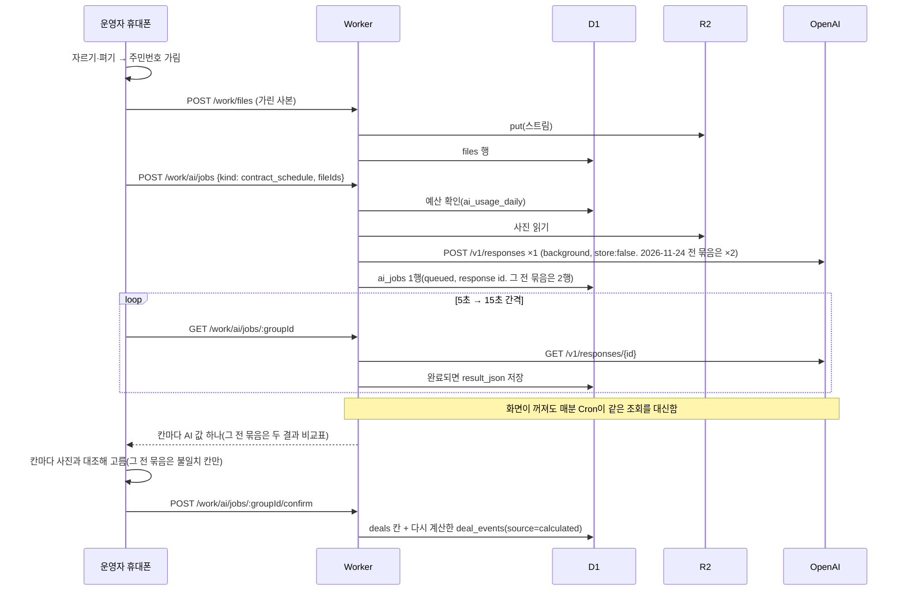
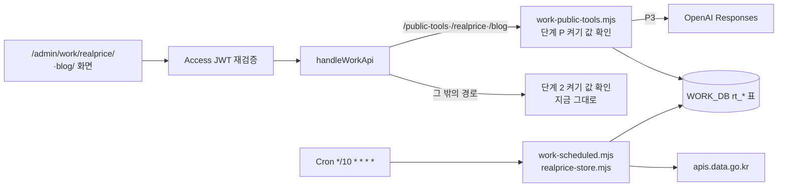

# 리더스시티 행복한부동산 중개업무 도구 설계서

| 항목 | 내용 |
|---|---|
| 문서 ID | HRE-WORKTOOLS-DESIGN-001 |
| 버전 | v0.91(2026-11-27 홍보물 짧은 글: 22.10절 '짧은 글' 줄 새로, 22.17절 홍보물 줄 끝 문장. 이전 판은 v0.90(2026-11-26 달력 넓은 칸 글자 띠 한 조각: 6.15절 '달력 화면' 줄. 이전 판은 v0.89(2026-11-26 달력 화면(C안, 화면 PR): 6.15절 '달력 화면' 줄·'1년 넘게 지난 날짜 막기' 줄의 화면 몫·시험 줄, 6.13절 근거 문장, 7.1절 도구 모음 줄·경로 표 `/admin/work/`·`/admin/work/calendar/`·`/admin/work/tasks/` 줄, 12.3절 'Google 캘린더 알림' 줄·'알림 안내' 줄. 이전 판은 v0.88(2026-11-26 거래 없는 일정을 휴대폰 캘린더 구독에 싣기(둘째 서버 PR): 6.15절 '휴대폰 캘린더 구독에 싣기'·'다음 PR'·시험 줄, 12.3절 '넣는 것' 줄·'거래 없는 일정 싣기' 줄. 이전 판은 v0.87(2026-11-26 1년 넘게 지난 날짜 막기(거래 없는 일정 작은 PR): 6.15절 '1년 넘게 지난 날짜 막기' 줄, 10.4절 `APPOINTMENT_DATE_EXPIRED`. 이전 판은 v0.86(2026-11-26 거래 없는 일정 서버(첫 PR, 0009·업무 API·달력 한 달 읽기·1년 자동 삭제, 화면·구독은 다음 PR): 6.15절 새로, 8.2절 `appointments`·`trash_rows`(0009), 8.3절 색인, 8.4절 0009 줄·묶음 번호 옮김, 8.7절 삭제 표·되살리기 순서·충돌 규칙, 8.9절 03:00 차례 1년 삭제, 10.2절 API 5줄·휴지통 `appointments` 칸, 10.4절 `SKIP_LIMIT_REACHED`, 11.6절 공개 문장 줄, 12.3절 구독은 둘째 PR 줄. 이전 판은 v0.85(2026-11-25 홍보 그림 '카톡·문자로 보내기'·'그림 복사'(화면만): 22.24절 새로, 22.10절 카드 그림 줄·미리보기 칸 줄, 22.11절 9번, 22.14절 시험 범위, 22.18절 거래 완료 알림 그림 줄, 22.19절 그림 줄·iPhone 줄에 한 문장. 이전 판은 v0.84(2026-11-25 계약서 AI '거래에 넣기' 뒤 장부 보수 줄 미리 채우기(화면만): 14.3절 '화면'에 한 줄, 6.12절 '보수 채워 넣기'·7.1절 경로 표 AI 결과 확인 줄에 한 문장. 이전 판은 v0.83(2026-11-25 손님 카드 '새 거래' 답을 잃었을 때 다시 읽어 확인(화면만): 7.1절 경로 표 손님 카드 줄에 한 문장. 이전 판은 v0.82(2026-11-25 글 초안 3편 같이 만들기·카드 그림 판 2 화면: 22.23절 새로, 22.9절 표 `POST /work/blog/drafts` 줄에 `count`·`{ draft, drafts }`, `GET /work/blog/drafts` 줄에 `set`, 22.10절 경로 표 글 초안 줄. D1 구조 변경 없음(묶음 표시는 `disclosure_json.set`). 이전 판은 v0.81(2026-11-25 거래 완료 소식 화면: 22.9절 표에 `GET /work/realprice/deal-complexes` 줄(단지 찾기, 매매·전월세 자료), 7.1절 관리자 틀 설명의 구역 9개 → 10개('거래 완료 소식')·알약 그림 22개 → 23개, 22.14절 시험 범위에 7a.20절. D1 구조 변경 없음. 이전 판은 v0.80(2026-11-25 글 초안 카드 배경 그림 3장 서버: 22.22절 새로(OpenAI Images API 한 번 동기 호출, 저장 없음), 22.9절 표에 `POST /work/blog/backgrounds` 줄, 8.8절 표·22.12절 감사 이름 `blog.background.create`, 22.14절 시험 번호. D1 구조 변경 없음. 이전 판은 v0.79(2026-11-25 거래 완료 소식 건수 읽기: 22.9절 표에 `GET /work/realprice/deal-count` 줄, 22.14절 시험 범위에 7a.18절. 이전 판은 v0.78(2026-11-25 글 초안 빈 머리말: 22.11절 2b번에 머리말만 있는 줄을 빈 칸으로 보고 빼는 규칙(`dropEmptyMemoHeads()`)을 적고 '머리말을 그대로 보낸다'는 말을 고침. 이전 판은 v0.77(2026-11-25 글 초안 글 성격 21가지·현장 메모 '빠르게 넣기': 글 성격을 7가지에서 21가지(묶음 넷)로 늘리고 메모 칸 위에 머리말 단추를 둠. 스레드 글자 수는 이모지를 UTF-8 바이트 수로 셈. 고친 곳은 7.1절 경로 표 글 초안 줄, 22.10절 경로 표 `sources` 줄, 22.11절 2a번(다시 씀)·2b번(새로)·6번 경고 줄·8번 한도 줄, 22.14절 시험 번호, 열린 질문의 스레드 글자 수 줄. `worker/` 파일·D1 구조 변경 없음. 이전 판은 v0.76(2026-11-25 글 초안 올릴 곳 넷: 인스타그램·스레드 글을 같은 호출에서 받고 카카오톡 글은 코드가 만듦. 고친 곳은 7.1절 경로 표 글 초안 줄, 22장 표 P3 줄, 22.10절 경로 표, 22.11절 5번(올릴 곳 꼴, 키 7개)·6번(검사 자리)·8번(올릴 곳 넷·복사 글·한도)·9번(주 단추 이름)·'보내는 것' 줄(지시문 6줄)·비용 줄, 22.14절 시험 번호. D1 구조 변경 없음. 이전 판은 v0.75(2026-11-25 글 초안 화면 닫아도 받기: 1분 예약이 열린 글 초안도 조회해 받아 둠. 고친 곳은 8.9절 표·1분 예약 문단, 14.5절, 16.1절 주석, DEC-WT-36에 2026-11-25 바뀜, 22.3절 켜기 값 줄, 22.7절·22.13절, 22.9절 결과 상태 `AI_WAIT_TIMEOUT`, 22.10절 경로 표, 22.11절 4번 다시 씀, 22.12절 로그 줄, 22.14절 시험 번호. D1 구조 변경 없음. 이전 판은 v0.74(2026-11-25 실거래가 대전 5개 구 넓히기: 22.21절 새로(D1 구조 8 `0008_realprice_regions.sql`, 구 코드 칸·받은 달 기본 키, 거래 ID, 색인을 더하지 않는 까닭, 받기 속도·예산, 화면 구 거르기·구 이름, 홍보물, 적용 순서·되돌리기, 로컬 D1 실측, 사용자 결정 원문 4개, 구 코드 다른 응답 막기 `RT_REGION_MISMATCH`), 22.4·22.7·22.9·22.10·22.13·22.16절의 동구 한 곳 기준 값에 바뀐 값 괄호. 이전 판은 v0.73(2026-11-25 실거래가 단지 상세 칸: 22.9절 API 표에 `GET /work/realprice/complex`, 22.10절 경로 표 두 줄, 22.20절 새로(서버 계산·화면·막힘·시험·알려진 한계). D1 구조 변경 없음. 이전 판은 v0.72(2026-11-24 홍보 종이 모양 고르기(보드 20번): 22.18절 7번(거래 완료 알림 모양 5가지·'가격 넣기'·대표 소개 그림·명함 모양 6가지)과 알려진 한계의 가격 줄, 22.19절 7번(매물 안내지 모양 5가지, 명시사항 표 20px 바닥), 22.18절 8번·22.19절 8번('문구 고치기', 사용자 답 2026-11-24 17:08:14 "문구도 수정할 수 있게 하면 안되나?")을 더함(사용자 답 2026-11-24 16:04:00 "어 그렇게 해"(거래완료 01·06·09·11, 가격표 01·06·08·10, 소개 01·06·10)·"아냐 그냥 만들어"(가격을 켤 때 허락 확인 칸 없음)·"지금 글꼴로 해", 16:19:51 "다 마음에 드는데 고를 수 있게 하면 안되나"(명함 6가지 모두), 15:35:59 질문 도구 답 "넣을지 고르게 (추천)"(가격)). 이전 판은 v0.71(2026-11-24 S2 다시 재기 문서 묶음(2026-11-24): 14.9절에 합계 검사 PR(#153) 운영 뒤 S2 3회 다시 재기 결과와 판정(계약서 경고 PR(#151) 그대로, 사용자 결정 2026-11-24 13:46:37 "1번, 합계 검사 넣어"의 1번("내일 S2를 3번 다시 재고 정하기: 3번 모두 맞으면 PR #151을 그대로 두고, 또 틀리면 되돌림")). 이전 판은 v0.70(2026-11-24 합계 검사 PR: 14장 계약서 재검사에 합계 검사(`contractSumWarning`, 계약금 + 중도금 + 잔금이 매매대금·보증금과 다르면 경고 맨 앞에 한 문장)와 결과 고르기 화면의 코드 경고 줄(⚠ 금액 확인·중도금 확인, `contractCodeWarningKind`)을 더함(사용자 결정 2026-11-24 13:46:37 "1번, 합계 검사 넣어"·13:52:38 "같이 넣어"). 이전 판은 v0.69(2026-11-24 지시문 줄인 뒤 측정 문서 묶음(2026-11-24): 14.9절·22.11절에 지시문 줄인 뒤(PR #148) 계약서·글 초안 전후 측정 줄, 14.9절에 계약서 경고 PR(#151) 뒤 S2 다시 재기 1회(판정 보류). 이전 판은 v0.68(2026-11-24 계약서 경고 PR: 14장 계약서 지시문 4번째 줄의 '흐림·가림·고친 흔적'을 날짜·금액 칸으로 좁히고, 사무소가 미리 가린 주민등록번호 검은 칸은 warnings에 적지 않게 함. 지시문을 줄인 뒤 가상 계약서 5장 모두에 '당사자 정보 일부가 가려짐' 경고가 붙었기 때문(사용자 결정 2026-11-24 13:10:58 "가 로 해"). 이전 판은 v0.67(2026-11-24 AI 지시문 줄이기 PR(2026-11-24): 14장 계약서 지시문 4줄·재검사(글 칸 잘라 받기, 중도금 5회 이상은 앞 4자리를 비우고 경고), 22장 글 초안 지시문 5줄·결과 잘라 받기·결과 글 연락처·호수 막기(사용자 결정 2026-11-24 11:38:55 "어 그렇게 해"). 이전 판은 v0.66(2026-11-24 계약서 AI '모두 AI 값으로' 단추 PR(2026-11-24): 14.3절 한 번 읽기 묶음 결과 고르기 줄 — 표·카드 위 '모두 AI 값으로'가 그대로 넣을 수 있는 읽은 칸만 AI 값으로 고르고, 직접 넣던 값은 화면 메모리에 두어 그 칸 '직접 넣기'를 다시 누르면 한 번 되살림(사용자 승인 2026-11-24 11:38:55 "넣어"). 이전 판은 v0.65(2026-11-24 AI 설정 결정 문서 묶음(2026-11-24): 가상 계약서 측정 뒤 한 번 읽기 결정(사용자 결정 2026-11-24 10:49:19 질문 도구 답 "한 번 읽기 (추천)") 반영, 5.3절 AI 켜기 판정 줄(켠 시각, 한 번 읽기 뒤 A 모델만·`aiWarnings` 빈 배열), 11.6절 계약서 AI(OpenAI) 공개 문장(승인, 처리방침 PR), 14.2절 모델·추론·사진 세부도·단가 칸과 교차 설정 1행(넣지 않음), 14.3절 두 번 읽기, 14.9절 예약 비용 다시 계산·한도, 15.4절 모델 표, 16.2절 Secret 표, DEC-WT-17 줄(사용자 결정 2026-11-24 09:03:17 질문 도구 답·09:06:44·09:23:15). 이전 판은 v0.64(2026-11-24 실거래가 홍보물 카드 새 모양 PR(2026-11-24): 22.10절 '새 모양' 줄 — 카드 모양 4가지(처음 기본)·4건까지 한 장(5건 3 + 2, 6건 3 + 3)·딱지 '▲ 신고가'와 오름 폭·카드에서 출처 상자와 받은 시각 뺌(글 4가지에는 남김)·상호 크게, 홍보물 화면·미리보기 칸의 모양 띠와 올릴 곳 단추 4개, 목록 체크칸. 이전 판은 v0.63(2026-11-24 계약서 AI 한 번 읽기 PR(2026-11-24): 14.2절 표의 `OPENAI_MODEL_CONTRACT_A`·`OPENAI_MODEL_CONTRACT_B` 줄과 한 번 읽기 구현 줄, 14.3절 흐름 그림·한 번 읽기 묶음·비용 미리 보기 1회 몫·결과 고르기 화면의 '값 고르기', 14.4절 2회째 스키마는 옛 묶음만, 14.5절 '한쪽만'은 옛 묶음만(운영자 결정 2026-11-24(대장 측정·날개-2 다시 채점: 가상 계약서 5건을 두 번씩 읽어 경고 칸을 뺀 날짜·금액·소재지 68칸이 10회 모두 맞았고 두 번 읽은 값이 한 번도 다르지 않았음. 사용자 결정은 2026-11-24 10:49:19 질문 도구 답 "한 번 읽기 (추천)")). DEC-WT-17·진행 체크리스트 7.6·7.7절 '켜기 전' 줄은 따로 고침. 이전 판은 v0.62(2026-11-24 부동산뱅크 자동 받기 실패 알림 PR(2026-11-24): 6.14절 '화면'에 '부동산뱅크 자동 받기' 줄(사용자 결정 2026-11-24 09:03:17 질문 도구 답 "GitHub 이슈 + 대시보드 경고 (Recommended)"). 이전 판은 v0.61(2026-11-24 AI 결과 30일 정리 PR(2026-11-24): 8.7절 보관 표·예외 2, 8.8절 감사 동작 `ai.expire`, 8.9절 Cron 문단, 휴지통 7일 만료·영구 삭제 때 AI 결과 지우기, 14.10절 약점 4 해결(대장 결정(사용자 원문 아님), ready 결과 30일은 사용자 결정 2026-11-24 00:23:46 질문 도구 답 "손대지 않은 결과도 30일 뒤 지움 (Recommended)"). 이전 판은 v0.60(2026-11-23 같은 차 직접 중도금 두 줄 경고 PR(2026-11-23): 14.3절 '화면' 확인 단계의 같은 차 직접 중도금 경고 줄, 14.10절 약점 18을 '받아들임'에서 '고침'으로(대장 결정(사용자 원문 아님)). 이전 판은 v0.59(2026-11-23 계약서 AI 화면 PR(B안, 2026-11-23): 14.3절 '화면', 14.5절 브라우저 폴링, 14.10절 약점 16 ~ 19, 7.1절 경로 표 두 줄, 10.2절 API 표 묶음 조회 `group.fileIds`, 4.3절 AI 작업 줄(사용자 결정 2026-11-23 22:03:49 질문 도구 답 "B안 별도 화면 (Recommended)"·"다섯 다 추천대로 (Recommended)"·"넣음 (Recommended)"). 이전 판은 v0.58(2026-11-23 계약서 AI 확정 서버 PR(2026-11-23): 14.3절 확정 규칙·비용 미리 보기, 6.7절 AI 확정 일정을 고치면 `manual`, 10.2절 API 표 확정·미리 보기 줄, 10.4절 `DEAL_CLOSED`, 8.8절 `ai.confirm`, 14.10절 약점 13 ~ 15, 4.3절 AI 작업 줄(사용자 결정 2026-11-23 22:03:49 질문 도구 답 "B안 별도 화면 (Recommended)"·"다섯 다 추천대로 (Recommended)"·"넣음 (Recommended)", G18 ~ G21은 대장 결정(사용자 원문 아님)). 이전 판은 v0.57(2026-11-23 실거래가 미리보기 칸 PR(D-3, 2026-11-23): 22.10절 오른쪽 미리보기 칸, 7.1·22장 경로 표 실거래가 줄(사용자 선택 2026-11-23 18:27:27 질문 도구 답 "이대로 구현 (Recommended)"(질문 "실거래가 화면 오른쪽 미리보기 칸(D-3) 시안대로 만들까요? (그림은 위 링크, 1221px 이상 PC만)")·"세로로 2장 (Recommended)"(질문 "미리보기 칸에 담은 거래가 4 ~ 6건이라 카드가 2장이 될 때는 어떻게 보일까요?")). 이전 판은 v0.56(2026-11-23 글 초안 카드 그림 PR(2026-11-23): 22.11절 9번 카드 그림, 7.1·22장 경로 표 글 초안 줄(사용자 선택 2026-11-23 19:20:10 질문 도구 답 "B 큰 숫자 인포그래픽 (Recommended)"(질문 "블로그 카드 5안 중 어느 것으로 만들까요? …")·"3장 한 벌 (Recommended)"(질문 "카드는 3장 한 벌(표지·단지 정보·현장에서 확인할 점)로 만들까요, 표지 1장만 만들까요?")). 이전 판은 v0.55(2026-11-23 글 초안 개선 PR(2026-11-23): 22.11절 단지 자료 보냄·길이·구성 지시·결과 새 꼴(소제목·현장에서 확인할 점)·대표 현장 메모 500자(사용자 선택 2026-11-23 18:23:56 질문 도구 답 "① 단지 자료 다 넣기 (Recommended), ② 길이·구성 지시 (Recommended), ③ 현장 메모 칸 늘리기"(질문 "글 초안을 어떻게 고칠까요? (여러 개 고를 수 있습니다)", 앞서 18:23:00 사용자 "근데 초안이라는게 원래 좀 뭔가 부실한 것 같지?")). 이전 판은 v0.54(2026-11-23 매출장부 빈 새 줄·줄 끝 지우기 PR(D-2b, 2026-11-23): 6.12절 빈 새 줄·줄 끝 지우기·한글 조합 키, 7.1절 매출장부 줄, 추론 수준 `xhigh`(사용자 선택 2026-11-23 18:19:39 질문 도구 답 "공용 값을 바로 xhigh로"(질문: "글 초안의 추론 수준을 최고(max) 바로 아래(xhigh)로 낮추는 방법을 골라 주세요. 지금은 글 초안과 계약서 AI가 설정 값 하나를 함께 씁니다.")). 이전 판은 v0.53(2026-11-23 관리자 대시보드 A안 PR(2026-11-23): 6.14절 새로(관리자 대시보드 읽기 API·화면), 10.2절 `/work/dashboard` 줄을 실제 응답으로. 이전 판은 v0.52(2026-11-23 '계약 일정' 구독 칸 알림 안내 PR(2026-11-23): 12.3절 알림에 Google 캘린더 확인 사실, 알림 안내를 접힌 상자 두 단계로(사용자 승인 2026-11-23 14:30:33 "셋 다 추천대로"(질문 3 "'계약 일정' 화면의 Google 캘린더 안내 문장을 두 단계(알림 넣기·동기화 켜기)로 고쳐도 될까요?")). 이전 판은 v0.51(2026-11-23 '도구 모음' 이름·'대시보드' 고정 알약 PR(2026-11-23): 7.1절 아래 단계 맨 위 이름 '업무 도구 처음' → '도구 모음'(사용자 결정 2026-11-23 16:34:06 직접 친 말 "업무 도구 처음 이라는 단어는 좀 이상한거 같은데", 16:34:43 질문 도구 답 "도구 모음 (Recommended)"), 980px 이상 아래 단계 줄 맨 앞 '대시보드' 고정 알약(사용자 결정 2026-11-23 16:34:56 직접 친 말 "도구 모음 눌렀을때 대시보드 칸이 없어져서 보기 힘든 것 같아", 16:36:32 질문 도구 답 "알약 줄 맨 앞에 '대시보드' 고정 (Recommended)"), 경로 표 `/admin/work/` 이름. 이전 판은 v0.50(2026-11-23 매출장부 표 위 한 줄 PR(D-2a2, 2026-11-23): 6.12절에 1221px 이상 + 마우스의 표 위 한 줄, 7.1절 매출장부 줄(사용자 승인 2026-11-23 14:30:33 "셋 다 추천대로"(질문 2 "표 위쪽은 다음 PR에서 고쳐도 될까요?"), 11:34:13 시안 "이대로 구현 (Recommended)"). 이전 판은 v0.49(2026-11-23 매출장부 표 안에서 바로 고치기 PR(D-2a, 2026-11-23): 6.12절에 1221px 이상 표 안에서 바로 고치기 규칙(칸마다 저장·부가세 함께 바꾸기·입금액과 입금일·409·404·되돌리기 20단계·기억했다 이어 하기·합계 줄과 달 줄), 합계 응답에 `receivableWon` 1칸(D1 구조 그대로), 7.1절 매출장부 줄, 10.2절 합계 응답(사용자 승인 2026-11-23 11:01:24 질문 도구 답 매출장부 "모양 + 표 안에서 바로 고치기", 11:34:13 시안 "이대로 구현 (Recommended)"·부가세 "10%였던 줄만 함께 바꿈 (Recommended)"). 이전 판은 v0.48(2026-11-23 관리자 새 겉모양 PR(D-1, 2026-11-23): 7.1절 화면 틀을 왼쪽 고정 목록에서 화면 위 알약 줄로(모든 폭), '전체 메뉴' 창을 PC도 씀, 관리자만의 색 값(`--ds-*` 8개 값·`--ad-*` 11개), 지금 화면 표시, 마우스를 쓰는 1221px 이상 PC의 13px·36px 예외(사용자 승인 2026-11-23 11:12:45 직접 친 말 "중개날개에 가깝게"·(PC 표 13 ~ 14px에) "어 그렇게 해", 11:34:13 질문 도구 답(시안 "이대로 구현 (Recommended)" — 선택지 설명: 각 PR은 시험·원문 대조·CI가 통과하면 병합, PC에서 누르는 곳 36px도 함께 승인. 적용 범위 "관리자 화면 전체를 한 번에")). 매출장부 합계 줄·달 묶음 줄은 다음 PR. 이전 판은 v0.47(2026-11-23 AI 작업 서버 PR(2026-11-23), 단계 4 첫 PR(계약서 → 일정의 서버): 4장 파일 표의 AI 줄, 5.3절 AI 켜기 판정, 8.8절 AI 감사, 8.9절 예약 2개, 10.2절 `/work/ai/jobs` 줄, 10.4절 AI 오류 코드, 14.2 ~ 14.5·14.9·14.10절 구현 묶음과 알려진 약점, 16.1·16.2절(사용자 승인 2026-11-23 10:41:39 질문 도구 답(AI 서버 PR "통과하면 병합 (Recommended)" — 조건: 날개-2의 사본 시험·문서·원문 대조와 CI 통과. AI를 켜는 승인은 아님)). 이전 판은 v0.46(2026-11-23 계약서 사본 가림 화면 PR(K-b, 2026-11-23): 9.3절 `X-Work-Masked` 뜻, 경로 표 손님 카드 줄, 11.6절 처리방침 6항 구절, 13.2절 가림 화면 묶음·13.3절 펴기 없음·13.4절 ①, 18장 DR-09(사용자 승인 2026-11-23 10:22:02 질문 도구 답(가림 화면 "이대로 구현해 올림 (Recommended)", 가린 자리 확인 "사진 전체를 크게, 끌어서 봄 (Recommended)", 사본 칸 "접어 둠 (Recommended)"), 사용자 승인 2026-11-23 11:01:24 질문 도구 답(시안과 달라진 2곳 — 확대 배율, 닫기 전 확인 — "두 곳 모두 이대로 올림 (Recommended)")). 이전 판은 v0.45(2026-11-23 QR PR(2026-11-23): 12.3절 둘째 휴대폰 줄·'QR로 넘기기' 묶음, 17장 구독 주소 시험 줄, 18장 DR-04(사용자 승인 2026-11-23 10:22:02 질문 도구 답(QR 화면 "이대로 올림 (Recommended)")). 이전 판은 v0.44(2026-11-23 얼굴 가려서 내보내기(M-b): 13.4절 만드는 방식(블록 = max(16px, 네모 짧은 변 ÷ 5)을 올림한 값, 네모 그리기 부품 `openMaskEditor`)·화면에서 정한 것·알려진 한계 4가지, 경로 표 손님 카드 줄(사용자 결정 2026-11-23 08:55:04 질문 도구 답("나안: 화면 전체 (Recommended)"), 사용자 승인 2026-11-23 09:51:36 질문 도구 답(M-b "이대로 올림 (Recommended)", 모자이크 굵기 "더 굵게: 5칸 (Recommended)")). 이전 판은 v0.43(2026-11-23 계약서 사본 서버 PR(K-a, 2026-11-23): 9.3절 머리말 표·여는 범위(계약서 사본은 거래에만, 가림 확인, 한 거래 10장, 미리보기 없음)·미리보기·보관 줄, 8.7절 거래 파일 순서와 삭제 문장 수, 9.6절, 10.2절 손님 카드 `deals[].files`·미리보기 줄, 10.4절 오류 코드, 12.3절 속도 제한 HEAD 확인(사용자 결정 2026-11-23 09:37:40 질문 도구 답(계약서 사본 "거래에 붙임 (Recommended)", 미리보기 "만들지 않음 (Recommended)"), 사용자 승인 2026-11-23 09:51:36 질문 도구 답(K-a "통과하면 병합 (Recommended)")). 이전 판은 v0.42(2026-11-23 단계 3 화면 PR(C-b): 7.1절 미리 그리기 문단·경로 표 계약 일정 줄, 10.2절 HEAD 줄, 12.3절 화면 PR에서 정한 것·취소한 거래 일정 제외·HEAD·속도 제한 규칙·Workers 로그 확인, 15장 캘린더 구독 공개 문장(사용자 결정 2026-11-23 09:41:26 질문 도구 답("'사무소 대표와 직원의 휴대폰' (Recommended)")), 17장 구독 주소 시험 줄, 18장 DR-04(사용자 결정 2026-11-23 08:55:04 질문 도구 답(구독 칸 자리 "가안: 맨 아래 칸 하나 (Recommended)", 취소 거래 "뺌 (Recommended)"), 사용자 승인 2026-11-23 09:41:26 질문 도구 답(구독 화면 "이대로 올림 (Recommended)", 둘째 휴대폰 "지금대로, QR은 다음 PR (Recommended)")). 이전 판은 v0.41(2026-11-23 Workers Paid 전환과 운영 실측: 1장 결론 1, 8.10절 유료 전환, 10.3절 `CHECKSUM_MISMATCH`(R2 `put()` 예외 실측), 15.1절 CPU 줄, 16.1절 `limits` 메모, 18장 DR-01, 20장 DEC-WT-12(2026-11-23 09:10:55 사용자 결정(질문 도구 답 "지금 유료로 바꿈 (Recommended)")). 이전 판은 v0.40(2026-11-22 단계 3 세부 결정: 7장 화면 표, 12.3절 구독 주소(사무소 1개·일정 이름·할 일·알림 전날 18:00·'계약 일정' 화면), 13.4절 모자이크 내보내기, 18장 DR-04, 19장 DEC-WT-42(사용자 결정 2026-11-22 18:41:13 질문 도구 답(구독 주인 "사무소 주소 1개를 같이 씀 (Recommended)", 일정 이름 "종류 + 거래 제목, 할 일도 (Recommended)". 질문 글의 나머지 세부(알림 전날 18:00, 구독 만들기는 '계약 일정' 화면, 모자이크는 '가려서 내려받기·공유'만)도 추천대로)), 8.10절 D1 읽기 정정·쓰기량 두 숫자, 구독 서버(C-a)에서 정한 것: 2장 라우팅 줄, 10장 API 표 `GET /work/calendar-feeds`, 12.3절 구현 값·WAF 10초 5회·Workers Logs 확인·결정 대기 1건, 16장 Secret 줄·롤백 표. 이전 판은 v0.39(2026-11-22 단계 2 남은 구현 묶음(2026-11-22)와 D1 무료 한도 사고: 7.2절 로그인 만료·Access 302 처리(공용 업무 클라이언트 3개), 8.7절 감사 로그 자동 삭제 구현, 8.8절 쓰기량, 8.9절 03:00 차례에 감사 로그 3년 삭제·Cron 시각, 8.10절 D1 무료 한도 사고와 원격 대량 쓰기 규칙, 18장 DR-17. 이전 판은 v0.38(2026-11-22 처리방침 사진 문장: 11.6절(사용자 지시 2026-11-22 18:04:52 "왜 안켜 켜"(사진·AI 글 초안), D17). 이전 판은 v0.37(2026-11-22 업무 도구 켬 뒤: 8.10절 월간 백업 담당·날짜(사용자 결정 2026-11-22 17:18:35 질문 도구 답 "대장이 매월 첫 평일에 받음 (Recommended)"), 보관 장소 문장을 사실대로, 복원 훈련 결과와 운영 복원 절차(time-travel restore 자동 yes 위험). 이전 판은 v0.36(2026-11-22 단계 2 처리방침 수정: 11.6절 공개 문장(사용자 결정 2026-11-22 17:05:58 질문 도구 답 4개(D2 "처리방침 공개로 갈음", D3 "가능 — 문장 그대로", D6 "남김을 그대로 적음", 나머지 9개 "모두 추천대로")). 이전 판은 v0.35(2026-11-22 단계 2 바로 찍기 화면(F-b): 경로 표 손님 카드 줄 '사진' 칸·휴지통 줄 '사진', 하단 고정 단추 '사진 찍기', 13.1절 원본은 늘 JPEG(0.9 → 0.8)·미리보기 WebP(0.8 → 0.6) 또는 JPEG·확인 칸 그림, 알려진 한계(사용자 결정 2026-11-22 15:23:20 질문 도구 답(긴 변 4096px·한 장 10MB, 작은 미리보기 + 누르면 원본, 신분증 안내 + 단추 이름에 확인, 보관은 손님 기록과 같게), 사용자 선택 2026-11-22 15:39:08 질문 도구 답(시안 "이 시안대로 (Recommended)", 하단 막대 "B. 사진 찍기 더함 (Recommended)", 한 번 장수 "10장 (Recommended)", 휴지통 이름 "'사진 · 11월 22일 14:05 올림' (Recommended)")). 이전 판은 v0.34(2026-11-22 단계 2 파일 서버(바로 찍기 F-a): 8.2절 `file`·`files` 쓰기 시작, 8.7절 손님 삭제 줄 고침(R2는 휴지통 동안 그대로)·파일 삭제 줄·영구 삭제 실패 처리, 9.2 미리보기 키, 9.3 손님에게만·여는 종류·통째로 받아 검사한 뒤 저장·메타데이터 검사, 9.4 미리보기, 9.6, 10.2 API, 11장 오류 코드, 켜기 값 `WORK_FILES_ENABLED`(사용자 결정 2026-11-22 15:23:20 질문 도구 답(크기 "긴 변 4096px·한 장 10MB (Recommended)", 보이기 "작은 미리보기 + 누르면 원본 (Recommended)", 신분증 "안내 + 단추 이름에 확인 (Recommended)", 보관 "손님 기록과 같게 (Recommended)")). 이전 판은 v0.33(2026-11-22 단계 2 휴지통 화면(R-b): 7.1절 메뉴 밖 화면에 휴지통(손님 목록 위 고리·업무 도구 처음 바로가기)과 미리 그리기, 경로 표 `/admin/work/`·`/admin/work/customers/` 줄과 `/admin/work/trash/` 줄, 8.7절 삭제 화면 문구를 화면 4곳에 넣음(사용자 선택 2026-11-22 14:31:26 질문 도구 답(휴지통 자리 "A. 손님 화면 고리 + 처음 화면 바로가기 (Recommended)"), 사용자 선택 2026-11-22 14:42:41 질문 도구 답(휴지통 화면 "이 시안대로 (Recommended)")). 이전 판은 v0.32(2026-11-22 단계 2 휴지통 서버(R-a): 8.2절 `trash_batches`·`trash_rows`(0007), 8.3 색인, 8.4 0007·구조 백업 7일 규칙, 8.7절 삭제가 휴지통을 거침·되살리기 규칙·영구 삭제, 8.8 `trash.*`, 8.9 휴지통 만료, 8.10 구조 백업, 9.6, 10.2·10.4, 18장 DR-23, 20장 DEC-WT-41(사용자 결정 2026-11-21 02:39:45 질문 도구 답(휴지통 "가. 지운 자료를 따로 옮겨 둠 (Recommended)", 나머지 "모두 추천대로 (Recommended)"), 사용자 결정 2026-11-22 14:31:26 질문 도구 답(휴지통 자리 "A. 손님 화면 고리 + 처음 화면 바로가기 (Recommended)", 구조 백업 "A. 적용 확인 7일 뒤 지움 (Recommended)", 손님 삭제 요청 "A. 바로 영구 삭제 (Recommended)", 처리방침 문장 "A. 고침 (Recommended)")). 이전 판은 v0.31(2026-11-22 단계 2 할 일 화면(T-b): 7.1절 아래 단계 메뉴에 '할 일'('업무 도구 처음' 바로 뒤, 묶음 제목 없는 첫 칸, 지금 11개), 미리 그리기 목록에서 뺌·첫 화면 '오늘 할 일' 칸은 보인 뒤에 부름, 경로 표 `/admin/work/` 줄과 `/admin/work/tasks/` 줄(사용자 선택 2026-11-22 13:22:11 질문 도구 답(메뉴 "A. 업무 도구 처음 옆 (Recommended)", 화면 "이 시안대로 (Recommended)", 첫 화면 머리·사용법 "할 일 화면 PR에서 같이 고침 (Recommended)")). 이전 판은 v0.30(2026-11-22 단계 2 할 일 서버(T-a): 6.13절 할 일·반복 규칙 새로, 8.2절 `tasks` 표, 8.3절 색인 2개, 8.4절 `0006_tasks.sql`, 8.7절 손님·거래 삭제에 할 일과 할 일 삭제, 8.8절 `task.*`, 10.2절 할 일 API 4개와 삭제 응답 `deleted.tasks`, 20장 DEC-WT-40(사용자 2026-11-21 11:15:11 질문 도구 답(반복 "추천안대로 (Recommended)", 거래 삭제 "함께 지움 (Recommended)", 범위 "작게 시작 (Recommended)")). 이전 판은 v0.29(2026-11-21 단계 2 매출장부 화면(L-b): 7.1절 아래 단계 메뉴에 '매출장부'(손님 바로 뒤, 지금 10개)와 묶음 제목 3개(사용자 선택 2026-11-21 03:09:45 "B. 손님 옆 + 묶음 제목 3개 (Recommended)"), 미리 그리기 목록에서 뺌, 경로 표에 `/admin/work/ledger/`와 손님 카드 거래 칸의 장부 칸(사용자 선택 2026-11-21 03:09:45 "이 시안대로 (Recommended)"). 6.12절 보수 채워 넣기는 주택만·'미입금만' 연도 규칙·입금·미입금 부가세 포함 표시, 11.5절 매출장부 CSV(수식 막기·BOM·CRLF·최대 40쪽·감사), 8.8절 `export.ledger`, 10.2절 `POST /work/ledger/export`. 이전 판은 v0.28(2026-11-21 단계 2 매출장부 서버(L-a): 6.12절 매출장부 계산(장부 줄·보수 채워 넣기·경고와 상한 비교 범위·미입금·합계 기준일·달별 합계)을 새로 쓰고, 8.2절에 `ledger_entries` 표와 설명, 8.3절 색인 2개, 8.4절 `0005_ledger.sql`(구조 번호 5)과 적용 순서, 8.7절 손님·거래 삭제의 장부 줄 연결 끊기·장부 줄 삭제 줄·보유 표 '매출장부 줄', 8.8절 감사 동작 `deal.list`·`ledger.list`·`ledger.view`·`ledger.delete`, 10.2절 `GET /work/deals`·장부 경로 5개와 손님·거래 삭제 응답 `kept.ledger`, 10.4절 경고는 오류가 아님, 20장 DEC-WT-37 ~ 39(사용자 결정 2026-11-21 02:39:45). 휴지통 몫(8.7절 머리 표시·9.6절·`trash_*` 표·휴지통 경로)은 휴지통 PR까지 넣지 않음. 이전 판은 v0.27(2026-11-21 단계 2 손님 화면(PR #98): 7.1절에 아래 단계 메뉴 '손님'(업무 도구 처음 바로 뒤, 지금 9개)·손님 카드와 메모 창고는 메뉴에 넣지 않음·미리 그리기(prerender) 목록에서 뺌을 적고 경로 표 세 줄을 고침. 8.8절 감사 표에 손님 카드의 거래별 일정은 `deal.view`를 따로 남기지 않음을, 10.2절 `GET /work/customers/:id`에 거래별 일정 `deals[].events`와 메모 50개 한도를, `DELETE /work/customers/:id` 응답에 `kept.notes`를 보탬. 이전 판은 v0.26(2026-11-21 시험 항목 범위를 TK-108까지: 테스트 체크리스트 v0.25의 명시사항 칸 밀림 화면 시험 TK-107·TK-108). 이전 판은 v0.25(2026-11-21 하루 끝: 22.19절 2번 분양권 잠금 줄에서 매일 바뀌는 매물 건수를 빼고, 22.18절 머리말에 매물 안내지·비교표가 22.19절에 있다고 적음. 이전 판은 v0.24(2026-11-21 단계 P 매물 안내지·비교표(보드 45번 D): 운영자 결정 2026-11-20 23:32:49 "관리자 화면에서만"·23:41:16 "A 매물 종이"·"만들 때마다 넣고 저장 안 함"·"넣지 않기", 2026-11-21 00:08:46 "같은 종류·거래끼리만"과 00:08:46 병합 승인을 22.19절(범위와 경계·고르기·명시사항 칸 공용 파일 `work-disclosure-fields.ts`·그림 글·그림과 인쇄·알려진 한계)로 보태고, 7.1절 경로 표에 `/admin/work/listing-paper/`, 22.1절 홍보 종이 줄, 22.14절 시험 범위에 TK-94 ~ TK-106. 같은 판에서 2026-11-20 23:32:49 운영자 결정 "고치기"로 기획서 WT-P-05 근거 줄을 고친 것을 22.18절 1번에 반영하고 6번의 '확인 필요' 줄을 지움. D1 구조 변경 없음(구조 번호 4 그대로). 이전 판은 v0.23(2026-11-20 단계 P 홍보 종이(보드 45번 C): 운영자 결정 2026-11-20 18:09:06(거래 완료 알림 "① 가격 빼고 달·면적 흐리게"·명함 "A 흰 종이")과 18:33:04 답(병합·올리는 때 안내 한 줄·그림에서만 ㎡ 간격)을 22.18절(범위와 경계·거래 완료 알림·명함 인쇄·명시사항 한 곳 `ad-disclosure.mjs`·카드 공통 그리기 `work-card-draw.ts`·알려진 한계)로 보태고, 7.1절 경로 표에 `/admin/work/paper/`, 22.1절 표에 홍보 종이 줄, 22.10절 파일 줄에 명시사항·그리기 공통 파일, 22.14절 시험 범위에 TK-83 ~ TK-93. D1 구조 변경 없음(구조 번호 4 그대로). 이전 판은 v0.22(2026-11-20 하루 끝: 22.15절 P3 적용 순서에서 원격 D1 백업을 따로 된 단계 ③으로 빼고(만들어진 파일 이름·크기 확인 뒤 다음 단계), 2026-11-20 `0004` 적용 때 백업을 빠뜨린 일을 적음. 단계 번호 ① ~ ⑨로 다시 매김. 8.4절 0002 문장에 0003·0004 원격 적용과 다음 번호 `0005_*.sql`. 이전 판은 v0.21(2026-11-20 단계 P 실거래가 거래 흐름(보드 63번): 운영자 결정 2026-11-20 17:13:57(권하는 조합·앞선 최고 기준·12개월·공유 링크는 나중)과 17:59:25 병합 승인을 22.17절(묶음·거래마다 계산·`GET /work/realprice/insights`·읽는 문장·읽기 실측 1,378 ~ 1,700행·부르는 곳과 화면·알려진 한계)로 보태고, 22.9절 표에 `insights` 줄과 `RT_READ_BUDGET` 줄, 22.14절 시험 범위에 TK-69 ~ TK-82. D1 구조 변경 없음(구조 번호 4 그대로). 이전 판은 v0.20(2026-11-20 단계 P AI 블로그 글 초안 P3: 운영자 결정 2026-11-20 13:18:32 글 성격 7가지·15:33:57 착수·15:36:44 앱 AI 한도 처음 값·15:51:54 시안 결정 4가지를 22.1·22.2·22.3·22.7·22.9·22.11·22.12·22.14·22.15·22.16절과 14.9절 P3 줄에 반영. 22.11절 SQL을 실제 `0004_blog_drafts.sql`과 같게, 22.3절 `WORK_BLOG_ENABLED`의 "보조 폴링"을 지우고(DEC-WT-36) 22.15절 P3 적용 순서를 "켜기 → 화면에서 한도 저장"으로 고침. 이전 판은 v0.19(2026-11-20 단계 0 보강 중도금 여러 번: 6.7절 표·"중도금 여러 번"(최대 3번, 이름·일정 종류, 오류, 단계 2는 한 칸 그대로, 빈 칸 뒤 차수 막기, 알려진 한계 1개·잔금 순서), 6.8절 UID 줄. 이전 판은 v0.18(2026-11-20 단계 0 보강 중개보수 영수증: 6.11절(입력 3칸·저장하지 않음·출력 3가지·항목과 고정 문구·민감 문자열 검사·법령 근거·현금영수증 의무). 이전 판 변경은 진행 체크리스트 9장)))))))))))))))))))))))))))))))))))))))))))))))))))))) |
| 작성 기준일 | 2026-11-16 |
| 문서 상태 | 승인(2026-11-16). 검토 이력은 진행 체크리스트 3.2와 git 이력 참고. v0.3 ~ v0.11 변경은 진행 체크리스트 9장. v0.11의 22장과 "단계 P" 표시 줄(2026-11-19 보탬)은 2026-11-19 09:13:09 운영자 조건부 승인, PR #64(조건: 남은 보탬 반영·CI 통과 뒤 병합) |
| 대상 | 관리자 화면 `/admin/work/` 아래 업무 도구와 같은 Worker의 `/api/admin/v1/work/*` API. 2026-11-19부터 단계 P 공개 자료 도구(실거래가 탭·AI 블로그 글 초안, 22장) 포함 |
| 기준 기획서 | `리더스시티 행복한부동산 중개업무 도구 기획서.md` (HRE-WORKTOOLS-PLAN-001) |
| 결정 기록 | `docs/adr/ADR-011-private-work-data-d1-r2-openai.md` |
| 진행 관리 | `리더스시티 행복한부동산 중개업무 도구 개발 진행 체크리스트.md` |
| 시험 기준 | `리더스시티 행복한부동산 중개업무 도구 테스트 체크리스트.md` |
| 기존 구조 | Astro 정적 사이트 + Cloudflare Workers Static Assets + 동일 Worker 관리 API(ADR-004) |
| 작성 | 설계·조사 담당 세션(날개-1) |

> 이 문서는 2026-11-16 운영자가 정한 방향을 실제 구현 가능한 수준으로 구체화한다. 기획서가 "설계서가 정한다"고 넘긴 항목(화면 경로·메뉴 이름, 접근자 제한 구현, 알림 방식 추천, 긴 AI 응답 다시 받기, D1·R2 지역·백업, 보유기간 제안값)은 이 문서가 정한다. 운영자 결정이 필요한 항목은 20장 "결정 대기"에 모았다.
>
> 법령 관련 값은 2026-11-16에 국가법령정보센터 원문을 브라우저로 직접 열어 확인했다. 개발 요구사항일 뿐 최종 법률 판단을 대신하지 않는다. 플랫폼 한도와 요금은 공식 문서 확인일과 함께 15장에 적었고, 구현 시점에 다시 확인한다.
>
> 공개 저장소이므로 이 문서에는 비밀값, Cloudflare 계정 ID, 실제 손님 정보를 넣지 않는다. 사람·금액·주소·계좌 예시는 모두 가상 값이다.
>
> 2026-11-19 보탬: 단계 P(실거래가 탭·AI 블로그 글 초안, 기획서 7.6절)는 22장에 따로 적었다. 앞 장 번호를 바꾸지 않으려고 맨 끝에 덧붙였고, 앞 장에는 22장으로 가는 짧은 줄만 넣었다. 단계 P 설계에서 새로 나온 운영자 결정은 20장 DEC-WT-31 ~ 36이다(2026-11-19 09:13:09 모두 추천안으로 결정 완료).

---

## 1. 핵심 결론

### 1.1 한 문단 요약

업무 도구는 지금 운영 중인 Worker 하나(`leaders-city-happy-realty`)에 붙인다. 단계 0은 저장 없이 브라우저에서만 계산한다. 단계 2부터 손님·메모·일정은 Cloudflare D1, 사진·녹음·문서는 비공개 R2 버킷에 둔다. 모든 API는 `/api/admin/v1/work/` 아래에 두고 기존 Access JWT 재검증·허용 이메일 2개·Origin·CSRF 검사를 그대로 쓴다(운영자 결정: 2명 모두 사용). 그 대신 보기·수정·삭제·내보내기·AI 호출마다 작업한 이메일을 D1 감사 로그에 남긴다. AI는 Worker가 OpenAI API를 SDK 없이 직접 `fetch`로 부르고, 긴 추론은 background 모드와 폴링으로 처리해 휴대폰 화면이 꺼져도 결과를 잃지 않게 한다.

### 1.2 이 문서가 확정하는 항목

| 기획서에서 넘긴 항목 | 이 문서의 결정 | 위치 |
|---|---|---|
| 화면 경로·메뉴 이름 | 메뉴 "업무 도구", 경로 `/admin/work/` 아래 12개 화면 | 7장 |
| 접근자 제한 구현 | 운영자 결정(2026-11-16 "3. 2명 모두")대로 기존 허용 이메일 2개를 그대로 쓴다. 추가 이메일 제한은 넣지 않고, 작업자 이메일을 감사 로그에 남긴다 | 5장, 8.8절 |
| 알림 방식 | 비교 후 "캘린더 구독 주소"를 추천했고, 운영자가 추천대로 정했다(DEC-WT-05, 2026-11-17 13:55:29). 거래별 `.ics` 내려받기도 함께 둔다 | 12장 |
| 긴 AI 응답 다시 받기 | OpenAI background 모드(`store:false`) + 브라우저 폴링 + 1분 Cron 보조 폴링 | 14.5절 |
| D1·R2 지역·백업 | 위치 힌트 `apac`(보장 아님), D1 Time Travel + 운영자 내보내기, R2는 삭제 지연 없음 | 8.10절, 9.6절 |
| 보유기간 값 | 운영자 결정(DEC-WT-04, 2026-11-17 14:02:11 "널널안 적용"): 손님 기록은 사용자가 직접 지울 때까지 보관하고 1년마다 정리 안내, 감사 로그 3년 뒤 자동 삭제. PC 백업 최근 3개·AI 초안 30일은 제안값 그대로 | 8.7절 |
| 앱의 법정 보존 역할 | 운영자가 추천대로 정했다(DEC-WT-08, 2026-11-17 13:55:29): A. 이 앱은 법정 보존 수단이 아니고 주민등록번호를 가린 업무용 사본만 둔다 | 11.4절 |
| 얼굴 모자이크 방식 | 운영자 결정(DEC-WT-09, 2026-11-17 14:02:11): 앱 안에 보관하는 사진은 얼굴을 가리지 않고, 밖으로 내보낼 때만 사용자가 수동 모자이크로 가린다. 자동 인식 라이브러리는 넣지 않는다 | 13.4절 |
| 단계 P의 켜기 값·인증키 이름·자료 받기·공개 실거래 자료 표·단지 연결·감사 범위·화면(기획서 7.6절, 2026-11-19 보탬) | 단계 2와 따로 켜고 같은 D1에 공개 자료 표를 둔다. Cron 하나가 대전 동구 자료를 한 번에 1개월씩 받아 달 단위로 차이만 반영한다(2026-11-19 09:13:09 승인, PR #64. 2026-11-25 0008부터 대전 5개 구·한 번 12개, 22.21절) | 22장 |

### 1.3 가장 큰 위험 3가지

1. **Workers 무료 플랜의 요청당 CPU 10ms.** 단계 4에서 사진을 base64로 바꿔 OpenAI에 보내는 작업과 음성 변환 Cron은 10ms를 넘을 가능성이 높다(추정). 운영자가 Workers Paid(월 5달러)를 승인했다(DEC-WT-12, 2026-11-16 "2. 5달러로 해"). 지금 전환하지 않고, 단계 2 운영 반영 전 CPU 실측 뒤 필요하면 다시 알린다(늦어도 단계 4 착수 전). 2026-11-23 09:10:55 사용자 결정(질문 도구 답 "지금 유료로 바꿈 (Recommended)")으로 Workers Paid로 바꿨다(10MB 사진 올리기 CPU 75 ~ 84ms(무료 한도 10ms의 약 8배, 테스트 T2-82)와 2026-11-22 D1 하루 한도 사고).
2. **관리자 쓰기 활성화 조건이 GitHub 설정에 묶여 있다.** 지금 `isAdminWriteEnabled()`는 GitHub 토큰이 있어야 참이 된다. 업무 도구는 GitHub와 무관하므로 별도 활성화 조건(`isWorkToolsEnabled()`)과 CSRF 발급 경로를 만든다(5.3절). 이를 놓치면 GitHub 토큰 장애가 손님 자료 저장까지 막는다.
3. **삭제해도 백업에 남는다.** D1 Time Travel은 무료 7일, 유료 30일 동안 과거 시점을 복원할 수 있다. 손님 삭제 뒤에도 그 기간만큼 데이터가 복원 가능한 상태로 남으므로 처리방침에 적어야 한다(8.10절, 11.6절).

---

## 2. 범위

### 2.1 단계별 범위

| 단계 | 내용 | 저장 | 서버 API | 외부 전송 |
|---|---|---|---|---|
| 0 | 중개보수 계산기, 안내 문자 만들기, 계약 일정 계산 + `.ics` | 없음 | 없음 | 없음 |
| 1 | 이 설계서·기획서·ADR-011·체크리스트 승인 | — | — | — |
| 2 | 손님·메모·거래·일정·파일 보관, 검색, 내보내기, 삭제 | D1 + R2 | `/api/admin/v1/work/*` | Cloudflare |
| 3 | 알림(캘린더 구독 주소, DEC-WT-05), 얼굴 모자이크(내보낼 때만 수동, DEC-WT-09) | D1 | 구독 주소 1개 추가 | Cloudflare |
| 4 | 계약서 사진 → 일정, 등기부 → 약정금 문자, 녹음 → 글자 → 요약, 사진·메모 글자 검색, 사진 제목 일괄 | D1 + R2 | AI 작업 API | Cloudflare, OpenAI |
| P | 실거래가 탭·홍보물, AI 블로그 글 초안(2026-11-19 보탬, 22장). 단계 2 ~ 4를 기다리지 않고 먼저 만든다(DEC-WT-18) | D1(공개 실거래 자료·글 초안만, 손님 자료 없음) | `/api/admin/v1/work/public-tools/session`·`/work/realprice/*`·`/work/blog/*` | 공공데이터포털(Worker Cron만), OpenAI(글 초안) |

단계 0은 저장과 서버 API가 없으므로 단계 1 승인 전에도 이 설계서 6장 규칙대로 먼저 만들 수 있다(기획서 7.0절과 같음).

### 2.2 만들지 않는 것

- 소장님끼리 쪽지, 팀 공유, 실시간 공유
- 공유 링크(넣지 않음, DEC-WT-03 2026-11-17 13:55:29 결정). 두 분만 쓰므로 필요 없고, 링크가 새면 손님 정보가 노출된다
- 주민등록번호 저장, 신분증 사진 업로드
- 가리지 않은 계약서 원본 보관(11.4절 A안, DEC-WT-08 결정)
- 브라우저에서 OpenAI 직접 호출, 95번 서버(comibot) 경유 호출
- 새 서버, 별도 Worker, C#·.NET, Worker용 OpenAI SDK
- 공개 홈페이지 화면 변경(업무 도구는 관리자 화면 안에만 둔다)

### 2.3 기존 문서와 달라지는 범위

`docs/리더스시티 행복한부동산 관리자시스템 설계서.md` 5.2절은 CRM, 고객 연락처 저장, 계약 관리, 임대인·임차인 관리, 계약서 업로드를 제외 범위로 둔다. 이 설계가 승인되면 이 항목들은 "중개업무 도구 설계서 범위"로 옮긴다. 신분증 업로드는 계속 제외한다. 실제 문서 수정은 19장 순서대로 구현 작업에서 함께 한다.

---

## 3. 현재 기준선

설계 전에 2026-11-16 `origin/master`(PR #8 병합 시점) 코드를 직접 확인했다.

| 구성 | 현재 코드 | 이 설계에 미치는 영향 |
|---|---|---|
| 라우팅 | `wrangler.jsonc` `assets.run_worker_first`가 `/api/admin`, `/api/admin/*`만 Worker 먼저 실행 | 업무 도구 API는 `/api/admin/v1/work/*`라 추가 설정이 없다. 알림을 캘린더 구독 주소로 정해(DEC-WT-05) 단계 3에서 공개 경로 1개를 추가해야 한다(12장). 구독 서버 PR(C-a, 2026-11-22)이 `/api/calendar/*`를 더해 세 개가 됨 |
| 인증 | `worker/access-auth.mjs`가 `Cf-Access-Jwt-Assertion`을 `jose`로 재검증하고 `ADMIN_ALLOWED_EMAILS`가 정확히 2개인지 확인 | 그대로 쓴다. 서명 검증된 JWT의 `email`을 감사 로그 작업자로 쓴다 |
| 쓰기 보호 | `worker/admin-security.mjs` `validateAdminWriteRequest()`가 `isAdminWriteEnabled()` → Origin → `Content-Type: application/json` → `X-Admin-CSRF` 순서로 검사 | `isAdminWriteEnabled()`가 GitHub 토큰·저장소·브랜치를 요구한다. 업무 도구용 활성화 함수와 바이너리 업로드용 검사 함수를 새로 둔다(5.3절) |
| CSRF 발급 | `GET /api/admin/v1/session`이 `writeEnabled`일 때만 `csrfToken`을 준다 | 업무 도구는 `GET /api/admin/v1/work/session`에서 같은 `createCsrfToken()`으로 따로 발급한다 |
| 외부 호출 패턴 | `worker/github-content.mjs` `githubRequest(path, init, env, fetcher = fetch)`가 상태 코드를 고정 오류 코드로 바꾼다 | OpenAI 호출도 `openaiRequest(path, init, env, fetcher = fetch)` 같은 모양으로 만든다(14.1절) |
| 응답 형식 | `worker/http.mjs`가 `no-store`, `noindex`, `X-Request-Id`와 `{ ok, data | error, requestId }` 봉투를 만든다 | 그대로 쓴다 |
| 감사 로그 | `admin-api.mjs` `emitAdminAudit()`가 이메일을 HMAC으로 바꾼 `actorId`만 `console.info`로 남긴다 | 업무 도구는 D1 `audit_events`에 작업자 이메일 원문을 남긴다(운영자 요구). Worker 로그에는 지금처럼 HMAC `actorId`만 남긴다(8.8절) |
| 보안 헤더 | `public/_headers` 전역: `Permissions-Policy: camera=(), microphone=()`, CSP `img-src 'self' data: …`(blob 없음), `media-src` 없음(→ `default-src 'self'`) | 페이지 안 녹음(getUserMedia)은 지금 막혀 있다. 운영자 결정(DEC-WT-14)에 따라 대면 녹음 화면 한 곳만 경로 예외를 둔다(11.8절, 14.11절). 사진 미리보기는 `blob:` 주소 대신 canvas로 그린다 |
| 관리자 화면 | `src/layouts/AdminLayout.astro`의 `navigation` 배열, `src/pages/admin/*`, ID는 `?id=` query 패턴(`/admin/listings/editor/`) | 같은 레이아웃·패턴을 쓴다(7장) |
| 시험 | `node --test tests/*.test.mjs`, `tests/admin-worker.test.mjs`가 `handleAdminApi(request, env, options)`에 가짜 함수를 넣어 시험 | 업무 도구도 `options`로 D1·R2·OpenAI 가짜 객체를 넣을 수 있게 만든다 |

---

## 4. 전체 구조

### 4.1 구조도

```mermaid
flowchart TB
  subgraph Phone[운영자 휴대폰 브라우저]
    Calc[단계 0 계산기·문자·일정<br/>저장 없음]
    WorkUI[/admin/work/ 화면]
    Mask[주민번호 가림·자르기<br/>얼굴 모자이크 canvas]
    Zip[내보내기 ZIP 생성]
    Cal[휴대폰 캘린더 앱]
  end

  subgraph Edge[Cloudflare]
    Access[Cloudflare Access<br/>Email OTP]
    subgraph Worker[leaders-city-happy-realty Worker]
      Assets[ASSETS 정적 자산]
      AdminAPI[/api/admin/v1/* 기존 API/]
      WorkAPI[/api/admin/v1/work/* 업무 도구 API/]
      Feed[/api/calendar/:token.ics<br/>단계 3/]
      Cron[Cron Trigger<br/>보조 폴링·정리 안내]
    end
    D1[(D1 WORK_DB<br/>손님·메모·거래·일정·감사)]
    R2[(R2 WORK_FILES<br/>비공개 파일)]
  end

  subgraph External[외부]
    OpenAI[OpenAI API<br/>Responses·Transcriptions]
    GitHub[GitHub 공개 저장소<br/>코드·공개 콘텐츠만]
  end

  Calc -->|서버 요청 없음| Calc
  WorkUI --> Access --> WorkAPI
  Mask --> WorkUI
  WorkAPI --> D1
  WorkAPI --> R2
  WorkAPI -->|fetch, SDK 없음| OpenAI
  Cron --> D1
  Cron --> OpenAI
  Cal -->|토큰 주소 구독| Feed
  Feed --> D1
  AdminAPI --> GitHub
  Zip --> WorkUI
```

### 4.2 런타임 원칙

- 공개 정적 요청은 지금처럼 `ASSETS`가 직접 처리한다. 업무 도구 때문에 공개 경로를 Worker 먼저 실행으로 바꾸지 않는다. 예외는 캘린더 구독 주소 1개(단계 3, DEC-WT-05)다.
- 업무 도구 데이터는 Git, `dist/`, deployment marker, Worker 로그 어디에도 들어가지 않는다.
- 단계 0 계산은 브라우저 순수 함수로 만든다. 단계 2 이후에도 같은 함수를 화면에서 재사용하고, 서버는 저장된 값만 다룬다.
- 업무 도구 API는 기존 콘텐츠 API와 코드 파일을 나눈다(`worker/work-*.mjs`). 기존 `admin-api.mjs`의 변경은 아래 세 가지와 그에 필요한 import 2줄(`admin-audit.mjs`·`work-api.mjs`)로 한정한다(2026-11-17 PR #23 실제 변경에 맞춤. 처음 계획은 "분기 1곳 + 함수 옮기기" 두 가지였다).
  1. 경로 분기 1곳: `handleAdminApi()`에서 `authenticate()`가 성공한 **직후**(지금 코드의 인증 `try/catch` 바로 뒤, `/health`·`/session` 분기보다 앞)에 `/api/admin/v1/work/`로 시작하면 `handleWorkApi(request, env, actor, options)`로 넘긴다. 인증보다 앞에 두면 JWT 재검증을 건너뛰므로 금지한다.
  2. 공용 함수 옮기기: 지금 export되지 않은 내부 함수 `maskEmail()`·`getAuditActorId()`를 새 파일 `worker/admin-audit.mjs`로 옮겨 export하고, `admin-api.mjs`와 `work-*.mjs`가 함께 import한다. 같은 HMAC 계산을 두 곳에 복사하면 나중에 값이 어긋날 수 있어 옮기는 쪽을 택한다. 동작은 바뀌지 않으며 기존 `tests/admin-worker.test.mjs`가 그대로 통과해야 한다.
  3. 인증 실패 경고 로그: `authenticate()`가 실패한 `catch` 안에서, 요청 경로가 업무 경로일 때만 이유 코드·Ray ID·요청 ID를 Worker 경고 로그에 남긴다(신원 없는 거부는 D1에 쓰지 않음, 8.8절). 응답은 기존 오류 그대로다.
- 비활성화 상태(설정 없음·바인딩 없음)는 항상 fail closed로 503을 돌려준다.

### 4.3 새 Worker 모듈 후보

| 파일 | 역할 |
|---|---|
| `worker/work-api.mjs` | `/api/admin/v1/work/*` 라우팅, 공통 검사, 응답 |
| `worker/admin-audit.mjs` | 기존 `admin-api.mjs` 내부 함수 `maskEmail()`·`getAuditActorId()`를 옮겨 export(동작 변경 없음) |
| `worker/work-security.mjs` | `isWorkToolsEnabled()`, `createWorkCsrfToken()`·`verifyWorkCsrfToken()`, `validateWorkJsonWrite()`, `validateWorkUpload()` |
| `worker/work-db.mjs` | D1 쿼리(준비된 문장만), 낙관적 잠금, 감사 기록 |
| `worker/work-files.mjs` | R2 저장·내려주기·삭제, 파일 검사 |
| `worker/openai-client.mjs` | `openaiRequest()`, 오류 코드 변환, 메타데이터 로그 |
| `worker/work-ai-jobs.mjs`·`worker/work-ai-cron.mjs`·`worker/work-ai-config.mjs` | AI 작업 만들기·조회·취소·거래별 목록, 1분 예약, 설정 읽기(AI 작업 서버 PR(2026-11-23). 설계 때 이름은 `worker/work-ai.mjs`. 계약서 결과 스키마·재검사·가림은 `src/lib/work/contract-extract.mjs`. 확정·비용 미리 보기는 계약서 AI 확정 서버 PR(2026-11-23), 화면·서버가 함께 쓰는 비교 함수는 `src/lib/work/contract-compare.mjs`. 화면은 계약서 AI 화면 PR(B안, 2026-11-23): 손님 카드 상자 `src/lib/work-ai-section.ts`, 결과 고르기 `src/lib/work-ai-review.ts`, 서버 요청 `src/lib/work-ai-client.ts`, 순수 함수 `src/lib/work/contract-ai-view.mjs`) |
| `worker/work-calendar.mjs` | `.ics` 생성(브라우저와 같은 규칙), 구독 주소 처리. 단계 2 거래 `.ics`는 `src/lib/work/ics.mjs`의 함수(이스케이프·75옥텟 접기·날짜·알림 표)를 가져다 쓰기만 한다(6.8절) |
| `worker/work-scheduled.mjs` | Cron 처리(보조 폴링, 정리 안내, 만료 작업 정리) |
| `src/lib/work/work-format.mjs` | 단계 0 공용 입력 검사·표시 함수(원 단위 금액·0.01% 단위 요율 입력, "1억 8,000만 원" 표시, `WorkInputError`) |
| `src/lib/work/brokerage-fee.mjs` | 단계 0 중개보수 순수 함수(브라우저·시험 공용) |
| `src/lib/work/legal-dates.mjs` | 기한 계산과 일정 대상 판정(거래신고·자금조달·임대차 신고) 순수 함수 |
| `src/lib/work/ics.mjs` | iCalendar 문자열 생성 순수 함수(Worker도 import) |
| `src/lib/work/message-templates.mjs` | 문자 문구 틀 |
| `src/data/work/legal-rules.json` | 요율표·기한 규칙·판정 기준값 데이터(출처·확인일 포함, 공개 법령 정보만) |
| `src/components/admin/WorkLegalBasis.astro` | 화면 아래 법령 기준·확인일·규칙 ID 표시. 업무 도구 화면 사이 이동은 공용 틀의 아래 단계 메뉴가 맡는다(2026-11-18 F6-1에서 화면 위 밑줄 탭 `WorkToolNav.astro`를 지움) |
| `src/components/admin/WorkResultBar.astro` | 979px 이하 중개보수·안내 문자 화면의 결과 막대(2026-11-18 F6-2). 결과 칸의 합계·글자 수를 옮겨 보이고 복사는 결과 칸의 원래 복사 단추를 누른다. 계산·복사 코드 없음, 저장·전송 없음 |
| `src/components/admin/AdminIcon.astro`·`AdminMenu.astro` | 관리자 화면용 선 그림 기호(이 사무소용으로 새로 그림), 관리자 메뉴 목록(전체 메뉴 창의 목록. 2026-11-23부터 PC·휴대폰이 같은 창을 쓰고 PC 왼쪽 고정 목록은 없음. 묶음 이름·메뉴·지금 구역의 아래 단계·준비 중 메뉴. 찾기 칸 없음, 저장·전송 없음). 2026-11-18 F6-1에서 화면 왼쪽 보조 목록 `AdminSubnav.astro`(찾기 칸 포함)를 대신함 |

`src/data/work/legal-rules.json`은 공개 법령 정보만 담으므로 저장소에 둘 수 있다. 개인정보 필드는 없다. `scripts/content-validation.mjs`에 `validateLegalRules()`를 두고 `scripts/validate-content.mjs`가 빌드 전에 실행해, 실수로 개인정보 필드가 들어오지 않게 한다(단계 0 구현 반영).

- 기존 `validateContent()`에 넣지 않고 따로 둔다. Worker(`worker/admin-resource-validation.mjs`)도 `validateContent()`를 쓰므로 그 함수의 입력을 바꾸지 않기 위해서다.
- 검사 항목: 구조, 요율 구간 연속성(0원부터 빈틈·겹침 없음, 마지막 구간만 `null`), bp 정수, 기한 규칙 종류별 1개, 모든 규칙의 출처, 허용되지 않은 필드, 금지 필드, 민감 문자열.
- 법령 판 표기(`sources[].version`, 예: "국토교통부령 제1611호, 2026. 8. 11., 시행 2026. 8. 28.")는 기존 민감 문자열 검사의 호수 패턴에 걸린다. 그래서 이 값만 정해진 형식(`법률·대통령령·국토교통부령·대전광역시조례 제N호, YYYY. M. D.`, 뒤에 `, 시행 YYYY. M. D.` 선택)으로 따로 검사하고, 나머지 값은 기존 민감 문자열 검사를 그대로 거친다. 공용 검사 규칙은 고치지 않는다.

---

## 5. 접근 제어

### 5.1 Access 경로

Cloudflare Access 애플리케이션은 지금처럼 `/admin`과 `/api/admin` 경로를 보호한다. `/admin/work/`와 `/api/admin/v1/work/*`는 이 안에 들어가므로 Access 정책을 바꾸지 않는다.

### 5.2 업무 도구 접근자(확정: 허용 이메일 2개 모두)

- 운영자 결정(2026-11-16, 원문 "3. 2명 모두"): 업무 도구도 기존 관리자 API와 같은 허용 이메일 2개(`ADMIN_ALLOWED_EMAILS`)에 연다. 업무 도구 전용 이메일 제한은 넣지 않는다.
- 대신 작업자를 추적할 수 있게 한다. 보기·수정·삭제·내보내기·AI 호출마다 서명 검증된 Access JWT의 `email`을 D1 `audit_events.actor_email`에 남긴다(8.8절). 설정 화면에서 두 사람이 누가 언제 무엇을 했는지 볼 수 있다.
- 위험: 손님 자료 보호가 두 이메일 계정의 보안에 달려 있다. Access 로그인이 Email OTP라서 한쪽 메일 계정이 뚫리면 그 계정으로 손님 자료 전체를 볼 수 있다(18장 DR-13). 대응: 두 메일 계정 모두 2단계 인증 필수(운영 체크리스트 항목), 감사 로그 정기 확인, 의심되면 Cloudflare Access 세션 폐기와 `WORK_TOOLS_ENABLED=false`로 즉시 차단.
- 주의: 지금 `parseAllowedEmails()`는 `ADMIN_ALLOWED_EMAILS`가 **정확히 2개**가 아니면 관리 API 전체를 503으로 막는다. 유출된 이메일을 Worker 변수에서 하나만 빼면 업무 도구뿐 아니라 콘텐츠 관리까지 멈춘다. 그래서 차단 절차는 ① Cloudflare Access 정책에서 그 이메일을 빼고 세션을 폐기(로그인 차단) ② 필요하면 Worker 변수는 새 이메일로 **교체**(2개 유지) 순서로 운영 문서에 적는다.
- 정적 화면 `/admin/work/*`는 Access만 통과하면 열린다. 화면 자체에는 데이터가 없고 데이터는 API로만 받는다.

### 5.3 활성화 조건과 CSRF

```js
// worker/work-security.mjs (설계 의사 코드)
export function isWorkToolsEnabled(env) {
  return env?.WORK_TOOLS_ENABLED === "true"
    && hasD1(env.WORK_DB)
    && typeof env.ADMIN_CSRF_SECRET === "string" && env.ADMIN_CSRF_SECRET.length >= 32
    && parsesAllowedOrigins(env.ADMIN_ALLOWED_ORIGINS);     // 기존 parseAdminAllowedOrigins 재사용
}
export function isWorkFilesEnabled(env) {   // 단계 2 파일 기능
  return isWorkToolsEnabled(env) && hasR2(env.WORK_FILES);
}
export function isWorkAiEnabled(env) {      // 단계 4
  return isWorkFilesEnabled(env)
    && env.WORK_AI_ENABLED === "true"
    && typeof env.OPENAI_API_KEY === "string" && env.OPENAI_API_KEY.startsWith("sk-")
    && typeof env.OPENAI_MODEL === "string" && env.OPENAI_MODEL.length > 0
    && everyConfiguredModelHasPrice(env);   // OPENAI_MODEL·작업별 모델이 모두 OPENAI_PRICES_JSON에 있어야 함(14.2절)
}
```

- GitHub 설정(`GITHUB_CONTENTS_TOKEN` 등)과 무관하게 동작한다.
- **AI 켜기 판정(구현, AI 작업 서버 PR(2026-11-23)):** 위 `isWorkAiEnabled` 의사 코드 대신 `worker/work-ai-config.mjs`의 `getWorkAiState(env, files)`가 본다. `WORK_AI_ENABLED`가 글자 `true`이고, 파일 기능이 켜져 있고(`WORK_FILES_ENABLED` + R2), `OPENAI_API_KEY`가 20자 이상이고(`sk-`로 시작하는지는 보지 않음), 기본 모델과 계약서 A 모델(비면 기본 모델) 이름 꼴·추론 수준·출력 상한(1,000 ~ 200,000)·사진 세부도(`high`·`original`)가 맞아야 한다. 하나라도 빠지면 `/work/ai/*`는 503 `AI_DISABLED`, 설정한 모델이 단가표 `OPENAI_PRICES_JSON`에 없으면 503 `AI_CONFIG_INVALID`이고, 둘 다 D1 쓰기·R2·OpenAI 0번이다. `/work/session`은 `aiEnabled`와 `aiWarnings`를 준다. 한 번 읽기(#145)부터 `aiWarnings`는 늘 빈 배열이고 `OPENAI_MODEL_CONTRACT_B`·`settings.contract_cross_model_required`는 읽지 않는다(14.2절 한 번 읽기 줄. 그 전 두 번 읽기 때는 두 모델이 같으면 `CONTRACT_CROSS_MODEL_UNSET`을 넣었다). 운영에는 2026-11-24 09:43:56 켬(Secret `WORK_AI_ENABLED`, 대장 `wrangler secret put`, 사용자 대기 입력 2026-11-24 09:38:25 "지금 킬거야"·질문 도구 답 09:39:55). 그 전에는 없어 꺼져 있었다.
- CSRF 토큰은 `GET /api/admin/v1/work/session`이 발급한다. 기존 `createCsrfToken()`과 같은 HMAC·2시간 방식이지만 서명 메시지에 `work:` 접두어를 붙인다(`work:${email}:${issuedAt}`). 그래서 기존 콘텐츠 API 토큰과 업무 도구 토큰이 서로 통용되지 않는다. 기존 토큰은 메시지가 `email:issuedAt`이라 지금도 업무 도구 쪽 검증을 통과하지 못한다. 헤더 이름은 기존과 같은 `X-Admin-CSRF`다. 구현은 `admin-security.mjs`의 기존 함수를 고치지 않고 `work-security.mjs`에 `createWorkCsrfToken()`·`verifyWorkCsrfToken()`을 둔다(내부 HMAC 도우미만 공유).
- 모든 업무 도구 요청 순서: Access JWT 재검증(허용 이메일 2개) → `isWorkToolsEnabled` → (쓰기면) Origin·CSRF → 입력 검사 → 처리 → 감사 로그(8.8절). 감사 로그 기록에 실패하면 손님 자료를 돌려주지 않고 503 `AUDIT_UNAVAILABLE`로 끝낸다(기록 없는 열람을 만들지 않기 위해).
- JSON 쓰기는 기존처럼 `Content-Type: application/json`만 받는다. 파일 업로드는 `validateWorkUpload()`가 Origin·CSRF를 같은 방식으로 검사하되 허용 MIME 목록(9.3절)을 따로 둔다.

---

## 6. 단계 0 계산 사양

### 6.1 공통 규칙

- 입력값은 현재 페이지 메모리에서만 쓴다. 서버 요청, `localStorage`, URL query에 넣지 않는다.
- 금액은 원 단위 정수(`Number.isSafeInteger`)로만 계산한다. 소수 요율은 쓰지 않고 1만분율(bp, 1bp = 0.01%) 정수로 계산한다.
- 입력 상한: 금액 1조 원 미만. 1조 × 90bp = 9 × 10^13으로 `Number.MAX_SAFE_INTEGER`(약 9 × 10^15) 안이다.
- 날짜는 `YYYY-MM-DD` 문자열의 "달력 날짜"로만 다룬다. 시간대 변환을 하지 않는다(한국은 일광절약시간이 없다). 내부 계산은 `Date.UTC(y, m - 1, d)`로 한다.
- 화면 아래에 "법령 기준: 국가법령정보센터, 확인일 2026-11-16"과 규칙 ID를 작게 표시한다.
- 단계 0 구현 반영: 화면에는 `<form>`을 쓰지 않는다. Enter 제출로 입력값이 주소(query)에 붙는 일을 막기 위해서다. 모든 입력칸은 `autocomplete="off"`이고, 화면을 열 때와 뒤로 가기 캐시에서 다시 보일 때(`pageshow`) 기본값으로 다시 채운다. 날짜 칸은 연·월·일·달력 버튼 가운데 어디에 포커스가 있어도 칸 전체에 포커스 테두리를 보여 준다(`.work-tool` 범위의 `:focus`·`:focus-within` 규칙, 단계 0 시험 2회차 TU-04 반영). 기존 관리자 날짜 칸은 이 규칙의 범위가 아니다.

### 6.2 요율표 데이터 구조

`src/data/work/legal-rules.json` (공개 법령 정보만):

```json
{
  "schemaVersion": 1,
  "checkedAt": "2026-11-16",
  "brokerageFeeRules": [
    {
      "id": "kr-housing-2021-10-19-daejeon-2022-05-16",
      "appliesFrom": "2022-05-16",
      "appliesTo": "contractDate",
      "region": "daejeon",
      "sources": [
        { "title": "공인중개사법 시행규칙 제20조, 별표 1, 별표 2", "version": "국토교통부령 제1611호, 2026. 8. 11., 시행 2026. 8. 28." },
        { "title": "대전광역시 주택의 중개보수 등에 관한 조례 제2조", "version": "대전광역시조례 제6262호, 2024. 5. 17." }
      ],
      "housing": {
        "sale": [
          { "minWon": 0,          "maxWonExclusive": 50000000,   "rateBp": 60, "capWon": 250000 },
          { "minWon": 50000000,   "maxWonExclusive": 200000000,  "rateBp": 50, "capWon": 800000 },
          { "minWon": 200000000,  "maxWonExclusive": 900000000,  "rateBp": 40, "capWon": null },
          { "minWon": 900000000,  "maxWonExclusive": 1200000000, "rateBp": 50, "capWon": null },
          { "minWon": 1200000000, "maxWonExclusive": 1500000000, "rateBp": 60, "capWon": null },
          { "minWon": 1500000000, "maxWonExclusive": null,       "rateBp": 70, "capWon": null }
        ],
        "lease": [
          { "minWon": 0,          "maxWonExclusive": 50000000,   "rateBp": 50, "capWon": 200000 },
          { "minWon": 50000000,   "maxWonExclusive": 100000000,  "rateBp": 40, "capWon": 300000 },
          { "minWon": 100000000,  "maxWonExclusive": 600000000,  "rateBp": 30, "capWon": null },
          { "minWon": 600000000,  "maxWonExclusive": 1200000000, "rateBp": 40, "capWon": null },
          { "minWon": 1200000000, "maxWonExclusive": 1500000000, "rateBp": 50, "capWon": null },
          { "minWon": 1500000000, "maxWonExclusive": null,       "rateBp": 60, "capWon": null }
        ]
      },
      "officetel": {
        "conditions": ["exclusiveAreaAtMost85", "kitchenToiletBath"],
        "saleRateBp": 50,
        "leaseRateBp": 40
      },
      "otherMaxRateBp": 90,
      "monthlyRentConversion": { "multiplier": 100, "lowMultiplier": 70, "lowThresholdWon": 50000000 }
    }
  ]
}
```

- `appliesFrom` 2022-05-16은 「대전광역시 주택의 중개보수 등에 관한 조례」 2022.4.15 개정(공포 후 30일 경과 시행, 시행 뒤 체결 계약부터 적용)의 시행일이다. 그 전 계약은 지원하지 않는다(6.10절).
- 법령이 바뀌면 기존 항목을 고치지 않고 새 항목을 추가한다. 계산은 계약일이 `appliesFrom` 이상인 항목 중 가장 최근 것을 쓴다.
- 데이터 검증 시험: 구간이 0부터 빈틈·겹침 없이 이어지는지, 마지막 구간만 `maxWonExclusive: null`인지, bp가 정수인지.

단계 0 구현에서 같은 파일에 기한 규칙과 대상 판정 기준값을 더했다. 4.3절이 이 파일을 "요율표·기한 규칙 데이터"로 정했고, 시험 T0-122가 모든 규칙에 출처를 요구하기 때문이다. 값을 코드 여러 곳에 흩어 두지 않고 출처와 함께 한곳에서 고치게 하려는 목적이다.

| 키 | 내용 |
|---|---|
| `deadlineRules[]` | `id`, `kind`(`transactionReport`·`fundingPlanDelivery`·`fundingPlanSeparate`·`leaseReport`, 종류마다 정확히 1개), `days`(30·25·30·30), `label`(화면 문구), `calendarTitle`(캘린더 제목 기본값), `legalText`(법정 기한 문구), `sources[]` |
| `screeningRules` | `id`, `sources[]`, `fundingPlan`(주택 실제 거래가격 6억 원 이상, 수도권등 토지 1억 원 이상, 그 밖 토지 6억 원 이상, 수도권등 밖 토지 지분 6억 원 이상), `leaseReport`(보증금 6천만 원 초과, 월 차임 30만 원 초과) |

- 출처의 법령 판(`version`)은 2026-11-16 원문 확인 때의 판이다. 「부동산 거래신고 등에 관한 법률」 법률 제20194호(2024. 2. 6., 시행 2024. 5. 17.), 같은 법 시행령 대통령령 제36740호(2026. 9. 30., 시행 2026. 10. 1.), 같은 법 시행규칙 국토교통부령 제1557호(2026. 2. 6., 시행 2026. 2. 10.)를 적는다.
- 기한 규칙·판정 기준값에는 `appliesFrom`을 두지 않는다. 확인일 기준 현행 법령만 담고, 화면에 "기한·대상 판정은 확인일 기준 현행 법령입니다. 과거 계약은 당시 기준과 다를 수 있습니다."를 보여 준다. 지원 시작일(2022-05-16)은 중개보수 규칙의 가장 이른 `appliesFrom`에서 구해 일정 계산에도 같이 쓴다.

### 6.3 거래금액 계산 규칙

근거: 「공인중개사법 시행규칙」 제20조 제5항·제6항(2026-11-16 원문 확인).

| 상황 | 거래금액 | 근거 |
|---|---|---|
| 매매 | 매매가 | 제20조① |
| 전세 | 보증금 | 제20조① |
| 월세 | `보증금 + 월 차임 × 100`. 이 값이 5천만 원 미만이면 `보증금 + 월 차임 × 70` | 제20조⑤1호 |
| 교환 | 교환 대상 중 가액이 큰 쪽 | 제20조⑤2호 |
| 같은 물건·같은 당사자의 매매 포함 복수 거래가 같은 기회에 | 매매 금액만 | 제20조⑤3호 |
| 건축물 중 주택 면적이 1/2 이상 | 주택 요율 | 제20조⑥ |
| 주택 면적이 1/2 미만 | 주택 외 요율 | 제20조⑥ |

```js
// src/lib/work/brokerage-fee.mjs (설계 의사 코드)
export function transactionAmount({ dealType, priceWon, depositWon, monthlyRentWon, exchangeValuesWon }, rule) {
  if (dealType === "sale") return priceWon;
  if (dealType === "exchange") return Math.max(...exchangeValuesWon);
  if (dealType === "jeonse") return depositWon;
  if (dealType === "monthly_rent") {
    const { multiplier, lowMultiplier, lowThresholdWon } = rule.monthlyRentConversion;
    const base = depositWon + monthlyRentWon * multiplier;
    return base < lowThresholdWon ? depositWon + monthlyRentWon * lowMultiplier : base;
  }
  throw new WorkInputError("DEAL_TYPE_INVALID");
}
```

화면은 월세 환산 과정을 그대로 보여 준다. 예: "500만 + 30만 × 100 = 3,500만 원 → 5천만 원 미만이므로 500만 + 30만 × 70 = 2,600만 원".

화면의 버튼 구성(단계 0 구현 반영):

- 물건 종류: 주택, 오피스텔, 주택과 다른 용도가 섞인 건축물, 그 밖의 건축물·토지. "섞인 건축물"을 고르면 "주택 면적이 2분의 1 이상 / 미만"을 다시 골라 주택 요율과 주택 외 요율 가운데 하나를 쓴다(제20조⑥).
- 거래 종류: 매매, 교환, 전세, 월세, 매매와 임대차 동시. "매매와 임대차 동시"는 같은 물건·같은 당사자 사이의 매매와 임대차를 같은 기회에 계약한 경우이며, 매매 금액만 매매 요율로 계산한다(제20조⑤3호).

### 6.4 상한 계산과 경계값 규칙

- 구간 판정은 `minWon <= amount && (maxWonExclusive === null || amount < maxWonExclusive)`. 법령의 "이상·미만"과 같다.
- 상한 금액 = `floor(amount × rateBp / 10000)`. 1원 미만은 버린다. 법령에 끝수 처리 규정이 없어 상한을 넘지 않는 쪽을 택했고, 운영자가 확정했다(DEC-WT-15, 2026-11-16 "5. 추천대로 해").
- 한도액이 있으면 `min(상한 금액, capWon)`.
- 의뢰인 쌍방에게서 각각 받는 금액이다(제20조①). 화면에 "한쪽 의뢰인 기준"을 표시한다.

| 대상 | 계산 |
|---|---|
| 주택(매매·교환·전세·월세) | `housing.sale` 또는 `housing.lease` 구간 |
| 오피스텔 | 두 조건(전용 85㎡ 이하, 전용 입식 부엌·수세식 화장실·목욕시설)을 모두 체크하면 매매·교환 50bp, 임대차 40bp, 한도 없음. 하나라도 아니면 "그 밖의 건축물" |
| 그 밖의 건축물·토지 | 상한은 `사무소 게시 상한요율`(설정값, 기본 90bp, 90bp 초과 입력 금지). 시행규칙 제20조⑦에 따라 사무소가 요율표에 게시한 요율을 넘을 수 없기 때문이다 |

경계값 시험 목록(테스트 체크리스트에 그대로 넘긴다): 각 구간의 `경계 - 1원`, `경계`, 한도액이 걸리기 시작하는 금액(매매 0.5% 구간은 1억 6,000만 원에서 80만 원이 되고, 그 위로는 한도액이 적용된다), 월세 환산 `base = 49,999,999` / `50,000,000`, 0원·음수·소수·1조 원 이상 입력 거부.

검산 예시(가상 거래): 매매 1억 8,000만 원 → 90만 원 → 한도 80만 원 / 매매 3억 원 → 120만 원 / 보증금 500만 원·월 30만 원 → 2,600만 원 × 0.5% = 13만 원 / 전세 1억 원 → 30만 원(0.3% 구간 시작).

### 6.5 협의 요율·부가세·지급 시기

- **협의 요율**: 상한 bp 이하의 정수 bp(화면 입력은 0.01% 단위)만 받는다. 상한보다 크면 결과를 지우고 "법정 상한 0.40%를 넘을 수 없습니다"를 표시한다. 한도액 구간에서는 협의 금액도 한도액을 넘지 않게 `min()`을 한 번 더 적용한다.
- **부가세**: 켜기·끄기 설정. 켜면 `floor(금액 × 10 / 100)`을 "부가세(10%) 별도" 줄로 따로 보여 주고 합계를 함께 보여 준다. 사무소가 일반과세자로 확정되어(DEC-WT-01) 10% 계산만 제공한다. 간이과세자 계산식은 다루지 않는다.
  - 운영자 확정(DEC-WT-01, 2026-11-16 "1. 일반과세"): 사무소는 일반과세자이므로 기본값은 **켬**이다. 단계 0은 저장이 없으므로 코드 상수(`DEFAULT_VAT_DISPLAY = true`)로 두고, 화면에서 끈 값은 그 페이지에서만 유지한다. 단계 2부터는 D1 `settings`의 `vat_display_default`(기본 `true`)를 쓴다.
- **지급 시기 문구(기본값)**: "중개보수 지급 시기는 약정에 따르며, 약정이 없으면 거래대금 지급이 완료된 날입니다(공인중개사법 시행령 제27조의2)." 결과 복사 문장 끝에 넣는다.

### 6.6 날짜 계산 규칙

- 법정 문언은 "계약 체결일부터 30일 이내"다. 마지막 날을 계약일 다음 날부터 셀지(민법 제157조 방식) 계약일부터 셀지(행정기본법 제6조 제2항 1호 방식)에 따라 하루 차이가 난다. 운영자 결정(2026-11-16)대로 **더 이른 날짜**를 쓴다.
- 계산식: `늦어도 이날까지 = 계약일 + (N - 1)일`. 30일 기한 → `+29`, 25일 기한 → `+24`.
- 화면 표시는 항상 두 줄이다.
  - "늦어도 2026-12-15(화)까지"
  - "법정 기한: 계약일부터 30일 이내(부동산 거래신고 등에 관한 법률 제3조 제1항)"
- 주말이면 "(토요일)"처럼 표시만 붙이고 날짜를 미루지 않는다. 행정기본법 제6조 제2항 2호가 적용되면 말일이 주말이어도 연장되지 않기 때문에 미루지 않는 쪽이 안전하다.
  - 단계 0 구현: 평일은 "늦어도 2026-12-15(화)까지"처럼 요일 한 글자, 주말은 "늦어도 2026-12-19(토요일)까지"처럼 요일 이름 전체를 붙인다. 주말 기한이 하나라도 있으면 "주말이어도 기한을 미루지 않았습니다."를 함께 보여 준다.
- 공휴일 표시는 v1에서 하지 않는다. 대체공휴일·임시공휴일이 해마다 바뀌어 목록을 따로 관리해야 하기 때문이다. 화면에 "공휴일 여부는 직접 확인하세요"를 적는다(DEC-WT-13 확정, 2026-11-16 "3. 추천대로 해").

검산 예시(가상 계약일):

| 계약일 | 25일 기한(+24) | 30일 기한(+29) | 확인하는 것 |
|---|---|---|---|
| 2026-11-16 | 2026-12-10 | 2026-12-15 | 기본 |
| 2027-01-31 | 2027-02-24 | 2027-03-01 | 평년 2월 넘김 |
| 2028-01-31 | 2028-02-24 | 2028-02-29 | 윤년 |
| 2026-12-10 | 2027-01-03 | 2027-01-08 | 연도 넘김 |

### 6.7 일정 종류와 대상 판정

| 일정 | 표시 조건 | 기한 | 표시 문구 | 근거(2026-11-16 원문 확인) |
|---|---|---|---|---|
| 계약일 | 항상 | 입력값 | 계약일 | — |
| 중도금 | 입력했을 때(최대 3번, 2026-11-20 보탬) | 입력값 | 중도금. 2번 이상이면 1차·2차·3차 중도금 | — |
| 잔금 | 입력했을 때 | 입력값 | 잔금 | — |
| 부동산 거래신고 | 매매(부동산 매매계약, 공급계약, 공급받는 지위·입주자 지위의 매매계약). **교환은 표시하지 않는다** | +29 | "거래신고" + 신고 주체 조건 문장 | 법 제3조①③ |
| 자금조달계획서 등 전달 | 아래 "자금조달 대상"인 경우. 중개사 등 법인 또는 매수인 외의 사람이 신고할 때 적용 | +24 | "자금조달계획서 등 전달(법인·매수인 외의 사람이 신고하는 경우)" | 시행규칙 제2조⑩ |
| 자금조달계획서 별도 제출 | 자금조달 대상이고 사용자가 "분리 제출"을 체크 | +29 | "자금조달계획서 별도 제출" | 시행규칙 제2조⑨ |
| 주택 임대차 신고 | 아래 "임대차 신고 대상" | +29 | "당사자 신고 기한(위임받아 대행 가능)" | 법 제6조의2①, 시행규칙 제6조의5 |

신고 주체는 거래 종류마다 다르므로 표시 문구에 법 문언대로 조건을 붙인다(단계 0 시험 1회차 지적 반영). 예를 들어 최초 분양 공급계약은 보통 중개 거래가 아니므로 "중개사 신고 의무"라고 단정하지 않는다. 문장은 `legal-rules.json`의 `legalText`에 둔다.

| 일정 | 화면 둘째 줄(법정 문구) |
|---|---|
| 거래신고 | "법정 기한: 계약일부터 30일 이내(부동산 거래신고 등에 관한 법률 제3조 제1항). 개업공인중개사가 거래계약서를 작성·교부한 경우 그 중개사가 신고하고(같은 조 제3항, 공동 중개면 함께 신고), 그 밖에는 거래당사자가 공동으로 신고한다(한쪽이 국가 등이면 국가 등이 신고)." |
| 자금조달계획서 등 전달 | "법정 기한: 계약일부터 25일 이내(부동산 거래신고 등에 관한 법률 시행규칙 제2조 제10항). 중개사 등 법인 또는 매수인 외의 사람이 법인신고서등(법인 신고서·자금조달·입주계획서 등)을 제출하는 경우 법인 또는 매수인이 신고하려는 사람에게 제공하고, 이 기간 안에 제공하지 않으면 법인 또는 매수인이 따로 제출한다." |
| 자금조달계획서 별도 제출 | "법정 기한: 계약일부터 30일 이내(부동산 거래신고 등에 관한 법률 시행규칙 제2조 제9항). 법인 또는 매수인이 법인신고서등을 거래계약 신고서와 나누어 따로 제출하기를 원하는 경우에 쓴다." |
| 주택 임대차 신고 | "법정 기한: 계약일부터 30일 이내. 임대차계약당사자가 공동으로 신고하고, 한쪽이 국가 등이면 국가 등이 신고한다(부동산 거래신고 등에 관한 법률 제6조의2 제1항). 신고 의무자가 임대차계약당사자로 정해져 있어 중개사에게는 신고 의무가 없다(같은 항). 당사자의 위임을 받은 사람은 신고서 작성·제출을 대행할 수 있다(같은 법 시행규칙 제6조의5)." |

문장은 시행규칙 제2조⑨⑩의 주어("법인 또는 매수인")와 대상("법인신고서등")을 줄이지 않고 쓴다. 해석 문장("중개사에게는 신고 의무가 없다")과 대행 근거(시행규칙 제6조의5)는 근거 괄호를 따로 붙인다(단계 0 시험 2회차 법령 원문 대조 의견 반영).

- 거래신고 대상: 「부동산 거래신고 등에 관한 법률」 제3조①은 신고 대상 계약을 1호 부동산의 매매계약, 2호 「택지개발촉진법」·「주택법」 등에 따른 공급계약, 3호 공급받는 자로 선정된 지위·입주자로 선정된 지위의 매매계약으로 열거한다(2026-11-16 국가법령정보센터 원문 확인). 교환계약은 열거되어 있지 않으므로 교환 거래에는 거래신고 일정을 만들지 않고 "교환계약은 법 제3조① 신고 대상 계약 목록에 없습니다. 필요하면 관할 신고관청에 확인하세요"를 표시한다. 중개보수 계산의 교환(시행규칙 제20조⑤2호)과는 별개다.

**자금조달 대상 판정**(시행령 별표 1, <개정 2025. 12. 9.>, 2026.10.1 시행 개정에서도 바뀌지 않음):

| 입력(사용자 선택) | 판정 |
|---|---|
| 매수인이 법인이고 주택 매수 | 대상(금액 무관). 법인 주택 거래계약 신고서도 함께 |
| 개인 매수, 주택 실제 거래가격 6억 원 이상 | 대상 |
| 개인 매수, 투기과열지구·조정대상지역 주택 | 대상. 투기과열지구면 증빙 서류 첨부 |
| 토지거래허가를 받아 허가구역 주택 매수 | 대상 + 증빙 서류 |
| 토지 매수(지분 아님), 수도권등 1억 원 이상 / 그 밖 6억 원 이상 | 토지취득자금 조달 및 토지이용계획서 대상 |
| 토지 지분 매수, 수도권등 / 그 밖 6억 원 이상 | 같은 계획서 대상 |

- "수도권등"은 시행령 별표 1 비고 8에 따라 수도권, 인천을 뺀 광역시, 세종이다. 대전 물건은 "수도권등"이다. 화면의 "물건 소재지가 수도권·광역시(인천 제외)·세종" 체크 기본값을 켬으로 둔다.
- 규제지역 여부는 코드에 지역 목록을 넣지 않고 거래마다 사용자가 고른다. 기본값은 "비규제". 2026-11-16 기준 국토교통부 2026.6.30 보도참고자료의 현황표에 대전은 없다(서울 25곳 + 경기 15곳). 그 뒤 추가 지정 기록은 찾지 못했다(**추가 확인 필요**).

**주택 임대차 신고 대상 판정**(법 제6조의2, 시행령 제4조의3):

- 보증금 6천만 원 초과 **또는** 월 차임 30만 원 초과
- 보증금·차임 변동 없이 기간만 늘리는 갱신은 제외
- 지역: 특별자치시·특별자치도·시·군(광역시·경기도의 군만)·자치구. 대전 동구는 자치구라 해당
- 신고 의무자는 임대차계약당사자 공동이다. 거래신고와 달리 중개사에게 신고 의무가 없다. 당사자의 위임을 받으면 대행할 수 있다(위임장 + 신분증 사본, 시행규칙 제6조의5)
- 참고 문구: "임차인이 전입신고를 하면 임대차 신고를 한 것으로 봅니다(법 제6조의5①)."

**화면 입력과 결과 안내**(단계 0 구현 반영):

- 거래 종류: 매매, 분양 공급계약, 분양권·입주권 매매, 교환, 전세, 월세. 앞의 셋이 거래신고 대상(법 제3조① 1·2·3호)이고, 자금조달 대상도 이 셋에서만 판정한다.
- 물건 종류: 주택(주거용 건물), 토지, 그 밖의 건축물. 자금조달은 주택·토지만 판정하고 그 밖의 건축물은 판정하지 않는다. 주택 임대차 신고는 주택만 대상이고, 전입신고 참고 문구도 물건 종류가 주택일 때만 보여 준다.
- 판정 결과는 일정과 별도로 한 줄씩 안내한다. 대상이면 "주택취득자금 조달 및 입주계획서 대상: (이유)", 아니면 "… 대상이 아닙니다(입력한 조건 기준)."로 적는다. 임대차 신고는 "주택 임대차 신고 대상: 보증금 6,000만 원 초과 또는 월 차임 30만 원 초과"로 적거나, 대상이 아닌 이유를 적는다.
- 중도금일·잔금일이 계약일보다 빠르면 계산하지 않고 오류를 보여 준다. 중도금을 여러 번 넣으면 앞 차보다 빠른 중도금일도 오류다(아래 "중도금 여러 번").
- 단계 2 거래에서는 물건 종류가 오피스텔이면 일정 판정을 "주택"·"그 밖의 건축물" 중 거래마다 고른다(`schedule_target`, 안 고르면 400). 화면 안내 문구(2026-11-25 손님 카드 '새 거래' 칸에서 이 문장 그대로 씀): "주거용 오피스텔이 주택 임대차 신고·자금조달계획서 대상인지는 법률 해석이 필요합니다. 주거용으로 쓰면 '주택'을, 아니면 '그 밖의 건축물'을 고르세요." 주거용 오피스텔의 신고 대상 여부는 **추가 확인 필요**(법률 검토).
- 단계 2 거래의 일정 저장(`POST /work/deals/:id/events/calculate`, `worker/work-events.mjs`)은 거래에 저장된 칸을 단계 0과 같은 함수(`buildContractSchedule`)와 같은 `legal-rules.json`에 넣어 계산한다. 계산 전에 비어 있으면 안 되는 칸은 계약일(`contractOn`), 거래신고 대상(매매·공급계약·지위 매매)인 주택·토지의 거래금액(`priceWon`), 신고 지역의 주택 전세·월세(기간만 늘리는 갱신 제외)의 보증금(`depositWon`, 월세는 0원 허용)과 월 차임(`monthlyRentWon`), 오피스텔의 일정 판정(`scheduleTarget`)이다. 비어 있으면 400 `VALIDATION_FAILED`의 `details`에 칸 이름을 넣는다. 지원 시작일 전 계약일도 `contractOn`으로 400이다.
- 다시 계산은 일정 출처·상태에 따라 세 가지로 나눈다(대장 확정). ① 끝나지 않은 자동 일정(`source = 'calculated'`, `done_at` 없음): 그 행의 날짜·제목만 새 계산값으로 고치고 `id`·알림을 이어받는다(`.ics` UID도 같음). 새 계산에 없는 종류면 지운다. ② 완료한 자동 일정(`calculated` + `done_at` 있음): 날짜·완료 표시를 그대로 둔다(완료한 기록의 날짜가 나중에 조용히 옮겨지지 않게). 같은 종류를 새로 만들지 않고, 새 계산에 없는 종류가 되어도 기록으로 남긴다. 완료를 풀면 ①이 되어 다음 다시 계산 때 새 날짜로 바뀐다. ③ 날짜·제목을 고친 일정: 자동 일정이나 AI 확정이 넣은 일정(`ai_confirmed`, 14.3절)의 날짜나 제목을 지금 값과 다르게 고치면 `manual`이 된다(`ai_confirmed`는 계약서 AI 확정 서버 PR(2026-11-23), G21 대장 결정(사용자 원문 아님)). 화면 양식이 지금과 같은 날짜·제목을 함께 보내도 값이 같으면 바뀌지 않고, 알림·완료만 바꾸면 `calculated` 그대로다(비교는 입력 검사·앞뒤 공백 정리 뒤의 값으로 한다). `manual`·`ai_confirmed`가 있는 종류는 바꾸지도 새로 만들지도 않고, 같은 종류의 끝나지 않은 자동 일정이 함께 있으면 그 자동 일정을 지운다. ②·③으로 남긴 종류는 응답 `kept[]`에 `{ kind, keptOn, calculatedOn, reason }`(`reason`은 `manual` | `done`, 한 종류에 둘 다 있으면 `manual`)로 이번 계산에 나온 종류만 넣고, 화면은 `keptOn`과 `calculatedOn`이 다르면 크게 보여 준다(화면 PR). `notices[]` 맨 앞에도 같은 내용을 문장으로 넣는다: ③은 "거래신고: 직접 정한 기한(2026-12-30)을 그대로 두었습니다. 지금 거래 기준으로 다시 계산한 기한은 2027-01-09입니다."(날짜가 같으면 "계약일: 직접 고친 일정을 그대로 두었습니다(날짜는 다시 계산한 값과 같습니다)."), ②는 날짜가 다를 때만 "중도금: 완료로 표시한 일정의 날짜(2026-12-01)를 그대로 두었습니다. 지금 거래 기준으로 다시 계산한 날짜는 2026-12-03입니다."이다(법정 기한이 아닌 계약일·중도금·잔금은 "날짜"). 그 뒤에 되돌리는 방법 한 줄씩(③ 그 일정을 지운 뒤, ② 완료 표시를 푼 뒤 다시 계산)을 붙인다. 직접 넣은 일정(`custom`)은 다시 계산과 상관없이 남는다. 0003 없이 0001의 `source`·`done_at` 칸으로 처리한다. 거래를 읽은 뒤 저장하는 사이 다른 화면에서 거래를 고치면 batch 첫 문장(guard, 8.5절)이 거래 `version`을 다시 봐 전체를 되돌리고 409 `VERSION_CONFLICT`를 돌려준다. 일정 고치기도 일정 `version` guard를 쓴다. 거래 보기(`GET /work/deals/:id`)의 `events[]`는 일정 API의 `event`와 같은 모양(`dealId` 포함)이다.
- 화면 PR로 넘긴 것: 직접 고친 일정(`manual`)의 종류가 새 계산에서 빠지면(예: 거래금액을 낮춰 자금조달 대상이 아니게 됨) 그 일정은 그대로 남지만 `kept`·`notices`에는 나오지 않는다. 이 경우의 안내는 화면 PR에서 정한다.
- 결과 목록에서 일정마다 "캘린더에 넣기"를 끄거나 캘린더 제목을 고칠 수 있다. 고친 제목은 그 페이지에서만 유지한다.

**중도금 여러 번(단계 0 보강, 2026-11-20 보탬).** 근거는 기획서 부록 A WT-0-05 "중도금 여러 번"(보드 45번 B)이다. 운영자 결정은 2026-11-20 16:35:29 질문 도구 답 "계산기·문자 보강 (Recommended)"(착수)이고, 커밋·PR·병합 승인은 따로 받는다.

- 입력: `buildContractSchedule()`은 `middlePaymentDates` 배열을 받는다. 최대 3개이며 상수는 `MAX_MIDDLE_PAYMENTS = 3`이다. 배열이 없으면 예전처럼 `middlePaymentDate` 한 칸을 쓴다. 빈 값(`""`·`null`·`undefined`)은 빼고 센다.
- 화면(`/admin/work/schedule/`): '중도금일' 아래에 '2차 중도금일(선택)'·'3차 중도금일(선택)' 칸을 둔다. 각 칸은 바로 앞 칸에 날짜가 있거나 자기 칸에 값이 남아 있을 때만 보인다. 값이 있는 칸은 숨기지 않는다. 뒤로 가기로 다시 열리면 6.1절대로 모든 칸을 비운다.
- 이름과 일정 종류

  | 넣은 중도금 수 | 결과 이름 | 일정 종류(`kind`) |
  |---|---|---|
  | 1 | 중도금 | `middlePayment` |
  | 2 ~ 3 | 1차 중도금 · 2차 중도금 · 3차 중도금 | `middlePayment` · `middlePayment2` · `middlePayment3` |

  첫 번째는 `middlePayment`를 그대로 쓴다. 단계 2의 일정 종류 표(`worker/work-events.mjs`의 `middlePayment → middle_payment`)와 D1 값이 바뀌지 않게 하기 위해서다.
- 오류(계산하지 않음)

  | 경우 | 코드 | 문구 |
  |---|---|---|
  | 4개 이상 | `MIDDLE_PAYMENT_TOO_MANY` | "중도금은 3번까지 넣을 수 있습니다." |
  | 앞 차가 비고 뒤 차에 값이 있음 | `MIDDLE_PAYMENT_GAP` | "N차 중도금일부터 넣어 주세요."(N = 처음 빈 차. `[빈, 2차, 빈]` → 1차, `[1차, 빈, 3차]` → 2차) |
  | 앞 차보다 빠름 | `DATE_ORDER_INVALID` | "2차 중도금일이 1차 중도금일보다 빠릅니다."(3차도 같은 꼴) |
  | 계약일보다 빠름 | `DATE_ORDER_INVALID` | "{이름}일이 계약일보다 빠릅니다."(예전과 같음) |

  같은 날짜는 막지 않는다. 잔금일이 마지막 중도금일보다 빠른지는 예전처럼 검사하지 않는다(계약일과만 비교). 알려진 한계로 남기는 이유: `buildContractSchedule()`은 단계 2 Worker 일정 저장(`worker/work-events.mjs`)도 쓰므로, 새 오류를 넣으면 이미 저장된 거래의 일정이 다시 계산되지 않을 수 있다(대장 결정 2026-11-20).
- 단계 2: 거래 자료는 `middlePaymentDate` 한 칸만 넘긴다. D1 표·마이그레이션·업무 API는 바꾸지 않는다. 단계 2에서 여러 번을 받으려면 `middle_payment_on` 칸·일정 종류 표·D1 `kind` 허용값을 함께 바꾸는 새 마이그레이션(0004 이후)이 필요하다. 그 전에는 단계 2가 배열을 넘기지 않는다.
- **알려진 한계 1 — `.ics` 중복.** 6.8절 UID는 `[일정 종류, 계약일, 제목]`으로 만든다. 그런데 중도금 수가 1에서 2 이상으로 바뀌면 첫 중도금 제목이 "중도금(…)"에서 "1차 중도금(…)"으로 바뀐다. 2 이상에서 1로 줄 때는 거꾸로 바뀐다. 그러면 종류가 같아도 UID가 달라진다. 이미 캘린더에 넣은 첫 중도금 일정은 갱신되지 않고 새 일정이 하나 더 생길 수 있다. 예전 일정은 캘린더에서 직접 지운다. 제목을 결과 목록에서 직접 고쳐 같게 맞추면 UID도 같아진다.
- **빈 칸 뒤 차수(2026-11-20 대장 결정으로 막음).** 1차를 지우고 2차·3차만 남기면 빈 칸을 빼고 다시 세어 화면 칸 이름과 결과 이름이 달라졌다. 그래서 앞 차가 비면 위 표의 `MIDDLE_PAYMENT_GAP`으로 계산하지 않는다. 배열이 없는 단계 2 한 칸 입력에는 해당하지 않는다.

### 6.8 `.ics` 형식(RFC 5545)

`src/lib/work/ics.mjs`가 만들고, 단계 0은 브라우저에서, 단계 3 구독 주소는 Worker에서 같은 함수를 쓴다. 단계 2 거래 `.ics`(`GET /work/deals/:id/calendar.ics`)는 `worker/work-calendar.mjs`가 `ics.mjs`의 이스케이프·75옥텟 접기·날짜·알림 표를 그대로 가져다 쓰고, UID·파일 이름·내용만 아래 표의 단계 2 규칙을 따른다(`src/lib`는 고치지 않음).

```text
BEGIN:VCALENDAR
VERSION:2.0
PRODID:-//leaderscityhappy//work-tools//KO
CALSCALE:GREGORIAN
METHOD:PUBLISH
X-WR-CALNAME:업무 일정
BEGIN:VEVENT
UID:3f2a9c0e5b7d41a8a1c2e3f405162738@leaderscityhappy.com
DTSTAMP:20261116T013000Z
DTSTART;VALUE=DATE:20261215
DTEND;VALUE=DATE:20261216
SUMMARY:거래신고 기한(가상단지 101동)
DESCRIPTION:법정 기한: 계약일부터 30일 이내
TRANSP:TRANSPARENT
BEGIN:VALARM
ACTION:DISPLAY
DESCRIPTION:거래신고 기한
TRIGGER:-PT6H
END:VALARM
END:VEVENT
END:VCALENDAR
```

| 규칙 | 내용 |
|---|---|
| 줄바꿈 | CRLF(`\r\n`) |
| 줄 접기 | 75옥텟마다 접고 다음 줄 앞에 공백 1칸. UTF-8 한글(3바이트)을 중간에서 자르지 않는다 |
| 이스케이프 | TEXT 값의 `\` → `\\`, `;` → `\;`, `,` → `\,`, 줄바꿈 → `\n`. 단, 제목(`SUMMARY`)은 한 줄 값이라 넣기 전에 줄바꿈을 공백으로 바꾸고, 설명(`DESCRIPTION`)의 줄바꿈만 `\n`으로 남긴다(단계 0 시험 1회차 T0-93 반영) |
| 하루 종일 일정 | `DTSTART;VALUE=DATE`, `DTEND`는 다음 날(배타적 끝) |
| UID | 단계 0: `SHA-256(JSON.stringify([일정 종류, 계약일, 제목]))` 앞 32자리 + `@leaderscityhappy.com`. 세 값을 그냥 이어 붙이면 경계가 흐려져 서로 다른 입력이 같은 값을 낼 수 있어 배열로 묶는다(단계 0 구현 반영). 같은 입력으로 다시 내려받으면 같은 UID가 나와 캘린더가 중복 대신 갱신할 수 있게 한다(앱마다 동작이 달라 실기기 확인 필요). 중도금 수가 1 ↔ 2 이상으로 바뀌면 첫 중도금 제목이 바뀌어 UID도 바뀐다(6.7절 "중도금 여러 번" 알려진 한계 1). 단계 2 거래: 거래마다 하나뿐인 종류(계약일·중도금·잔금·신고 기한)는 `{거래 ID}-{kind}@leaderscityhappy.com`이라 다시 계산·지운 뒤 다시 만들기로 일정 `id`가 바뀌어도 UID가 같다. 직접 넣은 일정(`custom`)과 같은 종류가 둘 이상일 때의 두 번째부터는 `{deal_events.id}@leaderscityhappy.com` |
| DTSTAMP | 생성 시각 UTC |
| 알림 | 하루 종일 일정의 시작(그날 00:00) 기준 상대값. "전날 18:00" = `-PT6H`, "당일 09:00" = `PT9H`, "3일 전 09:00" = `-P2DT15H`. 일정마다 최대 2개 |
| 제목 | 손님 이름을 넣지 않는다. 기본값은 "일정 종류(물건 표시)"이고 사용자가 고칠 수 있다 |
| 파일 이름 | 단계 0: `work-schedule-YYYYMMDD.ics`. 단계 2 거래: `work-deal-<계약일 YYYYMMDD>.ics`(계약일이 없으면 오늘 한국 날짜). 손님 이름·동·호수를 넣지 않는다 |
| 단계 2 거래 `.ics` 내용 | 끝나지 않은 일정(`done_at` 없음)만 넣는다. 일정이 0개면 `VEVENT` 없는 빈 캘린더(200)다. `SUMMARY`는 `deal_events.title`, `DESCRIPTION`은 신고 기한 일정(거래신고·자금조달계획서 2가지·임대차 신고)에만 `legal-rules.json`의 `legalText`를 넣고, 알림은 `deal_events.alarm_offsets`(위 세 값 중 최대 2개)를 쓴다. 손님 이름·전화번호·메모는 넣지 않는다. 응답은 `Content-Disposition: attachment`와 10.1절 헤더(`no-store`·`noindex`·`X-Request-Id`)를 달고, 감사는 `deal.view`(`reason`은 `format=ics`)로 남긴다 |
| SEQUENCE·LAST-MODIFIED | 단계 2 거래 `.ics`에는 넣지 않는다. 같은 UID로 다시 넣을 때 캘린더 앱이 갱신하는지 실기기(Android·iPhone 캘린더 앱)로 먼저 확인한 뒤 정한다. `deal_events.version`은 SEQUENCE로 쓰지 않는다(지운 뒤 다시 생긴 일정은 version이 1로 돌아가 같은 UID에서 숫자가 줄어듦) |
| 내려받기 | `Blob([text], { type: "text/calendar;charset=utf-8" })` + `<a download>`. iPhone Safari에서 바로 캘린더 추가 화면이 뜨지 않으면 같은 내용을 `data:text/calendar` 주소로 여는 대체 버튼을 둔다(**실기기 확인 필요**). 두 버튼은 같은 문자열을 쓴다. Chrome 계열은 `data:` 주소로 바로 이동하는 것을 막을 수 있어(**추정**) 대체 버튼은 Safari 실기기에서만 확인한다 |

Android 캘린더 앱은 `.ics`의 `VALARM`을 무시하고 기본 알림을 쓰는 경우가 있다(**추정**). 실기기 확인 결과에 따라 화면 안내 문구를 정한다.

### 6.9 문자 문구 틀과 변수

문구는 이 사무소가 새로 쓴 것이다. 다른 서비스의 문구를 옮기지 않는다. 분쟁 소지가 있는 반환 조건은 도구가 단정하지 않고 자리표시로 남긴다.

| 변수 | 설명 | 빈 값 표시 |
|---|---|---|
| `{물건}` | 단지·동까지(공개 범위). 사용자가 직접 입력하거나 공개 매물에서 고름 | `[물건 표시]` |
| `{거래종류}` | 매매·전세·월세 | `[거래 종류]` |
| `{거래금액}` | "3억 2,000만 원" 형식. 전세는 "보증금 2억 원", 월세는 "보증금 1,000만 원 / 월세 50만 원" | `[거래 금액]`(월세에서 한쪽만 비면 `[보증금]`·`[월세]`) |
| `{가계약금}`·`{약정금}` | 금액 | `[가계약금]`(틀 A)·`[약정금]`(틀 B) |
| `{입금기한}` | 날짜·시각(자유 입력) | `[입금 기한]` |
| `{은행}`·`{계좌번호}`·`{예금주}` | 사용자 입력값만. 저장하지 않음 | 셋 다 비면 `[입금 계좌]`, 일부만 비면 `[은행]`·`[계좌번호]`·`[예금주]` |
| `{계약예정일}` | 날짜 | `[계약 예정일]` |
| `{특약메모}` | 자유 입력 | (줄 생략) |
| `{사무소}`·`{사무소전화}` | `src/data/office.json` 공개 값 | — |

틀 A — 가계약 안내(기본형):

```text
안녕하세요, {사무소}입니다.
{물건} {거래종류} 가계약 관련 안내드립니다.

- 거래 금액: {거래금액}
- 가계약금: {가계약금} ({입금기한}까지)
- 입금 계좌: {은행} {계좌번호} (예금주 {예금주})
- 본계약 예정일: {계약예정일}
- 가계약금 반환 조건: [반환 조건 확인]

입금 전에 예금주가 등기사항증명서의 소유자와 같은지 한 번 더 확인해 주세요.
문의: {사무소전화}
```

틀 B — 약정금(계약금 일부) 입금 안내, 틀 C — 계약일 안내도 같은 변수 체계로 쓴다. 짧은 형은 인사말과 확인 문장을 줄인 3 ~ 5줄 형태다.

**틀 B·C·짧은 형 확정 문장**(운영자 승인 2026-11-16 12:13:08, 원문 "문구 승인, 등기부상은 맞춰"):

- 특약 메모를 넣으면 기본형은 반환 조건 줄(틀 C는 준비물 줄) 다음에 "- 특약 메모: {특약메모}" 줄이, 짧은 형은 마지막 줄 앞에 "메모: {특약메모}" 줄이 생긴다. 비우면 그 줄을 뺀다. 틀 A 기본형에도 같은 규칙을 쓴다.
- "등기부상은 맞춰" 지시에 따라 짧은 형도 기본형과 같은 "등기사항증명서의 소유자"로 쓴다.

틀 A — 가계약 안내(짧은 형):

```text
[{사무소}] {물건} {거래종류} 가계약 안내(거래 금액 {거래금액})
가계약금 {가계약금}, {입금기한}까지 {은행} {계좌번호} (예금주 {예금주})로 입금 부탁드립니다.
본계약 예정일 {계약예정일} / 반환 조건 [반환 조건 확인]
입금 전 예금주가 등기사항증명서의 소유자와 같은지 확인해 주세요. 문의 {사무소전화}
```

틀 B — 약정금(계약금 일부) 입금 안내(기본형):

```text
안녕하세요, {사무소}입니다.
{물건} {거래종류} 계약금 가운데 약정금 입금을 안내드립니다.

- 거래 금액: {거래금액}
- 약정금: {약정금} ({입금기한}까지)
- 입금 계좌: {은행} {계좌번호} (예금주 {예금주})
- 계약 예정일: {계약예정일}
- 약정금 반환 조건: [반환 조건 확인]

입금 전에 예금주가 등기사항증명서의 소유자와 같은지 한 번 더 확인해 주세요.
입금하신 뒤 알려 주시면 확인해 드리겠습니다.
문의: {사무소전화}
```

틀 B — 약정금 입금 안내(짧은 형):

```text
[{사무소}] {물건} {거래종류} 약정금 입금 안내(거래 금액 {거래금액})
약정금 {약정금}, {입금기한}까지 {은행} {계좌번호} (예금주 {예금주})로 입금 부탁드립니다.
계약 예정일 {계약예정일} / 반환 조건 [반환 조건 확인]
입금 뒤 알려 주시면 확인해 드립니다. 문의 {사무소전화}
```

틀 C — 계약일 안내(기본형):

```text
안녕하세요, {사무소}입니다.
{물건} {거래종류} 계약 일정을 안내드립니다.

- 계약 예정일: {계약예정일}
- 거래 금액: {거래금액}
- 준비물: 신분증, [그 밖의 준비물 확인]

계약 당일 등기사항증명서로 권리관계를 다시 확인해 드립니다.
일정 변경이 필요하시면 미리 연락 부탁드립니다.
문의: {사무소전화}
```

틀 C — 계약일 안내(짧은 형):

```text
[{사무소}] {물건} {거래종류} 계약일 안내
계약 예정일 {계약예정일} / 거래 금액 {거래금액}
신분증을 챙겨 주세요. 일정 변경은 미리 연락 부탁드립니다. 문의 {사무소전화}
```

- 손님 이름·전화번호, 주민등록번호, 계좌 비밀번호는 변수에 없다.
- "문자 앱 열기"는 `sms:?body=` 형식이고 받는 사람 번호는 비워 둔다. iPhone은 `sms:&body=` 형식을 요구하는 경우가 있어 두 형식을 실기기에서 확인한다(**추정**). 결과 칸 안의 두 단추는 결과 칸이 648px보다 좁으면 세로로 쌓아 긴 이름("문자 앱 열기(iPhone에서 본문이 비면)")도 한 줄로 보인다(화면 폭 675px 이하와 980px 이상은 세로, 결과 칸이 넓은 676 ~ 979px은 나란히, 사용자 결정 2026-11-18, F6-2). 결과 칸이 310px보다 좁은 980 ~ 1059px에서는 세로로 쌓여도 긴 이름이 두 줄이 된다.
- 화면에 글자 수를 보여 준다. 장문 문자 기준(2,000바이트 등)은 통신사마다 달라 표시만 하고 막지 않는다.

### 6.10 지원 범위 밖 처리

| 경우 | 처리 |
|---|---|
| 계약일이 2022-05-16 이전 | "이 계산기는 2022-05-16 이후 계약만 지원합니다" 표시, 계산하지 않음 |
| 대전 밖 사무소 기준 계산 | 지원하지 않음. 시행규칙 제20조③에 따라 중개사무소 소재지(대전) 조례를 따르므로 물건이 대전 밖이어도 같은 표를 쓴다는 안내를 표시 |
| 주택 외 상한요율을 사무소 게시값보다 크게 입력 | 입력 거부 |
| 날짜 형식 오류, 존재하지 않는 날짜(2027-02-29) | 입력 거부 |

### 6.11 중개보수 영수증(단계 0 보강, 2026-11-20 보탬)

근거: 기획서 부록 A WT-0-05 가운데 중개보수 영수증(기획서 7.7절 "중개보수 영수증 문구·그림", 0 보강·저장하지 않음). 운영자 결정 2026-11-20 16:35:29 질문 도구 답 "계산기·문자 보강 (Recommended)"(착수), 영수증 안내 문구 "늘 넣기 (Recommended)". 커밋·PR·병합 승인은 따로 받는다.

**자리와 공통 규칙.** 중개보수 화면(`/admin/work/fee/`)의 계산 칸 아래 접힌 상자 '영수증 만들기'에 둔다. 계산 결과가 있어야 만들 수 있다. 6.1절 공통 규칙(페이지 메모리만, `<form>`을 쓰지 않음, `autocomplete="off"`, 뒤로 가기로 다시 열릴 때 다시 채우기)을 그대로 따른다. 순수 함수는 `src/lib/work/fee-receipt.mjs`의 `buildFeeReceipt(계산 결과, 입력, office)`, 그림은 `src/lib/work-fee-receipt-card.ts`다.

**입력 3칸**

| 칸 | 필수 | 상한 | 비었을 때 |
|---|---|---|---|
| 받는 분 | 선택 | 30자 | 그림·A4는 손으로 적을 빈칸, 문자 글은 `[받는 분]` |
| 발급일 | 필수 | 날짜(`YYYY-MM-DD`, 없는 날짜 거부) | 기본값은 오늘(한국 시각). 비거나 틀리면 만들지 않고 "발급일을 골라 주세요." |
| 물건 표시 | 선택 | 60자 | 물건 종류·거래만 적음(예: "주택 매매") |

- 받는 분·물건 표시는 줄바꿈·제어 글자를 지우고 상한에서 자른다(`cleanSingleLine`).
- 6.9절 안내 문자는 손님 이름을 변수로 두지 않는다. 영수증은 받는 분 이름을 **선택**으로 받는 예외이며, 그 값도 이 화면 메모리에만 둔다.

**저장하지 않음.**

- 입력값과 만든 글·그림은 화면 변수·입력 칸·canvas·data 주소에만 있다. 저장·서버 전송·URL·브라우저 저장소는 0이다.
- 그림 파일 이름에는 받는 분 이름을 넣지 않는다: `중개보수-영수증-YYYY-MM-DD.png`.
- 뒤로 가기로 화면이 다시 열리면(`pageshow`) 받는 분·물건 표시를 비우고 발급일을 오늘로 되돌린다.
- 내려받은 그림과 뽑은 종이는 기기·사무소가 관리하는 사본이다. 화면에서는 지울 수 없다.

**출력 3가지**

| 출력 | 단추 | 처리 |
|---|---|---|
| 문자 글 | '영수증 글 복사' | 클립보드에 복사. 막히면 6.9절과 같이 선택된 대체 칸을 보여 준다 |
| 그림 | '영수증 그림 만들기' → '그림 저장' | canvas 1080×1350 PNG(data 주소). 색·글꼴은 22.10절 홍보물 카드와 같다 |
| A4 | '종이로 뽑기(A4)' | 만든 그림 한 장을 인쇄 CSS(`.rt-print-sheet`, 22.10절 홍보물과 같은 틀)로 A4 한 장에 뽑는다. 관리자 메뉴·입력 칸은 인쇄하지 않는다 |

입력이나 계산 결과가 바뀌면 만든 그림과 '그림 저장'·'종이로 뽑기(A4)' 단추를 버린다. 그리는 도중에 바뀌면 끝난 그림도 버린다. 예전 값의 그림을 저장하거나 뽑지 않게 하기 위해서다.

**항목과 고정 문구(글·그림·A4가 같은 목록을 쓴다)**

| 순서 | 라벨 | 값 |
|---|---|---|
| 1 | 받는 분 | 입력값(비면 위 표대로) |
| 2 | 발급일 | `YYYY년 M월 D일` |
| 3 | 물건 | 물건 표시 + `(물건 종류 거래)`. 물건 표시가 비면 종류·거래만 |
| 4 | 거래금액 | 6.4절 거래금액을 한글 금액으로 |
| 5 | 중개보수 | 6.5절 보수. 협의 요율이면 뒤에 `(협의 요율 x.x%)` |
| 6 | 부가세(10%) | 부가세 표시를 켰을 때만(6.5절, 기본 켬) |
| 7 | 합계 | 6.5절 합계 |
| 고정 문장 | — | "위 금액을 중개보수로 받았습니다." |
| 사무소 6줄 | 상호·대표·주소·중개사무소 등록번호·사업자등록번호·연락처 | `src/data/office.json`의 `legalName`·`representative`·`address`·`registrationNumber`·`businessNumber`·`mobile`. 모두 `CLAUDE.md` '확정 공개 정보'이고 화면에서 고칠 수 없다 |
| 고정 안내 | — | "이 영수증은 세금계산서·현금영수증이 아닙니다." 늘 넣는다(운영자 결정 "늘 넣기") |

- 금액은 계산 결과의 보수·부가세·합계를 그대로 쓰고 영수증에서 다시 계산하지 않는다.
- 문자 글은 `[중개보수 영수증]` → `- 라벨: 값` 7줄 이하 → 고정 문장 → 빈 줄 → 사무소 6줄 → 빈 줄 → 고정 안내 순서다.
- 서명·도장 그림, 영수증 번호, 발급 대장은 두지 않는다. 도장이 필요하면 뽑은 종이에 직접 찍는다.

**민감 문자열 검사(받는 분·물건 표시 칸)**

| 종류 | 걸리는 꼴 | 출처 |
|---|---|---|
| 주민등록번호 | `\d{6}\s*-?\s*[1-8]\d{6}` | `fee-receipt.mjs` |
| 휴대폰 번호 | `01[016789]\s*-?\s*\d{3,4}\s*-?\s*\d{4}` | `fee-receipt.mjs` |
| 호수 | `(?<!\d)\d{1,4}\s*호(?!선\|점\|기\|차)` (예: `1203호`, `101동 1203호`) | `scripts/content-validation.mjs`의 공개 호수 검사와 같은 꼴. 2026-11-20 구현함(시험: `101동 1203호`·`1203 호` 막힘) |

- 걸리면 영수증을 만들지 않고 "{칸 이름} 칸에는 주민등록번호·휴대폰 번호·호수를 넣지 않습니다."처럼 그 칸 이름을 넣어 알린다.
- 동 번호(`101동`)·면적(`84㎡`)·단지 이름은 막지 않는다. 공개 매물 카드에도 보이는 정보이기 때문이다(`CLAUDE.md` 콘텐츠 규칙).
- 사무소 주소의 `105호`는 사무소 6줄(고정 자료)이라 검사 대상이 아니다.

**법령 근거(확인일 2026-11-20).** 국가법령정보센터 본문은 스크립트로 그려져 도구로 읽지 못했다. 그래서 같은 시행일 판을 옮겨 놓은 casenote.kr 원문 사본과 국세청 안내로 확인했다.

| 법령 | 확인한 판 | 결과 |
|---|---|---|
| 공인중개사법 시행규칙 | 국토교통부령 제1611호(2026-08-11 개정, 2026-08-28 시행) | '영수증'은 제20조②(중개대상물 확인·설명 실비를 청구할 때 "영수증 등을 첨부") 한 곳뿐이다. **중개보수 영수증의 발급 의무와 법정 서식은 없다.** 별지 서식 목록에도 보수 영수증이 없다 |
| 공인중개사법 시행령 | 2026-08-28 시행 | '영수증'이 나오지 않는다. 보수 지급 시기는 제27조의2(6.5절 문구 근거) |
| 공인중개사법 | 2023-10-19 시행본 | '영수증'이 나오지 않는다. 제32조는 중개보수 조항이다 |
| 공인중개사법(현행) | 법률 제21409호(2026-02-27 개정, 2026-08-28 시행) | **본문을 읽지 못해 확인하지 못했다(추가 확인 필요).** 개정으로 영수증 조항이 생겼다는 근거는 찾지 못했다 |

따라서 이 영수증은 법정 서식이 아니라 사무소가 스스로 주는 "받았다"는 확인 문서다. 법정 서식처럼 보이는 제목·번호를 붙이지 않는다.

**현금영수증 의무(세법, 영수증이 대신하지 못하는 것).** 사무소는 개인 일반과세자다(DEC-WT-01).

- 소득세법 제162조의3④(법률 제21221호, 2026-01-01 시행): 대통령령으로 정하는 업종의 사업자는 건당 거래금액(부가세 포함) 10만원 이상을 현금으로 받으면, 상대가 요청하지 않아도 현금영수증을 발급해야 한다. 사업자등록을 한 상대에게 세금계산서를 준 경우는 빠진다.
- 소득세법 시행령 제210조의3⑫: 그 업종은 별표 3의3이다. 국세청 안내의 별표 3의3 '그 밖의 업종'에 "부동산 중개 및 대리업"이 있다.
- 같은 조⑬: 상대를 모르면 현금을 받은 날부터 5일 이내에 국세청 지정 번호(010-000-1234)로 무기명 발급할 수 있다.
- 어기면 미발급 금액의 20% 가산세가 붙는다(소득세법 제81조의9, 국세청 안내).
- 국세청 안내: `https://www.nts.go.kr/nts/cm/cntnts/cntntsView.do?mi=2471&cntntsId=7796`(의무발행업종), `cntntsId=7795`.
- 그래서 고정 안내 문구로 "현금영수증이 아님"을 밝힌다.
- **운영자 결정(2026-11-20 16:52 "사용법에 한 줄 넣기"):** 중개보수 화면 사용법 상자(`src/lib/admin-help.mjs` 주의 칸)에 "현금으로 10만원 이상 받았으면 현금영수증을 따로 발급합니다(받은 날부터 5일 이내)." 한 줄을 둔다. 출력물에는 넣지 않는다.
- 추가 확인 필요: 계좌이체가 이 '현금'에 들어가는지는 국세청 안내 원문으로 다시 확인한다. 사업자 손님에게 주는 세금계산서 기준(부가가치세법)은 확인하지 않았다.

**하지 않는 것**

- 영수증 저장·번호·발급 대장
- 세금계산서·현금영수증 발급이나 국세청 연동
- 받는 분 전화번호·주소 칸

### 6.12 매출장부 계산(단계 2, 2026-11-21 보탬)

근거: 기획서 부록 A WT-2-11(매출 장부), 운영자 결정 2026-11-21 02:39:45(DEC-WT-38·39). 서버는 `worker/work-ledger.mjs`(매출장부 서버 PR), 화면은 그다음 매출장부 화면 PR이다.

참고용 집계이며 세무 장부가 아니다. 화면에 이 문구를 늘 보인다.

- **장부 줄:** 한 거래에 장부 줄을 여러 개 둘 수 있다(쌍방 중개의 양쪽 보수, DEC-WT-39). 종류는 보수(`fee`)·지출(`expense`)·기타 수입(`other_income`)이다. 보수 줄은 낸 쪽 역할(매수·매도·임차·임대·기타)만 적고 손님 ID는 두지 않는다. 손님을 지워도 장부에 손님 연결이 남지 않게 하기 위해서다.
- **보수 채워 넣기(화면):** 장부 줄을 만들 때 화면이 그 거래의 금액·종류·계약일로 `calculateBrokerageFee`(6.2 ~ 6.5절, 단계 0 화면과 같은 함수)를 돌려 법정 상한과 부가세를 칸에 미리 채운다. 사용자가 실제 받은 금액으로 고친 뒤 저장한다. 서버는 저장한 금액을 다시 계산하지 않는다(요율표가 바뀌어도 지난 장부 금액은 그대로). 채워 넣기는 주택 거래만 한다(매출장부 화면 PR 2026-11-21). 오피스텔·그 밖의 건축물·토지는 요율 조건(오피스텔 전용면적·부엌·화장실, 그 밖의 건축물 협의 요율)이 거래 자료에 없어 채우지 않고 "'중개보수 계산'에서 확인해 넣어 주세요"류의 까닭만 보인다. 교환(두 물건 가액이 따로 없음), 계약일 없음, 계약일이 법령 자료 범위 밖, 거래 금액 없음도 까닭만 보인다(순수 함수 `dealFeeCap`, `src/lib/work/ledger-view.mjs`). 채운 값은 한쪽 의뢰인 기준 상한이다. 계약서 AI 결과 고르기 화면의 '매출장부에 보수 줄 넣기' 칸(14.3절 '화면', 2026-11-25)도 같은 `dealFeeCap`·`payerSides`로 채우고, 공급가액을 고칠 때 부가세는 매출장부 표와 같은 규칙(고치기 전 10%였을 때만 따라 바뀜)을 따른다.
- **경고(저장은 함, DEC-WT-39):** 보수 줄의 부가세가 `floor(금액 × 10 / 100)`(`calculateVatWon`)과 다르면 `VAT_DIFFERS`, 거래에 붙은 보수 줄의 금액이 그 거래의 법정 상한보다 크면 `FEE_OVER_CAP`을 응답 `warnings[]`로 돌려준다. 화면은 굵은 글로 보인다. 장부는 사실 기록이라 막지 않는다. 상한은 서버도 같은 함수(`calculateBrokerageFee`, 일정 계산처럼 `legal-rules.json`을 읽음)로 계산하지만 저장값은 바꾸지 않는다. 상한은 보수 줄 하나(낸 쪽 한 명)마다 비교한다.
  - 상한 비교 범위: 주택은 그 거래의 요율표로 비교한다. 오피스텔은 주거용 조건(전용 85㎡ 이하, 전용 입식 부엌·수세식 화장실·목욕시설)을 거래 자료에 두지 않아 그 밖의 건축물 최대 요율(0.9%)로 비교한다. 그래서 주거용 오피스텔 상한(매매 0.5%·임대차 0.4%)을 넘는 보수에도 경고가 없을 수 있다. 그 밖의 건축물·토지도 법령 최대 요율로 비교한다(사무소가 게시한 요율보다 높을 수 있음). 교환은 두 물건의 가액이 따로 없어 비교하지 않는다. 거래 없는 줄, 금액이 빈 거래, 지원 범위 밖 계약일(6.10절)도 비교하지 않는다. 잘못된 경고를 줄이려고 덜 경고하는 쪽을 골랐다.
  - 경고는 저장하지 않는다. 만들기·고치기 응답과 목록(`GET /work/ledger`)의 줄마다 그때의 법령 자료로 다시 계산한다(요율표가 바뀌면 경고만 달라지고 저장한 금액은 그대로).
- **미입금:** 보수·기타 수입 줄은 `금액 + 부가세 − 입금액`이다. 0보다 작으면 0으로 보이고 초과 입금은 화면이 따로 표시한다. 지출 줄은 받을 돈이 없으므로 0이다. 화면의 '미입금만' 거르기는 입금일 기준이면 연도 조건을 빼고(`year` 없이 `unpaid=1`) 모든 해의 미입금 줄을 보이고 "입금일 기준에서는 미입금 줄을 연도와 상관없이 모두 보여 줍니다(아직 입금일이 없으므로)."를 한 줄 보인다. 아직 받지 않은 줄은 입금일이 없어 연도로 거르면 늘 빠지기 때문이다(2026-11-21 대장 결정, 서버는 그대로). 잔금일·계약일 기준이면 고른 해 안에서 거른다(`unpaidAllYears`·`ledgerListQuery`, `src/lib/work/ledger-view.mjs`).
- **합계 기준일(DEC-WT-39):** 잔금일·계약일·입금일 세 가지다. 잔금일·계약일은 거래에 붙은 줄이면 그 거래의 날짜, 거래 연결이 끊긴 줄이면 끊길 때 옮겨 둔 날짜(`snap_*`), 처음부터 거래가 없던 줄이면 그 줄의 날짜(`entry_on`)를 쓴다. 입금일은 수입 줄(보수·기타 수입)의 `received_on`이다. 지출 줄에는 입금일이 없으므로 입금일 기준에서도 잔금일 기준과 같은 날짜(거래 잔금일 → `snap_balance_on` → `entry_on`)를 쓰고, 화면에 "지출은 잔금일(거래 없는 지출은 지출일) 기준"이라고 적는다(2026-11-21 대장 검토). 보수 줄은 입금일 기준에서 `received_on` 달에 그 줄 전체가 들어간다(나눠 받은 돈을 달마다 나누지 않음). 기준일이 빈 줄은 기간 합계에서 빼고 "기준일 없는 n건"으로 따로 알린다(DEC-WT-39). 거래 없는 보수 줄은 날짜(`entry_on`)를 넣지 않아도 만들 수 있다. 날짜를 넣지 않은 그런 줄은 잔금일·계약일 기준에서 늘 "기준일 없음"으로 세고, 입금일 기준에서는 입금일로 센다. 기준일 없는 줄 수(`undatedCount`)는 연도를 준 목록·합계에서만 알린다. 날짜가 없어 연도를 가를 수 없으므로 그 수는 연도와 상관없이 그 기준으로 날짜가 없는 모든 줄이다.
- **달별 합계:** 보수(부가세 제외)·부가세·보수(부가세 포함)·입금·미입금·지출·기타 수입·순수익을 달마다 내고, 한 해 합계(`total`)도 함께 낸다. 순수익 = 보수(부가세 제외) + 기타 수입 − 지출. 부가세는 낼 세금이므로 순수익에 넣지 않는다. 부가세 포함·제외는 같은 응답에 함께 담아 화면 단추로 바꿔 본다. 보수(부가세 제외)·부가세·보수(부가세 포함)는 보수 줄만, 입금·미입금은 보수와 기타 수입 줄을 센다. 기타 수입·지출은 부가세를 뺀 금액(`amount_won`)으로 센다. 입금·미입금은 받은(받을) 돈 그대로라 부가세가 들어 있으므로, 화면은 '부가세 빼고' 단추에서도 입금·미입금에 "부가세 포함"을 밝힌다(7.1절 경로 표, 2026-11-21). 2026-11-23 D-2a부터 달과 합계마다 `receivableWon`(받을 금액 = 지출이 아닌 줄의 공급가액 + 부가세)도 낸다(사용자 승인 2026-11-23 14:30:33 "셋 다 추천대로" — 질문 '서버 합계 응답에 받을 금액 칸 하나를 보태도 될까요?'). 기타 수입 줄에도 부가세를 넣을 수 있어(입력 검사가 막지 않음) `feeWithVatWon + otherIncomeWon`으로는 기타 수입의 부가세가 빠지기 때문이다. D1 구조는 그대로이고 응답에 칸만 늘어 그 전 화면과 맞다. 받을 금액·입금·미입금 세 칸은 각각의 합이다. 미입금은 줄마다 0 아래로 내려가지 않게 자른 값을 더하므로, 초과 입금 줄이 있으면 '받을 금액 − 입금 = 미입금'이 맞지 않는다. 화면은 세 칸을 서로 빼서 맞추지 않고 식으로 보이지 않는다.

- **PC 표 안에서 바로 고치기(D-2a, 2026-11-23, 사용자 승인 2026-11-23 11:01:24 질문 도구 답 매출장부 "모양 + 표 안에서 바로 고치기", 11:34:13 시안 "이대로 구현 (Recommended)"·부가세 "10%였던 줄만 함께 바꿈 (Recommended)"):** 1221px 이상(마우스·손가락 모두)은 장부 줄을 표로 보이고 칸을 눌러 그 자리에서 고친다. 1220px 이하는 카드와 입력 화면 그대로다. 표 조각은 `src/lib/work-ledger-grid.ts`, 칸 글·저장할 값·되돌리기 묶음은 순수 함수 `src/lib/work/ledger-grid.mjs`다.
  - 칸: 기준일 · 종류 · 물건 표시·내용 · 낸 쪽 · 공급가액 · 부가세 · 받을 금액(계산) · 입금액 · 입금일 · 미입금(계산) 10칸 + 줄 상태와 '고치기'. 고칠 수 있는 칸은 물건 표시·내용, 공급가액, 부가세, 낸 쪽(보수만), 입금액·입금일(지출이 아닐 때), 기준일(처음부터 거래가 없는 줄의 날짜일 때. 입금일 기준에서 수입 줄의 첫 칸은 입금일이라 '입금일' 칸에서 고침)이다. 종류·거래 잇기·메모·지우기는 '고치기'(입력 화면)에서만 한다.
  - 키보드: 칸을 누르거나 Enter·F2·글자(금액 칸은 숫자)를 치면 입력칸이 열린다. 한글은 입력기가 첫 키를 글자로 넘기지 않아 바로 쳐서 열 수 없고, Enter·F2·누르기로 연 뒤 친다(13:24 사용자에게 약점으로 보임). Enter = 저장하고 아래 칸, Tab·Shift+Tab = 저장하고 옆 칸, Esc = 그만둠, 방향키 = 고칠 수 있는 칸만 옮김. 칸을 떠나면(다른 곳 누름·창 바꿈) 값이 맞을 때 저장하고, 틀리면 칸을 연 채 까닭을 줄 아래에 쓴다. 낸 쪽은 고른 뒤 Enter·Tab·떠나기로 저장한다. 넣다 만 날짜(브라우저가 빈 값으로 줌)는 비움으로 저장하지 않는다. 한글을 조합하는 중(`isComposing` 또는 `keyCode` 229)의 Enter·Tab·Esc는 입력기에 맡기고 저장·옮김·그만둠을 하지 않는다(조합 중 저장하면 마지막 글자가 빠지거나 다음 칸에 남음). 조합이 끝난 Enter만 저장한다(D-2b 2026-11-23, 새 줄과 칸 고치기 둘 다, 대장 결정(사용자 원문 아님)).
  - 저장: 칸 하나를 고칠 때마다 `PATCH /work/ledger/:id`에 `{ version, 바뀐 칸 }`을 보낸다(지금 있는 API 그대로). 한 줄의 저장은 차례로 하나씩 한다. 그래서 감사 `ledger.update`가 고친 칸 수만큼 남고, 되돌리기도 한 줄씩 더 남긴다.
  - 부가세 함께 바꾸기(사용자 선택 "10%였던 줄만 함께 바꿈"): 공급가액을 고치면 고치기 전 부가세가 `calculateVatWon(고치기 전 공급가액)`과 같던 줄만 부가세를 새 공급가액의 10%로 함께 보내고 줄 아래에 알린다. 0원·0원 줄은 보수 줄만 따른다(지출·기타 수입은 부가세를 따로 넣은 적이 없는 줄). 따로 넣은 부가세는 건드리지 않는다.
  - 입금액·입금일(대장·날개-4 결정(사용자 원문 아님)): 입금일이 빈 줄에 입금액을 넣으면 저장하지 않고 입금일 칸을 오늘로 열어 둔다. Enter·칸 떠나기 = 두 칸 함께 저장, Esc = 둘 다 그만둠. 입금액을 0으로 하면 입금일도 함께 비운다. 서버 입력 검사(입금액과 입금일은 함께 있거나 함께 없음)와 맞추기 위해서다.
  - 다른 곳에서 먼저 고침(409)·줄 없음(404)(대장 결정(사용자 원문 아님) 11:59, 다시 읽기 방식은 날개-4): 덮어쓰지 않고 그 줄의 기다리던 저장을 버린다. 409면 같은 조건의 목록을 다시 읽어 그 줄만 갈아 끼우고 넣던 값을 줄 아래에 글로 남긴다. 다시 읽은 목록에 그 줄이 없으면(지움·다른 해·거르기 밖) 줄을 잠근다. 404면 줄을 잠그고 그 줄의 되돌리기 단계만 버린다. 되돌리기·다시 하기 중이었으면 멈췄다고 알리고 남은 단계는 그대로 둔다.
  - 되돌리기·다시 하기(대장 결정(사용자 원문 아님) 11:59): 단추와 표 안 Ctrl+Z·Ctrl+Y, 최대 20단계(`LEDGER_UNDO_LIMIT`, 사용 안내의 단계 수를 시험이 대조). 화면 메모리에만 두고 새로 고치면 사라진다. 한 단계 = 한 번의 저장이고, 되돌리기는 앞 값으로 한 번 더 저장하는 것이며, 서버가 받아 준 뒤에만 단계를 옮긴다. 입력칸 안의 Ctrl+Z는 그 칸의 글만 되돌린다.
  - 저장 중의 다른 누름(사용자 승인 2026-11-23 14:30:33 "셋 다 추천대로" — 13:56에 보인 '날개-4가 정한 동작'. 세부는 날개-4·대장 13:26·13:44): 저장 중에 누른 연도·기준일·거르기·'그 줄만 보기'·더 보기·'고치기'·'장부 줄 만들기'는 마지막 하나만 기억했다가 저장이 끝나면 이어서 하고, 기다리는 동안 표 위에 "칸을 저장한 뒤 이어서 합니다…"를 보인다. 저장이 실패·409·404면 기억한 누름을 버리고 "저장하지 못해 방금 누른 것은 하지 않았습니다. 아래 줄을 확인해 주세요."를 남긴다. 기억한 뒤 다른 칸을 고치기 시작하거나 되돌리기·다시 하기를 누르면 버린다. 저장하지 못한 칸·입금일 확인 중인 칸이 있으면 그 누름과 입력 화면의 저장·지우기·다시 읽기·휴지통 되살리기는 막고 글로 알리며, 떠날 때는 브라우저 경고를 낸다.
  - 저장 실패(그 밖의 오류): 칸에 넣은 값과 빨간 테두리를 두고 줄 아래에 '다시 저장'·'고치기 전 값으로'를 보인다.
  - 합계 줄·달 줄(대장 결정(사용자 원문 아님) 12:29, 받을 금액 서버 칸과 공급가액·부가세 칸 비움은 사용자 승인 2026-11-23 14:30:33 "셋 다 추천대로"): 1221px 이상은 합계 칸·달별 표·'부가세 빼고/넣고' 단추를 숨기고, 표 맨 위에 그해 합계 줄, 달마다 그 달 첫 줄 앞에 달 줄을 둔다. 숫자 칸은 받을 금액(`receivableWon`)·입금액·미입금 세 칸뿐이고 모두 서버 합계 그대로다(화면에서 다시 더하지 않음). 공급가액·부가세 칸은 보수·지출·기타 수입이 섞여 더하면 뜻이 없어 비우고, 보수(+ 부가세)·기타 수입·지출·순수익(굵게)은 줄 제목 글로 쓴다. 거르기를 켜면 이 줄은 없다. 고쳐서 다른 달이 된 줄은 다시 그릴 때까지 원래 자리에 두고 "n월로 옮겨짐"을 붙인다(대장·날개-4 결정(사용자 원문 아님)).
  - 시안(11:34:13 "이대로 구현")과 다른 점(①·②와 ③의 찾기 칸·줄 번호·달 줄 접기·자물쇠 그림·정렬 화살표, ④의 '고치기'·줄 상태 글·줄 아래 알림은 13:24·13:56에 그림과 함께 사용자에게 보였고 사용자 승인 2026-11-23 14:30:33 "셋 다 추천대로"로 '이대로 올리고 표 위쪽은 다음 PR'. 나머지 ③의 휴지통 단추·빈 줄에서 새 줄·PC '부가세 빼고/넣고', ④의 표 위 막는 글·미입금 앞 "!", ⑤는 대장·날개-4 결정(사용자 원문 아님)로 따로 보이지 않음): ① 표 위쪽이 한 줄이 아니다 — 지금 화면 구성(제목 → 사용법 → 안내 → 연도·기준일 → 기준일 없는 줄 알림 → 단추 줄 → 거르기)을 그대로 두어 1280×900에서 표가 580px쯤에서 시작한다(바로 다음 PR에서 한 줄로 모음) ② 합계 줄·달 줄은 세 칸만 채운다(시안은 공급가액·부가세 칸에도 합) ③ 시안에 있고 없는 것: 찾기 칸, 줄 번호, 달 줄 접기, 자물쇠 그림(대신 흐린 글자 + 풍선 글 + 화면 읽기 글), 휴지통 단추와 빈 줄에서 새 줄(D-2b), PC의 '부가세 빼고/넣고', 첫 칸 정렬 화살표 ④ 시안에 없고 있는 것: 줄 끝 '고치기', 줄 상태 글, 줄 아래 알림 줄, 표 위 막는 글, 미입금 앞 "!" ⑤ 종류 알약이 테두리 알약(시안은 채운 알약). 2026-11-23 D-2a2(PR #123 다음 PR)에서 ①을 고쳐 표 위쪽을 한 줄로 모았다(아래 '표 위 한 줄'). 2026-11-23 D-2b에서 ③의 휴지통 단추(줄 끝 지우기)와 빈 줄에서 새 줄을 넣었다(아래 '빈 새 줄'·'줄 끝 지우기'). 칸 안에서 거래를 찾는 기능은 넣지 않았다(대장 결정, 사용자 원문 아님).
  - 표 위 한 줄(D-2a2, 2026-11-23, 사용자 승인 2026-11-23 14:30:33 "셋 다 추천대로"(질문 2 "표 위쪽은 다음 PR에서 고쳐도 될까요?"), 11:34:13 시안 "이대로 구현 (Recommended)"): 1221px 이상이고 마우스를 쓸 때(`(min-width: 1221px) and (hover: hover) and (pointer: fine)`, 조밀한 PC와 같은 조건)이고 목록이 보일 때만 스크립트가 연도·기준일(잔금일·계약일·입금일)·거르기를 왼쪽, 되돌리기·다시 하기·CSV 내려받기·'장부 줄 만들기'를 오른쪽에 둔 한 줄(`.lg-bar`)로 옮기고, 참고용 글('세무 장부가 아닙니다' 안내)·기준일 없는 줄 알림·CSV 알림은 그 위 얇은 한 줄(`.lg-line`)로 둔다. 좁히거나 손가락 화면이거나 목록이 숨으면(다시 불러오기·업무 도구 꺼짐·자료 구조 오류) 처음 자리로 되돌린다. 스크립트가 없으면 처음 배치 그대로다. 옮길 때 포커스가 묶음 안에 있었으면 같은 요소로 돌려주고, Tab 차례는 보이는 차례와 같다. 글자 크기는 그대로, '장부 줄 만들기'는 44px, 나머지 누르는 곳은 36px(조밀한 PC 예외 안). 1280×900에서 표 머리가 581px → 374px쯤으로 올라온다(구현자 보고). 대장 결정(사용자 원문 아님): ① 세무 장부가 아니라는 안내를 표 위 얇은 한 줄에 둠 ② '기준일' 이름은 화면에서 빼고 읽기 프로그램에만 남김(묶음 사이 세로 줄로 나눔) ③ 되돌리기·다시 하기는 그림 단추이고 이름은 화면 읽기 글과 마우스를 올리면 보이는 title(못 누를 때도 보임). 1221 ~ 1279px은 글꼴에 따라 오른쪽 단추 묶음(되돌리기 ~ '장부 줄 만들기')이 통째로 둘째 줄로, 안내 줄이 두 줄로 꺾일 수 있다(CI 리눅스 글꼴에서 1221px 꺾임 확인, 2026-11-23 PR #124). 웹 글꼴 없이 깔린 글꼴을 쓴다. 줄 폭은 화면 폭 − 56px(세로 스크롤바가 있으면 그만큼 더 좁음)이고, 한 줄에 필요한 폭은 단추 줄이 Noto Sans KR 1141px·맑은 고딕 1183px·CI 리눅스 1187.4px, 안내 줄(알림 3개)이 CI 리눅스 1197.8px이다(날개-4·CI 실측, 2026-11-23 PR #124 run 45130127903). 그래서 CI 리눅스 글꼴이면 1221px(줄 폭 1165px)에서 둘 다 꺾이고 1280px(줄 폭 1224px)에서는 둘 다 한 줄이며, 1280px에 스크롤바 17px이 있으면 남는 폭은 단추 줄 약 20px·안내 줄 약 9px이다(계산). 맑은 고딕이면 단추 줄이 화면 폭 1239px 미만(스크롤바가 있으면 1256px 미만)에서 꺾인다(계산, 맑은 고딕 안내 줄 폭은 재지 않음, 실기기 확인 전). 꺾여도 가로로 넘치지 않고 표는 지금(581px)보다 위에 있다. 시험은 1221px에서 단추 줄 꺾임·안내 줄 두 줄까지 받고 1280px은 한 줄만 받는다(T2-120i·T2-120j). 꺾임을 받는 것은 대장 결정(2026-11-23 16:0x, 관리자 화면 하나·꺾여도 표가 위·14:47에 정한 대비 동작이라는 까닭, 사용자에게는 그날 보고에서 알림)이다.
  - 빈 새 줄(D-2b, 2026-11-23, 사용자 승인 2026-11-23 11:34:13 시안 "이대로 구현 (Recommended)"(시안의 '새 줄 적는 중'·줄 끝 휴지통 단추)): 1221px 이상 표에서 합계 줄 바로 아래 '새 장부 줄'을 누르면 그 자리에서 거래 없는 장부 줄을 적는다. 날짜는 오늘, 종류는 지출(지출·보수·기타 수입 가운데)로 열린다. 입력칸은 날짜·종류·내용·낸 쪽(보수만)·공급가액·부가세(지출 빼고)이고, 보수의 부가세는 직접 고치기 전까지 공급가액의 10%로 채운다(입력 화면의 '10%로 채우기'와 같은 값). Enter = `POST /work/ledger` 한 번(입력 화면과 같은 검사 `checkLedgerInput`, 거래 없는 지출·기타 수입은 날짜가 꼭 있음, 틀리면 왼쪽 칸부터 첫 오류 하나를 줄 아래에), Esc = 버림. 저장하는 동안 줄을 잠가 Enter를 빨리 두 번 눌러도 POST는 한 번이다. 저장하면 목록·합계를 다시 읽어 그 줄을 강조하고 포커스는 '새 장부 줄'로 돌아오며, 지금 연도·기준일 목록에 보이지 않는 줄이면 그렇다고 알린다. 거르기·'미입금만'·기준일 없는 줄 보기에서는 숨고, 끄면 넣던 값 그대로 돌아온다. 저장하지 못하면 넣은 값을 두고 알린다. 거래에 잇는 보수 줄은 여기서 만들지 않고 '장부 줄 만들기'·손님 카드 거래 칸에서 만든다(칸 안에서 거래 찾기 없음, 대장 결정(사용자 원문 아님)). 순수 함수는 `src/lib/work/ledger-grid.mjs`의 `planNewRow`·`newRowVatText`·`newRowHasInput`·`newRowNote`·`newRowSavedText`이다.
  - 줄 끝 지우기(D-2b, 2026-11-23, 사용자 승인 2026-11-23 11:34:13 시안 "이대로 구현 (Recommended)"(시안의 '새 줄 적는 중'·줄 끝 휴지통 단추)): 줄 끝 휴지통 그림 단추(키보드로도 닿음)를 누르면 줄 아래에서 "'이름' 줄을 지울까요? 휴지통으로 옮깁니다. 7일 안에 되살릴 수 있고, 그 뒤 자동으로 영구 삭제됩니다. 휴지통에 있는 동안 합계에서는 빠집니다."로 한 번 더 묻고(`deleteAskText`, 확인 글은 다른 지우기 화면과 같은 `TRASH_MOVE_NOTICE`), '휴지통으로 옮기기'만 `DELETE /work/ledger/:id`를 보낸다(휴지통 8.7절, 알림의 '되살리기'). 지운 뒤 포커스는 다음 줄 → 없으면 빈 새 줄 → 거른 목록이 비면 '장부 줄 만들기'로 간다. 칸을 저장하는 중이거나 저장하지 못한 칸이 있으면 지우기를 열지 않고 글로 알린다(지우면 목록을 다시 그려 저장 중인 값이 사라지므로). 메모는 여전히 줄 끝 '고치기'에서 고친다.
  - 약점(구현자 보고 + 날개-2 확인): 칸마다 저장이라 감사 기록이 칸 수만큼 남는다. 날짜 입력칸(약 152px)이 입금일 칸(약 100px)보다 넓어 고치는 동안 '미입금' 칸을 덮는다. 표 칸 폭이 글에 맞춰 조금 움직인다. 409 뒤 다시 읽기는 50줄 쪽마다 요청을 보낸다. 고치는 동안 '상한으로 채우기'·'10%로 채우기'가 없다(입력 화면에만). 입력 화면으로 고친 칸을 표에서 되돌리면 표에서 고치기 전 값으로 다시 저장한다. 입금액 칸을 눌러 떠날 때 막 열린 입금일 칸을 지키는 코드는 Chromium에서는 있으나 없으나 같아(깨 보기로 못 잡음) Firefox·Safari용으로 남겼다. 실기기·실제 서버와 Firefox·Safari는 확인 전이다.

### 6.13 할 일·반복 할 일(단계 2, 2026-11-21 보탬)

근거: 기획서 부록 A WT-2-12 가운데 할 일·반복(7.7절 "할 일 목록(거래 진행 단계별, 기한·반복)", "달마다 반복할 때 31일이 없는 달을 어떻게 할지는 설계서에서 정한다"), DEC-WT-40(사용자 2026-11-21 11:15:11 질문 도구 답(반복 "추천안대로 (Recommended)", 거래 삭제 "함께 지움 (Recommended)", 범위 "작게 시작 (Recommended)")). 첫 화면 달력·다가오는 기한, 일정 찾기, 글자 크기는 뒤 PR이다(DEC-WT-40 범위). 달력은 달력 화면 PR(2026-11-26, 6.15절 '달력 화면' 줄)에서 따로 '달력' 화면으로 만들었고, 날짜 있는 할 일은 달력에도 보인다(누르면 할 일 화면). 아래 단계 메뉴의 '할 일'은 그때부터 '도구 모음' · '달력' 다음이다(사용자 답 2026-11-26 08:59:51).

- **할 일 하나:** 제목(1 ~ 80자) + 날짜(없어도 됨) + 거래(없어도 됨) + 반복(없음·매주·매월). 알림·메모 칸은 없다(알림은 단계 3 캘린더 구독, 자세한 내용은 메모). 손님 칸은 없고 손님 일은 손님이 낀 거래에 붙인다.
- **거래 진행 단계:** 새 단계 칸을 두지 않고 거래 상태 4가지(진행 중·계약함·끝·취소)를 함께 보인다. 단계별 기본 할 일 틀은 만들지 않는다(DEC-WT-40).
- **반복은 끝낼 때 다음 하나를 만든다.** 앞날 줄을 미리 펼쳐 두지 않는다. 끝내기 요청의 같은 batch에서 그 줄을 끝내며 반복을 '없음'으로 바꾸고, 같은 제목·거래·반복으로 다음 날짜 줄 하나를 넣는다. "끝낸 줄은 반복이 없다"를 CHECK로 막아 같은 줄이 다음 줄을 두 번 만들 길이 없다. 끝낸 줄을 다시 열어도(`done: false`) 반복은 되살아나지 않고, 이미 만든 다음 줄은 따로 남는다(응답 `next`로 그 줄을 알림, 8.2절 `next_task_id`).
- **다음 날짜:** 매주는 `날짜 + 7일`, 매월은 다음 달의 `min(기준일, 그 달 마지막 날)`이다. 기준일(`repeat_day`)은 처음 날짜의 '일'이고, 날짜를 고치면 새 날짜의 '일'로 바뀐다. 31일이 없는 달은 그 달 마지막 날로 당기고 다음 달은 다시 원래 날짜다(1/31 → 2/28 → 3/31, 윤년 2/29). 늦게 끝내면 원래 날짜에서 한 주기씩 더해 오늘(한국 날짜) 이후 첫 날로 정한다(지난 날짜 할 일이 줄줄이 생기지 않게). 순수 함수 `nextTaskDueOn`(`src/lib/work/task-repeat.mjs`)을 서버와 화면이 같이 쓴다.
- **거래를 지우면** 그 거래의 할 일도 함께 지운다(손님 삭제로 지워지는 단독 거래 포함, 응답 `deleted.tasks`). 장부 줄과 달리 남기지 않는 까닭: 할 일은 그 거래가 없으면 할 까닭이 없다(DEC-WT-40). 지운 할 일은 거래·손님 삭제의 휴지통 묶음에 함께 들어가 7일 동안 되살릴 수 있다(8.7절, 구조 번호 7).
- **거래 일정(`deal_events`)과 따로 둔다.** 거래 일정은 법정 기한 계산·`.ics`·알림 칸이 있는 거래 날짜이고 `deal_id`가 NOT NULL이다. 할 일은 거래가 없어도 된다. 거래 `.ics`에는 할 일을 넣지 않는다. 캘린더 구독(단계 3, 12.3절)을 만들 때 날짜 있는 열린 할 일을 하나짜리 VEVENT로 넣는다(RRULE 없음).
- **최종 상태로 검사:** 고치기는 보낸 칸만이 아니라 저장된 줄과 고칠 값을 합친 최종 상태로 본다(0006 CHECK 위반이 500이 아니라 400이 되게). 반복이 있는데 날짜가 없으면 400(`dueOn`), 끝낸 채로 남는 줄에 반복을 주면 400(`repeat`)이다. 끝낸 줄의 날짜를 지우는 것은 된다(끝낸 줄은 반복이 없으므로). 다음 날짜가 9999년을 넘으면 400(`dueOn`)이다(날짜 칸이 네 자리 해 글자이므로).
- 정렬: 열린 할 일은 날짜 빠른 순, 날짜 없는 할 일은 맨 뒤, 같은 날은 만든 순(만든 시각·id). 끝낸 할 일은 끝낸 때 최근 순. 열린 목록 커서는 (날짜 없음 여부·날짜·만든 시각·id)를 묶은 base64url JSON(`encodeTaskCursor`), 끝낸 목록 커서는 (끝낸 시각·id)다.
- **감사:** 제목은 감사 `reason`에 넣지 않는다. 제목의 주민등록번호 꼴을 가리면 `rrn_masked=<수>`, 끝내면 `done`, 반복으로 다음 줄을 만들면 `done repeat_next`만 남긴다.

---

### 6.14 관리자 대시보드(2026-11-23 보탬)

사용자 선택 2026-11-23 16:32:35 질문 도구 답(보일 정보 "오늘 할 일·기한 지남, 다가오는 계약 일정, 이번 달 돈, 실거래·매물", 서버 "읽기 전용 API 하나 새로 (Recommended)", 진행 "시안 그림 먼저 (Recommended)"), 16:54:58 질문 도구 답("A안 숫자 띠 + 칸 넷 (Recommended)", "휴대폰은 숫자 띠 빼기 (Recommended)", 도구 모음 "그대로 두기", 글자 "규칙 그대로 (Recommended)"). 화면은 관리자 첫 화면 `/admin/`이고, 서버는 읽기만 하는 `GET /work/dashboard` 하나다(`worker/work-dashboard.mjs`). 도구 모음(`/admin/work/`)의 칸('오늘 할 일' 포함)은 그대로 둔다.

- 문: `handleWorkApi`가 단계 P 문과 단계 2 켜기 값 문보다 먼저 받는다(Access 재검증·허용 이메일은 그 앞에서 끝남). GET 말고는 405 `METHOD_NOT_ALLOWED`와 `Allow: GET`이고, 읽기만 하므로 CSRF는 보지 않는다.
- 칸 넷과 켜기 값: 할 일·계약 일정·이번 달 돈은 `WORK_TOOLS_ENABLED`(+ D1·CSRF Secret·허용 출처), 실거래는 `WORK_REALPRICE_ENABLED`(+ `MOLIT_RT_SERVICE_KEY`)를 따로 본다. 응답 봉투는 늘 200이고 칸마다 `{ ok: true, … }` 또는 `{ ok: false, code }`다. 꺼짐은 `WORK_DISABLED`·`REALPRICE_DISABLED`, 켰는데 설정이 빠지면 `WORK_CONFIG_MISSING`·`REALPRICE_CONFIG_MISSING`이다. 둘 다 꺼져 있으면 D1을 읽지 않는다(구조 번호도).
- 구조 번호: 켜진 칸이 하나라도 있으면 한 번 읽고, 7보다 낮거나 높으면 켜진 칸만 `WORK_SCHEMA_OUTDATED`·`WORK_SCHEMA_AHEAD`(감사 `request.denied` 한 줄), 읽지 못하면 켜진 칸 모두 `STORAGE_UNAVAILABLE`이다. 꺼진 칸은 꺼짐 코드 그대로다. 한 칸 질의가 실패하면 그 칸만 `STORAGE_UNAVAILABLE`이고 Worker 로그에는 칸 이름·코드만 남긴다.
- 할 일: 끝내지 않았고 날짜가 오늘(한국 날짜) 이하인 할 일. 날짜 → 만든 시각 → id 차례로 5줄, `overdue`(오늘 전)·`dueToday`는 5줄과 상관없는 전체 수다.
- 계약 일정: 끝내지 않았고 거래가 취소되지 않은 일정 가운데 오늘−30일 ~ 오늘+14일(`until`). `total`·`overdue`는 전체 수다. 목록 5줄은 지난 일정을 오래된 차례로 2줄까지, 나머지를 앞날 가까운 차례로 채우고, 앞날이 모자라면 남는 줄을 지난 일정으로 채운다(대장 결정 2026-11-23 17:3x, 사용자 원문 아님). 줄마다 거래 참여자 가운데 매수인 → 임차인 → 매도인 → 임대인 → 그 밖 차례(같은 역할이면 손님 id 차례)로 손님 한 명과 참여자 수(`partyCount`)를 준다. 화면 숫자 띠 '14일 안 계약 일정'은 `total − overdue`(앞날만)이고 지난 수는 곁말로 보인다.
- 이번 달 돈: 매출장부 합계(6.12절)와 같은 문장으로 잔금일 기준 이번 달의 `receivableWon`·`receivedWon`·`unpaidWon`(서로 빼서 맞추지 않음), 미입금 줄 수, 미입금이 큰 차례로 3줄(이름이 비면 거래 제목)을 준다. `undatedCount`는 잔금일이 없는 줄 전체 수이고 화면은 "어느 달 합계에도 들어가지 않습니다"로 알린다(대장 결정 2026-11-23 17:3x, 사용자 원문 아님).
- 실거래: 처음 채우기가 아니고 처음 본 지 7일 안인 거래 수(계약 연월 이번 달 포함 3개월 범위)와 그 가운데 관심 단지 몫, 주요 거래(22.9절 `view=major`)의 최근 30일 신고가 수와 3줄. 읽은 행 수는 실거래 하루 사용량에 더하고, 상한이면 그 칸만 `RT_READ_BUDGET`이다. 한 번 열 때 약 3,450행을 읽는다(로컬 가상 자료로 잰 값, 날개-4).
- 감사: 단계 2 칸을 하나라도 읽으면 `dashboard.view` 한 줄(reason `result_count=n`, n은 세 칸 목록 줄 수의 합)을 남긴다. 손님 이름·할 일 제목·거래 제목은 감사·로그에 넣지 않는다. 감사를 남기지 못하면 읽은 단계 2 칸을 `AUDIT_UNAVAILABLE`로 바꿔 자료를 주지 않는다. 실거래 칸은 감사를 남기지 않는다(22.12절).
- 화면: 980px 이상은 숫자 띠 4칸(누르면 그 화면) + 칸 넷(2열), 979px 이하는 숫자 띠 없이 칸 넷이다. 이름·제목은 글자로만 그리고 주소에는 손님 UUID만 넣으며 브라우저 저장소는 쓰지 않는다. 미리 그리는 중에는 부르지 않고 뒤로 가기 캐시에서 돌아오면 다시 부른다. 칸이 실패하면 그 칸에 '다시 불러오기', 꺼진 칸은 '꺼짐' 글자이고, 응답을 받지 못하면 칸 넷 모두 실패 안내에 숫자 띠를 숨긴다. 1221px 이상 + 마우스에서만 날짜·곁말 14px·줄 36px다. 네이버 매물 줄은 빌드 때 값이라 API가 실패해도 보인다. 사용 안내 숫자는 `tests/admin-help.test.mjs`가 이 절의 상수와 대조한다.
- 부동산뱅크 자동 받기 줄(2026-11-24, 사용자 결정 2026-11-24 09:03:17 질문 도구 답 "GitHub 이슈 + 대시보드 경고 (Recommended)"): '실거래·매물' 칸 맨 아래 매물 링크 안에 둔다. 빌드 때 `.github/listing-review-state.json`의 부동산뱅크 매물 `lastSeenAt` 최댓값(`bankLastSeenOn`)을 싣고, 화면을 연 때 그 날 0시(한국 시각)부터 36시간(`BANK_SYNC_STALE_HOURS`)이 넘었는지(`bankSyncState`)를 잰다. 넘으면 '! 부동산뱅크 자동 받기 멈춤 · 마지막 11.21(토)(3일 전)'처럼 '!'·'멈춤' 글자와 경고 색, 아니면 '부동산뱅크 자동 받기 오늘 · 11.24(화)'다. 서버를 부르지 않는다. GitHub 이슈 알림은 `docs/operations/BANK_LISTING_SYNC.md` '실패 알림'.
- 우리집부동산 자동 받기 줄(2026-11-25, 사용자 결정 "대시보드에 오늘 못 받았다고 알림정도만"): 부동산뱅크 줄 바로 아래에 같은 모양으로 둔다. 우리집부동산 매물(`woori`) `lastSeenAt` 최댓값(`wooriLastSeenOn`)을 싣고 `wooriSyncState`가 '오늘 받았나'로 잰다: 받은 날이 오늘이면 정상, 어제이면 한국 시각 10:00(`WOORI_SYNC_DUE_TIME`, 09:20 사무소 PC 받기 + 배포) 전까지만 정상, 그 밖은 '! 우리집부동산 오늘 못 받음 · 마지막 11.23(월)'(`.is-late`)과 그 아래 매물 링크 밖에 따로 둔 고리 "사무소 PC를 켜거나 '우리집부동산 엑셀 가져오기'로 올려 주세요"(`/admin/listings/editor/#woori-import-heading`, 경고일 때만 보임)다. 부동산뱅크 줄의 36시간 기준·글은 그대로다. 우리집부동산 매물이 0건이면 '우리집부동산 자동 받기 · 매물 0건이라 받은 날을 알 수 없음'만 보인다. 메일·이슈 알림은 두지 않는다.

---

### 6.15 거래 없는 일정·달력 한 달 읽기(단계 2, 2026-11-26 보탬)

근거: 사용자 결정(대장 jsonl 질문 도구 답): 2026-11-25 22:36:23(우선순위 3위 거래 없는 일정, 95088줄), 23:03:55(저장 "새 표 따로", 반복 "중개날개와 같게", 꼬리표 "다섯 + 기타, 코드가 검사", 손님 연결 "처음에는 붙이지 않음", 95327줄), 23:32:21(달력 자리 "C 새 달력 화면, 이대로", 반복 고치기 "이 날만 / 이 날부터 모두", 알림 "지금 3가지 + '1시간 전'", 끝 시각 "시작보다 늦어야 함, 비워도 됨", 95847줄), 2026-11-26 09:18:41(처리방침 "6·8항 한 번에, 이 문구로 (Recommended)", 오래된 일정 "지난 지 1년 뒤 자동 삭제 (Recommended)", 처음 체크값 "종일 '전날 18:00', 시각 있음 '1시간 전' (Recommended)", 96827줄), 09:30:29(처리방침 7항 "이대로 공개", 97084줄). PR 나눔(첫 PR = 0009 + 업무 API + 1년 자동 삭제, 둘째 PR = 휴대폰 캘린더 구독), 구독 범위(오늘 −30일 ~ +180일·500개), '이 날만' 지우기도 휴지통 묶음, 휴지통 묶음 번호 8 → 9 옮김, 1년 삭제는 휴지통을 거치지 않음은 대장 결정(2026-11-26 09:1x ~ 09:2x, 사용자 원문 아님)이다. 이 절은 첫 PR(거래 없는 일정 서버 PR(2026-11-26))의 서버다. 달력 화면(C안)은 화면 PR, 휴대폰 캘린더 구독에 싣기는 둘째 서버 PR이다(이 절 끝 두 줄).

- **일정 하나:** 꼬리표(`showing` 안내·`consult` 상담·`routine` 일상·`tax` 비과세·`lease_end` 임대차 종료·`other` 기타) + 제목(1 ~ 80자 한 줄, 주민등록번호 꼴은 가림) + 날짜(`startsOn`) + 시각(`startTime`, 없으면 하루 종일) + 끝 시각(`endTime`, 비워도 되고 있으면 시작보다 늦어야 함) + 반복(`repeatRule`) + 끝나는 날(`repeatUntil`, 그날 포함, 없으면 끝 없음) + 알림(`alarms`). 손님·거래 칸은 없다(사용자 답 "처음에는 붙이지 않음". 붙일 때는 `customer_id` 칸을 새 마이그레이션으로 더함). 거래 일정(`deal_events`)·할 일(`tasks`, 6.13절)과 따로 둔다(사용자 답 "새 표 따로"). 꼬리표·반복·알림 목록은 DB CHECK 없이 서버 코드가 검사한다(`src/lib/work/appointment-rules.mjs`, 사용자 답 "코드가 검사". 목록을 늘릴 때 표를 다시 만들지 않게).
- **반복:** 없음·매일·평일(월 ~ 금)·매주·매달·매년(사용자 답 "중개날개와 같게"). 저장하지 않고 읽을 때 펼친다(`appointmentOccurrences`, `src/lib/work/appointment-repeat.mjs`, 서버와 화면이 같은 함수). 매달은 시작일의 '일'을 따르고 그날이 없는 달은 그 달 마지막 날이다(할 일 6.13절과 같음). 매년 2월 29일 시작은 평년에 2월 28일, 평일 반복이 토·일에 시작하면 다음 월요일부터다.
- **알림:** 키 배열 0 ~ 2개(거래 일정과 같은 규칙, 겹치면 400). 고를 수 있는 것은 지금 3가지(`day-before-18` 전날 18:00·`same-day-09` 당일 09:00·`three-days-before-09` 3일 전 09:00)와 시각 있는 일정만 `hour-before` 1시간 전이다(사용자 답 "지금 3가지 + '1시간 전'"). 시각 있는 일정은 시작 시각에서 거꾸로 세고(16:00 시작의 전날 18:00 = `-PT22H`), 시작보다 늦게 울리는 알림(08:00 시작 + 당일 09:00)은 400이다(`appointmentAlarmTrigger`·`appointmentAlarmChoices`). `alarms`를 보내지 않으면 서버는 `["day-before-18"]` 하나를 넣는다. 화면의 처음 체크값은 하루 종일 '전날 18:00', 시각 있음 '1시간 전'이다(사용자 답 2026-11-26 09:18:41, 화면 PR이 보냄).
- **반복 줄 고치기(사용자 답 "이 날만 / 이 날부터 모두"):** 반복 줄에는 `scope`(`one`·`following`)와 `occurrenceOn`(그 반복에 있는 날, 뺀 날은 안 됨)이 있어야 하고, 반복 없는 줄에 보내면 400 `["scope"]`이다. '이 날만'은 원래 줄의 뺀 날(`skip_dates`)에 그날을 더하고 반복 없는 새 줄을 만든다(`series_id`·`series_on`으로 원래 줄을 가리킴, 보내지 않은 칸은 원래 값, 반복 칸을 보내면 400). '이 날부터 모두'는 원래 줄의 끝나는 날을 그 전날로 줄이고 그날부터 새 반복 줄을 만들며, 그날 이후의 뺀 날과 '이 날만 고친' 줄을 새 줄로 옮긴다(201 `{ appointment: 새 줄, series: 원래 줄 }`). 그날이 그 반복의 처음 보이는 날이면 나누지 않고 그 자리에서 고친다(200, 감사 `scope=all`). 지난 날은 건드리지 않는다. 뺀 날은 한 줄에 366개까지이고 넘으면 409 `SKIP_LIMIT_REACHED`다. '이 날만 고친' 줄은 반복 없는 줄로 다룬다.
- **지우기 = 휴지통(8.7절):** 반복 없는 줄은 본문 없이(공용 클라이언트가 보내는 `{}`도 본문 없음으로 받음), 반복 줄은 `{ version, scope, occurrenceOn }`이다. '이 날만'은 뺀 날만 더하고, '이 날부터 모두'는 끝나는 날을 줄이고 그날 이후 '이 날만 고친' 줄을 지운다. 그날이 처음 보이는 날이거나('이 날부터 모두'), 지우고 나면 보이는 날이 없으면('이 날만') 줄 전체와 그 반복의 '이 날만 고친' 줄을 지운다(감사 `scope=all`). 어느 경우든 휴지통 묶음 하나(`kind` event, 이름은 '제목'·'제목 · 12월 8일'·'제목 · 12월 15일부터')가 생겨 7일 동안 되살릴 수 있다. '이 날만 고친' 줄만 지우면 그 줄만 지우고 원래 반복의 뺀 날은 그대로라 그날은 빈다. 휴지통 목록 `counts`와 되살리기 `restored`의 `appointments` 칸은 일정 몫(행·줄인 반복)이 있을 때만 들어가고(예전 응답 그대로), 같은 수를 `events`에도 더한다.
- **동시 수정:** 고치기·지우기는 `version`을 보고(다르면 409 `VERSION_CONFLICT`), 여러 줄을 바꾸는 batch는 첫 문장 guard로 다시 본다(8.5절). 고치기는 저장된 줄과 보낸 칸을 합친 최종 상태로 다시 검사한다. 그래서 시각을 지우면서 끝 시각을 남기면 400 `["startTime"]`, '1시간 전' 알림을 남기면 400 `["alarms"]`이고, 화면은 `endTime: null`과 알림도 함께 보낸다.
- **달력 한 달 읽기(`GET /work/calendar?from=&to=`):** 1 ~ 42일(달력 6주). 거래 일정(취소한 거래의 것은 빼고 끝낸 것은 넣음, `done`), 할 일(날짜가 범위 안인 것, 끝낸 것과 취소한 거래에 걸린 것도 넣음, 반복 할 일은 펼치지 않음), 거래 없는 일정(날짜마다 한 항목, key `appt-<id>-<YYYYMMDD>`, 원래 줄 전체를 `appointment`로 실음)을 한 목록으로 준다. 거래 일정·할 일의 손님은 대시보드(6.14절)와 같은 차례(매수인 → 임차인 → 매도인 → 임대인 → 그 밖)의 한 명이다. 정렬은 날짜 → 하루 종일 먼저 → 시각 → key. 표마다 500줄, 펼친 항목 1,500개를 넘으면 앞 날짜부터 남기고 `truncated: true`다(화면은 "일부만 보입니다"). `today`(한국 날짜)를 함께 주고 지남 표시는 화면이 한다. 감사 `calendar.view`(reason `result_count=n`).
- **감사:** `appointment.create`(reason `repeat=<규칙>`, 가렸으면 뒤에 `rrn_masked=<수>`)·`appointment.view`·`appointment.update`·`appointment.delete`(reason `scope=none|one|following|all`)·`calendar.view`. 제목은 감사·Worker 로그·주소·브라우저 저장소에 넣지 않는다(손님 이름이 들어갈 수 있음, 처리방침 6항).
- **1년 자동 삭제(사용자 답 "지난 지 1년 뒤 자동 삭제 (Recommended)", 8.9절):** 매일 03:00 차례에 반복 없는 일정은 날짜가, 반복 일정은 끝나는 날이 기준일(한국 날짜에서 해만 1 뺀 날) 전이면 휴지통을 거치지 않고 지운다(`expireAppointments`). 2월 29일이면 기준일이 전해 '02-29' 글자라 02-28까지 지우고 03-01은 남긴다(덜 지우는 쪽, 감사 기록 3년 삭제와 같은 방향). 끝나는 날이 없는 반복은 남긴다(처리방침 7항 "사무소가 삭제할 때까지 보관"). '이 날만 고친' 줄은 자기 날짜로 지우고 원래 반복의 뺀 날은 남겨 그날이 다시 보이지 않게 한다. 500줄씩 최대 4번이고 감사 기록은 없다. 로그는 `appointment_expire`(지운 수·남았는지만, 지울 것이 없으면 없음)이고, 남으면 경고 `APPOINTMENT_EXPIRE_BACKLOG`, 실패는 `APPOINTMENT_EXPIRE_FAILED`다. 휴지통을 거치지 않는 까닭: 1년 지난 일정이라 되살릴 일이 드물고, 휴지통 화면에 사람이 지우지 않은 묶음이 섞이지 않으며, 처리방침 문장이 '1년 + 7일'로 길어지지 않는다.
- **1년 넘게 지난 날짜 막기(사용자 결정 2026-11-26 09:52:45 질문 도구 답 "막고 까닭을 알림 (Recommended)"(대장 jsonl 97345줄)·10:16:42 질문 도구 답 "딱 1년 전도 막음 (Recommended)"(97847줄). 날짜 바꾸지 않는 고치기는 막지 않음은 대장 추천(2026-11-26), 칸·문장은 날개-2가 정해 날개-4(달력 화면)와 맞춤):** 저장하면 다음 03:00 정리에 지워질 줄은 만들지 않는다. 기준일은 위 1년 자동 삭제와 같은 `appointmentCutoffDate`이고, 판정은 서버·화면이 같이 쓰는 순수 함수 `appointmentDateExpired(state, cutoff)`(`src/lib/work/appointment-rules.mjs`, 막을 칸 이름 배열 또는 null)다. 반복 없는 줄은 시작일, 끝 있는 반복은 끝나는 날이 기준일과 같거나 앞이면 막고(다음 날은 통과), 끝 없는 반복은 시작일이 오래돼도 통과한다. 정리는 기준일 앞만 지우지만 기준일 당일 줄은 다음 날 03:00에 지워지므로 막기는 당일까지다. 만들기는 늘 보고, 고치기는 새로 생기는 줄('이 날만'의 새 줄: 보낸 `startsOn`, 없으면 `occurrenceOn`, '이 날부터 모두'로 나눈 새 줄: 끝나는 날)과 그 자리 고치기에서 `startsOn`·`repeatRule`·`repeatUntil` 값이 바뀐 때만 본다. 제목·꼬리표·시각·알림만 고치거나, 나눠서 줄어드는 원래 줄, 지우기는 옛 줄이어도 막지 않는다. 형식 검사(`VALIDATION_FAILED`)가 먼저이고, 막으면 400 `APPOINTMENT_DATE_EXPIRED`(`details` `["startsOn"]` 또는 `["repeatUntil"]`, 다시 시도 안 함, 아무것도 쓰지 않고 감사 기록도 없음)다. 화면 문장은 응답 `message`와 같은 글자("지난 지 1년이 된 날짜는 자동으로 지워져 넣을 수 없습니다. 날짜를 확인해 주세요.", `APPOINTMENT_DATE_EXPIRED_MESSAGE`)다. 휴대폰 시계와 서버가 자정 근처에 하루 어긋날 수 있어 화면이 먼저 막더라도 서버 400을 그대로 보인다. 화면 몫(달력 화면 PR(2026-11-26)): 저장 전에 `appointmentSaveExpired(original, body, cutoff)`(`src/lib/work/calendar-view.mjs`. 보낼 본문을 서버처럼 저장된 줄과 합쳐 위와 같은 경우 나눔으로 `appointmentDateExpired`에 넘김, 기준일은 휴대폰 시계의 `appointmentCutoffDate(Date.now())`)로 보고, 막히면 요청 없이 그 칸 아래에 같은 문장을 보이고 그 칸에 `aria-invalid`와 초점을 둔다. 반복 줄 고치기에서 한 범위만 날짜 때문에 막히면 범위 묻기의 그 단추를 끄고 단추 안에 까닭을 보이며, 두 범위가 다 날짜 때문에 막히면 묻지 않고 칸 아래에 알린다. 서버 400이 오면 상태 줄 "저장하지 못했습니다. <문장>"과 `details` 칸 아래 글을 함께 보인다. 화면 판정과 서버 판정이 같은지는 같은 입력 21가지를 두 쪽에 넣어 견주는 시험(`tests/work-calendar-expired.test.mjs`)으로 묶었다.
- **구조 번호 9(`migrations/work/0009_appointments.sql`, `WORK_SCHEMA_VERSION = 9`):** `appointments` 표와 색인 2개(8.2·8.3절)를 더한다. `trash_rows`는 CHECK에 `appointments` 표·`appt_series` 동작을 더하려고 같은 칸의 새 표로 옮긴다(행 그대로). 휴지통이 담는 표의 칸은 바뀌지 않으므로 묶음 번호 8을 9로 옮겨 적용 전에 지운 묶음도 되살린다(시험 T2-152).
- **적용 순서(8.4절과 같음):** 처리방침 6·7·8항 공개(처리방침 PR #195) → 켜진 도구·휴지통 묶음 수 확인 → 원격 백업 → 사용자 승인 → 원격 적용 → `schema_version` 9 확인 → 병합·배포·marker 확인. 원격 적용부터 새 Worker 배포까지는 앞 판 Worker가 구조 번호를 높다고 보아 업무 API 전부가 503 `WORK_SCHEMA_AHEAD`, 캘린더 구독 주소는 404이고, 실거래가 Cron은 그 차례를 건너뛴다. 03:00 ~ 03:10 KST는 피한다. 바뀌는 행은 `trash_rows` 행 수(휴지통 7일치)와 묶음 수 정도다(**추정**, 원격 적용 때 출력과 `rows_written_24h`로 본다).
- **되돌리기:** 적용한 뒤 코드만 옛 판으로 되돌리면 옛 코드가 구조 번호 9를 높다고 보아 업무 도구 전부가 `WORK_SCHEMA_AHEAD`다. 켜기 값으로 먼저 막고, 꼭 되돌려야 하면 `WORK_SCHEMA_VERSION = 9`를 둔 되돌리기 커밋을 쓴다. 0009 자체를 되돌리려면 적용 직전 `wrangler d1 export` 백업, 또는 같은 날이면 D1 Time Travel로 적용 직전 시각(손님 자료까지 그 시각으로 돌아가므로 사용자 승인)이다.
- **휴대폰 캘린더 구독에 싣기(둘째 서버 PR(2026-11-26), 12.3절 '거래 없는 일정 싣기'):** 한국 날짜 오늘 −30일 ~ +180일을 날짜마다 펼쳐 500개까지 싣는다. `UID`는 `appt-<id>-<YYYYMMDD>`(달력 key와 같음), 시각 있는 일정은 `DTSTART`·`DTEND`(UTC)와 시작 시각 기준 알림이다. 처리방침 8항(처리방침 PR #195)이 먼저 공개됐다.
- **달력 화면(C안, 달력 화면 PR(2026-11-26), 7.1절 경로 표 `/admin/work/calendar/` 줄. 사용자 답 2026-11-25 23:32:21·2026-11-26 08:59:51(도구 모음 고리, 알약 순서 '도구 모음' · '달력' · '할 일', 제목 안내 새 문구, 비과세는 날짜만)·09:18:41(처음 알림), 보관 안내 문구는 09:30:29(대장 전달)):** 한 달은 `GET /work/calendar?from=&to=`(그 달이 걸친 주, 날짜 둘만 실음) 한 번으로 받고, 넣기·고치기·지우기는 `/work/appointments`다. 칸은 일요일 시작이고 1221px 이상은 칸 안 글자 띠 3개 + 'n개 더'(띠마다 뜻 있는 한 조각만: 종류가 정해진 거래 일정(계약일·중도금·잔금·거래신고·자금조달계획서·임대차 신고)은 그 이름, 할 일·거래 없는 일정·이름 붙인 거래 일정은 적어 둔 제목이고 제목이 비면 이름. 손님·거래 이름은 그날 칸·목록에서 본다. 순수 함수 `chipText`, 사용자 결정 2026-11-26 11:22:26 질문 도구 답 "뜻 있는 한 조각 (Recommended)"), 1220px 이하는 모양 표시(◆ 돈 날짜·▲ 기한·● 안내·상담·■ 일상·☐ 할 일, 넘치면 2개 + '+')다. 980px 이상은 오른쪽 그날 칸, 979px 이하는 아래 그날 목록이고, 방향키로 날을 옮긴다. 종류 거르기는 '전체'와 다섯 종류이고 받은 자료에서만 거른다. 거래 일정 줄은 손님 카드, 할 일 줄은 할 일 화면으로 가는 고리이고(거래의 직접 넣은(custom) 일정은 '기한'으로 묶음, 날개-4 결정), 거래 없는 일정만 '일정 넣기' 창에서 넣고 고친다(꼬리표 6개, 하루 종일 또는 시작 ~ 끝, 반복과 끝나는 날, 알림 체크칸 최대 2개). 처음 알림은 하루 종일 '전날 18:00', 시각 있음 '1시간 전'이고 손으로 고르기 전까지 하루 종일·시각에 따라 바뀌며, 시작 시각에 맞지 않는 알림은 잠근다(`appointmentAlarmChoices`). 시작 시각을 지우면 `endTime: null`도 함께 보낸다. 반복 일정을 고치거나 지우면 '이 날만 / 이 날부터 모두'를 묻고, 반복·끝나는 날을 바꾸면 '이 날만'을 끈다(서버 400과 같음). '이 날만'으로 고친 줄(`seriesId` 있음)은 반복 칸을 잠근다(날개-4 결정). 409면 넣던 값을 두고 '새 값 보기', 고친 것이 있으면 Esc·닫기·화면 떠나기를 한 번 더 묻는다. 지우면 휴지통(종류 '일정')으로 가고 알림 줄 '되살리기'로 돌린다. 거래 없는 일정에는 '끝냄'이 없고 지난 것은 회색 글자로만 흐린다(날개-4 결정). 1년 넘게 지난 날짜는 위 '1년 넘게 지난 날짜 막기' 줄의 화면 몫으로 저장 전에 막는다. 저장 단추 줄 바로 위와 사용법 상자에 보관 안내("지난 지 1년이 된 일정은 자동으로 지워집니다. 반복 일정은 끝나는 날로부터 1년 뒤에 지워지고, 끝나는 날이 없으면 직접 지울 때까지 남습니다.", `APPOINTMENT_KEEP_NOTICE`)를 글자 그대로 둔다. 서버 요청은 `src/lib/work-calendar-client.ts` 한 곳, 화면 문장·칸 계산·입력 검사·고치기 본문은 `src/lib/work/calendar-view.mjs`, 칸·줄 그리기는 `src/lib/work-calendar-dom.ts`, 반복 펼치기·꼬리표·알림 규칙은 서버와 같은 `appointment-repeat.mjs`·`appointment-rules.mjs`다. 업무 세션이 꺼져 있으면 세션만 읽고 달력 자료를 부르지 않으며, 구조 번호 9 전이면 갱신 전이라고 알린다. 일정 제목은 주소·브라우저 저장소·문서 제목에 넣지 않고, 서버를 부르므로 탭 미리 그리기(prerender) 목록에 넣지 않는다. 도구 모음의 빈 '이번 달' 달력은 서버를 부르지 않는 '달력' 고리 칸으로 바꾸고, 대시보드 '다가오는 계약 일정' 칸 머리에 '달력' 고리를 둔다.
- 시험: `tests/work-appointments.test.mjs`(T2-143 ~ T2-153), 구조 번호 9에 맞춘 기존 시험 9개(T2-154). 테스트 체크리스트 4.16절. 구독 싣기는 `tests/work-calendar-feeds.test.mjs`(T3-23 ~ T3-26, 테스트 체크리스트 6.1절). 달력 화면은 `tests/work-calendar-view.test.mjs`·`tests/work-calendar-pages.test.mjs`·`tests/work-calendar-expired.test.mjs`(화면·서버 1년 판정 대조)·`e2e/admin-calendar.spec.mjs`(가짜 업무 API)·`e2e/admin-calendar-real.spec.mjs`(진짜 업무 API를 메모리 DB에 이음, `e2e/support/real-work-api.mjs`)(T2-160 ~ T2-166, 테스트 체크리스트 4.16절).

## 7. 화면 설계

### 7.1 경로와 메뉴

`AdminLayout.astro`의 `navigation` 배열에 "업무 도구"(짧은 이름 "업무")를 대시보드 다음에 추가한다. 하위 화면은 공용 틀의 아래 단계 메뉴(2026-11-23부터 모든 폭에서 화면 위 알약 줄 `.admin-subtabs`. 그 전에는 980px 이상 왼쪽 고정 목록에서 지금 구역 아래에 펼침, 979px 이하 위 제목 줄 아래 작은 탭)와 업무 도구 첫 화면의 바로가기로 이동한다(관리자 메뉴가 너무 길어지지 않게). 단계 0의 아래 단계는 "업무 도구 처음·중개보수 계산·안내 문자·계약 일정" 4개다(`AdminLayout.astro`의 `navigationSubItems`). 단계 P P1-d(2026-11-19)에서 "실거래가"를 더해 5개다(22.10절). 그 뒤 "글 초안"(22.11절)·"홍보 종이"(22.18절)·"매물 안내지"(22.19절)를 더했고, 단계 2 손님 화면(2026-11-21, PR #98)에서 "업무 도구 처음" 바로 뒤에 "손님"을 더해 9개가 됐고, 매출장부 화면(2026-11-21, 매출장부 화면 PR)에서 "손님" 바로 뒤에 "매출장부"를 더해 10개가 됐다. 10개는 "업무 도구 처음"을 맨 위에 따로 두고 묶음 제목 3개로 나눈다: "손님·돈"(손님·매출장부), "상담 도구"(중개보수 계산·안내 문자·계약 일정·실거래가), "홍보 만들기"(글 초안·홍보 종이·매물 안내지)(사용자 선택 2026-11-21 03:09:45 "B. 손님 옆 + 묶음 제목 3개 (Recommended)"). 메뉴 자료는 `navigationSubItems` 항목의 `group` 값이고, 이웃한 같은 `group`끼리 한 묶음이 된다(차례·Tab 순서는 그대로). 묶음마다 목록 줄(`li`) 하나에 제목과 하위 목록(`ul role="group"`, `aria-labelledby`로 그 제목을 가리킴)을 둔다(대장 판단 2026-11-21). 전체 메뉴 창은 제목이 보이고(제목 id 앞머리 `admin-sheet`), 화면 위 알약 줄은 모든 폭에서 묶음 사이에 세로 줄을 두고 같은 제목을 화면 읽기 도구에만 읽히는 글(`sr-only`, id 앞머리 `admin-subtabs-group`)로 둔다(2026-11-23 새 겉모양. 그 전에는 980px 이상 왼쪽 목록에 제목이 보였고 id 앞머리가 `admin-side`·`admin-sheet`였다. 아래 글의 '작은 탭'은 지금의 알약 줄이다). 작은 탭의 `sr-only` 제목이 문서 폭을 늘리지 않게 묶음 줄을 `position: relative`로 가둔다. 묶음 제목·세로 줄은 누를 수 없는 표시이고, 360px 작은 탭은 묶음을 넣어도 한 줄(가로로 밀어 봄)이다. 할 일 화면(2026-11-22, 할 일 화면 PR)에서 "업무 도구 처음" 바로 뒤, 묶음 제목이 없는 첫 칸에 "할 일"을 더해 지금 11개다(`group` 값 없음, 사용자 선택 2026-11-22 13:22:11 질문 도구 답(메뉴 "A. 업무 도구 처음 옆 (Recommended)", 화면 "이 시안대로 (Recommended)", 첫 화면 머리·사용법 "할 일 화면 PR에서 같이 고침 (Recommended)")). 손님 카드·메모 창고는 아래 단계 메뉴에 넣지 않는다(휴대폰 작은 탭이 길어지지 않게, 사용자 선택 2026-11-21 02:26:01 "손님 화면 안 링크로만"). 휴지통(`/admin/work/trash/`, 2026-11-22 휴지통 화면 PR)도 메뉴에 넣지 않고 손님 목록 위 '휴지통' 고리와 도구 모음 바로가기로만 연다(사용자 선택 2026-11-22 14:31:26 질문 도구 답(휴지통 자리 "A. 손님 화면 고리 + 처음 화면 바로가기 (Recommended)")). 손님 카드에 있을 때는 "손님"이 지금 구역의 아래 단계(`aria-current="true"`)로 보인다. 2026-11-18 F6-1부터 화면 안의 밑줄 탭(`WorkToolNav.astro`)은 쓰지 않는다. 2026-11-23부터 아래 단계 맨 위 이름은 "도구 모음"이다(사용자 결정 2026-11-23 16:34:06 직접 친 말 "업무 도구 처음 이라는 단어는 좀 이상한거 같은데", 16:34:43 질문 도구 답 "도구 모음 (Recommended)". 이 문단 앞쪽의 "업무 도구 처음"은 그때 이름). 그 화면 제목·탭 제목도 "도구 모음"이고, 위 구역 알약·아래 탭·전체 메뉴 창의 구역 이름과 사용 안내 묶음 제목은 "업무 도구" 그대로다(사용 안내 묶음 제목은 대장 결정).

화면 틀(2026-11-23 관리자 새 겉모양 D-1: CD1의 PC 왼쪽 고정 목록을 화면 위 알약 줄로 바꾸고 색·모서리·단추 모양을 바꿨다. 사용자 승인 2026-11-23 11:12:45 직접 친 말 "중개날개에 가깝게"·(PC 표 13 ~ 14px에) "어 그렇게 해", 11:34:13 질문 도구 답(시안 "이대로 구현 (Recommended)" — 선택지 설명: 각 PR은 시험·원문 대조·CI가 통과하면 병합, PC에서 누르는 곳 36px도 함께 승인. 적용 범위 "관리자 화면 전체를 한 번에"). 업무 도구 화면의 배치는 그대로다. 그 전 기록 — 관리자 디자인 CD1, 사용자 선택 2026-11-18 17:24:07 "C+D"·17:55:44 "CD1", F6-1에서 반영. 2026-11-16 C안(사용자 시안 승인 15:05:43)의 맨 위 가로 메뉴 줄·화면 왼쪽 보조 목록과 메뉴 줄 고정(사용자 선택 16:59:58)을 대신한다. 업무 도구 4화면의 모양·배치(CD1의 D 업무 도구 도안)는 같은 날 F6-2에서 반영했다):

- 관리자 공용 틀(`AdminLayout.astro`, 전체 메뉴 창의 목록은 `AdminMenu.astro`, 알약 그림은 `AdminPillIcon.astro`. 2026-11-23 새 겉모양): 왼쪽 고정 목록은 없다. 틀은 위 한 줄(`.admin-bar`) + 본문이고, 979px 이하는 화면 아래 고정 탭 4개(홈·업무 도구·매물·전체 메뉴, 높이 56px + safe-area)가 더 있다. 980px 이상의 위 한 줄은 로고(관리자 홈 링크, 44×44px) → 알약 줄 → "전체 메뉴" 단추 순서로 한 줄이고(높이 60px, 마우스를 쓰는 1221px 이상은 56px), 마크업 순서 = 보이는 순서 = Tab 순서다. 979px 이하의 위 줄은 제목 줄(홈 로고, 지금 구역 이름, 공개 홈페이지 기호 단추) 아래에 알약 줄이 놓인다. 알약 줄은 지금 구역에 아래 단계가 있으면(업무 도구 12개·네이버 매물 2개) 그 아래 단계(`nav.admin-subtabs`)이고, 없으면 980px 이상에서만 구역 10개(`nav.admin-topnav`: 대시보드 / 업무 도구 / 네이버 매물 / 첫 화면·사무소 / 블로그·유튜브·인스타그램 / 지역·단지 설명 / 거래 완료 소식 / 배포 상태 / 변경 이력·복원 / 사용 안내)를 보인다(979px 이하의 그 화면은 알약 줄 없이 아래 탭·전체 메뉴 창으로 간다). 아래 단계 줄 화면(업무 도구·네이버 매물)은 980px 이상에서 왼쪽 줄 밀기 단추 다음, 미는 줄 밖 맨 앞에 '대시보드' 알약(`.admin-bar__home`, 주소 `/admin/`, 지금 화면 표시 없음, 높이 48px·마우스를 쓰는 1221px 이상은 44px, 뒤에 얇은 세로 줄)을 고정해 줄을 밀어도 제자리이고, Tab은 로고 → 대시보드 → 첫 알약이다. 979px 이하는 아래 탭 '홈'이 있어 두지 않고, 구역 10개 줄에도 두지 않는다(사용자 결정 2026-11-23 16:34:56 직접 친 말 "도구 모음 눌렀을때 대시보드 칸이 없어져서 보기 힘든 것 같아", 16:36:32 질문 도구 답 "알약 줄 맨 앞에 '대시보드' 고정 (Recommended)"). 알약은 왼쪽에 그 화면의 색 동그라미 그림(24개, 2026-11-26 '달력' 남색 달력을 더하기 전에는 23개, 2026-11-25 '거래 완료 소식' 초록 체크를 더하기 전에는 22개, 인라인 SVG, `aria-hidden`, 이 사무소용으로 새로 그림)과 이름을 두고, 누르는 곳은 줄 높이 48px(마우스를 쓰는 1221px 이상은 44px), 보이는 알약 모양은 그 안쪽 40px이다. 알약이 줄보다 많으면 그 줄만 가로로 밀린다(스크롤 막대 숨김). 처음 열 때 지금 화면의 알약이 줄 오른쪽 밖이면 줄을 옮겨 둔다. 980px 이상에서 마우스를 쓸 때만(`@media (min-width: 980px) and (hover: hover) and (pointer: fine)`) 줄 양옆에 줄 밀기 단추(44×44px 원, 조밀한 PC는 36px)를 보이고, 손가락으로 쓰는 넓은 화면은 단추 없이 줄을 직접 민다. 단추는 `tabindex="-1"`·`aria-hidden="true"`이고(키보드로는 포커스가 간 알약을 줄이 따라감), 더 밀 곳이 없는 쪽은 숨기되 자리를 지킨다(`visibility: hidden`. 단추가 나타나고 사라질 때 줄 폭이 바뀌면 방금 옮긴 알약이 다시 잘림). "전체 메뉴"는 `<dialog>` 창(`showModal`) 하나를 980px 이상의 위 줄 단추와 979px 이하의 아래 탭 단추가 같이 연다. 창에는 메뉴 묶음 3개(업무: 대시보드·업무 도구·네이버 매물 / 홈페이지 글: 첫 화면·사무소, 블로그·유튜브·인스타그램, 지역·단지 설명, 거래 완료 소식 / 확인: 배포 상태, 변경 이력·복원, 사용 안내), 지금 구역의 아래 단계(묶음 제목이 보임), 준비 중 메뉴(FAQ·후기)가 있고, 창 아래쪽에 상호·"공인중개사사무소 · 관리자 시스템"·안내 문장·"공개 홈페이지" 단추가 있다. 979px 이하는 가운데 창(폭은 화면 − 24px, 최대 420px), 980px 이상은 오른쪽 위 판(폭 최대 780px, 화면 위에서 66px, 높이는 화면 − 86px까지이고 넘치면 창 안에서 스크롤)이며 묶음 3개를 세 칸으로, 아래 단계가 펼쳐진 화면에서는 업무 묶음을 두 칸 폭 + 아래 단계 두 단으로 놓는다(이 배치는 묶음 순서가 업무 → 홈페이지 글 → 확인인 것에 기댄다). 창은 Esc·닫기 단추로 닫히고 닫은 뒤 포커스는 연 단추로 돌아오며, 다른 화면으로 가거나 뒤로 갈 때(`pagehide`)와 창 바깥 바탕을 누를 때도 닫힌다(창 안 여백을 누르면 그대로). 찾기 칸은 없다(사용자 결정 2026-11-18 19:47:29 "없애기"). 그 전 틀(2026-11-18 F6-1 ~ 2026-11-23): 980px 이상 왼쪽 고정 목록 264px(브랜드·메뉴 묶음 3개·지금 구역만 아래 단계 펼침·"공개 홈페이지" 단추), 979px 이하 위 제목 줄 + 작은 탭 + 아래 탭 4개 + 전체 메뉴 창.
- 위 제목 줄은 고정하지 않는다(F6 결정). 그래서 C안의 머리글 고정, 넘기기 단추, 고정 머리글 뒤 포커스 보정 스크립트, 좁은 화면 머리글 안 포커스 때 브랜드 줄 내리기는 모두 없앴다. `--admin-sticky-height`는 `0px`로 두어 기존 scroll-margin 규칙(건너뛰기 대상 `#admin-main`, 스크립트로 옮기는 본문 묶음 `[data-manual-form]`·`[data-history-preview]`, 안내 문자 미리보기 `[data-message-preview]`는 + 8px)을 그대로 쓴다. 본문에서 스크립트로 스크롤·포커스를 옮기는 대상을 새로 만들면 `admin.css`의 scroll-margin 목록에 추가한다. 2026-11-23 새 겉모양의 980px 이상 위 한 줄(`.admin-bar`)도 고정하지 않는다(사용자 승인 범위에 고정이 없음. 시험이 `.admin-bar`에 `position: sticky`·`fixed`가 없는지 본다).
- 979px 이하에서 아래 고정 탭이 키보드 포커스와 본문 끝을 가리지 않게 문서에 `scroll-padding-bottom: calc(64px + env(safe-area-inset-bottom))`, 본문에 아래 여백 `calc(80px + env(safe-area-inset-bottom))`을 두고, 매물 편집 저장 줄(`.admin-editor__actions`)은 탭 위 66px에 붙인다. 알약 줄(2026-11-23 전 이름은 작은 탭)·아래 탭 안의 포커스 표시는 줄 끝에 잘리지 않게 안쪽(`outline-offset: -3px`)에 그린다. 980px 이상의 계산 결과 칸은 화면 위 16px, 매물 편집 왼쪽 칸은 24px에 붙는다.
- 결과 막대(`WorkResultBar.astro`, F6-2): 979px 이하의 중개보수·안내 문자 화면은 아래 탭 바로 위(`bottom: calc(56px + env(safe-area-inset-bottom))`, 높이 56px, z-index 99)에 결과 요약과 복사 단추를 붙인다. 중개보수는 결과가 나오면 "보수" 또는 "합계·부가세 포함"과 금액, 안내 문자는 "보낼 문장"과 글자 수("224자")를 보이고, 결과가 없으면 막대를 숨겨 아래 탭만 남는다. 막대의 글자는 결과 칸에 이미 있으므로 화면 읽기 도구에는 숨기고(`aria-hidden`) 단추("결과 복사"·"문장 복사")만 읽힌다. 단추는 결과 칸의 원래 복사 단추를 누르므로 복사 글·알림 문구(`role="status"`)·자동 복사가 막혔을 때의 직접 복사 칸은 원래 단추와 같다. 복사가 성공하면 막대 단추 글자를 2초 동안 "복사함"으로 바꾸고(연달아 누르면 2초를 다시 셈), 실패하거나 입력을 고쳐 알림이 지워지면 바로 원래 글자로 돌린다. 막대가 보이는 동안은 문서 `scroll-padding-bottom`을 `calc(120px + env(safe-area-inset-bottom))`, 본문 아래 여백을 `calc(136px + env(safe-area-inset-bottom))`으로 늘린다(`html:has(.work-result-bar:not([hidden]))`). 980px 이상은 결과 칸이 입력 칸 옆에 붙어 있어 막대를 쓰지 않는다. 계약 일정 화면에는 막대가 없다. 결과 칸의 빈 알림 칸(`.work-ui .admin-form-status:empty`)은 `display: none` 대신 화면에서만 숨겨(1px·`clip`) 자리를 차지하지 않으면서 접근성 트리에는 남긴다. 첫 복사 알림이 들어갈 때 칸이 새로 생기면 화면 읽기 도구가 그 알림을 놓칠 수 있기 때문이다(F6-2).
- 알약 줄(`.admin-subtabs`와 2026-11-23부터 980px 이상의 구역 줄 `.admin-topnav`. 그 전 이름은 작은 탭)에서 키보드로 간 링크가 줄 옆으로 잘리면 그 줄의 가로 위치만 옮긴다(문서 세로 위치는 그대로, 마우스·손가락으로 누를 때는 옮기지 않아 손을 뗀 자리가 다른 링크가 되지 않게, 보드 34번). 안내 문자 화면에서 자동 복사가 막혀 미리보기 칸으로 포커스를 옮길 때는 브라우저 스크롤을 끄고(`preventScroll`), 칸 위쪽이 scroll-margin(8px)보다 위일 때만 칸 위에 8px를 두고 옮긴다(보드 35번). Tab으로 미리보기 칸에 갈 때는 Chromium이 읽기 전용 글상자로 스크롤하지 않아 360 ~ 430px에서 칸 위쪽이 화면 위로 잘렸으므로(날개-2 TU-23), 칸에 포커스가 오면 `scrollIntoView({ block: "nearest" })`로 scroll-margin·scroll-padding을 지키며 보이는 곳까지 옮긴다(F6-2, PR #55의 매물 문의 문장 칸과 같은 방법). 업무 도구 체크 칸은 Tab으로 갈 때 브라우저가 20px 체크 상자만 화면 안에 맞추는데 포커스 테두리는 여러 줄 이름표 전체에 그려져, 360px 계약 일정에서 이름표·테두리가 아래 탭에 가렸다. 체크 상자에 `scroll-margin-block: 32px`를 두어 브라우저가 스크롤할 때 이름표까지 보이게 한다(F6-2). 체크 상자가 이미 화면 안에 다 보이면 브라우저가 스크롤하지 않으므로, 이름표 아래 끝이 아래 탭 바로 위에 걸리면 포커스 테두리 아래 2px가 가릴 수 있다(390px 계약 일정 결과의 "캘린더에 넣기 · 잔금", F6-1 화면도 같음).
- 색(2026-11-23 새 겉모양): 관리자 화면은 공개 홈과 다른 관리자만의 색을 쓴다. `admin.css`의 `.admin-body`에 둔 `--ds-*` 8개는 공개 `global.css`와 이름만 같고 값이 다르다(paper `#ffffff` · paper-2 `#f3f4f6` · edge `#e3e6ea` · ink `#1f2329` · navy `#232a33`(이름은 그대로, 값은 짙은 먹색) · ink-soft `#5b6472` · stamp `#c62828` · field-edge `#858a91`). 관리자 전용 `--ad-*` 11개: fill-2 `#e9ebef` · blue `#2f5fe3` · primary `#1b7474` · primary-dark `#155e5e` · mark `#f7cd4f` · mark-ink `#3b2c00` · auto `#fff9e3` · warn-ink `#7a5600` · warn `#fdefbf` · bad-soft `#fff4f3` · radius `8px`(blue는 지금 화면 알약·아래 탭, primary는 주 단추 청록). 두 곳의 이름이 같은지와 공개·관리자 값은 단계 0 화면 시험(`tests/work-stage0-pages.test.mjs`)이 고정한다. 공개 `global.css`와 공개 화면 CSS 산출물은 바꾸지 않는다(공개 색 이름은 `:where(body:not(.admin-body))`로 관리자에 닿지 않음. 관리자 화면만 바꾸는 PR은 테스트 체크리스트 TR-13으로 공개 산출물이 같은지 본다). 날개-2가 계산한 명암비: 보조 글 5.98:1(흰 바탕)·5.44:1(paper-2), 주 단추 흰 글자 5.53:1, 지금 화면 알약 흰 글자 5.43:1, 입력칸 테두리 3.48:1. 모서리는 2px에서 8px(`--ad-radius`. 큰 칸 12px, 알약·고르는 단추 999px)로 바꿨고 중개보수 영수증(`.work-receipt`)만 2px 그대로다. 주 단추(그 화면에서 일을 끝내는 단추)는 청록 채움 + 흰 글자, 그 밖의 단추는 옅은 회색 채움 + 1px 테두리, 고르는 단추(거르기·보기)는 알약이고 고른 것은 짙은 채움 + "✓" 또는 굵기, 표 머리는 회색 채움 + 1px 줄이다. 이 문서의 다른 절에 남은 "남색"은 `--ds-navy`를 쓰는 곳이고 2026-11-23부터 화면에는 짙은 먹색으로 보인다. 제목 위 영어 머리표(ADMIN CONSOLE 등)는 쓰지 않는다. 그 전(F6-1 ~ 2026-11-23)에는 공개 홈과 같은 색 값 8개를 복사해 썼고 두 곳 값이 같은지 시험이 봤다.
- 한글 낱말 가운데 줄바꿈 막기(보드 46번): 관리자 전체(`.admin-body`)에 공개 화면과 같은 `word-break: keep-all`·`overflow-wrap: anywhere`를 물려주고, 표 칸(`td`·`th`)은 열이 낱말보다 좁아지지 않게 `overflow-wrap: break-word`를 쓴다. 매물 현황은 1220px 이하에서 휴대폰과 같은 세 줄 카드(매물명·가격 / 유형·거래·등록일 / 마지막 확인·관리)로 보이고, 641px 이상에서는 매물명과 가격이 멀어지지 않게 카드 목록 폭만 720px까지로 줄인다(읽는 순서는 최근 등록순 한 줄씩, F6-2에서 641 ~ 1220px의 표 가로 밀림을 없앰. 처음 경계 1179px로는 1180 ~ 1220px에서 표가 1 ~ 41px 밀려 사용자 결정 2026-11-18로 1220px까지 올림). 1221px 이상은 표로 보이며 머리줄과 짧은 열(유형·거래·가격·등록일·마지막 확인·관리)을 한 줄로 두고, 매물명 열이 남는 폭을 모두 쓴다(관리 열은 "선택·확인 완료"가 한 줄에 들어가는 8.5rem). 표가 칸보다 넓으면 표만 가로로 밀린다(`.admin-table-wrap` `overflow-x: auto`, 줄 안 링크로 Tab하면 그 자리까지 밀림. 2026-11-18 자료로는 1221px 이상에서 밀림 0). 화면 전체 가로 넘침은 없다.
- 관리자 탭 미리 그리기(Speculation Rules, 사용자 승인 2026-11-16 17:14:13·17:17:47): `AdminLayout.astro`의 head에 `<script type="speculationrules">` 하나를 둔다. 메뉴에 0.2초 머물면(`eagerness: "moderate"`, 휴대폰 Chrome은 화면에 보이는 링크 기준) 서버 요청이 없는 단계 0 업무 도구 4화면(`/admin/work/`·`/admin/work/fee/`·`/admin/work/messages/`·`/admin/work/schedule/`)만 이름 목록으로 적어 화면 전체를 미리 그리고(prerender, 목록 주소는 뒤 빗금까지 같아야 맞고 `?`·`#` 뒤는 따지지 않는다. 업무 도구 아래 새 화면은 목록에 넣기 전까지 prerender되지 않는다), 나머지 관리자 화면(`/admin/*`)은 HTML만 미리 받는다(prefetch, 스크립트를 실행하지 않으므로 세션·시스템 API 요청이 생기지 않음). 두 규칙 모두 서버 API(`/api/*`), Access 인증·로그아웃 경로(`/cdn-cgi/*`), 매물 편집 저장 화면(`/admin/listings/editor*`), `[data-no-speculate]`·`[download]`·`[rel~=nofollow]` 링크를 뺀다. 주소만 받아도 상태가 바뀌는 링크(로그아웃·내려받기 등)를 새로 만들면 `data-no-speculate`를 붙인다. 공개 화면(`BaseLayout.astro`)에는 규칙을 넣지 않는다. 서버를 부르거나 기록을 남기는 화면은 prerender 목록에 넣지 않는다. 넣어야 하면 `document.prerendering`을 확인하고 화면이 실제로 보일 때(`prerenderingchange` 뒤) 요청한다. 손님·손님 카드·메모 창고(단계 2, PR #98)는 손님 자료를 부르므로 prerender 목록에 넣지 않았다(HTML만 미리 받음). 매출장부(`/admin/work/ledger/`)도 장부 자료를 부르고 `ledger.list`·`ledger.view` 기록을 남기므로 넣지 않는다. 할 일(`/admin/work/tasks/`)도 할 일 자료를 부르고 `task.list`를 남기므로 넣지 않는다. 휴지통(`/admin/work/trash/`)은 메뉴에 없어 목록에도 없다. 업무 도구 첫 화면의 휴지통 바로가기는 개수를 싣지 않아 서버를 부르지 않으므로 첫 화면은 목록에 그대로 둔다. 업무 도구 첫 화면(`/admin/work/`)은 목록에 남기고, 그 화면의 '오늘 할 일' 칸만 `document.prerendering`이면 `prerenderingchange` 뒤에 부른다(뒤로 가기 캐시로 돌아오면 `pageshow`에서 다시 부름). 계약 일정 화면(`/admin/work/schedule/`)도 목록에 남기고, 맨 아래 '휴대폰 캘린더 구독' 칸(화면 PR(C-b), 12.3절)만 같은 방식으로 부른다. 그래서 위의 '서버 요청이 없는 단계 0 4화면'은 계산기 입력값에 한한 말이고, 이 두 화면은 실제로 보인 뒤 칸 하나가 서버를 부른다(입력값은 싣지 않음). 이 규칙을 모르는 브라우저는 무시하고 평소처럼 이동한다.
- C안의 화면 왼쪽 보조 목록(`AdminSubnav.astro`, 대시보드·업무 도구 첫 화면, 좁은 화면 가로 칩 줄)은 F6-1에서 없앴다. 대시보드는 본문만 "지금 할 일 → 운영 숫자 → 시스템 상태" 묶음 순서로 둔다.
- 도구 모음 화면(`/admin/work/`, 2026-11-23 전 메뉴 이름 '업무 도구 처음'·제목 '업무 도구'. 위 구역 알약·아래 탭·전체 메뉴 창의 구역 이름과 사용 안내 묶음 제목은 '업무 도구' 그대로)은 제목 아래에 지금 쓸 수 있는 도구 3개(중개보수 계산·안내 문자·계약 일정)를 크게 두고(남색 테두리 줄, 48px 남색 그림, 900px 이상은 세로 칸 3개), 그 아래 입력값 안내, '달력' 고리 칸(달력 화면 PR(2026-11-26)부터. 그 전의 빈 이번 달 달력(오늘만 표시, 이전·다음 달 이동)·오늘 일정을 바꿈. 달력에 모이는 것 한 줄, 표시 모양 5가지, '달력 열기'이고 서버를 부르지 않아 탭 미리 그리기 그대로), "오늘 할 일", "다가오는 기한" 카드를 둔다(F6-2). 보이는 순서와 키보드 순서가 같게 마크업 순서를 바꿨고(CSS `order`를 쓰지 않음), 도구 묶음 제목 "도구 바로가기"는 화면 읽기 도구에만 둔다. 제목 옆 알약 바로가기 줄은 같은 도구 3개가 바로 아래에 있어 없앴다. 단계 0은 저장이 없으므로 카드에는 가짜 내용 없이 "단계 2부터" 빈 상태 문구만 보인다. 달력 화면 PR(2026-11-26)부터 '다가오는 기한' 카드는 "거래마다 저장한 기한은 달력과 대시보드 '다가오는 계약 일정'에 모입니다. 저장하지 않고 기한만 계산하려면 계약 일정 화면을 씁니다."와 '달력에서 보기' 고리다.
- 중개보수·안내 문자·계약 일정 화면은 제목 옆 남색 네모 그림, "항목 이름 | 입력" 줄, 오른쪽 결과 칸(결과 전에는 빈 상태 그림과 안내) 형식을 쓴다(F6-2, 화면 사이 이동은 공용 틀의 아래 단계 메뉴). 고르기는 같은 폭 칸(휴대폰 2열, 640px 이상 132px 이상 칸을 채움, 높이 48px)이고 고른 칸은 남색 바탕 + ✓ + 굵기, 금액 칸은 높이 56px·20px 굵은 글자다. 중개보수 결과 칸은 남색 테두리 합계 → 내역 → "계산 결과 복사" 단추 순서, 안내 문자 결과 칸은 미리보기 → 글자 수 → "문장 복사"·문자 앱 단추 순서로, 복사 단추를 결과 칸 안에 둔다(마크업 순서). 계약 일정은 ".ics 내려받기" 단추를 입력 칸 아래에 그대로 둔다. 큰 단추는 검정 바탕, 보조 단추는 남색 테두리다. 좁은 화면에서는 입력 → 결과(→ 복사 단추) 순서다. 포커스 테두리는 관리자 공용 값을 그대로 쓴다.
- 기능이 없는 단추는 만들지 않는다. 입력하면 바로 계산되는 화면에 "생성" 단추를 따로 두지 않고, 잔금일 옆 빠른 날짜 단추(+1개월 등)는 기능 승인 전까지 넣지 않는다.
- 지금 화면 표시는 색만으로 구분하지 않는다(2026-11-23 새 겉모양): 알약 줄의 지금 화면은 파란 채움(`--ad-blue`) + 흰 글자 + 굵기 800 + 그림 뒤집힘(흰 동그라미 + 색 선), 전체 메뉴 창의 지금 화면은 굵기 800 + 왼쪽 4px 막대 + 옅은 채움, 아래 단계를 가진 지금 구역 메뉴는 굵기 800, 아래 탭은 굵기 800 + 위 3px 파란 막대, 고르기 칸은 짙은 바탕 + ✓ + 굵기. 마크업은 지금 화면 `aria-current="page"`, 지금 구역 `aria-current="true"`로 나눈다. 아래 단계의 하위 화면(예: 실거래가 설정)에 있을 때는 그 아래 단계 항목(알약·전체 메뉴 창)도 `aria-current="true"`로 두고, 알약은 굵기 800 + 파란 테두리(테두리 1px + 안쪽 줄 1px), 전체 메뉴 창은 굵기 800 + 왼쪽 2px 막대로 보인다(P1-d, 22.10절. 2026-11-23 전에는 PC 왼쪽 목록 2px 왼쪽 막대·작은 탭 2px 밑줄, 지금 화면은 작은 탭 3px 밑줄).
- 다른 서비스의 그림·로고·고유 이름·그림 파일은 쓰지 않는다. 메뉴 항목·알약·아래 탭의 누르는 높이 44px 이상(전체 메뉴 창 44px, 알약 48px, 아래 탭 56px), 본문·입력 16px, 대비 4.5:1은 지킨다. 예외는 하나다(사용자 승인 2026-11-23 11:12:45 "어 그렇게 해"·11:34:13 "PC에서 누르는 곳 36px도 함께 승인"): 1221px 이상이고 마우스를 쓰는 PC(`@media (min-width: 1221px) and (hover: hover) and (pointer: fine)`)에서만 표 글자 13px(매물 현황·매출장부 표·달별 합계 표. 실거래가 표는 금액 14px)·표 안 보조 글 12px, 매출장부 표 줄 36px·실거래가 표 줄 48px, 누르는 곳 36px(위 줄 "전체 메뉴", 줄 밀기 단추, 전체 메뉴 창 항목, 거르기·담기·보조 단추, 표 안 '고치기'·'담기'), 알약 글자 14px(누르는 곳은 44px)로 줄인다. 입력칸·주 단추·본문 글은 줄이지 않고, 손가락으로 쓰는 넓은 화면(hover 없음·coarse pointer)과 1220px 이하는 16px·44px 그대로다. 알려진 한계: 마우스와 터치가 함께 되는 노트북은 브라우저가 주 입력을 마우스로 알리면 조밀한 규칙이 걸리고, 손가락으로 쓰는 넓은 화면에서 알약 줄이 더 있다는 표시는 잘린 알약뿐이다(실기기 확인 전, TU-27).

| 경로 | 화면 이름 | 단계 | 비고 |
|---|---|---|---|
| `/admin/work/` | 도구 모음(2026-11-23 전 '업무 도구') | 0 → 2 | 단계 0: 도구 3개 바로가기(맨 위), 이번 달 달력·오늘 할 일·다가오는 기한(빈 상태 문구). 단계 2: 오늘·이번 주 일정, 최근 손님 5명, 검색, 정리 안내(8.7절). 할 일 화면 PR(2026-11-22): '오늘 할 일' 칸은 오늘까지(지난 것 포함) 끝내지 않은 할 일을 5개까지 읽기만 한다(`GET /work/tasks?until=오늘&limit=50`, 날짜 옆 '! n일 지남'·'오늘', 누르면 할 일 화면, 끝내기는 할 일 화면에서). 0개면 "오늘까지 할 일이 없습니다."와 '할 일 만들기', 6개 이상이면 '할 일 n개 모두 보기', 50개를 넘으면 '할 일 50개 넘게 · 모두 보기'. 업무 세션이 꺼져 있으면 할 일 목록을 부르지 않고 한 줄로 알리고, 구조 번호가 6 전이면 '자료 구조 갱신 전', 잠깐 실패면 '다시 불러오기'. 머리 줄은 "계산·문장 도구는 저장하지 않음 · 손님·장부·할 일은 서버에 저장"이고 입력값 안내도 계산·문장 도구와 손님 자료를 나눠 적는다. 휴지통 화면 PR(2026-11-22): 도구 3개 아래·안내 글 위에 '휴지통 · 지운 자료 7일 보관' 바로가기(개수를 싣지 않아 서버를 부르지 않음). 달력 화면 PR(2026-11-26): 빈 '이번 달' 달력 칸을 서버를 부르지 않는 '달력' 고리 칸으로, '다가오는 기한' 칸 글을 달력·대시보드를 가리키는 글과 '달력에서 보기'로 바꿈 |
| `/admin/work/calendar/` | 달력 | 2 | 6.15절 '달력 화면' 줄. 거래 일정·날짜 있는 할 일·거래 없는 일정을 한 달 칸에 모으고, 거래 없는 일정만 이 화면에서 넣고 고친다. 아래 단계 메뉴 '도구 모음' · '달력' · '할 일'(사용자 답 2026-11-26 08:59:51, 묶음 제목 없음). 서버를 부르므로 탭 미리 그리기 목록에 넣지 않고, 일정 제목은 주소·브라우저 저장소·문서 제목에 넣지 않는다 |
| `/admin/work/fee/` | 중개보수 계산 | 0 | 6.2 ~ 6.5절. 요율 규칙 선택을 위해 계약일 입력을 둔다(기본값 오늘, 2022-05-16 이전이면 6.10절 처리) |
| `/admin/work/messages/` | 안내 문자 만들기 | 0 | 6.9절 |
| `/admin/work/schedule/` | 계약 일정 계산 | 0 → 3 | 6.6 ~ 6.8절. 단계 2부터 "거래에 저장" 버튼. 단계 3 화면 PR(C-b, 2026-11-23)에서 맨 아래 '휴대폰 캘린더 구독' 칸(주소 만들기·새 주소 만들기·취소, 12.3절, DEC-WT-42). 이 칸만 서버를 부르고 위 계산기 입력값은 여전히 보내지 않는다 |
| `/admin/work/customers/` | 손님 | 2 | 검색·상태 필터, 한 열 카드, 20명씩 '20명 더 보기', 새 손님. 아래 단계 메뉴 "손님"(PR #98). 위쪽 고리 "메모 창고"·"휴지통"(휴지통은 2026-11-22 휴지통 화면 PR) |
| `/admin/work/customers/detail/?id=` | 손님 카드 | 2 | 기본 정보 → 거래·일정 → 메모(최근 50개) → 사진(2026-11-22 바로 찍기 화면 PR, 사용자 선택 2026-11-22 15:39:08 질문 도구 답(시안 "이 시안대로 (Recommended)", 하단 막대 "B. 사진 찍기 더함 (Recommended)", 한 번 장수 "10장 (Recommended)", 휴지통 이름 "'사진 · 11월 22일 14:05 올림' (Recommended)"). 서버는 9.3 ~ 9.6절. '사진 크게 보기'의 '얼굴 가려서 내보내기'는 13.4절): 제목 '사진'과 장수, '바로 찍기'(`capture="environment"`, 휴대폰 아래 고정 막대 '메모 추가' 옆 '사진 찍기'도 같음)·'사진첩에서 고르기'(여러 장, 한 번 10장까지. 11장 이상 고르면 "한 번에 10장까지 올릴 수 있습니다. N장을 골랐으니 10장 이하로 다시 골라 주세요."), 사진첩에서는 종류('현장 사진'·'기타 사진')를 고른다. 고른 뒤 확인 칸: 그림(긴 변 960px, 화면 메모리만)·'이 사진 빼기'·설명 하나(0 ~ 200자, 여러 장이면 모두에 붙임)·신분증 안내 "신분증·주민등록증·주민번호가 보이는 서류는 올리지 마세요. 사진 속 글자는 가려지지 않습니다."·'신분증·주민번호 없음 확인, 올리기'·'그만두기'. 올리는 동안은 진행 막대 없이 글로만 알리고, 한 장씩 원본(POST) → 미리보기(PUT, 실패해도 원본은 그대로) → 설명(PATCH)을 보낸다. 못 올리면 칸 안에 "! 사진 N장을 올리지 못했습니다"·까닭·"못 올린 사진은 이 화면에만 남아 있어, 화면을 닫거나 새로 고치면 없어집니다(휴대폰 사진첩에 없을 수 있음)."과 '다시 올리기'(같은 바이트·같은 SHA-256, 자동으로 다시 보내지 않고 누를 때마다)·'못 올린 사진 버리기'(한 번 더 묻기)를 보인다. 다시 올리기 뒤 알림은 이번에 올린 장수만 센다. 10MB 넘음·메타데이터·형식 오류처럼 다시 해도 안 되는 까닭이면 '다시 올리기'를 숨긴다. 로그인 만료(`AUTH_REQUIRED`)·보안 확인 만료(`CSRF_INVALID`, 서버 요청 쪽이 세션을 한 번 새로 받아 다시 보낸 뒤에도 실패한 경우)도 '다시 올리기'를 남긴다. 로그인 만료 글은 "관리자 로그인이 만료되었습니다. 새 탭에서 관리자 화면을 열어 다시 로그인한 뒤 '다시 올리기'를 누르세요."이고(새로고침하면 사진이 없어지므로 새로고침하라고 하지 않음), 올리기 전용 글은 `UPLOAD_ERROR_TEXTS`에 둔다. 고른 뒤부터 모두 올리거나 버릴 때까지 화면을 떠나면 브라우저 경고를 띄운다. 목록은 미리보기(`GET …/thumb`, 없으면 글자 자리표) 20장씩·'20장 더 보기', 누르면 크게 보기(원본 `GET …/content`)에서 '설명 저장'·'사진 지우기'(칸 안에서 "이 사진을 지울까요?"와 "휴지통으로 옮깁니다. 7일 안에 되살릴 수 있고, 그 뒤 자동으로 영구 삭제됩니다.", 확인 창 없음 → "✓ 사진을 휴지통으로 옮겼습니다."). 꺼짐이면 "파일 저장소가 아직 켜지지 않았습니다. 켜지면 여기서 현장 사진을 바로 찍어 올릴 수 있습니다."(올려 둔 사진이 있으면 그 장수도 알림)이고 서버에 올리지 않는다. 손님 지우기의 409 `FILES_REQUIRE_STORAGE` 글은 "올린 사진이 있어, 파일 저장소가 연결된 뒤에 지울 수 있습니다."('이 손님에게'를 뺌, 서버가 켜기 값이 아니라 연결만 보므로 '연결된 뒤에'). 서버 오류 글(`worker/work-customers.mjs`·`worker/work-deals.mjs`)의 '켜진 뒤에'는 화면에 보이지 않아 이 PR에서 고치지 않았다(작은 후속 묶음 후보, 진행 체크리스트 5.4절). 설명·손님 이름은 글자로만 그리고 주소·브라우저 저장소에 넣지 않으며, 그림은 `blob:` 주소 없이 같은 출처 주소·canvas로만 그린다. 알려진 한계(2026-11-22 검토, 이 PR에서 고치지 않음): ① 서버가 답을 보냈는데 응답만 잃은 뒤 '다시 올리기'를 누르면 같은 사진이 2장 생긴다(서버가 같은 SHA-256을 거르지 않음, 하나를 지우면 됨). ② 여러 장일 때 상태가 바뀔 때마다 확인 칸 그림(긴 변 960px)을 다시 그리고, 원본은 줄이기 전에 전체 크기로 풀므로 48MP 같은 큰 사진에서 메모리가 모자라면 '사진으로 읽을 수 없습니다'로 보일 수 있다. 크게 보기를 열고 닫을 때 목록을 다시 그려 미리보기를 다시 받는다(`no-store`). 실기기 T2-140에서 확인. ③ 여러 장이 서로 다른 까닭으로 실패하면 첫 장의 까닭만 보이고, 다시 올리는 중 제목 숫자에 앞서 올린 장수가 섞이며, 올리는 도중 503 `FILES_DISABLED`가 와도 칸이 꺼짐 상태로 바뀌지 않는다. 거래별 일정은 `GET /work/customers/:id`의 `deals[].events`로 한 번에 받고(사용자 선택 2026-11-21 02:26:01 "손님 상세에 일정 함께 담기"), 같은 거래에 역할이 둘이면 화면에서 거래 하나로 모은다. 손님 카드 '새 거래' PR(2026-11-25, 2026-11-24 사용자가 찾은 "화면에서 거래를 만들 곳이 없음"): '거래·일정' 제목 아래 '새 거래' 단추를 누르면 칸이 열리고 '거래 제목'(1 ~ 80자)·'거래 종류'·'물건 종류'·오피스텔이면 '오피스텔 일정 기준'(6.7절 안내 문장 그대로)·'이 손님은'(거래 종류의 두 쪽 + 기타, 매출장부 `DEAL_PAYER_SIDES`와 같은 짝)을 고른 뒤 '거래 저장'으로 `POST /work/deals`(참여자는 이 손님 한 명, 금액·날짜·규제 지역·자금조달 깃발은 보내지 않아 서버 `DEAL_DEFAULTS`(진행 중·규제 지역 아님·수도권등·임대차 신고 지역, 매매면 일반 매매, 8.2절)가 들어감, 감사 `deal.create`)를 부른다. 검사는 순수 함수 `src/lib/work/customers-view.mjs`의 `checkDealInput`·`dealServerErrors`이고 400 `VALIDATION_FAILED`는 그 칸 아래 문장, `parties`는 "찾지 못했습니다"로 알린다. 저장하면 손님 카드를 다시 읽어 새 거래 칸(장부·계약서 사본)을 그리고 그 제목으로 포커스를 옮기며, 다시 읽기만 실패하면 "✓ 거래는 만들었습니다. 다만…"과 '다시 불러오기'(거래를 다시 보내지 않음)를 보인다. 저장 답을 잃었으면(코드 없이 끊김·JSON이 아닌 502·5xx, 2026-11-25 사용자 결정 20:39:21 "화면만 고침"·20:56:01 문장 "이대로"·판정 "종류·손님 쪽까지", 서버·D1·업무 API는 그대로) "답이 오지 않아 거래가 만들어졌는지 손님 카드를 다시 읽어 확인하고 있습니다…"를 보이고 손님 카드를 한 번만 다시 읽어, 보내기 전에 없던 거래 가운데 제목(서버처럼 앞뒤 빈칸을 덜어)·거래 종류·이 손님의 쪽이 모두 같은 것이 있으면(한 거래에 이 손님의 쪽이 둘이면 하나만 맞아도 됨) 만들어진 것으로 보고 "✓ 저장한 뒤 답이 오지 않아 손님 카드를 다시 읽어 보니 거래가 만들어져 있었습니다. 다시 누르지 않아도 됩니다. 아래 거래 칸에서 장부를 봅니다."(파일 저장소가 켜져 있으면 끝이 "장부를 보고 계약서 사본을 올립니다.")와 함께 저장했을 때처럼 칸을 닫고 그 거래 제목으로 포커스를 옮긴다(손님 카드는 또 읽지 않음). 같은 거래가 없거나 다시 읽기도 실패하면 지금 실패 문장 그대로이고 넣던 칸도 남는다. 어느 쪽이든 거래는 다시 보내지 않는다. 코드가 있는 4xx와 로그인·보안 확인 만료(`AUTH_REQUIRED`)는 다시 읽지 않는다. 서버가 주민등록번호 꼴을 가려 저장한 제목은 같지 않아 '못 찾음'이 된다(시험 T2-142). 칸에 넣던 값이 있으면 떠나기 전에 묻는다. 거래 제목은 주소·브라우저 저장소·문서 제목에 넣지 않는다. 금액·계약일·일정은 이 칸에서 넣지 않고(넣어도 일정이 저절로 생기지 않음), 거래를 고치거나 다른 손님을 같은 거래에 잇는 화면은 아직 없다(아래 `/admin/work/deals/detail/` 줄). 그 밖의 거래·일정은 보기만 한다. 메뉴에 없고 손님 목록에서 연다(PR #98). 거래 칸 안의 '장부' 칸은 열 때만 그 거래의 `GET /work/deals/:id`(보수 채워 넣기용 금액·종류·계약일)와 `GET /work/ledger?dealId=`를 부르고, 그 거래의 장부 줄과 '보수 줄 만들기'(거래에 손님으로 붙은 쪽을 미리 고르고, 둘 다면 쌍방 2줄)를 둔다(거래 화면이 아직 없어 손님 카드 안에 둠, 사용자 선택 2026-11-21 03:09:45 "이 시안대로 (Recommended)"). 손님 지우기 확인 칸에 "지운 거래에 이은 장부 줄은 매출장부에 남습니다. 거래 제목이 그 줄의 물건 표시로 남아 있을 수 있으니 손님 이름이 들어 있으면 매출장부에서 고쳐 주세요."를 두고, 결과의 `kept.ledger`가 1 이상이면 "장부 줄 n개는 매출장부에 남습니다(거래 연결만 끊김)…"를 보인다(0개면 말하지 않음, 8.7절) 계약서 사본 가림 화면 PR(K-b, 2026-11-23): 거래 칸마다 접어 둔 '계약서 사본 n장' 단추가 있고, 펼치면 사본 목록(글자 줄)·'계약서 찍기'·'사진첩에서 고르기'가 보인다. 고른 사진은 화면 전체 창에서 주민등록번호를 검게 칠하고 크게 확인한 뒤에만 올린다(13.2절). 따로 `/admin/work/upload/` 화면은 만들지 않았다 |
| `/admin/work/ledger/` | 매출장부 | 2 | 6.12절. 늘 "참고용 집계입니다. 세무 장부가 아닙니다."를 보인다. 연도(기본 올해)·기준일(잔금일·계약일·입금일, 기본 잔금일)·미입금만·종류 거르기, 한 해 합계와 달별 표(부가세 포함·제외는 같은 응답으로 단추만 바꿈), "기준일 없는 n건" 알림(기준마다 다른 글), 입금일 기준이면 "지출은 잔금일(거래 없는 지출은 지출일) 기준" 안내, 장부 줄 목록(1220px 이하 카드·1221px 이상 표), 장부 줄 만들기·고치기(바뀐 칸만 `version`과 함께, 409면 넣던 값을 지우지 않고 '새 값 보기')·지우기(확인 창 없이 칸 안에서 한 번 더 묻기)와 저장 뒤 경고(굵은 글, 색만으로 알리지 않음), CSV 내려받기(11.5절). '미입금만'은 입금일 기준이면 연도 없이 모든 해의 미입금을 보이고 그 안내 한 줄을 둔다(입금 전 줄은 입금일이 없어 연도로 거르면 늘 빠지므로). 잔금일·계약일 기준이면 고른 해 안에서 보인다. '상한으로 채우기'는 주택 거래만 한다(6.12절). 합계 칸의 입금·미입금 아래에는 "부가세 포함 · 보수와 기타 수입"을 늘 적고, PC 달별 표 머리는 "입금(부가세 포함)"·"미입금(부가세 포함)", 979px 이하 달별 표는 머리가 좁아 표 아래 "미입금은 부가세를 포함한 금액입니다(보수와 기타 수입)." 한 줄로 대신한다('부가세 빼고' 단추에서도 입금·미입금은 부가세 포함 금액이므로, 2026-11-21 대장 검토). 이름·메모는 주소·브라우저 저장소에 넣지 않는다. 아래 단계 메뉴 "매출장부"(사용자 선택 2026-11-21 03:09:45 "이 시안대로 (Recommended)") 2026-11-23 D-2a: 1221px 이상은 표에서 칸을 눌러 바로 고치고, 합계 칸·달별 표 대신 표 안에 합계 줄·달 줄을 둔다(6.12절 'PC 표 안에서 바로 고치기'). 2026-11-23 D-2a2: 1221px 이상 + 마우스에서는 연도·기준일·거르기·되돌리기·CSV·'장부 줄 만들기'를 표 위 한 줄로 모은다(6.12절 '표 위 한 줄'). 2026-11-23 D-2b: 1221px 이상 표 안에서 합계 줄 아래 빈 새 줄로 거래 없는 장부 줄을 적고, 줄 끝 휴지통 단추로 지운다(6.12절 '빈 새 줄'·'줄 끝 지우기'). |
| `/admin/work/tasks/` | 할 일 | 2 | 6.13절. 열린 할 일을 '! 지난 할 일'·'오늘 · 날짜'·'이번 주 · 일요일 날짜까지'(내일 ~ 이번 주 일요일)·'나중'·'날짜 없음' 묶음으로 나눠 보이고(묶음 제목은 글자, 빈 묶음은 뺌, 서버 순서 그대로), 50개씩 '더 보기'. 줄마다 왼쪽 끝냄 단추('끝냄: 제목'), 날짜·'n일 지남'·반복('매주 수요일'·'매월 31일', 말일로 당겨진 줄은 '(31일이 없는 달이라 말일)')·거래 이름과 상태, 줄 끝 '고치기'. '할 일 만들기'·'고치기'는 같은 칸(제목 필수 1 ~ 80자, 날짜 없어도 됨, 날짜를 넣어야 반복 '매주'·'매월', 반복을 고르면 '끝내면 다음 할 일: 날짜' 미리 보기, '거래에 붙이기'는 찾기로 고름)이고 고치기는 그 줄 자리에서 열려 바뀐 칸만 `version`과 함께 보낸다. 409면 넣던 값을 지우지 않고 '새 값 보기'. 지우기는 칸 안에서 한 번 더 묻고(반복 할 일이면 다음 할 일도 더 생기지 않는다고 알림), 확인 창은 쓰지 않는다. 끝내면 반복 할 일은 서버가 만든 다음 할 일 날짜를 알리고, '끝낸 할 일 보기'(끝낸 때 최근 순)에서 '다시 열기'하면 다음 할 일이 남아 있을 때만 그렇다고 알린다(서버 `next`). 줄의 거래 이름을 누르면 그 거래의 할 일만 서버에 묻고 '거르기 풀기'로 돌아간다. 끝낸 목록 보기·거래 거르기·할 일 제목은 주소·브라우저 저장소에 넣지 않는다. 열린 할 일이 0개면 0건 안내와 함께 만들기 칸을 열어 두되 포커스는 옮기지 않는다. 꺼짐·구조 옛날(6번 전)·잠깐 실패는 손님 화면과 같은 상태 칸. 넣던 값이 있으면 화면을 떠날 때 경고한다(`beforeunload`, 코드만 있고 화면 시험은 없음). 아래 단계 메뉴 "할 일"(사용자 선택 2026-11-22 13:22:11 질문 도구 답(메뉴 "A. 업무 도구 처음 옆 (Recommended)", 화면 "이 시안대로 (Recommended)", 첫 화면 머리·사용법 "할 일 화면 PR에서 같이 고침 (Recommended)")). 2026-11-26부터 '도구 모음' · '달력' 다음 |
| `/admin/work/deals/detail/?id=` | 거래 | 2 | 거래 정보, 일정 목록, 연결 손님, 파일 |
| `/admin/work/notes/` | 메모 창고 | 2 | 손님과 연결하지 않은 메모. 빠른 메모·손님에게 옮기기·고치기·지우기. 메뉴에 없고 손님 화면 위 "메모 창고" 링크로만 간다(PR #98) |
| `/admin/work/trash/` | 휴지통 | 2 | 8.7절. 지운 묶음을 지운 때 최근 순으로 50개씩('50개 더 보기') 보인다. 줄마다 종류(손님·거래·메모·일정·장부 줄·할 일·사진, 글자. 사진은 2026-11-22 바로 찍기 화면 PR로 '사진'·'사진 N장'·빈 칸 '지운 사진이 없습니다', 되살린 뒤 고리는 응답에 손님 id가 없어 '손님 목록 열기'), 묶음 이름, 지운 때, '함께:' 든 것의 수, 남은 날('n일 남음'과 영구 삭제가 시작되는 날, 1일은 '!', 0일은 "! 곧 영구 삭제 · 7일이 지나 다음 새벽 정리 때 지워집니다"), 끊었던 연결이 있으면 '되살리면 … 연결 n개도 다시 잇습니다' 한 줄, 줄 끝 '되살리기'·'영구 삭제'. 종류 거르기는 받은 목록에서만 하고 서버에 다시 묻지 않는다(0건이어도 더 받을 것이 있으면 '50개 더 보기'). 되살리기는 빈 본문으로 보내고 돌아온 수를 알린 뒤 목록을 새로 읽으며, 알림의 고리는 그 종류의 화면(손님 목록·메모 창고·매출장부·할 일 등)으로 간다. 일부를 건너뛰면 까닭별 한 줄을 알리고 남은 묶음에 '일부만 남음 — 함께였던 거래나 손님을 먼저 되살린 뒤 다시 누르세요.'를 붙인다. 구조가 바뀐 묶음(`restorable` 거짓)은 '되살리기' 없이 까닭과 '영구 삭제'만, 다른 화면이 먼저 되살렸거나 지운 묶음(404)은 알리고 새로 읽는다. 영구 삭제는 그 줄 자리의 칸에 "영구 삭제"를 넣어야(앞뒤 공백은 무시) 단추가 켜지고(확인 창 없음), 모두 지워지는 것의 수와 백업 안내(숫자 없이 "영구 삭제한 뒤에도 백업에는 개인정보 처리방침에 적힌 기간 동안 남았다가 지워집니다.")를 보인다. 꺼짐(7일 지난 묶음은 그래도 지워진다고 알림)·구조 옛날(7번 전)·잠깐 실패·0건은 손님 화면과 같은 상태 칸. 묶음 이름(손님 이름·메모 첫머리)은 글자로만 그리고 주소·브라우저 저장소에 넣지 않는다. 메뉴에 없고 손님 목록 위 '휴지통' 고리와 도구 모음 바로가기로만 간다(사용자 선택 2026-11-22 14:31:26 질문 도구 답(휴지통 자리 "A. 손님 화면 고리 + 처음 화면 바로가기 (Recommended)"), 화면은 사용자 선택 2026-11-22 14:42:41 질문 도구 답(휴지통 화면 "이 시안대로 (Recommended)")) |
| `/admin/work/upload/` | 파일 올리기 | 2 | 사진 선택·촬영 → 자르기·기울기 → 가리기 → 올리기 |
| `/admin/work/settings/` | 업무 설정 | 2 → 4 | 부가세 기본값, 주택 외 게시 요율, 보유기간, 내보내기, AI 사용량(캘린더 구독은 '계약 일정' 화면으로 옮김, DEC-WT-42) |
| `/admin/work/ai/` | AI 작업 | 4 | 작업 목록·진행 상태. 계약서 AI 화면 PR(B안, 2026-11-23)에서는 이 화면을 두지 않았다. B안은 손님 카드 상자와 결과 고르기 화면 두 곳이고, AI 작업은 거래마다 열리므로 진행 상태는 그 거래의 계약서 사본 칸 상자에서 본다(대장 결정(사용자 원문 아님), 14.3절 '화면') |
| `/admin/work/ai/review/?id=` | AI 결과 확인 | 4 | 원문 사진과 추출값, 불일치 표시, 확인하고 저장. 계약서 AI 화면 PR(B안, 2026-11-23): 주소는 `?id=<묶음 UUID>&from=<손님 UUID>`(UUID가 아니면 서버를 부르지 않음), 비교표 → 거래에 넣기 전 확인 → 넣은 뒤 세 단계(14.3절 '화면'). 넣은 뒤 단계에는 '매출장부에 보수 줄 넣기' 칸이 있다(2026-11-25, 14.3절 '화면'). 메뉴에는 넣지 않고 손님 카드 상자의 '결과 보고 고르기'로 들어가며, 아래 단계 알약은 켜지지 않는다(대장 결정(사용자 원문 아님)). 서버를 부르므로 prerender 목록에 넣지 않는다 |
| `/admin/work/record/` | 대면 상담 녹음 | 4 | 안내 화면 → 녹음(3분 조각 자동 업로드) → 종료 → 글자 변환 작업 등록(14.11절). 마이크가 허용되는 유일한 경로 |
| `/admin/work/realprice/` | 실거래가 | P | 22.10절. 새 거래·관심 단지·거르기·갱신 상태. 2026-11-23부터 1221px 이상은 목록 오른쪽 '미리보기' 칸(D-3, 22.10절). 2026-11-25부터 거래 줄을 누르면 단지 상세 칸(22.20절). |
| `/admin/work/realprice/settings/` | 실거래가 설정 | P | 관심 단지, 자료 받기 상태, 지금 다시 받기 |
| `/admin/work/realprice/promo/?ids=` | 홍보물 만들기 | P | 글 4가지·카드 그림·A4. `ids`는 공개 실거래 자료의 거래 ID(개인정보 아님) |
| `/admin/work/blog/` | 글 초안 | P | 22.11절. 공개 매물·단지 고르기 → 초안 확인·고치기·복사. 2026-11-23부터 결과 아래 '카드 그림'(단지 3장·매물 표지 1장, 22.11절 9번). 2026-11-25부터 결과 위 '어디에 올릴까요?'에서 블로그·인스타그램·스레드·카카오톡을 골라 그곳 글을 복사(22.11절 8번). 2026-11-25부터 3단계 '몇 편'(처음 '3편 같이 만들기')과 결과 위 '같이 만든 3편' 단추, '카드 그림' 칸의 '카드 모양' 4가지·'표지 사진'('단지 사진'·'AI 배경 그림', 22.23절). |
| `/admin/work/paper/` | 홍보 종이 | P | 22.18절. 거래 완료 알림 그림(1080×1350)·명함 인쇄(인쇄소용 96×56mm·A4 10장 판). 서버 요청·저장·켜기 값 없음 |
| `/admin/work/listing-paper/` | 매물 안내지 | P | 22.19절. 공개 매물 1건 안내지·2 ~ 3건 비교표 그림(1080×1350)과 A4 인쇄. 서버 요청·저장·켜기 값 없음 |

- ID가 필요한 화면은 정적 빌드와 맞게 `?id=` query를 쓴다(기존 `/admin/listings/editor/` 패턴). URL의 ID는 무작위 UUID이고 개인정보가 아니다. 손님 이름·전화번호는 URL에 넣지 않는다.
- 단계 0 화면 3개는 단계 2 API가 없어도 동작해야 한다.

### 7.2 모바일 우선 규칙

- 360·390·430·768·1280px에서 가로 넘침이 없어야 한다(CLAUDE.md 규칙).
- 본문 16px 이상, 터치 대상 44×44px 이상, 숫자 입력은 `inputmode="numeric"`.
- 금액 입력 옆에 "1억 8,000만 원"처럼 한글 단위를 실시간 표시한다.
- 하단 고정 버튼(손님 카드의 "메모 추가", "사진 찍기"(2026-11-22 사용자 선택 "B. 사진 찍기 더함 (Recommended)", 앞 판의 "사진 올리기"를 바꿈))은 safe-area를 가리지 않는다.
- 0건·불러오는 중·오류·권한 없음·비활성화 상태 화면을 모두 만든다.
- 저장 전 이탈 경고는 기존 관리자 dirty 경고 방식을 재사용한다.
- **로그인·보안 확인 만료(단계 2 남은 구현 묶음(2026-11-22)):** 업무 API 요청은 공용 클라이언트 3개(`src/lib/work-realprice-client.ts`·`src/lib/work-customers-client.ts`·`src/lib/work-files-client.ts`, fetch 7곳)에서 모두 `redirect: "manual"`로 보내고, `readEnvelope`는 `opaqueredirect`(status 0)를 `AUTH_REQUIRED`로 본다. 이 클라이언트를 쓰는 업무 도구 모든 화면이 다른 주소로 가는 이동을 로그인 만료로 본다(업무 API(Worker)는 이동 응답을 보내지 않으므로 이동은 Access 쪽이라고 봄). 로그인이 만료되면 Access가 팀 로그인 화면으로 302를 보낸다는 것은 **추정**이다(기본 follow면 CORS에 막혀 fetch가 `TypeError`를 던져 만료인지 알 수 없음 — Playwright가 돌려준 302로 확인, 운영의 실제 만료 응답·실기기는 확인 전). 손님 화면 3곳의 저장·옮기기·지우기 실패는 `customerSaveErrorText`로 '새로고침하지 말고 새 탭에서 다시 로그인한 뒤 같은 단추'를 안내하고(로그인 쿠키는 탭끼리 같이 씀), 응답 없이 끊긴 요청(`TypeError`)은 서버가 저장했는지 모르므로 '새 탭에서 저장됐는지 확인한 뒤 다시'로 안내한다(두 번 넣지 않게). 처음 업무 세션이 302를 받으면 로그인 만료 화면이다. 남은 것(다음 묶음 후보): 매출장부·할 일 화면의 저장 실패 글은 끊김 글을 받지 않는다. 홈페이지 관리자 `src/lib/admin-content-client.ts`는 기본 follow(`response.redirected` 검사)라 같은 만료에서 `TypeError`가 되며 이번에 고치지 않았다.
- 색만으로 상태를 전달하지 않는다. AI 불일치는 색 + "불일치" 글자 + 아이콘으로 표시한다.

### 7.3 기존 관리자 구성 재사용

| 재사용 | 방법 |
|---|---|
| `AdminLayout.astro` | 모든 업무 도구 화면의 틀(위 한 줄: 로고·알약 줄·전체 메뉴 단추. 979px 이하는 제목 줄·알약 줄·아래 탭. 전체 메뉴 창의 목록은 `AdminMenu.astro`, 알약 그림은 `AdminPillIcon.astro`. 2026-11-23 전에는 PC 왼쪽 고정 목록). `noindex,nofollow,noarchive` 메타 유지 |
| `src/styles/admin.css` | 기존 카드·폼·버튼 클래스 사용. 새 클래스는 `work-` 접두어 |
| `src/lib/admin-content-client.ts` | 봉투 해석·`AdminApiError` 패턴을 본떠 `src/lib/work/work-client.ts`를 만든다(기존 파일은 고치지 않음) |
| `AdminWriteGate.astro` | 쓰기 비활성 안내 방식을 본떠 `WorkGate` 컴포넌트를 만든다 |
| `public/_headers` `/admin/*` | `no-store`, `X-Robots-Tag` 그대로 적용 |

---

## 8. 데이터 저장 설계(D1)

### 8.1 원칙

- D1 데이터베이스 1개(`leaderscity-work`), 바인딩 이름 `WORK_DB`.
- 모든 쿼리는 `prepare().bind()`만 쓴다. 문자열 이어 붙이기로 SQL을 만들지 않는다.
- ID는 `crypto.randomUUID()`(텍스트). 순번 ID를 쓰지 않아 URL로 개수를 추측할 수 없게 한다(감사 로그는 예외).
- 시각은 ISO 8601 UTC 문자열(`2026-11-16T01:30:00.000Z`), 달력 날짜는 `YYYY-MM-DD`.
- 금액은 원 단위 `INTEGER`.
- 주민등록번호·외국인등록번호·계좌 비밀번호·신분증 이미지 칸은 없다. 메모·손님 이름·찾는 조건·AI 결과 저장 전에 주민등록번호 형태(구분자·전각·앞뒤 숫자 경계 규칙은 11.2절)를 찾아 가린다.
- D1은 외래 키를 기본으로 검사한다고 알려져 있다(**추가 확인 필요**). 마이그레이션 첫 줄에 `PRAGMA foreign_keys = ON;` 동작을 시험으로 확인한다.

### 8.2 테이블

```sql
-- migrations/work/0001_init.sql (설계 초안)

CREATE TABLE customers (
  id               TEXT PRIMARY KEY,
  display_name     TEXT NOT NULL CHECK (length(display_name) BETWEEN 1 AND 60),
  phone_digits     TEXT CHECK (phone_digits IS NULL OR phone_digits GLOB '[0-9]*'),
  needs            TEXT NOT NULL DEFAULT '' CHECK (length(needs) <= 2000),  -- 찾는 조건
  status           TEXT NOT NULL DEFAULT 'consulting'
                   CHECK (status IN ('consulting','contracting','completed','on_hold')),
  last_contact_on  TEXT,
  retention_until  TEXT,                                -- 정리 안내 기준일(삭제 예정일 아님). 지나면 1년마다 정리 알림만 띄움
  version          INTEGER NOT NULL DEFAULT 1,
  created_at       TEXT NOT NULL,
  updated_at       TEXT NOT NULL
);

CREATE TABLE deals (
  id                   TEXT PRIMARY KEY,
  title                TEXT NOT NULL CHECK (length(title) BETWEEN 1 AND 80),
  deal_type            TEXT NOT NULL CHECK (deal_type IN ('sale','exchange','jeonse','monthly_rent')),
  property_kind        TEXT NOT NULL CHECK (property_kind IN ('housing','officetel','other','land')),
  property_label       TEXT NOT NULL DEFAULT '' CHECK (length(property_label) <= 120),
  price_won            INTEGER CHECK (price_won IS NULL OR price_won >= 0),
  deposit_won          INTEGER CHECK (deposit_won IS NULL OR deposit_won >= 0),
  monthly_rent_won     INTEGER CHECK (monthly_rent_won IS NULL OR monthly_rent_won >= 0),
  contract_on          TEXT,
  middle_payment_on    TEXT,
  balance_on           TEXT,
  buyer_is_corporation INTEGER NOT NULL DEFAULT 0 CHECK (buyer_is_corporation IN (0,1)),
  regulated_area       INTEGER NOT NULL DEFAULT 0 CHECK (regulated_area IN (0,1)),
  land_permit_area     INTEGER NOT NULL DEFAULT 0 CHECK (land_permit_area IN (0,1)),
  metro_area           INTEGER NOT NULL DEFAULT 1 CHECK (metro_area IN (0,1)),  -- 수도권등
  status               TEXT NOT NULL DEFAULT 'open'
                       CHECK (status IN ('open','contracted','completed','cancelled')),
  closed_on            TEXT,
  retention_until      TEXT,                            -- 정리 안내 기준일(삭제 예정일 아님)
  version              INTEGER NOT NULL DEFAULT 1,
  created_at           TEXT NOT NULL,
  updated_at           TEXT NOT NULL
);
-- 0002(migrations/work/0002_deal_schedule_inputs.sql, 2026-11-17 사용자 승인 17:42:16)가 일정 계산 입력 칸 7개를 더한다:
-- sale_kind(매매 세부 종류 sale·supply·status_sale, 매매만), regulation(none·adjusted·overheated, regulated_area와 CHECK로 묶음:
-- 비규제 0·조정·투기과열 1), schedule_target(오피스텔만 housing·other), land_share, separate_funding_submission,
-- lease_reporting_region(기본 1), lease_renewal_without_change. settings.schema_version은 2.

CREATE TABLE deal_parties (
  deal_id      TEXT NOT NULL REFERENCES deals(id) ON DELETE CASCADE,
  customer_id  TEXT NOT NULL REFERENCES customers(id) ON DELETE CASCADE,
  role         TEXT NOT NULL CHECK (role IN ('buyer','seller','tenant','landlord','other')),
  PRIMARY KEY (deal_id, customer_id, role)
);

CREATE TABLE deal_events (
  id          TEXT PRIMARY KEY,
  deal_id     TEXT NOT NULL REFERENCES deals(id) ON DELETE CASCADE,
  kind        TEXT NOT NULL CHECK (kind IN ('contract','middle_payment','balance',
                'transaction_report','funding_plan_to_agent','funding_plan_submit',
                'lease_report','custom')),
  due_on      TEXT NOT NULL,
  title       TEXT NOT NULL CHECK (length(title) BETWEEN 1 AND 80),
  alarm_offsets TEXT NOT NULL DEFAULT '["-PT6H"]',   -- RFC 5545 duration JSON 배열, 최대 2개
  source      TEXT NOT NULL DEFAULT 'manual' CHECK (source IN ('calculated','manual','ai_confirmed')),
  done_at     TEXT,
  version     INTEGER NOT NULL DEFAULT 1,
  created_at  TEXT NOT NULL,
  updated_at  TEXT NOT NULL
);

CREATE TABLE notes (
  id           TEXT PRIMARY KEY,
  customer_id  TEXT REFERENCES customers(id) ON DELETE CASCADE,
  deal_id      TEXT REFERENCES deals(id) ON DELETE CASCADE,
  body         TEXT NOT NULL CHECK (length(body) BETWEEN 1 AND 20000),
  source       TEXT NOT NULL DEFAULT 'manual' CHECK (source IN ('manual','transcript','ai_summary')),
  file_id      TEXT REFERENCES files(id) ON DELETE SET NULL,
  version      INTEGER NOT NULL DEFAULT 1,
  created_at   TEXT NOT NULL,
  updated_at   TEXT NOT NULL
);
-- customer_id·deal_id가 모두 NULL이면 "메모 창고" 메모다.

CREATE TABLE files (
  id              TEXT PRIMARY KEY,
  r2_key          TEXT NOT NULL UNIQUE,
  kind            TEXT NOT NULL CHECK (kind IN ('contract_copy','registry','recording',
                    'property_photo','document','other')),
  mime_type       TEXT NOT NULL,
  byte_size       INTEGER NOT NULL CHECK (byte_size > 0),
  sha256_hex      TEXT NOT NULL CHECK (length(sha256_hex) = 64),
  customer_id     TEXT REFERENCES customers(id) ON DELETE SET NULL,
  deal_id         TEXT REFERENCES deals(id) ON DELETE SET NULL,
  rrn_masked      INTEGER NOT NULL DEFAULT 0 CHECK (rrn_masked IN (0,1)),   -- 사용자가 가림 완료를 확인
  caption         TEXT NOT NULL DEFAULT '' CHECK (length(caption) <= 200),
  extracted_text  TEXT,                       -- 단계 4 글자 인식 결과(주민번호 가림 후)
  recording_group_id TEXT,                    -- 대면 녹음 묶음 ID(14.11절)
  recording_index    INTEGER CHECK (recording_index IS NULL OR recording_index BETWEEN 1 AND 40),
  retention_until TEXT,                                 -- 정리 안내 기준일(삭제 예정일 아님)
  created_at      TEXT NOT NULL,
  UNIQUE (recording_group_id, recording_index)
);

CREATE TABLE ai_jobs (
  id                  TEXT PRIMARY KEY,
  group_id            TEXT NOT NULL,          -- 두 번 읽기 묶음
  run_index           INTEGER NOT NULL CHECK (run_index IN (1,2)),
  pair_mode           TEXT CHECK (pair_mode IS NULL OR pair_mode IN ('cross','same_chosen','same_unset')),
                      -- 계약서 두 번 읽기 묶음만 값이 있고 묶음의 두 행에 같은 값(14.2·14.3절)
                      -- cross: 두 모델 교차 / same_chosen: 운영자가 고른 같은 모델 두 번 / same_unset: CONTRACT_B 설정 누락으로 생긴 같은 모델 두 번
  kind                TEXT NOT NULL CHECK (kind IN ('contract_schedule','registry_message',
                        'transcription','transcript_summary','photo_text','photo_caption')),
  status              TEXT NOT NULL CHECK (status IN ('queued','in_progress','completed',
                        'failed','cancelled','expired','unknown')),
  openai_response_id  TEXT,
  lease_until         TEXT,                   -- Cron이 작업을 가져간 뒤 만료 시각(음성 변환)
  result_note_id      TEXT REFERENCES notes(id) ON DELETE SET NULL,
  model               TEXT NOT NULL,
  reasoning_effort    TEXT NOT NULL,
  input_file_ids      TEXT NOT NULL DEFAULT '[]',
  result_json         TEXT,                   -- 스키마 검증·주민번호 가림 뒤의 초안
  error_code          TEXT,
  input_tokens        INTEGER,
  output_tokens       INTEGER,
  confirmed_at        TEXT,
  created_at          TEXT NOT NULL,
  updated_at          TEXT NOT NULL
);

CREATE TABLE ai_usage_daily (
  day                   TEXT PRIMARY KEY,     -- KST 기준 YYYY-MM-DD
  create_requests       INTEGER NOT NULL DEFAULT 0,
  transcribe_requests   INTEGER NOT NULL DEFAULT 0,
  transcribe_seconds    INTEGER NOT NULL DEFAULT 0,   -- 음성 변환 예산은 길이로 셈(14.9절)
  input_tokens          INTEGER NOT NULL DEFAULT 0,
  output_tokens         INTEGER NOT NULL DEFAULT 0,
  estimated_cost_micro_usd INTEGER NOT NULL DEFAULT 0
);

CREATE TABLE worker_leases (
  name         TEXT PRIMARY KEY,              -- 예: 'transcription-runner'(14.6절)
  holder       TEXT NOT NULL,                 -- Cron 실행마다 만든 무작위 ID
  lease_until  TEXT NOT NULL
);

CREATE TABLE calendar_feeds (
  id            TEXT PRIMARY KEY,
  token_hash    TEXT NOT NULL UNIQUE,         -- HMAC-SHA256(token, WORK_FEED_TOKEN_PEPPER)
  label         TEXT NOT NULL DEFAULT '',
  created_at    TEXT NOT NULL,
  last_used_at  TEXT,
  revoked_at    TEXT
);

CREATE TABLE settings (
  key         TEXT PRIMARY KEY,
  value_json  TEXT NOT NULL,
  updated_at  TEXT NOT NULL
);

CREATE TABLE audit_events (
  seq          INTEGER PRIMARY KEY AUTOINCREMENT,
  at           TEXT NOT NULL,
  actor_email  TEXT NOT NULL CHECK (length(actor_email) > 0),  -- 서명 검증된 Access JWT의 email(소문자)
  action       TEXT NOT NULL,                 -- 예: customer.view, customer.update, file.download, export.full, ai.create, request.denied
  target_type  TEXT,
  target_id    TEXT,
  request_id   TEXT NOT NULL,
  outcome      TEXT NOT NULL CHECK (outcome IN ('ok','denied','failed')),
  reason       TEXT CHECK (reason IS NULL OR length(reason) <= 64)  -- 거부·실패 이유 코드(예: CSRF_INVALID). 입력값·본문은 넣지 않는다
);
```

- 이름·연락처는 `customers`에만 있다. 감사 로그·AI 작업·파일 메타데이터에는 이름을 복사하지 않는다.
- `audit_events.reason`은 거부·실패 이유 코드(예: `CSRF_INVALID`)이거나 정상 처리의 메모 코드다. 메모 코드는 소문자 이름 `=` 숫자 형식으로, 주민번호 형태를 가린 횟수 `rrn_masked=<횟수>`, 목록·검색 결과 개수 `result_count=<개수>`를 쓴다. 0001에 이미 적용된 SQL 주석("거부·실패 이유 코드")은 고치지 않고 여기서 뜻을 넓힌다. 거부 행은 `action = 'request.denied'`·`outcome = 'denied'`로 구분하고, `reason IS NOT NULL`로 거부를 세지 않는다.
- `deals.property_label`은 "가상단지 101동"처럼 단지·동까지를 권장한다. 비공개 저장소라 호수 입력을 막지는 않지만 입력란 안내에 "호수는 꼭 필요할 때만"을 적는다.
- 삭제 표시(`deleted_at`) 칸을 두지 않는다. 원래 표에서는 지금처럼 실제로 지우고, 같은 batch에서 지운 행과 끊은 연결을 휴지통 표(`trash_batches`·`trash_rows`, 아래)로 옮겨 적는다(DEC-WT-37, 구조 번호 7). 그래서 모든 목록·검색·합계·내보내기 문장은 "지운 행 빼기" 조건 없이 그대로 맞다. 휴지통은 7일 뒤 자동으로 영구 삭제된다(8.7절). 손님·거래 지우기의 이름·제목 다시 입력 확인은 그대로 둔다(DEC-WT-39).

`ledger_entries` — 매출장부 줄(6.12절, `migrations/work/0005_ledger.sql`, 구조 번호 5, 2026-11-21 보탬)

```sql
CREATE TABLE ledger_entries (
  id               TEXT PRIMARY KEY,
  kind             TEXT NOT NULL CHECK (kind IN ('fee','expense','other_income')),
  deal_id          TEXT REFERENCES deals(id),
  payer_role       TEXT CHECK (payer_role IS NULL OR (kind = 'fee' AND payer_role IN ('buyer','seller','tenant','landlord','other'))),
  label            TEXT NOT NULL DEFAULT '' CHECK (length(label) <= 120),
  entry_on         TEXT CHECK (entry_on IS NULL OR deal_id IS NULL),
  amount_won       INTEGER NOT NULL CHECK (amount_won >= 0),
  vat_won          INTEGER NOT NULL DEFAULT 0 CHECK (vat_won >= 0),
  received_won     INTEGER NOT NULL DEFAULT 0 CHECK (received_won >= 0 AND (kind <> 'expense' OR received_won = 0)),
  received_on      TEXT,
  snap_contract_on TEXT,
  snap_balance_on  TEXT,
  memo             TEXT NOT NULL DEFAULT '' CHECK (length(memo) <= 500),
  version          INTEGER NOT NULL DEFAULT 1,
  created_at       TEXT NOT NULL,
  updated_at       TEXT NOT NULL
);
```

- 금액은 원 단위 정수다. 손님 ID 칸은 없다(누가 낸 보수인지는 `payer_role` 역할만). `label`(한 줄 120자)·`memo`(여러 줄 500자)는 주민등록번호 형식 가림(11.2절)을 거치고, 입력란에 "이름·전화번호는 적지 마세요"를 적는다(화면 PR).
- `entry_on`은 처음부터 거래가 없는 줄(지출·기타 수입 등)의 날짜다. 거래에 붙은 줄은 쓰지 않는다(CHECK, 6.12절). 거래 없는 새 지출·기타 수입은 입력 검사로 날짜를 받아야 만들고, 거래 없는 보수 줄은 날짜 없이도 만든다.
- `received_on`은 보수·기타 수입 줄에서 받은 돈(`received_won > 0`)이 있을 때만 쓰고, 그때는 꼭 있어야 한다. 입금액이 0이면 비우고, 지출 줄은 늘 비운다. CHECK가 아니라 입력 검사(만들기와 고치기의 최종 상태)로만 막는다.
- `snap_*`은 거래 연결이 끊길 때 거래의 계약일·잔금일을 옮겨 둔다(8.7절, DEC-WT-38). 이때 `label`이 비어 있으면 거래 제목(앞 120자)을 옮겨 두고 `version`을 1 올린다.
- 날짜 칸(`entry_on`·`received_on`·`snap_*`)은 `YYYY-MM-DD` 글자이고, 형식은 CHECK가 아니라 서버 입력 검사(없는 날짜 거부)로 본다.
- "날짜가 하나는 있어야 한다" CHECK는 두지 않는다. 계약일·잔금일이 빈 거래에 지출 줄이 붙어 있으면, 거래를 지우며 연결을 끊는 순간 그 CHECK에 걸려 거래 삭제 전체가 실패하기 때문이다(2026-11-21 대장 검토). 기준일을 못 정하는 줄은 종류와 상관없이 "기준일 없는 n건"(6.12절)으로 센다.
- 장부 줄의 거래(`deal_id`)와 종류(`kind`)는 고칠 수 없다. 바꾸려면 지우고 새로 만든다. 고치기 요청은 저장된 줄과 합친 최종 상태로 검사해, CHECK에 걸릴 조합을 500이 아니라 400으로 돌려준다.
- 휴지통 표(`trash_*`)는 이 파일에 넣지 않고 휴지통 PR의 다음 빈 번호(`0007_trash.sql`)로 만들었다(8.4절).

`tasks` — 할 일(6.13절, `migrations/work/0006_tasks.sql`, 구조 번호 6, 2026-11-21 보탬)

```sql
CREATE TABLE tasks (
  id          TEXT PRIMARY KEY,
  title       TEXT NOT NULL CHECK (length(title) BETWEEN 1 AND 80),
  deal_id     TEXT REFERENCES deals(id),
  due_on      TEXT,
  repeat_rule TEXT NOT NULL DEFAULT 'none' CHECK (repeat_rule IN ('none','weekly','monthly')),
  repeat_day  INTEGER CHECK (repeat_day IS NULL OR repeat_day BETWEEN 1 AND 31),
  done_at     TEXT,
  next_task_id TEXT,
  version     INTEGER NOT NULL DEFAULT 1,
  created_at  TEXT NOT NULL,
  updated_at  TEXT NOT NULL,
  CHECK (repeat_rule = 'none' OR due_on IS NOT NULL),
  CHECK ((repeat_rule = 'monthly') = (repeat_day IS NOT NULL)),
  CHECK (done_at IS NULL OR repeat_rule = 'none')
);
```

- `deal_id`에 ON DELETE CASCADE를 두지 않는다. 거래·손님 삭제 batch가 할 일을 명시적으로 지운다(빠뜨리면 외래 키 오류로 batch가 실패해 조용히 사라지지 않고, 휴지통이 지운 행을 옮겨 적을 수 있다).
- CHECK 3개: 반복에는 날짜가 있어야 하고, 매월만 기준일을 가지며, 끝낸 줄은 반복이 없다(6.13절).
- `next_task_id`는 반복 할 일을 끝낼 때 같은 batch에서 만든 다음 줄의 id다(다시 열 때 "다음 할 일은 따로 남아 있습니다"를 보이려고). REFERENCES를 두지 않아 다음 줄을 지우거나 거래 삭제 batch에서 함께 지워도 막히지 않고, 다시 열어도 그대로 둔다. 가리키는 줄이 없으면 서버가 '다음 줄 없음'으로 본다.
- `due_on`은 `YYYY-MM-DD` 글자이고 형식은 서버 입력 검사로 본다. 제목은 한 줄로 정리하고 주민등록번호 꼴을 가린다. 제목에는 손님 이름이 들어갈 수 있다(감사 `reason`·Worker 로그·주소에 넣지 않음, 11.7절).

`trash_batches`·`trash_rows` — 휴지통(기획서 WT-2-13, `migrations/work/0007_trash.sql`, 구조 번호 7, 2026-11-22 보탬)

```sql
CREATE TABLE trash_batches (
  id             TEXT PRIMARY KEY,
  kind           TEXT NOT NULL CHECK (kind IN ('customer','deal','note','event','ledger','task','file')),
  target_id      TEXT NOT NULL,
  label          TEXT NOT NULL CHECK (length(label) BETWEEN 1 AND 80),
  schema_version INTEGER NOT NULL,
  deleted_at     TEXT NOT NULL,
  deleted_by     TEXT NOT NULL CHECK (length(deleted_by) > 0),
  request_id     TEXT NOT NULL,
  purge_after    TEXT NOT NULL
);
CREATE TABLE trash_rows (
  batch_id   TEXT NOT NULL REFERENCES trash_batches(id),
  table_name TEXT NOT NULL CHECK (table_name IN ('customers','deals','deal_parties','deal_events','notes','files','ledger_entries','tasks')),
  op         TEXT NOT NULL CHECK (op IN ('row','note_customer','note_deal','ledger_deal')),
  row_id     TEXT NOT NULL,
  row_json   TEXT NOT NULL CHECK (json_valid(row_json)),
  PRIMARY KEY (batch_id, table_name, op, row_id)
);
```

- 한 번의 삭제 요청 = 묶음 하나. `kind`는 지운 대상 종류, `label`은 휴지통 목록 이름(손님 이름·거래 제목·메모 앞 40자·일정과 할 일 제목·장부 줄 `label` 또는 이름이 없으면 "장부 줄 30000원"처럼 쉼표 없는 금액, 메모 본문이 비면 "메모", 80자까지)이라 **개인정보**다. 감사 `reason`·Worker 로그·주소에 넣지 않는다.
- `schema_version`은 지울 때 구조 번호다. 지금 구조 번호와 다르면 되살리기를 막고 영구 삭제만 된다(DEC-WT-39). `request_id`는 같은 요청의 감사 기록과 잇는 값이다. `purge_after` = `deleted_at` + 7일.
- `op`: `row` = 지운 행 전체(표마다 정한 칸 목록을 SQL `json_object`로 적음, Worker가 직렬화하지 않음) / `note_customer`·`note_deal` = 메모의 손님·거래 연결을 끊음(`{ id, customer_id }`·`{ id, deal_id }`) / `ledger_deal` = 장부 줄의 거래 연결을 끊음(`{ id, deal_id, snap_contract_on, snap_balance_on, label, version_after }`, `version_after`는 끊은 직후 `version`).
- `row_id`는 그 행의 `id`이고, `deal_parties`는 `deal_id || '|' || customer_id || '|' || role`이다. 되살릴 순서는 칸이 아니라 코드의 고정 순서다(순번 칸을 두지 않음, DEC-WT-41 R-1).
- 장부 줄 `row`에는 붙어 있던 거래의 계약일·잔금일·제목을 `deal_snap`으로 함께 적는다. 되살릴 때 거래가 없으면 거래 연결 끊기와 같은 값으로 채운다(날짜 없는 줄이 되지 않게).
- `file`·`files`는 파일 서버 PR(2026-11-22)부터 쓴다(사진 한 장 지우기 = `kind` file, 손님 삭제 묶음 안의 `files` 행). CHECK에는 0007 때 미리 넣었다. SQLite는 CHECK를 고칠 수 없어 나중에 넣으려면 표를 다시 만들어야 한다(DEC-WT-41 R-4).
- 표마다 칸 목록은 서버 코드의 상수 하나를 복사·되살리기가 함께 쓰고, 시험(T2-92c)이 `PRAGMA table_info`와 같은지 본다. 새 마이그레이션이 업무 표에 칸을 보태면 이 시험이 깨진다.

`appointments` — 거래 없는 일정(`migrations/work/0009_appointments.sql`, 구조 번호 9, 2026-11-26 보탬, 6.15절)

```sql
CREATE TABLE appointments (
  id           TEXT PRIMARY KEY,
  tag          TEXT NOT NULL,                          -- 코드가 검사
  title        TEXT NOT NULL CHECK (length(title) BETWEEN 1 AND 80),
  starts_on    TEXT NOT NULL,                          -- 한국 날짜, 반복이면 첫날
  start_time   TEXT CHECK (start_time IS NULL OR length(start_time) = 5),  -- HH:MM, NULL = 하루 종일
  end_time     TEXT CHECK (end_time IS NULL OR length(end_time) = 5),
  repeat_rule  TEXT NOT NULL DEFAULT 'none',           -- 코드가 검사
  repeat_until TEXT,                                   -- 그날 포함, NULL = 끝 없음
  skip_dates   TEXT NOT NULL DEFAULT '[]' CHECK (json_valid(skip_dates) AND json_type(skip_dates) = 'array'),
  alarms       TEXT NOT NULL DEFAULT '["day-before-18"]' CHECK (json_valid(alarms) AND json_type(alarms) = 'array'),
  series_id    TEXT,                                   -- '이 날만 고친' 줄의 원래 반복 줄
  series_on    TEXT,
  version      INTEGER NOT NULL DEFAULT 1,
  created_at   TEXT NOT NULL,
  updated_at   TEXT NOT NULL,
  CHECK (end_time IS NULL OR (start_time IS NOT NULL AND end_time > start_time)),
  CHECK (repeat_until IS NULL OR (repeat_rule <> 'none' AND repeat_until >= starts_on)),
  CHECK (repeat_rule <> 'none' OR skip_dates = '[]'),
  CHECK ((series_id IS NULL) = (series_on IS NULL)),
  CHECK (series_id IS NULL OR repeat_rule = 'none')
);
```

- 칸 사이 규칙 5개(끝 시각은 시작보다 늦음·반복 없으면 끝나는 날과 뺀 날이 없음·`series_id`와 `series_on`은 같이·'이 날만 고친' 줄은 반복 없음)는 DB도 막는다. 꼬리표·반복·알림 키의 목록과 날짜·시각 꼴, 알림 0 ~ 2개는 서버 입력 검사(`worker/work-input.mjs`)가 본다.
- `series_id`에는 REFERENCES를 두지 않는다. '이 날부터 모두' 지우기와 줄 전체 지우기가 그 반복의 '이 날만 고친' 줄을 같은 batch에서 함께 휴지통으로 옮긴다.
- 제목에는 손님 이름이 들어갈 수 있다(감사 `reason`·Worker 로그·주소에 넣지 않음, 11.7절).
- `trash_rows`(0009에서 같은 칸의 새 표로 옮김): `table_name`에 `'appointments'`, `op`에 `'appt_series'`를 더했다. `appt_series`는 반복 줄의 끝나는 날을 줄이거나 뺀 날을 더하기 전 값 `{ id, repeat_until, skip_dates, version_after }`이다. 칸·기본 키·행은 그대로이고, 일정 묶음의 `kind`는 기존 `event`를 같이 쓴다(휴지통 거르기 칸을 늘리지 않음).

### 8.3 색인

```sql
CREATE INDEX idx_customers_status_updated ON customers(status, updated_at DESC);
CREATE INDEX idx_customers_phone ON customers(phone_digits);
CREATE INDEX idx_deal_events_due ON deal_events(due_on) WHERE done_at IS NULL;
CREATE INDEX idx_deal_events_deal ON deal_events(deal_id);
CREATE INDEX idx_deal_parties_customer ON deal_parties(customer_id);
CREATE INDEX idx_notes_customer_created ON notes(customer_id, created_at DESC);
CREATE INDEX idx_notes_inbox ON notes(created_at DESC) WHERE customer_id IS NULL AND deal_id IS NULL;
CREATE INDEX idx_files_customer ON files(customer_id);
CREATE INDEX idx_files_deal ON files(deal_id);
CREATE INDEX idx_files_recording_group ON files(recording_group_id, recording_index) WHERE recording_group_id IS NOT NULL;
CREATE INDEX idx_ai_jobs_group ON ai_jobs(group_id);
CREATE INDEX idx_ai_jobs_pending ON ai_jobs(status) WHERE status IN ('queued','in_progress');
CREATE INDEX idx_audit_at ON audit_events(at);
CREATE INDEX idx_audit_actor_at ON audit_events(actor_email, at);
```

구조 번호 5(`0005_ledger.sql`, 2026-11-21)에서 보탠 색인:

```sql
CREATE INDEX idx_ledger_deal ON ledger_entries(deal_id);
CREATE INDEX idx_ledger_entry_on ON ledger_entries(entry_on);
```

구조 번호 6(`0006_tasks.sql`, 2026-11-21)에서 보탠 색인:

```sql
CREATE INDEX idx_tasks_open_due ON tasks(due_on) WHERE done_at IS NULL;
CREATE INDEX idx_tasks_deal ON tasks(deal_id);
```

구조 번호 7(`0007_trash.sql`, 2026-11-22)에서 보탠 색인:

```sql
CREATE INDEX idx_trash_batches_purge ON trash_batches(purge_after);
CREATE INDEX idx_trash_batches_deleted ON trash_batches(deleted_at DESC, id DESC);
```

- `idx_trash_batches_purge`는 7일 만료(8.9절), `idx_trash_batches_deleted`는 휴지통 목록(최근 지운 순·커서)에 쓴다. `trash_rows`는 기본 키 `(batch_id, …)`로 묶음별로 찾는다.

구조 번호 9(`0009_appointments.sql`, 2026-11-26)에서 보탠 색인:

```sql
CREATE INDEX idx_appointments_starts ON appointments(starts_on);
CREATE INDEX idx_appointments_series ON appointments(series_id) WHERE series_id IS NOT NULL;
```

- `idx_appointments_starts`는 달력 한 달 읽기와 1년 삭제에, `idx_appointments_series`는 '이 날부터 모두'의 고친 줄 옮기기·지우기에 쓴다. 끝 없는 반복은 시작일이 오래돼도 달력에 들어가야 하므로 달력 읽기는 `starts_on <= to` 범위를 훑는다(1년 삭제가 있어 수천 줄 아래로 본다, **추정**).

- `idx_tasks_open_due`는 열린 할 일 목록과 첫 화면 '오늘 할 일'(`until`)에, `idx_tasks_deal`은 거래로 거르기와 거래·손님 삭제에 쓴다.

- `idx_ledger_deal`은 거래의 장부 줄 찾기(`?dealId=`)와 거래·손님 삭제의 연결 끊기에 쓴다. 합계 기준일은 거래 날짜·`snap_*`·`entry_on`을 합친 식이라 색인을 타지 않는다. 사무소 한 곳 규모에서는 장부 전체 훑기로 충분하다(**추정**).
- `deals`의 상태·날짜 색인은 두지 않는다. `GET /work/deals`도 전체 훑기로 충분하다(**추정**, 8.6절과 같은 판단). T2-82 CPU 실측에서 넘치면 보탠다.

### 8.4 마이그레이션

- `wrangler.jsonc`의 D1 바인딩에 `"migrations_dir": "migrations/work"`를 둔다. 파일은 `0001_init.sql`처럼 번호 순서로 쌓는다.
- `0001_init.sql`은 2026-11-17 원격 D1에 적용됐으므로 고치지 않는다(시험이 지문을 고정). 구조 변경은 새 번호로만 한다. `0002_deal_schedule_inputs.sql`(거래 일정 계산 입력 칸 7개, 구조 번호 2)은 ADD COLUMN만 쓰고, 다른 칸을 함께 보는 CHECK가 기존 행에도 검사되므로 어긋난 행이 있으면 적용이 실패한다(운영 D1은 빈 표). PR을 병합해도 원격 D1은 바뀌지 않으며, 원격 적용은 백업 뒤 따로 사용자 승인을 받는다(0002는 PR #36 병합 뒤 2026-11-17 18:17:49 승인, 18:19:03 원격 적용, 구조 번호 2. 0002도 이제 고치지 않는다. `0003_public_realprice.sql`은 2026-11-19, `0004_blog_drafts.sql`은 2026-11-20 17:41에 원격 적용돼 다음 구조 변경은 `0005_*.sql`. 그 0005가 매출장부 `0005_ledger.sql`이며 2026-11-21 기준 원격 적용 전). 업무 도구가 꺼져 있는 동안은 코드와 원격 구조 번호가 잠시 어긋나도(그동안 업무 경로 503) 영향이 없다.
- 적용 순서: 로컬 `npx wrangler d1 migrations apply leaderscity-work --local` → 시험 → 원격 적용 전에 `npx wrangler d1 export leaderscity-work --remote --output <로컬 보관 경로>`로 백업 → `npx wrangler d1 migrations apply leaderscity-work --remote`.
- 바인딩 이름이 아니라 데이터베이스 이름으로 적용한다(공식 문서 권고, 잘못된 바인딩에 적용하는 실수 방지).
- 마이그레이션은 앞으로만 간다. 되돌릴 때는 되돌리는 SQL을 새 번호로 추가하거나 D1 Time Travel로 시점 복원한다(전체 데이터베이스가 그 시점으로 돌아가므로 이후 입력분이 사라진다).
- 원격 마이그레이션 적용은 운영 데이터 변경이므로 배포 담당 세션이 사용자 승인 뒤에만 한다.
- Worker 코드는 `settings`의 `schema_version`이 기대값보다 낮거나 행이 없으면(마이그레이션 전이라 `settings` 표가 없을 때 포함, 재시도 대상 아님) 업무 도구 API를 503 `WORK_SCHEMA_OUTDATED`로, 높으면(이전 코드로 되돌린 경우) 읽기·쓰기 모두 503 `WORK_SCHEMA_AHEAD`로 막는다(배포와 마이그레이션 순서가 어긋났을 때의 보호).
- 단계 P는 다음 빈 번호 두 개(예정 `0003_public_realprice.sql`·`0004_blog_drafts.sql`, 구조 번호 3·4)를 더한다(22.5·22.11절). 단계 2와 단계 P는 같은 `settings.schema_version`을 보므로 Worker의 기대값도 하나다. 그래서 단계 P의 적용 순서와 되돌리기가 단계 2에도 영향을 준다(22.15절, 2026-11-19 보탬).
- 단계 2 매출장부는 `0005_ledger.sql`(구조 번호 5, `ledger_entries` 표 하나와 색인 2개)이다(2026-11-21). 휴지통 표는 같은 파일에 넣지 않고, 휴지통 PR을 만들 때의 다음 빈 번호로 만든다. 순서대로면 할 일이 0006, 휴지통이 0007이다. `trash_rows.table_name` CHECK에 그때 있는 표를 모두 넣기 위해서다. SQLite는 CHECK를 고칠 수 없어 미리 만들면 표를 다시 만들어야 한다.
- 단계 2 할 일은 `0006_tasks.sql`(구조 번호 6, `tasks` 표 하나와 색인 2개)이다(2026-11-21). 휴지통 0007의 `trash_rows.table_name` CHECK에 `'tasks'`를, 휴지통 묶음 종류 CHECK에 `'task'`를 넣는다.
- 단계 2 휴지통은 `0007_trash.sql`(구조 번호 7, `trash_batches`·`trash_rows` 표 2개와 색인 2개)이다(2026-11-22). 0001 ~ 0006은 고치지 않는다.
- 거래 없는 일정은 `0009_appointments.sql`(구조 번호 9, `appointments` 표와 색인 2개, 2026-11-26, 6.15절)이다. `trash_rows`의 CHECK를 넓히려고 같은 칸의 새 표로 옮겨 이름을 바꾼다(SQLite는 CHECK를 고칠 수 없음). 0001 ~ 0008은 고치지 않는다.
- **구조를 바꾸기 전에 휴지통 묶음 수를 본다(0008부터):** 구조 번호가 바뀌면 그 전 묶음은 되살릴 수 없고 영구 삭제만 된다(DEC-WT-39). 묶음이 있으면 7일이 지나기를 기다리거나, 사용자에게 "지금 휴지통의 n개는 되살릴 수 없게 됩니다"를 알리고 승인을 받는다. 0008·0009는 휴지통이 담는 표의 칸을 바꾸지 않아 같은 파일에서 묶음 번호를 새 번호로 옮기므로, 그 전 묶음도 되살릴 수 있다(0009는 시험 T2-152가 확인).
- **구조 변경 전 백업 파일의 보관:** 원격 적용 전에 받은 `wrangler d1 export` 파일(운영자 PC `backups/d1/`, 휴지통 표까지 든 DB 전체)은 적용과 운영 반영을 확인한 날부터 7일 뒤 지운다(사용자 결정 2026-11-22 14:31:26 질문 도구 답(휴지통 자리 "A. 손님 화면 고리 + 처음 화면 바로가기 (Recommended)", 구조 백업 "A. 적용 확인 7일 뒤 지움 (Recommended)", 손님 삭제 요청 "A. 바로 영구 삭제 (Recommended)", 처리방침 문장 "A. 고침 (Recommended)")). 처리방침의 백업 잔존 기간에 함께 적는다(11.6절).
- 구조 번호를 올리는 PR은 `WORK_SCHEMA_VERSION`도 같이 올린다. 원격 적용보다 배포가 먼저 되면 업무 도구 API가 503 `WORK_SCHEMA_OUTDATED`로 막히므로 순서는 앞 번호와 같다: 켜진 도구 확인 → 원격 백업 → 사용자 승인 → 원격 적용 → `schema_version` 확인 → 병합·배포·marker 확인. 원격 적용부터 새 Worker 배포까지는 앞 판 Worker가 구조 번호를 높다고 보아 단계 P(실거래가·글 초안) API도 503 `WORK_SCHEMA_AHEAD`로 막고, 실거래가 Cron은 그 10분 차례를 건너뛴다(2 ~ 3분, **추정**). 실거래가 하루 확인 차례인 03:00 ~ 03:10 KST는 피한다.

### 8.5 동시 수정(낙관적 잠금)

- 수정 요청은 화면이 읽은 `version`을 함께 보낸다.
- `UPDATE … SET …, version = version + 1 WHERE id = ? AND version = ?`의 변경 행 수가 0이면 409 `VERSION_CONFLICT`.
- 허용 이메일 2개가 같은 자료를 고칠 수 있고, 한 사람이 휴대폰과 PC를 함께 열어 둘 수도 있어 덮어쓰기를 막는다.
- 여러 행을 함께 바꾸는 쓰기(거래 고치기의 참여자 교체, 손님·거래 삭제, 참여자가 있는 거래 만들기, 일정 다시 계산)는 미리 읽은 뒤 다른 관리자가 끼어들 수 있어, batch 첫 문장(guard)에서 조건을 다시 본다. 조건이 깨졌으면 `json('guard')`(잘못된 JSON)로 일부러 오류를 내 batch 전체를 되돌리고, 다시 확인해 404·409·400을 돌려준다. D1 batch는 한 트랜잭션이라 guard를 통과하면 뒤 문장도 같은 상태에서 돈다(로컬 D1에서 오류·되돌림 확인, 원격 D1도 같은 동작을 2026-11-17 읽기 질의로 확인). 고치기(손님·메모·거래)의 guard는 version도 보고(메모는 고친 뒤 손님·거래 연결 조건도), 통과하면 UPDATE가 반드시 들어가므로 참여자 교체·감사 기록에 "새 version + 같은 시각" 조건을 따로 걸지 않는다(같은 밀리초에 다른 관리자가 같은 version을 만들면 실패한 수정의 감사 행이 남던 겹침을 막음, 손님·메모는 2026-11-17 작은 PR에서 바꿈). 일정(PR #39)도 같은 방식이다: 다시 계산의 guard는 거래 version을 봐서 계산하는 사이 거래가 고쳐지면 자동 일정 정리·고치기·넣기·감사가 함께 되돌려지고 409, 일정 고치기의 guard는 일정 version을 봐서 겹치면 409, 직접 일정 넣기·일정 지우기의 guard는 거래·일정이 아직 있는지를 봐서 없으면 404.

### 8.6 검색

- v1은 `instr()` 기반 부분 일치로 찾는다. `LIKE`는 D1에서 패턴이 50바이트로 제한되어(한글 약 16자) 쓰지 않는다.
- 대상: 손님 이름 일부, 전화번호 일부(숫자만 비교), 찾는 조건·메모 본문 단어, 상태 필터, 단계 4의 사진 글자·제목.
- 검색어는 1 ~ 30자로 제한하고 소문자·NFKC 정규화한다. 저장된 칸도 `instr(lower(칸), ?)`로 비교해 영문 대소문자를 맞춘다(SQLite `lower()`는 ASCII 글자만 바꿈). 저장된 값 자체는 사람이 친 그대로라, 전각 문자처럼 NFKC로만 같아지는 저장값은 찾지 못할 수 있다(v1 한계). 전화번호는 검색어가 숫자·공백·하이픈으로만 돼 있고 숫자가 3자 이상일 때만, 숫자만 뽑아 `phone_digits`의 어느 위치에든 들어 있는지 비교한다(예: `010-1234`·`5678`은 전화번호로 찾음). 글자가 섞인 검색어(`101동`·`a1`)나 숫자 2자 이하는 이름·찾는 조건·메모만 찾는다. 저장한 전화번호는 숫자 8 ~ 12자리이고 맨 앞 `+`는 뗀다(11.2절). `+82 10-1234`처럼 `+`가 붙은 검색어는 숫자 비교를 하지 않아 국제 형식 앞부분으로는 찾지 못한다(v1 한계, `1234`처럼 숫자만 넣으면 찾음).
- 사무소 한 곳, 계정 2개 규모(손님 수천 명, 메모 수만 건 이하)에서는 전체 훑기로 충분하다(**추정**). D1은 읽은 행 수로 과금되며 무료 플랜도 하루 500만 행이다. 10만 행을 넘으면 D1이 지원하는 FTS5 전문 검색으로 바꾼다. 한국어 조사가 붙은 단어 검색 품질은 FTS5 토크나이저에 따라 달라 그때 따로 시험한다.

### 8.7 삭제·보유기간·파기

> 2026-11-22 고침(구조 번호 7, 휴지통 서버 PR): 아래 삭제는 모두 휴지통을 거친다. 원래 표에서는 지금처럼 실제로 지우고, 같은 batch에서 지운 행과 끊은 연결을 휴지통 표로 옮겨 적는다(DEC-WT-37). 7일 동안 되살릴 수 있고, 7일이 지나면 다음 03:00 차례에 자동으로 영구 삭제된다(하루 안, DEC-WT-39·41). 일정 다시 계산이 지우는 자동 일정은 휴지통을 거치지 않는다.

**삭제 종류**

| 동작 | 대상 | 방식 |
|---|---|---|
| 손님 삭제 | 손님 1명 + 그 손님에게만 연결된 메모·파일 + 다른 손님이 없는 거래. 그 거래의 장부 줄은 지우지 않고 거래 연결만 끊음(DEC-WT-38) | 이름 다시 입력 확인 → D1 행 삭제(한 번의 `batch`. `files` 행도 지우기 바로 앞에서 휴지통으로 옮겨 적고, R2 객체는 휴지통에 있는 동안 그대로 두었다가 영구 삭제 때 먼저 지움, 9.6절. 2026-11-22 파일 서버 PR 고침: 앞 판은 "R2 객체 삭제 → D1 행 삭제"라 9.6절·DEC-WT-37과 반대였음) → 감사 로그에 ID만 기록. 남긴 장부 줄 수는 응답 `kept.ledger`. 지운 행·끊은 연결은 휴지통 묶음 하나(`kind` customer) |
| 거래 삭제 | 거래 + 일정 + 참여자 + 손님 연결 없는 거래 메모 + 거래 전용 파일. 손님이 붙은 거래 메모는 거래 연결만 끊어 손님 메모로 남김 | 같은 방식, 거래 제목 다시 입력. 남긴 메모 수는 `kept.notes`·`notes_kept=<개수>`. 그 거래의 장부 줄은 지우지 않고 거래 연결만 끊으며(계약일·잔금일은 `snap_*`로, 빈 `label`에는 거래 제목, DEC-WT-38), 남긴 수는 응답 `kept.ledger`(감사 `reason` 꼴은 그대로). 휴지통 묶음 하나(`kind` deal) |
| 파일 삭제 | 파일 1개 | R2 삭제 성공 뒤 D1 행 삭제 |
| 메모 삭제 | 메모 1개 | D1 행 삭제(확인 창 없음) + 휴지통 묶음(`kind` note). batch 첫 문장 guard로 이미 지운 메모면 404(빈 묶음을 만들지 않음, 2026-11-22 보탬) |
| 일정 삭제 | 일정 1개 | D1 행 삭제(확인 창 없음) + 휴지통 묶음(`kind` event, 2026-11-22 보탬) |
| 장부 줄 삭제 | 장부 줄 1개 | D1 행 삭제(확인 창 없음, 2026-11-21 보탬) + 휴지통 묶음(`kind` ledger, 붙어 있던 거래 날짜·제목도 `deal_snap`으로) |
| 할 일 삭제 | 할 일 1개 | D1 행 삭제(확인 창 없음, 2026-11-21 보탬) + 휴지통 묶음(`kind` task) |
| 직접 넣은 일정 삭제 | 일정 1줄. 반복 줄은 '이 날만'(뺀 날 더하기)·'이 날부터 모두'(끝나는 날 줄이기 + 그날 이후 고친 줄), 처음 보이는 날·마지막 남은 날이면 줄 전체 + 그 반복의 고친 줄(2026-11-26, 6.15절) | D1 행 삭제·줄 줄이기(확인 창은 화면 몫) + 휴지통 묶음(`kind` event, 줄인 반복은 `appt_series`로 옛 값을 적음). 1년 지난 일정은 03:00에 휴지통 없이 지움(8.9절) |
| 사진 삭제 | 파일 1개(이 단계는 손님 카드 사진) | D1 행 삭제(확인 창 없음) + 휴지통 묶음(`kind` file, 이름은 "사진 · 11월 22일 14:05 올림"(올린 때 `files.created_at`의 한국 시각) 또는 설명 앞 40자, 사용자 선택 2026-11-22 15:39:08). R2 원본·미리보기는 그대로(2026-11-22 파일 서버 PR) |
| 휴지통 영구 삭제 | 휴지통 묶음 1개 | `{ confirm: "영구 삭제" }` 확인 → 휴지통 행·묶음 삭제. 묶음에 `files` 행이 있으면 그 R2 원본·미리보기를 먼저 지우고(이미 없는 키는 성공), R2가 실패하면 휴지통 행을 남기고 503 `FILE_STORAGE_FAILED`(2026-11-22 파일 서버 PR). 손님이 삭제를 요청한 자료는 지운 뒤 이것까지 한다(사용자 결정 2026-11-22 14:31:26 질문 도구 답(휴지통 자리 "A. 손님 화면 고리 + 처음 화면 바로가기 (Recommended)", 구조 백업 "A. 적용 확인 7일 뒤 지움 (Recommended)", 손님 삭제 요청 "A. 바로 영구 삭제 (Recommended)", 처리방침 문장 "A. 고침 (Recommended)")) |

- 손님을 지울 때, 그 손님 메모 가운데 다른 손님과 함께인 거래에도 걸린 메모는 그 거래의 기록이므로 지우지 않고 손님 연결(`customer_id`)만 끊는다. 또 함께 지우는 단독 거래에 다른 손님의 메모가 걸려 있으면 그 메모는 지우지 않고 거래 연결(`deal_id`)만 끊어 그 손님의 메모로 남긴다(2026-11-17 대장 판단). 두 경우 모두 지운 개수에는 넣지 않고, 응답 `kept.notes`와 감사 기록 `reason`의 `notes_kept=<개수>`로 남긴 개수를 합쳐 알린다. 연결 끊기와 삭제는 같은 `batch`에서 한다. 메모를 만들 때 그 손님이 거래 참여자인지 확인하는 것은 거래 PR(PR-B1)에서 정했다(아래 항목). 남는 메모 본문에 지운 손님의 이름이나 사정이 들어 있을 수 있으므로, 손님 삭제 화면(PR-C 또는 화면 PR)에서 이 개수를 경고한다(2026-11-17 대장 판단, 사용자가 "전부 삭제"를 원하면 바꿈). 외래 키 동작에 기대지 않고 지울 행을 직접 지운다(D1 외래 키 기본 검사는 **추가 확인 필요**).
- 손님 삭제의 "그 손님 전용 거래"와 남길 메모는 미리 읽은 목록이 아니라 batch의 문장마다 그 순간 상태로 다시 판정한다(8.5절 guard). 그래서 지우는 사이 다른 관리자가 그 거래에 다른 손님을 더하면 그 거래는 남고 이 손님 메모는 손님 연결만 끊긴다. 응답의 지운·남긴 개수와 감사 기록의 `notes_kept`도 batch 안에서 센다(PR-B1, 2026-11-17).
- 메모에 손님과 거래를 둘 다 연결하면 그 손님이 그 거래 참여자여야 한다(아니면 400, `details: ["dealId"]`). 넣기·고치기 문장에 같은 조건을 걸어, 확인한 뒤 참여자가 빠지면 메모가 생기거나 바뀌지 않고 409다(PR-B1).
- 파일 저장소 삭제가 연결되기 전에는, 지울 손님(또는 그 손님 전용 거래)이나 거래에 파일 행이 있으면 409 `FILES_REQUIRE_STORAGE`로 막는다. 파일 서버 PR(2026-11-22)부터 손님의 사진은 휴지통으로 옮기고, 손님 삭제는 `WORK_FILES` 바인딩이 없을 때만 막는다(켜기 값 `WORK_FILES_ENABLED`와 상관없음, 지우는 일은 바인딩만 봄). 거래 파일(손님 전용 거래의 파일 포함)도 계약서 사본 서버 PR(K-a, 2026-11-23)부터 휴지통으로 옮기고, 거래 삭제와 손님 삭제 모두 `WORK_FILES` 바인딩이 없을 때만 막는다. 지우는 사이 파일 행이 생기면 batch 전체가 되돌려진다.
- **거래 파일 순서(계약서 사본 서버 PR(K-a, 2026-11-23)):** 거래 삭제는 `trashDealFiles` → `dealFilesDelete` → `trashDeal` → `dealDelete` 순서로, 거래 행을 지우기 **앞**에서 그 거래의 `files` 행을 휴지통에 옮겨 적고 지운다(`files.deal_id`가 `ON DELETE SET NULL`이라 순서가 뒤바뀌거나 문장이 빠지면 오류 없이 주인 없는 사본이 남음). 손님 삭제는 손님 사진 바로 뒤에서 단독 거래의 파일을 같은 방식으로 옮긴다(`trashExclusiveDealFiles` → `exclusiveDealFilesDelete`). 다른 손님과 함께인 거래는 지우지 않으므로 그 사본도 남는다. 응답 `deleted.files`는 실제로 지운 수다(손님 삭제는 손님 사진 + 단독 거래 사본). 되살리기 순서는 그대로 손님 → 거래 → 파일이고, 사본 한 장만 지운 묶음은 거래가 없으면 `deal_missing`으로 휴지통에 남았다가 거래를 되살린 뒤 들어간다. 사본 한 장의 휴지통 이름은 '계약서 사본 · 11월 17일 14:00 올림'(설명이 있으면 '계약서 사본 · 설명 앞 40자')이다.
- R2 삭제가 실패하면 D1 행을 지우지 않고 오류를 돌려준다. 그래야 "D1에는 없는데 R2에 남은 파일"이 생기지 않는다. D1 삭제가 실패해 "R2에는 없는데 D1에 남은 행"이 생기면 다음 Cron이 `files`의 R2 존재 여부를 확인해 정리 대상으로 표시한다.
- 삭제 화면은 "휴지통으로 옮깁니다. 7일 안에 되살릴 수 있고, 그 뒤 자동으로 영구 삭제됩니다"를 보여 준다. 휴지통 영구 삭제 칸과 사용법 상자는 숫자 없이 "영구 삭제한 뒤에도 백업에는 개인정보 처리방침에 적힌 기간 동안 남았다가 지워집니다."를 보여 준다(처리방침 기간이 바뀌어도 화면을 고치지 않게, 2026-11-22 대장 판단. 화면은 휴지통 화면 PR에서 손님 카드·메모 창고·매출장부·할 일 지우기 칸 4곳과 휴지통 화면·사용법 상자에 넣음. 메모·장부 줄·할 일을 지운 뒤 알림에는 '되살리기'·'휴지통 보기', 손님을 지운 뒤에는 '손님을 휴지통으로 옮겼습니다'와 되살릴 수 있는 마지막 날·'휴지통 보기'). 백업 기간 숫자(D1 Time Travel 7일(무료)·30일(유료), 월간 백업 약 3개월, 구조 변경 백업 확인 뒤 7일)는 처리방침과 8.10절에만 둔다.
- 장부 줄의 거래 연결 끊기는 거래 행을 지우는 문장보다 앞에 두어 같은 batch에서 거래 날짜를 옮긴다(거래 삭제는 `dealDelete` 앞, 손님 삭제는 단독 거래 삭제 앞). 다른 손님과 함께인 거래는 지우지 않으므로 그 장부 줄은 그대로다. 연결을 끊은 줄은 `version`이 오르므로 그 줄을 고치던 다른 화면은 409를 받는다.
- **할 일은 거래와 함께 지운다(DEC-WT-40):** 거래 삭제는 `dealDelete` 앞에서 그 거래의 할 일을, 손님 삭제는 단독 거래 삭제 앞에서 그 거래들의 할 일을 같은 batch로 지운다. 응답 `deleted.tasks`가 지운 수다. 다른 손님과 함께인 거래와 거래 없는 할 일은 그대로다.
- **장부 줄이 남는 삭제:** 손님·거래 삭제 응답의 `kept.ledger`가 1 이상이면 화면이 "장부 줄 n개는 남습니다(메모에 손님 이름이 있으면 확인하세요)"를 보인다(DEC-WT-38, 화면은 매출장부 화면 PR). 연결을 끊을 때 비어 있던 `label`에는 거래 제목이 들어가므로, 거래 제목에 손님 이름을 적었으면 그 이름도 장부에 남는다.

**휴지통(구조 번호 7, 2026-11-22)**

- **옮겨 적는 순서:** 지우기·끊기 문장마다 바로 앞에 같은 `WHERE`의 복사 문장을 둔다. 그래서 복사한 행과 지운 행이 같은 순간의 상태로 판정된다(위 "batch의 문장마다 그 순간 상태로 다시 판정"과 같은 까닭). 손님 삭제는 guard·감사·묶음 넣기 + 복사·지우기 짝 12개 + 단독 거래 참여자 줄 복사 1개로 28문장, 거래 삭제는 19문장(계약서 사본 서버 PR(K-a, 2026-11-23)에서 거래 파일 복사·지우기 짝을 하나씩 더함. 날개-2가 코드에서 셈: 앞 판의 '짝 10개·24문장'은 그때 코드에서 이미 짝 11개·26문장이었다), 한 건 삭제는 5문장, 되살리기는 35문장, 영구 삭제는 4문장이다. 응답의 지운·남긴 개수는 batch 결과를 자리 번호가 아니라 문장 이름으로 찾는다(DEC-WT-41 R-3).
- **연쇄 삭제로 새는 행 막기:** 0001의 `deal_parties`·`deal_events`·`notes`에는 `ON DELETE CASCADE`가 있다. D1도 외래 키를 검사한다(휴지통 서버 PR의 로컬 D1 시험). 그래서 손님 삭제에서 단독 거래를 지우면 그 거래의 참여자 줄이 연쇄로 지워지므로, 거래 지우기 바로 앞에서 그 줄을 따로 옮겨 적는다(이 손님의 참여자 줄 지우기를 앞으로 옮기면 단독 거래 판정이 바뀌기 때문). 복사 문장을 빠뜨리면 그 행이 휴지통을 거치지 않고 사라지므로, 시험(T2-92b)이 표마다 "사라진 행 수 = 휴지통 `row` 행 수"를 잰다.
- **되살리기(`POST /work/trash/:batchId/restore`):** 한 batch. 첫 문장 guard가 묶음이 있고 구조 번호가 같은지 본다(다르면 409 `TRASH_SCHEMA_CHANGED`). 넣는 순서는 손님 → 거래 → 사진(`files`. 메모의 `file_id`가 가리키므로 메모·참여자 앞, 2026-11-22 파일 서버 PR) → 참여자 → 일정 → 메모 → 할 일 → 장부 줄 → 끊은 연결 되돌리기다. 되살린 행의 `version`·`updated_at`·`retention_until`은 지울 때 값 그대로다. 끊었던 장부 연결을 되돌린 줄만 `version` + 1·`updated_at`이 바뀐다(끊을 때와 같음). 메모 연결 되돌리기는 끊을 때처럼 `version`을 올리지 않는다. AI 작업 기록의 `result_note_id`는 메모를 되살려도 다시 이어지지 않는다. 거래 없는 일정(0009)은 장부 줄 뒤에 넣고(기댈 표가 없음), 줄인 반복 줄(`appt_series`)은 끊은 연결 되돌리기 끝에서 그 줄의 `version`이 줄인 직후 값 그대로일 때만 옛 끝나는 날·뺀 날로 돌리며 `version` + 1·`updated_at`을 바꾼다(6.15절).
- **되살리기 충돌 규칙:** 같은 id가 이미 있으면 건너뜀(`exists`). 참여자 줄은 거래나 손님이 없으면 건너뜀(`deal_missing`·`customer_missing`), 일정은 거래가 없으면 건너뜀. 메모는 손님·거래가 없으면 그 칸만 비워 넣고(메모를 잃지 않음, 응답 `restored.notesUnlinked`), 손님이 그 거래 참여자가 아니면 거래 칸을 비운다. 할 일은 거래가 없으면 거래 없이 넣는다. 장부 줄은 거래가 없으면 `deal_snap`으로 날짜·이름을 채워 넣는다. 끊은 메모 연결은 그 칸이 아직 비어 있고 대상이 있을 때만 되돌리고(아니면 `relinked`), 끊은 장부 연결은 그 줄이 거래 없이 남아 있고 `version`이 끊은 직후 값 그대로이고 거래가 있을 때만 되돌린다(아니면 `changed`, 그 사이 사람이 고친 줄은 덮어쓰지 않음). 그사이 메모·장부 줄 자체가 지워졌으면 `note_missing`·`entry_missing`이다. 응답 `skipped[].table`은 행이면 `customers`·`deals`·`parties`·`events`·`notes`·`tasks`·`ledger`, 연결이면 `noteCustomer`·`noteDeal`·`ledgerDeal`이다. 거래 없는 일정 줄은 같은 id가 있으면 `exists`, 줄인 반복 줄은 그사이 고쳤으면 `changed`(지금 값 그대로), 그 줄이 지워졌으면 `appointment_missing`이고 `skipped[].table`은 `appointments`·`appointmentSeries`다(2026-11-26).
- **되살린 뒤 휴지통:** 되살렸거나 `exists`·`relinked`·`changed`로 건너뛴 휴지통 행은 지우고, 대상이 없어 건너뛴 행(`deal_missing`·`customer_missing`·`note_missing`·`entry_missing`)은 남긴다. 남은 행이 없으면 묶음도 지운다(DEC-WT-41 R-2). 손님 A를 지운 뒤 공동 거래를 지운 경우, 거래를 먼저 되살리고 A를 다시 되살리면 참여자 줄이 채워진다. `appointment_missing`(0009)도 대상이 없는 쪽이라 남긴다(그 줄의 묶음을 되살린 뒤 다시 누르면 들어감).
- **7일 만료:** 매일 03:00 차례에 `purge_after`가 지난 묶음을 오래된 순으로 지운다(감사 `trash.expire`는 묶음마다 1줄, 작업자 `system:cron`, 한 번(100개)마다 읽기 1 + batch 4문장). 구조 번호가 7 이상이면 돈다. 되살리기와 달리 구조 번호가 지울 때보다 커도 지운다(개인정보 삭제 약속이 먼저, 2026-11-22 대장 판단). 켜기 값(`WORK_TOOLS_ENABLED`)과 상관없이 돈다. 처리방침이 "7일이 지나면 하루 안에"를 약속하므로 100개씩 읽어 지우기를 0개가 될 때까지 되풀이한다. 파일이 든 묶음은 R2 원본·미리보기를 먼저 지우고, R2가 실패하면 그 묶음은 남겨 다음 날 다시 한다(경고 로그, 2026-11-22 파일 서버 PR). `WORK_FILES`가 없으면 파일 든 묶음은 건너뛴다(행만 지우면 R2에 주인 없는 객체가 남음). 한 차례 상한은 10번(1,000개)이고, 그래도 남으면 경고 로그(남은 수만)를 남기고 다음 날 차례에서 이어 간다(2026-11-22 대장 판단, 시험 T2-87). 화면의 남은 날이 0이면 "! 곧 영구 삭제 · 7일이 지나 다음 새벽 정리 때 지워집니다"다.
- **영구 삭제 때 AI 결과(AI 결과 30일 정리 PR(2026-11-24)):** 사람이 누른 영구 삭제와 7일 만료 둘 다, 지우는 휴지통 묶음의 파일 행(`trash_rows`의 `files`)을 읽은 AI 작업 묶음(`input_file_ids`에 그 파일 id가 있는 것)의 행을 같은 batch에서, 휴지통 행을 지우기 전에 지운다(`ai_jobs`에는 거래 칸이 없어 파일 id로 찾는다). 거래를 지운 묶음에는 그 거래의 계약서 사본 행이 함께 들어 있어 "거래 영구 삭제 → 그 거래의 AI 결과 삭제"가 되고, 계약서 사본만 지워 영구 삭제해도 그 사본을 읽은 결과가 지워진다(묶음의 다른 사본이 남아 있어도 묶음째). 휴지통으로 옮기기만 할 때(7일 안에 되살릴 수 있음)와 R2 삭제가 실패해 영구 삭제가 안 될 때는 그대로다. 열린 행이 있는 AI 묶음은 건드리지 않고(예약 비용·조회 Cron이 씀) 끝난 뒤 30일 정리가 지운다. 감사는 `trash.purge`·`trash.expire` 그대로다.
- **손님이 삭제를 요청하면** 지운 뒤 휴지통에서 '영구 삭제'까지 한다(휴지통 7일을 두지 않음). 그래도 D1 Time Travel에는 7일(유료 30일), 받아 둔 백업에는 8.10절 기간 동안 남는다.
- 휴지통도 개인정보다(손님 이름·전화번호·메모 본문). 목록을 열면 감사 `trash.list`(대상 ID 없음, `result_count=<수>`)를 남기고, 휴지통 자료는 앱의 월간 내보내기에 넣지 않는다(DEC-WT-39).

**보유기간(DEC-WT-04·10 결정, 2026-11-17 14:02:11 운영자 원문 "널널안 적용")**

경위: 2026-11-17 13:55:29 운영자 원문 "A·B·C 적용, 결정 대기 추천대로"로 설계서 제안값(완료 거래 5년, 상담만 1년, 취소 거래 1년, 메모 창고 1년, 감사 로그 1년, 녹음 기본 보관 안 함)을 정했다가, 14:00:15 운영자 원문 "어 생각해보니깐 어차피 우리만 쓸건데 널널하게좀 잡아줘" 뒤 14:02:11 "널널안 적용"으로 아래 값으로 바꿨다.

| 자료 | 정한 값 | 기준일 | 이유 |
|---|---|---|---|
| 손님(상담만 한 손님·거래한 손님 모두) | 사용자가 직접 지울 때까지 보관(기간 없음, 자동 삭제 없음). 기준일에서 1년이 지나면 정리 안내 | 마지막 연락일(`last_contact_on`) | 두 분만 쓰는 업무 도구라 넉넉히 둔다(운영자 원문 14:00:15). 오래 쌓이는 위험과 대응은 18장 DR-15 |
| 거래(완료·취소) | 같음 | 완료·취소일(`closed_on`) | 같은 이유. 이 앱은 법정 보존 수단이 아니다(11.4절). 거래계약서 등 법정 보존 대상은 법정 기간 이상 보존해야 하며, 공식 보존은 기존 방식이 맡는다(DEC-WT-08) |
| 메모(손님·거래 메모, 메모 창고 메모) | 같음 | 올린 날 | 같은 이유 |
| 사진·업무용 사본(가린 계약서 사본, 등기부 등 파일) | 같음 | 올린 날 | 같은 이유 |
| 통화 녹음 파일·대면 녹음 조각 | 기본 1년 보관. 사용자가 언제든 직접 지울 수 있고, 1년이 지나면 정리 안내(자동 삭제 아님) | 올린 날 | DEC-WT-10. 13:55:29에는 "기본 보관 안 함(메모 저장 뒤 삭제), 고른 경우만 30일"이었다 |
| 감사 로그 | 3년. 지나면 Cron이 자동 삭제 | 기록일 | 접근 기록 확인용. 손님 개인정보는 없음(작업자 이메일은 있음). 13:55:29에는 1년이었다 |
| 운영자 PC 백업 파일(월간 내보내기) | 최근 3개만 보관, 4번째를 받으면 가장 오래된 것을 지움 | 받은 날 | 지운 손님이 PC 백업에 무기한 남지 않게 함. 최대 잔존 약 3개월을 처리방침에 적음(8.10절). 13:55:29 제안값대로 정했고 널널안에서도 바꾸지 않았다 |
| 매출장부 줄 | 사용자가 직접 지울 때까지(정리 안내에 넣지 않음) | — | 손님 ID가 없는 사무소 수입·지출 기록(DEC-WT-39). 손님·거래를 지워도 남으므로(DEC-WT-38) 물건 표시·메모에 이름을 적지 않게 안내 |
| AI 작업 기록(결과 초안 포함) | 확정·취소, 또는 결과가 나온 뒤 손대지 않은 채 30일(실패·만료 포함)(사용자 결정 2026-11-24 00:23:46 질문 도구 답 "손대지 않은 결과도 30일 뒤 지움 (Recommended)") | 확정일(확정 안 했으면 마지막으로 닫힌 때) | 확정된 값은 거래·일정에 반영되므로 초안은 오래 둘 필요가 없음. 13:55:29 제안값대로 정했고 널널안에서도 바꾸지 않았다. 거래에 넣지 않은 결과도 원문 근거에 계약서 글이 들어 있어 끝없이 남지 않게 한다(AI 결과 30일 정리 PR(2026-11-24)) |

- 손님 기록과 녹음은 자동 삭제하지 않는다(기획서 결정, DEC-WT-04·10). 매일 Cron이 기준일에서 1년이 지난 자료를 찾아 업무 도구 첫 화면에 "정리 안내 N건"으로 보여 준다. 사용자는 목록에서 자료마다 "지우기" 또는 "계속 보관"을 고른다. "지우기"는 위 삭제 방식으로 지우고, "계속 보관"은 누른 날부터 1년 뒤 다시 안내한다(**설계 선택**).
- `retention_until` 칸(8.2절)은 이름을 바꾸지 않고 "정리 안내 기준일"(기준일 + 1년, "계속 보관"을 누르면 누른 날 + 1년)로 쓴다. 이 날짜가 지나도 자료를 지우지 않고 안내만 한다(**설계 선택**).
- 손님의 마지막 연락일(`last_contact_on`)은 손님을 만들 때와 그 손님에게 메모를 쓸 때 오늘(한국 날짜)로 바꾸고, 그때 `retention_until`도 +1년으로 다시 정한다. 손님 `version`은 올리지 않는다(다른 화면의 손님 수정과 부딪히지 않게). (**설계 선택**, 2026-11-17 대장 판단, 사용자에게 알림)
- 예외(자동 삭제): 아래 2가지는 운영자 확인 없이 지운다(DEC-WT-04).
  1. 감사 로그: 기간(3년)이 지나면 Cron이 지운다. 손님 개인정보가 없다. 구현: 단계 2 남은 구현 묶음(2026-11-22), 8.9절 03:00 차례의 `runAuditExpire`(`worker/work-scheduled.mjs`). 3년은 기록일 `at`의 달력 기준(UTC 날짜에서 해만 3 뺌)이라 2월 29일 기록은 3월 1일까지 하루 더 남는다. 지운 일은 감사 로그에 다시 적지 않는다. 설정 화면이 아직 없어 보관 기간은 코드 상수 `AUDIT_KEEP_YEARS = 3`이다(아래 `settings` 줄은 설정 화면 PR에서).
  2. AI 작업 기록(결과 초안): 확정·취소 후 30일이 지나면 Cron이 지운다. 확정 값은 거래·일정에 이미 반영되어 있다. 코드는 `worker/work-ai-expire.mjs`(AI 결과 30일 정리 PR(2026-11-24)): 계약서 두 번 읽기 묶음(`kind='contract_schedule'`) 가운데 열린 행(`queued`·`in_progress`)이 없고 끝난 때(묶음 행들의 `updated_at`·`confirmed_at` 가운데 가장 늦은 값, 확정이면 확정일)가 30일 지난 묶음의 행을 모두 지운다. 거래에 넣지 않고 둔 결과(ready)와 실패·만료·상태 모름 묶음도 끝난 때부터 30일이면 지운다(사용자 결정 2026-11-24 00:23:46 질문 도구 답 "손대지 않은 결과도 30일 뒤 지움 (Recommended)"). 진행 중 묶음은 끝난 뒤부터 센다. 비용 집계(`ai_usage_daily`)는 따로 있어 그대로다. 녹음 변환 등 다른 종류는 보관 규칙을 정할 때까지 건드리지 않는다.
  - 13:55:29에 함께 정했던 세 번째 예외 "변환용 임시 녹음(메모 저장 뒤 삭제, 실패 시 48시간 뒤 삭제)"은 14:02:11 DEC-WT-10 결정으로 없앴다. 녹음은 글자 변환 뒤에도 지우지 않고 기본 1년 보관한다(14.6절).
- 기술 정리(보관 규칙이 아님): 올리다 끊겨 완성되지 않은 업로드만 48시간이 지나면 매일 Cron이 치운다. 이 설계는 R2 multipart 업로드를 쓰지 않고 한 번의 `put()`으로 올리므로(9.3절), 대상은 R2에는 들어갔지만 D1 `files` 행이 만들어지지 않은 객체(보상 삭제까지 실패한 경우)다. 나중에 multipart를 쓰게 되면 끝나지 않은 multipart도 같은 규칙으로 치운다. 변환에 실패했거나 결과를 모르는(`unknown`) 녹음과 끝내지 않은 녹음 묶음의 조각은 완성된 원본이라 여기에 들어가지 않고 1년 보관 대상이다(**설계 선택**, 기획서 7.5.3·10.4·10.5와 같은 해석).
- 정리 안내 주기(1년)와 감사 로그 보관 기간(3년)은 `settings`에 두고 화면에서 바꿀 수 있게 한다. 바꾸면 이후 계산부터 적용한다.

### 8.8 감사 로그

허용 이메일 2개가 같은 손님 자료를 보므로(5.2절) 누가 무엇을 했는지 D1에 남긴다.

| 분류 | 남기는 동작(`action`) |
|---|---|
| 보기 | `customer.view`(손님 카드. 카드에 함께 싣는 거래별 일정은 `deal.view`를 따로 남기지 않음, PR #98), `deal.view`, `customer.list`·`notes.list`·`deal.list`·`ledger.list`(목록 요청 1회당 1건, 대상 ID 없음. `deal.list`·`ledger.list`는 매출장부 PR에서 보탬), `ledger.view`(매출장부 달별 합계, 대상 ID 없음), `task.list`(할 일 목록 1회당 1건, 대상 ID 없음, 2026-11-21 보탬), `search.run`(검색어는 남기지 않음), `file.view`·`file.download`, `dashboard.view`(하루 1회), `trash.list`(휴지통 목록 1회당 1건, 대상 ID 없음, 2026-11-22 보탬) |
| 수정 | `*.create`, `*.update`, `event.calculate`, `settings.update`, `file.upload`, `file.thumb`(미리보기 올리기. 미리보기 읽기는 감사 없음, 2026-11-22), `retention.keep`(정리 안내에서 "계속 보관"), `trash.restore`(대상 = 묶음 ID, `reason`은 건너뛴 휴지통 행 수 `skipped=<수>`, 0이어도 남김) |
| 삭제 | `customer.delete`, `deal.delete`, `note.delete`, `event.delete`, `file.delete`, `ledger.delete`, `task.delete`, `retention.purge`(휴지통으로 옮김, 기록 꼴은 그대로), `trash.purge`(휴지통 영구 삭제), `trash.expire`(7일 만료, 묶음마다 1줄, 작업자 `system:cron`), `ai.expire`(AI 작업 기록 30일 삭제, 묶음마다 1줄, 작업자 `system:cron`, 대상 `ai_job_group`·묶음 id, `reason`은 `kind=contract_schedule;days=30`, AI 결과 30일 정리 PR(2026-11-24)) |
| 내보내기 | `export.customer`, `export.full`, `export.ledger`(매출장부 CSV, 대상 ID 없음, `reason`은 화면이 알린 줄 수 `result_count=<수>`만, 11.5절) |
| AI 호출 | `ai.create`, `ai.view`(결과를 실어 보낼 때만, 2026-11-23), `ai.cancel`, `ai.confirm`, `ai.transcribe` |
| 대면 녹음 | `recording.start`(손님 안내를 띄웠는지 포함, DEC-WT-16), `recording.finish`, `recording.discard` |
| 기타 | `feed.create`, `feed.revoke`, 신원 있는 거부 `request.denied`(`outcome=denied`, `reason`에 `ORIGIN_DENIED`·`CSRF_INVALID`·`WORK_SCHEMA_OUTDATED`·`WORK_SCHEMA_AHEAD`. 업무 도구가 꺼져 있을 때의 거부 `WORK_DISABLED`는 D1에 쓰지 않고 Worker 로그에 HMAC 작업자 ID만 남김) |
| 단계 P | `realprice.watch.update`, `realprice.refresh`, `blog.create`(생성 요청 전), `blog.confirm`, `blog.cancel`, `blog.background.create`(카드 배경 그림, 생성 요청 전, 22.22절). 실거래 자료·글 초안 보기는 남기지 않는다(22.12절, 2026-11-19 보탬) |

- `actor_email`은 서명 검증된 Access JWT의 `email`(소문자)이다. 요청 본문이나 헤더의 다른 값을 작업자로 쓰지 않는다.
- 신원 없는 거부(Access JWT 없음·서명 틀림·만료·허용 이메일 아님)는 D1에 쓰지 않는다. Access가 에지에서 로그인 없는 요청을 막아 Worker까지 오는 일이 드물고, 신원 없는 요청이 D1 쓰기를 일으키지 않게 하기 위해서다. Worker 경고 로그에 이유 코드와 Ray ID만 남긴다(JWT 원문·이메일·IP·본문·쿼리 없음). 거부 기록이 실패해도 거부 응답은 그대로 나간다.
- 남기지 않는 것: 손님 이름, 전화번호, 메모 본문, 파일 이름, 검색어, AI 입력·출력. 대상은 무작위 ID(`target_id`)로만 가리킨다.
- 목록·검색·한 건 보기는 자료를 읽은 뒤 감사 기록을 쓰고, 기록이 성공해야 돌려준다(목록은 결과 개수를 알아야 하므로). 목록·검색은 `reason`에 `result_count=<개수>`만 남기고 대상 ID는 비운다. 없는 대상을 보려 한 요청(404)은 기록하지 않는다. 수정은 그 수정이 실제로 적용됐을 때만 기록이 남게 같은 batch 안에서 조건을 건다(409는 기록 없음).
- 기록 순서: 보기 요청은 감사 기록을 먼저 쓰고 성공해야 자료를 돌려준다. 수정·삭제는 같은 D1 `batch()` 안에 감사 기록을 넣어 함께 성공·실패하게 한다. AI 호출은 생성 요청을 보내기 전에 기록한다.
- **AI 작업 감사(구현, AI 작업 서버 PR(2026-11-23)):** `ai.create`는 작업 행 2개를 넣는 같은 문장 묶음 안에서, 행이 2개 들어갔을 때만 남는다(OpenAI로 보내기 전). `ai.view`는 결과를 실어 보낼 때만(묶음이 다 끝났을 때) 남기고, 못 남기면 결과를 주지 않고 503 `AUDIT_UNAVAILABLE`이다. 진행 중 조회와 거래별 목록은 결과가 없어 감사를 남기지 않는다(5초마다 조회해도 감사가 쌓이지 않음). `ai.cancel`은 취소 문장 묶음에 넣는다. 대상은 묶음 ID(`ai_job_group`)이고 `reason`은 고정 꼴 `kind=contract_schedule;files=<장수>;pair=<pair_mode>`·`kind=…;results=<수>`·`kind=…;open=<수>`뿐이다(거래·파일 번호, 계약서 내용 없음). `ai.confirm`은 확정 문장 묶음 안에 한 줄이고(계약서 AI 확정 서버 PR(2026-11-23)) `reason`은 `kind=contract_schedule;fields=<apply 칸 수>;events=<계산한 일정 수 + AI 중도금 일정 수>`이다(날짜·금액·계약서 글 없음). `ai.transcribe`는 음성 변환 PR에서 넣는다.
- Worker 로그(`console.info`)에는 이메일 원문을 남기지 않고 `getAuditActorId()` HMAC 값만 남긴다(4.2절에서 `worker/admin-audit.mjs`로 옮긴 함수). 로그는 Cloudflare 화면·Logpush로 퍼질 수 있어 원문은 D1에만 둔다.
- 설정 화면 "작업 기록"에서 최근 기록을 사람(이메일 마스킹 표시: 같은 파일로 옮긴 `maskEmail()`)·동작·날짜로 걸러 읽기 전용으로 본다. 기록 수정·삭제 API는 만들지 않는다(보관 기간 3년이 지난 감사 기록의 Cron 삭제만).
- 쓰기량 감각: 하루 보기·수정 200건이면 연 7만 행(**추정**). D1 무료 쓰기 한도(하루 10만 행) 안이다. 감사 기록을 3년 보관하면 약 22만 행이다(**추정**, 하루 200건 × 365일 × 3년). 3년 삭제 쿼리는 `at` 색인(`idx_audit_at`, 0001)의 범위 검색이라 표 전체가 아니라 지울 줄 근처만 읽는다(2026-11-22 node:sqlite 실행 계획 "SEARCH audit_events USING COVERING INDEX idx_audit_at (at<?)"로 확인, D1 실측은 아님).

### 8.9 Cron 처리

`wrangler.jsonc`의 `triggers.crons`에 두 개를 둔다(무료 플랜 계정당 5개 한도 안).

| 일정 | 시각 | 하는 일 |
|---|---|---|
| `* * * * *` | 매분 | (1) background AI 작업이 있으면 OpenAI 상태를 조회하고 완료 결과를 D1에 저장(14.5절) (2) `transcription-runner` 임대를 얻은 실행 하나만 대기 중인 음성 변환 작업을 최대 8개·30MB까지 가져가 3개씩 병렬 처리(실행 겹침 방지, 14.6절) (3) 임대 시간(`lease_until`)이 지난 작업을 `unknown`으로 표시. 대기 작업이 없으면 D1 조회 1번으로 끝 (4) 2026-11-25부터 열린 글 초안(`blog_drafts`)도 조회해 결과를 D1에 옮김(켜기 값 `WORK_BLOG_ENABLED`를 따로 봄, 22.11절 4번) |
| `17 18 * * *` | 매일 03:17 KST | 정리 안내 기준일(1년)이 지난 자료 집계(안내만), 자동 삭제 예외 2가지 처리(감사 로그 3년, AI 초안 30일), R2와 D1 불일치 점검과 48시간 지난 미완성 업로드 정리(기술 정리, 8.7절) |

Cron 처리 함수는 `worker/index.mjs`의 `export default { fetch, scheduled }`에 추가한다. 단계 4 전에는 매분 Cron을 넣지 않는다(단계 P 글 초안도 넣지 않음, DEC-WT-36, 22.11절). 2026-11-25부터는 글 초안도 1분 예약을 함께 쓴다(아래 '1분 예약' 문단 끝). 단계 P 실거래가는 `*/10 * * * *`(10분마다) 하나를 더한다(22.7절, 2026-11-19 보탬). 2026-11-23 AI 작업 서버 PR 전까지 `wrangler.jsonc`에는 `*/10` 하나뿐이었고(지금은 아래 문단처럼 2개), 하루 한 번 일은 그 03:00 ~ 03:10 KST 차례(`isDailyCheckWindow`)에 붙인다. 휴지통 7일 만료(`runTrashExpire`, 2026-11-22)도 글 초안 정리처럼 이 차례에서 켜기 값과 상관없이 구조 번호 7 이상이면 돈다(100개씩 최대 10번, 남으면 경고 로그 `TRASH_EXPIRE_BACKLOG`, 실패는 `TRASH_EXPIRE_FAILED`, 이름·묶음 id는 로그에 없음). 감사 로그 3년 삭제(`runAuditExpire`, 단계 2 남은 구현 묶음(2026-11-22))도 이 차례에서 켜기 값과 상관없이 돈다. 조건은 D1이 있고 구조 번호를 읽을 수 있는 것뿐이다(`audit_events`는 0001부터 있음). 기록일이 3년 지난 줄을 오래된 순으로 500줄씩 최대 4번(하루 2,000줄, 하루 쓰기 추정 200줄의 10배) 지우고, 그래도 남으면 경고 로그 `AUDIT_EXPIRE_BACKLOG`를 남기고 다음 날 이어 간다. 실패는 `AUDIT_EXPIRE_FAILED`만 남기고 Cron은 이어 간다. 로그에는 지운 줄 수와 남았는지만 있다(이메일·동작·대상 ID 없음). 03:00 차례는 Cron이 정한 시각 `controller.scheduledTime`으로 판정한다(실행이 몇 초 늦게 시작해도 같은 차례, 같은 묶음). 위 표의 `17 18 * * *` 줄은 처음 계획이고 지금 `wrangler.jsonc`에는 없다. AI 작업 기록 30일 삭제(`runAiJobExpire`, AI 결과 30일 정리 PR(2026-11-24))도 이 차례의 정리 순서 끝(감사 로그 3년 삭제 뒤)에서 AI·실거래가 켜기 값과 상관없이 구조 번호 7 이상이면 돈다(8.7절 예외 2). 묶음 100개씩 최대 10번(하루 1,000묶음 = 2,000행), 그래도 남으면 경고 로그 `AI_EXPIRE_BACKLOG`, 실패는 `AI_EXPIRE_FAILED`만 남기고 Cron은 이어 간다. 지울 것이 없으면 읽기 1번으로 끝나고 로그·감사가 없다. 로그에는 지운 묶음·행 수만 있다(묶음 id·계약서 글 없음). 감사 `ai.expire`와 삭제는 한 batch이고 둘 다 조건을 다시 본다(고른 뒤 그사이 확정돼 끝난 때가 바뀐 묶음은 건드리지 않음). 매분 AI 조회 예약(`* * * * *`)에서는 돌지 않는다. 그 줄의 정리 안내 집계·R2와 D1 불일치 점검·미완성 업로드 정리는 아직 코드가 없다. 거래 없는 일정 1년 삭제(`runAppointmentExpire`, 거래 없는 일정 서버 PR(2026-11-26))는 그 뒤(정리 순서 맨 끝)에서 켜기 값과 상관없이 구조 번호 9 이상이면 돈다(6.15절). 휴지통·감사 없이 500줄씩 최대 4번 지우고(하루 2,000줄), 남으면 경고 `APPOINTMENT_EXPIRE_BACKLOG`, 실패는 `APPOINTMENT_EXPIRE_FAILED`만 남기고 이어 간다. 지울 것이 없으면 구조 번호 읽기와 삭제 문장 1번으로 끝나고 로그가 없다.

**1분 예약(구현, AI 작업 서버 PR(2026-11-23), 사용자 결정 2026-11-23 09:55:41 질문 도구 답("1분 예약을 하나 더함 (Recommended)")):** `wrangler.jsonc`의 `triggers.crons`는 `*/10 * * * *`와 `* * * * *` 2개다. Cloudflare는 예약마다 같은 `scheduled()`를 따로 부르고 `controller.cron`에 설정 글자를 그대로 준다(공식 문서 Scheduled Handler·Multiple Cron Triggers, 날개-2 2026-11-23 확인). `worker/work-scheduled.mjs`가 이 글자로 나눠 `*/10`에서는 실거래가 받기와 03:00 차례 정리만, `* * * * *`에서는 `worker/work-ai-cron.mjs`의 `runAiPollCron`을 부른다(2026-11-25부터 그 뒤에 글 초안 조회 `runBlogPollCron`도 부름, 이 문단 끝). `wrangler.jsonc`의 예약 글자가 코드 상수(`AI_POLL_CRON`)와 글자까지 같은지는 시험이 본다. 1분 예약의 AI 작업 조회는 `WORK_AI_ENABLED`가 `true`가 아니면 첫 줄에서 끝난다(D1 0번·외부 요청 0번·로그 0줄, 03:00 정각에도 같음). 켜져 있으면 열린 작업(`queued`·`in_progress`)을 `updated_at`이 오래된 순으로 10행까지 한 번 읽고, 있을 때만 구조 번호를 확인한 뒤(코드와 다르면 경고 `AI_CRON_SCHEMA`만 남기고 끝) 행마다 OpenAI 상태를 조회한다(14.5절). 켰는데 다른 설정이 빠졌으면 D1을 읽지 않고 매시 정각 차례에만 경고 `AI_CRON_CONFIG` 1줄을 남긴다. 한 행의 오류는 다른 행을 막지 않고, 로그에는 고정 코드만 남는다. 위 표 `* * * * *` 줄의 (2)(3) 음성 변환 몫은 아직 코드가 없다. 이 예약으로 Worker가 깨어나는 횟수는 한 달에 약 43,200번 늘어난다(60 × 24 × 30). 매 10분에는 두 예약이 같은 분에 걸리지만 서로 다른 일을 해 같은 행을 건드리지 않는다. 같은 분의 두 예약을 실제로 따로 부르는지는 병합 뒤 운영 로그로 확인한다(**추가 확인 필요**: 공식 문서는 예약마다 부른다고만 적고, 같은 분에 겹칠 때를 따로 적지 않음).

**글 초안 조회(구현, 2026-11-25, 사용자 답 2026-11-25 13:26:16 "3. 추천대로 해"(시안 3번 '화면을 닫아도 글 받기')):** 같은 1분 예약이 `runAiPollCron` 뒤에 `worker/work-blog-cron.mjs`의 `runBlogPollCron`을 부른다. 예약 글자와 개수는 그대로다(`wrangler.jsonc` 변경 없음). `WORK_BLOG_ENABLED`가 `true`가 아니면 첫 줄에서 끝나고(D1 0번·외부 요청 0번·로그 0줄), `WORK_AI_ENABLED`와 서로 상관없이 본다(둘 다 꺼짐 = 아무 일도 없음, 글 초안만 켜짐 = 글 초안 조회만, TK-155). 켜져 있으면 최근 24시간에 만든 열린 초안(`queued`·`in_progress`, 닫히지 않음)을 만든 순으로 10행까지 한 번 읽고(`OPEN_DRAFTS_SQL`, 색인 `idx_blog_drafts_created` 범위 검색), 있을 때만 구조 번호를 확인한 뒤(코드와 다르면 경고 `BLOG_CRON_SCHEMA`만 남기고 끝) 행마다 화면 조회와 같은 `pollDraft()`로 OpenAI 상태를 묻고 결과를 옮긴다(22.11절 4번). 켰는데 OpenAI 설정이 빠졌으면 D1을 읽지 않고 매시 정각 차례에만 경고 `BLOG_CRON_CONFIG` 1줄을 남긴다. 한 행의 오류(D1 쓰기 실패 포함)는 실패 수로만 세고 다른 행을 막지 않는다. 열린 초안이 없는 실행은 D1 문장 1개·쓰기 0·로그 0이다(TK-160). 한 달 약 43,200번 도는 문장이지만 색인 범위 검색이라 읽는 행은 최근 24시간에 만든 초안 수뿐이다(없으면 0행. 로컬 SQLite 실행 계획으로 확인했고 운영 D1의 `rows_read`는 재지 않음, **추정**). 계약서 AI 조회가 먼저 돌므로 그쪽 OpenAI 조회가 길어지면 같은 실행의 글 초안 조회가 그만큼 늦게 시작한다(다음 분 예약은 따로 돈다). 계약서 AI 조회가 안에서 실패해도(예외를 잡아 고정 코드 `AI_CRON_INTERNAL`만 남김) 같은 차례에 글 초안 조회는 그대로 돈다(TK-161).

### 8.10 위치와 백업

- **위치**: D1 생성 시 위치 힌트 `apac`을 준다. 공식 문서상 위치 힌트는 보장이 아니라 "가까운 곳" 선호이고, 한국을 지정하는 관할(jurisdiction) 선택지는 없다. 따라서 손님 데이터는 국외에 저장될 수 있다고 보고 처리방침에 적는다(11.6절). R2도 같은 방식으로 위치 힌트 `apac`을 준다(R2 위치 힌트 선택지는 구현 시 공식 문서로 다시 확인).
- **D1 백업**: Time Travel(무료 7일, 유료 30일 시점 복원)을 1차 백업으로 쓴다. 매월 첫 평일에 배포 담당(날개대장)이 `wrangler d1 export`로(앱의 "전체 내보내기"가 생기면 그것으로) 받은 파일을 운영자 PC 안에 둔다(사용자 결정 2026-11-22 17:18:35 질문 도구 답 "대장이 매월 첫 평일에 받음 (Recommended)"). 저장소·Git·인터넷 저장소·공유 드라이브에는 두지 않는다.
- **PC 백업의 삭제·파기**: 손님을 지워도 이미 받아 둔 PC 백업에는 남는다. 그래서 PC 백업은 **최근 3개만** 두고, 새 백업을 받으면 가장 오래된 파일을 지운다(8.7절 표). 지운 손님이 PC 백업에서 사라지기까지 최대 약 3개월이 걸리고, 이 기간을 처리방침의 "백업 잔존 기간"에 D1 Time Travel 기간과 함께 적는다(11.6절). 보관 개수(최근 3개)는 DEC-WT-04에서 설계서 제안값대로 정했다(2026-11-17 13:55:29, 14:02:11 널널안에서도 바꾸지 않음). 손님이 즉시 삭제를 요구하면 PC 백업 파일 안의 해당 손님도 지우는 절차(백업 파일을 앱에 올려 다시 내보내기 등)는 운영 문서에서 정한다(**추가 설계 필요**).
- **구조 변경 전 백업:** 배포 담당이 원격 마이그레이션 전에 받는 `wrangler d1 export` 파일은 휴지통까지 든 DB 전체다. 적용과 운영 반영을 확인한 날부터 7일 뒤 지운다(8.4절, 사용자 결정 2026-11-22 14:31:26 질문 도구 답(휴지통 자리 "A. 손님 화면 고리 + 처음 화면 바로가기 (Recommended)", 구조 백업 "A. 적용 확인 7일 뒤 지움 (Recommended)", 손님 삭제 요청 "A. 바로 영구 삭제 (Recommended)", 처리방침 문장 "A. 고침 (Recommended)")). 앱 내보내기가 생기기 전에는 월간 백업도 `wrangler d1 export`라 휴지통이 들어간다(휴지통 몫 최대 약 8일, 3개월 잔존 안).
- **암호화(2026-11-22 확인):** 지금 운영자 PC의 C 드라이브는 BitLocker가 꺼져 있다(대장 확인). 그래서 위 D1 백업 줄의 앞 판 문장 "운영자 PC의 암호화된 보관 장소"를 "운영자 PC 안"으로 고쳤고(2026-11-22 업무 도구 켬 뒤 문서 묶음), 처리방침에는 암호화를 적지 않고 "관리자 PC 안에만 두고 인터넷 저장소·공유 드라이브에 올리지 않음"만 적는다(사용자 결정 2026-11-22 14:42:41 질문 도구 답 "문장을 사실대로 고침 (Recommended)").
- **R2 백업**: 별도 복제를 두지 않는다(**설계 선택**). 업무용 사본만 두는 앱이고(11.4절 A안, DEC-WT-08 결정), 앱의 전체 내보내기 ZIP이 파일까지 담는다. 대안 B(앱을 법정 보존 수단으로 사용)를 고르면 R2 백업이 필수가 된다.
- **복원 훈련**: 단계 2 운영 전 1회. 가상 데이터를 넣고 Time Travel로 복원 → 행 수·내용 비교. 결과는 진행 체크리스트에 남긴다.
  - 주의: Time Travel은 데이터베이스 **전체**를 그 시점으로 되돌린다. 복원 시점 이후에 들어온 행은 모두 사라진다. 그래서 훈련은 실제 손님 자료가 들어가기 전(`WORK_TOOLS_ENABLED`를 켜기 전)에 운영 D1에서 하거나, 운영 뒤에는 훈련용 D1(`leaderscity-work-drill`, 가상 데이터만)을 따로 만들어 한다. 운영 D1에서 복원 훈련을 반복하지 않는다(테스트 체크리스트 4.8절과 같음).
- **복원 훈련 결과(2026-11-22, 켠 뒤에 함 — 켜기 전 관문을 어김. 사용자 결정 2026-11-22 17:30:27 질문 도구 답 "지금 훈련용 DB를 만들어 훈련 (Recommended)", 배포 담당(날개대장)이 저장소 밖에서 실행, `wrangler.jsonc` 바뀌지 않음):**
  - 17:30:43 훈련용 D1 `leaderscity-work-drill`을 만듦(무료, Worker 바인딩 없음). 17:30:52 ~ 17:31:02 켜기 직전 원격 백업 `leaderscity-work-20261122-before-enable.sql`을 넣음(`rows_written` 109682, `CREATE TABLE` 23개).
  - 17:31:14 `wrangler d1 time-travel info`로 복원 표시(bookmark) B0을 받음. 17:31:31 기준: 표 25개(`d1_migrations` 등 포함), `d1_migrations` 7줄, `customers` 0줄, `rt_trades` 54636줄, `audit_events` 0줄(켜기 직전 백업에 손님 자료 0건).
  - 17:31:38 ~ 17:32:01 일부러 바꿈: `drill_check` 표를 만들고 1줄 넣음, `rt_trades` 1000줄 삭제 → 표 26개·`rt_trades` 53636줄.
  - 17:32:03 ~ 17:32:07 `wrangler d1 time-travel restore --bookmark=B0` → 표 25개·`rt_trades` 54636줄·`drill_check` 없음·`d1_migrations` 7줄·`customers` 0줄로 기준과 같음. 되돌리기 표시(undo bookmark)도 출력됨.
  - 한계: 비교는 표 개수·행 수·표 있음 여부이고 행 내용 해시는 비교하지 않았다. 손님 자료가 0건이라 손님 행 복원은 확인하지 못했다. 훈련용 D1을 지울지는 사용자에게 다시 묻는다.
  - 참고: `rt_trades`는 `WITHOUT ROWID`(기본키 `trade_key`)라 `rowid` 질의가 되지 않는다.
- **운영 복원 절차(복원 훈련에서 알게 된 위험):** `wrangler d1 time-travel restore`는 `CI=true` 같은 비대화 실행에서 확인 질문 "OK to proceed (y/N)"를 **자동으로 yes**로 처리한다(2026-11-22 훈련에서 배포 담당 실측). 운영 DB(`leaderscity-work`)에 잘못 치면 확인 없이 DB 전체가 되돌아간다. 그래서 운영 복원은 ① `CI=true` 없이 사람이 확인 질문에 직접 답해서만 하고 ② 명령의 DB 이름을 두 번 확인하고(`leaderscity-work-drill`과 헷갈리지 않게) ③ 복원 직전에 `wrangler d1 export`로 백업을 받고 ④ 출력된 되돌리기 표시(undo bookmark)를 기록한다. 복원 시점 이후에 들어온 손님 자료는 모두 사라지므로 복원 전에 사용자 승인을 받는다.
- **D1 무료 한도 사고(2026-11-22):** 위 복원 훈련에서 훈련용 D1에 켜기 직전 백업을 원격으로 넣은 것(`rows_written` 109,682행)과 운영 D1의 지난 24시간 쓰기(33,567행: `wrangler d1 info leaderscity-work`의 `rows_written_24h`, Cloudflare 집계·DB 전체, 18:18:15에 잼. 같은 때쯤 앱이 실행마다 적은 실거래가 `rt_fetch_runs.rows_written` 합은 최근 24시간 124번 33,913행(18:3x에 잼) — 앱 값이 Cloudflare 집계보다 조금 클 수 있음)가 더해져 계정의 D1 무료 쓰기 한도(하루 10만 행)를 넘었다. 한도는 DB마다가 아니라 계정 전체 합이라 훈련용 D1에 쓴 것도 운영 D1과 같이 센다. 배포 담당 확인으로 18:15쯤부터 운영 D1 쓰기가 실패했고, 한도가 다시 차는 11-23 09:00 KST(00:00 UTC)까지 업무 도구와 실거래가 Cron이 멈춘다. 공개 홈페이지는 D1을 쓰지 않아 그대로다.
  - 영향: 업무 도구는 보기도 감사 기록을 먼저 써야 하므로(8.8절) 손님 보기까지 막힌다. 사진 올리기(`files` 행), 휴지통 영구 삭제(가상 손님 영구 삭제가 503 `STORAGE_UNAVAILABLE`, 배포 담당 확인), 11-23 03:00 차례의 정리(휴지통 7일·글 초안·감사 로그 3년)도 실패할 것으로 본다(**추정**: 각 정리는 실패 경고만 남기고 다음 날 이어 간다). 이 동안 손님이 삭제를 요청하면 '바로 영구 삭제'를 지킬 수 없으므로 09:00 뒤 곧바로 한다.
  - 공식 문서는 계정이 하루 읽기·쓰기 한도에 닿으면 D1에 쿼리를 실행할 수 없다고 적는다("you will not be able to run queries against D1"). 쓰기 한도만 넘으면 읽기는 된다(2026-11-22 18:3x 배포 담당이 운영 D1 읽기 질의 성공으로 확인). 손님 화면은 보기 전에 감사 기록을 써야 하므로 그래도 막힌다. 사람 사용량은 **추정**(색인 개수로 계산)으로 보기 약 3행·저장 약 7행·사진 약 8행, 바쁜 날 한 사람 약 1,000행(하루 한도의 1%)이다. 사용자는 유료 전환 없이 11-23 09:00까지 기다리기로 했다(사용자 결정 2026-11-22 18:41:13 질문 도구 답 "내일 09:00까지 기다림 (Recommended)"). Workers Paid 플랜에는 이 하루 한도가 없다(월 포함량과 초과 요금, 전환은 5.6절 운영자 관문 그대로).
  - 실거래가의 하루 쓰기 예산(4만 행, 22.8절)은 실거래가 Cron이 쓴 행만 세므로 Wrangler로 친 쿼리·다른 DB의 쓰기를 모른다. 그래서 원격 대량 쓰기는 앱이 아니라 사람이 막는다: 큰 백업 넣기 같은 대량 쓰기는 `--local` D1에서 하고, 원격에 꼭 써야 하면 먼저 계정의 모든 D1(`wrangler d1 list`)마다 `wrangler d1 info <이름>`의 `rows_written_24h`를 더해 이번 쓰기와 합쳐도 10만 행 아래인지 확인한다. 훈련용 D1에는 수십 행짜리 가상 자료만 넣고 Time Travel 훈련을 한다. `rows_written_24h`는 지난 24시간 값이라 UTC 하루 사용량과 다를 수 있다(**추정**: 넉넉하게 보이는 쪽).
  - **유료 전환(2026-11-23):** 2026-11-23 09:10:55 사용자 결정(질문 도구 답 "지금 유료로 바꿈 (Recommended)")으로 Workers Paid(월 5달러)로 바꿨다(결제는 운영자, 배포 담당(날개대장)이 09:15 요금제 화면에서 확인). 유료에는 D1 하루 한도가 없고, 월 포함량(읽기 250억 행·쓰기 5,000만 행·저장 5GB)을 넘으면 읽기 100만 행당 0.001달러·쓰기 100만 행당 1달러·저장 GB-월 0.75달러가 붙는다(2026-11-23 Cloudflare D1 요금 문서 확인. 월 포함량은 구독을 시작한 날을 기준으로 매달 다시 찬다). Wrangler·대시보드에서 친 쿼리도 같이 센다. 그래서 멈출 위험은 없어졌지만 위 줄대로 대량 쓰기는 `--local`에서 하고, 원격 대량 쓰기는 10만 행 확인 대신 양을 보고 사용자에게 먼저 묻는다. Time Travel은 유료 30일(15.2절)이 되며 처리방침의 'D1 Time Travel 7일 또는 30일'과 맞는다(계정 화면 값은 **추가 확인 필요**).

---

## 9. 파일 저장 설계(R2)

### 9.1 버킷

- 버킷 이름 `leaderscity-work-files`, 바인딩 이름 `WORK_FILES`.
- 공개 접근을 켜지 않는다. `r2.dev` 주소와 사용자 도메인 연결을 만들지 않는다. 파일은 Worker가 Access 검증 뒤에만 내려준다.
- R2 S3 API 키를 만들지 않는다. Worker 바인딩만 쓴다.

### 9.2 객체 키 규칙

```text
work/{kind}/{yyyy}/{mm}/{uuid}.{ext}
work/{kind}/{yyyy}/{mm}/{uuid}.{ext}.thumb   (미리보기 사본, 2026-11-22)
예: work/contract_copy/2026/11/0b6c3c1e-2d4f-4b1a-9f61-6c1d2e3f4a5b.jpg
```

- 미리보기 사본은 원본 키 뒤에 `.thumb`(확장자 없음)를 붙인 키에 둔다. 형식(WebP·JPEG)은 키가 아니라 R2 `httpMetadata.contentType`으로 구분한다(iPhone Safari의 canvas가 WebP를 만들지 못해 JPEG도 받음, 2026-11-22). D1에 칸을 두지 않는다(원본 키에서 만들 수 있음, 사용자 결정 2026-11-22 15:23:20 "작은 미리보기 + 누르면 원본 (Recommended)").

- 키에 이름·전화번호·주소·동·호수·원래 파일 이름을 넣지 않는다.
- 원래 파일 이름은 저장하지 않는다(휴대폰 파일 이름에 날짜·장소가 들어갈 수 있다). 화면에는 종류와 올린 날짜를 보여 준다.
- `customMetadata`에도 개인정보를 넣지 않는다. `sha256`과 `kind`만 둔다.

### 9.3 업로드

`POST /api/admin/v1/work/files` (본문은 파일 바이트 그대로, base64 아님)

| 헤더 | 내용 |
|---|---|
| `Content-Type` | 허용 MIME 중 하나 |
| `Content-Length` | 필수. 종류별 한도 이하 |
| `X-Admin-CSRF` | CSRF 토큰 |
| `X-Work-File-Kind` | `contract_copy`, `registry`, `recording`, `property_photo`, `document`, `other` |
| `X-Work-File-Sha256` | 브라우저가 계산한 SHA-256(hex) |
| `X-Work-Owner` | `customer:{uuid}` 또는 `deal:{uuid}`. 종류마다 하나만 받는다(손님 사진은 `customer:`, 계약서 사본은 `deal:`. 아래 '여는 범위') |
| `X-Work-Masked` | 계약서 사본은 `rrn=1` 필수(가림 화면에서 사람이 확인한 표시. 뜻은 "가렸거나 번호가 없음"이고 서버는 사진을 보고 확인하지 못한다, 13.2절). 값은 앞뒤 공백만 떼고 정확히 `rrn=1`이어야 한다. 손님 사진에 이 머리말이 오면 무시한다 |
| `X-Work-Recording-Group`, `X-Work-Recording-Index` | 대면 녹음 조각만(14.11절). 같은 묶음·순번·SHA-256이 이미 있으면 새로 저장하지 않고 기존 파일을 돌려준다(재업로드 중복 방지). 같은 묶음·순번인데 SHA-256이 다르면 409 `RECORDING_SEGMENT_CONFLICT`로 거부한다(조각을 덮어쓰지 않음) |
| `X-Work-Keep-Original` | 두지 않는다. DEC-WT-10 결정(2026-11-17 14:02:11)으로 녹음은 모두 기본 1년 보관이라 "원본 보관"을 고르는 값이 없다(13:55:29 추천안에서는 녹음만 `1`이면 "원본 보관") |

- MIME 비교는 `Content-Type`의 매개변수(`;codecs=opus` 등)를 떼고 미디어 형식만 본다.
- **파일 서버 PR(2026-11-22, 바로 찍기)에서 여는 범위:** 종류는 `property_photo`·`other`만, 붙일 곳은 `customer:{uuid}`만(`deal:`·비움은 400). `contract_copy`·`registry`·`recording`·`document`는 400 `FILE_KIND_NOT_READY`(가림·PDF·녹음 PR에서 엶). 거래에 붙이지 않으므로 `files.deal_id`는 늘 NULL이고, 0007 `trash_rows.op`에 없는 '거래 파일 연결 끊기'·'메모의 파일 연결' 몫이 생기지 않는다(그 PR에서 0008과 함께 정함). 이 범위는 바로 아래 계약서 사본 서버 PR에서 넓혔다.
- **계약서 사본 서버 PR(K-a, 2026-11-23)에서 여는 범위**(사용자 결정 2026-11-23 09:37:40 질문 도구 답(계약서 사본 "거래에 붙임 (Recommended)", 미리보기 "만들지 않음 (Recommended)"), 사용자 승인 2026-11-23 09:51:36 질문 도구 답(K-a "통과하면 병합 (Recommended)")): 종류 `contract_copy`를 연다(`registry`·`recording`·`document`는 그대로 400 `FILE_KIND_NOT_READY`). 올리는 화면(가림 화면)은 이 PR에 없고 계약서 사본 가림 화면 PR(K-b, 2026-11-23)에서 만들었다(13.2절).
  - 주인 규칙: 계약서 사본은 `deal:{uuid}`만, 손님 사진(`property_photo`·`other`)은 `customer:{uuid}`만 받는다. 어긋나면 400 `VALIDATION_FAILED`(`details: ["X-Work-Owner"]`). 없는 거래는 본문을 읽지 않고 404. 저장한 행은 `deal_id`만 있고 `customer_id`는 NULL이다.
  - 가림 확인: 주인 검사 뒤 `X-Work-Masked`가 정확히 `rrn=1`이 아니면 400 `MASK_CONFIRMATION_REQUIRED`(R2를 부르지 않음). 통과하면 `files.rrn_masked`가 1이다(손님 사진은 0). 이 값은 보내는 쪽이 스스로 표시하는 것이라, 서버는 사진에서 주민등록번호가 실제로 가려졌는지 확인하지 못한다(가림은 화면과 사람의 확인에 달려 있음, 13.2절).
  - 한 거래에 10장까지: 올리기 앞 확인에서 이미 10장이면 본문을 읽지 않고 409 `FILE_LIMIT_REACHED`. 행을 넣는 batch의 guard가 그 순간 장수를 다시 세어, 올리는 사이 10장이 찼으면 방금 넣은 R2 객체를 지우고 409다(그사이 거래가 지워졌으면 404). 휴지통에 있는 사본은 세지 않으므로 지운 사본을 되살리면 10장을 넘을 수 있다(막지 않음, 배포 담당 판단).
  - 미리보기는 만들지 않는다: `PUT /work/files/:id/thumb`은 본문을 읽지 않고 400 `FILE_THUMB_NOT_ALLOWED`, `GET …/thumb`은 R2를 부르지 않고 404. 화면은 원본(`…/content`, 감사 `file.download`)만 연다.
  - 감사 `file.upload`의 `reason`은 `kind=contract_copy`다(파일 ID만, 거래 제목·설명 없음). 키는 `work/contract_copy/{yyyy}/{mm}/{uuid}.{ext}`이고 `retention_until`은 NULL이다(거래를 지우면 함께 휴지통으로, 8.7절).
  - D1 구조는 바꾸지 않는다(구조 번호 7 그대로, `files.deal_id`는 0001부터 있던 칸). 0007 `trash_rows.op`에 없는 '메모의 파일 연결' 몫은 아직 생기지 않는다(메모에 `file_id`를 넣는 코드가 없음). 단계 4 AI 결과 메모가 `file_id`를 쓰기 시작하면, 파일을 지울 때 `notes.file_id`가 `ON DELETE SET NULL`로 오류 없이 끊기고 휴지통에 적히지 않아 되살려도 연결이 돌아오지 않으므로 그 PR에서 0008과 함께 정한다.
- **받는 방식(2026-11-22 대장 판단, 사진은 아래 흘려 보내기 의사 코드를 쓰지 않음):** `Content-Length`가 없거나 종류별 한도를 넘으면 본문을 읽지 않고 413 `PAYLOAD_TOO_LARGE`(꼴이 틀리거나 0이면 400). 넘지 않으면 `Content-Length` 크기의 버퍼에 본문을 끝까지 받는다. 더 많이 오면 그 자리에서 읽기를 멈추고 400, 덜 오면 400. 다 받은 뒤 매직 넘버와 메타데이터를 검사하고, 통과한 **뒤에만** `put()`한다(걸리면 R2를 부르지 않음). `put()`의 `sha256` 옵션은 그대로 쓴다. 값은 브라우저가 계산해 머리 `X-Work-File-Sha256`으로 보낸 것이고(꼴이 틀리면 400), Worker는 해시를 다시 계산하지 않는다. R2가 받은 내용과 대조해 다르면 422 `CHECKSUM_MISMATCH`(R2가 불일치를 예외로 알리는지 null로 알리는지 실제 런타임에서 확인하지 못해, `put()` 예외·null을 모두 이 코드로 처리하고 혹시 생긴 객체는 지움. 그래서 R2 장애도 422로 보임. 실제 런타임 확인은 T2-28), 통과한 값만 `files.sha256_hex`에 저장한다. 녹음(25MB) PR에서 이 방식을 다시 본다.
- **메타데이터 검사(서버, 2026-11-22):** JPEG은 SOI부터 SOS(`FF DA`) 전까지 조각을 모두 훑고, APP 조각은 허용 목록만 통과시킨다(WebP 조각과 같은 방식, 2026-11-22 검토 고침). 통과는 APP0 `JFIF\0`·`JFXX\0`, APP2 `ICC_PROFILE\0`(색 정보), APP14 `Adobe`뿐이다. 그 밖의 APPn(APP1 Exif·XMP, APP2 MPF 여러 장 그림 정보, APP13 IPTC 등)과 COM(설명 글)은 거부한다. APP가 아닌 표준 조각(DQT·DHT·SOFn·DRI 등)은 통과한다. 끝 두 바이트가 EOI(`FF D9`)가 아니거나(EOI 뒤 꼬리 자료) 조각 길이가 파일을 넘거나 SOS가 없어도 거부한다. SOS 뒤 그림 자료는 보지 않는다. 브라우저가 canvas로 만든 JPEG이 이 목록만 쓰는지는 실기기 시험(T2-136·T2-140)에서 확인한다. WebP는 RIFF 조각을 파일 끝까지 훑어(조각 머리만 읽고 본문은 건너뜀) `VP8 `·`VP8L`·`VP8X`·`ALPH`·`ICCP` 밖의 조각, `VP8X` 깃발 EXIF(0x08)·XMP(0x04), RIFF 크기 + 8 ≠ 본문 길이를 거부한다. EXIF·XMP 조각은 그림 자료 뒤(파일 끝 쪽)에 오는 일이 많아 앞부분만 보면 놓친다. 거부는 415 `IMAGE_METADATA_PRESENT`. 브라우저 다시 인코딩(13.1절)이 1차, 이 검사는 화면 버그·직접 호출을 막는 2차다.
- **미리보기 사본:** 원본 201 뒤에 `PUT /work/files/:id/thumb`(WebP·JPEG, 긴 변 480px, 256KB 이하, 같은 `X-Work-File-Sha256`·메타데이터 검사, 키는 9.2절, 감사 `file.thumb`). 이미 있으면 덮어쓴다. 덮어쓰기가 실패하면 정리 삭제를 하지 않아 이전 미리보기가 남는다(원본 올리기 실패의 정리 삭제는 그대로). 올리는 사이 원본이 지워졌으면 방금 넣은 미리보기를 지우고 404. 실패해도 원본은 그대로이고 화면은 글자 자리표를 보인다. 계약서 사본은 미리보기를 받지 않는다(400 `FILE_THUMB_NOT_ALLOWED`, 위 '계약서 사본 서버 PR(K-a, 2026-11-23)에서 여는 범위').
- **설명:** 올리기 요청은 설명을 받지 않는다. 201 뒤 `PATCH /work/files/:id` `{ caption }`(0 ~ 200자 한 줄, 감사 `file.update`에 설명은 넣지 않음). 주민번호 꼴이 있으면 메모처럼 가리지 않고 400으로 받지 않는다(T2-137h). `files`에 `version` 칸이 없어 마지막 쓰기가 이긴다.
- **보관:** 사진 `files.retention_until`은 NULL로 둔다. 보관은 손님 기록을 따른다(손님을 지우면 함께 휴지통으로, Q-4 "손님 기록과 같게 (Recommended)"). 계약서 사본의 `retention_until`도 NULL이고 보관은 거래를 따른다(거래를 지우면 함께 휴지통으로).
- **로그(코드만, R2 키·설명·손님 이름 없음):** `FILE_PUT_REJECTED`(R2 `put()` 예외, 오류 이름만), `FILE_COMPENSATE_FAILED`(정리 삭제 실패), `FILE_OBJECT_MISSING`(원본 행은 있는데 R2 객체 없음), Cron `TRASH_EXPIRE_R2_FAILED`·`TRASH_EXPIRE_NO_STORAGE`(8.7절 7일 만료).
- **켜기 값:** `WORK_FILES_ENABLED`(Worker Secret, 값 `true`)와 `WORK_FILES` 바인딩이 둘 다 있어야 파일 API가 돈다. 없으면 503 `FILES_DISABLED`, 세션 `filesEnabled` 거짓. 손님 삭제·영구 삭제·7일 만료는 지우는 일이라 켜기 값과 상관없이 `WORK_FILES` 바인딩만 본다. 바인딩이 없는 동안 사진이 있는 손님 삭제는 409 `FILES_REQUIRE_STORAGE`이고(11장), 켜기 값만 끈 동안에는 지울 수 있다(손님 삭제 요청을 지체 없이 처리, 2026-11-22 검토 고침). 처리방침에 사진 문장을 공개한 뒤에 등록한다.

| 종류 | 허용 MIME | 크기 한도 | 비고 |
|---|---|---|---|
| 사진(`contract_copy`, `property_photo`) | `image/jpeg`, `image/webp` | 10MB | 브라우저에서 긴 변 4096px 이하로 줄이고 다시 인코딩해 EXIF·GPS를 없앤 결과만 |
| 등기부·문서(`registry`, `document`) | `application/pdf`, `image/jpeg`, `image/webp` | 20MB | PDF는 첫 바이트 `%PDF-` 확인 |
| 녹음(`recording`) | `audio/mp4`, `audio/x-m4a`, `audio/mpeg`, `audio/webm`, `audio/ogg`, `audio/wav` | 25MB | OpenAI 음성 → 글자 한도(25MB)와 같게 둔다. 더 긴 녹음은 14.6절 |

- (이 줄부터 아래 의사 코드까지는 녹음(25MB) PR 후보다. 파일 서버 PR의 사진은 위 '받는 방식'대로 다 받은 뒤 `put()`한다, 2026-11-22) Worker는 본문을 메모리에 통째로 올리지 않고 R2로 흘려 보낸다(아래 방식). `put()` 옵션 `sha256`으로 브라우저가 계산한 해시를 넘기면 R2가 받은 내용과 대조해 다르면 저장을 거부하므로 Worker가 해시를 다시 계산하지 않는다(R2 Workers API reference의 `R2PutOptions.sha256`, 2026-11-16 확인).
- R2 `put()`은 길이를 아는 스트림만 받는다. 공식 문서(R2 Workers API reference, 2026-11-16 확인)상 `Content-Length`가 있는 요청 본문이나 `FixedLengthStream`의 읽기 쪽만 되고, `TransformStream`의 읽기 쪽이나 길이 없는 스트림은 `TypeError`가 난다. 그래서 다음 방식으로 흘려 보낸다.

  ```js
  // worker/work-files.mjs (설계 의사 코드)
  const length = Number(request.headers.get("Content-Length"));      // 필수, 종류별 한도 이하
  const fixed = new FixedLengthStream(length);                         // 길이를 R2에 알려 줌
  const piping = request.body
    .pipeThrough(createMagicNumberCheck(kind))   // 앞 16바이트만 검사, 나머지는 그대로 통과. 불일치면 오류로 중단
    .pipeTo(fixed.writable);
  const stored = env.WORK_FILES.put(key, fixed.readable, { sha256, httpMetadata, customMetadata });
  await Promise.all([piping, stored]);           // 검사 실패나 길이 불일치면 둘 다 실패 → 415 또는 400
  ```

  - `tee()`는 쓰지 않는다. 갈래 스트림에 길이 정보가 없어 `put()`이 거부할 가능성이 높고, 두 갈래를 모두 읽지 않으면 메모리에 쌓인다.
  - 매직 넘버 검사가 실패하면 `put()`이 끝나지 않으므로 객체가 생기지 않는다. 혹시 생겼으면 즉시 지운다.
  - 시험: 로컬 시험에 더해 실제 런타임(`wrangler dev`)에서 10MB·25MB 업로드 성공, 길이 불일치 거부, 매직 넘버 불일치 거부를 확인한다.
- R2 저장이 성공한 뒤 D1 `files` 행을 만든다. D1 저장이 실패하면 방금 만든 R2 객체를 지운다(보상 처리).
- 요청 본문 크기 한도는 도메인의 Cloudflare 플랜 기준 100MB(Free·Pro)라 위 한도와 충돌하지 않는다.

### 9.4 내려주기

`GET /api/admin/v1/work/files/:id/content`

- Access·업무 접근자 검사 뒤 R2 객체를 스트림으로 돌려준다.
- 헤더: `Cache-Control: no-store`, `Content-Disposition: inline`(사진) 또는 `attachment; filename="work-file-<id 앞 8자리>.<ext>"`, `X-Content-Type-Options: nosniff`, `Content-Security-Policy: default-src 'none'; sandbox`(PDF·이미지를 직접 열 때 스크립트 실행 방지).
- 관리자 화면의 ``는 같은 출처라 CSP `img-src 'self'`로 열린다.
- 내려받을 때마다 감사 로그 `file.download`.
- 미리보기 `GET /work/files/:id/thumb`는 같은 헤더(`inline`)에 저장할 때 넣은 형식(WebP·JPEG, R2 `httpMetadata.contentType`)으로 돌려주고 감사를 남기지 않는다(손님 카드를 연 `customer.view` 한 건으로 갈음, 2026-11-22). 미리보기가 없거나 형식이 그 둘 밖이면 404 `NOT_FOUND`(화면은 글자 자리표).

### 9.5 R2 비용 감각

R2 무료 범위는 월 10GB 저장, Class A 100만 건, Class B 1,000만 건, 외부 전송 무료다(2026-11-16 확인). 사진 1장 2MB, 한 달 300장이면 월 0.6GB씩 늘어 1년 약 7GB다(**추정**). 녹음은 기본 1년 보관(DEC-WT-10)이라 1년치가 쌓인다. 기획서 11.3절 가정(월 약 1,000분)과 대면 녹음 64kbps(분당 약 0.5MB, 14.11절)로 잡으면 월 약 0.5GB, 1년 약 6GB다(**추정**. 통화 녹음 파일 크기는 휴대폰 녹음 앱마다 달라 실측 필요). 사진과 합치면 1년 뒤 약 13GB(1년 예상 사용량 기준. 기획서 11.2절의 약 21GB는 중개날개 15GB 상한 기준)로 무료 10GB를 넘고, 넘는 약 3GB는 GB-월 0.015달러라 월 약 0.05달러다(**추정**). 손님 기록·사진은 기간 없이 두고 1년 지난 녹음도 "계속 보관"을 고르면 남으므로 해가 갈수록 더 쌓인다. 단계 2 운영 뒤 실제 사용량으로 다시 계산한다.

### 9.6 삭제 지연

R2 객체는 휴지통에 있는 동안 지우지 않고, 영구 삭제(즉시 또는 7일 만료) 때 R2를 먼저 지운 뒤 휴지통 행을 지운다(DEC-WT-37). 파일 서버 PR(2026-11-22)부터 손님 삭제와 사진 한 장 지우기가 `files` 행을 휴지통으로 옮긴다. 0001의 `files.customer_id`·`deal_id`는 `ON DELETE SET NULL`이라 batch가 파일 문장을 빠뜨려도 오류가 나지 않고 주인 없는 행이 남으므로, 손님 행을 지우기 **앞**에서 그 손님의 `files` 행을 옮겨 적고 지운다(시험 T2-137d). 거래 파일(계약서 사본)은 계약서 사본 서버 PR(K-a, 2026-11-23)부터 거래 삭제와 손님 삭제(단독 거래)가 같은 방식으로 휴지통으로 옮긴다(거래 행을 지우기 앞에서, 8.7절). `WORK_FILES` 바인딩이 없는 동안 사진이 있는 손님 삭제는 409 `FILES_REQUIRE_STORAGE`다(켜기 값만 끈 동안은 지울 수 있음. 휴지통에 들어간 사진을 7일 만료가 R2에서 지우지 못해 묶음이 쌓이지 않게, 시험 T2-137k). 영구 삭제·7일 만료의 R2 실패는 휴지통 행을 남겨 다시 한다(8.7절). R2 고아 점검은 휴지통에 있는 파일 객체를 지우지 않는다(시험 T2-91, 파일 PR).

---

## 10. API 설계

### 10.1 공통 규칙

- 경로 루트: `/api/admin/v1/work`
- 응답 봉투: 기존과 같은 `{ ok: true, data, requestId }` / `{ ok: false, error: { code, message, retryable, details? }, requestId }`
- 만들기(`POST /work/customers`·`POST /work/notes`·`POST /work/deals`·`POST /work/deals/:id/events`·`POST /work/ledger`)는 201, 나머지 성공은 200이다. 본문이 없는 쓰기(메모 지우기 등)도 `Content-Type: application/json`과 CSRF는 보내야 하며 빈 본문은 `{}`로 본다.
- 모든 응답 `Cache-Control: no-store`, `X-Robots-Tag: noindex, nofollow, noarchive`, `X-Request-Id`
- 쓰기(`POST`·`PATCH`·`PUT`·`DELETE`): Origin + `X-Admin-CSRF` 필수
- JSON 본문 한도 256KB(파일 업로드 제외)
- 목록은 `?cursor=`·`?limit=`(기본 20, 최대 50) 커서 방식
- 날짜 입력은 `YYYY-MM-DD`이고 실제 존재하는 날짜인지 검사
- 오류 메시지는 고정 문구만 쓴다. 입력값·쿼리·스택을 응답에 넣지 않는다

### 10.2 API 목록

단계 P(실거래가·글 초안) API는 22.9절에 따로 적었다(2026-11-19 보탬).

| 메서드 | 경로 | 요청 | 응답 `data` | 단계 |
|---|---|---|---|---|
| GET | `/work/session` | — | `{ enabled, filesEnabled, aiEnabled, administrator(마스킹), csrfToken, schemaVersion, aiWarnings[] }` (2026-11-24 한 번 읽기부터 `aiWarnings`는 늘 빈 배열. 그 전 예: `CONTRACT_CROSS_MODEL_UNSET`) | 2 |
| GET | `/work/dashboard` | — | `{ today, tasks, events, money, realprice }`. 칸마다 `{ ok: true, … }` 또는 `{ ok: false, code }`이고 봉투는 늘 200(6.14절). 단계 2 칸과 실거래 칸은 켜기 값을 따로 본다. GET 말고는 405 | 2·P |
| GET | `/work/customers` | `?q=&status=&cursor=&limit=` | `{ items[], nextCursor }` | 2 |
| POST | `/work/customers` | `{ displayName, phoneDigits?, needs?, status? }` | `{ customer }` | 2 |
| GET | `/work/customers/:id` | — | `{ customer, deals[], notes[], files[] }`. `deals[]`는 거래·역할마다 한 줄이고, 줄마다 그 거래의 일정 `events[]`(마감일 순, `GET /work/deals/:id`의 `events`와 같은 모양)를 싣는다(PR #98). 줄마다 그 거래의 파일 `files[]`(계약서 사본, 올린 때 최신순)도 싣는다(계약서 사본 서버 PR(K-a, 2026-11-23). 같이 하는 거래의 사본은 참여자 누구의 카드에서나 보임. 화면은 계약서 사본 가림 화면 PR(K-b, 2026-11-23)부터 거래 칸의 사본 목록에 씀). `notes[]`는 최근 50개 | 2 |
| PATCH | `/work/customers/:id` | `{ version, …바꿀 칸 }` | `{ customer }` | 2 |
| DELETE | `/work/customers/:id` | `{ confirmName }` | `{ deleted: { customers, deals, notes, files, tasks }, kept: { notes, ledger }, trash: { batchId, purgeAfter } }`(`deleted.tasks`는 지운 단독 거래의 할 일 수, 6.13절)(`kept.ledger`는 지운 단독 거래에서 연결만 끊고 남긴 장부 줄 수, 8.7절) | 2 |
| GET | `/work/deals` | `?status=&basis=balance\|contract&month=YYYY-MM&year=YYYY&q=&cursor=&limit=`(상태는 쉼표로 여러 값, `month`와 `year`는 하나만) | `{ items[], nextCursor, undatedCount }`. 줄마다 거래 요약과 그 거래 장부 줄의 합 `ledger: { feeWon, vatWon, receivedWon, unpaidWon, entryCount }`. 기간을 주면 고른 기준일이 그 기간인 거래만 기준일·`id` 내림차순, 기간이 없으면 `updated_at`·`id` 내림차순. `undatedCount`는 기간을 줬을 때 그 기준일이 빈 거래 수. `limit` 기본 20·최대 50 | 2 |
| POST | `/work/deals` | `{ title, dealType, saleKind?, propertyKind, scheduleTarget?(오피스텔이면 필수), …, parties?: [{ customerId, role }] }`(참여자 최대 10, 역할 buyer·seller·tenant·landlord·other) | `{ deal, parties[] }` | 2 |
| GET | `/work/deals/:id` | — | `{ deal, parties[], events[], notes[], files[] }` | 2 |
| PATCH | `/work/deals/:id` | `{ version, …, parties? }`(`parties`를 주면 통째로 바꿈) | `{ deal, parties[] }` | 2 |
| DELETE | `/work/deals/:id` | `{ confirmTitle }` | `{ deleted: { deals, events, notes, files, tasks }, kept: { notes, ledger }, trash: { batchId, purgeAfter } }`(`deleted.tasks`는 그 거래의 할 일 수, 6.13절)(`kept.ledger`는 연결만 끊고 남긴 장부 줄 수, 8.7절) | 2 |
| POST | `/work/deals/:id/events/calculate` | `{ replaceCalculated: true }` | `{ events[], notices[], kept[] }`(`events`는 그 거래의 모든 일정, `notices`는 안내 문장, `kept`는 남긴 종류 `{ kind, keptOn, calculatedOn, reason: manual \| done }`. 6.7절 규칙으로 서버도 같은 함수 사용) | 2 |
| POST | `/work/deals/:id/events` | `{ kind: "custom", dueOn, title(1 ~ 80자), alarmOffsets?[] }`(알림 기본 `["-PT6H"]`, 6.8절 세 값 중 최대 2개) | `{ event }` | 2 |
| PATCH | `/work/events/:id` | `{ version, dueOn?, title?, done?, alarmOffsets? }`(하나 이상) | `{ event }` | 2 |
| DELETE | `/work/events/:id` | — | `{ deleted: true, trash: { batchId, purgeAfter } }` | 2 |
| GET | `/work/tasks` | `?status=open\|done`(기본 open)`&until=YYYY-MM-DD`(열린 할 일 중 그 날까지, 날짜 없는 줄 빠짐. `status=done`과 함께면 400)`&dealId=&cursor=&limit=`(기본·최대 50) | `{ items[], nextCursor }`. 줄마다 `{ id, title, dueOn, repeat, repeatDay, doneAt, version, deal: { id, title, status } \| null }`(손님 이름 없음) | 2 |
| POST | `/work/tasks` | `{ title(1 ~ 80자), dueOn?, dealId?, repeat? }`(`repeat`가 `weekly`·`monthly`면 `dueOn` 필수, 매월 기준일은 서버가 `dueOn`의 '일'로 정함) | 201 `{ task }` | 2 |
| PATCH | `/work/tasks/:id` | `{ version, title?, dueOn?(null이면 지움), dealId?(null이면 뗌), repeat?, done? }`(하나 이상. 최종 상태로 검사해 끝낸 줄에 반복·반복인데 날짜 없음·다음 날짜가 9999년을 넘음은 400, 끝낸 줄의 날짜 지우기는 됨. 옛 `version`은 409) | `{ task, next }`(`next`는 반복 할 일을 끝내며 만든 다음 줄, 또는 다시 열 때 전에 만든 다음 줄. 없거나 지워졌으면 `null`) | 2 |
| DELETE | `/work/tasks/:id` | — | `{ deleted: true, trash: { batchId, purgeAfter } }` | 2 |
| GET | `/work/calendar` | `?from=YYYY-MM-DD&to=YYYY-MM-DD`(둘 다 필수, `from` ≤ `to`, 1 ~ 42일) | `{ from, to, today, truncated, items[] }`. 항목마다 `{ key, source(deal·task·appointment), id, on, title, startTime, endTime, done, deal, customer }`이고 거래 일정은 `kind`, 할 일은 `repeat`, 거래 없는 일정은 `appointment`(한 줄 전체)를 더함(6.15절). 감사 `calendar.view`. GET 말고는 405 | 2 |
| POST | `/work/appointments` | `{ tag, title(1 ~ 80자), startsOn, startTime?, endTime?, repeatRule?, repeatUntil?, alarms?(0 ~ 2개) }` | 201 `{ appointment }`. 한 줄 모양 `{ id, tag, title, startsOn, startTime, endTime, repeatRule, repeatUntil, skipDates, alarms, seriesId, seriesOn, version, createdAt, updatedAt }` | 2 |
| GET | `/work/appointments/:id` | — | `{ appointment }`(감사 `appointment.view`) | 2 |
| PATCH | `/work/appointments/:id` | `{ version, scope?, occurrenceOn?, 고칠 칸 하나 이상 }`(반복 줄은 `scope`(`one`·`following`)·`occurrenceOn` 필수, 반복 없는 줄에 보내면 400) | 반복 없는 줄·처음 보이는 날의 '이 날부터 모두'는 200 `{ appointment }`, 그 밖은 201 `{ appointment: 새 줄, series: 원래 줄 }` | 2 |
| DELETE | `/work/appointments/:id` | 반복 없는 줄은 — 또는 `{}`, 반복 줄은 `{ version, scope, occurrenceOn }` | `{ deleted: true, trash: { batchId, purgeAfter } }` | 2 |
| GET | `/work/deals/:id/calendar.ics` | — | `text/calendar` 내려받기 본문(JSON 봉투 아님, 6.8절) | 2 |
| GET | `/work/ledger` | `?year=YYYY&basis=balance\|contract\|received&unpaid=1&kind=fee\|expense\|other_income&dealId=&cursor=&limit=` | `{ items[], nextCursor, undatedCount }`. 줄마다 저장한 칸과 `unpaidWon`·`basisOn`(고른 기준의 날짜)·`warnings[]`(저장 때와 같은 계산, 6.12절). 정렬은 `unpaid=1`이면 미입금액 큰 순, `year`를 주면 기준일 내림차순, 둘 다 없으면 `updated_at` 내림차순(모두 `id` 내림차순으로 이음). `undatedCount`는 `year`를 줬을 때만 센다 | 2 |
| POST | `/work/ledger` | `{ kind, dealId?, payerRole?(보수만), label?, entryOn?(거래 없는 줄만. 지출·기타 수입은 필수), amountWon, vatWon?, receivedWon?(지출은 0), receivedOn?(입금액이 있을 때만, 그때는 필수), memo? }` | `{ entry, warnings[] }`(`VAT_DIFFERS`·`FEE_OVER_CAP`, 10.4절 아래) | 2 |
| PATCH | `/work/ledger/:id` | `{ version, …바꿀 칸 }`(`kind`·`dealId`는 받지 않음, 저장된 줄과 합친 최종 상태로 검사) | `{ entry, warnings[] }` | 2 |
| DELETE | `/work/ledger/:id` | 본문 없음 | `{ deleted: true, trash: { batchId, purgeAfter } }` | 2 |
| POST | `/work/ledger/export` | `{ year, basis, count }`(`year`는 장부 목록과 같은 검사, `basis`는 `balance`·`contract`·`received` 가운데 하나, `count`는 0 이상 정수이고 상한은 기존 `limit` 검사 꼴. 맞지 않으면 400 `VALIDATION_FAILED`와 칸 이름) | `{ recorded: true }`(감사 `export.ledger`만 남기고 자료는 돌려주지 않음. `count`는 검증하지 않는 화면 값, 11.5절) | 2 |
| GET | `/work/ledger/summary` | `?year=YYYY(필수)&basis=balance\|contract\|received` | `{ year, months[12], total, undatedCount }`. 달과 합계마다 `feeWon`·`vatWon`·`feeWithVatWon`·`receivedWon`·`unpaidWon`·`expenseWon`·`otherIncomeWon`·`netWon`·`receivableWon`(2026-11-23 D-2a: 지출이 아닌 줄의 공급가액 + 부가세의 합, 6.12절) | 2 |
| GET | `/work/notes` | `?inbox=1&q=&cursor=` | `{ items[], nextCursor }` | 2 |
| POST | `/work/notes` | `{ body, customerId?, dealId? }` | `{ note }` | 2 |
| PATCH | `/work/notes/:id` | `{ version, body?, customerId?, dealId? }` | `{ note }` | 2 |
| DELETE | `/work/notes/:id` | — | `{ deleted: true, trash: { batchId, purgeAfter } }` | 2 |
| GET | `/work/trash` | `?cursor=&limit=`(기본·최대 50) | `{ items[], nextCursor }`. 줄마다 `{ batchId, kind, label, deletedAt, purgeAfter, daysLeft, counts, restorable }`(최근 지운 순, `daysLeft`는 `purge_after`의 한국 날짜 − 오늘 한국 날짜(0 아래로 내려가지 않음)·0이면 다음 03:00 차례에 지워짐, `counts`는 부를 때 그 묶음의 `trash_rows`에서 셈(키 `customers`·`deals`·`parties`·`events`·`notes`·`tasks`·`ledger`·`links`), `restorable`은 구조 번호가 같은지). 종류로 거르는 매개변수는 없음(화면이 거름). 감사 `trash.list` | 2 |
| POST | `/work/trash/:batchId/restore` | `{}` | `{ restored: { customers, deals, parties, events, notes, tasks, ledger, links, notesUnlinked, appointments(일정 몫이 있을 때만, 6.15절) }, skipped: [{ table, reason, count }], remaining }`(`skipped[].reason`은 `exists`·`relinked`·`changed`·`deal_missing`·`customer_missing`·`note_missing`·`entry_missing`, `skipped[].table`과 `remaining`(휴지통에 남은 행 수)은 8.7절. 본문에 칸이 있으면 400) | 2 |
| DELETE | `/work/trash/:batchId` | `{ confirm: "영구 삭제" }`(앞뒤 공백은 무시, 다른 칸은 400 `VALIDATION_FAILED`) | `{ purged: true }` | 2 |
| POST | `/work/files` | 바이너리(9.3절. 설명은 받지 않고 201 뒤 `PATCH`, 2026-11-22) | `{ file }` | 2 |
| GET | `/work/files/:id/content` | — | 파일 스트림 | 2 |
| PUT | `/work/files/:id/thumb` | WebP·JPEG 바이너리(9.3절 미리보기. 계약서 사본은 400 `FILE_THUMB_NOT_ALLOWED`) | `{ file }` | 2 |
| GET | `/work/files/:id/thumb` | — | 미리보기 스트림 | 2 |
| PATCH | `/work/files/:id` | `{ caption?, customerId?, dealId? }`(파일 서버 PR은 `caption`만, `files`에 `version` 칸이 없어 마지막 쓰기가 이김) | `{ file }` | 2 |
| DELETE | `/work/files/:id` | — | `{ deleted: true }` | 2 |
| GET | `/work/search` | `?q=` | `{ customers[], notes[], files[] }` | 2 |
| GET | `/work/export/manifest` | `?scope=customer&id=` 또는 `?scope=all` | `{ exportId, schemaVersion, tables: [{ name, rowCount }], fileCount, totalFileBytes }` | 2 |
| GET | `/work/export/rows` | `?exportId=&table=&cursor=&limit=`(최대 500행) | `{ rows[], nextCursor }`. 테이블별로 나눠 받음(한 요청의 직렬화량을 줄여 CPU 한도 안에 둠) | 2 |
| GET | `/work/retention/due` | — | `{ items[] }` (정리 안내 기준일이 지난 자료, 8.7절) | 2 |
| POST | `/work/retention/purge` | `{ ids[], confirm: "파기" }` | `{ purged }` (정리 안내의 "지우기") | 2 |
| POST | `/work/retention/keep` | `{ ids[] }` | `{ kept, nextNoticeOn }` (정리 안내의 "계속 보관", 1년 뒤 다시 안내, **설계 선택**) | 2 |
| GET | `/work/settings` | — | `{ settings }` | 2 |
| PUT | `/work/settings` | `{ version, settings }` | `{ settings }` | 2 |
| GET | `/work/audit` | `?cursor=` | `{ items[], nextCursor }` | 2 |
| GET | `/work/calendar-feeds` | — | `{ feeds[] }` (취소되지 않은 주소만: `id`·이름·만든 때·마지막으로 받은 때. 주소 원문·해시는 없음, 구독 서버 PR(C-a)에서 더함) | 3 |
| POST | `/work/calendar-feeds` | `{ label }`(40자까지, 없어도 됨) | `{ feed, subscribeUrl }` (주소는 이때 한 번만 보여 줌. 이전 주소는 자동 취소) | 3 |
| DELETE | `/work/calendar-feeds/:id` | — | `{ revoked: true }` | 3 |
| GET | `/api/calendar/:token.ics` | — | `text/calendar` (Access 밖, 12장. 없음·취소·형식 틀림·꺼짐·구조 불일치는 같은 404) | 3 |
| HEAD | `/api/calendar/:token.ics` | — | GET과 같은 상태·헤더, 본문 없음. `last_used_at`을 쓰지 않음(화면 PR(C-b), 12.3절) | 3 |
| POST | `/work/ai/jobs` | `{ kind: "contract_schedule", fileIds[], dealId }`(`fileIds` 1 ~ 5개, `dealId` 필수, 다른 칸이 있으면 400. 설계 때의 `dealId?`·`options?`는 두지 않음, 2026-11-23) | 201 `{ groupId, pairMode, jobs[] }` | 4 |
| GET | `/work/ai/jobs/:groupId` | — | `{ group{ id, kind, dealId, status, pairMode, createdAt, confirmedAt, fileIds }, jobs[{ id, runIndex, model, status, errorCode, reasoningEffort, maskedCount, result }] }`. `group.status`는 `running`·`ready`·`failed`·`cancelled`·`confirmed`. `reasoningEffort`·`maskedCount`·`result`는 묶음이 `ready`·`confirmed`일 때만 뜻이 있다(진행 중에는 결과를 싣지 않음). `group.fileIds`는 읽은 계약서 사본 ID(보낸 순서 = 근거 `evidence.page`의 쪽 번호)이고 결과 고르기 화면이 근거 사진을 짝짓는 데 쓴다(계약서 AI 화면 PR(B안, 2026-11-23). 사본 ID는 거래 응답에도 있는 값). 설계 때의 `comparison`은 두지 않았다(화면이 두 결과로 같은 비교 함수 `src/lib/work/contract-compare.mjs`를 돌림) | 4 |
| POST | `/work/ai/jobs/:groupId/cancel` | `{}`(다른 본문은 400) | `{ status: "cancelled" }`. 두 번 눌러도 200, 확정된 묶음은 409 `AI_JOB_STATE_CONFLICT`(2026-11-23) | 4 |
| POST | `/work/ai/jobs/:groupId/confirm` | `{ dealVersion, apply: { 칸: 값 }, keep: [칸 이름] }`(14.3절. 설계 때의 `{ fields }`는 두지 않음) | `{ deal, events[], notices[], kept[] }`(결과는 싣지 않음). 거래 `version` 다름 409 `VERSION_CONFLICT`, 묶음이 확정할 수 없는 상태 409 `AI_JOB_STATE_CONFLICT`, 끝난·취소 거래 409 `DEAL_CLOSED`(계약서 AI 확정 서버 PR(2026-11-23)) | 4 |
| GET | `/work/ai/estimate?pages=<장수>` | — | `{ pages, requests, estimatedCostMicroUsd, dailyCreateLimit, todayCreates, remainingCreates, monthlyCostLimitMicroUsd, monthCostMicroUsd, remainingCostMicroUsd, allowed, blockedBy }` 만들기 전 예상 비용(한 번 읽기 1회 몫 최대값, 2026-11-24 전에는 2회 몫)과 남은 한도. 읽기만 함(D1 쓰기·감사·R2·OpenAI 0, 단가는 싣지 않음, 계약서 AI 확정 서버 PR(2026-11-23)) | 4 |
| GET | `/work/ai/jobs?dealId=` | — | `{ items[{ groupId, status, pairMode, createdAt, confirmedAt, jobs[{ id, runIndex, model, status, errorCode }] }] }` 그 거래의 최근 묶음 5개(결과·토큰 없음, OpenAI 조회·감사 없음). 없는 거래 404, 다른 쿼리가 있으면 400(2026-11-23) | 4 |
| POST | `/work/ai/recordings/:groupId/finish` | `{}` (녹음은 기본 1년 보관이라 원본 보관 값이 없음, DEC-WT-10) | `{ groupId, segmentCount, missingIndexes[], jobIds[] }` (대면 녹음 조각들의 변환 작업 등록, 14.11절) | 4 |
| POST | `/work/ai/recordings/:groupId/retry-failed` | `{}` | `{ jobIds[] }` (실패·unknown 조각만 새 작업으로 등록) | 4 |
| POST | `/work/ai/recordings/:groupId/complete` | `{ allowMissing: true }` | `{ noteId }` (빠진 순번을 "[N번 조각 없음]"으로 넣고 메모 생성) | 4 |
| POST | `/work/ai/transcriptions` | `{ fileId }` | `{ groupId, jobId }` (작업 등록만, 변환은 Cron이 처리. 결과는 `GET /work/ai/jobs/:groupId`의 `noteId`) | 4 |
| GET | `/work/ai/usage` | — | `{ today, month, limits }` | 4 |

### 10.3 요청·응답 예시(가상 값)

```http
POST /api/admin/v1/work/customers
Content-Type: application/json
Origin: https://leaderscityhappy.com
X-Admin-CSRF: 1795000000.AbC…

{ "displayName": "가상 손님 A", "phoneDigits": "01000000000", "needs": "리더스시티 84㎡ 매수, 4억 원대", "status": "consulting" }
```

```json
{
  "ok": true,
  "data": {
    "customer": {
      "id": "0b6c3c1e-2d4f-4b1a-9f61-6c1d2e3f4a5b",
      "displayName": "가상 손님 A",
      "phoneDigits": "01000000000",
      "needs": "리더스시티 84㎡ 매수, 4억 원대",
      "status": "consulting",
      "version": 1,
      "createdAt": "2026-11-16T01:30:00.000Z",
      "updatedAt": "2026-11-16T01:30:00.000Z"
    }
  },
  "requestId": "4f1c…"
}
```

### 10.4 오류 코드

단계 P 오류 코드와 자료 받기 상태 코드는 22.9절에 따로 적었다(2026-11-19 보탬).

| HTTP | 코드 | 상황 | 재시도 |
|---|---|---|---|
| 401·403 | 기존 Access 오류 코드 | JWT 없음·위조·만료·허용 이메일 아님 | 아니오 |
| 503 | `WORK_DISABLED` | `WORK_TOOLS_ENABLED`가 정확히 `"true"`가 아님. 이때 `GET /work/session`만 200 `{ enabled: false, csrfToken: null }`을 돌려준다 | 아니오 |
| 503 | `WORK_CONFIG_MISSING` | D1·R2 바인딩, CSRF Secret, 허용 출처 설정 누락 | 아니오 |
| 503 | `AUDIT_UNAVAILABLE` | 감사 기록을 쓰지 못함(자료를 돌려주지 않음) | 예 |
| 503 | `WORK_SCHEMA_OUTDATED` | D1 마이그레이션이 코드보다 뒤처짐(구조 번호 행 없음, 마이그레이션 전이라 표가 없음 포함) | 아니오 |
| 503 | `WORK_SCHEMA_AHEAD` | D1 구조가 코드보다 새것(이전 코드로 되돌림). 읽기·쓰기 모두 막음 | 아니오 |
| 403 | `ORIGIN_DENIED`, `CSRF_INVALID` | 기존과 같은 의미(업무 CSRF는 `work:` 서명이라 콘텐츠 API 토큰과 서로 통하지 않음) | 아니오 |
| 415 | `CONTENT_TYPE_REQUIRED` | JSON 쓰기에 `application/json`이 아님(파일 업로드는 `UNSUPPORTED_MEDIA_TYPE`) | 아니오 |
| 405 | `METHOD_NOT_ALLOWED` | 경로가 받지 않는 요청 방식(`Allow` 헤더로 알림) | 아니오 |
| 400 | `VALIDATION_FAILED` | 입력 형식 오류(`details`에 칸 이름만) | 아니오 |
| 400 | `CONFIRMATION_MISMATCH` | 삭제 확인 이름·제목 불일치, 휴지통 영구 삭제의 "영구 삭제" 불일치 | 아니오 |
| 409 | `TRASH_SCHEMA_CHANGED` | 휴지통 묶음을 지운 뒤 구조 번호가 바뀌어 되살릴 수 없음(영구 삭제만 됨, 2026-11-22 보탬) | 아니오 |
| 409 | `SKIP_LIMIT_REACHED` | 반복 줄 하나의 뺀 날('이 날만' 고치기·지우기)이 366개를 넘음. '이 날부터 모두'로 나눈 뒤 다시(2026-11-26, 6.15절) | 아니오 |
| 400 | `APPOINTMENT_DATE_EXPIRED` | 거래 없는 일정의 시작일(반복 없음·'이 날만' 새 줄) 또는 끝나는 날(끝 있는 반복)이 1년 자동 삭제 기준일과 같거나 앞이라 저장하면 다음 03:00에 지워짐(`details`는 칸 이름, 1년 넘게 지난 날짜 막기 PR(2026-11-26), 6.15절) | 아니오 |
| 409 | `FILES_REQUIRE_STORAGE` | 지우려는 손님(사진, 단독 거래의 계약서 사본)이나 거래(계약서 사본)에 파일 행이 있는데 `WORK_FILES` 바인딩이 없음(켜기 값 `WORK_FILES_ENABLED`와 상관없음. 바인딩이 붙으면 지울 수 있음. 거래 파일도 계약서 사본 서버 PR(K-a, 2026-11-23)부터 같음) | 아니오 |
| 503 | `FILES_DISABLED` | 파일 켜기 값 `WORK_FILES_ENABLED` 또는 `WORK_FILES` 바인딩 없음(2026-11-22) | 아니오 |
| 400 | `FILE_KIND_NOT_READY` | 이 단계에서 열지 않은 파일 종류(등기부·녹음·문서. 계약서 사본은 계약서 사본 서버 PR(K-a, 2026-11-23)에서 엶) | 아니오 |
| 409 | `FILE_LIMIT_REACHED` | 한 거래의 계약서 사본이 이미 10장(계약서 사본 서버 PR(K-a, 2026-11-23)) | 아니오 |
| 400 | `FILE_THUMB_NOT_ALLOWED` | 계약서 사본에 미리보기 올리기(계약서 사본 서버 PR(K-a, 2026-11-23)) | 아니오 |
| 415 | `IMAGE_METADATA_PRESENT` | 사진에 EXIF·XMP·IPTC 같은 부가 정보가 남아 있음(9.3절, 2026-11-22) | 아니오 |
| 503 | `FILE_STORAGE_FAILED` | 영구 삭제 때 R2 객체를 지우지 못함. 휴지통 묶음은 그대로(2026-11-22) | 예 |
| 400 | `MASK_CONFIRMATION_REQUIRED` | 계약서 사본에 `X-Work-Masked: rrn=1` 확인 없음(값이 정확히 `rrn=1`이 아님) | 아니오 |
| 404 | `NOT_FOUND` | 대상 없음(다른 사람 자료 존재 여부도 같은 응답) | 아니오 |
| 409 | `VERSION_CONFLICT` | 다른 화면에서 먼저 수정 | 아니오(다시 불러온 뒤) |
| 413 | `PAYLOAD_TOO_LARGE` | 본문·파일 크기 초과(파일 올리기는 `Content-Length`가 없어도 이 코드, 2026-11-22) | 아니오 |
| 409 | `RECORDING_SEGMENT_CONFLICT` | 같은 녹음 묶음·순번에 내용(SHA-256)이 다른 조각 | 아니오 |
| 415 | `UNSUPPORTED_MEDIA_TYPE` | 허용하지 않는 MIME·매직 넘버 불일치 | 아니오 |
| 422 | `CHECKSUM_MISMATCH` | R2가 SHA-256 불일치로 거부(R2 `put()` 예외·null 모두 이 코드라 R2 장애도 여기에 들어감, 2026-11-22. 2026-11-23 운영 실측에서 sha256 불일치는 예외로 옴, 테스트 T2-28) | 예(다시 올리기) |
| 503 | `STORAGE_UNAVAILABLE` | D1·R2 일시 오류 | 예 |
| 503 | `AI_DISABLED` | AI 설정 꺼짐 | 아니오 |
| 429 | `AI_BUDGET_EXCEEDED` | 하루 횟수·월 예상 비용 한도 초과 | 아니오 |
| 429 | `AI_RATE_LIMITED` | OpenAI 429. 자동 재시도하지 않음 | 사용자 판단 |
| 502 | `AI_UPSTREAM_FAILED` | OpenAI 5xx·연결 실패 | 사용자 판단 |
| 502 | `AI_RESULT_INVALID` | 응답이 JSON 스키마를 통과하지 못함 | 사용자 판단 |
| 502 | `AI_RESULT_INCOMPLETE` | 출력 상한(추론 포함)에 걸려 답이 끝나지 않음 | 사용자 판단(새 비용) |
| 410 | `AI_RESULT_EXPIRED` | background 임시 보관 시간이 지나 결과를 받을 수 없음 | 사용자 판단(새 비용) |
| 502 | `AI_STATE_UNKNOWN` | 생성 요청 후 응답을 못 받아(시간 초과·5xx·네트워크) 실제 생성 여부를 모름. 코드는 글 초안·계약서 작업 모두 502다(앞 판의 409를 2026-11-23 코드 대조로 고침) | 사용자 판단 |
| 503 | `AI_CONFIG_INVALID` | 설정한 모델이 단가표에 없음, 또는 OpenAI가 키를 거절(401·403) | 아니오 |
| 502 | `AI_REQUEST_INVALID` | OpenAI가 요청을 받아들이지 않음(그 밖의 4xx) | 아니오 |
| 413 | `AI_INPUT_TOO_LARGE` | 계약서 사본이 6장 이상이거나 합계 12MB 초과(2026-11-23) | 아니오(장수를 줄임) |
| 409 | `AI_JOB_ACTIVE` | 같은 거래에 진행 중인 AI 묶음이 있음(`details`에 그 묶음 ID, 2026-11-23) | 아니오 |
| 409 | `AI_JOB_STATE_CONFLICT` | 확정된 묶음을 취소하려 함, 또는 확정할 수 없는 상태(진행 중·둘 다 실패·취소·확정됨)의 묶음을 확정하려 함(2026-11-23) | 아니오 |
| 409 | `DEAL_CLOSED` | 끝난(`completed`)·취소한(`cancelled`) 거래에 AI 결과를 확정하려 함. 화면 문장 "끝난 거래와 취소한 거래에는 AI 결과를 넣을 수 없습니다."(계약서 AI 확정 서버 PR(2026-11-23), G20 대장 결정(사용자 원문 아님)) | 아니오 |

- 계약서 AI 작업(AI 작업 서버 PR(2026-11-23)): 위 표의 `AI_RESULT_INVALID`(502)·`AI_RESULT_INCOMPLETE`(502)·`AI_RESULT_EXPIRED`(410)는 계약서 작업에서는 HTTP 응답 코드로 나가지 않는다. 조회 응답은 200이고 그 작업의 `jobs[].errorCode`에 코드가 들어간다. 60분이 지나도 끝나지 않아 닫은 작업의 `AI_LEASE_EXPIRED`도 `errorCode`로만 나온다. `AI_RATE_LIMITED`·`AI_CONFIG_INVALID`·`AI_REQUEST_INVALID`·`AI_STATE_UNKNOWN`도 두 작업 가운데 하나만 그럴 때는 201 응답의 `errorCode`다. 표의 HTTP 코드는 글 초안(22장)과, 계약서 만들기에서 두 요청이 모두 만들어지지 않았을 때의 응답이다.
- 매출장부의 `VAT_DIFFERS`·`FEE_OVER_CAP`은 오류가 아니라 200·201 응답의 `warnings[]`다(6.12절). 장부 줄을 만드는 사이 그 거래가 지워지면 409 `VERSION_CONFLICT`다(2026-11-21 보탬). 이미 되살렸거나 영구 삭제된 휴지통 묶음은 404 `NOT_FOUND`다(2026-11-22 보탬).

### 10.5 시험할 수 있는 구조

`handleWorkApi(request, env, options)`는 `options.db`, `options.files`, `options.openaiFetch`, `options.now`, `options.randomUUID`를 받아 가짜 객체로 바꿔 끼울 수 있게 한다. 기존 `tests/admin-worker.test.mjs` 방식과 같다.

---

## 11. 보안·개인정보

### 11.1 접근

- Access(허용 이메일 2개 + Email OTP) → Worker JWT 재검증 → Origin·CSRF(쓰기) → 감사 기록(8.8절).
- 두 허용 이메일 계정 모두 메일 서비스의 2단계 인증을 켠다. Email OTP 로그인이라 메일 계정이 곧 손님 자료 열쇠다(DR-13).
- 업무 도구 화면을 연 기기의 화면 잠금과 브라우저 잠금은 운영자 책임으로 안내한다.
- Cloudflare Access 세션 유효시간은 지금 설정을 확인하고, 업무 도구 운영 전에 짧게(예: 24시간 이하) 줄일지 검토한다(**추가 확인 필요**, 외부 운영 작업).

### 11.2 주민등록번호

| 단계 | 처리 |
|---|---|
| 입력란 | 주민등록번호 입력란을 만들지 않는다 |
| 메모·손님 이름(`display_name`)·찾는 조건(`needs`)·AI 결과 저장 전 | 전각·작은 꼴 글자(전각 숫자·전각 하이픈·전각 공백 등)만 NFKC로 맞춘 글에서 `(?<!\d)\d{6}\s*[-.\u2010-\u2015\u2212]?\s*[1-8]\d{6}(?!\d)` 형태(하이픈·대시류·점 하나와 그 앞뒤 공백 허용, 앞뒤가 숫자면 보지 않음)를 찾아, 원래 글의 그 부분만 `******-*******`로 바꾼 뒤 저장. 글 전체를 NFKC로 바꿔 저장하지 않는다(㎡·원문자·한글 자모가 바뀌므로). 바꾼 뒤 길이가 칸 제한을 넘으면 400. 바꾼 횟수만 감사 로그 `reason`에 `rrn_masked=<횟수>`로 남김. 계좌번호처럼 비슷한 13자리 숫자도 가려질 수 있다(보수적). 띄어 쓴 금액 두 개(`650000000 2000000`), 전화번호, 날짜, 사업자등록번호는 가리지 않는다 |
| 전화번호 칸(`phone_digits`) | NFKC 뒤 공백·하이픈과 맨 앞 `+`를 빼고 숫자 8 ~ 12자리만 받는다(대표번호 8, 국내 9 ~ 11, 82 포함 12). 13자리처럼 주민번호 모양의 숫자는 400으로 거절 |
| 계약서 사진 | 올리기 전에 브라우저 가림 화면에서 사용자가 상자를 그어 가린다(13.2절). 가림 완료 확인 없이는 `contract_copy`로 올릴 수 없다 |
| 등기부 | 인터넷등기소 발급본은 뒷자리가 이미 가려진 경우가 많지만 확인하지 않고 같은 가림 화면을 거친다 |
| AI 프롬프트 | "주민등록번호·외국인등록번호를 출력하지 마라"를 지시하고, 결과에도 위 패턴 가림을 한 번 더 적용 |

개인정보 보호법 제24조의2는 법령 근거가 없으면 주민등록번호 처리를 금지한다(2026-11-16 원문 확인, 시행 2026.9.11 법률 제21445호). 이 앱은 주민등록번호를 처리할 법령 근거를 주장하지 않는 설계다.

### 11.3 암호화

| 구간 | 방식 |
|---|---|
| 전송 | HTTPS(Cloudflare), Worker → OpenAI HTTPS |
| D1 저장 | Cloudflare가 AES-256으로 자동 암호화(공식 문서 Data security, 2026-11-16 확인) |
| R2 저장 | Cloudflare 자동 암호화(**추가 확인 필요**: R2 data security 문서를 구현 시 확인). R2는 요청마다 고객 키를 주는 SSE-C(`ssecKey`)도 지원한다(R2 Workers API reference, 2026-11-16 확인). v1은 쓰지 않고, 11.4절 대안 B를 고르면 원본 파일 암호화 수단 후보로 검토한다 |
| 앱 수준 암호화 | v1에서는 하지 않는다. 주민등록번호를 저장하지 않고, 앱 수준 암호화는 검색·키 교체·분실 복구 부담이 크기 때문이다. 11.4절 대안 B를 고르면 필수로 바뀐다 |

### 11.4 법정 보존과 이 앱의 역할(DEC-WT-08)

공인중개사법은 거래계약서 5년(법 제26조①, 시행령 제22조②), 중개대상물 확인·설명서 3년(법 제25조③, 시행령 제21조④), 전속중개계약서 3년(법 제23조②, 시행규칙 제14조②) 보존을 요구한다. "원본, 사본 또는 전자문서"를 인정하고, 공인전자문서센터에 보관하면 보존 의무가 없다(2026-11-16 원문 확인).

**A안(추천, DEC-WT-08 결정) — 이 앱은 법정 보존 수단이 아니다**

- 법정 보존은 지금처럼 원본 서류철, 또는 기존 부동산거래계약시스템(전자계약)·공인전자문서센터가 맡는다.
- 앱에는 주민등록번호를 가린 **업무용 사본**만 둔다. 일정 확인·손님 응대·AI 일정 추출이 목적이다.
- 보유기간은 DEC-WT-04 결정대로 사용자가 직접 지울 때까지 보관하고 1년마다 정리 안내한다(8.7절). 앱의 보관은 법정 기간에 묶이지 않는다. 거래계약서 등 법정 보존 대상은 법정 기간 이상 보존해야 하며, 그 공식 보존은 위 기존 방식이 맡는다(앱에서 지워도 법정 보존은 기존 방식으로 지킨다).
- 장점: 주민등록번호 원본을 다루지 않아 처리 근거·암호화·접근 기록 의무가 앱 전체로 번지지 않는다. 앱 장애나 실수 삭제가 법 위반으로 이어지지 않는다.
- 단점: 서류를 두 곳(원본 서류철 + 앱)에서 관리한다. 가린 사본이 법정 보존 "사본"으로 인정되는지는 판단하지 않는다(인정 여부 불확실).

**대안 B — 이 앱을 법정 보존 수단으로 쓴다**

필요한 조치:

1. 가리지 않은 원본(주민등록번호 포함)을 보관한다. 업무용 가린 사본은 따로 만든다.
2. 주민등록번호 처리 근거를 법령으로 확인하고 처리방침에 적는다(법률 검토 필요).
3. 원본 파일은 앱 수준 암호화(AES-GCM, 키는 Cloudflare Secret, 키 교체 절차 포함)로 저장한다.
4. 원본 열람·내려받기마다 접근 기록을 남기고 열람 사유를 입력받는다.
5. 거래계약서 5년·확인설명서 3년이 지나면 파기하고, 그 전에는 삭제를 막는다(손님 삭제 요청과 충돌 시 분리 보관, 개인정보 보호법 제21조③).
6. R2 백업(다른 버킷 또는 외부 보관)과 복원 훈련을 정기적으로 한다.
7. 원본은 AI로 보내지 않는다.

- 장점: 서류를 앱 한 곳에서 관리할 수 있다.
- 단점: 위 조치 때문에 구현·운영 부담과 사고 시 책임이 크게 늘어난다.

운영자가 A를 골랐다(DEC-WT-08, 2026-11-17 13:55:29 운영자 원문 "A·B·C 적용, 결정 대기 추천대로", 14:02:11 널널안에서도 그대로). A 기준으로 구현하고, 주민등록번호는 저장하지 않는다(ADR-011 8번 그대로). 나중에 B로 바꾸려면 이 설계서 8·9·11장을 다시 쓴다.

### 11.5 내보내기

- 손님 1명 또는 전체. 손님 카드·설정 화면의 "더보기" 안에 둔다.
- 서버는 데이터를 한 번에 돌려주지 않는다. `export/manifest`로 테이블별 행 수와 파일 목록을 받고, `export/rows`로 테이블마다 500행씩 커서 페이지로 받는다(손님 수천 명·메모 수만 건을 한 번에 직렬화하면 무료 플랜 CPU 10ms를 넘을 수 있음, **추정**). `exportId`는 시작 시각을 담아, 내보내는 동안 바뀐 행이 섞이는지 화면에 알린다(다른 계정이 작업하지 않는 시간에 내보내기를 권장). 브라우저가 페이지와 파일을 하나씩 받아 **무압축 ZIP**으로 묶는다. ZIP 생성은 라이브러리 없이 CRC32와 로컬·중앙 디렉터리 헤더를 직접 쓰는 작은 모듈로 만든다(약 150줄, **추정**). 휴대폰 메모리를 고려해 전체 내보내기가 500MB를 넘으면 기간별로 나눠 받게 한다.
- ZIP 안 구성: `data.json`(테이블별 배열, 스키마 버전 포함), `files/{kind}/{id}.{ext}`, `README.txt`(가상 예시 없이 구조 설명만).
- 내보낸 파일은 개인정보 묶음이라는 경고를 보여 주고 감사 로그 `export.customer`·`export.full`을 남긴다.
- 매출장부 화면의 "CSV 내려받기"(2026-11-21 보탬)는 고른 연도·기준일의 장부 줄을 `GET /work/ledger` 쪽(50줄)마다 모두 읽어 화면 메모리에서 만든다(서버는 줄만 준다). 최대 40쪽(2,000줄)까지 읽고, 그보다 많으면 파일을 만들지 않고 까닭을 보인다(사무소 한 곳의 한 해는 그 안이라고 봄, **추정**). 내려받기는 Blob 주소로 하고, 막히면 'CSV 파일 저장' 링크를 보인다. 형식은 UTF-8 BOM(엑셀에서 한글이 깨지지 않게), 쉼표 구분, 줄바꿈 CRLF다. 글자 칸이 `=`·`+`·`-`·`@`·탭·CR로 시작하면 앞에 `'`를 붙여 엑셀 수식 실행을 막고, 금액 칸은 숫자 그대로 둔다(순수 함수 `src/lib/work/ledger-view.mjs`, T2-96). 화면은 먼저 `POST /work/ledger/export`(본문 `{ year, basis, count }`)로 감사 `export.ledger`를 남기고, 200 `{ recorded: true }`를 받은 뒤에만 CSV를 만든다. 기록하지 못하면 내려받지 않고 까닭을 보인다(대장 판단 2026-11-21: 8.8절 '내보내기마다 감사' 원칙과 `export.customer`·`export.full` 이름 꼴에 맞추고, `label`·`memo`에 이름이 들어갈 수 있어서). 한계: `count`는 화면이 알려 주는 값이라 서버가 실제 내려받은 줄 수와 맞는지 검증하지 않는다. 허용 이메일 2명 전용 도구라 받아들인다. 기준일이 빈 줄은 고른 연도에 들지 않아 파일에 들어가지 않으므로, 화면은 내려받기 옆에 "기준일이 없는 장부 줄 n건은 파일에 들어가지 않습니다"를 보인다(대장 판단 2026-11-21). 파일 이름에는 이름·메모를 넣지 않는다. 엑셀 가져오기는 하지 않는다(DEC-WT-29).

### 11.6 국외 이전 고지

- Cloudflare(미국 회사, D1·R2 위치 힌트는 보장 아님)와 OpenAI(미국 회사)로 손님 개인정보가 저장·처리될 수 있다.
- 단계 4 운영 전에는 대면 상담 녹음(14.11절)의 목적·항목(음성, 글자 변환 결과)·국외 이전·보관 기간(기본 1년, 사용자가 언제든 삭제, DEC-WT-10)을 함께 넣는다. 녹음을 OpenAI(미국)로 보내 글자로 바꾸는 것은 개인정보 국외 이전이므로 단계 4 처리방침 수정 때 적는다(DEC-WT-16).
- 단계 2 운영 전에 `src/pages/privacy.astro`(개인정보처리방침)에 국외 이전 항목을 추가한다. 적을 항목 후보: 이전받는 자, 국가, 이전 일시·방법, 항목, 목적, 보유·이용 기간(손님 기록은 사용자가 지울 때까지, 감사 로그 3년 — DEC-WT-04), 백업 잔존 기간(D1 Time Travel 7일 또는 30일, 운영자 PC 백업 최대 약 3개월 — 8.10절), 거부 방법. 근거 조문(개인정보 보호법 국외 이전 조항)과 문구는 법률 검토 대상이다(**추가 확인 필요**).
- **단계 2 공개 문장(2026-11-22 처리방침 PR, 사용자 결정 2026-11-22 17:05:58 질문 도구 답 4개(D2 "처리방침 공개로 갈음", D3 "가능 — 문장 그대로", D6 "남김을 그대로 적음", 나머지 9개 "모두 추천대로")):** 처리방침 8항에 이전받는 자 Cloudflare, Inc.(미국)·연락처 dpo@cloudflare.com(D10, Cloudflare 개인정보처리방침 2025-11-04 판 연락처 절 "Attention: Data Protection Officer dpo@cloudflare.com", 2026-11-22 확인. 한국 이용자 부록의 Cloudflare Korea LLC도 같은 주소), 이전 국가 "미국 등 Cloudflare 데이터센터가 있는 국가이며, 특정 국가를 보장하지 않습니다", 항목(6항), 시기와 방법(입력하거나 열어 볼 때마다 HTTPS), 목적과 보유기간(7항), 거부 방법과 효과(거부하면 업무 도구에 기록하지 않고 상담, D3)를 적었다. 위치 힌트는 보장이 아니고 실제 생성 위치를 확인하지 않았으므로 "아시아·태평양으로 지정"은 적지 않았다. 국외 이전 동의는 따로 받지 않고 처리방침 공개로 갈음한다(D2, 개인정보 보호법 제28조의8 제1항 제3호의 계약 이행을 위한 처리위탁·보관으로 보는 해설 기준. 변호사 확인이 아니므로 **추가 확인 필요**는 남김). 보유 공개 문장은 "업무 목적이 끝나 사무소가 삭제할 때까지 + 1년마다 검토"(D5, 8.7절 운영은 같음), 접근 기록은 "3년 동안 보관한 뒤 삭제합니다"(D11. 8.7절의 3년 자동 삭제 Cron은 아직 없어 "자동으로"를 넣지 않음 — 진행 체크리스트 5.6절 Cron 줄), Time Travel 7일(D1, 무료 요금. 유료로 바꾸면 30일로 고쳐 다시 공개), 월간 백업 최대 약 3개월(D16)이다. 신고 기관은 개인정보침해신고센터 118·개인정보분쟁조정위원회 1833-6972(2026-11-22 개인정보보호위원회·한국인터넷진흥원 자료로 확인). 사진·계약서 사본·녹음·OpenAI 줄은 그 기능을 켜기 전에 넣는다(D9·D17).
- **사진 공개 문장(2026-11-22 처리방침 사진 PR, 사용자 지시 2026-11-22 18:04:52 "왜 안켜 켜"(사진·AI 글 초안), 문장은 사용자 결정 2026-11-22 15:23:20 질문 도구 답(보관 "손님 기록과 같게 (Recommended)", 신분증 "안내 + 단추 이름에 확인 (Recommended)")):** 사진 원본·미리보기는 R2(`leaderscity-work-files`)에 저장되므로 8항 국외 이전의 '6항의 정보'에 들어간다(새 이전받는 자 없음). 6항 사진 줄, 7항 손님 기록에 사진(기준일 올린 날, 보관은 손님 기록과 같음 — 손님을 지우면 사진도 휴지통으로), 10항 신분증 사진 문장을 넣었다. R2에서 영구 삭제한 사진은 Time Travel·월간 백업(`wrangler d1 export`는 D1만 받음)에 남지 않으므로 7항 백업 문장은 그대로다. 계약서 사본 가림 문장은 계약서 사본 기능을 켤 때 넣는다(D9). → 계약서 사본 가림 화면 PR(K-b, 2026-11-23)에서 6항 사진 줄을 '현장 사진과 서류 사진(주민등록번호를 가린 계약서 사본 포함)'으로 고치고 최근 개정일 글에 적었다(사용자 결정 2026-11-23 09:51:36 질문 도구 답(처리방침 6항 "한 구절 더함 (Recommended)")). 저장하는 곳은 같은 R2라 새로 이전받는 자는 없다.
- **캘린더 구독 공개 문장(2026-11-23 화면 PR(C-b)과 같은 PR, 사용자 결정 2026-11-23 09:41:26 질문 도구 답("'사무소 대표와 직원의 휴대폰' (Recommended)")):** 8항 끝에 문단 7개를 더했다. 첫 문장의 주어는 '사무소 대표와 직원의 휴대폰 캘린더(Google 캘린더 또는 Apple 캘린더)'이고, 이전받는 자는 Google LLC(미국, googlekrsupport@google.com — Google 「한국 거주자를 위한 개인정보 관련 추가 정보」 연락처 정보)와 Apple Inc.(미국, apple.com/kr/privacy/contact — Apple 개인정보 처리방침 한국어판 국외 이전 표)다(둘 다 2026-11-22 공식 원문 확인). 이전 국가 "미국 등 각 회사의 데이터센터가 있는 국가", 항목(일정 종류·거래 제목·할 일 제목·일정 날짜. 거래 제목에 단지 이름과 동, 할 일 제목에 손님 이름이 들어갈 수 있음. 손님 연락처와 상담 메모는 보내지 않음), 시기와 방법(휴대폰 캘린더가 구독 주소를 새로 고칠 때마다 HTTPS), 목적과 보유기간(계약 일정 알림, 구독을 끊거나 주소를 취소할 때까지 각 회사의 기준), 거부 방법과 효과(거부하면 그 손님의 거래 제목·할 일 제목에 손님을 알아볼 내용을 적지 않음 — 사람이 조심해서 쓰는 방식이고 앱이 막아 주지는 않는다)를 적었다. "전송될 수 있습니다"로 쓴 까닭: iPhone 설정에 넣은 구독 캘린더는 휴대폰이 직접 받아 가고 iCloud 계정에 넣으면 Apple 서버가 받아 간다는 것이 **추정**이기 때문이다. 한국 이용자의 iCloud 캘린더를 처리하는 회사가 Apple Inc.인지 Apple Services Pte. Ltd.(싱가포르)인지는 확인하지 못했다(**추가 확인 필요**, 원문 표대로 Apple Inc.로 적음). 6·7항은 바꾸지 않았다(새로 모으는 정보가 없고, 거래 정보·할 일 제목과 날짜는 이미 6항에 있음). 개정일 줄은 2026년 11월 23일로 고쳤다. 화면과 문장이 같은 배포로 나가므로 화면에서 주소를 만들 수 있게 되는 때와 공개가 같다.
- **계약서 AI(OpenAI) 공개 문장(2026-11-24 처리방침 OpenAI 항목 PR, 사용자 결정 2026-11-24 09:23:15 질문 도구 답 "이대로 올림 (Recommended)"(대장 jsonl 66394줄, 문장은 66391줄 질문의 미리 보기)):** 8항 끝(캘린더 문단 뒤)에 문단 7개를 더했다. 첫 문단은 목적과 보내는 조건("계약서 사본에서 계약일·중도금일·잔금일 같은 일정을 뽑기 위해, 사무소가 'AI로 일정 뽑기'를 누른 거래의 계약서 사본을 OpenAI에 보냅니다. 사무소가 주민등록번호를 가렸다고 확인한 사본만 보냅니다.")이고, 이전받는 자 OpenAI OpCo, LLC(미국, dpo@openai.com — OpenAI 한국 등 EEA 밖 이용자 개인정보처리방침), 이전 국가 "미국 등 OpenAI 데이터센터가 있는 국가", 항목(고른 계약서 사본 한 번에 5장까지. 계약 당사자의 이름·주소·연락처, 물건 표시, 거래 금액과 날짜가 담길 수 있음), 시기와 방법('AI로 일정 뽑기'를 누를 때 HTTPS), 목적과 보유기간(계약 일정 뽑기. 학습에 쓰지 않고 처리하는 동안 약 10분 임시 보관한 뒤 지움, 남용 감시 최대 30일, 법이 정하거나 피해를 막는 데 필요하면 더 오래), 거부 방법과 효과(전화·이메일로 거부하면 그 거래의 사본은 AI에 보내지 않고 사무소가 일정을 직접 넣음)다. 7항에 "AI가 뽑은 일정 결과(뽑은 값과 근거 글): 거래에 넣거나 취소한 뒤, 또는 손대지 않은 채 30일이 지나면 지웁니다. 그 거래를 영구 삭제하면 함께 지웁니다."(8.7절, AI 결과 30일 정리 PR), 6항 목적 괄호에 '계약서 사본에서 일정 뽑기'를 더하고 개정일을 2026년 11월 24일로 고쳤다. 근거는 OpenAI 공식 문서 your-data(학습에 쓰지 않음, 남용 감시 최대 30일, background 약 10분)·row-privacy-policy(2026-11-24 09:2x 대장 확인)다. 녹음(14.11절, DEC-WT-16)과 등기부·사진 글자 같은 다른 AI 작업은 이 문단에 없으므로 그 기능을 켤 때 따로 넣는다. 올려도 AI는 켜지지 않는다(`WORK_AI_ENABLED`는 따로 승인).
- **거래 없는 일정 공개 문장(2026-11-26 처리방침 PR #195, 사용자 결정 2026-11-26 09:18:41 질문 도구 답 "6·8항 한 번에, 이 문구로 (Recommended)"·"지난 지 1년 뒤 자동 삭제 (Recommended)"(대장 jsonl 96827줄), 7항 문장은 2026-11-26 09:30:29 질문 도구 답 '이대로 공개'(대장 jsonl 97084줄)):** 6항 목적 괄호를 '계약 일정·안내·상담 약속과 할 일 관리'로 고치고 '할 일' 뒤에 '일정' 문단(제목·날짜와 시각·반복 규칙, 제목에 손님 이름이 들어갈 수 있음)을 더했다. 7항 '할 일' 뒤에 1년 자동 영구 삭제 문단(반복은 끝나는 날 기준, 끝 없는 반복은 사무소가 지울 때까지, 손님 이름이 든 일정은 손님 기록과 같은 기준으로 검토), 8항 캘린더 문단의 첫 문장·이전 항목(직접 넣은 일정 제목, 일정 날짜와 시각)·이용 목적·거부를 고치고, 개정일을 2026년 11월 26일로 고쳤다. 8항은 구독 포함 PR(둘째 서버 PR)보다 먼저 공개되며, 실제보다 넓게 알리는 쪽이다.
- OpenAI 보관 정책(2026-11-16 확인): Responses API는 남용 감시 로그가 최대 30일 보관될 수 있고, `store:false`면 30일 애플리케이션 상태 보관을 하지 않는다. background 모드는 `store:false`여도 약 10분 임시 보관한다. 이미지 입력은 CSAM 검사 대상이고 의심되면 수동 검토를 위해 보관될 수 있다. `/v1/audio/transcriptions`는 남용 감시 보관과 애플리케이션 상태 보관이 모두 "None"이다.

### 11.7 로그

- Worker 로그에는 `requestId`, 경로 템플릿(`/work/customers/:id`), 상태 코드, 소요 시간, AI 작업이면 모델·추론 수준·토큰 수·OpenAI 요청 ID만 남긴다.
- 쿼리 문자열(검색어), 요청·응답 본문, 파일 이름, 이메일 원문은 Worker 로그에 남기지 않는다. 작업자 이메일 원문은 D1 감사 로그에만 있다(8.8절).
- 오류를 잡을 때 `error.message`를 그대로 로그에 쓰지 않는다(D1 오류 메시지에 값이 섞일 수 있다). 오류 종류 이름과 코드만 남긴다.

### 11.8 보안 헤더

| 항목 | 현재 | 결정 |
|---|---|---|
| `Permissions-Policy: microphone=()` | 페이지 안 녹음 불가 | 운영자 결정(DEC-WT-14, 2026-11-16 "4. 어 녹음하게 해")으로 대면 녹음 화면 `/admin/work/record/`에만 아래 "경로별 완화 방식"으로 `microphone=(self)`를 준다. 공개 화면과 다른 관리자 화면은 `microphone=()` 그대로다. 녹음한 소리를 화면에서 다시 듣는 기능은 v1에 두지 않아 CSP `media-src`는 바꾸지 않는다(다시 듣기를 넣으려면 같은 방식으로 `media-src blob:` 추가가 필요하고 별도 승인) |
| `Permissions-Policy: camera=()` | 페이지 안 카메라 불가 | 바꾸지 않는다. `<input type="file" accept="image/*" capture="environment">`는 휴대폰 카메라 앱을 여는 방식이라 영향이 없을 것으로 본다(**실기기 확인 필요**) |
| CSP `img-src`에 `blob:` 없음 | `URL.createObjectURL` 미리보기 차단 | 바꾸지 않는다. 미리보기·가림 화면은 `createImageBitmap()` + `<canvas>`로 그린다 |
| CSP `connect-src 'self' …` | 같은 출처 API 허용 | 그대로. 브라우저는 OpenAI에 직접 연결하지 않는다 |
| CSP `script-src` | `wasm-unsafe-eval` 없음 | 바꾸지 않는다. 얼굴 자동 인식 라이브러리(WASM)는 넣지 않기로 했다(13.4절, DEC-WT-09 2026-11-17 14:02:11) |

**경로별 완화 방식(완화를 승인받은 경우에만)**

Cloudflare `_headers`는 같은 헤더가 여러 규칙에 걸리면 값을 쉼표로 **합친다**(공식 문서 Workers Static Assets "Headers", 2026-11-16 확인). 그래서 `/admin/work/*` 규칙에 CSP를 하나 더 적으면 전역 `/*` CSP와 두 정책이 함께 적용되어 더 엄격한 쪽이 이기고 완화가 먹지 않는다. Permissions-Policy도 `microphone=()`와 `microphone=(self)`가 합쳐져 결과를 장담할 수 없다. 올바른 방식은 다음과 같다.

```text
# public/_headers (전역 규칙 뒤에 둔다. 규칙은 파일 순서대로 적용되고, `!`는 앞 규칙이 붙인 값만 뗀다)
/admin/work/record
  ! Permissions-Policy
  Permissions-Policy: camera=(), microphone=(self), geolocation=(), payment=()

/admin/work/record/*
  ! Permissions-Policy
  Permissions-Policy: camera=(), microphone=(self), geolocation=(), payment=()
```

기존 `/admin`·`/admin/*` 규칙처럼 슬래시 없는 경로와 하위 경로를 둘 다 적는다. 다른 Permissions-Policy 항목(`camera`, `geolocation`, `payment`)은 전역 값과 같게 다시 적는다.

- 좁은 경로 규칙을 넓은 `/*` 규칙 **뒤에** 두고, `! 헤더이름`으로 전역 값을 뗀 다음 **전체 값을 다시** 적는다. 위아래가 바뀌면 떼기가 먼저 실행되어 두 값이 합쳐진다.
- CSP도 같은 방식으로 전역 CSP 전체를 다시 적고 필요한 지시어 하나만 더한다(예: `script-src`에 `'wasm-unsafe-eval'`). 다른 지시어를 빼먹으면 보안이 오히려 약해지므로 전역 CSP 문자열과의 차이를 시험으로 확인한다.
- 완화 범위는 그 기능 화면 하나로 좁힌다(`/admin/work/*` 전체가 아님).
- 시험: 해당 경로 응답에 `Content-Security-Policy`·`Permissions-Policy` 헤더가 **각각 1개**인지, 값이 의도한 전체 문자열과 같은지, 다른 관리자·공개 경로 값은 그대로인지.
- `_headers`는 Worker가 만든 응답(`/api/admin/*`, `/api/calendar/*`)에는 적용되지 않는다(같은 공식 문서). API 응답 헤더는 Worker 코드에서 붙인다(10.1절, 12.3절).
- 완화 자체는 보안 헤더 변경이라 운영자 승인 사항이다(DEC-WT-14, CLAUDE.md "보안 헤더를 약화하지 않는다").

---

## 12. 알림 설계(DEC-WT-05)

### 12.1 비교

| 기준 | ① 캘린더 구독 주소 | ② 웹 푸시(Web Push) | ③ `.ics` 내려받기(단계 0 방식) |
|---|---|---|---|
| iPhone | 캘린더 앱 구독 지원 | 홈 화면에 추가한 웹앱에서만(iOS 16.4 이상, **추정**) | 지원 |
| Android | Google 캘린더 등 구독 지원 | Chrome 지원 | 앱마다 다름 |
| 알림 신뢰성 | 휴대폰 캘린더가 알림을 맡아 높음 | 푸시 서비스 전달에 의존 | 높음 |
| 새 일정 반영 속도 | 캘린더 앱의 새로 고침 주기에 따라 늦을 수 있음(Google은 수 시간 이상일 수 있음, **추정**) | 즉시 | 사용자가 다시 내려받아야 함 |
| 서버 구현 | 공개 경로 1개 + 토큰 해시 조회 + `.ics` 생성 | Service Worker, VAPID 키, 구독 저장, 메시지 암호화(aes128gcm)를 라이브러리 없이 구현, 매분 Cron 발송 | 없음 |
| 공개 표면 | Access 밖 경로 1개(토큰 보호) | 없음(발송만) | 없음 |
| 개인정보 | 주소가 새면 일정 제목이 보임 → 제목에 이름을 넣지 않음, 주소 취소 기능 | 알림 문구가 푸시 서비스를 거침(암호화) | 파일이 휴대폰에만 있음 |

### 12.2 추천: ① 캘린더 구독 주소

- 운영자가 추천대로 정했다(DEC-WT-05, 2026-11-17 13:55:29 운영자 원문 "A·B·C 적용, 결정 대기 추천대로", 14:02:11 널널안에서도 그대로). 아래 ③ 거래별 `.ics` 내려받기도 그대로 둔다.
- 알림 자체를 휴대폰 캘린더가 맡아 가장 안정적이고, 서버 구현이 가장 작다.
- 새 일정이 바로 필요할 때는 거래 화면의 ".ics 내려받기"(③)를 함께 둔다.
- 웹 푸시는 "원하는 시각에 즉시 알림"이 꼭 필요해질 때 다시 검토한다.

### 12.3 구독 주소 설계(①, DEC-WT-05 결정)

- 경로: `GET`·`HEAD /api/calendar/{token}.ics`(HEAD는 화면 PR(C-b)에서 더함, 아래 '화면 PR에서 정한 것'). `wrangler.jsonc` `assets.run_worker_first`에 `/api/calendar/*`를 추가한다. Access 애플리케이션 경로에는 넣지 않는다(캘린더 앱은 Access 로그인을 할 수 없음).
- 토큰: 32바이트 무작위(base64url 43자). D1에는 `HMAC-SHA256(token, WORK_FEED_TOKEN_PEPPER)`만 저장. 원래 토큰은 생성 화면에서 한 번만 보여 준다.
- 비교: 해시 조회로 찾고, 없거나 `revoked_at`이 있으면 404(존재 여부를 알려 주지 않음).
- 내용: 끝나지 않은 일정 + 지난 30일 일정만. `SUMMARY`는 `deal_events.title`, `DESCRIPTION`은 일정 종류와 법정 문구만. 손님 이름·전화번호·메모는 넣지 않는다.
- **단계 3 세부 결정(DEC-WT-42, 사용자 결정 2026-11-22 18:41:13 질문 도구 답(구독 주인 "사무소 주소 1개를 같이 씀 (Recommended)", 일정 이름 "종류 + 거래 제목, 할 일도 (Recommended)". 질문 글의 나머지 세부(알림 전날 18:00, 구독 만들기는 '계약 일정' 화면, 모자이크는 '가려서 내려받기·공유'만)도 추천대로)):** 위 '내용' 줄의 `SUMMARY`와 아래 '취소' 줄의 자리는 이 결정으로 바뀐다.
  - 주소 주인: 사무소 주소 1개를 허용 계정 2개가 같이 쓴다. 두 사람이 같은 주소를 각자 휴대폰에 넣는다. `calendar_feeds`는 그대로이고 구조 변경(0008)이 없다. 취소되지 않은 주소는 늘 1개뿐이고, 새 주소를 만들면 이전 주소가 취소되어 두 휴대폰의 구독이 모두 끊긴다(만들기 전에 그렇게 알림).
  - 일정 이름(`SUMMARY`): 거래 일정은 '일정 종류 · 거래 제목'(예: '잔금 · 리더스시티 5블록 매매'). 날짜가 있는 할 일도 넣고 이름은 할 일 제목이다. 거래 제목에는 단지·동이, 할 일 제목에는 손님 이름이 들어갈 수 있어 '손님 이름을 넣지 않는다'는 할 일에서는 지킬 수 없다. 사용자가 알고 골랐고, 처리방침 8항에 캘린더 회사(Google·Apple, 미국)로 가는 국외 이전 항목을 먼저 공개한 뒤 켠다. 손님 연락처·메모는 여전히 넣지 않는다. 할 일을 넣는 기간은 구독 서버 PR(C-a)에서 정했다(아래 '구독 서버에서 정한 것').
  - 알림: 일정마다 전날 18:00 한 번. 하루 종일 일정이므로 `VALARM` `TRIGGER:-PT6H`(일정 날 0시 기준, 휴대폰 시간대). Google 캘린더의 주소 구독은 `.ics`의 `VALARM`을 무시한다는 사용자 보고가 여럿 있고(공식 문서로는 확인 못 함), iPhone 구독 캘린더에는 '알림 제거' 스위치가 있다(기본값은 확인 못 함). 둘 다 **추정**이라, 구독 서버 PR(C-a)이 끝나면 화면 PR 전에 Android·iPhone 실기기에서 시험 주소로 알림이 오는지 먼저 본다. 오지 않으면 휴대폰 캘린더에서 그 구독 캘린더의 기본 알림을 켜는 안내로 대신한다(**추가 확인 필요**). 2026-11-23 확인: ① Google 캘린더에서 구독한 캘린더는 설정의 '종일 일정 알림'이 비어 있으면 알림이 오지 않는다(대장 조사·확인, 사용자 말 아님) ② 그 칸에 알림을 넣자 PC 브라우저에 알림이 왔다(사용자 13:33:22 "PC로 오른쪽 밑에 알람왔어") ③ Android Google 캘린더 앱에서 구독한 캘린더의 '동기화'가 꺼져 있었다(사용자 13:38:29 "아 동기화 안켜져있어저 지금 켰어", 그때 켬) ④ 휴대폰 알림: 시험용 할 일 '캘린더 알림 시험'(11.24, 종일)의 전날 18:00 알림이 휴대폰에 왔는지 묻자 사용자가 18:01:48 "알림 왔어"라고 답했다(직접 친 말, 휴대폰 기기 명시 없음). 시험용 할 일은 대장이 18:03 휴지통으로 옮겼다(영구 삭제 아님, 7일 뒤 자동 삭제). 그래서 Google 캘린더는 구독 파일의 `VALARM`을 쓰지 않는 것으로 보고(공식 문서는 여전히 확인 못 함) 화면 안내를 Google 쪽 설정 두 단계로 바꿨다. 파일의 `VALARM`은 iPhone 등 다른 캘린더를 위해 그대로 둔다. iPhone은 아직 확인 전이다(T3-10).
  - 만들기·취소 자리: 설정 화면이 아니라 '계약 일정' 화면(`/admin/work/schedule/`). 주소는 만들 때 한 번만 보여 준다.
- **구독 서버에서 정한 것(구독 서버 PR(C-a), 2026-11-22, `worker/work-calendar-feeds.mjs`):**
  - 넣는 것: 거래 일정과 날짜 있는 할 일 가운데 끝나지 않은 것(날짜와 상관없이)과 날짜가 지난 30일 안인 것(끝낸 것 포함). 끝낸 때가 아니라 일정 날짜로 본다. 날짜 없는 할 일은 넣지 않는다. 일정·할 일 각각 최대 500개이고, 넘으면 날짜가 늦은 것부터 넣고 오래된 것을 뺀다. 취소한 거래의 일정은 넣지 않는다(화면 PR(C-b), 아래 '화면 PR에서 정한 것'). 거래 없는 일정(6.15절)은 둘째 서버 PR(2026-11-26)부터 넣는다(아래 '거래 없는 일정 싣기').
  - 이름: 거래 일정은 '일정 종류 · 거래 제목', 직접 넣은 일정은 '그 일정 제목 · 거래 제목', 할 일은 할 일 제목. 끝낸 것은 앞에 '완료 · '를 붙인다. 설명(`DESCRIPTION`)은 일정 종류와 법정 문구(할 일은 '할 일')이고, 캘린더 이름(`X-WR-CALNAME`)은 '업무 일정'.
  - 알림: 거래 일정은 일정에 저장된 알림 값을 따른다(기본 `-PT6H` 전날 18:00, 거래 화면에서 바꾼 일정은 그 값, 알림을 끈 일정은 없음). 할 일은 `-PT6H`. 끝낸 것은 알림을 넣지 않는다.
  - 응답: 없음·취소·형식 틀림·업무 도구 꺼짐·`WORK_FEED_TOKEN_PEPPER` 없음(32자 미만 포함)·구조 번호 불일치는 모두 바이트까지 같은 404다. D1 오류는 503(`Retry-After: 300`), GET·HEAD가 아니면 405(`Allow: GET, HEAD`. 앞 판은 GET만 — 화면 PR(C-b)에서 바꿈). 아래 '응답 헤더' 줄에 더해 `X-Content-Type-Options: nosniff`를 붙이고 `X-Robots-Tag`는 `noindex, nofollow, noarchive`.
  - 기록: 받기는 감사 기록을 남기지 않는다(받을 때마다 D1 쓰기가 늘기 때문). 감사는 `feed.create`·`feed.revoke`뿐이고, 새 주소에 밀려 취소된 이전 주소는 `reason`이 `replaced`. 토큰·주소는 Worker 로그에 남기지 않는다.
  - 토큰 해시 키 `WORK_FEED_TOKEN_PEPPER`(Worker Secret, 32자 이상): 없으면 주소 만들기가 503 `WORK_CONFIG_MISSING`이고 받기는 404. **등록한 뒤 바꾸면 모든 주소가 무효**가 되므로 바꾸지 않는다. 유출이 의심될 때만 바꾸고 새 주소를 만들어 두 휴대폰에 다시 넣는다.
  - 속도 제한: 아래 '남용 방지' 줄의 WAF 규칙은 10초 5회(Cloudflare Free 플랜의 속도 제한 규칙은 1개이고 기간은 10초만 고를 수 있다 — 날개-4 조사). 규칙은 2026-11-23에 만들었다(사용자 승인 2026-11-23 09:32:17 질문 도구 답("대장이 만듦 (Recommended)"). 무료 규칙 0/1칸을 대시보드에서 확인한 뒤 만듦): 주소가 `/api/calendar/`로 시작하는 요청을 같은 IP가 10초에 5회 넘게 부르면 10초 동안 막는다. 2026-11-23 09:34:59 운영 확인: 6번째 요청부터 429, 10초 뒤 다시 404(배포 담당(날개대장) 실측). 규칙은 요청 방식을 가리지 않고 HEAD도 센다(2026-11-23 09:57:35 운영 확인: HEAD 7번에 405 5번 뒤 429 2번. 그때 운영은 HEAD를 받기 전이라 405였다. 배포 담당(날개대장) 실측).
  - Workers Logs: Cloudflare 대시보드에서 Workers Logs(관찰)를 켜면 요청 주소에 든 토큰이 Cloudflare 로그에 남을 수 있다(계정 주인만 봄, 배포 담당(날개대장) 검토, **추정**). 2026-11-23 배포 담당(날개대장)이 대시보드에서 Workers 로그·추적(traces)·Logpush가 모두 꺼져 있음을 확인했다. 켜려면 먼저 요청 주소의 토큰이 로그에 남지 않게 할 방법을 정한다.
- **거래 없는 일정 싣기(둘째 서버 PR(2026-11-26), `worker/work-calendar-feeds.mjs` `feedAppointmentEvents`, `worker/work-appointments.mjs` `loadAppointmentOccurrences`, `worker/work-calendar.mjs`. 싣는 항목은 처리방침 8항(처리방침 PR #195, 사용자 결정 2026-11-26 09:18:41 질문 도구 답 "6·8항 한 번에, 이 문구로 (Recommended)")의 '일정 종류, …, 직접 넣은 일정 제목, 일정 날짜와 시각' 안이다. 범위·개수와 PR 나눔은 대장 결정(2026-11-26, 사용자 원문 아님)):**
  - 넣는 것: 한국 날짜 오늘 −30일 ~ +180일(양 끝 포함) 안의 날짜마다 하나씩. 반복은 달력과 같은 함수(`appointmentOccurrences`)로 펼치므로 뺀 날은 없다. 줄은 달력 한 달 읽기와 같은 문장으로 500줄까지 읽고, 펼친 뒤 500개(`FEED_APPOINTMENT_LIMIT`)를 넘으면 먼 미래부터 뺀다. 거래 일정·할 일 몫(각 500)과 따로 세고, 셋을 합친 전체는 날짜 순이다.
  - 이름·설명: `SUMMARY`는 '꼬리표 · 제목'(예: '안내 · 집 보여 주기'), `DESCRIPTION`은 '직접 넣은 일정'. 끝내기 칸이 없어 '완료 · '는 붙지 않는다. 손님 칸이 없어 손님 정보는 사무소가 제목에 적은 글뿐이다(처리방침 8항).
  - `UID`: `appt-<id>-<YYYYMMDD>@leaderscityhappy.com`(날마다 따로, 달력 key와 같음). 반복 줄의 한 날을 '이 날만' 고치면 그날은 새 줄 id의 UID가 되어, 캘린더 앱에는 옛 일정이 지워지고 새 일정이 생긴 것처럼 보인다(**추정**, 앱마다 다름).
  - 시각: 하루 종일은 거래 일정과 같은 `DTSTART;VALUE=DATE`·`DTEND;VALUE=DATE`(다음 날). 시각 있는 일정은 한국 시각을 UTC로 바꾼 `DTSTART:…Z`(한국은 일광 절약 시간이 없어 늘 +09:00, 08:00 시작이면 UTC 전날 23:00)이고, 끝 시각이 있으면 `DTEND`, 없으면 `DTEND` 없이 둔다(RFC 5545상 시작 그 순간의 일정).
  - 알림: 일정에 저장된 알림 키를 그날 시작 기준 값으로 바꾼다(`appointmentAlarmTrigger`. 하루 종일은 거래 일정과 같은 세 값, 시각 있으면 시작에서 거꾸로 센 값, 예 16:00 시작의 전날 18:00 = `-PT22H`). 시각 일정의 알림은 `-PT…H…M`·`PT0S` 꼴만, 최대 2개, 겹침 없음(`isAllowedTimedAlarmTriggers`)이고 어긋나면 그 일정의 알림을 모두 뺀다(저장할 때 이미 검사하므로 생기지 않아야 함). 오늘 전 날에는 알림을 넣지 않는다(오늘은 넣음).
  - Google 캘린더 알림: 구독 캘린더는 `.ics`의 알림을 쓰지 않는다(위 '알림' 줄의 2026-11-23 확인). 시각 있는 일정은 '종일 일정 알림'이 아니라 그 캘린더의 '일정 알림' 기본값을 따를 것이다(**추정**, 실기기 T3-27). '계약 일정' 화면 '알림이 오지 않을 때' 상자의 둘째 단계 끝에 달력 화면 PR(2026-11-26)에서 "시각이 있는 일정(달력에 넣은 상담 등)은 같은 곳에서 '일정 알림'도 켜 두어야 할 수 있습니다."를 더했다(사용자 답 2026-11-26 10:32:14 질문 도구 답 "안내 한 줄 더함 (Recommended)", 문구는 사용자 확인 2026-11-26 11:02:35 질문 도구 답 "이 문구로 (Recommended)"). Google 앱에서 그 이름이 어떻게 보이는지는 실기기 T3-27 전이라 **추정**이다.
  - 시험: `tests/work-calendar-feeds.test.mjs` T3-23 ~ T3-26, 깨 보기 T3-28(테스트 체크리스트 6.1절).
- **화면 PR에서 정한 것(화면 PR(C-b), 2026-11-23, `src/pages/admin/work/schedule.astro`, 사용자 결정 2026-11-23 08:55:04 질문 도구 답(구독 칸 자리 "가안: 맨 아래 칸 하나 (Recommended)", 취소 거래 "뺌 (Recommended)"), 사용자 승인 2026-11-23 09:41:26 질문 도구 답(구독 화면 "이대로 올림 (Recommended)", 둘째 휴대폰 "지금대로, QR은 다음 PR (Recommended)")):**
  - 취소한 거래: 취소한 거래(`deals.status`가 `cancelled`)의 일정은 끝나지 않았어도 구독에 넣지 않는다(앞 판의 '결정 대기'를 닫음). 거래를 다시 열면 다음 받기에 돌아온다. 그 거래에 걸린 날짜 있는 할 일은 그대로 넣는다(예: 계약금 돌려주기. 할 일은 할 일 화면에서 따로 끝낸다 — 09:41:26 질문 글 ③에 "이대로 올림").
  - HEAD: 캘린더 앱·점검 도구가 먼저 HEAD로 확인하는 경우를 위해 받는다. GET과 같은 상태·헤더를 본문 없이 돌려주고(없는 주소도 같은 404, D1도 GET과 같이 읽음) 실제로 받아 간 것이 아니므로 `last_used_at`을 쓰지 않는다.
  - 자리: '계약 일정' 화면 맨 아래 '휴대폰 캘린더 구독' 칸 하나(법령 기준 줄 위). 위 계산기와 따로 돌아, 서버가 답하지 않아도 계산기는 그대로 쓴다. 서버 요청은 `src/lib/work-calendar-feeds-client.ts` 한 곳(세션·보안 토큰·응답 해석은 손님 화면의 `work-customers-client.ts`를 씀), 주소 바꾸기·문장은 순수 함수 `src/lib/work/calendar-feed-view.mjs`.
  - 상태 셋: 주소 없음('구독 주소 만들기') / 막 만듦(주소 칸, '주소 복사'·'iPhone 캘린더에 넣기'·'Google 캘린더에 넣기') / 주소 있음('만든 날'·'마지막으로 받아 감', '새 주소 만들기'·'구독 주소 취소'). 목록은 `GET /work/calendar-feeds`로 읽고, 살아 있는 주소가 여럿이면 가장 새것 하나를 보인다. '새 주소 만들기'와 '구독 주소 취소'는 칸 안에서 한 번 더 묻는다(새 주소를 만들면 두 휴대폰 구독이 모두 끊기므로. 확인 창은 쓰지 않음).
  - 주소 다루기: 구독 주소는 만들 때 응답에만 있고 '막 만듦' 상태의 입력칸에만 둔다. 다른 상태로 바뀌거나 화면을 떠날 때(`pagehide`) 지우고, 뒤로 가기 캐시로 돌아오면 다시 불러 '주소 있음'으로 보인다. 이 화면의 주소·제목·`localStorage`·`sessionStorage`에 넣지 않는다. 화면 밖으로 나가는 길은 둘이다: '주소 복사'(클립보드)와 'Google 캘린더에 넣기'(주소를 Google 캘린더 사이트 주소 `https://calendar.google.com/calendar/r?cid=…`에 실어 새 탭으로 엶. 그래서 누른 브라우저의 방문 기록에 구독 주소가 남는다 — DR-04).
  - 휴대폰에 넣기: iPhone은 `webcal://` 주소(누르면 구독 확인 창). Google은 위 사이트 주소다. Android의 Google 캘린더 앱이 주소 구독을 더하지 못해 사이트에서 더해야 한다는 것과 `cid` 주소 꼴이 구독 주소를 채운 채 열리는지는 실기기에서 확인하지 못했다(**추정**, 테스트 T3-10·T3-11·T3-12g).
  - 둘째 휴대폰: 주소는 한 번만 보이므로 '주소 복사'로 두 사람끼리 넘기거나, QR PR(2026-11-23)부터 '다른 휴대폰에 넘기기'의 QR을 그 휴대폰 카메라로 읽는다(아래 'QR로 넘기기'. 앞 판의 "QR은 다음 PR"을 바꿈).
  - QR로 넘기기(QR PR(2026-11-23), 사용자 승인 2026-11-23 10:22:02 질문 도구 답(QR 화면 "이대로 올림 (Recommended)")): 주소를 막 만든 상태에서만 'iPhone용 QR 보기'·'Android용 QR 보기' 단추가 보인다(주소가 없거나 이미 있는 상태에는 주소가 화면에 없으므로 단추도 없다). 눌러야 그림이 나온다. iPhone용에는 `webcal://` 주소가, Android용에는 Google 캘린더 사이트 주소(`calendar.google.com/calendar/r?cid=…`)가 들어 있다.
  - QR 그림을 두는 곳: `<canvas>` 픽셀에만 그린다. ``·`data:`·`blob:` 주소를 만들지 않고, 화면 주소·브라우저 저장소·서버 요청에 주소를 넣지 않는다(띄우는 동안 나가는 요청 0건). 같은 단추를 다시 누르거나 'QR 숨기기'를 누를 때, 칸 상태가 바뀔 때, 화면을 떠날 때(`pagehide`) canvas 크기를 0으로 줄여 픽셀째 지운다.
  - QR 만드는 법: 구독 주소를 밖으로 보내지 않으려고 외부 QR 서비스·라이브러리를 쓰지 않는다. 순수 함수 `src/lib/work/qr.mjs`(ISO/IEC 18004 QR 코드 모델 2 가운데 바이트 모드·오류 정정 M·버전 1 ~ 10만. 들어가는 가장 작은 버전을 고르고 213바이트를 넘으면 만들지 않음. 마스크는 여덟 가지 중 벌점이 가장 낮은 것)가 칸을 계산하고, `src/lib/work-qr-canvas.ts`가 둘레에 밝은 칸 4줄을 두고 흰 바탕·검은 칸으로 그린다. 한 칸은 화면 픽셀 3 ~ 6px의 정수 배이고 CSS로 늘이거나 줄이지 않는다. 구독 주소 꼴은 버전 6(41칸), Google 캘린더 주소 꼴은 버전 8(49칸)이다.
  - QR이 맞는지 본 방법: 시험의 표본 4개(규격서 본보기 '01234567', 'HELLO WORLD', 구독 주소 꼴, Google 캘린더 주소 꼴)는 저장소 밖 독립 구현 둘과 견준 뒤 박은 값이다(생성기 qrcode-generator 1.4.4와 모든 칸이 같고, 판독기 jsQR 1.4.0이 글을 그대로 읽음 — 날개-4, 2026-11-23. 두 구현은 저장소에 넣지 않았고 날개-2는 그 대조를 다시 하지 않음).
  - QR 실기기 미확인(T3-12k): 실제 휴대폰 카메라가 이 QR을 읽는지, 읽은 뒤 구독이 실제로 더해지는지는 보지 못했다. iPhone 카메라가 `webcal://` QR을 읽고 캘린더 구독을 더할지 묻는 창을 띄우는지는 **추정**이다. PC 브라우저에서는 같은 Google 캘린더 주소 꼴이 받아들여졌다(대장 운영 확인 2026-11-23: 10:13:57 구독 주소 만듦 → 'Google 캘린더에 넣기' → 10:14:24 Google이 구독 파일을 받아 감, 캘린더 이름 '업무 일정'. 날개-2는 다시 하지 않음). 휴대폰 브라우저·앱에서도 되는지는 따로 봐야 한다: Android는 QR을 읽은 뒤 Google 캘린더 앱이 주소를 가로채 오류를 보이거나 휴대폰용 Google 캘린더 사이트가 주소로 더하기를 받지 않는다는 제3자 보고가 있다(**추정**, 날개-2 웹 조사 2026-11-23). Android에서 안 되면 화면 안내를 "PC 브라우저에서 'Google 캘린더에 넣기'로 같은 Google 계정에 더한다"로 바꿔야 할 수 있다(**추가 확인 필요**).
  - QR의 위험: 그림에 구독 주소가 그대로 들어 있어 화면을 찍으면 사진에 주소가 남는다. QR 아래에 "이 그림에는 구독 주소가 들어 있습니다. 화면을 찍어 두거나 남에게 보내지 마세요."를 둔다.
  - 미리 그리기·꺼짐·오류: 이 화면은 탭 미리 그리기(prerender) 목록에 있어, 미리 그리는 동안에는 부르지 않고 화면이 실제로 보인 뒤 부른다(7.1절). 업무 도구가 꺼져 있으면 세션만 읽고 "업무 도구가 켜지면 구독 주소를 만들 수 있습니다."만 보인다(구독 목록을 부르지 않음). 해시 키가 없으면(503 `WORK_CONFIG_MISSING`) "구독 주소 설정이 아직 끝나지 않았습니다. 개발 담당에게 '구독 주소 설정 누락'이라고 알려 주세요."로 알린다. 이미 취소된 주소를 취소하면(404) 칸을 다시 불러온다.
  - 알림 안내: 실기기 알림 확인(T3-10·T3-11) 전에 화면을 올리므로, '막 만듦' 상태에 "알림이 오지 않으면 그 캘린더의 알림 설정을 켜 주세요" 안내를 넣었다. 2026-11-23 '계약 일정' 구독 칸 알림 안내 PR(2026-11-23)에서 이 문장을 지우고 '알림이 오지 않을 때' 접힌 상자(`details.bl-fold.cf-alarm`)로 바꿨다(사용자 승인 2026-11-23 14:30:33 "셋 다 추천대로"(질문 3 "'계약 일정' 화면의 Google 캘린더 안내 문장을 두 단계(알림 넣기·동기화 켜기)로 고쳐도 될까요?")): 첫 문단 "구독 파일에는 일정 전날 오후 6시 알림을 넣어 보내지만, Google 캘린더는 이 알림을 쓰지 않습니다." + 번호 두 단계(① PC 브라우저의 Google 캘린더 설정에서 구독한 캘린더의 '종일 일정 알림'에 전날 오후 6시 알림을 더함, 두 분 계정에서 따로 ② 휴대폰 Google 캘린더 앱의 메뉴 → 설정 → 구독한 캘린더에서 '동기화'를 켬, 꺼져 있으면 일정도 알림도 오지 않음) + iPhone은 설정에서 캘린더 알림이 켜져 있는지 확인하라는 한 줄. 상자는 '막 만듦'뿐 아니라 '주소 있음' 상태에서도 보인다(대장·날개-4 결정(사용자 원문 아님): 이미 넣은 휴대폰도 다시 볼 곳이 있게). Google 화면의 시각 고르기 글과 구독 캘린더 이름이 Google에 어떻게 보이는지는 확인하지 못해 따옴표로 부르지 않았다(날개-4). 달력 화면 PR(2026-11-26)에서 ② 끝에 시각 있는 일정의 '일정 알림' 한 줄을 더했다(위 'Google 캘린더 알림' 줄).
- 응답 헤더: `Content-Type: text/calendar; charset=utf-8`, `Cache-Control: no-store`, `X-Robots-Tag: noindex`, `Referrer-Policy: no-referrer`.
- 남용 방지: 토큰 엔트로피(256비트)에 의존하고, Cloudflare WAF 속도 제한 규칙(외부 운영 작업)을 `/api/calendar/*`에 10초 5회로 걸었다(2026-11-23 만들고 운영에서 확인, 앞 판의 1분 30회를 구독 서버 PR(C-a)에서 바꿈, 위 '속도 제한'). `last_used_at`은 하루 1번만 갱신(D1 쓰기 절약).
- 취소: '계약 일정' 화면에서 "구독 주소 취소"(앞 판의 '설정 화면'을 DEC-WT-42로 바꿈) → `revoked_at` 기록. 새 주소를 만들면 이전 주소는 자동 취소.

---

## 13. 브라우저 이미지 처리

### 13.1 공통

- 원본 파일은 서버로 보내지 않는다. 브라우저에서 `createImageBitmap(file)` → `<canvas>`에 그려 처리하고 JPEG(품질 0.9) 또는 WebP로 다시 인코딩한 결과만 올린다. 다시 인코딩하면 EXIF·GPS가 사라진다.
- 큰 사진은 긴 변 4096px로 줄인다. iPhone Safari의 canvas 최대 면적 제한(약 1,670만 화소, **추정**)을 넘지 않게 한다.
- 처리 중 원본 비트맵은 처리 후 `close()`로 바로 해제한다.
- **바로 찍기 화면 PR(2026-11-22)에서 정한 값:** 읽기는 `createImageBitmap(file, { imageOrientation: "from-image" })`(휴대폰이 적어 둔 방향을 먼저 반영). 원본은 늘 JPEG로 다시 저장한다(WebP로 저장하지 않음): 품질 0.9, 결과가 10MB를 넘으면 0.8로 한 번 더, 그래도 넘으면 "이 사진은 줄여도 10MB가 넘어 올릴 수 없습니다. 휴대폰 카메라 설정에서 사진 크기를 줄여 다시 찍어 주세요."를 알리고 보내지 않는다. 미리보기는 긴 변 480px로 WebP(품질 0.8 → 0.6)를 먼저 만들어 보고, iPhone Safari처럼 WebP를 만들지 못하면 JPEG로 만든다. 256KB를 넘으면 미리보기 없이 원본만 올린다. 확인 칸 그림은 긴 변 960px로 화면 메모리에만 둔다. SHA-256은 다시 저장한 바이트로 `crypto.subtle.digest`가 계산한다. 사진으로 읽지 못하면 "이 파일은 사진으로 읽을 수 없습니다. JPEG·PNG·WebP 사진을 골라 주세요."(PNG는 읽어서 JPEG로 다시 저장하므로 받음). 크기·품질 값과 문장은 `src/lib/work/photo-view.mjs`, 다시 저장은 `src/lib/work-photo-dom.ts`, 서버 요청은 `src/lib/work-files-client.ts`, 사진 칸 화면은 `src/lib/work-photo-section.ts`(지시서의 `photo-prepare.mjs`는 만들지 않고 이 둘로 나눔). Chromium canvas JPEG은 APP0 JFIF·APP2 ICC_PROFILE만 넣어 서버 허용 목록(9.3절)을 통과한다(2026-11-22 실측). Safari·Firefox는 실기기 T2-140에서 확인한다.

### 13.2 주민등록번호 가림

- 사용자가 손가락으로 상자를 그어 가린다. 상자는 불투명 검정으로 칠한다(흐림 처리는 복원 위험이 있어 쓰지 않음).
- 상자를 여러 개 그릴 수 있고, 되돌리기·다시 하기를 지원한다.
- "가림 완료"를 누르면 확대 미리보기로 한 번 더 확인하게 한 뒤 업로드한다. 이 확인이 `X-Work-Masked: rrn=1`이 된다.
- 자동 감지는 하지 않는다. 글자 인식 없이 주민등록번호 위치를 찾을 방법이 없고, 원본을 OpenAI로 보내 찾게 하면 "가린 뒤 보낸다"는 원칙에 어긋난다.
- **계약서 사본 가림 화면(K-b, 2026-11-23)에서 정한 것**(사용자 승인 2026-11-23 10:22:02 질문 도구 답(가림 화면 "이대로 구현해 올림 (Recommended)", 가린 자리 확인 "사진 전체를 크게, 끌어서 봄 (Recommended)", 사본 칸 "접어 둠 (Recommended)"), 사용자 승인 2026-11-23 11:01:24 질문 도구 답(시안과 달라진 2곳 — 확대 배율, 닫기 전 확인 — "두 곳 모두 이대로 올림 (Recommended)")):
  - 들어가는 곳: 손님 카드 거래 칸마다 접어 둔 '계약서 사본 n장' 단추. 펼치면 목록(글자 줄 '계약서 사본 · 11월 23일 10:40 올림')·'계약서 찍기'(`capture="environment"`)·'사진첩에서 고르기'가 보인다. 한 번에 한 장, 한 거래 10장까지다(10장이 차면 찍기 단추 대신 안내). 화면 코드는 `src/lib/work-contract-copy-section.ts`, 글·크기 계산은 순수 함수 `src/lib/work/contract-copy-view.mjs`, 서버 요청은 `src/lib/work-files-client.ts`의 `uploadContractCopy` 한 곳이다.
  - 흐름: 찍거나 고른 사진을 방향을 반영해 긴 변 4096px 안쪽 canvas로 읽음 → 화면 전체 창에서 주민등록번호를 끌어 검게 칠함(13.4절과 같은 부품 `openMaskEditor`에 `paintBlack`, 그린 네모의 테두리 없음) → '다 가렸음, 확대해서 확인' → 올릴 그림 그대로를 크게 보며 끌어서(키보드는 화살표 키) 확인 → '주민번호 가림 확인, 올리기'. 덜 가렸으면 '다시 가리기'로 돌아간다. 사진을 준비하는 동안 '그만두기'를 누르거나 다른 사진을 고르면, 늦게 끝난 앞 사진은 칠하기 자리를 건드리지 않는다(읽은 뒤 차례 번호 확인 + `openMaskEditor`의 `cancelled`).
  - 확대 확인의 크기는 사진 자리 폭의 4배와 사진 실제 크기 가운데 작은 쪽이다(시안의 2배를 바꿈). 까닭: 휴대폰 사진(3024×4032)에서 주민등록번호 숫자 높이는 약 43px이고, 360px 휴대폰(사진 자리 폭 336px)에서 2배면 약 10px라 한 글자씩 읽기 어렵고 4배면 약 19px다(구현자 계산, **추정**: 실기기에서 아직 보지 않음). 처음 보이는 자리는 첫 네모가 가운데다.
  - 가린 곳이 0개면 큰 단추가 '가릴 주민번호 없음'이고, 누르면 "가린 곳이 없습니다. 이대로 올릴까요?"를 한 번 더 물은 뒤 '주민번호 없음 확인, 올리기'로 올린다. 이 길은 확대 확인을 거치지 않는다. 서버로 가는 표시는 두 길 모두 `X-Work-Masked: rrn=1`이다. 그래서 `files.rrn_masked = 1`의 뜻은 "사람이 가렸다고 확인했거나 번호가 없다고 확인함"이다. 단계 4 AI 작업은 이 표시가 있는 사본만 OpenAI로 보내므로(14.3절), 잘못 확인한 사본은 주민등록번호가 보이는 채로 저장되고 보내질 수 있다(18장 DR-09).
  - 서버로 가는 것은 칠한 뒤 다시 저장한 JPEG 하나뿐이다(품질 0.9 → 10MB를 넘으면 0.8 → 그래도 넘으면 올리지 않음. 촬영 정보 없음). 가리기 전 사진·원래 파일 이름·미리보기는 보내지 않는다. 그림은 canvas와 같은 출처 ``로만 보이고 `blob:` 주소·브라우저 저장소·화면 주소를 쓰지 않는다.
  - 못 올리면 가린 사본을 화면 메모리에 두고 '다시 올리기'(같은 바이트·같은 SHA-256)를 보인다. 앞서 만든 사본은 칠한 상태가 만들 때와 같을 때만 다시 쓰고, 달라졌으면 올릴 때 새로 만든다(대조는 올리기 한 곳. 가린 곳 0개로 만든 사본이 그대로 올라가지 않게). 올리기를 누르면 칠하기 편집기를 잠근다(`setLocked`): 그 순간 끌고 있던 네모는 말없이 없어지고, 끝날 때까지 끌기·되돌리기·다 지우기를 받지 않는다. 그래서 그 순간 화면에 보이던 가린 곳이 올라가는 사본과 같다. 올리는 중에는 '그만두기'·Esc·뒤로 가기로 닫히지 않고 버릴지 묻지도 않는다(올리기는 끝까지 가므로 중간에 닫히면 서버에만 사본이 남는다). 잠금을 넣은 까닭: 고치기 전 코드는 칠하기 자리를 `inert`로만 막았는데, Chromium은 이미 누르고 있던 끌기의 끝(pointerup)을 `inert` 자리에도 그대로 보내서, 올리는 중에 네모가 생기고 화면의 가린 곳 수와 올라간 사본이 달라질 수 있었다(날개-4가 고치기 전 빌드로 확인, 날개-2는 잠금 줄을 빼면 새 시험이 실패하는 것으로 확인). `inert` 줄은 겹으로 남겼다. 서버가 가림 확인을 받지 못한 오류(400 `MASK_CONFIRMATION_REQUIRED`)에는 '다시 올리기'를 보이지 않는다.
  - 닫기: 칠한 곳이 있으면 '그만두기'·Esc·휴대폰 뒤로 가기에 "가리던 사진을 버릴까요?"를, 못 올린 사본이 있으면 "못 올린 사본을 버릴까요?"를 묻는다(시안에 없던 확인. 바로 찍은 사진은 휴대폰 사진첩에 없을 수 있음). 브라우저가 창을 닫아도 다시 열어 묻는다. 창을 닫으면 사진·canvas 메모리를 푼다. 사진을 고른 뒤 창이 열려 있는 동안 화면을 떠나려 하면 떠날지 묻는다.
  - 올린 사본 '보기': 누를 때마다 올려 둔 사본을 한 번 받는다(감사 `file.download`). '크게 보기'·'화면에 맞추기'를 오간다. '지우기'는 줄 안에서 한 번 더 묻고 휴지통으로 옮긴다(알림에 '되살리기').
  - 휴지통 화면: 종류 거르기와 여러 가지가 섞인 수는 '사진·계약서 사본', 파일 한 개 묶음의 종류 표시는 '사진'·'계약서 사본'으로 가려 쓴다. 가려 쓰는 기준은 서버가 묶음 이름 앞에 붙이는 '계약서 사본 · '이다(`worker/work-trash.mjs`, 화면은 `src/lib/work/trash-view.mjs`의 `trashKindTag`).
  - 파일 저장소가 꺼져 있으면 사본 수와 까닭만 보이고 '보기'·'지우기'·'계약서 찍기'가 없다.
  - 알려진 한계: ① 가린 곳 0개 길은 확대 확인 없이 올린다. ② 칠하기는 화면에 맞춘 크기에서만 한다(확대해서 칠하기 없음. 360px 휴대폰에서 주민등록번호 높이가 4 ~ 5px로 보임 — 구현자 계산). 그래서 덜 가린 것을 잡는 자리는 확대 확인뿐이다. ③ 키보드로는 칠할 수 없다(창에 안내). ④ 휴지통의 '계약서 사본' 표시는 묶음 이름 앞머리에 기대므로, 설명이 '계약서 사본 · '으로 시작하는 손님 사진은 '계약서 사본'으로 보인다. ⑤ 같은 거래를 두 화면에서 동시에 올려 10장을 넘으면 한쪽은 409이고 화면이 까닭을 알린다. ⑥ 자르기·기울기 보정은 없다(13.3절). ⑦ 실기기(Android Chrome·iPhone Safari)에서 찍기·칠하기·확대 확인을 아직 보지 않았다(테스트 T2-137w). ⑧ 서버가 저장했는데 응답만 끊긴 뒤 '다시 올리기'를 누르면 같은 사본이 두 장이 되고 10장 한도를 한 칸 더 쓴다(손님 사진과 같은 동작. 서버는 같은 SHA-256을 다시 받아도 막지 않는다). ⑨ 4032×3024 사진 한 장을 여는 동안 메모리를 약 100 ~ 150MB 쓴다(**추정**, 메모리가 작은 iPhone 실기기 확인 필요). ⑩ 가린 곳이 0개일 때 '그만두기'는 묻지 않고 닫는다(잃을 칠이 없음).

### 13.3 문서 영역 자르기·기울기 보정

- 사용자가 문서 네 모서리를 끌어 맞춘다. 브라우저가 원근 변환(호모그래피)을 계산해 직사각형으로 펴서 다시 그린다. 라이브러리 없이 3×3 행렬 계산과 역변환 픽셀 샘플링으로 만든다(약 150 ~ 200줄, **추정**).
- 자동 모서리 찾기는 하지 않는다(OpenCV.js 같은 라이브러리가 필요하다).
- 순서: 자르기·펴기 → 가림 → 올리기. 펴기를 먼저 해야 가림 상자가 비뚤어지지 않는다.
- 첫판(계약서 사본 가림 화면 PR(K-b, 2026-11-23))에는 자르기·펴기를 넣지 않았다(사용자 결정 2026-11-23 09:37:40 질문 도구 답(반듯하게 펴기 "첫판에는 넣지 않음 (Recommended)")). 찍은 사진을 그대로 칠해 올린다.

### 13.4 얼굴 모자이크(DEC-WT-09)

| 기준 | ① 수동 모자이크(추천, 결정: 내보낼 때만) | ② 브라우저 얼굴 인식 라이브러리(예: MediaPipe Face Detector) | ③ 브라우저 내장 Shape Detection API(`FaceDetector`) |
|---|---|---|---|
| 추가 내려받기 크기 | 0 | WASM 실행 파일 수 MB + 얼굴 모델 수백 KB(**추정**. 제3자 자료에서 MediaPipe 계열 WASM이 압축 전 약 8.9MB로 보고됨. 실제 크기는 도입 시 실측) | 0 |
| 처리 속도 | 사용자 작업 시간에 좌우 | 사진 1장 수십 ~ 수백 ms(**추정**, 기기 따라 다름) | 빠름(지원 기기에서) |
| iPhone Safari | 동작 | WASM 지원 기기에서 동작할 것으로 보나 메모리·속도는 실측 필요(**추정**) | 쓸 수 없는 것으로 알려짐(**추정**, 기획서와 같음) |
| Android Chrome | 동작 | 동작 | 지원 여부가 기기·버전에 따라 다름(**추가 확인 필요**) |
| 국외 전송 | 없음 | 없음(모델을 우리 정적 자산으로 제공하는 경우. CDN에서 받으면 외부 요청 발생) | 없음 |
| 보안 헤더 영향 | 없음 | 얼굴 처리 화면 경로에서만 `! Content-Security-Policy`로 전역 CSP를 떼고 `script-src`에 `'wasm-unsafe-eval'`을 더한 전체 CSP를 다시 적음(11.8절 "경로별 완화 방식"). 모델·WASM은 `public/`에 두어 `connect-src 'self'` 유지 | 없음 |
| 정확도 | 사용자가 보는 그대로 | 작은 얼굴·옆얼굴을 놓칠 수 있어 사용자 확인 필수 | 같음 |
| 유지보수 | 없음 | 라이브러리 버전·라이선스 관리 | 없음 |

- 결정(DEC-WT-09, 2026-11-17 14:02:11 운영자 원문 "널널안 적용"): **앱 안에 보관하는 사진은 얼굴을 가리지 않는다.** 사진을 올릴 때 얼굴을 가리는 단계는 없다(EXIF·GPS 제거, 주민등록번호 가림 등 13.1 ~ 13.3절 처리는 그대로). 밖으로 내보낼 때(블로그 게시·문자 전송용 내려받기 등)만 ①로 사용자가 직접 가린다. 13:55:29에는 추천대로 "수동 먼저"였다.
- ① 만드는 방식: 그림 위에 네모를 그려 그 자리를 가리는 부품(`src/lib/work-mask-canvas.ts`의 `openMaskEditor(view, photo, { onChange, paint, outline, cancelled })`)을 얼굴 가리기에서 먼저 만들었다. 끌어서 네모 만들기·되돌리기·다시 하기·화면 좌표와 사진 좌표 바꾸기·JPEG로 내보내기는 부품이 맡고, 가리는 방식만 `paint`로 바꿔 끼운다. 기본은 모자이크(`paintMosaic`, 칸마다 평균색)이고, 주민등록번호 가림 화면(13.2절, 단계 4 계약서 사본 가림 화면)은 같은 부품에 검은 칠 함수 `paintBlack`을 넘겨 쓴다(계약서 사본 가림 화면 PR(K-b, 2026-11-23)에서 만듦. 네모가 0개인 사본은 `exportJpeg`에 `allowEmpty`를 줄 때만 내보낸다. 같은 PR에서 편집기에 잠금 `setLocked`와 준비 중 그만두기 `cancelled`를 더했다. 얼굴 가리기는 `cancelled`만 쓰고 '가려서 내려받기'를 만드는 동안 끝난 끌기는 잠그지 않는다 — 서버로 가지 않는 사본이라 두었고 다음 개선 후보다. 앞 판은 거꾸로 '13.2절의 상자 그리기를 그대로 쓴다'였다). 모자이크 블록(칸) 크기는 max(16px, 네모 짧은 변 ÷ 5)을 올림한 값이다(사용자 결정 2026-11-23 09:51:36 질문 도구 답("더 굵게: 5칸 (Recommended)"). 앞 판의 '8 ~ 16px 블록, 얼굴 상자 크기의 1/8 이상'을 바꿈). 네모 끝에 작은 칸이 남지 않게 칸 경계를 고르게 나눠 모든 칸이 블록 크기 이상이고, 네모가 블록보다 작으면 네모 전체가 한 칸이다(순수 함수 `src/lib/work/mosaic.mjs`). 사진 화면의 내보내기(내려받기)에서 브라우저 canvas로 가린 결과만 기기에 저장하고, 가린 사진을 서버에 다시 올리지 않는다(**설계 선택**). 모자이크 화면에는 '가려서 내려받기'와 '가려서 공유'(휴대폰 공유 창)만 두고 원본 내려받기 단추는 두지 않는다(DEC-WT-42).
- **얼굴 가려서 내보내기 화면(M-b, 2026-11-23)에서 정한 것**(사용자 결정 2026-11-23 08:55:04 질문 도구 답("나안: 화면 전체 (Recommended)"), 사용자 승인 2026-11-23 09:51:36 질문 도구 답(M-b "이대로 올림 (Recommended)", 모자이크 굵기 "더 굵게: 5칸 (Recommended)")):
  - 들어가는 곳: 손님 카드 '사진 크게 보기'의 '얼굴 가려서 내보내기' 단추(원본 그림을 다 읽기 전에는 꺼져 있음) → 화면 전체 창(`<dialog>`의 `showModal()`, 휴대폰 아래 막대보다 위). 단추는 '그만두기'·'되돌리기'·'다시 하기'·'다 지우기'·'가려서 내려받기'이고, 브라우저가 사진 파일 공유를 받을 때만(`navigator.canShare`) '가려서 공유'가 보인다. Esc나 '그만두기'로 닫으면 비트맵·canvas 메모리를 푼다.
  - 원본을 다시 받지 않는다: '사진 크게 보기'가 이미 읽어 둔 ``를 `createImageBitmap(img, { imageOrientation: "from-image" })`로 읽는다. 감사 `file.download`는 크게 보기를 열 때 한 번만 남고, 편집·내려받기·공유는 서버를 부르지 않는다(T3-20).
  - 칠하기는 사진 원래 크기의 작업 canvas에서 한다(화면에 보이는 그림은 긴 변 960px로 줄여 그린 것). 네모마다 그 자리만 읽어 칠한다. 되돌리기·다시 하기·다 지우기는 네모 목록만 바꾸고 그림은 매번 원본에서 다시 칠한다. 네모는 최대 30개다. 화면에서 가로나 세로가 8px보다 작게 끌린 것(손가락이 살짝 끌린 것)은 넣지 않는다. 이 최소 크기는 화면에 보이는 크기로 잰다(`minBoxInImage`: 사진 픽셀로는 8 × (사진 폭 ÷ 화면에 보이는 폭). 휴대폰 사진(폭 4032px)을 폭 336px로 보면 사진 96px). 사진 픽셀 8px로 재면 큰 사진에서 1 ~ 3px 끌림이 눈에 안 보이는 네모가 되어 '1곳 가림'으로 세고 내려받기가 켜지므로(날개-2 계산으로 찾아 같은 PR에서 고침) 화면 기준으로 한다. 화면 폭을 알 수 없으면 네모를 만들지 않는다.
  - 내보내기: 네모가 하나도 없으면 내보내지 않는다(단추 꺼짐). 작업 canvas를 JPEG 품질 0.9로 다시 저장하므로 EXIF·GPS·기기 정보가 없다(T3-19). 파일 이름은 `photo-masked-YYYYMMDD.jpg`(한국 날짜만, 손님 이름·동·호수 없음). 내려받기는 잠깐 쓰는 `blob:` 주소 링크로 하고 1초 뒤 그 주소를 푼다(화면에 그림을 그릴 때는 여전히 `blob:` 주소를 쓰지 않는다). 공유는 누른 그 순간에 불러야 하는 브라우저가 있어(Safari, **추정**) 네모가 바뀔 때마다 0.3초 뒤 가린 사본을 미리 만들어 둔다. 가린 사본은 화면 메모리와 그 기기에만 있고 주소·브라우저 저장소·서버에 넣지 않는다.
  - 알려진 한계: ① 키보드로는 네모를 그릴 수 없다(포인터 끌기만. 창에 "키보드로는 그릴 수 없습니다" 안내가 있고 대안은 정하지 않음 — **추가 확인 필요**). ② 모자이크는 칸의 위치와 평균색이 남는다. 원래 얼굴을 알아볼 수 없는지는 T3-18(수동, 운영자와 함께)로 확인한다(미실행). ③ iPhone Safari에서 '가려서 내려받기'가 파일 앱에 저장되는지는 실기기 미확인(**추정**, T3-20c). ④ 확대 기능이 없어 사진 속 작은 얼굴은 화면에서도 작게 보인다.
- ②·③ 자동 얼굴 인식은 넣지 않는다(DEC-WT-09). 나중에 ②를 다시 검토하게 되면 자동으로 찾은 상자를 사용자가 확인·수정한 뒤 칠하고, 모델과 WASM은 외부 CDN이 아니라 `public/vendor/`에 고정 버전으로 두고 라이선스를 기록한다.
- AI(OpenAI)로 얼굴을 찾는 방식은 원본 사진을 국외로 보내야 해서 추천하지 않는다(기획서와 같음).

---

## 14. AI 처리 설계(단계 4)

### 14.1 호출 구조

```js
// worker/openai-client.mjs (설계 의사 코드, SDK 없음)
export async function openaiRequest(path, init, env, fetcher = fetch) {
  const response = await fetcher(`https://api.openai.com/v1${path}`, {
    ...init,
    headers: {
      Authorization: `Bearer ${env.OPENAI_API_KEY}`,
      "User-Agent": "leaderscityhappy-work-worker",
      ...(init?.headers ?? {}),
    },
    signal: init?.signal ?? AbortSignal.timeout(init?.timeoutMs ?? 60_000),
  });
  if (!response.ok) {
    response.body?.cancel();
    const status = response.status;
    const code = status === 429 ? "AI_RATE_LIMITED"
      : status === 401 || status === 403 ? "AI_CONFIG_INVALID"
      : status >= 500 ? "AI_UPSTREAM_FAILED"
      : "AI_REQUEST_INVALID";
    throw new WorkAiError(code, status, response.headers.get("x-request-id"));
  }
  return response;
}
```

- `githubRequest()`처럼 `fetcher`를 바꿔 끼울 수 있어 시험에서 실제 OpenAI를 부르지 않는다.
- **생성 요청(`POST /v1/responses`, `POST /v1/audio/transcriptions`)은 자동 재시도 0회.** 응답을 받기 전에 연결이 끊기면 실제로 생성되었는지 알 수 없으므로 작업 상태를 `unknown`으로 두고 사용자에게 다시 할지 묻는다(중복 비용 방지).
- 조회 요청(`GET /v1/responses/{id}`)은 1회까지 재시도할 수 있다(비용 없음).
- 로그는 OpenAI `x-request-id`, 모델, 추론 수준, 상태, 토큰 수, 소요 시간만 남긴다.

### 14.2 모델·추론 설정

| 설정(Worker vars) | 의미 | 2026-11-16 공식 문서 기준 예시 |
|---|---|---|
| `OPENAI_MODEL` | 기본 추론·인식 모델(아래 작업별 값이 없을 때 씀) | `gpt-6.2-sol`(2026-11-24부터 모든 작업, 사용자 결정 2026-11-24 09:06:44 질문 도구 답 "6.2 Sol 로 다 설정해". 운영 Secret은 2026-11-24 대장 등록). 그 전 `gpt-6.1-sol`(운영자 결정 DEC-WT-17. 공식 모델 문서 "Near-Astra performance for complex work at a lower cost", 추론 low ~ max, 이미지 입력·구조화 출력 지원) |
| `OPENAI_MODEL_CONTRACT_A` | 계약서 읽기 모델(2026-11-24부터 한 번 읽기. 그 전에 만든 묶음에서는 두 번 읽기의 1회째) | `gpt-6.2-sol`(2026-11-24 결정, 계약서 AI를 켤 때 등록). 비우면 `OPENAI_MODEL`(= `gpt-6.2-sol`, 그 전 `gpt-6.1-sol`) |
| `OPENAI_MODEL_CONTRACT_B` | **2026-11-24부터 읽지 않음**(한 번 읽기. 값을 넣어 두어도 무시하고 경고도 없음). 아래 칸은 그 전 두 번 읽기의 2회째(교차) 설명 | `gpt-6.2-sol`(2026-11-24부터, A와 같은 모델이라 교차가 아님. 사용자 결정 2026-11-24 09:06:44 질문 도구 답 "6.2 Sol 로 다 설정해". 계약서 AI를 켤 때 등록. 그 전 계획은 `gpt-6-astra`(공식 모델 문서 "Our most capable model for the most demanding work")). **비우면 2회째도 기본 모델 `OPENAI_MODEL`로 읽는다**(2회째는 지시문 칸 순서만 바꿈). 이때 두 요청의 모델이 같으면 묶음의 두 `ai_jobs` 행 `pair_mode`에 `same_unset`을 기록하고(운영자가 "Sol 두 번"을 고른 뒤라면 `same_chosen`, 모델이 다르면 `cross`) 결과 화면에 "교차 아님"을 표시하고, `GET /work/session`의 `aiWarnings`에 `CONTRACT_CROSS_MODEL_UNSET`을 넣어 업무 설정·AI 화면에 설정 경고를 띄운다. 운영자 결정(교차)을 조용히 어기지 않으면서, 설정 하나가 빠졌다고 AI 기능 전체를 멈추지 않기 위해서다(대장 결정, 2026-11-16). 단계 4 비교 결과 "Sol 두 번"을 운영자가 고르면 이 값을 비우고 경고는 끈다(`settings.contract_cross_model_required = false`) |
| `OPENAI_MODEL_REGISTRY`, `OPENAI_MODEL_SUMMARY`, `OPENAI_MODEL_PHOTO` | 등기부 인식, 녹음 요약, 사진 글자·제목 | 비우면 `OPENAI_MODEL`. 작업별로 바꿀 일이 생기면 코드 변경 없이 값만 넣는다 |
| `OPENAI_REASONING_EFFORT` | 추론 수준(모든 작업 공통) | `max`(운영자 결정 09:43:23 "제일 성능이 좋게 나오도록 하는 모델이랑 추론 기능"은 추론에 대해 그대로 유지. 모델만 DEC-WT-17로 바뀜) 2026-11-23 18:19:47부터 `xhigh`(사용자 선택 2026-11-23 18:19:39 질문 도구 답 "공용 값을 바로 xhigh로"(질문: "글 초안의 추론 수준을 최고(max) 바로 아래(xhigh)로 낮추는 방법을 골라 주세요. 지금은 글 초안과 계약서 AI가 설정 값 하나를 함께 씁니다.")). 계약서 AI와 함께 쓰는 값이라 계약서 AI를 켜기 전에 다시 정한다(진행 체크리스트 7.7절 '켜기 전 6'). 2026-11-24 계약서도 `xhigh` 그대로로 정했다(사용자 결정 2026-11-24 09:03:17 질문 도구 답 "둘 다 xhigh 그대로") |
| `OPENAI_TRANSCRIBE_MODEL` | 음성 → 글자 | `gpt-transcribe`(공식 문서 권장. `whisper-1`·`gpt-4o-transcribe` 계열은 2027-02-26 종료 예정) |
| `OPENAI_IMAGE_DETAIL` | 사진 입력 세부도 | `original`(사용자 결정 2026-11-24 09:03:17 질문 도구 답 "원본 해상도(original) (Recommended)". 질문 글은 Sol·Astra 교차를 전제로 했고, 세부도는 뒤 모델 답과 상관없이 그대로 쓴다 — 대장 판단(사용자 원문 아님). 계약서 AI를 켤 때 등록. 코드는 `high`·`original`만 받고 기본값이 없음) |
| `OPENAI_MAX_OUTPUT_TOKENS` | 요청 1번의 출력 상한(추론 토큰 포함) | 기본 20,000(**제안값**). Responses API의 출력 상한에는 추론 토큰도 들어가므로, 높은 추론 수준에서 상한이 낮으면 답을 끝내지 못하고 `incomplete`로 끝날 수 있다(**추정**). 가상 표본 첫 측정(14.9절)에서 실제 사용량을 보고 정하고, 바꾸면 비용 상한 계산도 다시 한다 |
| `OPENAI_PRICES_JSON` | 모델별 예상 비용 계산 단가표(마이크로달러). 토큰 모델은 100만 토큰당 `input`·`output`, 음성 변환 모델은 분당 `perMinute` | 운영 값에는 2026-11-24 `gpt-6.1-sol`·`gpt-6.2-sol`을 넣었다(대장 등록, 둘 다 `{"input":2000000,"output":10000000}`. OpenAI 공식 가격표(2026-11-24 09:04 대장 확인)에서 `gpt-6.2-sol`은 입력 100만 토큰당 2달러·출력 10달러로 `gpt-6.1-sol`과 같다). 처음 예시: `{"gpt-6.1-sol":{"input":2000000,"output":10000000},"gpt-6-astra":{"input":10000000,"output":50000000},"gpt-transcribe":{"perMinute":4500}}`(2026-11-16 공식 가격·모델 문서. `gpt-transcribe`는 분당 0.0045달러). 생성 요청은 토큰 사용량 × 단가, 음성 변환은 `transcribe_seconds ÷ 60 × perMinute`로 계산해 `ai_usage_daily.estimated_cost_micro_usd`에 합치고 월 상한 확인에 쓴다. 설정된 모델(`OPENAI_MODEL`·작업별 모델·`OPENAI_TRANSCRIBE_MODEL`)이 표에 없으면 그 AI 작업을 503 `AI_CONFIG_INVALID`로 막는다(비용 계산 없이 호출하지 않기 위해) |

- 모델 결정 경위(DEC-WT-17):
  - 09:43:23 운영자 원문 "아 그리고 ai 호출은 혼자쓰는거니깐 api 호출비용 상관없이 제일 성능이 좋게 나오도록 하는 모델이랑 추론 기능 썼으면 좋겠어" → 처음 설계는 최상위 모델(`gpt-6-astra`) + 최고 추론.
  - 10:54:38 운영자 원문 "전부 6.1 Sol" → 9초 뒤 바뀌어 적용하지 않음.
  - 10:54:47 운영자 원문 "아니대 18번 추천대로하자" → **결정**. 보드 0절 18번 추천: 기본은 모든 작업 `gpt-6.1-sol`, 계약서 두 번 읽기만 1회 `gpt-6.1-sol` + 1회 `gpt-6-astra` 교차, 단계 4 시작 때 가상 계약서로 재고 확정.
  - 추론 수준은 바뀌지 않아 모든 작업 `max`다. 2026-11-23 18:19:47 공용 값을 `xhigh`로 낮췄다(사용자 선택 2026-11-23 18:19:39 질문 도구 답 "공용 값을 바로 xhigh로"(질문: "글 초안의 추론 수준을 최고(max) 바로 아래(xhigh)로 낮추는 방법을 골라 주세요. 지금은 글 초안과 계약서 AI가 설정 값 하나를 함께 씁니다.")). 글 초안 실사용 시험 3편(대장): 리더스시티 5블록 담백(max) 43초·0.026달러, 신흥 SK뷰 실거주(max) 0.047달러·출력 4,515토큰(시간은 로그인 만료로 못 잼), 같은 글(xhigh) 48초·0.025달러·2,309토큰, 품질은 같거나 나음(대장 판단). 계약서 AI는 이때 꺼져 있었고, 켜기 전에 추론 수준을 다시 정했다(2026-11-24 `xhigh` 그대로, 진행 체크리스트 7.7절 '켜기 전 6'). 계약서 AI는 2026-11-24 09:43:56에 켰다.
- **2026-11-24 바뀜(사용자 결정 2026-11-24 09:06:44 질문 도구 답 "6.2 Sol 로 다 설정해"·"하루 20회·월 10달러", 사용자 결정 2026-11-24 09:03:17 질문 도구 답 "둘 다 xhigh 그대로"·"원본 해상도(original) (Recommended)"):** 글 초안과 계약서(A·B)가 모두 `gpt-6.2-sol`이고, 서로 다른 모델이 맞춰 보는 교차는 쓰지 않는다. 켠 09:43:56부터 #145 병합 11:48 전까지 만든 묶음은 같은 모델 두 번이다. 켠 뒤 가상 계약서로 재 보고(14.9절) 한 번만 읽기로 정했다(사용자 결정 2026-11-24 10:49:19 질문 도구 답 "한 번 읽기 (추천)"). 코드는 계약서 AI 한 번 읽기 PR(#145, 2026-11-24 11:48 병합)에서 바꿨다. 모델은 가상 계약서 비교(14.9절·진행 체크리스트 7.6절) 없이 정했다. OpenAI 공식 가격표(2026-11-24 09:04 대장 확인)에서 `gpt-6.2-sol`은 입력 100만 토큰당 2달러·출력 10달러로 `gpt-6.1-sol`과 같다. 6.2가 6.1보다 잘 읽는지는 재 보지 않았다. 추론은 공용 `xhigh` 그대로, 사진 세부도는 `original`이다. settings의 `contract_cross_model_required = false` 1행은 넣지 않았다(사용자 결정 2026-11-24 09:39:55 질문 도구 답 "측정 끝날 때까지 그냥 둠 (Recommended)"). 계약서 AI 한 번 읽기 PR(#145, 2026-11-24 11:48 병합)부터는 한 번만 읽어 비교표·'교차 아님' 경고가 없으므로 이 행도 필요 없다(아래 틀린 문구와 경고는 그 전 두 번 읽기 동안의 이야기다). 이 행이 없으면 A·B 모델이 같아 `pair_mode`가 `same_unset`이 되고, 결과 화면에 "교차 아님 — … 2회째 모델 설정이 비어 있어"(B를 넣었으므로 사실과 다른 문구)와 `aiWarnings`의 `CONTRACT_CROSS_MODEL_UNSET`이 뜬다(`worker/work-ai-jobs.mjs` `readCrossModelRequired`, 행이 없으면 true). 행을 넣으면 `same_chosen`이고 화면은 "같은 모델(gpt-6.2-sol)로 두 번 읽었습니다(운영자가 고른 방식)."다. 이 값을 넣는 화면·API는 없고, 넣으려면 원격 D1 1행 쓰기라 사용자 승인을 받은 뒤 넣고 SELECT로 확인한다.
- 모델 이름은 코드에 박지 않고 위 설정값으로만 바꾼다. 구현 시점에 공식 모델 문서로 두 모델이 그대로 있는지, 단가·추론 수준·이미지 입력 지원이 같은지 다시 확인한다.
- 모델을 바꾸면 14.9절 가상 표본 비교 측정을 다시 돌린다(합격 기준은 두지 않는다, DEC-WT-11).
- **구현(AI 작업 서버 PR(2026-11-23), `worker/work-ai-config.mjs`의 `readContractAiConfig`):** 계약서 작업은 `OPENAI_MODEL`(기본)·`OPENAI_MODEL_CONTRACT_A`·`OPENAI_MODEL_CONTRACT_B`·`OPENAI_REASONING_EFFORT`·`OPENAI_MAX_OUTPUT_TOKENS`(1,000 ~ 200,000)·`OPENAI_IMAGE_DETAIL`·`OPENAI_PRICES_JSON`을 읽는다(아래 한 번 읽기 줄부터 B는 읽지 않음). A·B가 비면 기본 모델이다. 두 모델 이름이 같으면 `pair_mode`는 `same_unset`(`settings.contract_cross_model_required`가 false면 `same_chosen`), 다르면 `cross`다. `OPENAI_IMAGE_DETAIL`은 `high`·`original`만 받고 기본값이 없다(비거나 다른 값이면 AI가 꺼진 것으로 봄). 사진 1장의 입력 토큰은 실제 크기를 재지 않고 세부도별 최대값(`IMAGE_TOKENS_MAX`: `high` 7,500, `original` 36,000)으로 잡아 예산을 예약한다(14.9절). 등기부·요약·사진·음성 변환 설정(`OPENAI_MODEL_REGISTRY` 등)은 아직 읽지 않는다. 위 표의 '설정(Worker vars)'은 모두 Worker Secret으로 등록한다(16.2절).
- **한 번 읽기(계약서 AI 한 번 읽기 PR(2026-11-24)):** `readContractAiConfig`는 `{ a, detail }`만 돌려준다(`a`는 `OPENAI_MODEL_CONTRACT_A`, 비면 `OPENAI_MODEL`). `OPENAI_MODEL_CONTRACT_B`와 `settings.contract_cross_model_required`는 읽지 않고, `GET /work/session`의 `aiWarnings`는 늘 빈 배열이다(`CONTRACT_CROSS_MODEL_UNSET`을 넣지 않음). 새 묶음의 `pair_mode`는 NULL이다. 위 `pair_mode` 세 값(`cross`·`same_unset`·`same_chosen`)은 그 전에 만든 두 번 읽기 묶음에만 남는다(운영자 결정 2026-11-24(대장 측정·날개-2 다시 채점: 가상 계약서 5건을 두 번씩 읽어 경고 칸을 뺀 날짜·금액·소재지 68칸이 10회 모두 맞았고 두 번 읽은 값이 한 번도 다르지 않았음. 사용자 결정은 2026-11-24 10:49:19 질문 도구 답 "한 번 읽기 (추천)")).

### 14.3 계약서 사진 → 일정 흐름



- **한 번 읽기(2026-11-24부터, 계약서 AI 한 번 읽기 PR(2026-11-24)):** 같은 사진으로 생성 요청 1개를 `OPENAI_MODEL_CONTRACT_A`(비면 `OPENAI_MODEL`)로 보낸다. 작업 행은 1개(`run_index` 1, `pair_mode` NULL)이고, 예산은 1회 몫을 예약하며(하루 횟수도 1을 셈), 감사 `ai.create`의 `reason`은 `kind=contract_schedule;files=<장수>;reads=1`이다. 만들기 응답은 `pairMode: null`과 작업 1개다. 요청이 거절(4xx)되면 그 오류 코드, 만들어졌는지 모르면 502 `AI_STATE_UNKNOWN`이다. 작업이 끝나면 묶음은 `ready`, 실패하면 `failed`다. D1 구조는 바꾸지 않았다(0001의 `pair_mode` CHECK가 NULL을 받음). 아래 '순서'·'생성 응답 나누기'·'취소와 겹치면'은 요청 수만 1개로 그대로 쓴다. 판정은 결과 개수로 한다: 결과가 하나면 한 번 읽기, 둘이면 옛 두 번 읽기 묶음이다(`compareGroupResults`, 화면·확정 서버가 같은 함수). 그래서 그 전에 만든 2행 묶음도 조회·목록·취소·확정·30일 정리가 그대로 된다(운영자 결정 2026-11-24(대장 측정·날개-2 다시 채점: 가상 계약서 5건을 두 번씩 읽어 경고 칸을 뺀 날짜·금액·소재지 68칸이 10회 모두 맞았고 두 번 읽은 값이 한 번도 다르지 않았음. 사용자 결정은 2026-11-24 10:49:19 질문 도구 답 "한 번 읽기 (추천)")).
- 두 번 읽기(교차, 2026-11-24 전에 만든 묶음): 같은 사진으로 생성 요청 2개를 동시에 보낸다. 1회째는 `OPENAI_MODEL_CONTRACT_A`(`gpt-6.1-sol`), 2회째는 `OPENAI_MODEL_CONTRACT_B`(`gpt-6-astra`)로 보내고, 2회째는 지시문의 칸 순서도 바꾼다(DEC-WT-17). 2026-11-24부터는 A·B 모두 `gpt-6.2-sol`이라 교차가 아니다(사용자 결정 2026-11-24 09:06:44 질문 도구 답 "6.2 Sol 로 다 설정해"). 켠 09:43:56부터 #145 병합 11:48 전까지 만든 묶음은 같은 모델 두 번이다. 켠 뒤 가상 계약서로 재 보고(14.9절) 한 번만 읽기로 정했다(사용자 결정 2026-11-24 10:49:19 질문 도구 답 "한 번 읽기 (추천)"). 코드는 계약서 AI 한 번 읽기 PR(#145, 2026-11-24 11:48 병합)에서 바꿨다. 계약서 AI 한 번 읽기 PR(#145, 2026-11-24 11:48 병합) 전에 만든 두 번 읽기 묶음은 칸 순서 바꾸기가 그대로이고 `pair_mode`는 `same_unset`이다(설정 1행을 넣지 않음, 14.2절). 그 뒤 새 묶음은 한 번 읽기라 `pair_mode`가 NULL이다.
  - 장점: 서로 다른 모델이라 같은 칸을 같은 식으로 틀릴 가능성이 줄어든다(**추정**). 비용은 Astra 두 번보다 낮다(1회 Sol + 1회 Astra = Astra 두 번의 약 60%).
  - 단점: 두 모델의 읽는 방식 차이 때문에 실제 오류가 아닌 불일치가 늘어 사람이 확인할 칸이 많아질 수 있다(**추정**). 두 모델 중 느린 쪽에 맞춰 기다린다.
  - 확정 방법: 단계 4 착수 때 가상 계약서 표본(14.9절)으로 "Sol 두 번"과 "Sol + Astra 교차"의 칸별 정확도, 불일치 비율(그중 실제 오류 비율), 완료 시간, 비용을 비교한다. 결과가 비슷하면 `OPENAI_MODEL_CONTRACT_B`를 비워 Sol 두 번으로 바꿀 수 있다(설정값만 바꾸면 됨). 비교 결과와 선택은 운영자 결정으로 남긴다.
  - 비교표의 각 칸에는 어느 모델이 읽은 값인지 표시해 사람이 판단할 때 참고하게 한다.
  - 정확도 집계는 `ai_jobs.pair_mode`로 나눈다. "교차" 결과는 `cross`만, "Sol 두 번" 결과는 `same_chosen`만 센다. 설정 누락으로 생긴 `same_unset`은 두 집계 어디에도 넣지 않는다(시험 T4-50a·T4-50b).
- 비교 규칙: 날짜는 `YYYY-MM-DD`, 금액은 원 단위 정수로 정규화한 뒤 칸별로 비교한다. 결과는 `일치` / `불일치` / `한쪽만` / `둘 다 없음`.
- 확정 조건: `불일치`·`한쪽만` 칸은 사용자가 값을 고르거나 직접 입력해야 저장 버튼이 켜진다. `일치` 칸도 화면에서 한 번 보게 하되 따로 누를 필요는 없다.
- 확정한 날짜로 6.7절 일정(거래신고·자금조달·임대차 신고)을 다시 계산해 함께 저장한다. AI가 계산한 기한은 쓰지 않는다.
- **구현(AI 작업 서버 PR(2026-11-23), `worker/work-ai-jobs.mjs`. 위 그림·글과 다른 곳은 여기가 기준):**
  - 만들기는 거래에 붙은 계약서 사본만 받는다. `dealId`가 필수이고, 파일은 그 거래의 `kind='contract_copy'`·`rrn_masked=1`(9장)·JPEG·WebP여야 하며, 1 ~ 5장·합계 12MB까지다(넘으면 413 `AI_INPUT_TOO_LARGE`). 가림 확인이 없는 파일·다른 종류·다른 거래 파일·없는 파일·없는 거래는 모두 같은 404다. `rrn_masked`는 올린 사람이 "가렸거나 번호가 없다"고 확인한 표시이고(13.2절 가림 화면. 가린 곳이 0개여도 같은 표시로 올라온다), 서버가 사진을 보고 확인한 것이 아니다(9장). 잘못 확인한 사본은 주민등록번호가 보이는 채로 OpenAI로 갈 수 있다(14.10절 알려진 약점 12).
  - 순서: 본문 검사 → 설정 → 파일 조건·크기 → 같은 거래의 진행 중 묶음 확인(있으면 409 `AI_JOB_ACTIVE`) → R2에서 사진 읽기(객체가 없으면 404 + 경고 로그 `FILE_OBJECT_MISSING`, R2 오류는 503 `FILE_STORAGE_FAILED`) → 예산 예약(한 번 읽기는 1회 몫, 그 전 묶음은 2회 몫, 14.9절) → 작업 행(한 번 읽기 1개, 그 전 2개)과 감사 `ai.create`를 조건부로 넣기(그 사이 다른 요청이 먼저 넣었거나 파일이 지워졌으면 예약을 되돌리고 409·404) → OpenAI 생성 요청(한 번 읽기 1개, 그 전 2개).
  - (그 전 두 번 읽기 묶음) 두 생성 요청은 **차례로** 보낸다(위 "동시에"와 다름). 1회째가 거절(4xx)돼도 2회째를 보낸다. 요청 하나의 시간 제한은 120초다(사진을 실어 보내므로 기본 60초보다 김).
  - 생성 응답 나누기: 4xx는 만들어지지 않은 것으로 보고 그 작업만 `failed`, 그 몫의 예약을 되돌린다. 5xx·시간 초과·네트워크 오류는 만들어졌는지 모르는 것으로 보고 `unknown`(`AI_STATE_UNKNOWN`), 예약을 되돌리지 않는다. 하나라도 만들어지면 201이고, 둘 다 만들어지지 않았을 때만 오류로 답한다(하나라도 모름이면 502 `AI_STATE_UNKNOWN`, 아니면 1회째의 오류 코드).
  - 취소와 겹치면(생성 응답을 적으려는데 행이 이미 닫혀 있음) 방금 만들어진 OpenAI 작업을 취소한다.
  - 비교표 화면은 아래 '화면'(계약서 AI 화면 PR(B안, 2026-11-23)), 확정(`/confirm`)은 아래 '확정'에 적었다.
- **확정(구현, 계약서 AI 확정 서버 PR(2026-11-23). 위 그림·글과 다른 곳은 여기가 기준):** 근거는 사용자 결정 2026-11-23 22:03:49 질문 도구 답 "B안 별도 화면 (Recommended)"·"다섯 다 추천대로 (Recommended)"·"넣음 (Recommended)"이다. 질문의 확정 규칙 다섯 가지는 ① 확정은 거래 칸만 고치고 일정은 다시 계산으로 만든다 ② 중도금 2차부터는 직접 일정 ③ 계약금·중도금·잔금 금액은 보기만(일정 제목에도 넣지 않음) ④ 칸마다 '지금 값 → 넣을 값'을 보이고 덮어쓰는 칸은 경고 ⑤ 끝난·취소한 거래는 막음이다. 본문 꼴(G18)·다시 확정(G19)·오류 코드(G20)·고친 일정(G21)은 대장 결정(사용자 원문 아님)이다.
  - 비교: 칸마다 `일치`(`same`)·`불일치`(`different`)·`한쪽만`(`one_side`, 한 작업만 결과가 있으면 모든 칸)·`둘 다 없음`(`both_empty`)으로 나누는 순수 함수 하나(`src/lib/work/contract-compare.mjs`)를 화면과 서버가 함께 쓴다. 중도금은 날짜 배열 하나를 한 칸으로 보고, 두 결과의 차 수가 다르면 `불일치`다(한쪽이 비었으면 `한쪽만`).
  - 본문 `{ dealVersion, apply, keep }`(G18): `불일치`·`한쪽만` 칸은 `apply`(넣을 값, 고른 값이나 직접 넣은 값)와 `keep`(지금 거래 값 그대로) 가운데 정확히 한 곳에 있어야 하고, 없거나 두 곳 다면 400 `VALIDATION_FAILED`다. `일치` 칸은 `apply`에 있을 때만 쓴다. 서버가 같은 비교 함수로 두 결과를 다시 견주므로 화면만 고쳐서는 확인을 건너뛸 수 없다.
  - 거래에 쓰는 칸: 계약일·첫 중도금·잔금·거래금액·보증금·월세 가운데 지금 거래 종류에 쓰는 것만. 계약금 날짜, 계약금·중도금·잔금 금액, 물건 표시(`property_text`), 거래 종류(`deal_type`)는 화면에 보이기만 하고 `apply`에 넣으면 400이다. 날짜·금액 형식과 날짜 순서는 거래 입력 검사와 같다(400 `VALIDATION_FAILED` + `details`의 칸 이름. 설계 때 적은 `DATE_ORDER_INVALID`는 업무 API가 내지 않는다). 중도금은 앞 차·계약일보다 빠르거나 잔금일보다 늦으면 400(`middlePayments`)이고, '잔금일보다 늦음'은 거래 고치기에는 없고 확정에만 있는 검사다(AI가 읽은 값을 거르는 자리, 대장 결정).
  - 일정(①): 같은 문장 묶음에서 6.7절 다시 계산과 같은 함수로 만들고 출처는 `calculated`다. 그래서 확정 뒤 거래를 고치고 다시 계산하면 법정 기한도 바뀐다(설계 때 글처럼 모두 `ai_confirmed`로 넣으면 다시 계산이 그 기한을 남겨 신고 기한이 사실과 달라질 수 있었다). AI가 확정했다는 기록은 `ai_jobs.confirmed_at`과 감사 `ai.confirm`에 남는다. 다시 계산에 필요한 칸이 비면 400이고 거래도 고치지 않는다.
  - 둘째 이후 중도금(②, G19): 거래에는 중도금 칸이 하나뿐이라 둘째부터는 `kind='custom'`·`source='ai_confirmed'` 일정으로 넣는다(제목 "2차 중도금(물건 표시)"(물건 표시가 없으면 "2차 중도금"), 금액 없음, 마이그레이션 없음). 같은 거래를 새 묶음으로 다시 확정하면 그 거래의 `custom`+`ai_confirmed`+끝나지 않은 일정만 바꾼다. 사람이 그 일정의 날짜나 제목을 고치면 `manual`이 되어(6.7절 ③, G21) 다시 확정이 건드리지 않는다. 알림만 바꾼 행은 `ai_confirmed` 그대로라 바뀐다. 제목이 'n차 중도금'으로 시작하는 완료한 직접 일정(`custom` + `done_at` 있음, 사람이 고쳐 `manual`이 된 것 포함)이 있으면 다시 확정 때 그 차는 새로 넣지 않고 `notices`에 차마다 "2차 중도금은 이미 완료 표시돼 새로 넣지 않았습니다." 꼴 한 문장을 넣는다(완료 행은 기록으로 남기고 같은 차가 두 번 생기지 않게, 대장 결정(사용자 원문 아님). 경합은 14.10절 약점 15).
  - 막기: 거래 `version`이 다르면 409 `VERSION_CONFLICT`(batch 첫 문장 guard). 묶음은 `confirmed_at`이 비어 있고 취소되지 않았고 `completed` 행이 1개 이상이고 열린 행이 0개일 때만 확정하고, 아니면 409 `AI_JOB_STATE_CONFLICT`다(확정과 취소가 겹쳐도 한쪽만 됨). 끝난·취소한 거래는 409 `DEAL_CLOSED`(⑤, G20). 묶음의 계약서 사본이 하나라도 휴지통에 있거나 한 거래에 모여 있지 않으면 404다(14.10절 약점 2. 문장 묶음 첫 guard에서도 다시 봄).
  - 감사·외부: `ai.confirm` 한 줄을 같은 문장 묶음에 넣는다(8.8절). OpenAI·R2를 부르지 않고 `ai_usage_daily`·`result_json`을 바꾸지 않는다. 응답에 결과를 싣지 않으므로 `ai.view`도 남기지 않는다.
  - 되돌리기 없음: 확정이 덮어쓴 거래 값은 따로 남지 않는다(지우기가 아니라 고치기라 휴지통에도 가지 않음). 그래서 화면이 확정 전에 칸마다 '지금 값 → 넣을 값'을 보이고 한 번 묻는다(④, 계약서 AI 화면 PR(B안, 2026-11-23)의 '거래에 넣기 전 확인' 단계).
- **비용 미리 보기(구현, 계약서 AI 확정 서버 PR(2026-11-23)):** `GET /work/ai/estimate?pages=<장수>`(장수 1 ~ 5)는 만들기 전에 예상 비용(최대값. 한 번 읽기는 1회 몫이고 응답 `requests`는 1, 2026-11-24 전에는 2회 몫·`requests` 2)과 남은 하루 횟수·이번 달 비용을 준다. 단가가 Worker Secret이라 화면이 계산할 수 없어 둔 읽기 전용 경로다. 만들기의 예약(`reserveAiBudgetMany`)과 같은 함수로 계산하고, D1 쓰기·감사·R2·OpenAI가 없으며 단가 자체는 싣지 않는다. 숫자는 그 순간 값이고, 만들기가 예산을 다시 확인한다(14.10절 약점 14).

- **화면(구현, 계약서 AI 화면 PR(B안, 2026-11-23). 위 그림·글과 다른 곳은 여기가 기준):** 근거는 사용자 결정 2026-11-23 22:03:49 질문 도구 답 "B안 별도 화면 (Recommended)"·"다섯 다 추천대로 (Recommended)"·"넣음 (Recommended)"("B안 별도 화면"·확정 규칙 다섯 가지·비용 표시 "넣음")이다.
  - 들어가는 길: 손님 카드 거래 칸의 '계약서 사본 n장'을 펼친 맨 끝에 'AI로 일정 뽑기' 상자(`src/lib/work-ai-section.ts`)를 둔다. 업무 세션의 `aiEnabled`·`filesEnabled`가 모두 참이고 그 거래에 사본이 있을 때만 그린다. `WORK_AI_ENABLED`가 없으면(2026-11-24 09:43:56 켜기 전 운영) 상자를 그리지 않고 AI 업무 API를 한 번도 부르지 않는다. 끝난·취소 거래는 한 줄 안내만 보이고 AI 업무 API를 부르지 않는다. 사본 칸을 처음 펼칠 때 `GET /work/ai/jobs?dealId=`로 최근 묶음을 읽어 진행 중이면 곧바로 이어 본다.
  - 시작: 최근 사본 5장을 미리 골라 두고 6장째는 고를 수 없다. 고른 장수로 비용 미리 보기(`GET /work/ai/estimate`)를 불러 예상 비용·남은 한도를 보이고, 한도가 모자라면 단추를 끈다. '사본 N장으로 일정 뽑기'는 `POST /work/ai/jobs`(`{ kind, fileIds, dealId }`) 한 번이다. 409 `AI_JOB_ACTIVE`면 새로 만들지 않고 `details[0]` 묶음을 이어 보고, 502 `AI_STATE_UNKNOWN`이면 목록을 다시 읽는다. 그 밖의 실패는 까닭 한 줄이다. 가림 확인이 없는 사본은 서버가 받지 않으므로 화면이 따로 거르지 않는다. 미리 보기 응답에 모델 이름이 없어 시작 칸에는 모델을 쓰지 않는다("어느 모델이 읽었는지는 결과에 나옵니다").
  - 진행 중: 14.5절 '브라우저 폴링'. 진행 중에는 결과 칸을 그리지 않고, '그만두기'는 `POST …/cancel {}` 한 번이다. 결과가 나오면 개수 칩과 '결과 보고 고르기'(결과 고르기 화면으로)·'결과 버리기'(한 번 묻고 취소)를 보인다. 넣은 묶음·실패한 묶음에는 '다시 뽑기'만 있고 자동으로 다시 실행하지 않는다.
  - 결과 고르기 화면, 한 번 읽기 묶음(작업 1개, 계약서 AI 한 번 읽기 PR(2026-11-24)): 비교표 대신 '값 고르기' → '거래에 넣기 전 확인' → 넣은 뒤 세 단계다. 1221px 이상은 3칸 표(칸 | AI 읽음(모델) | 거래에 넣을 값), 그 아래는 카드에 AI 값 하나와 'AI 읽음 · 모델'을 보인다. `같음`·`다름`·`한쪽만`·'교차 아님'은 없다. 읽은 칸(`read`, '확인할 칸')은 하나도 미리 골라 두지 않고, 칸마다 AI 값('(AI)' 단추)·직접 넣기·'지금 값 그대로'(`keep`) 가운데 하나를 골라야 '확인으로 넘어가기'가 켜진다. 표·카드 위 '모두 AI 값으로'(사용자 승인 2026-11-24 "넣어")를 누르면 AI 값을 그대로 넣을 수 있는 읽은 칸만 한꺼번에 AI 값으로 고른다(이미 '지금 값 그대로'·직접 넣기로 고른 칸도 바꾸고, 덮은 직접 넣기 값은 화면 메모리에 남아 그 칸의 '직접 넣기'를 다시 누르면 돌아옴. 못 읽은 칸·못 읽은 차가 있는 중도금은 그대로). 고른 칸 수를 단추 옆 한 줄(`aria-live`)로 알리고 다음 단계로 저절로 넘기지 않으며, 그 뒤 '지금 값 → 넣을 값' 확인 단계는 그대로다. 순수 함수는 `aiPickAllAi`·`aiPickAllText`다. 고르지 않은 칸만 표시하고 고르면 표시를 거둔다. 못 읽은 칸(`unread`, '– 못 읽음')은 고를 칸이 아니고 지금 값 그대로다. 못 읽은 차가 있는 중도금은 옛 묶음과 같이 AI 값 단추가 없어 직접 넣어야 한다. 근거는 '근거(모델): n쪽 “원문”'이고 사진·'사진에서 보기'는 아래 옛 묶음과 같다. 확인 단계의 되돌아가기 단추는 '값 고르기로 돌아가기'다. 실패 묶음은 'n회:' 없이 까닭 한 줄이다. 확정 서버는 결과가 하나인 묶음을 같은 규칙(`read` 칸은 `apply`나 `keep`에 있어야 함)으로 검사한다.
  - 결과 고르기 화면, 옛 두 번 읽기 묶음(작업 2개, `src/lib/work-ai-review.ts`, 7.1절 경로 표): 비교표 → '거래에 넣기 전 확인' → 넣은 뒤 세 단계다. 비교표는 1221px 이상 표, 그 아래는 카드이고 칸 상태를 글자 + 기호(`✓ 같음`·`≠ 다름`·`◐ 한쪽만`·`– 둘 다 없음`)로 보인다. 처음에는 `같음` 칸만 그 값을 넣기로 골라 두고, `다름`·`한쪽만` 칸은 1회 값·2회 값·직접 넣기·'지금 값 그대로'(`keep`, 시안의 '없음') 가운데 하나를 골라야 '확인으로 넘어가기'가 켜진다. 못 읽은 차가 있는 중도금은 AI 값을 그대로 넣을 수 없고 직접 넣어야 한다. 한 작업만 결과가 있으면 위에 알림을 두고 모든 칸이 `한쪽만`이다. 근거는 원문 글과 읽은 모델이 먼저이고, '사진에서 보기'는 그 쪽 사진 위에 위치 상자를 참고로 그린다. 사진은 980px 이상만 왼쪽에 바로 받고, 그 아래는 '사진 펼치기'를 눌러야 받는다. 근거 사진은 묶음 조회 응답의 `group.fileIds`(읽은 사본 ID, 근거 쪽 순서)로 짝짓는다. `pairMode`가 `same_unset`이면 '교차 아님'을 글자로 보이고, 가린 항목 수를 보인다.
  - 거래에 넣기 전 확인(④): 칸마다 '지금 값 → 넣을 값'(그대로·＋ 새로·↺ 덮어씀·– 비움)을 보이고 덮어쓰거나 비우는 칸은 "덮어쓴 값은 되돌릴 수 없습니다."로 경고한다. 그 아래 일정 미리 보기는 서버와 같은 계산 함수(`buildContractSchedule`)·같은 법령 데이터로 화면에서 만들고(거래 칸 → 계산 입력 옮기기는 서버 `scheduleInput`과 같은지 시험이 대조), 그대로 둘 일정(완료한 자동 일정·직접 고친 일정)과 완료한 n차 중도금 건너뛰기도 서버와 같은 판정이다. 같은 거래를 새 묶음으로 다시 확정하면 일정 미리 보기 아래 '앞 AI 결과로 넣은 일정' 줄에, 앞 확정이 넣은 둘째 이후 중도금(`custom`+`ai_confirmed`)이 이번에 어떻게 되는지 보인다. 끝나지 않았고 새 결과에 같은 차가 있으면 '바뀜'(새 날짜로 다시 넣음), 없으면 '지움', 완료한 것은 '그대로, 완료', 이번에 중도금 칸을 넣지 않으면(`keep` 등) '그대로 둠'이다. 판정은 서버의 지우기 문장(`apply`에 중도금이 있을 때만 `custom`+`ai_confirmed`+끝나지 않은 일정을 지움)과 같다(대장 결정(사용자 원문 아님)). '넣지 않는 것'의 문장은 "이 거래에 직접 넣거나 고친 일정(계산·AI로 넣은 일정을 손으로 고친 것 포함)은 그대로 둡니다."이고(날짜·제목을 고치면 `manual`이 되므로), `ai_confirmed` 일정의 화면 이름은 미리 보기의 새 줄과 넣은 뒤 일정 목록 모두 'AI로 넣음'이다. 사람이 넣거나 고친(`manual`) 일정은 미리 보기에 나오지 않는다. 다만 끝나지 않은 직접 일정(`custom`이고 AI로 넣음·계산이 아닌 것) 가운데 제목이 이번에 넣을 AI 중도금과 같은 'n차 중도금'으로 시작하는 것은, 서버가 그대로 두고 AI 일정을 또 넣어 같은 차가 두 줄이 되므로 '직접 넣은 같은 차 중도금' 소제목 아래 경고 "⚠ 같은 차수 AI 일정과 두 줄이 됩니다. 직접 넣은 일정은 그대로 둡니다. 하나만 남기려면 넣은 뒤 손님 카드에서 필요 없는 줄을 지워 주세요."와 그 일정 줄(날짜 · 제목 '(같은 차 AI 일정: 날짜)' · 꼬리표 '그대로 둠')로 먼저 알린다(같은 차 직접 중도금 두 줄 경고 PR(2026-11-23), 대장 결정(사용자 원문 아님)). 판정은 `src/lib/work/contract-ai-view.mjs`의 `aiManualTwins`이고 서버의 완료한 같은 차 건너뛰기와 같은 제목 머리 규칙이다. 완료한 같은 차는 서버가 AI 줄을 넣지 않으므로 이 줄에 없고, 두 줄을 하나로 합치지는 않는다. '거래에 넣기'는 `POST …/confirm`(`{ dealVersion, apply, keep }`) 한 번이고 자동으로 다시 보내지 않는다. 주 단추('확인으로 넘어가기'·'거래에 넣기')는 마우스 PC에서도 44px다.
  - 넣기 실패: 409 `VERSION_CONFLICT`·`AI_JOB_STATE_CONFLICT`는 "다른 곳에서 바뀌었습니다. 다시 불러와 주세요."와 '다시 불러오기'(고른 값은 화면 메모리에 남기고 새 판으로 다시 읽음). 404는 "읽은 계약서 사본이 휴지통에 있어 이 결과를 거래에 넣을 수 없습니다. 휴지통에서 되살리면 이어집니다.", 409 `DEAL_CLOSED`는 "끝난 거래와 취소한 거래에는 AI 결과를 넣을 수 없습니다."(G20)이고 둘 다 넣기 단추를 다시 켜지 않는다. 400 `VALIDATION_FAILED`는 `details`의 칸을 확인 목록에 표시한다. 503 `AI_DISABLED`는 "AI 일정 뽑기가 아직 켜지지 않았습니다."다. 묶음 조회의 `dealId`가 null(사본이 휴지통)이면 거래를 읽지 않고 같은 404 문장으로 막는다.
  - 넣은 뒤 장부 보수 줄(계약서 AI 장부 미리 채우기 PR(2026-11-25), 중개날개 대조표 16절 2위, 사용자 선택 2026-11-25 22:36:23 질문 도구 답 "2위 계약서 AI 뒤 장부 미리 채우기", `src/lib/work-ai-ledger.ts`, 글·값은 순수 함수 `src/lib/work/ai-ledger-prefill.mjs`): '거래에 넣기'가 성공하면 일정 목록 아래·'손님 카드로 돌아가기' 위에 '매출장부에 보수 줄 넣기' 칸이 나온다. 칸은 그 거래의 보수 줄을 한 번 읽어(`GET ledger?basis=balance&kind=fee&dealId=&limit=50`, 연도 없이 전부, 감사 `ledger.list`) 이미 있으면 채우지 않고 'n줄 있음'과 '매출장부에서 보기'만 보이고, 없으면 6.12절 '보수 채워 넣기'와 같은 `dealFeeCap`·`payerSides`·`checkLedgerInput`으로 낸 쪽마다 공급가액(법정 상한)·부가세 10%(원 미만 버림)를 채운다. 주택 밖·교환·계약일이나 금액 없음은 빈칸과 `dealFeeCap`의 까닭이다. 낸 쪽은 그 거래에 붙은 손님의 쪽만 미리 고른다(쌍방이면 둘 다). 공급가액을 고치면 고치기 전 부가세가 10%였을 때만 따라 바뀌고(매출장부 표와 같은 규칙), 비우면 부가세도 비운다. 확정 서버는 장부를 건드리지 않고, 사람이 '장부에 넣기'를 눌러야 고른 쪽마다 기존 `POST ledger`(`kind: "fee"`, 이름은 거래 제목 앞 120자로 손님 카드 '보수 줄 만들기'와 같음, 입금 0원·입금일 없음)를 차례로 부른다. 한 줄이라도 들어간 뒤 실패하면 칸을 다시 보이지 않고 'n개만 넣었습니다'로 알리고(같은 줄이 두 번 생기지 않게. 그 실패가 답 없이 끊긴 것(`dealSaveUnsure`)이면 그 줄도 들어갔을 수 있어 '넣지 못했다'고 단정하지 않고 'n개는 넣었지만, 다음 줄은 답이 오지 않아 들어갔는지 확인하지 못했습니다'와 '장부 보기'에서 확인할 것을 알린다. 대장 검토 지적, 사용자 승인 2026-11-26 질문 도구 답 "이대로 + 문장 고쳐 올림"), 첫 줄이 답 없이 끊기면(코드 없음·5xx, `dealSaveUnsure`) 다시 보내지 않고 목록을 한 번 다시 읽어 알리며, 코드가 있는 4xx는 칸을 그대로 두고 까닭을 보인다. 목록을 못 읽으면 채우지 않고, 다시 해 볼 만한 오류면 '다시 확인하기'를 둔다. 금액·거래 제목은 화면 메모리에만 두고 주소·제목·브라우저 저장소에 넣지 않는다. 서버·D1 구조·업무 API는 그대로다(시험 T4-26r·T4-26s). 화면 글은 승인 전이다.
  - 개인정보: 계약서 글·금액·날짜는 화면 메모리에만 두고 주소·`localStorage`·`sessionStorage`·화면 제목에 넣지 않으며 `blob:` 주소를 쓰지 않는다. 주소에는 묶음 UUID와 돌아갈 손님 UUID만 싣는다. 뒤로 가기 캐시로 돌아오면(`pageshow` `persisted`) 고른 값을 버리고 다시 읽는다.
  - 경로는 대장 결정(사용자 원문 아님)대로 `/admin/work/ai/review/`이고, 이 경로에서는 아래 단계 알약이 켜지지 않는다(휴지통·메모 창고처럼 메뉴 밖). 목록 화면 `/admin/work/ai/`는 두지 않았다. B안은 손님 카드 상자와 결과 고르기 화면 두 곳이고, AI 작업은 거래마다 열리므로 진행 상태는 그 거래의 사본 칸 상자에서 본다(대장 결정(사용자 원문 아님)).

### 14.4 JSON 스키마(계약서)

```json
{
  "type": "object",
  "additionalProperties": false,
  "required": ["document_kind", "deal_type", "contract_date", "price_won", "deposit_won",
               "monthly_rent_won", "down_payment", "middle_payments", "balance", "property_text", "warnings"],
  "properties": {
    "document_kind": { "type": "string", "enum": ["sale_contract", "lease_contract", "unknown"] },
    "deal_type": { "anyOf": [{ "type": "string", "enum": ["sale", "exchange", "jeonse", "monthly_rent"] }, { "type": "null" }] },
    "contract_date": { "$ref": "#/$defs/dateField" },
    "price_won": { "$ref": "#/$defs/moneyField" },
    "deposit_won": { "$ref": "#/$defs/moneyField" },
    "monthly_rent_won": { "$ref": "#/$defs/moneyField" },
    "down_payment": { "$ref": "#/$defs/payment" },
    "middle_payments": { "type": "array", "items": { "$ref": "#/$defs/payment" } },
    "balance": { "$ref": "#/$defs/payment" },
    "property_text": { "$ref": "#/$defs/textField" },
    "warnings": { "type": "array", "items": { "type": "string" } }
  },
  "$defs": {
    "evidence": {
      "type": "object", "additionalProperties": false,
      "required": ["page", "quote", "box"],
      "properties": {
        "page": { "type": "integer" },
        "quote": { "type": "string" },
        "box": { "anyOf": [{ "type": "array", "items": { "type": "number" } }, { "type": "null" }] }
      }
    },
    "dateField": { "type": "object", "additionalProperties": false, "required": ["value", "evidence"],
      "properties": { "value": { "type": ["string", "null"] }, "evidence": { "$ref": "#/$defs/evidence" } } },
    "moneyField": { "type": "object", "additionalProperties": false, "required": ["value", "evidence"],
      "properties": { "value": { "type": ["integer", "null"] }, "evidence": { "$ref": "#/$defs/evidence" } } },
    "textField": { "type": "object", "additionalProperties": false, "required": ["value", "evidence"],
      "properties": { "value": { "type": ["string", "null"] }, "evidence": { "$ref": "#/$defs/evidence" } } },
    "payment": { "type": "object", "additionalProperties": false, "required": ["amount", "date"],
      "properties": { "amount": { "$ref": "#/$defs/moneyField" }, "date": { "$ref": "#/$defs/dateField" } } }
  }
}
```

- 사람 이름은 스키마에 없다(일정 추출에 필요 없음).
- `evidence.quote`는 원문 문구(최대 120자)이고, `box`는 사진 위 위치(0 ~ 1 비율) 힌트다. 모델이 돌려준 위치는 정확하지 않을 수 있어 화면은 문구를 먼저 보여 주고 상자는 참고로만 그린다(**추정**).
- Worker는 응답을 14.4절 조건 전체로 다시 검사한다(OpenAI strict 모드에만 기대지 않음). 통과하지 못하면 `AI_RESULT_INVALID`.
- OpenAI에 보내는 스키마는 모양만 정한다(`$defs`·`$ref`, 글·정수의 `null` 합집합, `anyOf`). 2026-11-24 운영에서 값 조건(`pattern`·`minimum`·`maximum`·`minItems`·`maxItems`)과 `type: ["array", "null"]`이 든 스키마를 OpenAI가 `invalid_json_schema`(`text.format.schema`)로 거절해, 날짜 꼴·금액 범위·쪽 번호·`box` 4칸·글자 수·배열 개수는 위 재검사에서만 보고 `null`이 될 수 있는 배열은 `anyOf`로 쓴다. 둘 중 어느 쪽이 거절 원인이었는지는 가려 보지 않았다.

요청 본문 모양(설계):

```json
{
  "model": "<OPENAI_MODEL_CONTRACT_A 또는 _B>",
  "reasoning": { "effort": "<OPENAI_REASONING_EFFORT>" },
  "store": false,
  "background": true,
  "max_output_tokens": "<OPENAI_MAX_OUTPUT_TOKENS>",
  "input": [
    { "role": "developer", "content": [{ "type": "input_text", "text": "계약서에서 날짜·금액만 추출한다. 사람 이름·주민등록번호·계좌번호는 출력하지 않는다. 보이지 않으면 null." }] },
    { "role": "user", "content": [
      { "type": "input_text", "text": "1쪽" },
      { "type": "input_image", "image_url": "data:image/jpeg;base64,…", "detail": "<OPENAI_IMAGE_DETAIL>" }
    ] }
  ],
  "text": { "format": { "type": "json_schema", "name": "contract_schedule", "strict": true, "schema": { } } }
}
```

- **구현(AI 작업 서버 PR(2026-11-23), `src/lib/work/contract-extract.mjs`. 위 예시와 다른 곳):**
  - 지시문은 `input`의 developer 역할이 아니라 요청의 `instructions` 칸에 넣는다. `input`에는 사진(쪽 번호 글 + data URL)만 있다. 요청 칸은 `background`·`input`·`instructions`·`max_output_tokens`·`model`·`reasoning`·`store`·`text` 8개뿐이다.
  - 스키마에 `maxLength`를 넣지 않고 `deal_type`은 `anyOf`로 적는다(칸 이름·타입·`null` 가능 여부·`enum`·`required`·`additionalProperties: false`만). 글자 수·날짜·금액 범위는 아래 서버 재검사가 본다.
  - 2회째 스키마는 칸 순서가 거꾸로다(`warnings`만 끝에 둠). 칸 자체는 같다. 2026-11-24부터 새 묶음은 1회째 스키마만 보내고, 2회째 만드는 함수(`contractFieldOrder(2)` 등)는 순수 함수로만 남는다. 2회째 지시문도 칸 순서가 거꾸로였으나, 2026-11-24 지시문 줄임 뒤로는 칸별 안내가 없어 1·2회째가 같은 글이다.
  - 지시문(`contractInstructions()`, 2026-11-24 지시문 줄임 PR(2026-11-24)부터 4줄, 사용자 결정 2026-11-24 "어 그렇게 해", 앞서 사용자 "AI 호출할 때 제약을 많이 걸수록 성능이 나빠진다"): ① 한국 부동산 계약서 사진에서 거래 날짜·금액 칸을 읽어 스키마대로 옮김, 사람이 사진과 대조해 고른 뒤에만 쓰임 ② 적힌 것만 옮기고 안 보이거나 확실하지 않은 칸은 추측·계산하지 말고 `null`, 날짜는 YYYY-MM-DD·금액은 원 단위 정수 ③ `evidence`에 쪽 번호·그 자리 글자·자리(`box`, 0 ~ 1 비율, 모르면 `null`), 값이 `null`이면 page 1·빈 quote·box `null` ④ 사람 이름·주민등록번호·전화번호·계좌번호는 쓰지 않음, 한글 금액과 숫자 금액이 다르면 한글 금액을 쓰고 그런 점과 날짜·금액 칸의 흐림·가림·고친 흔적은 `warnings`에, 주민등록번호 자리의 검은 칸은 사무소가 미리 가린 것이니 `warnings`에 적지 않음(계약서 경고 PR(2026-11-24), 사용자 결정 "가 로 해". 줄인 지시문의 '가림'이 사무소가 칠한 검은 칸까지 가리켜 가상 계약서 5장 모두에 '당사자 정보 일부가 가려짐' 경고가 붙었음). 그 전에 있던 칸별 안내 11줄(문서 종류·거래 종류·각 금액의 뜻, 중도금 최대 4개, 근거 문구·물건 표시 120자, 경고 200자·10개)과 "신고 기한 같은 날짜를 만들어 내지 않는다"는 뺐다(칸 이름·`enum`이 뜻을 전하고, 글자 수·개수는 아래 재검사가 잘라 받거나 거절함). 남긴 날짜·금액 꼴과 `null` 근거 꼴은 어기면 재검사가 묶음 전체를 거절해 비용만 쓰므로, 이름·전화번호·계좌번호는 결과에서 가리지 않으므로, 한글 금액 우선은 코드가 알 수 없으므로 남겼다. 지시문이 짧아져 입력 토큰 추정(`estimateContractInputTokens`, 지시문 글자 수를 셈)도 그만큼 줄었다.
  - 서버 재검사(`validateContractResult`): 칸 누락·추가 칸·틀린 종류, 실제 달력 날짜(1900 ~ 2200년), 금액 범위, 쪽 번호 1 ~ 100, `box` 4칸·0 ~ 1. 통과하지 못하면 `AI_RESULT_INVALID`이고 원문 응답은 저장하지 않는다. 쪽 번호가 보낸 장수 안인지는 보지 않는다. 글자 칸(근거 문구·물건 표시 120자, 경고 200자)과 경고 개수(10개)는 2026-11-24부터 거절하지 않고 잘라 받는다(상한 글자에서 자르고 두 칸 글자를 반으로 가르지 않음, 빈 경고는 버린 뒤 앞 10개, 잘랐다는 표시는 남기지 않음). 일정이 되는 날짜·금액 값은 잘라 받으면 일정이 조용히 틀리므로 그대로 거절한다. 중도금이 4회(`CONTRACT_MIDDLE_PAYMENTS_MAX`)를 넘게 적힌 계약서(분양권 공급계약은 6회도 흔함)는 2026-11-24부터 결과 전체를 거절하지 않는다(그 전에는 `AI_RESULT_INVALID`라 비용만 쓰고 아무 칸도 얻지 못함, 날개-2 검수·대장 결정(사용자 원문 아님)): 넘친 차들은 칸 모양(`amount`·`date`)만 보고, 중도금 자리 4개를 남기되 그 날짜·금액을 모두 못 읽은 값(`value` `null`, 근거 page 1·빈 quote·box `null`)으로 바꾸고, 경고 맨 앞에 "중도금이 n회 적혀 있어 거래에 다 넣을 수 없습니다(4회까지). 중도금은 사진을 보고 직접 넣어 주세요."를 둔다(`contractMiddleOverflowWarning()`, 경고 10개 상한 안에서 원래 경고가 뒤에서 빠짐). 그러면 결과 고르기 화면은 중도금을 '1차 못 읽음 · … · 4차 못 읽음'으로 보이고, `aiCanApply()`가 거짓이라 처음 고르기·'모두 AI 값으로'에 들지 않으며, 직접 넣기로 그 값을 넘겨도 `aiManualProblem()`이 막는다. 빈 배열 `[]`로 두지 않는 까닭은 '중도금 없음'으로 거래에 넣힐 수 있어서다. 다른 칸은 그대로 받는다.
  - 합계 검사(`contractSumWarning`, 2026-11-24 합계 검사 PR, 사용자 결정 2026-11-24 13:46:37 "1번, 합계 검사 넣어"): 재검사를 통과한 결과에서 계약금 + 중도금들 + 잔금을 매매(`sale`)는 `price_won`, 전세·월세는 `deposit_won`과 맞춰 보고, 다르면 경고 맨 앞(중도금 넘침 경고 다음, AI 경고 앞)에 "계약금·중도금·잔금을 더하면 ○원인데 매매대금은 ○원입니다. 사진에서 금액을 다시 확인해 주세요" 한 문장을 붙인다("…입니다(○원 차이)."처럼 차액을 함께 적고, 매매에는 "대출·보증금을 넘겨받은 계약이면 그 금액이 차이와 같은지 보세요."를 덧붙임. 매매에서 대출·임대보증금을 넘겨받으면 잔금이 줄어 합계가 늘 달라 이 경고가 붙으므로, 사람이 계약서의 넘겨받은 금액과 바로 맞춰 보게 하려는 것. 중도금이 없으면 "계약금·잔금"). 들어온 경고 속 합계 경고는 버리고 새로 계산하므로 저장된 결과를 다시 검사해도(확정 경로) 겹치지 않는다. 값은 고치지 않고 거절하지도 않는다. 칸이 하나라도 `null`이거나 거래 종류가 `null`·교환이면 따지지 않는다. 까닭: 계약서 경고 PR(#151) 뒤 S2 다시 재기에서 AI가 2차 중도금을 숫자 금액으로 잘못 읽고 한글·숫자 금액 다름 경고도 남기지 않았는데, 합계가 맞지 않아서만 알아챌 수 있었다(14.9절). 지시문은 늘리지 않는다(검사는 받은 뒤 코드로). 코드 경고(합계 다름·중도금 넘침)는 결과 고르기 화면에서 "AI가 남긴 말"(AI 경고 앞 3개, ⓘ)에 섞지 않고 "⚠ 금액 확인:"·"⚠ 중도금 확인:" 줄로 따로 보인다(`contractCodeWarningKind`가 두 경고의 첫머리로 가림, 사용자 결정 2026-11-24 13:52:38 "같이 넣어"). 서버는 코드 경고를 AI 경고보다 앞에 둔다. 가상 계약서 정답 5장에는 이 경고가 나오지 않고 S2 틀린 결과에는 나옴을 확인했다.
  - 가림(`maskContractResult`): 원문 문구·물건 표시·경고의 주민등록번호 꼴을 가리고 개수를 센다. `ai_jobs.result_json`에는 `{ maskedCount, result }`를 넣는다. 이름·전화번호·계좌번호는 지시문으로만 막고 결과에서 가리지 않는다(14.10절 알려진 약점).
  - 시험은 가짜 fetcher로만 한다(`tests/work-ai-test-kit.mjs`). 실제 OpenAI를 부르는 시험은 없다.

### 14.5 긴 처리: background + 폴링

- 높은 추론 수준(`xhigh`, 2026-11-23부터. 그 전 `max`)은 응답이 수 분 걸릴 수 있다(**추정**). 휴대폰 화면이 꺼지면 연결이 끊겨 스트리밍 방식은 결과를 잃는다. 그래서 OpenAI background 모드를 쓴다.
- OpenAI 공식 문서(2026-11-16 확인): background 요청은 `store:false`로 보낼 수 있고, 결과는 폴링을 위해 약 10분 임시 보관된다. 이 10분 임시 보관은 `store:false` 결정과 충돌하지 않는 것으로 판단한다(30일 보관이 아님). 다만 "보관 없음"은 아니므로 처리방침의 OpenAI 항목에 적는다.
- 결과를 잃지 않는 장치:
  1. 브라우저가 열려 있으면 5초 간격(1분 뒤 15초)으로 `GET /work/ai/jobs/:groupId`를 부른다.
  2. 브라우저가 닫혀도 매분 Cron이 `queued`·`in_progress` 작업을 조회해 완료 결과를 D1 `ai_jobs.result_json`에 저장한다. 그래서 OpenAI 쪽 10분 임시 보관이 끝나도 결과는 D1에 남는다. 글 초안(`blog_drafts`)도 2026-11-25부터 같은 예약에서 조회한다(22.11절 4번. 끝은 60분 임대가 아니라 만든 지 30분).
  3. Cron이 10분 넘게 결과를 받지 못하고 OpenAI가 결과를 찾을 수 없다고 하면 `expired`로 바꾸고 화면에 "결과를 받지 못했습니다. 다시 실행하면 새 비용이 듭니다"를 보여 준다.
- 취소: `POST /work/ai/jobs/:groupId/cancel` → OpenAI 취소 API 호출(같은 요청 두 번은 안전).
- (2026-11-24 전 두 번 읽기 묶음) 생성 요청 2개 중 하나만 성공하면 성공한 것만 진행하고, 비교표는 "한쪽만"으로 보여 준다. 한 번 읽기 묶음은 요청이 1개라 하나가 실패하면 묶음이 `failed`다.
- **구현(AI 작업 서버 PR(2026-11-23)):**
  - 조회(`GET /work/ai/jobs/:groupId`)는 열린 행마다 OpenAI 상태를 1번 묻고 결과를 D1에 옮긴다. 결과(`result`)는 묶음이 다 끝난 뒤(`ready`·`confirmed`)에만 싣고, 그때만 감사 `ai.view`를 남긴다(8.8절). 한쪽이 끝나도 다른 쪽이 진행 중이면 결과를 싣지 않는다.
  - 위 3의 "10분": 만든 지 10분이 지난 뒤 OpenAI가 없다고(404) 하면 `expired`(`AI_RESULT_EXPIRED`), 10분 안의 404는 `unknown`이다. 생성 응답 ID를 적지 못한 행은 10분 동안 그대로 두고(OpenAI를 부르지 않음) 그 뒤 `unknown`으로 닫는다.
  - 조회의 네트워크·5xx 오류는 1번 다시 부르고, 그래도 안 되면 행을 그대로 둔다(다음 조회·1분 예약이 다시 봄). 60분이 지나도 끝나지 않으면 `unknown`(`AI_LEASE_EXPIRED`)으로 닫아 끝없이 묻지 않는다. 이때 OpenAI 작업은 취소하지 않는다.
  - 취소: 본문은 `{}`만 받는다. 열린 행은 OpenAI 취소 뒤 `cancelled`이고 두 번 눌러도 200이다. OpenAI 취소가 400·404·409면 이미 끝난 것으로 보고 성공, 429·5xx면 행을 그대로 두고 오류로 답한다. 끝났지만 확정 전인 묶음을 취소하면 결과(`result_json`)를 지운다. 확정된 묶음은 409 `AI_JOB_STATE_CONFLICT`다.
  - 거래별 목록(`GET /work/ai/jobs?dealId=`): 그 거래의 최근 묶음 5개를 결과·토큰 없이 준다. 화면을 닫았다 열었을 때 묶음을 다시 찾는 길이다.
  - 브라우저 폴링(위 1)은 계약서 AI 화면 PR(B안, 2026-11-23)에서 만들었다: 손님 카드 상자가 지켜보기 시작한 뒤 1분은 5초, 그 뒤 15초 간격으로 묶음을 조회하고(만든 직후에는 첫 간격을 기다린 뒤, 다시 들어왔을 때는 곧바로 한 번), 묶음이 `ready`·`confirmed`·`failed`·`cancelled`가 되면 멈추며, 화면을 떠나면(`pagehide`) 타이머를 푼다. 조회 오류는 자동으로 다시 묻지 않고 '다시 확인' 단추로 넘긴다(오류가 반복될 때 요청이 쌓이지 않게). 1분 예약(위 2)은 8.9절에 적었다.

### 14.6 음성 → 글자

- 입력은 두 가지다.
  1. **전화 통화**: 웹 페이지는 휴대폰 전화 통화 음성을 녹음할 수 없다. 휴대폰 통화 녹음 기능이나 녹음 앱으로 만든 파일(m4a·mp3 등)을 `recording`으로 R2에 올린다.
  2. **대면 상담**: 관리자 화면 안 녹음(14.11절, DEC-WT-14). 3분 조각마다 `recording`으로 올린다.
  - 두 경우 모두 아래 같은 변환·보관 규칙을 쓴다.
- **변환은 휴대폰 연결과 떼어 놓는다.** 음성 변환은 OpenAI 쪽 보관이 없어(15.4절) 연결이 끊기면 결과를 다시 받을 수 없고 새로 돌려야 한다(새 비용). 그래서 브라우저 요청 안에서 스트리밍으로 변환하지 않고 "작업"으로 등록해 Cron이 처리한다.
  1. `POST /work/ai/transcriptions { fileId }` → D1 `ai_jobs`에 `kind='transcription'`, `status='queued'` 행을 만들고 바로 응답한다(감사 기록 `ai.transcribe`, 예산 확인 포함).
  2. 매분 Cron이 대기 작업을 **예산 안에서 여러 개** 가져간다. 한 번에 최대 8개, 파일 크기 합계 30MB 이하로 고르고, 동시에 3개까지 병렬로 처리한다(Worker 메모리 128MB와 동시 연결 6개 한도 안에 두기 위해. 25MB 파일 1개면 그 1개만). 대면 녹음 조각(약 1.5MB)은 한 번에 8개씩 처리되어 120분 녹음(40조각)도 약 5분 안에 끝난다(**추정**). 가져가기는 작업마다 `UPDATE ai_jobs SET status='in_progress', lease_until=? WHERE id=? AND status='queued'`의 변경 행 수가 1일 때만 진행한다(같은 작업을 두 Cron이 동시에 돌려 비용이 두 번 나가는 것을 막음). 한 Cron이 시작한 지 10분이 지나면 새 작업을 더 가져가지 않는다(벽시계 15분 한도 여유).
     - **실행 겹침 방지**: Cron은 매분 새로 시작되므로 앞 실행이 끝나기 전에 다음 실행이 겹칠 수 있다. 겹치면 동시 처리 수와 메모리가 실행 수만큼 늘어나 128MB를 넘을 수 있다(**추정**). 그래서 음성 변환은 한 번에 **실행 하나만** 하게 D1 임대 행을 둔다.
       - 변환을 시작하기 전에 `INSERT INTO worker_leases(name, holder, lease_until) VALUES('transcription-runner', ?, ?) ON CONFLICT(name) DO UPDATE SET holder=excluded.holder, lease_until=excluded.lease_until WHERE worker_leases.lease_until < ?`(현재 시각)의 변경 행 수가 1일 때만 변환을 한다. 0이면 이번 분에는 변환을 건너뛰고 background 결과 조회(14.5절)만 한다.
       - 임대 시간은 15분(Cron 벽시계 한도)이고, 실행이 끝나면 `UPDATE worker_leases SET lease_until=? WHERE name='transcription-runner' AND holder=?`(자기 실행 ID일 때만)로 바로 풀어 준다. 다른 실행이 이미 넘겨받은 임대를 실수로 풀지 않기 위해서다. 실행이 중간에 죽으면 15분 뒤 다음 실행이 넘겨받는다. 죽은 실행이 가져간 작업은 작업별 임대(20분)가 지나 `unknown`이 된다.
       - 작업별 가져가기(조건부 UPDATE)는 그대로 둔다. 임대 행이 실행 겹침을, 작업별 조건이 같은 작업 중복을 막는다.
       - background 결과 조회는 겹쳐도 같은 결과를 같은 행에 쓰는 것이라(`WHERE status IN ('queued','in_progress')`) 임대 없이 둔다.
       - 고른 이유: 다른 방법인 "전체 `in_progress`가 3개 미만일 때만 가져가기" 조건은 동시 작업 수는 막지만, 겹친 실행마다 대기 목록 조회·시간 예산 계산이 따로 돌고 실행끼리 작업을 나눠 가져 한 실행 안의 30MB 합계 규칙이 전체에는 적용되지 않는다. 임대 행은 실행 자체를 하나로 만들어 "8개·30MB·3병렬"이 그대로 전체 한도가 되고, 시험(T4-42e)도 "임대를 못 얻은 실행은 변환을 건너뜀" 한 가지로 단순해진다. 대신 실행이 죽으면 최대 15분 동안 변환이 멈출 수 있다(작업별 20분 임대와 함께 `unknown`으로 정리됨).
  3. Cron이 R2에서 파일을 읽어 `multipart/form-data`로 `/v1/audio/transcriptions`를 부른다(`model=<OPENAI_TRANSCRIBE_MODEL>`, 스트리밍 없음, `languages=["ko"]`, `keywords`에 단지 이름 등 공개 용어). Cron 1회 벽시계 한도는 15분이라 25MB 파일 변환(수 분, **추정**)이 들어간다.
  4. 결과를 주민등록번호 가림 후 `notes`(source=`transcript`)로 저장하고, 저장이 성공하면 `status='completed'`로 바꾼다. 녹음 파일은 지우지 않고 기본 1년 보관한다(DEC-WT-10).
  5. 브라우저는 `GET /work/ai/jobs/:groupId`로 상태만 본다. 화면이 꺼지거나 창을 닫아도 변환은 계속된다.
  6. Cron이 중간에 끊겨 `lease_until`(가져간 뒤 20분)이 지나도 `in_progress`면 `unknown`으로 바꾸고 자동으로 다시 돌리지 않는다(생성 재시도 0회). 사용자가 결과·비용을 확인한 뒤 다시 실행할지 정한다.
  - OpenAI 한도·예산 영향: 병렬 3개는 공식 문서상 `gpt-transcribe` 속도 제한(가장 낮은 유료 등급 Build: 분당 요청 5,000)에 비해 매우 작다(2026-11-16 모델 문서). 그래도 429가 오면 자동 재시도하지 않고 그 작업만 `failed`로 두며, 사용자가 "실패한 조각만 다시"로 다시 실행한다. 예산은 조각 수가 아니라 **녹음 길이(분)**로 센다(14.9절). 조각 40개짜리 120분 녹음이 요청 수 한도에 걸려 중간에 멈추지 않게 하기 위해서다. Worker는 음성을 풀어 길이를 잴 수 없으므로 업로드 때 브라우저가 보낸 길이(`X-Work-Audio-Seconds`, 관리자만 쓰는 값이라 그대로 씀)로 예산을 확인하고, 변환 응답에 사용 길이가 오면 그 값으로 바로잡는다(응답 필드는 구현 시 확인). 단가는 분당 0.0045달러라 120분 녹음 1건은 약 0.54달러다(같은 모델 문서).
  - 매개변수: 2026-11-16 공식 문서 기준 `gpt-transcribe`는 단수 `language` 대신 `languages`(배열), 용어 힌트는 `keywords`, 맥락은 `prompt`를 쓴다(기존 모델은 `language`·`prompt`). 모델이 바뀌면 이름이 달라질 수 있어 구현 시 다시 확인한다.
  - 이 방식은 매분 Cron(8.9절)이 있어야 하고, Cron 1회 CPU가 무료 플랜 10ms를 넘을 수 있다(25MB 파일을 multipart로 묶는 비용, **실측 필요**). 단계 4는 Workers Paid(DEC-WT-12)를 전제로 한다.
  - 처음 설계했던 "브라우저 요청 안에서 `stream=true`로 변환"은 화면 꺼짐·연결 끊김에 결과를 잃어 쓰지 않는다. 음성 변환에는 Screen Wake Lock으로 화면을 켜 두는 방법을 보조 수단으로도 두지 않는다(기기·브라우저마다 지원이 다르고(**추정**), 변환은 Cron이 하므로 화면이 필요 없음). 대면 녹음 중의 Wake Lock은 별개다(14.11절).
- 25MB 초과: 브라우저에서 나눈다. `decodeAudioData`로 풀고 16kHz 단일 채널 WAV로 10분씩(약 19MB) 잘라 각각 올리고 변환한다. 한 시간 녹음을 통째로 풀면 휴대폰 메모리를 많이 쓴다(48kHz 스테레오 1시간이면 약 1.4GB, **추정**). 그래서 v1은 25MB 초과 파일을 "PC에서만" 허용하고, 휴대폰에서는 "녹음 앱에서 나눠 저장해 주세요"를 안내한다. 휴대폰 지원은 iPhone Safari 실측 뒤 정한다.
- 화자 구분: 공식 문서상 화자 구분 모델(`gpt-4o-transcribe-diarize`)은 2027-02-26 종료 예정이라 v1에서 쓰지 않는다.
- 요약: 글자 결과를 Responses API(background)에 보내 `{ summary, requests[], next_actions[], schedule_candidates[] }` JSON으로 받는다. 일정 후보는 사람 확인 뒤에만 일정이 된다.
- 녹음 원본(통화 녹음 파일·대면 녹음 조각)은 기본 1년 보관한다(DEC-WT-10, 2026-11-17 14:02:11 운영자 원문 "널널안 적용"). 글자 결과를 메모로 저장한 뒤에도 R2 객체와 `files` 행을 자동으로 지우지 않는다. 사용자는 언제든 직접 지울 수 있고, 올린 날에서 1년이 지나면 정리 안내(8.7절)에 오른다(자동 삭제 아님). 변환에 실패했거나 결과를 모르는(`unknown`) 녹음도 완성된 원본이라 같은 1년 보관 대상이고, 남아 있어 다시 실행할 수 있다(48시간 정리는 미완성 업로드에만, 8.7절). 13:55:29에는 추천대로 "기본 보관 안 함(메모 저장 뒤 삭제, 실패 시 48시간 뒤 삭제), '원본 보관'을 고른 경우만 요약 확인 후 30일"이었다가 14:02:11에 바뀌었다.
- 변환 요청 전 "상대방 개인정보가 국외 AI 업체로 전송됩니다" 확인 단계를 둔다(기획서 10.4절). 통화 상대방 고지 등 녹음 관련 개인정보 고려는 기획서 10.4절을 따른다.

### 14.7 등기부 → 약정금 문자

- 입력: 등기사항증명서 PDF 또는 사진(가림 화면 통과본).
- PDF는 Responses API의 파일 입력으로 직접 보낸다. `/v1/files` 업로드는 "삭제할 때까지 보관"이라 쓰지 않는다. PDF를 요청 본문에 직접 넣는 방식(파일 데이터 인라인)의 정확한 필드 이름은 구현 시점 공식 문서로 확인한다(**추가 확인 필요**).
- 추출 칸: 소유자 표시(예금주 대조용 이름 1개), 소유 지분, 근저당 등 을구 요약(채권최고액 합계), 압류·가압류 여부, 발급일. 각 칸에 원문 문구 근거.
- 결과는 6.9절 틀 B의 `{예금주}` 대조 안내와 "확인할 권리 관계" 줄에만 쓴다. 등기부 내용을 문자에 길게 옮기지 않는다.
- 중개보수 계산기에는 등기부 값을 자동으로 넣지 않는다. 등기부 갑구의 "거래가액"은 과거 이전 등기의 가격이라 이번 거래 금액이 아니기 때문이다. 계산기는 사용자가 이번 거래 금액을 입력한다(기획서 7.5.2와 다른 점, 검토 때 맞춤).
- 소유자 이름은 문자 초안에만 쓰고 D1에는 저장하지 않는다(문자 초안은 저장하지 않음).

### 14.8 사진·메모 글자 검색, 사진 제목 일괄

- 사진 글자 인식: 가림·모자이크를 마친 사진만 대상. DEC-WT-09로 앱 안 사진은 얼굴을 가리지 않으므로, AI(국외)로 보내기 전에 이 화면에서 얼굴 모자이크를 따로 하게 할지, 얼굴이 보이는 사진은 보내지 않을지는 단계 4 착수 전에 정한다(**추가 확인 필요**). 자동으로 돌리지 않는다. 업로드 화면의 "글자 읽기" 체크(기본 끔) 또는 설정 화면에서 범위(기간·손님)를 골라 실행한다(비용 통제, 기획서 7.5.4). 결과는 `files.extracted_text`에 주민등록번호 가림 후 저장해 8.6절 검색에 포함한다.
- 사진 제목 일괄: 선택한 사진들(최대 20장)에 "거실 남향 창", "욕실 리모델링" 같은 짧은 제목을 제안 → 사용자가 고치고 저장(`files.caption`).
- 둘 다 두 번 읽기를 하지 않는다(날짜·금액이 아니어서 비교 이익이 적음).

### 14.9 비용 통제와 정확도

| 장치 | 기본값 | 위치 |
|---|---|---|
| 하루 생성 요청 수 | 40회(두 번 읽기 1건 = 2회). 요청 1번 출력 상한 비용은 `gpt-6.1-sol` 약 0.2달러, `gpt-6-astra` 약 1달러(20,000토큰 기준)라 하루 최대 약 8 ~ 24달러가 될 수 있다(**추정**). 월 상한이 실제 보호선이다 | `settings.ai_daily_create_limit` |
| 하루 음성 변환 길이 | 300분(조각 수와 무관, 녹음 길이 합계로 셈). 대면 녹음 120분(조각 40개)도 한 번에 끝까지 변환된다. 300분이면 약 1.35달러(분당 0.0045달러) | `settings.ai_daily_transcribe_minutes_limit` |
| 월 예상 비용 상한 | 운영자 결정(DEC-WT-06과 함께). 기획서 11.3절 추정(DEC-WT-17 모델 결정 기준 월 약 22 ~ 55달러, 음성 변환 포함)을 참고해 정하고 OpenAI 프로젝트 예산 상한과 같은 값으로 둔다 | `settings.ai_monthly_cost_limit_micro_usd` |
| OpenAI 프로젝트 예산 상한 | 운영자가 OpenAI 화면에서 설정 | 외부 |
| 화면 표시 | 오늘·이번 달 사용 횟수와 예상 비용 | `/admin/work/settings/` |

- 예산 확인은 생성 요청 전에 D1에서 한다. Worker는 상태가 없으므로 D1 `ai_usage_daily`를 원자적으로 늘린다(`INSERT … ON CONFLICT DO UPDATE SET create_requests = create_requests + 1 … RETURNING`). 늘린 뒤 한도를 넘으면 되돌리고 `AI_BUDGET_EXCEEDED`.
- 예상 비용은 응답의 토큰 사용량 × 설정 단가로 계산한다. 실제 청구액과 다를 수 있다(**추정 값**으로 표시).
- P3 글 초안 구현(2026-11-20, `worker/work-ai-budget.mjs`, 설계서 22.11절 3)에서 정한 것. 단계 4는 이 부품과 행을 그대로 쓴다.
  - 확인과 늘리기를 한 문장(조건부 `INSERT … ON CONFLICT DO UPDATE … WHERE … RETURNING`)으로 해서, 한도를 넘으면 행이 바뀌지 않고 `AI_BUDGET_EXCEEDED`다(위 "늘린 뒤 되돌리기" 대신. 되돌리는 문장이 없어 동시에 보내도 넘지 않음). 날·달은 한국 날짜 기준이다.
  - 월 상한은 결과를 받기 전에 그 요청의 최대 예상 비용(입력 추정 + 출력 상한 × 단가)을 먼저 더해 확인하고, 결과를 받으면 실제 토큰 수로 한 번만 바로잡는다. OpenAI 4xx로 작업이 만들어지지 않았을 때만 되돌린다.
  - 한도 행 2개가 없으면 409 `AI_LIMITS_MISSING`으로 보내지 않는다(fail closed). 글 초안 화면 한도 칸(`GET·PUT /work/blog/limits`, `settings.ai_limits_version` guard, 감사 `settings.update`)에서 넣고, 처음 보여 주는 값은 하루 10편·월 10달러다(운영자 결정 2026-11-20 15:36:44 "하루 10편 · 월 10달러"). OpenAI 프로젝트 예산 상한(월 20달러, 2026-11-19 15:25:51 운영자 원문 "월 20달러, 넘으면 막기")보다 낮게 두어 앱 한도가 먼저 멈춘다. 위 표의 "OpenAI 프로젝트 예산 상한과 같은 값으로 둔다"는 단계 P만 쓰는 동안 이 결정으로 바뀌었다. 단계 4 착수 때 하루 한도(단계 4 기본 40회)와 월 상한을 다시 정한다.
- **계약서 작업의 예산(구현, AI 작업 서버 PR(2026-11-23)):**
  - 한 번 만들 때 요청 수만큼의 몫을 한 문장으로 예약한다(`reserveAiBudgetMany`). 2026-11-24 한 번 읽기부터는 1회 몫(하루 횟수 + 1, 이번 달 비용 + 요청 1개의 최대 예상 비용), 그 전 두 번 읽기는 2회 몫(하루 횟수 + 2, 두 요청의 최대 예상 비용)이고 모두 한도 안일 때만 행이 바뀐다. 한쪽 몫만 들어가는 일은 없다(계약서 AI 한 번 읽기 PR(2026-11-24)).
  - 한도 행은 글 초안과 같다(`settings`의 하루 편수·월 비용, `ai_usage_daily`). 계약서 1건은 1회로 센다(2026-11-24 한 번 읽기 PR(#145)부터 `AI_CONTRACT_READS` 1. 그 전 두 번 읽기 묶음은 2회). 위 표의 "하루 40회"는 설계 때 값이고, 지금 저장돼 있는 값은 글 초안 화면에서 넣은 값이다(처음 보여 주는 값 하루 10편·월 10달러). 2026-11-24 09:09에 하루 20편·월 10달러로 저장했다(사용자 결정 2026-11-24 09:06:44 질문 도구 답 "하루 20회·월 10달러", 대장이 관리자 'AI 사용 한도'에 저장). 계약서 1건은 2회라 글 초안을 쓰지 않는 날이면 하루 10건이다.
  - 최대 예상 비용 = (지시문·스키마 글자 수 + 장수 × 세부도별 최대 토큰 + 여유) × 입력 단가 + 출력 상한 × 출력 단가. 코드의 계산식에 14.2절 예시 단가와 출력 상한 20,000을 넣으면(날개-2 계산 2026-11-23, 교차 Sol + Astra) 5장 `high` 약 1.7달러, 5장 `original` 약 3.4달러, 1장 `high` 약 1.3달러다(**추정**: 실제 청구액이 아니라 예약 상한이고, 단가·설정에 따라 달라진다. 출력 상한 몫이 커서 장수를 줄여도 크게 줄지 않는다). 결과를 받으면 실제 토큰으로 바로잡으므로 이 값이 묶여 있는 것은 작업이 열려 있는 동안이다. 그래도 월 10달러면 `high` 5장 묶음 5개, `original` 5장 묶음 2개를 예약하면 다음 묶음이 막힌다. 켜기 전에 한도를 다시 정한다(진행 체크리스트 7.7절). 2026-11-24 모델이 `gpt-6.2-sol` 두 번으로 바뀐 뒤 같은 함수(`contractReservation`)로 다시 계산하면(날개-2, 출력 상한 20,000 가정) 5장 `original` 약 1.13달러, 1장 `original` 약 0.56달러, 5장 `high` 약 0.56달러, 1장 `high` 약 0.44달러다(**추정**). 월 10달러면 `original` 5장 묶음 8개를 예약하면 다음 묶음이 막힌다. 한 번 읽기(사용자 결정 2026-11-24 10:49:19 질문 도구 답 "한 번 읽기 (추천)", 계약서 AI 한 번 읽기 PR(#145, 2026-11-24 11:48 병합))부터는 1회 몫이라 위 값의 절반쯤(5장 `original` 약 0.57달러, 1장 `original` 약 0.28달러, **추정**)이다. 가상 계약서 5건(각 1쪽, 실제 손님 서류 아님)을 `gpt-6.2-sol`로 두 번씩 읽은 측정(2026-11-24 대장, PR #143 병합 10:40 뒤): 휴대폰 사진 판(기울여 찍은 사진, 실제 손님 서류 아님)의 채점 칸 73개(문서 종류·거래 형태·날짜·금액·중도금 수·소재지·경고) 가운데 경고 칸 5개를 뺀 68칸을 10회 모두 맞혔고 두 읽기가 다르게 읽은 칸은 0개, 장당 입력 10,060토큰·출력 1,582 ~ 2,495토큰. 경고 칸은 S2(한글·숫자 금액 다름)·S5(고친 날짜)에서 맞게 짚었고, S1·S3·S4에서는 견본 바닥의 '가상 견본' 표시를 경고로 더 붙여 채점상 틀림(정답이 '경고 없음'이라 생긴 것, S3은 '계약금 날짜 없음' 메모도 붙음). 날개-2가 원자료(D1 `ai_jobs` 행 10개)를 날개-4 채점 스크립트로 다시 채점해 같음을 확인. 이 토큰으로 셈하면 1쪽 계약서 1회 읽기의 실제 비용은 약 0.036 ~ 0.045달러다(**추정**, 단가 입력 2·출력 10달러/100만 토큰).
  - 되돌리는 경우: 작업 행을 넣지 못했을 때(전부), 생성 요청이 4xx로 거절됐을 때(그 몫만). 되돌리지 않는 경우: `unknown`·`expired`·취소(만들어졌을 수 있어 많이 센 쪽으로 둔다).
  - 정산은 결과로 닫을 때 한 번만 한다(열린 행일 때만 먹는 정산 문장을 닫는 문장보다 앞에 둠). 화면 조회와 1분 예약이 같은 결과를 동시에 받아도 한 번이다. 정산하는 날짜는 작업을 만든 날(한국 날짜)이다. 사용량이 없는 응답은 예약한 비용을 그대로 둔다.
  - `ai_jobs.input_tokens`·`output_tokens`는 두 뜻으로 쓴다. 열린 행은 예약값(입력 추정·출력 상한), 결과로 닫힌 행은 실제 사용량(모르면 NULL), 그 밖에 닫힌 행은 NULL이다.
- 정확도 기준(DEC-WT-11, 2026-11-17 14:02:11 운영자 원문 "널널안 적용"): **합격 기준 없이 쓴다.** AI 결과는 항상 사람이 확인한 뒤 저장한다(14.3절 확정 조건. 계약서 숫자는 틀리면 사고라 사람 확인 단계는 남긴다). 가상 계약서 표본 20장(실제 손님 서류 사용 금지) 측정은 DEC-WT-17 모델 비교(14.3절)용으로만 한다. 13:55:29에는 추천대로 "가상 계약서로 첫 측정 뒤 정함"이었다.
- 지시문 줄인 뒤 측정(AI 지시문 줄이기 PR #148 병합 뒤, 2026-11-24 12:46 ~ 13:00 운영, 대장 측정, 모델 `gpt-6.2-sol`·추론 `xhigh`·사진 `original`, 그날 AI 사용 19/20회, 대장 설명 "진행하려면 실제 OpenAI로 전후 품질을 비교해야" 뒤 사용자 결정 2026-11-24 11:38:55 "어 그렇게 해"): 가상 계약서 5장(실제 손님 서류 아님. 휴대폰 사진 판. 10:42 ~ 10:43 두 번 읽기 측정(T4-50)과 같은 업로드 파일 5장, 파일 ID가 같음)을 같은 가상 거래에서 한 번 읽기 5건: 경고 칸을 뺀 68칸 모두 맞음(T4-50 두 번 읽기 10회와 같은 결과), 계약일(작성일)·전세 보증금 칸도 맞음. 장당 입력 10,060 → 9,740토큰(같은 사진이라 줄어든 320토큰은 지시문 길이 차이), 출력 평균 1,865 → 2,077토큰(1,810 ~ 2,565). 필요 없는 경고: T4-50과 같이 S1·S3·S4에 '가상 견본 표시' 경고, 새로 5장 모두에 '당사자 정보 일부가 가려짐' 경고(주민등록번호를 가리는 것이 정상 절차라 실제 계약서마다 붙을 수 있음. 줄인 지시문 4번째 줄 "흐림·가림·고친 흔적처럼 사람이 다시 볼 점은 warnings에 적는다"의 '가림'이 이 경고를 부른 것으로 보임 — **추정**. 관찰 → 사용자 결정 2026-11-24 13:10:58 "가 로 해" → 계약서 경고 PR(#151)로 그 줄을 날짜·금액 칸으로 좁히고 주민등록번호 검은 칸은 적지 않게 고침(14.4절), 고친 뒤 S2로 4회 다시 재어 4회 모두 이 경고 없음, 14.9절 다음 줄). 원자료는 대장 PC(scratchpad `after2/S1` ~ `S5.json`·`M1` ~ `M5.json`). 테스트 체크리스트 T4-50c.
- 계약서 경고 PR(#151) 뒤 다시 재기(판정 보류): 2026-11-24 13:40대 운영, 대장 측정, 계약서 경고 PR(#151) 운영 반영 13:38 뒤, S2(중도금 2번 매매, 2차 중도금의 한글 '금 일억오천만원정'과 숫자 '₩105,000,000'이 일부러 다른 장) 휴대폰 사진 판 같은 업로드 파일, 한 번 읽기 1회, 그날 AI 사용 20/20회. 장당 입력 9,773·출력 2,326토큰(지시문이 한 문장 늘어 #151 전 평균 9,740보다 33 많음 — 대장 해석). '당사자 정보 가려짐' 경고는 사라지고 '가상 견본' 경고는 남음. 그러나 2차 중도금을 숫자 금액 105,000,000으로 읽음(정답은 한글 금액 150,000,000): 경고는 '계약금·중도금·잔금 합계가 매매대금과 맞지 않음'뿐이고 '한글·숫자 금액 다름'은 없음. 자동 채점 16/17(경고 칸은 '있음'만 보므로 맞음으로 셈, 뜻으로는 기대한 '한글·숫자 금액 다름' 경고가 빠짐). #151 전 같은 파일 3회(10:42 두 번 읽기 2회·12:46 한 번 읽기 1회)는 모두 150,000,000과 '한글·숫자 금액 다름' 경고였음. 1회뿐이라 흔들림인지 #151 문장 탓인지 모름. 2026-11-25에 S2를 여러 번 다시 재서 정함, 사용자 결정 전. 원자료는 대장 PC(scratchpad `after2/S2-fix.json`). 테스트 체크리스트 T4-50d.
- 합계 검사 PR(#153) 운영 뒤 S2 3회 다시 재기(판정: #151 그대로, 사용자 결정 2026-11-24 13:46:37 "1번, 합계 검사 넣어"의 1번("내일 S2를 3번 다시 재고 정하기: 3번 모두 맞으면 PR #151을 그대로 두고, 또 틀리면 되돌림")): 합계 검사 PR(#153) 운영 반영 14:26:16(8ad4e10) 뒤 2026-11-24 14:27:01·14:28:53·14:29:42 운영, 대장 측정, S2 휴대폰 사진 판 같은 업로드 파일, 한 번 읽기 3회, 모두 completed. 장당 입력 9,773·출력 2,922·2,127·2,505토큰. 3회 모두 17/17 맞음(2차 중도금 150,000,000, 날개-2 다시 채점), 3회 모두 '2차 중도금의 한글 금액과 숫자 금액이 달라 한글 금액을 적용함' 경고, '당사자 정보 가려짐' 경고 0/3, '가상 견본' 경고는 2회(해 없음), 합계 검사의 '⚠ 금액 확인'은 합계가 맞아 0/3(정상). #151 뒤 4회(13:40대 1회 + 이번 3회)로 보면 2차 중도금은 3/4 한글 금액, 1/4 숫자 금액이고 가려짐 경고는 0/4. 13:40대 1회의 숫자 금액은 AI가 한글·숫자가 다른 두 금액 가운데 숫자 쪽을 고른 흔들림으로 보임(**추정**, 4회로는 #151 문장 탓이 아니라고 단정할 수 없음). 그 1회 결과(`after2/S2-fix.json`)를 #153 코드로 다시 검사하면 '⚠ 금액 확인'(4,500만 원 차이)이 맨 앞에 붙음(날개-2 탐침, 운영에서는 아직 못 봄). 원자료는 대장 PC(scratchpad `after3/r1` ~ `r3.json`). 테스트 체크리스트 T4-50d·T4-25g.

### 14.10 실패 처리

| 상황 | 처리 |
|---|---|
| OpenAI 429·5xx | 자동 재시도 없이 오류 코드 표시. 사용자가 "다시 실행"을 누르면 새 작업(새 비용) |
| 생성 요청 시간 초과 | `unknown`. OpenAI 사용량 화면에서 확인하라는 안내 |
| 스키마 불통과 | `AI_RESULT_INVALID`. 원문 응답은 저장하지 않고 오류만 기록 |
| 출력 상한 도달(`incomplete`) | `AI_RESULT_INCOMPLETE`(502). 자동 재실행하지 않고 "출력 상한에 걸렸습니다. 다시 실행하면 새 비용이 듭니다"를 표시하고, 사용량 기록에 남겨 `OPENAI_MAX_OUTPUT_TOKENS` 조정 근거로 쓴다 |
| 결과에 주민등록번호 패턴 | 가린 뒤 저장, 화면에 "가린 항목 N개" 표시 |
| 예산 초과 | 생성 요청을 보내지 않음 |
| D1 저장 실패(Cron) | 다음 분 Cron이 다시 조회. 10분이 지나면 `expired` 가능 |
| 음성 변환 Cron 중단 | 임대 시간(20분)이 지나면 `unknown`. 녹음 파일은 남아 있어(기본 1년 보관) 사용자가 다시 실행할 수 있음 |

- **구현에 맞춘 읽는 법(AI 작업 서버 PR(2026-11-23)):** 위 표의 `AI_RESULT_INVALID`·`AI_RESULT_INCOMPLETE`는 계약서 작업에서는 HTTP 응답 코드가 아니라 조회 응답(200)의 `jobs[].errorCode`다(10.4절). "OpenAI 429·5xx" 줄은 생성 요청에서 429는 `failed`(예약 되돌림), 5xx는 `unknown`(예약 그대로)으로 갈린다(14.3절).
- **알려진 약점(AI 작업 서버 PR(2026-11-23). 켜기 전에 다시 본다, 진행 체크리스트 7.7절):**
  1. 만들기 요청 도중 브라우저 연결이 끊기면(`waitUntil`을 쓰지 않음) 1회째만 만들어지고 2회째 행은 `queued`로 남을 수 있다. 10분 뒤 `unknown`으로 닫히고, 그동안 그 거래는 409 `AI_JOB_ACTIVE`다(**추정**: 코드로 본 것이고 운영에서 재현하지 않음).
  2. 묶음과 거래의 연결은 `files` 행에 달려 있다. 계약서 사본이 휴지통으로 가면 그 묶음은 거래별 목록과 '진행 중 묶음' 막기에서 빠진다(대장 확인, 날개-2는 따로 시험하지 않음).
  3. 취소·`unknown`·`expired`는 예약한 비용을 되돌리지 않는다(14.9절). 여러 번 겹치면 실제로 쓰지 않은 비용으로 월 한도가 찬다.
  4. `result_json`의 원문 근거(`evidence.quote`)에 계약서 글 일부가 들어간다. 주민등록번호 꼴만 가리고 이름·전화번호·계좌번호는 지시문으로만 막는다. 그래서 30일 지난 AI 결과 정리(8.7절)와 거래 영구 삭제 때 결과 지우기가 들어가기 전에는 켜지 않는다. → 해결(AI 결과 30일 정리 PR(2026-11-24)): 03:00 차례 30일 정리(8.9절)와 휴지통 영구 삭제·7일 만료 때 그 파일을 읽은 AI 결과 지우기(휴지통 절). 처리방침 AI 줄을 넣을 때(켜기 전 1) 'AI 결과 30일' 문장을 함께 넣는다.
  5. 한 번 만들 때 묶이는 예약 비용이 크다(14.9절 계산). 지금 한도 값(글 초안 때 넣은 월 10달러)으로는 몇 번 못 만든다.
  6. 정산은 예약 비용을 '행의 토큰 칸 × 그때의 단가표'로 다시 계산한다. 작업이 열린 동안 단가표를 바꾸면 빼는 값이 예약 때와 달라진다(차이는 작음).
  7. 입력 토큰 추정은 지시문·스키마 글자 1개를 1토큰으로, 사진은 세부도별 최대값으로 잡는다. 실제가 더 크면 정산 때 더해져 월 한도를 조금 넘을 수 있다(**추정**).
  8. 1분 예약은 오래된 순 10행만 본다. 열린 행이 10개를 넘으면(거래 5건 넘게 동시에) 새 행이 밀려 OpenAI 10분 임시 보관을 넘길 수 있다(그 화면이 열려 있으면 화면 조회가 받음).
  9. `ai_jobs.model`에는 요청한 모델 이름만 적는다. OpenAI 응답의 `model` 값과 견주지 않는다(테스트 T4-07c).
  10. 한 군데씩 일부러 틀리게 고쳐 시험이 잡는지 본 98곳 가운데 21곳을 시험이 잡지 못했다. 8곳은 이번 PR에서 시험을 보탰고, 나머지 13곳은 다음 PR에서 보탠다(테스트 체크리스트 7.3절 기록).
  11. 취소에서 OpenAI 취소 요청이 1회째는 성공하고 2회째만 5xx로 실패하면, OpenAI에서는 1회째만 취소되고 D1의 두 행은 모두 진행 중으로 남는다. 다음 조회나 1분 예약이 이 묶음을 바르게 닫는지는 시험하지 않았다(대장이 알린 자리, 다음 PR에서 시험).
  12. OpenAI로 보내는 조건은 `files.rrn_masked = 1`뿐이다. 이 표시는 사람이 가림 화면에서 누른 확인이고, 가린 곳이 0개인 사본도 '주민번호 없음 확인'으로 같은 표시를 받는다(13.2절). 서버·AI 작업 어디에서도 사진 안의 주민등록번호를 찾지 않으므로, 덜 가렸거나 잘못 확인한 사본은 주민등록번호가 보이는 채로 국외(OpenAI)로 간다. 결과 글의 주민등록번호 꼴은 가리지만 보낸 사진은 되돌릴 수 없다. 켜기 전에 실기기에서 확대 확인이 실제로 읽히는지 본다(테스트 T2-137w).
  13. 확정이 덮어쓴 거래 값은 되돌릴 수 없다(이전 값이 남지 않음). 화면의 '지금 값 → 넣을 값' 확인만 막는다(계약서 AI 확정 서버 PR(2026-11-23)).
  14. 비용 미리 보기의 숫자는 그 순간 값이다. 보고 나서 누르기 전에 다른 작업이 한도를 쓰면 만들기가 예산 초과로 막힐 수 있다(계약서 AI 확정 서버 PR(2026-11-23)).
  15. 완료한 n차 중도금 건너뛰기는 확정이 일정을 읽은 때를 기준으로 한다. 읽은 뒤 문장 묶음을 보내기 전에 다른 화면에서 그 차를 완료로 표시하면 같은 차가 하나 더 생긴다(사용자 2명이라 드묾, 대장 결정(사용자 원문 아님)로 받아들임). 또 완료한 직접 일정은 제목이 'n차 중도금'으로 시작하면 사람이 넣은 것도 같은 차로 본다(계약서 AI 확정 서버 PR(2026-11-23)).
  16. 결과 고르기 화면에서 '다시 불러오기'를 누르면 묶음 조회를 한 번 더 해 감사 `ai.view`가 하나 더 남는다(사람이 누를 때만, 계약서 AI 화면 PR(B안, 2026-11-23)).
  17. (고침) 화면 PR 1·2판의 확인 단계는 다시 확정이 지우고 새로 넣는 앞 AI 중도금 일정을 보이지 않고 "이 거래에 직접 넣어 둔 다른 일정은 그대로 둡니다."라고 적어, 새 결과의 중도금 차 수가 적으면 옛 차가 말없이 사라졌다(날개-2 깨 보기). 3판에서 '앞 AI 결과로 넣은 일정' 줄(바뀜·지움·그대로, 완료·그대로 둠), `manual`만 가리키는 문장, 화면 이름 'AI로 넣음'으로 고쳤다(대장 결정(사용자 원문 아님), 위 14.3절 '화면').
  18. (고침, 같은 차 직접 중도금 두 줄 경고 PR(2026-11-23)) 끝나지 않은 직접(`manual`) 일정의 제목이 '2차 중도금'으로 시작해도 확정은 그것을 그대로 두고 AI 2차 중도금을 또 넣어 두 줄이 된다(서버 규칙, 완료한 것만 같은 차로 봄. 서버는 바꾸지 않음). 계약서 AI 화면 PR(B안, 2026-11-23)에서는 받아들였으나(확인 단계에 새 AI 2차 줄만 보이고 직접 일정은 '넣지 않는 것' 문장으로만 알림) 켜기 전에 고치기로 했고(대장 결정(사용자 원문 아님)), 이 PR부터 확인 단계가 그 직접 일정을 '직접 넣은 같은 차 중도금' 줄('그대로 둠')과 두 줄 경고로 먼저 알린다(14.3절 '화면'). 하나만 남기려면 넣은 뒤 손님 카드에서 필요 없는 줄을 지운다.
  19. 서버는 AI 중도금 일정 제목을 80자로 자르고 미리 보기는 자르지 않는다. 물건 표시가 아주 길 때만 미리 보기와 실제 제목의 글자가 다르다(계약서 AI 화면 PR(B안, 2026-11-23)).

### 14.11 관리자 화면 안 대면 상담 녹음(DEC-WT-14)

운영자 결정(2026-11-16 원문 "4. 어 녹음하게 해")으로 추가한 기능이다. 설계 추천(녹음 앱 파일만)과 다른 결정이라 위험과 대응을 함께 적는다.

**목적과 범위**

- 사무실·현장의 **대면 상담**을 운영자 휴대폰 브라우저로 녹음해 글자·요약으로 남긴다.
- **전화 통화는 대상이 아니다.** 웹 페이지는 휴대폰 전화 통화 음성을 녹음할 수 없다. 통화는 휴대폰 통화 녹음 파일을 올리는 14.6절 방식을 그대로 쓴다. 화면에도 "전화 통화는 휴대폰 녹음 파일을 올려 주세요"를 적는다.
- 마이크는 `/admin/work/record/` 한 경로에서만 허용한다(11.8절 경로별 완화 방식). 공개 화면과 다른 관리자 화면은 `microphone=()` 그대로다.

**녹음 전 안내(개인정보)**

- 녹음을 시작할 때 "손님께 안내하셨나요?" 안내를 한 번 띄운다(**설계 선택**: 같은 묶음을 이어서 녹음할 때는 다시 띄우지 않음). 운영자가 손님에게 읽어 줄 문구 예시(사무소가 새로 쓴 문구, 최종 문구는 단계 4 처리방침 수정 때 맞춘다): "지금부터 상담 내용을 녹음해 업무 기록과 요약에 사용합니다. 녹음은 1년 동안 보관하며 그 전에도 지울 수 있고, 글자 변환과 요약을 위해 국외(미국) 업체 서버로 전송됩니다. 원하지 않으시면 녹음하지 않겠습니다."
- **확인을 누르지 않아도 녹음된다**(DEC-WT-16, 2026-11-17 14:02:11 운영자 원문 "널널안 적용"). 13:55:29에는 추천대로 "법률 확인 전까지 '손님에게 안내함'을 눌러야 녹음이 켜짐"이었다. 감사 기록 `recording.start`에는 안내를 띄웠는지를 남긴다(손님 이름은 남기지 않음).
- 법적 판단(DEC-WT-16): 대화 당사자가 자기 대화를 녹음하는 것은 합법이라는 대장 판단으로 정했다(통신비밀보호법은 타인 간 대화 녹음을 금지한다고 알려짐). 변호사 확인은 아니고, 이번에 법령 원문으로도 확인하지 않았다(**추가 확인 필요**). 녹음을 OpenAI(미국)로 보내 받아쓰기하는 것은 개인정보 국외 이전이므로 처리방침에 적는다(단계 4 처리방침 수정 때, 11.6절).
- 처리방침에 "대면 상담 녹음(목적, 항목, 국외 이전, 보관 기간)"을 넣는다(11.6절, 단계 4 운영 전).
- 원본 보관은 DEC-WT-10을 똑같이 적용한다(기본 1년 보관, 사용자가 언제든 직접 삭제, 1년이 지나면 정리 안내).

**녹음 방식과 형식**

- `navigator.mediaDevices.getUserMedia({ audio: { channelCount: 1, echoCancellation: true, noiseSuppression: true } })`.
- 형식은 `MediaRecorder.isTypeSupported()`로 다음 순서대로 고른다: `audio/mp4`(iPhone Safari가 주로 지원, **추정**) → `audio/webm;codecs=opus`(Android Chrome이 주로 지원, **추정**) → `audio/ogg;codecs=opus`. 세 형식 모두 OpenAI 음성 변환 허용 형식(mp4·webm·ogg, 15.4절)에 들어간다. 지원 형식이 없으면 녹음 화면을 막고 파일 업로드를 안내한다. 실제 형식은 실기기에서 확인해 시험 결과에 적는다.
- `audioBitsPerSecond: 64000`(분당 약 0.5MB, **추정**).
- 업로드 검사(9.3절)는 `Content-Type`의 `codecs` 매개변수를 떼고 미디어 형식(`audio/mp4`, `audio/webm`, `audio/ogg`)만 비교한다.
- 녹음한 소리를 화면에서 다시 듣는 기능은 v1에 없다(CSP `media-src` 변경을 피하기 위해. 11.8절).

**조각 나누기(긴 녹음·데이터 손실 대비)**

- 3분마다 `MediaRecorder`를 멈췄다가 바로 다시 시작해 **각각 완결된 파일**을 만든다. `start(timeslice)`로 나온 조각은 첫 조각에만 머리 정보가 있어 단독 파일로 변환할 수 없을 가능성이 높아(**추정**) 쓰지 않는다. 조각 사이 끊김은 짧다(수십 ms, **추정**, 실기기 확인).
- 조각은 끝나는 즉시 `POST /work/files`로 올린다(`kind=recording`, 헤더 `X-Work-Recording-Group`=녹음 묶음 ID, `X-Work-Recording-Index`=순번). 조각 하나는 약 1.5MB라 25MB 한도와 상관없다.
- 업로드에 실패한 조각은 메모리에 두고 다시 올린다. 파일 업로드는 OpenAI 생성 요청이 아니므로 재시도해도 비용이 없다. 같은 묶음·순번·SHA-256이면 서버가 중복으로 보고 기존 파일을 돌려준다.
- 휴대폰 저장소(IndexedDB 등)에 녹음을 저장하지 않는다. 기기에 손님 음성이 남지 않게 하기 위해서다. 그 대신 연결이 정상일 때는 사고가 나도 진행 중이던 조각(최대 3분)만 잃는다. 연결이 끊긴 동안에는 올리지 못한 조각이 메모리에 쌓이므로, 그 사이 창이 닫히거나 브라우저가 멈추면 쌓인 조각까지(최대 5개, 약 15분) 잃을 수 있다. 화면에 "올리지 못한 녹음 N분"을 계속 보여 준다.
- 녹음 종료 → `POST /work/ai/recordings/:groupId/finish` → 조각마다 음성 변환 작업 등록(14.6절 Cron 처리, 여러 개 병렬) → 모든 조각이 끝나면 순번대로 이어 붙여 메모 1개로 저장 → 요약 작업(14.6절).
- 끝내기 화면은 조각별 상태를 보여 준다: 변환 완료 / 대기 / 실패 / `unknown` / **빠진 순번**(올라오지 않은 조각, 예: "3번 조각 없음").
  - 실패·`unknown` 조각은 "실패한 조각만 다시" 버튼으로 그 조각들만 새 작업으로 등록한다(사용자가 누를 때만, 그 조각만큼 새 비용).
  - 빠진 순번이 있으면 운영자가 "빠진 채로 끝내기"를 고를 수 있고, 메모의 그 자리에 "[3번 조각 없음]"을 넣는다.
  - 모든 조각이 완료(또는 운영자가 빠진 채 끝내기)되어야 메모를 만든다. 메모를 저장해도 조각들은 지우지 않고 기본 1년 보관한다(DEC-WT-10).
- 한 묶음 최대 120분(조각 40개, **제안값**).

**화면 꺼짐·앱 전환·새로 고침·연결 끊김**

| 상황 | 대응 |
|---|---|
| 화면 꺼짐 | 녹음 중 Screen Wake Lock(`navigator.wakeLock.request("screen")`)으로 꺼짐을 막는다. 지원하지 않거나 거부되면 "화면을 켜 두세요" 경고를 크게 보여 준다(지원 범위 **추정**, 실기기 확인) |
| 다른 앱 전환·전화 수신 | `visibilitychange`로 화면이 숨겨지면 진행 중 조각을 바로 멈춰 올린다. 돌아오면 "녹음이 멈췄습니다. 이어서 녹음할까요?"를 보여 주고, 이어서 녹음하면 같은 묶음의 다음 순번으로 붙는다. iPhone Safari는 화면이 숨겨지면 마이크 입력이 멈출 수 있다(**추정**) |
| 새로 고침·창 닫기 | `beforeunload` 확인 창. 그래도 닫히면 이미 올린 조각은 묶음으로 남고, 업무 도구 첫 화면에 "끝나지 않은 녹음 1건(조각 N개) — 이어서 녹음 / 지금까지로 끝내기"를 보여 준다. 24시간 동안 끝내지 않은 묶음은 첫 화면에서 다시 알린다. 이미 올린 조각 하나하나가 완성된 녹음이라 48시간 정리 대상이 아니다. "끝내지 않은 녹음"으로 표시해 기본 1년 보관하고, 1년이 지나면 정리 안내(8.7절)에 올린다(DEC-WT-10). 필요 없으면 사용자가 지운다(`recording.discard`) |
| 연결 끊김 | 녹음은 계속하고 조각을 메모리에 쌓았다가 연결되면 순서대로 올린다. 쌓인 조각이 5개(약 15분)를 넘으면 녹음을 멈추고 알린다(휴대폰 메모리 보호) |
| 마이크 권한 거부 | 권한 다시 켜는 방법(브라우저 설정)을 안내하고 파일 업로드로 대신하게 한다 |

**데이터**

- `files`에 `recording_group_id TEXT`, `recording_index INTEGER` 칸과 색인 `idx_files_recording_group(recording_group_id, recording_index)`를 둔다(대면 녹음 조각에만 값이 있음, 8.2절).
- 묶음 상태는 별도 테이블 없이 `files`와 `ai_jobs`로 계산한다(조각 수, 변환 완료 수).
- 감사 기록: `recording.start`(안내를 띄웠는지), `recording.finish`, `recording.discard`.

---

## 15. 플랫폼 한도와 요금(확인일 2026-11-16)

구현 시점에 다시 확인한다. 이 사무소 Cloudflare 계정의 Workers 플랜(무료·유료)과 도메인 플랜은 이번에 확인하지 않았다(**추가 확인 필요**). 단계 P에 필요한 한도(Cron CPU, D1 쓰기, 계정당 Cron 수, 2026-09-01부터의 D1 무료 한도 적용)는 2026-11-19에 다시 확인해 22.13절에 적었다.

### 15.1 Cloudflare Workers

| 항목 | 무료 | 유료(Workers Paid) | 설계 영향 |
|---|---|---|---|
| 요청당 CPU 시간 | 10ms | 기본 30초, 최대 5분 | 단계 4 사진 base64 변환은 무료 한도를 넘을 가능성이 높음(**추정**). 단계 2도 내보내기·대시보드·검색 실측 대상 → DEC-WT-12. 2026-11-23 Workers Paid로 바꿈(10MB 올리기 실측 최대 84ms, 테스트 T2-82) |
| Cron 1회 CPU | 10ms | 30초(1시간 미만 간격), 15분(1시간 이상) | 매분 Cron의 상태 조회는 무료에서도 동작할 가능성이 있으나, 음성 변환(25MB multipart)은 넘을 수 있음(**실측 필요**) |
| Cron 1회 벽시계 시간 | 15분 | 15분 | 음성 변환 1건(25MB 이하)을 한 번에 처리하는 근거 |
| 계정당 Cron 수 | 5 | 1,000(2026-11-19 공식 한도 문서로 다시 확인해 2026-11-16에 적은 250을 고침) | 2개 사용(단계 P를 더하면 이 Worker 3개, 22.7절) |
| 메모리 | 128MB(격리 단위) | 128MB | 25MB 녹음 1개 처리는 가능. 동시에 여러 개 처리하지 않음 |
| 요청당 하위 요청 | 50 | 10,000 | 손님 삭제 시 R2 삭제 수가 많으면 나눠 처리 |
| 요청 본문 크기 | 도메인 플랜 기준 100MB(Free·Pro) | 같음 | 파일 한도 25MB 이하라 문제없음 |
| HTTP 요청 실행 시간 | 클라이언트가 연결된 동안 제한 없음 | 같음 | 휴대폰 연결이 끊기면 요청도 끝나므로 긴 작업은 요청 안에서 하지 않는다(음성 변환은 Cron, 14.6절). 응답 후 `waitUntil`은 30초 |
| 환경변수 수 | 64 | 128 | 업무 도구 변수 약 12개 추가 |

출처: https://developers.cloudflare.com/workers/platform/limits/

### 15.2 Cloudflare D1

| 항목 | 무료 | 유료 |
|---|---|---|
| 데이터베이스 크기 | 500MB | 10GB |
| 계정 전체 저장 | 5GB | 1TB |
| Time Travel(시점 복원) | 7일 | 30일 |
| 호출당 쿼리 수 | 50 | 1,000 (`batch()`는 1회로 셈) |
| 행·문자열 최대 | 2MB | 2MB |
| SQL 문장 길이 | 100KB | 100KB |
| 바인딩 매개변수 | 100개 | 100개 |
| `LIKE` 패턴 길이 | 50바이트 | 50바이트 |
| 쿼리 시간 | 30초 | 30초 |
| 읽기 | 하루 500만 행 | 월 250억 행 포함 |
| 쓰기 | 하루 10만 행 | 월 5,000만 행 포함 |
| 저장 요금 | 5GB 포함 | 5GB 포함 + GB-월 0.75달러 |

- 저장 데이터는 AES-256으로 자동 암호화된다. 위치 힌트(`apac` 등)는 보장이 아니다.
- 출처: https://developers.cloudflare.com/d1/platform/limits/ , https://developers.cloudflare.com/d1/platform/pricing/ , https://developers.cloudflare.com/d1/reference/data-security/ , https://developers.cloudflare.com/d1/reference/migrations/

### 15.3 Cloudflare R2

| 항목 | 값 |
|---|---|
| 무료 범위(월) | 저장 10GB-월, Class A 100만 건, Class B 1,000만 건 |
| Standard 요금 | 저장 GB-월 0.015달러, Class A 100만 건 4.50달러, Class B 100만 건 0.36달러 |
| 외부 전송 | 무료 |
| 객체 키 길이 | 1,024바이트 |
| 객체 메타데이터 | 8,192바이트 |
| 한 번에 올리기 | 5GiB(단일), Worker 경유 시 Worker 요청 본문 한도가 먼저 적용 |
| 같은 키 동시 쓰기 | 초당 1회 |

출처: https://developers.cloudflare.com/r2/pricing/ , https://developers.cloudflare.com/r2/platform/limits/

### 15.4 OpenAI

| 항목 | 값 | 출처 |
|---|---|---|
| 계약서 교차 읽기 모델 | 2026-11-24부터 쓰지 않음(계약서는 `gpt-6.2-sol`로 한 번 읽기, 14.2절). 그 전 계획: `gpt-6-astra`("Our most capable model"), 추론 low·medium·high·xhigh·max, 입력 100만 토큰당 10달러·출력 50달러, 문맥 105만 토큰, 최대 출력 12만 8천 토큰 | https://developers.openai.com/api/docs/models/gpt-6-astra |
| Responses 남용 감시 로그 | 최대 30일(ZDR·Modified Abuse Monitoring 승인 시 제외 가능) | https://developers.openai.com/api/docs/guides/your-data |
| Responses 애플리케이션 상태 | `store:true` 또는 생략 시 최소 30일. `store:false`면 없음(예외 있음) | 같음 |
| background 모드 | `store:false` 가능. 폴링을 위해 약 10분 임시 보관 | https://developers.openai.com/api/docs/guides/background |
| 이미지 입력 | CSAM 검사, 의심 시 수동 검토를 위해 보관 가능 | your-data 문서 |
| 음성 → 글자 | `gpt-transcribe` 권장, 파일 25MB 이하, flac·mp3·mp4·mpeg·mpga·m4a·ogg·wav·webm | https://developers.openai.com/api/docs/guides/speech-to-text |
| 음성 → 글자 단가·한도 | `gpt-transcribe` 분당 0.0045달러, 속도 제한 Build 등급 분당 요청 5,000(등급별로 높아짐), 구조화 출력 미지원 | https://developers.openai.com/api/docs/models/gpt-transcribe |
| 기본 모델(DEC-WT-17) | 2026-11-24부터 `gpt-6.2-sol`(입력 100만 토큰당 2달러·출력 10달러, 2026-11-24 09:04 OpenAI 공식 가격표 대장 확인. 추론 수준·이미지 입력·구조화 출력 지원은 다시 확인하지 않음 — **추가 확인 필요**, 진행 체크리스트 7.0절 공식 문서 재확인 줄). 그 전 `gpt-6.1-sol`: "Near-Astra performance for complex work at a lower cost", 입력 100만 토큰당 2달러·출력 10달러(Astra의 1/5), 추론 low·medium(기본)·high·xhigh·max, 입력 Text·Image, 구조화 출력 지원, 최대 출력 12만 8천 토큰, 속도 제한 Build 분당 요청 5,000·분당 토큰 100만(Astra와 같음). `gpt-6-astra`는 같은 문서 계열에서 "Our most capable model"로 소개 | https://developers.openai.com/api/docs/models/gpt-6.1-sol , https://developers.openai.com/api/docs/models/gpt-6-astra , https://developers.openai.com/api/docs/pricing |
| 음성 → 글자 보관 | 남용 감시·애플리케이션 상태 모두 None | your-data 문서 |
| 종료 예정 | `whisper-1`, `gpt-4o-transcribe`, `gpt-4o-mini-transcribe`, `gpt-4o-transcribe-diarize`, `/v1/audio/translations` → 2027-02-26 | speech-to-text 문서 |

---

## 16. 배포 설정 변경

> **위험 경고**: 아래는 전역 배포 설정(`wrangler.jsonc`)과 운영 Secret을 바꾸는 작업이다. `master`에 병합되면 Workers Builds가 운영 사이트를 자동 배포한다. 바인딩 이름 오타나 잘못된 `run_worker_first`는 운영 관리 API 또는 공개 사이트 전체에 영향을 준다. 각 단계는 사용자 승인 뒤 배포 담당 세션이 적용한다.

### 16.1 `wrangler.jsonc` 추가안

```jsonc
{
  // … 기존 설정 유지 …
  "d1_databases": [
    {
      "binding": "WORK_DB",
      "database_name": "leaderscity-work",
      "database_id": "<wrangler d1 create 결과값>",
      "migrations_dir": "migrations/work"
    }
  ],
  "r2_buckets": [
    { "binding": "WORK_FILES", "bucket_name": "leaderscity-work-files" }
  ],
  // Cron: 2026-11-23 AI 작업 서버 PR부터 "*/10 * * * *", "* * * * *" 2개(8.9절). 처음 계획의 "17 18 * * *"는 넣지 않았다(하루 한 번 일은 "*/10"의 03:00 차례)
  // 단계 P: 실거래가 PR에서 "*/10 * * * *", 글 초안 PR은 Cron을 더하지 않음(DEC-WT-36, 22.7·22.11절). 2026-11-25부터 글 초안도 "* * * * *"를 함께 씀(예약 글자·개수 그대로)
  // vars는 두지 않는다(아래 설명)
  // 단계 3에서 구독 주소(DEC-WT-05)를 위해 assets.run_worker_first에 "/api/calendar/*" 추가
  // Workers Paid(DEC-WT-12)로 2026-11-23 전환함. 기본 CPU 한도 30초가 실측 최대 84ms보다 훨씬 커서 "limits"는 넣지 않음(단계 4 실측 뒤 다시 봄)
}
```

- `database_id`는 비밀값은 아니지만 계정 리소스 식별자다. 바인딩에 필요해 `wrangler.jsonc`(공개 저장소)에 넣는다(사용자 결정 2026-11-17 14:37:18 "번호 A": 이름만으로 연결하는 방식은 못 찾을 때 빈 DB를 새로 만들어 자료가 갈라질 위험이 있어 쓰지 않음). 문서에는 자리표시자로만 쓴다. Cloudflare 계정 ID는 어디에도 쓰지 않는다.
- 켜기 값 `WORK_TOOLS_ENABLED`·`WORK_AI_ENABLED`·`WORK_FILES_ENABLED`(2026-11-22 파일 서버 PR)는 일반 변수가 아니라 **Worker Secret**으로 등록한다(`ADMIN_WRITE_ENABLED`와 같은 방식). wrangler는 배포 때 설정 파일을 기준으로 일반 변수(plain text)를 다시 쓰므로, Cloudflare 화면에서 일반 변수로 넣은 값은 다음 배포 때 지워진다(공식 문서 Wrangler configuration "Source of truth", `keep_vars`를 켜지 않은 경우). 매시간 외부 콘텐츠 동기화·매일 부동산뱅크 동기화 커밋도 배포를 일으키므로, 일반 변수로 켜면 업무 도구가 운영자 모르게 꺼진다. Secret은 `wrangler secret delete`를 하지 않는 한 배포로 지워지지 않는다. `keep_vars: true`는 배포 전체 규칙을 바꾸므로 쓰지 않는다.
- `wrangler.jsonc`에 `vars`를 두지 않는다. 같은 이름의 기본값(`"false"`)을 두면 배포 때마다 그 값으로 다시 쓰이고, Secret과 이름이 겹칠 때의 동작도 확인하지 않았기 때문이다(**추가 확인 필요**). 코드는 값이 없으면 꺼짐으로 처리하므로(정확히 `"true"`일 때만 켜짐), 코드 병합만으로 손님 기능이 켜지지 않는다.

### 16.2 Secret·변수 목록

| 이름 | 종류 | 단계 | 내용 |
|---|---|---|---|
| `WORK_TOOLS_ENABLED` | Secret(일반 변수 아님, 16.1절) | 2 | `true`일 때만 업무 도구 API 동작 |
| `WORK_FEED_TOKEN_PEPPER` | Secret | 3 | 구독 토큰 해시용 32바이트 이상 무작위 값(코드는 32자 이상인지 봄). 등록한 뒤 바꾸면 모든 구독 주소가 무효(12.3절) |
| `WORK_AI_ENABLED` | Secret(일반 변수 아님, 16.1절) | 4 | `true`일 때만 AI API 동작 |
| `OPENAI_API_KEY` | Secret | 4 | 새 OpenAI 프로젝트 키(comibot과 분리). 운영자가 Cloudflare 대시보드의 Worker Secret에 직접 입력한다(DEC-WT-06, 2026-11-17 13:55:29) |
| `OPENAI_MODEL`(`gpt-6.2-sol`, 2026-11-24 등록. 그 전 `gpt-6.1-sol`), `OPENAI_MODEL_CONTRACT_A`(`gpt-6.2-sol`, 켤 때 등록), `OPENAI_MODEL_CONTRACT_B`(`gpt-6.2-sol`, 켤 때 등록. 그 전 계획 `gpt-6-astra`), `OPENAI_MODEL_REGISTRY`, `OPENAI_MODEL_SUMMARY`, `OPENAI_MODEL_PHOTO`, `OPENAI_REASONING_EFFORT`(`xhigh`, 2026-11-23부터. 그 전 `max`), `OPENAI_TRANSCRIBE_MODEL`, `OPENAI_IMAGE_DETAIL`(`original`, 켤 때 등록), `OPENAI_MAX_OUTPUT_TOKENS` | 변수 | 4 | 14.2절 |
| `OPENAI_PRICES_JSON` | 변수 | 4 | 모델별 예상 비용 계산 단가표(토큰 모델 + 음성 변환 분당 단가). 2026-11-24 `gpt-6.1-sol`·`gpt-6.2-sol` 단가를 넣음(대장) |
| `WORK_REALPRICE_ENABLED` | Secret(일반 변수 아님, 16.1절) | P | `true`일 때만 실거래가 API·Cron 동작(22.3절) |
| `MOLIT_RT_SERVICE_KEY` | Secret | P | 공공데이터포털 인증키. 운영자가 Cloudflare 대시보드에 직접 입력(22.3절) |
| `WORK_BLOG_ENABLED` | Secret(일반 변수 아님, 16.1절) | P | `true`일 때만 글 초안 API 동작(22.3절) |
| `OPENAI_MODEL_BLOG` | Secret(22.3절) | P | 글 초안 모델. 비면 `OPENAI_MODEL`(2026-11-24부터 글 초안도 `gpt-6.2-sol`. 운영 Secret에 이 값은 없어 `OPENAI_MODEL`을 씀 — 2026-11-24 대장 확인) |

기존 `ADMIN_CSRF_SECRET`, `ADMIN_ALLOWED_ORIGINS`, `ADMIN_ALLOWED_EMAILS`, `CF_ACCESS_*`는 그대로 쓴다.

단계 P 글 초안은 위 OpenAI 설정값(`OPENAI_MODEL` 등)을 Secret으로 등록한다(22.3절). 위 표의 "변수"는 대시보드 일반 변수로 넣으면 다음 배포 때 지워지므로(16.1절) 단계 4 착수 때 같은 방식으로 고친다(2026-11-19 보탬). AI 작업 서버 PR(2026-11-23): 계약서 작업이 읽는 `OPENAI_MODEL_CONTRACT_A`·`OPENAI_MODEL_CONTRACT_B`·`OPENAI_IMAGE_DETAIL`도 Secret으로 등록한다(위 표의 '변수'는 Secret으로 읽는다). `OPENAI_API_KEY`는 코드가 20자 이상인지만 본다. `WORK_AI_ENABLED`는 진행 체크리스트 7.7절 '켜기 전' 줄을 모두 끝낸 뒤 마지막에 등록한다.

### 16.3 적용 순서

1. 로컬: `wrangler d1 create`는 하지 않고 `--local` D1·R2로 개발·시험
2. 사용자 승인 → 배포 담당이 D1 생성(`apac` 위치 힌트) → `wrangler.jsonc`에 D1 바인딩(`WORK_DB`)을 넣는 PR(PR #26, `vars`·Cron 없음). R2는 처음에 계정에서 꺼져 있어 버킷 생성이 오류 10042로 실패했고, 사용자가 R2를 켠 뒤(2026-11-17 16:10:59) 배포 담당이 버킷 `leaderscity-work-files`를 만들었다(APAC, Standard, r2.dev 공개 주소 꺼짐, 사용자 도메인·CORS 없음). `r2_buckets` 바인딩(`WORK_FILES`)은 그 다음 PR로 넣는다. Cron은 `scheduled` 처리 함수를 만드는 PR에서 넣는다
3. 원격 마이그레이션 적용(8.4절)
4. 필요한 Secret 등록(단계 3부터 `WORK_FEED_TOKEN_PEPPER`, 단계 4부터 `OPENAI_API_KEY`. `OPENAI_API_KEY`는 운영자가 Cloudflare 대시보드에서 직접 입력, DEC-WT-06), `WORK_TOOLS_ENABLED`는 넣지 않음(없으면 꺼짐)
5. `npx wrangler deploy --dry-run`으로 바인딩·번들 확인, 번들에 Secret 문자열이 없는지 확인
6. PR CI 통과 → 사용자 병합 승인 → 자동 배포 → deployment marker·운영 확인
7. Secret `WORK_TOOLS_ENABLED=true` 등록(`wrangler secret put` 또는 Cloudflare 화면의 Secret. 일반 변수로 넣으면 다음 배포 때 지워짐) → 가상 데이터로 운영 점검 → 가상 데이터 삭제

단계 P의 적용 순서는 22.15절이다(2026-11-19 보탬).

### 16.4 롤백

| 상황 | 방법 |
|---|---|
| 업무 도구만 문제 | Secret `WORK_TOOLS_ENABLED`를 지우거나(`wrangler secret delete`) `false`로 바꿈 → API 즉시 503. 데이터는 그대로 |
| AI만 문제 | Secret `WORK_AI_ENABLED`를 지우거나 `false`로, 필요하면 OpenAI 키 폐기 |
| 배포 전체 문제 | 직전 정상 Cloudflare 배포 버전으로 롤백 + `git revert`(CLAUDE.md 절차) |
| 바인딩 제거 | `wrangler.jsonc`에서 바인딩을 빼고 재배포. D1·R2 데이터는 남는다. 데이터 삭제는 백업 확인과 사용자 승인 뒤 별도 작업 |
| 마이그레이션 오류 | 되돌리는 SQL을 새 번호로 추가, 또는 D1 Time Travel 시점 복원(이후 입력분 사라짐) |
| 구독 주소 경로 문제 | 주소 하나만 막을 때는 '구독 주소 취소'(`DELETE /work/calendar-feeds/:id`). 경로 전체는 `run_worker_first`에서 `/api/calendar/*` 제거 후 재배포 |
| 녹음 화면 헤더 예외 문제 | `public/_headers`에서 `/admin/work/record` 두 규칙을 지우고 재배포 → 전역 `microphone=()`로 돌아감. 녹음 화면은 "파일 업로드로 대신" 안내만 남김 |
| 단계 P(실거래가·글 초안) 문제 | 22.15절 롤백 표(켜기 값 끄기, 그 달 다시 받기, Cron 빼기) |

---

## 17. 시험 전략 요약

자세한 시험 항목은 테스트 체크리스트(날개-2 작성)를 따른다. 설계에서 꼭 필요한 시험:

| 구분 | 시험 |
|---|---|
| 순수 함수 | 요율 구간 경계, 한도액, 월세 × 100 / × 70 경계, 오피스텔 조건, 주택 외 게시 요율, 협의 요율 초과 거부, 부가세, 지원 범위 밖 계약일 |
| 날짜 | 첫날 포함 +24·+29, 월말, 윤년, 연도 넘김, 존재하지 않는 날짜 거부, 주말 표시 |
| `.ics` | CRLF, 75옥텟 접기(한글 경계), 이스케이프, 하루 종일 `DTEND`, UID 결정성, VALARM |
| 접근 제어 | Access 없음·위조·허용 목록 밖 이메일 거부, 허용 이메일 2개 모두 통과, 설정 누락(fail closed), GitHub 설정 없이도 업무 도구 동작 |
| 감사 로그 | 보기·수정·삭제·내보내기·AI 호출마다 `actor_email`이 JWT 이메일로 남는지, 감사 기록 실패 시 자료를 돌려주지 않는지(`AUDIT_UNAVAILABLE`), Worker 로그에 이메일 원문이 없는지 |
| 쓰기 보호 | Origin·CSRF 누락, JSON 아닌 본문, 업로드 MIME·매직 넘버·크기·가림 확인 누락, 기존 콘텐츠 API CSRF 토큰으로 업무 도구 쓰기 거부(`work:` 접두어), 업무 도구 분기가 인증 뒤에 있는지(JWT 없이 `/work/*` 거부) |
| 업로드 런타임 | `wrangler dev` 실제 런타임에서 10MB 사진(다 받은 뒤 `put()`, 2026-11-22)·25MB 녹음(`FixedLengthStream` 경로, 녹음 PR) 업로드 성공, `Content-Length` 불일치·누락 거부, SHA-256 불일치 시 R2 거부 |
| 보안 헤더 | v1에서 `public/_headers` 변경 없음. 완화를 승인받으면 해당 경로 응답에 CSP·Permissions-Policy가 각각 1개이고 전체 값이 의도와 같은지, 다른 경로 값이 그대로인지 |
| 내보내기 | 커서 페이지(500행)로 전체를 빠짐없이 받는지, 손님·메모 대량 가상 데이터에서 요청당 CPU 시간 실측(Workers 로그) |
| 거래신고 대상 | 교환 거래에는 거래신고 일정이 생기지 않고 안내 문구가 나오는지 |
| D1 | 낙관적 잠금 409, 손님 삭제가 메모·파일·전용 거래까지 지우는지, 다른 손님이 있는 거래는 남는지, 기준일에서 1년 지난 자료가 정리 안내에만 오르고 자동으로 지워지지 않는지, "계속 보관"이 1년 뒤로 미뤄지는지, 감사 로그 3년·AI 초안 30일만 자동 삭제되는지(8.7절) |
| R2 | R2 삭제 실패 시 D1 행 유지, D1 저장 실패 시 R2 보상 삭제 |
| 개인정보 | 주민번호 패턴 가림, 로그·감사 로그에 이름·본문 없음, `dist/`·Git·marker에 가상 손님 데이터 0건 |
| AI | 가짜 fetcher로 생성 재시도 0회, 429·5xx 코드 변환, 스키마 불통과, background 완료·만료, Cron 보조 폴링, 예산 초과 |
| 대면 녹음(14.11절) | 실기기 iPhone Safari·Android Chrome에서 고른 형식 기록, 3분 조각 경계에서 소리가 이어지는지, 화면 꺼짐·다른 앱 전환·전화 수신 시 조각이 올라가고 "이어서 녹음"이 되는지, 새로 고침 뒤 끝나지 않은 묶음 복구, 연결 끊김 뒤 순서대로 업로드, 같은 조각 재업로드 중복 없음, 녹음 시작 때 안내가 한 번 뜨고 확인을 누르지 않아도 녹음되는지(DEC-WT-16), `/admin/work/record/` 밖 관리자·공개 화면에서는 `getUserMedia`가 막히는지(헤더 1개 확인) |
| 음성 변환 작업 | 작업 등록 후 화면을 닫아도 Cron이 처리해 메모가 생기는지, 두 Cron이 같은 작업을 동시에 가져가지 못하는지(조건부 UPDATE), 임대 시간이 지나면 `unknown`이 되고 자동 재실행이 없는지, 메모 저장 뒤에도 녹음 파일이 남는지(기본 1년 보관, DEC-WT-10), 메모 저장 실패 시 다시 실행할 수 있는지, 48시간 정리가 미완성 업로드만 치우고 실패·`unknown`·끝내지 않은 묶음의 녹음은 남기는지 |
| 구독 주소 | 취소된 토큰 404, 손님 연락처·메모 미포함(거래 일정 제목은 손님 이름 없음, 할 일 제목은 들어갈 수 있음 — DEC-WT-42), 일정 이름 꼴·전날 18:00 `VALARM`, 캐시 금지 헤더, 취소한 거래의 일정 제외, HEAD(본문 없음·`last_used_at` 안 씀), 구독 칸 세 상태와 주소가 화면 주소·브라우저 저장소에 남지 않음, QR(막 만든 상태에서만 단추, 눌러야 canvas에만 그림, 숨기거나 떠나면 지움, 요청 0건, 표본 4개 모든 칸) |
| 화면 | 360 ~ 1280px 가로 넘침, 실기기 Android Chrome·iPhone Safari(`.ics` 추가, 문자 앱 열기, 사진 촬영 입력, 가림 화면) |
| 단계 P | 테스트 체크리스트 7a장(TK). 켜기 값 분리, 가상 XML 칸 변환, 다시 받기 쓰기 0행, 신고가 경계, 인증키 표식 0건(22.14절, 2026-11-19 보탬) |

---

## 18. 위험과 대응

| ID | 위험 | 영향 | 대응 |
|---|---|---|---|
| DR-01 | Workers 무료 CPU 10ms 초과 | 단계 4 실패(Error 1102) | Workers Paid 승인(DEC-WT-12). 지금 전환하지 않고 단계 2 운영 반영 전 CPU 실측 뒤 필요하면 다시 알림(늦어도 단계 4 착수 전). 2026-11-23 09:10:55 사용자 결정(질문 도구 답 "지금 유료로 바꿈 (Recommended)")으로 전환함 |
| DR-02 | 업무 도구 활성화가 GitHub 설정에 묶임 | GitHub 장애가 손님 자료 저장까지 막음 | `isWorkToolsEnabled()` 분리(5.3절) |
| DR-03 | 삭제 뒤 Time Travel에 데이터 잔존 | 정보주체 삭제 요청 대응 시 설명 필요 | 처리방침에 잔존 기간 기재, 삭제 화면 안내 |
| DR-04 | 구독 주소 유출 | 일정 제목 노출(거래 제목의 단지·동, 할 일 제목의 손님 이름) | 거래 일정 제목에 손님 이름 금지, 할 일 제목은 사용자가 알고 넣음(DEC-WT-42, 처리방침 8항), 취소·재발급(사무소 주소 1개라 재발급하면 두 휴대폰 모두 다시 구독), WAF 속도 제한(10초 5회 초과 → 10초 차단, 2026-11-23 운영 확인), Workers 로그·추적·Logpush 꺼 둠(2026-11-23 확인). 'Google 캘린더에 넣기'는 구독 주소를 Google 사이트 주소에 실어 열어 그 브라우저 방문 기록에 남으므로 사무소 사람의 기기에서만 누른다. 둘째 휴대폰에 넘길 때 카카오톡·문자로 보내면 대화 기록에 남는다(QR PR(2026-11-23)부터 화면의 QR을 그 휴대폰 카메라로 읽게 할 수 있다. QR 화면을 찍어 두면 사진에 주소가 남는다) |
| DR-05 | AI 오인식으로 잘못된 기한 저장 | 신고 기한 놓침 | 두 번 읽기 + 사람 확인, 기한은 확정 날짜로 코드가 다시 계산 |
| DR-06 | background 결과 만료 | 비용만 들고 결과 없음 | 매분 Cron 보조 폴링, `expired` 안내 |
| DR-07 | 생성 요청 중복 | 비용 두 배 | 재시도 0회, `unknown` 상태 |
| DR-08 | 휴대폰에서 큰 녹음 분할 시 메모리 부족 | 브라우저 멈춤 | 25MB 초과는 PC 한정(v1) |
| DR-09 | 가린 사진에 주민번호 일부 남음 | 민감정보 저장 | 확대 미리보기 확인, AI 결과 패턴 가림, 계약서 사본 업로드 시 확인 필수. 계약서 사본 가림 화면 PR(K-b, 2026-11-23): 올리기 전에 확대 확인(화면 폭의 4배 또는 실제 크기)을 거친다. 남은 위험: 가린 곳 0개 길은 확대 확인 없이 올리고, 칠하기는 화면에 맞춘 크기에서만 하며, 서버는 사진을 보고 확인하지 못한다(13.2절 알려진 한계) |
| DR-10 | 마이그레이션·배포 순서 어긋남 | API 오류 | `WORK_SCHEMA_OUTDATED`로 막기, 적용 순서 고정(16.3절) |
| DR-11 | 법령 개정 | 계산 오류 | 요율·기한 규칙을 데이터로 분리, 확인일 표시, 분기마다 원문 재확인(진행 체크리스트 운영 항목) |
| DR-12 | 모델 이름·API 필드 변경 | AI 호출 실패 | 모델·세부 값을 설정값으로, 구현 시점 문서 재확인 |
| DR-14 | 대면 녹음 화면에 마이크를 허용(DEC-WT-14) | 헤더 예외가 넓게 걸리면 다른 화면에서도 마이크 사용 가능, 녹음 중 화면 꺼짐·앱 전환으로 녹음 손실, 손님 안내 없이 녹음 | 예외는 `/admin/work/record/` 한 경로, `!`로 떼고 전체 값 다시 적기 + 헤더 1개 시험, 3분 조각 즉시 업로드(연결 정상 시 손실 최대 3분, 연결 끊김 중 창이 닫히면 최대 약 15분), Wake Lock·멈춤 알림, 녹음 시작 때 손님 안내 창 한 번(확인 없이도 녹음됨), 국외 이전은 처리방침에 적음(DEC-WT-16, 법 해석은 대장 판단이며 변호사 확인 아님) |
| DR-13 | 허용 이메일 2개 중 한 메일 계정이 뚫림(Email OTP 로그인) | 그 계정으로 손님 자료 전체 열람·내보내기 가능 | 두 메일 계정 2단계 인증 필수, 감사 로그(작업자 이메일) 정기 확인, Access 세션 유효시간 단축 검토, 의심 시 Access 세션 폐기 + `WORK_TOOLS_ENABLED=false` 즉시 차단 절차를 운영 문서에 둠 |
| DR-15 | 손님 기록·녹음을 기간 없이 보관(DEC-WT-04·10) | 오래된 개인정보가 쌓여 계정 유출 시 피해 범위가 커짐. 개인정보 보호법 제21조①(목적을 이루면 지체 없이 파기)과 맞는지는 법률 판단을 하지 않음(**추가 확인 필요**) | 1년마다 정리 안내(지우기·계속 보관, 8.7절), 처리방침에 보유기간을 "사용자가 지울 때까지"로 적음(11.6절), DR-13 계정 보호 |
| DR-16 | 무료 플랜 Cron CPU 10ms 초과(단계 P, 2026-11-19 보탬) | 실거래가 받기가 중간에 끊겨 과거 자료 채우기가 늦어짐(Error 1102) | 1회 1개월 1종류, `attempts`로 끊김 감지·3번 연속 경고, 첫 실측 뒤 DEC-WT-31(22.6·22.7절) |
| DR-17 | 같은 계정 D1 무료 쓰기(하루 10만 행)·읽기(하루 500만 행) 한도 초과(단계 P) | 2026-09-01부터 계정의 모든 D1 쿼리가 UTC 0시까지 실패(손님 자료 포함) | 실거래가 하루 쓰기 예산 4만 행, 읽기 첫 상한 150만 행(신고가·과거 채우기 끔)·끝 상한 250만 행(목록 조회 거절, 계정 한도의 절반), `rows_written`·`rows_read` 합산, `kind=all`은 종류별 범위 3개로 읽음, 신고가는 돌려줄 쪽의 매매 행만 계산, 색인 1개, 달 단위 차이 반영(22.5 ~ 22.8절). **2026-11-22 실제로 일어남**: 실거래가가 아니라 복원 훈련의 원격 넣기(109,682행)로 계정 합이 10만 행을 넘어 11-23 09:00까지 운영 D1이 멈춤(8.10절). 앱 예산은 다른 쓰기를 모르므로 원격 대량 쓰기 전에 계정 합을 사람이 확인(8.10절) |
| DR-18 | 공공데이터포털 인증키 노출(단계 P) | 남이 호출 한도를 써 버림 | Secret에만 둠, 요청 주소·응답 본문·오류 문장을 로그·D1에 남기지 않음, Workers 자동 추적 켜지 않음, Cron 처리 함수 맨 바깥에서 예외 잡기, 키 표식 시험(TK-31·TK-34), 재발급 절차(22.15절) |
| DR-19 | 덜 온 응답·정정 신고·늦은 해제로 자료가 틀림(단계 P) | 잘못된 신고가·홍보물 | `totalCount` 대조, 크게 줄면 보류, 최근 4개월 6시간마다 다시 받기, 과거 자료를 다 채우기 전 신고가 미표시, 화면에 판정 기준(22.6·22.8절) |
| DR-20 | 공공데이터 API의 칸·주소 변경이나 종료(단계 P) | 자료 받기 실패 | 형식이 다르면 `RT_RESPONSE_INVALID`로 멈추고 앞서 받은 자료는 지우지 않음, 갱신 상태 경고, 확인일 기록(22.4절) |
| DR-21 | AI 글 초안에 입력 밖 사실·틀린 숫자(단계 P) | 거짓·과장 광고 | 숫자 대조(다르면 복사 막기)·입력 밖 주장 경고, 명시사항 블록은 코드가 붙임, 사람이 확인, 자동 게시 없음(22.11절) |
| DR-22 | 단계 P 구조 번호를 단계 2와 같이 씀(단계 P) | 적용 순서가 어긋나거나 단계 P 코드를 되돌리면 단계 2까지 `WORK_SCHEMA_OUTDATED`·`WORK_SCHEMA_AHEAD`로 막힘 | 병합 → 원격 적용 순서, 병합 전 `WORK_TOOLS_ENABLED` 미등록 확인, 되돌리기는 켜기 값 끄기 먼저, 코드는 구조 번호를 유지한 채 단계 P만 빼기(22.15절) |
| DR-23 | 휴지통이 옮겨 적기를 빠뜨림(연쇄 삭제·새 칸, 2026-11-22 보탬) | 지운 자료가 휴지통을 거치지 않고 사라지거나 되살린 행의 칸이 빔 | 표마다 사라진 행 수 = 휴지통 행 수 시험(T2-92b), 칸 목록 ↔ `PRAGMA table_info` 시험(T2-92c), 구조 변경 전 휴지통 묶음 수 확인(8.4절) |

---

## 19. 문서 동기화(구현 작업에서 함께 고칠 문서)

이 설계서는 구현 제안이다. 실제 구현 작업에서 같은 PR로 다음을 고친다. 고치기 전후로 전체 문서 검색(`DB`, `D1`, `R2`, `CRM`, `계약서 업로드`, `고객 연락처`)을 실행해 이전 서술이 남았는지 확인한다.

| 문서 | 고칠 내용 | 단계 |
|---|---|---|
| `CLAUDE.md` | 프로젝트 개요의 "초기 버전에는 DB…를 두지 않는다"를 "공개 사이트는 DB가 없고, 관리자 업무 도구만 D1·R2를 쓴다"로. 핵심 모듈에 `/admin/work/`·`/api/admin/v1/work/*`. 공개·비공개 데이터 경계에 "비공개 업무 데이터는 D1·R2에만, Git 금지". 관리 API 환경변수에 16.2절 목록. 빌드·실행에 D1 로컬 명령 | 2(단계 0은 화면·모듈만 추가) |
| `README.md` | 로컬 개발 시 D1·R2 `--local` 안내 | 2 |
| `docs/01_천동_리더스시티_행복한부동산_서비스기획서.md` | 공개 홈페이지 범위임을 밝히고 업무 도구 기획서 연결 | 0 |
| `docs/02_천동_리더스시티_행복한부동산_시스템설계서.md` | 아키텍처에 D1·R2·OpenAI·Cron 추가, "DB 없음" 서술 정리 | 2 |
| `docs/03_천동_리더스시티_행복한부동산_개발진행체크리스트.md` | 업무 도구 진행 체크리스트 연결 | 0 |
| `docs/리더스시티 행복한부동산 관리자시스템 설계서.md` | 5.2 제외 범위의 CRM·고객 연락처 저장·계약 관리·임대인·임차인 관리·계약서 업로드를 "중개업무 도구 설계서 범위"로 옮김(신분증 업로드는 계속 제외). 메뉴 구성에 "업무 도구" | 0 |
| `docs/리더스시티 행복한부동산 관리자시스템 개발 진행 체크리스트.md` | 같은 범위 조정 | 0 |
| `docs/adr/ADR-004-workers-static-assets-admin-api.md` | 수정하지 않음. ADR-011이 확장한다는 연결만 ADR-011에 둔다 | — |
| `docs/operations/CLOUDFLARE_DEPLOY.md` | D1·R2 생성, 마이그레이션, Secret, Cron, 롤백 절차 | 2 |
| `docs/operations/` 새 문서 후보 `WORK_TOOLS_OPERATIONS.md` | 월 1회 내보내기 백업, 복원 훈련, 정리 안내 처리(지우기·계속 보관), OpenAI 키 교체(운영자가 Cloudflare 대시보드에 직접 입력, DEC-WT-06), 분기별 법령 재확인 | 2 |
| `src/pages/privacy.astro` | 국외 이전(Cloudflare·OpenAI, 대면 녹음 받아쓰기 포함 — DEC-WT-16), 처리 항목, 보유기간(손님 기록은 사용자가 지울 때까지, 녹음 기본 1년, 감사 로그 3년 — DEC-WT-04·10), 백업 잔존 기간 | 2 운영 전, 4 운영 전 |
| `public/_headers` | `/admin/work/record`·`/admin/work/record/*`에 Permissions-Policy 경로 예외(11.8절, DEC-WT-14). 얼굴 인식 라이브러리는 넣지 않아(DEC-WT-09) CSP 예외는 없다. `/api/calendar/*` 헤더는 Worker 코드에서 붙인다(`_headers`는 Worker 응답에 적용되지 않음) | 4(녹음) |
| `scripts/content-validation.mjs` | `src/data/work/legal-rules.json` 금지 필드 검사 대상 추가 | 0 |
| `CLAUDE.md` | 단계 P: 개요(공개 실거래 자료 표), 핵심 모듈(`/admin/work/realprice/`·`/admin/work/blog/`), 관리 API 환경 변수(16.2절의 단계 P 4개), Cloudflare 배포(Cron `*/10 * * * *`, Worker가 공공데이터포털을 부름). 저장소 작업 지침 파일이라 바꿀 문장 목록만 만들고 운영자가 확인한 뒤 고친다 | P |
| `docs/02_천동_리더스시티_행복한부동산_시스템설계서.md` | 단계 P: 업무 도구 문단, ADR-011 줄, D1·R2를 제외 범위로 적은 서술 | P |
| `docs/operations/CLOUDFLARE_DEPLOY.md` | 단계 P: Cron, 켜기 값·인증키 Secret 등록·교체, 롤백 | P |
| 기획서 15절·7.6.2절 | DEC-WT-31 ~ 36 결정 반영, 화면 입력값 보관 문장(DEC-WT-33) | P(PR #64에서 반영) |

---

## 20. 결정 대기

기획서 15장 ID와 보드 "결정 대기"를 맞췄다. 새 항목은 DEC-WT-12부터다. 2026-11-17 운영자 결정(13:55:29 원문 "A·B·C 적용, 결정 대기 추천대로" → 14:00:15 원문 "어 생각해보니깐 어차피 우리만 쓸건데 널널하게좀 잡아줘" → 14:02:11 원문 "널널안 적용")으로 DEC-WT-03 ~ 05·08 ~ 11·16을 정하고 DEC-WT-06은 키 전달 방법만 정했다. 두 시각의 값이 다르면 14:02:11 널널안이 최종이다.

| ID | 결정 항목 | 이 설계의 추천 | 필요한 시점 |
|---|---|---|---|
| DEC-WT-01 | 사무소 과세 유형 → 부가세 표시 기본값 | **확정**(2026-11-16 운영자 원문 "1. 일반과세"): 일반과세자 → "부가세 10% 별도" 기본 켬, 화면에서 끌 수 있음(6.5절) | 완료 |
| DEC-WT-02 | 업무 도구 접근자 | **확정**(2026-11-16 운영자 원문 "3. 2명 모두"): 허용 이메일 2개 모두. 작업자 이메일 감사 로그로 보완(5.2절, 8.8절) | 완료 |
| DEC-WT-03 | 공유 링크 | **확정**(2026-11-17 13:55:29 운영자 원문 "A·B·C 적용, 결정 대기 추천대로", 14:02:11 "널널안 적용"에서도 그대로): 넣지 않음(초기 제외). 두 분만 쓰므로 필요 없고, 링크가 새면 손님 정보가 노출된다(2.2절) | 완료 |
| DEC-WT-04 | 보유기간 값 | **확정**(2026-11-17 14:02:11 운영자 원문 "널널안 적용"): 손님 기록(손님·거래·메모·메모 창고·업무용 사본·사진)은 사용자가 직접 지울 때까지 보관(기간 없음, 자동 삭제 없음)하고 1년마다 정리 안내. 감사 로그 3년(지나면 자동 삭제, 손님 개인정보 없음). 운영자 PC 백업 최근 3개, AI 초안 확정·취소 후 30일 자동 삭제는 제안값 그대로(2026-11-24 사용자 결정 2026-11-24 00:23:46 질문 도구 답 "손대지 않은 결과도 30일 뒤 지움 (Recommended)"로 AI 작업 기록은 '확정·취소, 또는 결과가 나온 뒤 손대지 않은 채 30일(실패·만료 포함)'로 고침). 거래계약서 등 법정 보존 대상은 법정 기간 이상 보존해야 하며 공식 보존은 기존 방식이 맡는다(DEC-WT-08). 13:55:29 "A·B·C 적용, 결정 대기 추천대로"로 제안값(완료 거래 5년, 상담만 1년, 취소 거래 1년, 감사 로그 1년, 자동 삭제 예외 3가지)을 정했다가 14:02:11 널널안으로 바꿈(8.7절) | 완료 |
| DEC-WT-05 | 알림 방식 | **확정**(2026-11-17 13:55:29 운영자 원문 "A·B·C 적용, 결정 대기 추천대로", 14:02:11에도 그대로): 휴대폰 캘린더 구독 주소. 거래별 `.ics` 내려받기도 그대로 둔다(12장) | 완료 |
| DEC-WT-06 | OpenAI 새 프로젝트·키·예산 상한 | 키 전달 방법만 **확정**(2026-11-17 13:55:29 운영자 원문 "A·B·C 적용, 결정 대기 추천대로", 14:02:11에도 그대로): 운영자가 Cloudflare 대시보드의 Worker Secret에 직접 입력(16.2절). 새 프로젝트·키·월 예산 상한 만들기는 대기: 월 예산 상한을 먼저 정하고 키 생성, 같은 값을 `ai_monthly_cost_limit`에도 | 단계 4 착수 전(키 전달 방법은 완료) |
| DEC-WT-07 | 문서 4종 + ADR-011 승인, 문서 PR 커밋 | **확정**(2026-11-16 운영자 원문 11:06:29 "PR #10 병합 승인, 문서 승인", 11:15:26 "PR #11 병합 승인"): 문서 PR #11(커밋 `cec860c`) 병합 | 완료 |
| DEC-WT-08 | 이 앱의 법정 보존 역할: A(업무용 가린 사본만) / B(법정 보존 수단) | **확정**(2026-11-17 13:55:29 운영자 원문 "A·B·C 적용, 결정 대기 추천대로", 14:02:11에도 그대로): A. 주민등록번호를 가린 업무용 사본만 두고 법정 보존은 기존 방식이 맡는다. 주민등록번호는 저장하지 않는다(ADR-011 8번 그대로). B였다면 원본 보관·주민번호 처리 근거·앱 수준 암호화·접근 기록·5년 파기·R2 백업이 필요했다(11.4절) | 완료 |
| DEC-WT-09 | 얼굴 모자이크: 수동 / 브라우저 인식 라이브러리 | **확정**(2026-11-17 14:02:11 운영자 원문 "널널안 적용"): 앱 안에 보관하는 사진은 얼굴을 가리지 않는다. 밖으로 내보낼 때(블로그·문자 전송용 내려받기 등)만 사용자가 수동 모자이크로 직접 가린다. 자동 얼굴 인식 라이브러리는 넣지 않는다. 13:55:29에는 추천대로 "수동 먼저"였음(13.4절) | 완료 |
| DEC-WT-10 | 녹음 원본 보관 | **확정**(2026-11-17 14:02:11 운영자 원문 "널널안 적용"): 통화 녹음 파일·화면 안 대면 녹음 모두 기본 1년 보관, 사용자가 언제든 직접 삭제, 1년이 지나면 정리 안내(자동 삭제 아님). 13:55:29에는 추천대로 "기본 보관 안 함(메모 저장 성공 뒤 삭제, 실패 시 48시간 뒤 삭제), '원본 보관'을 고른 경우만 요약 확인 후 30일"이었음(8.7·14.6·14.11절) | 완료 |
| DEC-WT-11 | AI 정확도 합격 기준 | **확정**(2026-11-17 14:02:11 운영자 원문 "널널안 적용"): 합격 기준 없이 사용. AI 결과는 항상 사람이 확인한 뒤 저장(계약서 숫자는 틀리면 사고라 사람 확인 단계는 남김). 가상 계약서 측정은 DEC-WT-17 모델 비교용으로만 남는다. 13:55:29에는 추천대로 "가상 표본 20장 첫 측정 후 정함"이었음(14.9절) | 완료 |
| DEC-WT-12 | Workers 요금제 | **확정**(2026-11-16 운영자 원문 "2. 5달러로 해"): Workers Paid(월 5달러) 승인. 지금 전환하지 않고, 단계 2 운영 반영 전 CPU 실측(내보내기·대시보드·검색·업로드·녹음 조각 업로드) 뒤 필요하면 다시 알림(늦어도 단계 4 착수 전, 2026-11-17 13:55:29·14:02:11에도 그대로). 결제 정보는 운영자가 직접 입력. 전환 시점 확인은 진행 체크리스트 🔒 관문. 2026-11-23 09:10:55 사용자 결정(질문 도구 답 "지금 유료로 바꿈 (Recommended)")으로 전환함(10MB 사진 올리기 CPU 75 ~ 84ms(무료 한도 10ms의 약 8배, 테스트 T2-82)와 2026-11-22 D1 하루 한도 사고, 결제는 운영자, 배포 담당(날개대장)이 09:15 요금제 화면에서 확인) | 완료 |
| DEC-WT-13 | 기한 날짜의 공휴일 표시 | **확정**(2026-11-16 운영자 원문 "3. 추천대로 해"): 주말만 표시, 공휴일은 "직접 확인" 문구 | 완료 |
| DEC-WT-14 | 관리자 화면 안 녹음 | **확정**(2026-11-16 운영자 원문 "4. 어 녹음하게 해", 추천과 다른 결정): 대면 상담 녹음 화면 `/admin/work/record/` 한 곳에만 마이크 허용(14.11절). 전화 통화는 웹에서 녹음할 수 없어 휴대폰 녹음 파일 업로드 유지. `public/_headers` 변경 PR은 별도 🔒 관문 | 완료(헤더 PR은 관문) |
| DEC-WT-15 | 중개보수 원 미만 끝수 처리 | **확정**(2026-11-16 운영자 원문 "5. 추천대로 해"): 1원 미만 버림 | 완료 |
| DEC-WT-17 | AI 모델 | **확정**(2026-11-16 10:54:47 운영자 원문 "아니대 18번 추천대로하자"): 기본 모든 작업 `gpt-6.1-sol`, 계약서 두 번 읽기만 1회 Sol + 1회 `gpt-6-astra` 교차, 추론은 모두 `max`(2026-11-23 18:19:47부터 공용 `xhigh`, 사용자 선택 "공용 값을 바로 xhigh로", 계약서 AI를 켤 때 다시 정함). 단계 4 착수 때 가상 계약서로 "Sol 두 번" 대 "교차"를 재고 확정(비슷하면 Sol 두 번 가능). 경위는 14.2절(09:43:23 최상위 모델 결정 → 10:54:38 "전부 6.1 Sol" 9초 뒤 번복 → 10:54:47 결정). **2026-11-24 바뀜:** 모델은 모든 작업(글 초안·계약서 A·B) `gpt-6.2-sol`, 교차(Astra) 없음, 추론 공용 `xhigh` 그대로, 사진 `original`(사용자 결정 2026-11-24 09:06:44 질문 도구 답 "6.2 Sol 로 다 설정해", 사용자 결정 2026-11-24 09:03:17 질문 도구 답 "둘 다 xhigh 그대로"·"원본 해상도(original) (Recommended)"). 계약서는 켠 뒤 가상 계약서로 재 보고 한 번 읽기로 정함(사용자 결정 2026-11-24 10:49:19 질문 도구 답 "한 번 읽기 (추천)", 처음 말한 측정 방법 사용자 결정 2026-11-24 09:38:25 대기 입력 "지금 킬거야"·"5장으로 재 보고 정하기"(추천)). 설정 `contract_cross_model_required = false` 1행은 넣지 않음(한 번 읽기라 필요 없음, 사용자 결정 2026-11-24 09:39:55 질문 도구 답 "측정 끝날 때까지 그냥 둠 (Recommended)", 14.2절) | 완료(단계 4 착수 때 비교 후 최종 확정) |
| DEC-WT-16 | 대면 녹음 전 손님 동의가 법적으로 필요한지 | **확정**(2026-11-17 14:02:11 운영자 원문 "널널안 적용"): 확인을 누르지 않아도 녹음된다. 녹음을 시작할 때 "손님께 안내하셨나요?" 안내를 한 번 띄운다. 녹음을 AI(OpenAI, 미국)로 보내 받아쓰기하는 것은 개인정보 국외 이전이므로 처리방침에 적는다(단계 4 처리방침 수정 때). 법 해석은 대장 판단(대화 당사자 녹음은 합법)이고 변호사 확인은 아니다. 13:55:29에는 추천대로 "법률 확인 전까지 '손님에게 안내함'을 눌러야 녹음이 켜짐"이었고, 대장이 14:01:24에 추천한 "중간안"(손님마다 처음 한 번만 확인)은 고르지 않았다(14.11절) | 완료 |
| DEC-WT-31 | Workers Paid 전환 시점(단계 P, 2026-11-19 보탬) | **확정**(2026-11-19 09:13:09 운영자 질문 도구 답 "추천대로 (Recommended)"): 무료 플랜으로 시작한다. Cron 1번에 1개월 1종류만 받고 하루 쓰기 4만 행이면 과거 자료 채우기에 약 7일 걸린다(**추정**). 첫 운영 실측(테스트 TK-42)에서 Cron 1번 CPU가 10ms 근처이거나 넘으면(끊김 3번 연속 경고 포함) 그때 전환한다(전환 자체는 DEC-WT-12에서 승인, 결제는 운영자 직접). 고르지 않은 대안: 단계 P 운영 전에 바로 전환(받기가 빨라지고 CPU 걱정이 없지만 월 5달러가 먼저 듦) | 완료(전환 판단은 단계 P 운영 반영 뒤 첫 실측) |
| DEC-WT-32 | 매매 일반 자료(15126469)를 쓰는 방식(2026-11-19 보탬) | **확정**(2026-11-19 09:13:09 운영자 질문 도구 답 "추천대로 (Recommended)"): 상세 자료(15126468)만 저장하고, 일반 자료는 매일 1번 최근 3개월 건수만 받아 상세 자료와 다르면 경고만 한다(22.7절). 고르지 않은 대안: 상세 자료가 실패한 달만 일반 자료로 대신 저장(두 API 칸이 달라 같은 거래가 두 번 들어갈 위험) | 완료 |
| DEC-WT-33 | 글 초안 화면 입력값(방·욕실 개수·관리비 등 명시사항) 보관(2026-11-19 보탬) | **확정**(2026-11-19 09:13:09 운영자 질문 도구 답 "추천대로 (Recommended)"): 초안 기록 안에 함께 두고 초안과 함께 지운다(확정·취소 뒤 30일, DEC-WT-24 규칙). 다시 열어도 복사할 수 있다. 공개 매물에 대한 사무소 입력이라 손님 자료는 아니다. 기획서 7.6.2절도 같은 날 고쳤다. 고르지 않은 대안: 초안 본문만 두고, 다시 열어 복사할 때 입력값을 다시 넣음 | 완료 |
| DEC-WT-34 | 특정 매물이 없는 단지 소개 글의 명시사항(2026-11-19 보탬) | **확정**(2026-11-19 09:13:09 운영자 질문 도구 답 "추천대로 (Recommended)"): 사무소 명시사항 5항목만 붙이고, 글에 특정 매물의 가격·층 같은 숫자가 나오면 검사로 막는다. 매물 광고가 아니면 매물 명시사항은 필요 없다고 보는 해석이다(법률 판단 아님, **추정**). 고르지 않은 대안: 단지 소개 글은 만들지 않고 매물 글만 만듦 | 완료 |
| DEC-WT-35 | 글 초안 AI 한도 2개(`ai_daily_create_limit`·`ai_monthly_cost_limit_micro_usd`)를 넣는 방법(2026-11-19 보탬, 대장 독립 검토) | **확정**(2026-11-19 09:13:09 운영자 질문 도구 답 "추천대로 (Recommended)"): 글 초안 화면 안에 한도 2개만 고치는 작은 설정 칸(`GET·PUT /work/blog/limits`, 감사 `settings.update`)을 둔다. 값은 운영자가 DEC-WT-06의 월 예산 상한과 같게 넣는다. 넣기 전에는 글 초안이 막힌다(fail closed). 14.9절의 업무 설정 화면(단계 2·4)이 생기면 같은 행을 그 화면에서도 고친다. 고르지 않은 대안: 글 초안 마이그레이션이 DEC-WT-06 값을 직접 넣음(값이 공개 저장소에 남고, 바꾸려면 새 마이그레이션이나 승인 SQL) | 완료 |
| DEC-WT-36 | 글 초안(P3)에 매분 Cron 보조 폴링을 넣을지(2026-11-19 보탬, 대장 독립 검토) | **확정**(2026-11-19 09:13:09 운영자 질문 도구 답 "추천대로 (Recommended)"): 넣지 않고 시작한다. 브라우저 폴링만 쓰고, 화면을 닫았다가 약 10분 안에 다시 열면 결과를 받는다. 그보다 늦으면 `expired`이고 다시 만들면 1편 최대 약 0.21달러(**추정**). 매분 Cron은 단계 4에서 넣고 그때 글 초안도 함께 쓴다. 고르지 않은 대안: P3에서 넣어 화면을 닫아도 결과를 받아 둠(이 Worker Cron 1개 더, 매분 D1 조회). **2026-11-25 바뀜**(사용자 답 2026-11-25 13:26:16 "3. 추천대로 해"(시안 3번 '화면을 닫아도 글 받기')): 단계 4에서 넣은 1분 예약(`* * * * *`)이 열린 글 초안도 조회해 화면을 닫거나 휴대폰을 꺼도 결과를 받아 둔다. D1 구조는 그대로(마이그레이션 없음), 서버가 기다리는 끝은 30분(넘으면 `failed`·`AI_WAIT_TIMEOUT`으로 닫고 미리 더한 비용을 실제 비용으로 정산), 다시 열었을 때 알림은 그 브라우저에 기다리던 초안 번호(UUID)만 기억한다(22.11절 4번) | 완료 |
| DEC-WT-37 | 휴지통 방식(2026-11-21 보탬) | **확정**(2026-11-21 02:39:45 운영자 질문 도구 답 "가. 지운 자료를 따로 옮겨 둠 (Recommended)"): 원래 표에서는 지금처럼 실제로 지우고, 같은 batch에서 지운 행과 끊은 연결을 휴지통 표로 옮긴다. 설계서 반영(8.2·8.7·9.6·10.2절)은 휴지통 PR에서 하고, 그 전까지 8.7절은 즉시 실제 삭제 그대로다 | 완료(휴지통 서버 PR, 2026-11-22) |
| DEC-WT-38 | 보수 줄이 있는 거래를 지울 때 매출장부 줄(2026-11-21 보탬) | **확정**(같은 시각 "나. 장부 줄은 남기고 거래 연결만 끊음 (Recommended)"): 장부 줄은 지우지 않고 거래 연결만 끊으며 거래의 계약일·잔금일을 `snap_*`로 옮기고, 남는 줄 수를 알린다(6.12·8.2·8.7절) | 완료 |
| DEC-WT-39 | 휴지통·매출장부 세부 기술 결정 13개(2026-11-21 보탬) | **확정**(같은 시각 "모두 추천대로 (Recommended)"). 휴지통: 일정 1건 삭제도 휴지통으로, 정리 안내 '지우기'도 휴지통을 거침, 휴지통에서 즉시 영구 삭제('영구 삭제' 입력), 손님·거래만 이름 다시 입력(메모·일정은 확인 없이), 구조 번호가 바뀐 묶음은 되살리기를 막고 영구 삭제만, 7일 영구 삭제는 매일 03시 기존 자동 작업에 붙임, 휴지통은 월간 내보내기에서 뺌. 매출장부: 기준일 없는 줄은 'n건'으로 따로 알림, 부가세·상한이 다르면 저장하고 경고, 합계 기준일은 잔금일·계약일·입금일, 장부 줄은 사용자가 직접 지울 때까지 보관, 한 거래에 보수 줄 여러 개(쌍방 중개) 허용 | 장부 몫 완료, 휴지통 몫은 휴지통 PR |
| DEC-WT-40 | 할 일·반복(2026-11-21 보탬) | **확정**(사용자 2026-11-21 11:15:11 질문 도구 답(반복 "추천안대로 (Recommended)", 거래 삭제 "함께 지움 (Recommended)", 범위 "작게 시작 (Recommended)")): 반복은 매주·매월만(끝나는 날·횟수 없음), 끝내면 다음 하나만 생김, 31일이 없는 달은 그 달 마지막 날·다음 달은 원래 날짜, 늦게 끝낸 반복은 오늘 이후 첫 날. 거래를 지우면 그 거래의 할 일도 함께 지움. 범위는 할 일 화면 하나와 업무 도구 처음의 '오늘 할 일' 칸, 단계별 기본 할 일 틀 없음, 첫 화면 달력·일정 찾기·글자 크기는 뒤 PR. 메뉴 자리는 화면 시안과 함께 따로(6.13절) | 완료 |
| DEC-WT-41 | 휴지통 세부(2026-11-22 보탬) | **확정**. 사용자(사용자 결정 2026-11-22 14:31:26 질문 도구 답(휴지통 자리 "A. 손님 화면 고리 + 처음 화면 바로가기 (Recommended)", 구조 백업 "A. 적용 확인 7일 뒤 지움 (Recommended)", 손님 삭제 요청 "A. 바로 영구 삭제 (Recommended)", 처리방침 문장 "A. 고침 (Recommended)")): 휴지통 화면은 메뉴에 넣지 않고 손님 화면 고리와 업무 도구 처음 바로가기, 구조 변경 전 백업은 적용 확인 7일 뒤 지움, 손님이 삭제를 요청하면 휴지통에서 영구 삭제까지, 처리방침 문장 "7일이 지나면 하루 안에 자동으로 영구 삭제". 대장 판단(2026-11-22): R-1 휴지통 행 순번 칸 없음·기본 키 `(batch_id, table_name, op, row_id)`, R-2 되살리기에서 `deal_missing`·`customer_missing` 행만 남김, R-3 이번에 바꾸는 삭제 batch의 결과를 이름으로 찾음, R-4 `file` 몫을 CHECK에 미리 넣음. 목록 `restorable`·되살리기 `notesUnlinked`를 응답에 넣고 종류 거르기는 화면에서 함, 404는 기존 `NOT_FOUND`, 7일 만료는 한 차례 100개씩 최대 10번, 목록 `counts`는 `trash_rows`에서 셈. 사용자(2026-11-22 14:42:41 질문 도구 답): 휴지통 화면 "이 시안대로 (Recommended)", 처리방침 백업 암호화 "문장을 사실대로 고침 (Recommended)"(8.10절) | 서버: 휴지통 서버 PR, 화면: 휴지통 화면 PR |
| DEC-WT-42 | 단계 3 세부(2026-11-22 보탬) | **확정**(사용자 결정 2026-11-22 18:41:13 질문 도구 답(구독 주인 "사무소 주소 1개를 같이 씀 (Recommended)", 일정 이름 "종류 + 거래 제목, 할 일도 (Recommended)". 질문 글의 나머지 세부(알림 전날 18:00, 구독 만들기는 '계약 일정' 화면, 모자이크는 '가려서 내려받기·공유'만)도 추천대로)): 구독 주소는 사무소 1개를 같이 씀(구조 변경 없음), 일정 이름은 '일정 종류 · 거래 제목'과 날짜 있는 할 일의 제목, 알림은 전날 18:00, 구독 만들기·취소는 '계약 일정' 화면, 모자이크는 '가려서 내려받기·공유'만(원본 내려받기 단추 없음). 처리방침 8항 캘린더 회사 국외 이전 문장을 공개한 뒤 켬(12.3·13.4절) | 완료 |

DEC-WT-18 ~ 30(2026-11-19 07:25:18·07:26:57 결정 완료)은 기획서 15절에 있다. DEC-WT-31 ~ 36은 단계 P 설계(22장)에서 새로 나온 항목으로, 2026-11-19 09:13:09 운영자가 질문 도구로 6개 모두 추천대로 정했다(35·36은 같은 날 대장 독립 검토에서 나옴). 기획서 15절에도 같은 결정을 적었다. DEC-WT-37 ~ 39는 단계 2 매출장부·휴지통 설계에서 나온 항목으로, 2026-11-21 02:39:45 운영자가 질문 도구로 정했다. 기획서 15절에도 같은 번호로 적었다.

---

## 21. 참고 자료(확인일 2026-11-16)

법령(국가법령정보센터, 브라우저로 원문 확인):

- 공인중개사법 [시행 2026. 8. 28.] [법률 제21409호] 제23조, 제25조, 제26조: https://www.law.go.kr/법령/공인중개사법
- 공인중개사법 시행령 [시행 2026. 8. 28.] [대통령령 제36590호] 제21조, 제22조, 제27조의2: https://www.law.go.kr/법령/공인중개사법시행령
- 공인중개사법 시행규칙 [시행 2026. 8. 28.] [국토교통부령 제1611호] 제14조, 제20조, 별표 1·2: https://www.law.go.kr/법령/공인중개사법시행규칙
- 대전광역시 주택의 중개보수 등에 관한 조례 [시행 2024. 5. 17.] [조례 제6262호]: https://www.law.go.kr/LSW/ordinInfoR.do?ordinSeq=1931021
- 부동산 거래신고 등에 관한 법률 [시행 2024. 5. 17.] [법률 제20194호] 제3조, 제6조의2, 제6조의3, 제6조의5, 제28조: https://www.law.go.kr/법령/부동산거래신고등에관한법률
- 같은 법 시행령 [시행 2026. 10. 1.] [대통령령 제36740호] 제4조의3, 별표 1(<개정 2025. 12. 9.>): https://www.law.go.kr/법령/부동산거래신고등에관한법률시행령
- 같은 법 시행규칙 [시행 2026. 2. 10.] [국토교통부령 제1557호] 제2조, 제6조의2, 제6조의5: https://www.law.go.kr/법령/부동산거래신고등에관한법률시행규칙
- 개인정보 보호법 [시행 2026. 9. 11.] [법률 제21445호] 제21조, 제24조의2: https://www.law.go.kr/법령/개인정보보호법
- 행정기본법 제6조(법령 사본으로 확인, 원문 대조 필요): https://korea.legal/wiki/%ed%96%89%ec%a0%95%ea%b8%b0%eb%b3%b8%eb%b2%95-%ec%a0%9c6%ec%a1%b0/
- 국토교통부 보도참고자료 "투기과열지구 및 조정대상지역 추가 지정"(2026. 6. 30.): https://www.molit.go.kr/USR/NEWS/m_71/dtl.jsp?id=95092167

플랫폼:

- Cloudflare Workers limits: https://developers.cloudflare.com/workers/platform/limits/
- Cloudflare D1 limits·pricing·data security·migrations: https://developers.cloudflare.com/d1/platform/limits/ , https://developers.cloudflare.com/d1/platform/pricing/ , https://developers.cloudflare.com/d1/reference/data-security/ , https://developers.cloudflare.com/d1/reference/migrations/
- Cloudflare R2 pricing·limits·Workers API reference(`put()` 길이 요구, `sha256` 옵션, SSE-C): https://developers.cloudflare.com/r2/pricing/ , https://developers.cloudflare.com/r2/platform/limits/ , https://developers.cloudflare.com/r2/api/workers/workers-api-reference/
- Cloudflare Workers Static Assets headers(`_headers` 값 합치기, `!` 떼기, Worker 응답 미적용): https://developers.cloudflare.com/workers/static-assets/headers/
- OpenAI data controls·background·speech to text·models: https://developers.openai.com/api/docs/guides/your-data , https://developers.openai.com/api/docs/guides/background , https://developers.openai.com/api/docs/guides/speech-to-text , https://developers.openai.com/api/docs/models
- iCalendar RFC 5545: https://www.rfc-editor.org/rfc/rfc5545

단계 P(확인일 2026-11-19, 2026-11-19 보탬):

- 공공데이터포털 국토교통부 아파트 매매 실거래가 상세 자료(15126468)·매매 실거래가 자료(15126469)·분양권전매 실거래가 자료(15126471)·전월세 실거래가 자료(15126474): https://www.data.go.kr/data/15126468/openapi.do , https://www.data.go.kr/data/15126469/openapi.do , https://www.data.go.kr/data/15126471/openapi.do , https://www.data.go.kr/data/15126474/openapi.do (15126469·15126471은 서비스 주소·제공 형식 목록만 확인)
- Cloudflare Workers limits·Cron Triggers: https://developers.cloudflare.com/workers/platform/limits/ , https://developers.cloudflare.com/workers/configuration/cron-triggers/
- Cloudflare D1 limits·pricing·색인: https://developers.cloudflare.com/d1/platform/limits/ , https://developers.cloudflare.com/d1/platform/pricing/ , https://developers.cloudflare.com/d1/best-practices/use-indexes/
- D1 무료 한도 적용(2026-09-01): https://developers.cloudflare.com/changelog/post/2026-09-01-d1-free-tier-limit-enforcement/

---
## 22. 단계 P — 공개 자료 도구(2026-11-19 보탬, 2026-11-19 09:13:09 승인, PR #64)

이 장은 기획서 7.6절(실거래가 탭·AI 블로그 글 초안)과 운영자 결정 DEC-WT-18 ~ 24(2026-11-19 07:25:18·07:26:57)를 구현할 수 있는 수준으로 정한다. 기획서가 "설계서에서 정한다"고 넘긴 항목(켜기 값·인증키 Secret 이름, 자료 받기·나눠 받기·이어 받기, 공개 실거래 자료 표, 단지 연결, 감사 범위, 화면)을 여기서 정한다. 구조 결정은 ADR-011의 2026-11-19 보탬이다. 이 장에서 새로 나온 운영자 결정은 20장 DEC-WT-31 ~ 36이다(2026-11-19 09:13:09 모두 추천안으로 결정 완료).

단계 P는 손님 자료를 받지도, 저장하지도 않는다. 공개 실거래 자료, 지금 공개 중인 매물·단지, 사무소 확정 공개 정보만 쓴다.

### 22.1 범위와 구현 순서

| 묶음 | 내용 | 저장 | 외부 연결 | 켜기 값 |
|---|---|---|---|---|
| P1 실거래가 자료 받기 | 공공데이터포털 API 4개, 대전 5개 구(2026-11-25 0008부터, 그 전에는 동구 `30110`만, 22.21절), Cron이 나눠 받아 D1에 둠, 최근 달 다시 받기 | D1 `rt_*` 표(22.5절, 마이그레이션 `0003`) | Worker → `apis.data.go.kr` | `WORK_REALPRICE_ENABLED` |
| P2 실거래가 화면·홍보물 | 새 거래·관심 단지·신고가·거르기·갱신 상태, 홍보물 글 4가지·카드 그림·A4 | 관심 단지만 D1 | 없음(브라우저에서 그림·인쇄) | 같음 |
| P3 AI 블로그 글 초안 | 공개 매물 1건 또는 공개 단지 1곳 → 블로그 글 초안 + 인스타그램·스레드·카카오톡 글(2026-11-25 전에는 SNS 짧은 문구 하나), 명시사항 블록은 코드가 붙임 | D1 `blog_drafts`(마이그레이션 `0004`) | Worker → OpenAI | `WORK_BLOG_ENABLED` |
| 홍보 종이(보드 45번 C, WT-P-05 1차) | 거래 완료 알림 그림(단지 이름·거래 종류·'전용 N㎡대'만)과 명함 인쇄. 매물 안내지·비교표는 22.19절(보드 45번 D) | 없음(화면 메모리만) | 없음(브라우저에서 그림·인쇄) | 없음(늘 열림, 22.18절) |

- 순서는 P1 → P2 → P3이다(DEC-WT-18). P1과 P2는 한 PR로 묶을 수 있다. P3은 DEC-WT-06(OpenAI 새 프로젝트·월 예산 상한) 뒤에 시작한다. DEC-WT-06은 2026-11-19에 끝났다(새 프로젝트 `leaderscity-work-tools`, 운영자 원문 15:25:51 "월 20달러, 넘으면 막기", 서비스 계정 키를 Worker Secret `OPENAI_API_KEY`에 운영자가 직접 입력, 15:33:43 "넣었어"). P3 착수는 2026-11-20 15:33:57 운영자 원문 "그럼 다음 진행해"다.
- 단계 2(`WORK_TOOLS_ENABLED`)와 단계 4(`WORK_AI_ENABLED`)를 켜지 않아도 동작해야 한다(기획서 7.0절). 반대로 단계 P를 켜도 손님·메모·거래 경로는 단계 2 켜기 값이 없으면 지금처럼 503이다.
- 마이그레이션은 기능 PR마다 나눈다. P1·P2는 실거래가 표, P3은 글 초안 표다. 번호는 그 PR을 만들 때의 다음 빈 번호를 쓴다(예정 `0003_public_realprice.sql`·구조 번호 3, `0004_blog_drafts.sql`·구조 번호 4. 단계 2 휴지통 7일처럼 다른 구조 변경이 먼저 들어가면 하나씩 밀림). 0003·구조 번호 3은 P1-b에서, 0004·구조 번호 4는 P3(2026-11-20)에서 그대로 썼다. 쓰지 않는 표를 미리 만들지 않는다.

### 22.2 구조와 경로 분기



- 분기 위치: `worker/work-api.mjs`의 `handleWorkApi()`에서 `getWorkConfigState()`(단계 2 켜기 값 확인)를 부르기 **전에**, 경로가 `/public-tools/session`이거나 `/realprice`·`/blog`로 시작하면 `handlePublicToolsApi(request, env, options)`(새 파일 `worker/work-public-tools.mjs`)로 넘긴다. `work-api.mjs`의 변경은 이 분기 1곳과 import 1줄, 구조 번호 3, 그리고 `work-public-tools.mjs`가 함께 쓰는 도우미 5개(`readSchemaVersion`·`recordDenied`·`workError`·`workSuccess`·`readWorkJsonBody`)에 `export`만 붙인 것이다(2026-11-19 D-3의 4개에 쓰기 본문 읽기 `readWorkJsonBody`를 보탬, P1-b). P3(2026-11-20)에서는 구조 번호를 4로 올리고, 이 분기가 `handlePublicToolsApi()`에 `randomUUID`와 OpenAI 요청용 `openaiFetch`(시험은 가짜를 넣어 실제 OpenAI를 부르지 않음)를 함께 넘기게 했다. 두 파일은 서로 import하지만 내보낸 것을 요청을 처리할 때만 쓰므로 순환 import가 문제되지 않는다. 경로는 정확히 `/public-tools`·`/realprice`·`/blog`이거나 그 아래(`/realprice/…`)일 때만 넘기고, `/realpricex`·`/blogs` 같은 경로는 단계 2 쪽에 남는다. Access JWT 재검증은 이미 `admin-api.mjs`에서 끝난 뒤라(4.2절) 건너뛰지 않는다.
- 단계 P 쪽 순서: 단계 P 켜기 값 확인 → 구조 번호 확인(`settings.schema_version`, 8.4절과 같은 규칙) → (쓰기면) Origin·CSRF → 입력 검사 → 처리 → (해당하면) 감사 기록.
- 켜기 값 확인(의사 코드):

```js
// worker/work-public-tools.mjs (설계 의사 코드)
export function getRealpriceConfigState(env, db = env?.WORK_DB) {
  if (env?.WORK_REALPRICE_ENABLED !== "true") return "disabled";
  if (!hasD1(db) || !hasCsrfSecret(env) || !parsesAllowedOrigins(env)) return "config_missing";
  if (typeof env.MOLIT_RT_SERVICE_KEY !== "string" || env.MOLIT_RT_SERVICE_KEY.trim().length < 20) return "config_missing";
  return "enabled";
}
export function getBlogConfigState(env, db = env?.WORK_DB) {
  if (env?.WORK_BLOG_ENABLED !== "true") return "disabled";
  if (!hasD1(db) || !hasCsrfSecret(env) || !parsesAllowedOrigins(env)) return "config_missing";
  return hasOpenAiConfig(env, "blog") ? "enabled" : "config_missing";   // 키·모델·단가표(14.2절)
}
```

- `hasOpenAiConfig()`는 단계 4의 `isWorkAiEnabled()`에서 OpenAI 설정 검사 부분만 떼어 함께 쓴다. `isWorkAiEnabled()`는 R2·단계 2 켜기 값까지 요구하므로 글 초안에 그대로 쓰지 않는다. 단계 4가 아직 없어 P3가 `worker/work-ai-config.mjs`(`readOpenAiTaskConfig()`·`hasOpenAiConfig()`·`readModelPrices()`·`estimateCostMicroUsd()`)와 `worker/openai-client.mjs`(`openaiRequest()`·`createBackgroundResponse()`·`retrieveResponse()`·`cancelResponse()`·`readResponseOutput()`)를 먼저 만들었고, 단계 4가 그 위에 쌓는다. 값 검사는 22.3절 표와 같다.
- CSRF: `GET /work/public-tools/session`이 `WORK_REALPRICE_ENABLED`·`WORK_BLOG_ENABLED` 중 하나라도 켜져 있으면 단계 2와 같은 `createWorkCsrfToken()`(`work:` 서명, 2시간)으로 토큰을 준다. 같은 관리자·같은 업무 영역이라 단계 2 토큰과 나누지 않는다(단계 2 쓰기는 단계 2 켜기 값이 따로 막는다). 둘 다 꺼져 있으면 D1을 읽지 않고 200 `{ realpriceEnabled: false, blogEnabled: false, csrfToken: null }`. P1-b ~ P1-f에서는 `blogEnabled`가 늘 `false`이고 `/work/blog/*`가 켜기 값과 상관없이 503 `BLOG_DISABLED`였다. P3(2026-11-20)부터는 `getBlogConfigState()`가 `enabled`일 때 `blogEnabled: true`이고, `/work/blog/*`도 켜기 값이 정확히 `"true"`가 아니면 503 `BLOG_DISABLED`(D1에 쓰지 않음)다. 실거래가·글 초안 켜기 값은 `true`인데 설정이 빠졌으면 세션도 503 `REALPRICE_CONFIG_MISSING`·`BLOG_CONFIG_MISSING`이다(단계 2 세션과 같은 규칙).
- 꺼진 기능의 거부는 단계 2처럼 D1에 쓰지 않고 Worker 로그에 HMAC 작업자 ID만 남긴다(8.8절).

### 22.3 켜기 값과 Secret

| 이름 | 종류 | 묶음 | 내용 |
|---|---|---|---|
| `WORK_REALPRICE_ENABLED` | Worker Secret(일반 변수 아님, 16.1절) | P1·P2 | 정확히 `true`일 때만 실거래가 API와 실거래가 Cron이 동작 |
| `MOLIT_RT_SERVICE_KEY` | Worker Secret | P1 | 공공데이터포털 인증키(일반 인증키 Decoding 값). 운영자가 Cloudflare 대시보드에 직접 입력한다. 대화·협업 보드·저장소·로그에 적지 않는다(기획서 10.8절의 예시 이름을 그대로 씀) |
| `WORK_BLOG_ENABLED` | Worker Secret | P3 | 정확히 `true`일 때만 글 초안 API(`/work/blog/*`, 한도 칸 `limits` 포함)가 동작. 2026-11-25부터 1분 예약(`* * * * *`)이 이 값이 `true`일 때만 열린 글 초안을 조회해 결과를 받아 둔다(`worker/work-blog-cron.mjs`. 값이 없으면 D1·외부 요청·로그 0, `WORK_AI_ENABLED`와 따로 봄, 22.11절 4). 그 전에는 매분 Cron 보조 폴링이 없었다(DEC-WT-36). 매일 03:00 차례의 보관 정리는 이 값과 상관없이 D1이 있고 구조 번호가 4 이상이면 돈다(22.7절, 꺼 둔 뒤에도 오래된 초안이 지워지게) |
| `OPENAI_API_KEY` | Worker Secret | P3(단계 4와 공유) | DEC-WT-06 새 프로젝트 키(앞뒤 공백을 뺀 20자 이상이어야 설정으로 봄). 운영자 직접 입력. 2026-11-19 새 프로젝트 `leaderscity-work-tools`(월 20달러 넘으면 막기)의 서비스 계정 키를 운영자가 입력함(15:33:43 "넣었어") |
| `OPENAI_MODEL`, `OPENAI_MODEL_BLOG`(새, 비우면 `OPENAI_MODEL`), `OPENAI_REASONING_EFFORT`, `OPENAI_MAX_OUTPUT_TOKENS`, `OPENAI_PRICES_JSON` | Worker Secret으로 등록 | P3(단계 4와 공유) | 14.2절. 대시보드 일반 변수는 다음 배포 때 지워지므로(16.1절) Secret으로 넣는다. 16.2절의 "변수" 표기는 단계 4 착수 때 같은 방식으로 맞춘다. P3 코드(`readOpenAiTaskConfig()`)가 보는 조건: 모델은 영문·숫자로 시작하는 64자 이하(`A-Z a-z 0-9 . _ : -`), 추론 수준은 영문 소문자 2 ~ 16자, 출력 상한은 정수 1,000 ~ 200,000, 단가표는 JSON이고 그 모델의 `input`·`output`이 0 ~ 1,000,000,000(100만 토큰당 마이크로달러) 정수. 하나라도 틀리면 `BLOG_CONFIG_MISSING`. 코드에 모델 이름·단가를 박지 않는다 |

- 이름에 `PUBLIC_`을 붙이지 않는다. Astro는 `PUBLIC_`으로 시작하는 값을 브라우저 번들에 넣을 수 있어 Secret과 헷갈린다.
- 글 초안 AI 한도(하루 편수·월 예상 비용)는 Secret이 아니라 D1 `settings` 행이다(22.11절 3, DEC-WT-35). 마이그레이션은 한도 행을 넣지 않고, 켜기 값을 켠 뒤 글 초안 화면 한도 칸에서 저장한다.
- 공공데이터포털 인증키 하나가 승인된 API 4개에 함께 쓰이는 것으로 본다(**추정**, 발급 화면에서 확인. 다르면 Secret을 API별로 나누지 않고 운영자에게 알린 뒤 이 표를 고친다).

### 22.4 공공데이터포털 API

| 쓰는 곳 | 자료 번호 | 요청 주소 | 비고 |
|---|---|---|---|
| 매매(저장 기준) | 15126468 | `https://apis.data.go.kr/1613000/RTMSDataSvcAptTradeDev/getRTMSDataSvcAptTradeDev` | 공식 자료 화면 확인, 2026-11-19 TK-43 호출 확인 |
| 매매 일반(건수 대조) | 15126469 | `https://apis.data.go.kr/1613000/RTMSDataSvcAptTrade/getRTMSDataSvcAptTrade` | 서비스 주소는 공식 목록 확인, 기능 이름은 2026-11-19 TK-43에서 호출해 확인(HTTP 200·`000`, 상세 자료와 같은 건수). 저장하지 않고 건수만 대조한다(DEC-WT-32, 22.7절) |
| 전월세 | 15126474 | `https://apis.data.go.kr/1613000/RTMSDataSvcAptRent/getRTMSDataSvcAptRent` | 공식 자료 화면 확인, 2026-11-19 TK-43 호출 확인 |
| 분양권 | 15126471 | `https://apis.data.go.kr/1613000/RTMSDataSvcSilvTrade/getRTMSDataSvcSilvTrade` | 서비스 주소는 공식 목록 확인, 기능 이름은 2026-11-19 TK-43에서 호출해 확인(HTTP 200·`000`) |

- 요청 칸: `serviceKey`, `LAWD_CD=<구 코드>`(2026-11-25 0008부터 대전 5개 구 `30110`·`30140`·`30170`·`30200`·`30230` 가운데 하나, 그 전에는 `30110`만. 응답 항목의 `sggCd`가 요청한 구와 다르면 버림, 22.21절), `DEAL_YMD=YYYYMM`, `pageNo`, `numOfRows=1000`. 요청 1번은 시군구 1곳 × 계약 1개월이다. 주소는 `URLSearchParams`로 만든다(Decoding 키를 넣으면 한 번만 인코딩된다).
- 응답 형식: 공식 목록의 제공 형식은 XML뿐이다(2026-11-19 공공데이터포털 목록 `encodingFormat: XML`). `_type=json`은 이 API 문서에서 찾지 못해 쓰지 않는다. Worker에는 `DOMParser`가 없으므로 평면 `<item>` 목록만 읽는 작은 읽기 함수(`worker/realprice-parse.mjs`)를 둔다. `<item>…</item>` 안의 `<칸>값</칸>`만 읽고, XML 기본 문자 참조 5개(`&amp;` 등)와 숫자 문자 참조만 풀며, 그 밖의 구조(속성·CDATA·중첩)가 나오면 그 응답을 `RT_RESPONSE_INVALID`로 버린다. 응답 본문은 5MB를 넘으면 읽지 않는다.
- 쪽 나눠 받기: 첫 응답의 `totalCount`가 1,000을 넘으면 `pageNo`를 늘려 받는다. 모은 항목 수가 `totalCount`와 다르면 그 달을 바꾸지 않는다(`RT_COUNT_MISMATCH`). `numOfRows` 최댓값은 확인하지 못했다(**추가 확인 필요**). 1,000보다 작게 막혀 있어도 `totalCount` 기준으로 쪽을 더 받으므로 결과는 같다. 한 달은 30쪽(`REALPRICE_MAX_PAGES`, 설계 선택)까지만 받고, 빈 쪽이 오거나 받는 도중 `totalCount`가 바뀌어도 `RT_COUNT_MISMATCH`로 본다. 쪽 하나라도 실패하면 그 달 전체가 실패다. 응답의 `pageNo`가 요청한 쪽과 다르거나, 2쪽 이상의 항목 목록이 1쪽과 똑같으면 `RT_RESPONSE_INVALID`로 그 달을 바꾸지 않는다(2026-11-19 B-1). 쪽 번호를 무시하고 같은 쪽을 다시 주는 응답은 건수가 맞아 같은 거래가 순번 0·1로 두 번 들어가기 때문이다. 키 발급 뒤 첫 확인(TK-43, 2026-11-19 15:49)에서 실제 API는 쪽 번호를 지켰다(10건씩 받은 2쪽 = 1,000건 쪽의 11 ~ 20번째). 이 대조는 방어용으로 둔다. `numOfRows=9999`도 거부하지 않았지만 그 달이 172건이라 최댓값은 여전히 모른다.
- 시간 제한: 요청 1번 15초(`AbortSignal.timeout`), 자동 재시도 없음(다음 Cron이 다시 받는다).
- 결과·오류 코드: 정상은 `resultCode`가 `000`(새 형식) 또는 `00`(옛 형식)이다(2026-11-19 TK-43에서 4개 API 모두 `000`·`OK`를 확인했고, `00`은 옛 형식 대비로 함께 받는다). 오류는 공공데이터포털 공통 오류 코드(`returnReasonCode`)를 아래 표처럼 바꾼다. 코드 목록은 공공데이터포털의 일반 안내 기준이고 이번에 공식 문서로 다시 확인하지 않았다. 이 API가 같은 코드를 쓰는지와 실제 오류 응답 모양은 TK-43에서도 오류가 나지 않아 아직 모른다(**추정**). 파서는 오류 코드가 머리(`header`)에 오는 모양과 오류 봉투 모양을 둘 다 읽는다. 표에 없는 코드는 `RT_UPSTREAM_FAILED`로 본다.

| 코드 | 뜻 | 바꾼 코드 | 다음 차례 |
|---|---|---|---|
| `03` | 자료 없음 | 정상 0건으로 봄(0건 달을 결과 코드로 알리는 경우 대비, **추정**) | 정상 주기 |
| `01`·`02`·`04`·`05`·`99` | 서비스 쪽 오류·시간 초과·알 수 없음 | `RT_UPSTREAM_FAILED` | 그 달만 30분 뒤 |
| `10`·`11` | 요청 값 오류·필수 값 없음 | `RT_REQUEST_INVALID`(코드 문제, 경고) | 그 종류만 6시간 뒤 |
| `12` | 서비스 없음·폐기 | `RT_SERVICE_GONE`(DR-20 신호, 경고) | 그 종류만 24시간 뒤 |
| `20` | 활용 권한 없음(그 API 활용 신청이 승인되지 않음) | `RT_ACCESS_DENIED`(경고: 공공데이터포털에서 그 API 활용 신청 상태 확인) | 그 종류만 1시간 뒤 |
| `21`·`29`·`30`·`32`·`33` | 키 일시 중지·IP 차단 목록·등록되지 않은 키·등록되지 않은 IP·서명 없는 호출 | `RT_KEY_INVALID` | 모든 종류 1시간 뒤 |
| `22` | 하루 호출 한도 초과 | `RT_DAILY_LIMIT` | 모든 종류 다음 날 00:10(한국 시각) |
| `23` | 초당 호출 한도 초과 | `RT_UPSTREAM_FAILED` | 그 달만 30분 뒤 |
| `31` | 활용 기간 만료 | `RT_KEY_EXPIRED` | 모든 종류 1시간 뒤 |
| HTTP 401·403 | — | `RT_KEY_INVALID` | 모든 종류 1시간 뒤 |
| HTTP 429 | — | `RT_DAILY_LIMIT` | 모든 종류 다음 날 00:10 |
| HTTP 400·404 등 그 밖의 4xx | — | `RT_REQUEST_INVALID`(경고) | 그 종류만 6시간 뒤 |
| HTTP 3xx(주소 이동은 따라가지 않음)·5xx·연결 실패·15초 초과 | — | `RT_UPSTREAM_FAILED` | 그 달만 30분 뒤 |
| 형식이 맞지 않음 | — | `RT_RESPONSE_INVALID` | 그 달만 30분 뒤 |
| 반영 전 구 대조(0008): 한 달 응답에서 `sggCd`가 요청한 구와 다른 항목이 받은 항목의 절반을 넘음 | — | `RT_REGION_MISMATCH`(경고: "받은 자료의 구 코드가 요청한 구와 달라 저장하지 않았습니다", 22.21절 5) | 그 종류만 6시간 뒤 |

- `20`은 4개 API 가운데 하나만 승인되지 않아도 그 API에서 처음부터 나온다. 그래서 그 종류만 멈추고 다른 종류는 계속 받는다.
- `29`(IP 차단)는 모든 호출이 막히므로 키 오류와 같게 모든 종류를 미룬다. 그 밖의 4xx는 키가 틀린 요청에 400이 온 적이 있어(2026-11-19 확인) 30분마다 달마다 다시 부르지 않도록 그 종류만 미룬다(2026-11-19 D-6). 결과 코드는 두 자리로 맞춰 읽는다(`000` → `00`, 세 자리 오류 코드가 오면 앞의 0을 지움, **추정**).
- 인증키는 요청 주소에 들어가므로 요청 주소·응답 본문·`error.message`를 로그·D1·화면에 남기지 않는다. 남기는 것은 API 종류, 계약 연월, HTTP 상태, 위 오류 코드, 받은 건수뿐이다. Workers 관측 설정의 자동 추적(traces)은 밖으로 보내는 요청의 주소를 기록할 수 있다(질의 문자열까지 남는지는 공식 문서에서 확인하지 못함, **추정**). 그래서 `wrangler.jsonc`에 `observability.traces`를 켜지 않고(지금은 `observability` 설정 자체가 없음) 대시보드에서도 켜지 않는다. 배포 설정 시험이 이를 고정한다(TK-34). 잡지 못한 예외는 플랫폼이 메시지를 기록하므로 Cron 처리 함수는 맨 바깥에서 예외를 잡는다(22.7절).

칸 변환(2026-11-19 TK-43 실제 응답으로 확인: 매매 상세 2026-10 172건·전월세 226건·분양권 13건. 전월세 응답에는 해제·중개 구분·등기일·동 칸이 없고, 분양권 응답에는 `aptSeq` 칸이 없다. 2006 ~ 2015년 매매는 중개 구분·등기일·해제·동 칸이 모두 빈 값이다. 전월세 `contractType`은 빈 값이 있어 화면에서 "신규"로 보이지 않게 하고, 전세의 `monthlyRent`는 `0`으로 온다):

| D1 칸 | 매매 응답 칸 | 변환 |
|---|---|---|
| `apt_seq` | `aptSeq` | 단지 고유번호(예: `30110-…`). 없으면 NULL. 신고가 비교에는 `cmp_seq`를 쓴다(22.5·22.8절) |
| `apt_nm`·`umd_nm`·`jibun` | `aptNm`·`umdNm`·`jibun` | 앞뒤 공백 정리 |
| `deal_date`·`deal_ymd` | `dealYear`·`dealMonth`·`dealDay` | `YYYY-MM-DD`, 달력에 없는 날짜면 그 항목을 버리고 버린 수를 기록 |
| `area_x100` | `excluUseAr` | ㎡ × 100 반올림 정수(84.97 → 8497). 신고가의 "같은 전용면적"은 이 값이 같은 것 |
| `floor` | `floor` | 정수(지하는 음수), 비면 NULL |
| `price_won` | `dealAmount` | 만 원 단위 문자열에서 쉼표·공백을 빼고 × 10,000(원 단위 정수, 8.1절) |
| `build_year` | `buildYear` | 정수, 비면 NULL |
| `dealing_gbn` | `dealingGbn` | `중개거래` → `broker`, `직거래` → `direct`, 그 밖·빈 값 → NULL(구분이 없던 옛 자료) |
| `cancelled`·`cancelled_on` | `cdealType`·`cdealDay` | `cdealType`이 `O`면 1, `YY.MM.DD` → `20YY-MM-DD` |
| `registered_on` | `rgstDate` | `YY.MM.DD` → `20YY-MM-DD`, 형식이 다르면 NULL |
| `apt_dong` | `aptDong` | 등기를 마친 거래만 값이 있다. 관리자 화면 목록에는 그대로 보이고 홍보물에는 넣지 않는다(DEC-WT-22) |
| `deposit_won`·`monthly_rent_won` | (전월세) 보증금·월세 칸 | 만 원 × 10,000 |
| `extra_json` | (전월세) 계약 기간·신규/갱신·갱신요구권 사용·종전 보증금·종전 월세, (분양권) 분양권/입주권 구분 | 정해진 이름만 넣는다. 위에 없는 응답 칸은 저장하지 않는다 |

- 저장하지 않고 버리는 항목(2026-11-19 D-5·D-7): 달력에 없는 날, 요청한 달이 아닌 날, 전용면적이 비었거나 0, 단지명이 빔, 금액(매매·분양권 `dealAmount`, 전월세 `deposit`·`monthlyRent`)이 비었거나 숫자가 아님, 길이 제한을 넘는 필수 칸(`apt_nm` 80자, `umd_nm` 30자, `jibun` 20자, `apt_seq` 20자). 버린 수는 이유별로 돌려주고, `totalCount` 대조는 버리기 전 건수로, 보류 판정(22.6절 5)은 버린 뒤 건수로 한다. 0003 CHECK에 걸려 한 달 batch 전체가 실패하지 않게 하기 위해서다.
- 화면용 `apt_dong`(20자, 명세 크기는 400)·`extra_json`(1,000자)이 넘으면 행은 두고 그 값만 비우며(NULL·`{}`) 따로 센다.
- 길이는 SQLite `length()`와 같게 코드 포인트로 센다. 제한값은 `worker/realprice-rows.mjs`의 `REALPRICE_ROW_LIMITS` 한 곳에 두고 0003 CHECK와 같게 맞춘다.
- 면적 반올림은 부동소수 오차가 없게 문자열 자릿수로 한다(셋째 소수 자리가 5 이상이면 올림, 84.975 → 8498).
- `extra_json` 값은 받은 문자열을 앞뒤 공백만 지워 그대로 두고(금액 칸도 만 원 단위 문자열 그대로), 빈 칸은 넣지 않는다. 전월세 응답에는 해제·중개 구분 칸이 없어 `cancelled`는 0, `dealing_gbn`은 NULL이다.

### 22.5 D1 표(`0003_public_realprice.sql`, 구조 번호 3)

2026-11-25 `0008_realprice_regions.sql`(구조 번호 8)이 `rt_trades`에 `lawd_cd`(구 코드) 칸을 더하고 `rt_fetch_months` 기본 키를 `(lawd_cd, kind, deal_ymd)`로 바꿨다(22.21절). 아래 SQL은 0003 원문 그대로다.

```sql
-- 업무 도구 D1 구조 3번: 단계 P 공개 실거래 자료(설계서 22.5절, ADR-011 2026-11-19 보탬).
-- 손님 자료 표와 외래 키·조인을 두지 않는다. 0001·0002는 원격에 적용됐으므로 고치지 않는다.
-- 원격 적용은 PR 병합 뒤, 사용자 승인을 받고 `wrangler d1 export`로 백업한 다음에 한다(설계서 8.4·22.15절).
-- 원격에 적용한 뒤에는 이 파일을 고칠 수 없다. 구조를 바꾸려면 새 번호 파일을 더한다.
--
-- 키 발급 뒤 첫 확인(TK-43, 2026-11-19 15:44 운영자 PC에서 첫 확인 스크립트 실행)으로 정한 것:
-- - rt_complex_keys(옛 매매의 aptSeq 빈 칸을 메우는 표)는 만들지 않는다(D-4). 2006 ~ 2015년 각 6월 매매 상세
--   2,628행에서 aptSeq 빈 값이 0건이었다. cmp_seq에는 apt_seq를 그대로 넣는다(worker/realprice-store.mjs).
-- - 칸 길이 제한은 설계 그대로 둔다(관찰한 최대 aptSeq 10·aptNm 16·aptDong 4·umdNm 3자).
--   worker/realprice-rows.mjs의 REALPRICE_ROW_LIMITS와 같아야 한다(시험이 대조). 넘는 행은 칸 변환이 버리고 dropped_count에 센다.

CREATE TABLE rt_trades (
  trade_key        TEXT PRIMARY KEY CHECK (length(trade_key) BETWEEN 20 AND 60),
                   -- '{kind}:{YYYYMM}:{서명 SHA-256 앞 20자}:{같은 서명 안 순번}'(22.6절)
  kind             TEXT NOT NULL CHECK (kind IN ('sale','rent','presale')),   -- 매매·전월세·분양권
  deal_ymd         TEXT NOT NULL CHECK (length(deal_ymd) = 6),
  deal_date        TEXT NOT NULL CHECK (length(deal_date) = 10),              -- 계약일
  umd_nm           TEXT NOT NULL DEFAULT '' CHECK (length(umd_nm) <= 30),     -- 전월세 명세 크기 30(2026-11-19 D-7)
  jibun            TEXT NOT NULL DEFAULT '' CHECK (length(jibun) <= 20),
  apt_seq          TEXT CHECK (apt_seq IS NULL OR length(apt_seq) BETWEEN 1 AND 20),
  cmp_seq          TEXT CHECK (cmp_seq IS NULL OR length(cmp_seq) BETWEEN 1 AND 20),  -- 신고가 비교용 단지 번호. 넣을 때 apt_seq를 그대로 씀(D-4)
  apt_nm           TEXT NOT NULL CHECK (length(apt_nm) BETWEEN 1 AND 80),
  area_x100        INTEGER NOT NULL CHECK (area_x100 > 0),
  floor            INTEGER,
  build_year       INTEGER,
  price_won        INTEGER CHECK (price_won IS NULL OR price_won >= 0),
  deposit_won      INTEGER CHECK (deposit_won IS NULL OR deposit_won >= 0),
  monthly_rent_won INTEGER CHECK (monthly_rent_won IS NULL OR monthly_rent_won >= 0),
  dealing_gbn      TEXT CHECK (dealing_gbn IS NULL OR dealing_gbn IN ('broker','direct')),
  cancelled        INTEGER NOT NULL DEFAULT 0 CHECK (cancelled IN (0,1)),
  cancelled_on     TEXT,
  registered_on    TEXT,
  apt_dong         TEXT CHECK (apt_dong IS NULL OR length(apt_dong) <= 20),  -- 명세 크기는 400. 넘으면 칸 변환이 NULL로 두고 센다(22.4절)
  extra_json       TEXT NOT NULL DEFAULT '{}' CHECK (json_valid(extra_json) AND length(extra_json) <= 1000),
  is_backfill      INTEGER NOT NULL DEFAULT 0 CHECK (is_backfill IN (0,1)),  -- 처음 채우기로 들어온 행("새로 들어옴" 표시에서 뺌)
  first_seen_at    TEXT NOT NULL,
  updated_at       TEXT NOT NULL
) WITHOUT ROWID;

-- 색인은 신고가 판정용 부분 색인 하나만 둔다(색인 칸을 쓸 때마다 D1 쓰기 행이 하나 더 든다, 22.5절).
CREATE INDEX idx_rt_trades_sale_group ON rt_trades(cmp_seq, area_x100, deal_date) WHERE kind = 'sale';

CREATE TABLE rt_fetch_months (
  kind            TEXT NOT NULL CHECK (kind IN ('sale','rent','presale')),
  deal_ymd        TEXT NOT NULL CHECK (length(deal_ymd) = 6),
  status          TEXT NOT NULL DEFAULT 'pending' CHECK (status IN ('pending','ok','failed','held')),
  row_count       INTEGER NOT NULL DEFAULT 0,  -- 저장한 행 수(버린 뒤)
  dropped_count   INTEGER NOT NULL DEFAULT 0,  -- 마지막 반영에서 칸 변환이 버린 항목 수(2026-11-19 D-5). row_count + dropped_count = 받은 totalCount
  held_count      INTEGER,                     -- 'held'(건수가 크게 줄어 반영을 미룸) 때 받은 건수(버린 뒤)
  attempts        INTEGER NOT NULL DEFAULT 0,  -- 받기 시작 때 +1, 끝나면 0. 0이 아닌데 시작한 실행이 끝났으면 중단으로 봄
  last_error      TEXT CHECK (last_error IS NULL OR length(last_error) <= 40),
  last_success_at TEXT,
  next_due_at     TEXT NOT NULL,
  PRIMARY KEY (kind, deal_ymd)
) WITHOUT ROWID;

CREATE TABLE rt_fetch_runs (
  seq          INTEGER PRIMARY KEY,         -- 받은 일이 있는 실행만 기록(빈 실행은 기록하지 않음)
  started_at   TEXT NOT NULL,
  finished_at  TEXT,
  months_done  INTEGER NOT NULL DEFAULT 0,
  api_calls    INTEGER NOT NULL DEFAULT 0,
  inserted     INTEGER NOT NULL DEFAULT 0,
  updated      INTEGER NOT NULL DEFAULT 0,
  deleted      INTEGER NOT NULL DEFAULT 0,
  rows_written INTEGER NOT NULL DEFAULT 0,  -- D1 응답 meta.rows_written 합
  outcome      TEXT NOT NULL DEFAULT 'running' CHECK (outcome IN ('running','ok','partial','failed')),
  error_code   TEXT CHECK (error_code IS NULL OR length(error_code) <= 40)
);

CREATE TABLE rt_daily_usage (
  day_utc      TEXT PRIMARY KEY,            -- D1 무료 한도가 UTC 0시(한국 09시)에 초기화되므로 UTC 날짜
  api_calls    INTEGER NOT NULL DEFAULT 0,
  rows_written INTEGER NOT NULL DEFAULT 0,
  rows_read    INTEGER NOT NULL DEFAULT 0   -- Cron과 실거래가 조회 API의 meta.rows_read 합(22.7절 읽기 예산)
) WITHOUT ROWID;

CREATE TABLE rt_watch_complexes (
  apt_seq      TEXT PRIMARY KEY CHECK (length(apt_seq) BETWEEN 1 AND 20),
  display_name TEXT NOT NULL CHECK (length(display_name) BETWEEN 1 AND 40),
  complex_slug TEXT CHECK (complex_slug IS NULL OR length(complex_slug) <= 60),  -- complexes.json의 공개 단지와 연결(있으면)
  sort_order   INTEGER NOT NULL DEFAULT 0,
  created_at   TEXT NOT NULL
) WITHOUT ROWID;

-- 관심 단지 저장의 version 확인(22.9절)이 비교할 행.
INSERT INTO settings (key, value_json, updated_at) VALUES ('realprice_watch_version', '0', strftime('%Y-%m-%dT%H:%M:%fZ', 'now'));
-- 코드가 기대하는 구조 번호. 단계 2 경로와 단계 P 경로가 같은 번호를 기대한다.
UPDATE settings SET value_json = '3', updated_at = strftime('%Y-%m-%dT%H:%M:%fZ', 'now') WHERE key = 'schema_version';
```

- **색인을 하나만 둔다.** D1은 색인이 걸린 칸을 쓸 때마다 쓰기 행을 하나 더 센다(2026-11-19 D1 요금 문서). `rt_trades`는 `WITHOUT ROWID`라 기본 키가 곧 표의 정렬 순서이고, 기본 키가 `종류:연월:`로 시작하므로 "한 달 다시 받기"와 "기간 목록"은 기본 키 범위로 읽는다(`trade_key >= 'sale:202608:' AND trade_key < 'sale:202611;'`). 색인은 신고가 판정용 부분 색인 1개(매매만)뿐이다. 그래서 새 거래 1건의 쓰기는 매매 약 2행, 전월세·분양권 약 1행이다. 로컬 D1(wrangler `getPlatformProxy`의 miniflare D1, 2026-11-19 P1-b) 실측: 매매 새 거래 1건 2행·300건 600행, 바뀌는 칸 고치기 1건 1행, 지우기 1건 1행, 같은 달을 같은 자료로 다시 받으면 거래 0행(달 상태·사용량 2행), 받을 달 676행 넣기 676행. 원격 D1 값은 첫 운영 실행(TK-42)에서 다시 본다.
- `rt_fetch_months`·`rt_fetch_runs`에는 색인을 두지 않는다(2026-11-25 0008 뒤 `rt_fetch_months`는 5개 구 × 약 680 = 약 3,400행이고 기본 키가 `lawd_cd, kind, deal_ymd`라 그래도 작음, 22.21절). 행이 700개 안팎·30일치라 다 훑어도 읽기 한도(하루 500만 행)에 비해 작다.
- `cmp_seq`(신고가 비교용 단지 번호, 2026-11-19 D-4 확정): 넣을 때 `apt_seq`를 그대로 쓴다(`worker/realprice-store.mjs`의 `cmpSeqFor()`). 키 발급 뒤 첫 확인(TK-43, 2026-11-19 15:44)에서 2006 ~ 2015년 각 6월 매매 2,628행의 `aptSeq` 빈 값이 0건이어서, 빈 단지 번호를 법정동·지번·건축연도로 메우는 `rt_complex_keys` 표와 채우기는 만들지 않았다. 앞으로 빈 행이 생기면 그 거래는 신고가 비교에서 빠지고(가짜 신고가가 아니라 표시가 빠지는 쪽), 그 수는 갱신 상태 `unmatchedSaleRows`에 보인다. 분양권 응답에는 `aptSeq` 칸이 없어 분양권 행의 `apt_seq`·`cmp_seq`는 NULL이다(신고가 판정은 매매만, 관심 단지 거르기에서 분양권은 안내 한 줄, P1-c·d). 단지 번호 기준은 DEC-WT-21 결정 그대로다.
- `rt_fetch_months.dropped_count`(2026-11-19 D-5): 마지막 반영에서 칸 변환이 버린 항목 수다. `row_count`(저장한 행 수)와 더하면 그 달 받은 `totalCount`다. TK-43 표본에는 빈 면적·빈 단지명이 0건이었지만 방어용으로 둔다.
- `settings`에 `realprice_watch_version` 행(`'0'`)을 넣는다. 관심 단지 저장의 version 확인(22.9절)이 비교할 행이다.
- `rt_daily_usage.rows_read`: Cron 실행과 실거래가 조회 API의 `meta.rows_read`를 더한다(읽기 예산, 22.7절). 조회마다 이 행을 1번 고치므로 조회 1번에 쓰기 1행이 더 든다.
- 실거래 자료는 공개 자료라 보유기간 없이 둔다(신고가 판정에 2006년부터의 자료가 필요). `rt_fetch_runs`는 30일 지나면 지운다.
- 손님 자료 표와 외래 키·조인을 두지 않는다. 단계 2의 전체 내보내기(`/work/export/*`)는 `rt_*`·`blog_drafts` 표를 넣지 않는다(내보내기 PR의 표 목록에 적는다).
- D1 Time Travel은 데이터베이스 전체를 되돌린다(8.10절). 실거래 자료가 틀렸을 때는 Time Travel을 쓰지 않고 그 달을 다시 받는다(`rt_fetch_months.next_due_at`을 지금으로). 손님 자료를 되돌린 경우에도 실거래 자료는 다시 받으면 된다.
- 같은 D1(`leaderscity-work`)에 두는 이유와 별도 D1 대안은 ADR-011 보탬에 적었다.

### 22.6 거래 ID와 달 단위 차이 반영

공개 자료에는 거래 번호가 없다. 그래서 거래마다 "바뀌지 않는 칸"으로 서명을 만들고, 같은 달을 다시 받을 때 바뀐 행만 쓴다. 매번 그 달을 지우고 다시 넣으면 다시 받기 4번 × 최근 4개월 × 3종류만으로 하루 무료 쓰기 한도를 넘을 수 있어서다(**추정**).

1. 서명: `종류|계약일|단지 고유번호(없으면 법정동+지번+단지명)|area_x100|floor|금액(매매·분양권은 price_won, 전월세는 deposit_won·monthly_rent_won)`을 NFKC·공백 정리 뒤 이어 붙여 SHA-256을 구하고 앞 20자를 쓴다. 해제 여부·해제일·등기일·동·중개 구분·`extra_json`은 나중에 바뀔 수 있어 서명에 넣지 않는다. 칸 사이는 `|`로 잇고, 전월세 금액은 `deposit_won|monthly_rent_won` 두 칸, 단지 고유번호가 없으면 `법정동+지번+단지명`, 빈 층은 빈 문자열이다(예: `sale|2026-10-04|가상동+101+가상숲1단지|8497|12|410000000`, `worker/realprice-rows.mjs`의 `tradeSignatureSource()`). 이 모양이 바뀌면 저장된 거래 ID가 모두 바뀌므로 고치지 않는다.
2. 같은 서명이 한 달에 여러 건이면(같은 날·같은 층·같은 금액) 서명에 넣지 않은 칸으로 정렬해 순번 0, 1, …을 붙인다. 정렬은 잘 바뀌지 않는 칸(동·건축연도·단지명·법정동·지번)을 앞에, 나중에 붙는 칸(중개 구분·`extra_json`·해제·해제일·등기일)을 뒤에 둔다(2026-11-19 B-3, `variableFieldsKey()`). 동이 다른 두 건 가운데 하나에 해제·등기가 붙어도 순번이 서로 바뀌지 않게 하기 위해서다. 다시 받을 때도 같은 규칙으로 맞추므로 건수가 같으면 같은 ID가 나온다. 동이 등기 뒤에 새로 붙는 경우는 여전히 순번이 바뀔 수 있지만, 똑같은 두 건의 바뀌는 칸이 서로 바뀌어 붙어도 화면 결과는 같다.
3. 그 달의 저장 행(기본 키 범위)과 새로 받은 항목을 ID로 비교해 ① 새 ID는 넣기 ② 같은 ID에서 바뀌는 칸이 다르면 그 칸만 고치기(`first_seen_at`은 그대로) ③ 새로 받은 목록에 없는 ID는 지우기를 한 D1 `batch`로 한다. 같은 batch에 `rt_fetch_months`(상태·건수·다음 차례)와 `rt_daily_usage`를 함께 고친다. 넣기·고치기·지우기는 행마다 문장을 만들지 않고 종류마다 `json_each(?)`로 여러 행을 한 문장에 담는다(예: `INSERT INTO rt_trades (…) SELECT … FROM json_each(?1)`, `UPDATE rt_trades SET … FROM (SELECT … FROM json_each(?1)) AS n WHERE rt_trades.trade_key = n.trade_key`, `DELETE FROM rt_trades WHERE trade_key IN (SELECT value FROM json_each(?1))`, 한 문장에 1,000행까지 담고 넘으면 나눔). D1이 `batch()` 안의 문장을 질의 몇 번으로 세는지 공식 문서에서 확인하지 못했고(**추정**), 실행 1번 질의 한도가 무료 50번이라 문장마다 센다고 보고 설계한다. 한 달 반영은 문장 10개 안팎이다(TK-58). 시험 결과(가짜 D1이 문장을 셈, 2026-11-19 P1-b): 2,350건 처음 반영은 넣기 3 + 달 상태 1 + 사용량 1 = batch 5문장(그 달 저장 행 읽기 1문장은 따로), 같은 자료로 다시 받기는 2문장, 처음 실행(받을 달 676행 넣기 포함) 1번 전체는 16문장이다.
4. 금액 정정처럼 바뀌지 않는 칸이 바뀌면 옛 행이 지워지고 새 행이 들어간다. 새 행은 "새로 들어옴"으로 보일 수 있다(알려진 한계, 화면에는 계약일이 함께 보임).
5. 덜 온 응답 막기: 쪽 하나라도 실패하거나 모은 건수가 `totalCount`와 다르면 그 달은 아무것도 바꾸지 않는다. 저장 건수가 20건 이상인데 새로 받은 건수가 그 절반보다 적거나, 저장 건수가 1건 이상인데 0건이 오면 반영하지 않고 `held`로 두며 받은 건수를 `held_count`에 적는다. 0건 보류는 2026-11-19 P1-c에 보탰다. 저장 19건 이하인 달이 0건 응답 한 번에 모두 지워졌다가 다음 받기에서 다시 들어오면, 옛 거래가 처음 본 거래(`is_backfill = 0`, 새 `first_seen_at`)로 들어가 "새로 들어옴"으로 보였기 때문이다. 다음 받기에서 같은 건수가 다시 오면 그때 반영한다(**설계 선택**). 처음 받는 달은 이 보류가 걸리지 않으므로, 칸 변환이 버린 수(`dropped_count`)가 그 달 받은 건수(버리기 전)의 5%를 넘으면 갱신 상태 `warnings[]`에 `RT_DROPPED_ROWS`로 보인다(2026-11-19 B-2, 예: 전세 `monthlyRent`가 비어 와 많이 버려지는 경우).
6. 시작·중단 표시: 그 달을 받기 시작할 때 `attempts`를 1 올리고(쓰기 1행), 끝나면 0으로 되돌린다. 실행이 CPU 한도 등으로 중간에 끊기면 `attempts`가 남으므로 다음 실행이 `RT_ABORTED`로 기록하고, 같은 달이 3번 연속 끊기면 갱신 상태 화면에 "처리가 중간에 끊김(무료 플랜 CPU 한도 의심)"을 보인다(DEC-WT-31 판단 근거). 구현(P1-b): 받기 시작 때 `attempts`를 1 올리고 `last_error`를 비운다. 다음 실행은 임대를 얻은 뒤 `attempts > 0`이고 `last_error`가 빈 달을 `RT_ABORTED`·`failed`로 적고 30분 뒤 차례로 둔다(조건을 다시 걸어, 미리 읽은 뒤 그 실행이 끝냈으면 바꾸지 않음). `attempts`는 그대로 두어 연속 횟수를 세고, 성공·오류로 끝나면 0이 된다. 처리 중 예외(`RT_INTERNAL`)는 정리 batch가 그 달을 `failed`·`RT_INTERNAL`로 30분 뒤에 두고 `attempts`는 그대로 둔다. 같은 달이 3번 연속 예외로 끝나면 갱신 상태 `warnings[]`에 `RT_INTERNAL`(달 목록)로 보인다. 끊김(`RT_ABORTED`)과 같은 횟수 칸을 쓰되 `last_error`로 나눠 센다(2026-11-19 P1-c, 예외가 되풀이되는 달을 알아채게).
7. 처음 받은 행 표시: 그 달을 한 번도 받지 못한 상태(`rt_fetch_months.last_success_at IS NULL`)에서 들어온 행은 최근 4개월이어도 `is_backfill = 1`로 넣는다. 처음 켰을 때 최근 거래 수백 건이 모두 "새로 들어옴"으로 보이지 않게 하기 위해서다.

### 22.7 Cron과 나눠 받기

- Cron: `wrangler.jsonc` `triggers.crons`에 `*/10 * * * *`(10분마다)를 더한다. 8.9절의 `17 18 * * *`(단계 2)·`* * * * *`(단계 4. P3 글 초안은 처음에 쓰지 않았고 2026-11-25부터 함께 씀, DEC-WT-36·22.11절 4번)과 합쳐 이 Worker는 최대 3개다. 무료 플랜 한도 5개는 계정 단위라 같은 계정의 다른 Worker가 쓰는 Cron 수도 확인한다(22.16절). `worker/index.mjs`에 `scheduled(controller, env, ctx)`를 더하고 `worker/work-scheduled.mjs`가 `controller.cron` 문자열로 나눈다(4.3절 모듈). `scheduled()`는 맨 바깥에서 모든 예외를 잡아 실행 번호와 고정 코드 `RT_INTERNAL`만 남기고 끝낸다. 잡지 못한 예외는 플랫폼이 메시지·스택을 기록해 그 안에 요청 주소가 섞일 수 있어서다.
- 실행 1번의 흐름: ⓪(P3, 한국 시각 03:00 ~ 03:09 차례만) D1이 있고 구조 번호가 4 이상이면 실거래가 켜기 값을 보기 **전에** 글 초안 보관 정리(`runBlogCleanup()` → `cleanupBlogDrafts()`, 22.11절)를 먼저 한다. 글 초안·실거래가 켜기 값과 상관없이 돌고(꺼 둔 뒤에도 오래된 초안이 지워지게), 실패해도 고정 코드 `BLOG_CLEANUP_FAILED` 경고 로그만 남기고 아래로 이어 간다. 그래서 그 차례에는 켜기 값이 없어도 D1의 구조 번호를 읽는다 ① `getRealpriceConfigState()`가 `enabled`가 아니면 (⓪을 빼고) D1·외부 요청 없이 끝 ② 구조 번호 확인(다르면 경고 로그만 남기고 끝) ③ 받을 차례 고르기(읽기만, 없으면 쓰기 없이 끝) ④ `worker_leases`의 `realprice-fetch` 임대(5분)를 조건부로 얻음(못 얻으면 끝, 실행 겹침 방지) ⑤ 차례대로 받아 22.6절대로 반영 ⑥ `rt_fetch_runs` 기록(끝 시각 `finished_at`은 끝 batch를 만들 때 시계를 다시 읽어 적음, 2026-11-19 P1-c)·임대 반납.
- 받을 차례(앞의 것이 먼저):

| 순서 | 대상 | 다시 받는 주기 | 이유 |
|---|---|---|---|
| 1 | 이번 달과 직전 3개월(3종류 × 4개월) | 6시간(하루 4번, 기획서 7.6.1 예시) | 신고 기한 30일 때문에 최근 달 건수가 늘고 해제 표시가 붙음 |
| 2 | 처음 과거 자료 채우기(아직 한 번도 받지 않은 달) | 한 번 | 매매 2006-01, 분양권 2007-06, 전월세 2011-01부터(2026-11-19 TK-43에서 전월세 2011-01도 311건이 나와 2021-06 이전 달도 자료가 있음, 0건 달도 기록). 매매 → 분양권 → 전월세 순서, 종류 안에서는 최근 달부터. 신고가 판정에 매매 자료가 먼저 필요해서다 |
| 3 | 5 ~ 12개월 전 | 7일 | 해제가 늦게 붙는 경우 |
| 4 | 13 ~ 36개월 전 | 30일 | 같은 이유, 드묾 |
| — | 37개월보다 오래된 달 | 다시 받지 않음 | 처음 채운 뒤 바뀔 일이 거의 없음(**추정**) |

- 새 달이 되면 실행이 그 달 3종류 행을 `rt_fetch_months`에 넣는다(`INSERT OR IGNORE`). 처음 실행은 채울 달 전체(약 700행)를 `json_each`로 한 문장에 넣는다(22.6절). 0008 뒤에는 구마다 넣고, 0008 뒤 첫 실행은 새 4개 구의 2,704행만 넣는다(동구 행은 그대로, 22.21절).
- 한 번에 받는 양(2026-11-25 0008로 바뀜, 22.21절. 지금 값: 실행 1번에 구·종류·달 12개(`REALPRICE_MONTHS_PER_RUN = 12`), 새 달 시작은 3분까지(`REALPRICE_RUN_TIME_BUDGET_MS`). 아래는 그 전 기록): 무료 플랜에서는 실행 1번에 **1개월 1종류**만 받는다(`REALPRICE_MONTHS_PER_RUN = 1`, 코드 상수). Cron 1번 CPU 한도가 10ms라 XML 읽기·서명 계산을 여러 달 하면 넘을 수 있다(**추정**). 하루 144번 실행 가운데 최근 달 다시 받기가 48번, 나머지 약 96번이 과거 채우기다. Workers Paid로 바꾸면(DEC-WT-31) 이 상수를 12로 올리는 작은 PR을 낸다.
- 하루 쓰기 예산(2026-11-25 0008로 바뀜, 22.21절. 지금 값: 하루 30만 행(`REALPRICE_DAILY_WRITE_BUDGET = 300000`)과 공공데이터포털 호출 하루 8,000번(`REALPRICE_DAILY_CALL_BUDGET`). 넘으면 최근 4개월만 받는 규칙은 같다. 아래는 그 전 기록): 같은 계정의 D1 무료 쓰기 한도는 하루 10만 행이고, 2026-09-01부터 넘으면 계정의 모든 D1 쿼리가 UTC 0시까지 실패한다(Cloudflare 2026-09-01 변경 안내). 단계 2 손님 자료 쓰기를 막지 않도록 실거래가 쓰기는 하루 4만 행(`REALPRICE_DAILY_WRITE_BUDGET = 40000`, 코드 상수)까지만 쓴다. 매 batch의 `meta.rows_written`을 `rt_daily_usage`에 더하고, 예산을 넘으면 그날은 순서 2 ~ 4(과거 채우기·오래된 달)를 멈추고 순서 1(최근 4개월)만 계속한다. 구현(P1-b): 한 달 반영 batch 안에서는 쓰기 행 추정(매매 넣기·지우기 2행, 그 밖 1행)을 먼저 더하고, 실행 끝 batch에서 그 실행 batch들의 `meta.rows_written` 실제 합과의 차이를 맞춘다(끝 batch 자신은 3행으로 추정). 예산을 넘긴 날 받은 실행의 기록은 `partial`·`RT_WRITE_BUDGET`이고, 할 일이 없으면 로그만 남는다. Workers Paid로 바꾸면 이 예산도 함께 올린다.
- 하루 읽기 예산(두 단계)(2026-11-25 0008로 바뀜, 22.21절. 지금 값: 첫 상한 600만 행·끝 상한 1,000만 행. 아래 150만·250만은 그 전 기록): 같은 계정 D1 무료 읽기는 하루 500만 행이고, 넘으면 쓰기와 같이 계정의 모든 D1 쿼리가 UTC 0시(한국 시각 09시)까지 실패한다(손님 자료 포함). 실거래가는 Cron과 조회의 `meta.rows_read`를 `rt_daily_usage.rows_read`에 더하고, 조회·실행 전에 그 값을 보고 두 단계로 막는다(코드 상수).
  - 첫 상한 150만 행(`REALPRICE_DAILY_READ_SOFT = 1500000`): 80%(120만 행)를 넘으면 갱신 상태에 경고하고, 넘으면 과거 채우기를 멈추며(`RT_READ_BUDGET`) 목록 조회는 신고가 계산을 빼고(`recordHigh: null`, `warnings`에 이유) 돌려준다. 근거: Cron 하루 약 10만 행에 최대 조회(2만 행 안팎) 약 70번이 더 들어가는 양으로, 운영자 2명의 평소 조회(하루 수십 번, 대부분 기본 조회 수천 행)보다 크게 넉넉하다(**추정**). TK-53 실측(2026-11-19 P1-c, 로컬 D1·가상 10만 행, 22.8절)은 기본 조회 약 1,800행, 가장 큰 목록 조회(`kind=all` 36개월 100건) 약 3,600행, 단지 찾기 약 8,700행이다. Cron을 빼고 남은 약 140만 행으로 가장 큰 목록 조회 약 380번, 기본 조회 약 790번을 견딘다.
  - 끝 상한 250만 행(`REALPRICE_DAILY_READ_HARD = 2500000`): 넘으면 목록 조회를 429 `RT_READ_BUDGET`(`retryAt`: 다음 한국 시각 09:00)으로 거절하고 화면에 "오늘 실거래가 조회 한도를 넘었습니다. 한국 시각 09시 이후 다시 보세요"를 보인다. Cron도 그날은 외부 요청·D1 쓰기 없이 끝난다. 갱신 상태·관심 단지처럼 한 번에 1천 행 이하인 조회만 둔다(멈춘 이유를 보여 주려고). 근거: 계정 무료 한도 500만 행의 절반이라 실거래가가 끝까지 써도 단계 2 손님 자료와 다른 쓰임에 250만 행이 남는다. 상한 확인은 조회 전에 하므로 마지막 조회 1번(최대 3만 행, TK-53 목표)만큼 넘칠 수 있지만 253만 행 안이다.
  - Workers Paid로 바꾸면(DEC-WT-31, 월 250억 행 포함) 두 상한을 함께 올린다. 2026-11-25 0008에서 600만·1,000만으로 올렸다(22.21절).
- 걸리는 날 감각(2026-11-25 0008로 바뀜, 22.21절. 지금 값: 새 4개 구 과거 채우기 약 4일(**추정**). 아래는 동구 한 곳·무료 플랜 기록)(**추정**, 첫 실측으로 바꿈): 받을 달은 매매 약 250 + 분양권 약 230 + 전월세 약 190 = 약 670번이다. 무료 플랜 1회 1개월이면 과거 채우기에 약 7일(매매만은 약 3일), 처음 채울 행은 약 12만 ~ 13만 행이다(TK-43 건수로 다시 잰 **추정**: 매매 251개월 × 약 255건 ≈ 6.4만, 분양권 약 0.3만 ~ 1.2만, 전월세 191개월 × 약 270건 ≈ 5.2만). 매매는 부분 색인 때문에 1건 2행(로컬 D1 실측, 22.5절)이라 쓰기는 약 18만 ~ 20만 행이고, 예산 4만 행으로 약 5일이 걸린다. 둘 중 긴 쪽(약 7일)이 걸린다. 원격 D1의 실제 쓰기는 TK-42에서 다시 본다. 공공데이터포털 호출은 과거 채우기 날에도 하루 200번 안팎으로 개발 계정 한도 10,000번보다 훨씬 적다.
- 할 일이 없는 실행(받을 달·끊긴 달 없음, 03시 실행 아님)은 쓰기 없이 끝나므로 그 실행의 읽기(받을 달 약 680행 등)는 `rt_daily_usage.rows_read`에 더하지 않는다. 하루 최대 약 10만 행을 덜 세지만 첫 상한 150만 행에 비해 작고, 빈 실행마다 쓰기 1행을 쓰지 않기 위해서다(**설계 선택**, P1-b). 받은 실행은 그 실행의 읽기를 모두 더한다. `.first()` 결과에는 D1도 `meta`를 주지 않아 1행으로 센다.
- 오류 뒤 다음 차례: 22.4절 표대로다. 키 단위 오류(`RT_DAILY_LIMIT`·`RT_KEY_INVALID`·`RT_KEY_EXPIRED`)는 모든 종류를 미루고(키를 고치면 다음 시도에서 풀림), 종류 단위 오류(`RT_ACCESS_DENIED`·`RT_SERVICE_GONE`·`RT_REQUEST_INVALID`)는 그 종류만 미루며, `RT_UPSTREAM_FAILED`·`RT_RESPONSE_INVALID`·`RT_COUNT_MISMATCH`는 그 달만 30분 뒤로 미룬다. 어느 경우에도 앞서 받은 자료는 지우지 않는다. 키·종류 단위 미룸은 구조 변경 없이 `settings`의 `realprice_fetch_hold` 행 1개(`{ all: { until, code }, kinds: { sale: { until, code } } }`)에 적고, 오류가 난 그 달에는 `rt_fetch_months`에 오류 코드와 다음 차례를 적는다(P1-b). 미룸 시각이 지나면 다시 받는다. 종류마다 수백 달의 행을 고치지 않아 쓰기가 1행으로 끝난다.
- 수동 다시 받기(2026-11-25 0008로 바뀜, 22.21절. 지금 값: 5개 구 × 최근 4개월 × 3종류 = 60건, 한 번에 12건이라 `estimatedMinutes` 50분. 아래 12건·120분은 그 전 기록): 화면의 "지금 다시 받기"는 외부 요청을 그 자리에서 보내지 않고 최근 4개월 3종류(12건)의 `next_due_at`을 지금으로 바꾼다. 무료 플랜에서는 Cron 1번에 1건씩 받으므로 다 받는 데 약 120분(최근 4개월 3종류 12건 × 10분)이 걸린다. 최근 달은 차례 맨 앞(순서 1)이라 다른 달이 기다리고 있어도 이 12건이 먼저 받아지므로 응답 `estimatedMinutes`는 12 × 10 = 120분이다. 읽기 끝 상한을 넘은 날은 Cron이 받지 않으므로 그날은 이 시간이 맞지 않는다(그날의 화면 문구는 P1-d). 같은 batch에서 `realprice_fetch_hold`(키·종류 단위 미룸)를 지워, 키를 고친 뒤 누르면 다음 Cron부터 다시 받는다. 화면은 "약 2시간 안에 모두 다시 받습니다"처럼 보인다. HTTP 요청 안에서 CPU 한도를 쓰지 않고, Cron과 겹치지 않게 하기 위해서다.
- 건수 대조(DEC-WT-32): 매일 03:00 ~ 03:09(한국 시각)에 도는 실행이 매매 일반 API로 최근 3개월의 `totalCount`만 받아(`numOfRows=1`, 3번 호출) 상세 자료의 받은 건수(저장 + 버림)와 다르면 갱신 상태 화면에 경고(`RT_COUNT_DIFF`)만 띄운다. 결과는 `settings`의 `realprice_count_check` 행에 `{ checkedAt, diffs: [{ dealYmd, basic, detail }], error }`(건수만)로 둔다. 상세 자료를 아직 받지 못한 달은 비교하지 않고, 키 단위 미룸 중이면 건너뛴다. 최근 달은 두 API 사이 시차로 차이가 날 수 있다(**추정**). 일반 자료는 저장하지 않는다. 두 API의 칸이 달라 같은 거래를 맞추기 어렵고, 섞어 저장하면 중복이 생길 수 있어서다. 대안(상세 자료가 실패한 달만 일반 자료로 대신 저장)은 고르지 않았다.
- 정리: 같은 03:00 ~ 03:09 실행이 30일 지난 `rt_fetch_runs`를 지운다. `blog_drafts` 보관 규칙(22.11절)은 P3(2026-11-20)부터 같은 차례의 맨 앞(위 흐름 ⓪)에서 하고, 로그에는 `blog_cleanup` 이벤트로 지운 수·닫은 수(실패면 고정 코드)만 남긴다.

### 22.8 신고가 판정(DEC-WT-21)

- 기준: 같은 단지 고유번호(`cmp_seq`, 보통 `apt_seq`와 같음, 22.5절)와 같은 전용면적(`area_x100`)의 매매(분양권 제외) 가운데, 해제(`cancelled = 1`)와 직거래(`dealing_gbn = 'direct'`)를 뺀 거래의 최고가를 넘으면 신고가다. 비교 대상은 그 거래보다 계약일이 앞선 거래다. 같은 날 거래끼리는 서로 비교하지 않는다(**설계 선택**).
- 표시하지 않는 경우: 그 거래가 해제·직거래·분양권이거나, `cmp_seq`가 없거나 모호(`'*'`)하거나, 하루 읽기 첫 상한을 넘었거나(22.7절), 앞선 비교 대상이 없거나(첫 거래), 앞선 최고가와 같거나 낮으면 표시하지 않는다. 중개 구분이 없는 옛 자료(`dealing_gbn` NULL)는 비교 대상에 넣는다.
- 판정 준비: 매매 2006-01부터 이번 달까지 모든 달이 한 번 이상 `ok`가 되기 전에는 신고가를 표시하지 않고 화면에 "신고가 판정 준비 중(매매 과거 자료 채우는 중, 지금 YYYY년 M월까지)"을 보인다. 과거 자료가 빠진 채 표시하면 신고가가 아닌 거래를 신고가로 보이기 때문이다.
- 계산은 보는 순간에 한다(저장하지 않음). 앞선 최고가 거래가 나중에 해제되면 다음 조회부터 바로 반영된다.

- 읽기 양(2026-11-19 P1-c, TK-53 실측으로 바꿈): D1은 정렬(임시 B-tree)에 넣은 행을 한 번 더 읽은 것으로 센다(로컬 D1 실측: 기간 범위 8,580행을 계약일순으로 정렬해 31건을 고르면 `rows_read` 17,160행). 처음 설계는 `page AS MATERIALIZED`로 기간 범위 전체를 정렬하고 돌려줄 행마다 신고가 하위 질의를 돌렸다. 이 방식은 기본 조회에 약 1만 2천 행, `kind=all` 36개월 조회에 약 4만 2천 행을 읽어 TK-53 목표(기본 1만 행·`kind=all` 36개월 3만 행 이하)를 넘었다. 그래서 두 가지를 바꿨다(`worker/realprice-query.mjs`).
  1. 달 창: 거래 ID의 달과 계약일의 달은 늘 같다(다른 달 행은 칸 변환이 `outOfMonth`로 버림, 22.4절). 그래서 기간을 최근 달부터 1·2·4·8…개월 창으로 나눠(36개월이면 창 6개) 아래 목록 문장을 창마다 돌리고, 돌려줄 수 + 1건이 차면 멈춘다. 뒤 창의 행은 모두 앞 창의 행보다 계약일이 이르므로 이어 붙인 순서는 기간 전체를 한 번에 정렬한 것과 같다. 커서가 있으면 커서의 달부터 읽는다. 쪽을 채울 만큼의 달만 정렬하므로 기간이 길어도 첫 쪽의 읽기가 거의 늘지 않는다. 대신 조건이 좁아 쪽이 잘 차지 않으면(예: 거래가 드문 단지) 목록 문장을 최대 6번 부른다.
  2. 묶음별 비교 자료: 돌려줄 쪽에서 신고가를 판정할 매매 행을 단지 고유번호·전용면적 묶음으로 모은다. 묶음마다 ① 쪽 안 가장 이른 계약일 앞의 비교 대상 최고가 1개 ② 쪽 안 가장 이른 ~ 가장 늦은 계약일 사이(늦은 날은 빼고)의 비교 대상 거래를 문장 1번으로 읽고, 행마다 앞선 최고가를 Worker가 계산한다(같은 날 거래끼리는 비교하지 않음). 같은 묶음의 옛 거래를 행 수만큼 다시 읽지 않는다. 판정할 행이 없으면(전월세·분양권만, 판정 준비 전, 읽기 첫 상한을 넘은 날) 이 문장을 부르지 않는다.
- 결과가 같은지: 같은 규모의 가상 자료로 처음 설계의 문장과 쪽 767개(34,540건)를 대조해 순서·`prevMaxWon`·`recordHigh`가 모두 같았다(2026-11-19 P1-c. 기본·`kind=all` 36개월·`kind=sale` 36개월 100건·관심 단지·한 단지·직거래 빼기를 커서로 끝까지).
- 실측(TK-53, 2026-11-19 P1-c): `node tests/realprice-read-measure.mjs`로 로컬 D1(miniflare, 저장하지 않음)에 가상 매매 6만·전월세 3만·분양권 1만 행을 넣고 쟀다. 한 단지·면적에 600건(그중 60건이 최근 3개월)인 묶음을 둔다. 값은 사용량에 더한 `rows_read`(사용량 행 1 + 받은 달 기록 676 + 목록·비교 자료)다. 원격 D1은 TK-42에서 다시 본다.

| 조회 | 처음 설계 | 바꾼 뒤 |
|---|---|---|
| 기본(최근 3개월·30건) | 11,873 | 1,768 |
| `kind=sale` 36개월 | 28,149 | 1,709 |
| `kind=all` 36개월 첫 쪽 | 41,753 | 1,768 |
| `kind=all` 36개월 다음 쪽 | 36,143 | 1,043 |
| `kind=all` 36개월 100건 | 49,753 | 3,625 |
| 관심 단지(`watch=1`, 최근 3개월) | 18,593 | 2,242 |
| 한 단지만(`apt=`, 매매 36개월) | 26,385 | 1,859 |
| 단지 찾기(`complexes?q=`) | — | 8,713 |

```sql
-- 목록(달 창마다 한 번): 종류별 기본 키 범위 3개(?1 ~ ?6, 안 보는 종류는 빈 범위 '~' ~ '~'), 거르기 ?7 ~ ?15, 커서 ?16·?17, 갈래마다 LIMIT ?18(채울 수)
SELECT trade_key, kind, deal_date, …, cmp_seq FROM (
  SELECT * FROM (SELECT * FROM rt_trades WHERE trade_key >= ?1 AND trade_key < ?2
    AND (?7 = 1 OR cancelled = 0) AND …                                    -- 거르기(22.9절)
    AND (?16 IS NULL OR deal_date < ?16 OR (deal_date = ?16 AND trade_key < ?17))
    ORDER BY deal_date DESC, trade_key DESC LIMIT ?18)
  UNION ALL
  SELECT * FROM (… trade_key >= ?3 AND trade_key < ?4 … LIMIT ?18)
  UNION ALL
  SELECT * FROM (… trade_key >= ?5 AND trade_key < ?6 … LIMIT ?18)
)
ORDER BY deal_date DESC, trade_key DESC
LIMIT ?18;

-- 신고가 비교 자료(쪽마다 한 번): ?1 = [[cmp_seq, area_x100, 쪽 안 가장 이른 계약일, 가장 늦은 계약일], …]
WITH g AS MATERIALIZED (
  SELECT json_extract(value, '$[0]') AS cmp_seq, json_extract(value, '$[1]') AS area_x100,
    json_extract(value, '$[2]') AS first_date, json_extract(value, '$[3]') AS last_date FROM json_each(?1)
)
SELECT g.cmp_seq, g.area_x100, NULL AS deal_date, (
  SELECT MAX(p.price_won) FROM rt_trades p
  WHERE p.kind = 'sale' AND p.cmp_seq = g.cmp_seq AND p.area_x100 = g.area_x100 AND p.deal_date < g.first_date
    AND p.cancelled = 0 AND (p.dealing_gbn IS NULL OR p.dealing_gbn = 'broker')
) AS price_won FROM g
UNION ALL
SELECT p.cmp_seq, p.area_x100, p.deal_date, p.price_won
FROM g JOIN rt_trades p ON p.kind = 'sale' AND p.cmp_seq = g.cmp_seq AND p.area_x100 = g.area_x100
  AND p.deal_date >= g.first_date AND p.deal_date < g.last_date
WHERE p.cancelled = 0 AND (p.dealing_gbn IS NULL OR p.dealing_gbn = 'broker');
```

- `kind=all`(반드시 지킴): 기본 키가 종류로 시작하므로(`{kind}:{YYYYMM}:…`) 세 종류의 기간을 기본 키 범위 하나로 묶을 수 없다. 범위 하나(`presale:…` ~ `sale:…`)로 쓰거나 거래일 조건만으로 거르면 표 전체(2006년부터 약 10만 행 이상)를 읽는다. 그래서 목록 문장은 달 창마다 종류별 기간 범위 3개를 각각 정렬·`LIMIT`으로 읽어 `UNION ALL`로 합친 뒤 다시 정렬·`LIMIT`한다. 커서 조건과 거르기 조건도 세 갈래에 똑같이 넣는다. 표 전체를 읽는 질의는 쓰지 않는다(TK-53이 실행 계획의 종류별 범위 3개와 `rows_read`를 잼). 비교 자료 문장도 부분 색인 `idx_rt_trades_sale_group`(단지·면적·계약일)으로만 읽는다.

- 화면에는 색만 쓰지 않고 글자 "신고가"를 붙이고(기획서 7.6.1), 목록 위에 판정 기준을 한 줄로 적는다.

### 22.9 API

| 메서드 | 경로 | 요청 | 응답 `data` | 묶음 |
|---|---|---|---|---|
| GET | `/work/public-tools/session` | — | `{ realpriceEnabled, blogEnabled, administrator(마스킹), csrfToken, schemaVersion }` | P1 |
| GET | `/work/realprice/trades` | `?kind=sale\|rent\|presale\|all&from=YYYY-MM&to=YYYY-MM&watch=1&apt=&umd=&lawd=&areaMin=&areaMax=&priceMin=&priceMax=&cancelled=exclude\|include&direct=include\|exclude&q=&cursor=&limit=`(기본 `kind=all`·최근 3개월(이번 달 포함, 한국 시각)·해제 빼기·직거래 포함, 기간 2006-01 ~ 이번 달·최대 36개월, `limit` 기본 30·최대 100. `apt`는 단지 고유번호, `umd`는 법정동(정확히 같음), `lawd`는 구 코드(대전 5개 구 가운데 하나, 없으면 5개 구 모두, 2026-11-25 0008, 22.21절), `areaMin`·`areaMax`는 ㎡(소수 둘째 자리까지), `priceMin`·`priceMax`는 원(매매·분양권은 거래 금액, 전월세는 보증금). `q`(P1-f)는 단지 이름이나 법정동 이름 일부로, 단지 찾기와 같은 검사(NFKC, 앞뒤 공백 뺀 1 ~ 30자, 제어 문자 금지, 소문자·띄어쓰기 뺌)를 거쳐 `instr(replace(lower(apt_nm),' ',''), ?)`·`umd_nm`도 같게 비교한다(LIKE를 쓰지 않아 `%`·`_`도 글자 그대로, 값은 바인딩으로만). 빈 값은 없는 것과 같다. 잘못된 값은 400 `VALIDATION_FAILED`(칸 이름만), 모르는 매개변수는 무시. P1-c) | `{ items[], nextCursor, recordHighReady, coverage }`. 항목은 공개 칸 + `recordHigh`(true·false·판정 준비 전이나 읽기 첫 상한을 넘으면 null)·`prevMaxWon`·`isNew`(`is_backfill = 0`이고 `first_seen_at`이 7일 안), 그리고 `warnings[]`(읽기 첫 상한을 넘은 날 `{ code: "RT_READ_BUDGET", level: "soft" }`). `coverage`는 `{ from, to, kinds, monthsTotal, monthsDone, pending[](아직 받지 못한 달, 최대 12), saleCoveredThrough }`. 읽기 끝 상한을 넘으면 429(`retryAt`·`Retry-After`) | P1 |
| GET | `/work/realprice/trades?view=major` | `?view=major&q=&watch=1&apt=&umd=&lawd=&areaMin=&areaMax=&priceMin=&priceMax=`(P1-f 주요 거래, 운영자 결정 2026-11-20 13:36:35 "가: 서버에 조건 추가"·"신고가 + 금액 상위 10건". 서버가 조건을 정한다: 계약일이 한국 날짜로 오늘을 넣어 최근 30일, 매매만, 해제·직거래 뺌. 그 조건 칸(`kind`·`from`·`to`·`cancelled`·`direct`·`cursor`·`limit`)과 함께 보내면 400 `VALIDATION_FAILED`(`details: ["view", 보낸 칸…]`). `view`는 `major`만 받고 다른 값·두 번 보내면 400. `ids`와 함께 보내면 400) | 목록과 같은 모양 + `major: { since, days: 30, top: 10 }`. `items`는 최근 30일 매매(최대 6,000행을 읽음(`REALPRICE_MAJOR_SCAN_MAX`, 2026-11-25 0008에서 2,000 → 6,000, 5개 구 평소 약 2,000건 **추정**), 동구만 평소 약 250건) 가운데 신고가(앞선 최고가보다 높은 매매) 전부 + 금액 상위 10건(겹치면 한 번)이고 계약일 최근순이다. `nextCursor`는 늘 null(한 번에 다 줌). 2,000행을 넘으면 `warnings`에 `{ code: "RT_MAJOR_PARTIAL" }`. 신고가 판정 준비 전·읽기 첫 상한 날은 금액 상위만 고른다. 사용량·429는 목록과 같다. `view`·`q`가 없는 요청은 응답이 이전과 바이트까지 같다(13가지 요청을 38821da 응답 지문으로 시험 고정). P1-f | P2 |
| GET | `/work/realprice/trades?ids=` | `?ids=거래ID,…`(P1-e 홍보물. 거래 ID는 `종류:YYYYMM:16진수 20자리:번호`이고 1 ~ 6개를 쉼표로 보낸다. 같은 ID는 하나로 합친다(보낸 순서 유지). 빈 값·형식이 틀린 값·7개 이상·`ids`를 두 번 보내면 400 `VALIDATION_FAILED`(`details: ["ids"]`). 목록 매개변수(`kind`·`from`·`to`·`watch`·`apt`·`umd`·`areaMin`·`areaMax`·`priceMin`·`priceMax`·`cancelled`·`direct`·`cursor`·`limit`, P1-f부터 `q`·`view`도)와 함께 보내면 어느 쪽이 적용됐는지 헷갈리지 않게 조용히 무시하지 않고 400(`details`는 `ids`와 함께 보낸 칸 이름). 홍보물 화면은 `ids`만 보내므로 지금 화면 흐름과 부딪히지 않는다. 모르는 매개변수는 목록처럼 무시) | `{ items[], missing[], receivedAt, recordHighReady, warnings }`. `items`는 보낸 순서이고 항목 모양·신고가 계산은 목록과 같다. 고른 뒤 해제된 거래도 `cancelled: true`로 그대로 돌려주고 빼는 일은 화면이 한다. 없어진 ID(다시 받으면서 키가 바뀌거나 지워짐)는 `missing`에 넣는다. `receivedAt`은 해제되지 않은 거래가 속한 달(`rt_fetch_months`, 거래 ID 앞부분)의 마지막 성공 시각 가운데 가장 이른 것이고, 그런 거래가 없거나 받은 기록이 없는 달이 섞이면 null(모르는 시각을 지어내지 않음). 기본 키로만 읽는다(`json_each` 바인딩 1개, 값을 SQL에 이어 붙이지 않음). 사용량 세기는 목록과 같다(사용량 1행 + 받은 달 기록 + 고른 거래 행 + 비교 자료 1번). 끝 상한이면 429 `RT_READ_BUDGET`, 첫 상한을 넘었거나 판정 준비 전이면 `recordHigh: null`. 감사 기록 0, 요청 주소·본문은 로그에 남기지 않는다. `ids`가 없으면 응답은 이전과 바이트까지 같다(시험으로 고정). P1-e | P2 |
| GET | `/work/realprice/insights` | `?ids=거래ID,…`(보드 63번 거래 흐름. `trades?ids=`와 같은 거래 ID 형식 1 ~ 30개를 쉼표로 보낸다. 같은 ID는 하나로 합친다(보낸 순서 유지). 빈 값·형식이 틀린 값·31개 이상·`ids`를 두 번 보냄·다른 매개변수는 400 `VALIDATION_FAILED`(`details: ["ids"]` 또는 그 칸 이름). GET 말고는 405) | `{ items: [{ tradeKey, available: true, series[12]: { ym, medianWon, count }, prev: { dealDate, floor, priceWon } 또는 null, prevMaxWon, ratioPct, recent3m, households } 또는 { tradeKey, available: false, reason }], missing[], basis: { months: 12, recentMonths: 3 }, recordHighReady, warnings[] }`(`items`는 보낸 순서대로 찾은 거래만. `reason`은 `not_sale`·`cancelled`·`direct`·`no_complex`·`budget`·`pending`. `prevMaxWon`은 `trades`의 `prevMaxWon`과 같은 값. 읽은 행은 `rt_daily_usage`에 더하고 끝 상한이면 429 `RT_READ_BUDGET`, 첫 상한·판정 준비 전은 200 + 모두 `available: false`. 감사 기록 없음. `trades` 응답은 바꾸지 않음, 22.17절) | P2 |
| GET | `/work/realprice/complex` | `?apt=단지고유번호[&area=전용면적㎡]`(2026-11-25 단지 상세 칸. `apt`는 `trades`의 `aptSeq`와 같은 형식(영문·숫자·`-` 1 ~ 20자, 모호한 `*` 안 됨), `area`는 소수 둘째 자리까지. `apt` 없음·형식 틀림·`*`·같은 칸 두 번·다른 매개변수는 400 `VALIDATION_FAILED`(`details`는 칸 이름만). GET 말고는 405) | `{ available, complex: { aptSeq, aptName, umdName, buildYear, households }, areas: [{ areaM2, tradeCount, lastDealDate }], area: { areaM2, tradeCount, latest: { tradeKey, dealDate, floor, priceWon, dealingGbn, recordHigh }, prev, prevMaxWon, ratioPct, ratioSkip, recent3m, typeMaxWon, typeMaxDate, bandM2, bandMaxWon, bandTypes, series[36], recent[≤20] }, basis: { months: 36, recentMonths: 3, recentMax: 20 }, recordHighReady, warnings }`(22.20절. 매매만, 계산 결과 저장·감사 없음, 읽은 행은 `rt_daily_usage`에 더함. 끝 상한이면 429 `RT_READ_BUDGET`, 첫 상한·판정 준비 전이면 200 + `{ available: false, reason: "budget"\|"pending", basis, recordHighReady, warnings }`. 매매 자료가 없으면 `areas: []`·`complex: null`·`area: null`) | P2 |
| GET | `/work/realprice/deal-count` | `?apt=단지고유번호&band=전용면적대&deal=sale\|jeonse\|monthly-rent`(2026-11-25 거래 완료 소식, 시스템설계서 11.7절. 셋 다 필수, `apt`는 `trades`의 `aptSeq`와 같은 형식, `band`는 10 ~ 400 정수. 빠진 값·형식 틀림·같은 칸 두 번·다른 매개변수(기준 날짜 포함)는 400 `VALIDATION_FAILED`(`details`는 칸 이름만), 대전 동구가 아닌 단지는 400 `RT_REGION_NOT_ALLOWED`. GET 말고는 405) | `{ available, count, today, basis: { months: 6, minCount: 3, from, to }, coverage: { kind, complete, missingMonths, sale: { coveredFrom }, rent: { coveredFrom } }, warnings }`(같은 단지·같은 면적대·같은 거래 종류, 계약일이 오늘(서버 시계의 한국 날짜)에서 6개월 전 ~ 오늘, 해제만 뺌(직거래·갱신도 셈). 면적은 `area_x100`(소수 둘째 자리 반올림)의 `[band × 100, (band + 1) × 100)`이라 84.995㎡ 이상은 85㎡대로 셈. 매매는 `cmp_seq`·부분 색인, 전월세는 `apt_seq`·구간 달의 기본 키 범위. 저장·감사 없음, 읽은 행은 `rt_daily_usage`에 더함. 끝 상한이면 429 `RT_READ_BUDGET`, 첫 상한이면 200 + `{ available: false, reason: "budget", count: null }`) | P2 |
| GET | `/work/realprice/deal-complexes` | `?q=단지 이름 일부`(2026-11-25 거래 완료 소식 화면의 단지 찾기, 사용자 결정 "전세·월세도 찾기", 시스템설계서 11.7절. `q`는 1 ~ 30자로 단지 찾기(`complexes`)와 같은 규칙. 빠진 값·같은 칸 두 번·다른 매개변수는 400 `VALIDATION_FAILED`(`details`는 칸 이름만). GET 말고는 405) | `{ available, items: [{ aptSeq, aptName, umdName, bands: { sale: [], jeonse: [], "monthly-rent": [] } }], basis: { from, to }, warnings }`(건수와 같은 구간(오늘에서 6개월 전 ~ 오늘)의 대전 동구 `rt_trades` 매매(`sale:`)·전월세(`rent:`) 두 `trade_key` 범위를 기본 키 범위로 읽음, 새 색인·마이그레이션 없음. 해제·분양권은 빼고, 띄어쓰기를 뺀 이름에 찾는 말이 든 단지를 단지 고유번호·거래 종류(매매/전세/월세, 월세액이 0보다 크면 월세)·전용면적대(`area_x100 / 100`, 건수와 같은 뜻, 10 ~ 400만)로 묶음. 이름·법정동은 그 단지의 가장 최근 계약 값. 건수·금액·동·층·거래 ID는 주지 않음. 가장 최근 거래일 순 30곳까지, 넘거나 SQL 묶음 400행에 닿으면 경고 `RT_DEAL_COMPLEXES_PARTIAL`. 구간은 `dealNewsSearchRanges()` 한 함수에서 바꿈. 저장·감사 없음, 읽은 행은 `rt_daily_usage`에 더함. 끝 상한이면 429 `RT_READ_BUDGET`, 첫 상한이면 200 + `{ available: false, reason: "budget", items: [] }`·경고 `RT_READ_BUDGET`. `WORK_REALPRICE_ENABLED`가 없으면 503) | P2 |
| GET | `/work/realprice/status` | — | `{ lastSuccessAt, coveredThrough, backfill: { sale, rent, presale: { done, total } }, recordHighReady, lastError: { code, at }, warnings[], today: { apiCalls, rowsWritten, rowsRead, writeBudget, readSoftLimit, readHardLimit }, unmatchedSaleRows, runs[](최근 10번) }`(`unmatchedSaleRows`는 비교 번호를 못 찾은 매매 행 수, 22.5절). `warnings[]` 항목은 `{ code, count, months[](최대 12) }`이고 code는 `RT_ABORTED`(같은 달 3번 연속 끊김)·`RT_INTERNAL`(같은 달 3번 연속 처리 중 예외, P1-c)·`RT_HELD_DROP`·`RT_DROPPED_ROWS`(버린 수 > 받은 건수 × 5%, B-2)·`RT_WRITE_BUDGET`·`RT_READ_BUDGET_NEAR`(첫 상한 80%)·`RT_READ_BUDGET`(`level: soft·hard`)·종류 단위 오류(`RT_ACCESS_DENIED`·`RT_SERVICE_GONE`·`RT_REQUEST_INVALID`, 미룸 중일 때)·`RT_COUNT_DIFF`(매일 03시 건수 대조). 읽기만 하고 감사·사용량을 쓰지 않는다 | P1 |
| GET | `/work/realprice/complexes` | `?q=`(1 ~ 30자) | `{ items: [{ aptSeq, aptName, umdName, tradeCount, lastDealDate, suggestedSlug }] }`(받은 자료에 나온 대전 5개 구 단지(2026-11-25 0008 전에는 동구만), 항목마다 `lawdCd`, 최대 50. 최근 36개월 매매 범위만 읽어 전월세만 있는 단지는 나오지 않음, 띄어쓰기·대소문자 무시, 거래 많은 순. `suggestedSlug`는 `complexes.json` 공개 단지의 별칭이 하나만 맞을 때만 그 slug, 아니면 null. 읽은 양은 사용량에 더하고 끝 상한을 넘으면 429, P1-c) | P2 |
| GET | `/work/realprice/watch` | — | `{ version, items: [{ aptSeq, displayName, complexSlug }] }`(20행 이하라 사용량에 더하지 않고 끝 상한 날에도 200, P1-c) | P2 |
| PUT | `/work/realprice/watch` | `{ version, items: [{ aptSeq, displayName, complexSlug? }] }`(최대 20, 통째로 바꿈. 본문 키는 이 둘만, `displayName`은 앞뒤 공백을 뺀 1 ~ 40자, `complexSlug`는 공개 단지만, `aptSeq` 겹침은 400) | `{ version, items[] }`(감사 `realprice.watch.update`(`watch_count=N`)를 같은 batch에, P1-c) | P2 |
| POST | `/work/realprice/refresh` | `{}` | `{ queuedMonths, estimatedMinutes }`(최근 4개월 3종류 12건 × 10분 = 120분, 22.7절) | P1 |
| GET | `/work/blog/sources` | `?type=naver_listing\|listing\|complex&q=`(`type`은 셋 중 하나 또는 빈 값, `q`는 NFKC·앞뒤 공백 뺀 30자 이하·제어 문자 금지, 틀리면 400 `VALIDATION_FAILED`. `q`는 띄어쓰기·대소문자를 무시하고 제목·매물 종류·단지 동네에 들어 있으면 맞음) | `{ items: [{ type, id, title, category, blockedReason, facts }], styles: [{ id, label, note }] }`(지금 배포의 공개 자료만, 22.11절 1. 명시 규칙이 없거나 막아 둔 종류(분양권)·가격을 읽지 못한 매물은 목록에 남기고 `blockedReason`으로 고를 수 없는 이유를 보임. `styles`는 글 성격 21가지(2026-11-25 전 7가지, 22.11절 2a번). D1 쓰기·감사 0) | P3 |
| POST | `/work/blog/drafts` | `{ source: { type, id }, style, inputs: { …화면 입력 명시사항(소재지 포함) }, emphasis?, count? }`(본문 키는 이 다섯만, `style`은 글 성격 id, 22.11절 2. `count`는 1·3이고 없으면 1, 2026-11-25 22.23절) | 201 `{ draft }`(3편이면 `{ draft, drafts }`, 22.23절. OpenAI background 작업 등록. 만들기 전에 공개 자료·글 성격·명시사항 빈 칸·개인정보 형식·한도를 보고, 하나라도 걸리면 D1·감사·사용량·OpenAI 0) | P3 |
| GET | `/work/blog/drafts` | — | `{ items: [{ id, source: { type, id, title }, status, closed, errorCode, title, set, createdAt, closedAt }] }`(최근 20개, 만든 순 최근부터. `title`은 결과 글 제목, 없으면 null. `set`은 같이 만든 3편이면 `{ n, of, ids }`, 아니면 null, 22.23절) | P3 |
| GET | `/work/blog/drafts/:id` | — | `{ draft: { id, source, sourcePublic, currentSource, status, closed, errorCode, inputs(소재지 없음), emphasisNumbers, needsLocation, result, checks: { blocks[], warnings[] }, model, reasoningEffort, reservedCostMicroUsd, actualCostMicroUsd, createdAt, updatedAt, closedAt } }`(닫히지 않고 진행 중이면 그 요청이 OpenAI 상태를 1번 조회해 받아 둠. `sourcePublic`은 그 자료가 지금도 공개 중인지, `needsLocation`은 매물 글이라 다시 열면 소재지를 다시 넣어야 하는지. id가 UUID가 아니거나 없으면 404) | P3 |
| POST | `/work/blog/drafts/:id/confirm` | `{}` | `{ draft }`(`completed`이고 닫히지 않은 초안만, 감사 `blog.confirm`. 아니면 409 `DRAFT_STATE_CONFLICT`. 보관 기간 시작) | P3 |
| POST | `/work/blog/drafts/:id/cancel` | `{}` | `{ draft }`(닫히지 않은 초안만, 감사 `blog.cancel`. 진행 중이고 OpenAI 작업 ID가 있으면 먼저 OpenAI 취소 1번(이미 끝났거나 없는 작업 400·404·409는 성공으로 봄). 닫힌 초안은 409 `DRAFT_STATE_CONFLICT`) | P3 |
| GET | `/work/blog/limits` | — | `{ version, dailyCreateLimit, monthlyCostLimitMicroUsd, defaults: { dailyCreateLimit: 10, monthlyCostLimitMicroUsd: 10000000 }, ranges: { daily: [1, 100], monthly: [100000, 200000000] }, usage: { day, todayCreates, monthCostMicroUsd } }`(한도 행이 없으면 두 한도가 null. `defaults`는 화면이 처음 보여 줄 값(운영자 결정 2026-11-20 15:36:44 "하루 10편 · 월 10달러")이고 저장하기 전에는 쓰지 않음. `usage`는 한국 날짜 기준 오늘 편수와 이번 달 예상 비용(마이크로달러)) | P3(DEC-WT-35) |
| PUT | `/work/blog/limits` | `{ version, dailyCreateLimit, monthlyCostLimitMicroUsd }`(본문 키는 이 셋만, 하루 1 ~ 100편, 월 0.1 ~ 200달러(마이크로달러 정수), 범위 밖·모르는 키는 400 `VALIDATION_FAILED`) | GET과 같은 모양(첫 문장 version guard → 한도 2행 → version + 1, 감사 `settings.update`(`daily=N;monthly_micro_usd=N`)를 같은 batch에. 낡은 `version`은 409 `VERSION_CONFLICT`) | P3(DEC-WT-35) |
| POST | `/work/blog/backgrounds` | `{ description?, style, quality }`(본문 키는 이 셋만. `description`은 200자 이하·제어 문자 금지, 비거나 없으면 기본안, 개인정보 꼴이면 400 `PERSONAL_DATA_PATTERN`. `style`은 `watercolor`·`photo`·`pastel`·`pencil`, `quality`는 `medium`·`high`, 틀리면 400 `VALIDATION_FAILED`) | 200 `{ images: [{ format: "jpeg", width: 1024, height: 1280, base64 }](3장), model, style, quality, defaultDescriptionUsed, costMicroUsd, costIsEstimate, usage }`(OpenAI Images API를 한 번 동기로 부름. 하루 편수 1편 몫, 감사 `blog.background.create`, 설명·그림은 저장하지 않음. 오류 코드는 22.22절 7) | P3 |

- 공통 규칙은 10.1절과 같다(봉투, `no-store`, 쓰기의 Origin·CSRF, 256KB, 고정 오류 문구). 목록 커서는 마지막 항목의 `(deal_date, trade_key)`를 base64url로 담는다. `kind=all`은 종류별 기본 키 범위 3번을 읽어 합친다(달 창마다, 22.8절).
- 관심 단지 `version`은 `settings`의 `realprice_watch_version`(마이그레이션이 `'0'`으로 넣음)으로 두고, batch 첫 문장(guard)에서 다시 확인한다(8.5절). 겹치면 409 `VERSION_CONFLICT`.
- 관심 단지 기본값: 코드에 단지 번호를 박지 않는다. 첫 자료를 받은 뒤 설정 화면이 `complexes.json`의 공개 단지 별칭과 받은 자료의 단지명·법정동을 `src/lib/complex-matching.mjs` 정규화로 맞춘 후보(리더스시티 4·5블록, 신흥 SK뷰)를 보이고, 운영자가 한 번 확인해 저장한다. 국토교통부 단지명이 우리 별칭과 달라 자동으로 맞히지 못할 수 있어서다.

단계 P 오류 코드(10.4절 공통 코드 외):

| HTTP | 코드 | 상황 | 재시도 |
|---|---|---|---|
| 503 | `REALPRICE_DISABLED` | `WORK_REALPRICE_ENABLED`가 정확히 `"true"`가 아님(이때도 `/work/public-tools/session`은 200) | 아니오 |
| 503 | `REALPRICE_CONFIG_MISSING` | D1·CSRF Secret·허용 출처·인증키 Secret 중 하나가 없거나 틀림 | 아니오 |
| 503 | `BLOG_DISABLED` | `WORK_BLOG_ENABLED`가 정확히 `"true"`가 아님(D1에 쓰지 않고 Worker 로그만) | 아니오 |
| 503 | `BLOG_CONFIG_MISSING` | 글 초안 켜기 값은 `true`인데 D1·CSRF Secret(32자 이상)·허용 출처·OpenAI 설정(22.3절 표의 조건) 중 하나가 없거나 틀림. 이때 같은 세션 응답(`public-tools/session`)을 쓰는 실거래가 화면도 함께 막힌다(알려진 한계, 글 초안 켜기 값을 끄면 풀림. 다른 쪽이 켜져 있으면 200 + 누락 표시로 바꾸기는 다음 작업) | 아니오 |
| 409 | `SOURCE_NOT_PUBLIC` | 고른 매물·단지가 지금 배포의 공개 자료에 없음(등록 종료·초안·준비 중) | 아니오 |
| 400 | `VALIDATION_FAILED` | 글 초안 본문 형식 밖(`details`는 칸 이름). 고를 수 없는 자료(`blockedReason`이 있는 종류)는 `source`, 그 거래 형태에 맞지 않는 글 성격은 `style` | 아니오 |
| 400 | `PERSONAL_DATA_PATTERN` | 글 초안 글자 칸(소재지·종류·방향 기준·강조점)에 주민등록번호·사무소 번호가 아닌 전화번호·이메일 형식, 소재지·강조점에는 호수 형식(`details`는 칸 이름, 22.11절 2) | 아니오 |
| 400 | `DISCLOSURE_INCOMPLETE` | 매물 종류별로 법이 요구하는 명시사항 칸이 비어 있음(`details`는 빈 칸 이름, 예: `location`·`floor`·`violation`·`directionBasis`). 만들기부터 막음(운영자 결정 2026-11-20 15:51:54 ③, AI 호출·비용 0) | 아니오(채운 뒤 다시) |
| 409 | `AI_LIMITS_MISSING` | AI 한도 행 2개가 아직 없음(화면 한도 칸에서 저장하기 전, fail closed, DEC-WT-35) | 아니오(한도 저장 뒤) |
| 429 | `AI_BUDGET_EXCEEDED` | 오늘 편수(`details: ["daily"]`) 또는 이번 달 예상 비용 + 이번 1편 최대 예상 비용(`details: ["monthly"]`)이 한도를 넘음. OpenAI·초안 0 | 아니오(다음 날·다음 달 또는 한도 변경) |
| 409 | `DRAFT_STATE_CONFLICT` | 완료 전 확정, 이미 닫힌 초안을 다시 확정·취소, 다른 창에서 먼저 바뀜 | 아니오(다시 불러옴) |
| 409 | `VERSION_CONFLICT` | 한도 저장의 `version`이 낡음 | 아니오(다시 불러옴) |
| 429 | `RT_READ_BUDGET` | 실거래가 하루 읽기 끝 상한(1,000만 행, 2026-11-25 0008 전에는 250만 행)을 넘어 목록 조회를 거절함(22.7절. 거래 흐름 `insights`도 같음, 22.17절). 응답에 `retryAt`(다음 한국 시각 09:00) | 예(`retryAt` 뒤) |
| 429·502·503 | `AI_*`(만들기·취소 응답) | 10.4절의 AI 코드를 그대로 씀. P3 만들기 요청이 OpenAI에서 거절되면 `AI_RATE_LIMITED`(429, OpenAI 429)·`AI_CONFIG_INVALID`(503, OpenAI 401·403)·`AI_REQUEST_INVALID`·`AI_NOT_FOUND`(502, 그 밖의 4xx)이고, 이때는 작업이 만들어지지 않은 것이라 미리 더한 한도를 되돌리고 초안을 `failed`로 둔다. 5xx·끊김·시간 초과·응답 모양 틀림은 만들어졌는지 몰라 502 `AI_STATE_UNKNOWN`이고 한도를 되돌리지 않고 초안을 `unknown`으로 둔다. 취소 때 OpenAI 실패는 `AI_RATE_LIMITED`·`AI_UPSTREAM_FAILED`(502). 생성 요청 재시도는 0회 | 사용자 판단 |

글 초안 결과 상태(응답 HTTP 코드가 아니라 `GET /work/blog/drafts/:id`의 `draft.status`·`draft.errorCode`에 남는 값): `AI_RESULT_INVALID`(결과 모양이 22.11절 5와 다르거나 거절, 원문 저장 없음)·`AI_RESULT_INCOMPLETE`(출력 상한에 걸림)·`AI_UPSTREAM_FAILED`(OpenAI가 실패·취소로 끝냄)·`AI_WAIT_TIMEOUT`(2026-11-25. 만든 지 30분이 지나도 OpenAI가 끝내지 않았거나 조회가 40분 넘게 계속 실패함)는 `failed`, `AI_RESULT_EXPIRED`(만든 지 10분이 지나 OpenAI가 결과를 찾지 못함)는 `expired`, `AI_STATE_UNKNOWN`(응답 ID를 적지 못한 채 10분이 지남, 또는 10분 전 조회 404)은 `unknown`. 조회 네트워크·5xx는 1번 다시 부른다. 그래도 안 되거나 404가 아닌 다른 조회 실패면 상태를 바꾸지 않고 다음 조회(화면 또는 1분 예약)에서 다시 본다. 만든 지 30분이 지났으면 그때 `AI_WAIT_TIMEOUT`으로 닫는다.

자료 받기 상태 코드(응답 HTTP 코드가 아니라 `/work/realprice/status`와 `rt_fetch_runs`에 남는 값): `RT_DAILY_LIMIT`, `RT_KEY_INVALID`, `RT_KEY_EXPIRED`, `RT_UPSTREAM_FAILED`, `RT_RESPONSE_INVALID`, `RT_COUNT_MISMATCH`, `RT_HELD_DROP`(크게 줄어 보류), `RT_WRITE_BUDGET`(하루 쓰기 예산), `RT_ABORTED`(시작만 하고 끝나지 않음), `RT_ACCESS_DENIED`(활용 권한 없음), `RT_SERVICE_GONE`(서비스 없음·폐기), `RT_REQUEST_INVALID`(요청 값 오류), `RT_REGION_MISMATCH`(받은 자료의 구 코드가 요청한 구와 다름, 2026-11-25 0008), `RT_READ_BUDGET`(하루 읽기 첫 상한·끝 상한, 22.7절), `RT_INTERNAL`(처리 중 예외). 갱신 상태 `warnings[]`에만 나오는 값: `RT_DROPPED_ROWS`(버린 비율 5% 초과), `RT_READ_BUDGET_NEAR`(첫 상한 80%), `RT_COUNT_DIFF`(건수 대조 차이). 화면에는 쉬운 문장으로 바꿔 보인다(예: `RT_KEY_EXPIRED` → "인증키 활용 기간이 끝났습니다. 공공데이터포털에서 연장한 뒤 다시 받기를 누르세요").

### 22.10 화면

| 경로 | 화면 이름 | 묶음 | 비고 |
|---|---|---|---|
| `/admin/work/realprice/` | 실거래가 | P2 | 위: 마지막으로 받은 시각·받은 범위(몇 월분까지)·실패 이유(한 줄로 접힘). 가운데: "새 거래 / 주요 거래 / 관심 단지" 고르기, 찾기칸(단지·동 이름), 거르기 단추(기간·평형·금액·신고가만·분양권만·더 보기 안에 거래 종류·법정동·해제 빼기 기본 켬·직거래 빼기), "n건 보는 중" 줄, 목록. 목록에서 최대 6건을 담아 "홍보물 만들기"(P1-e에서 홍보물 화면과 함께 더함, P1-f에서 D안으로 바꿈) 2026-11-23 D-3: 1221px 이상은 목록 오른쪽 380px '미리보기' 칸(22.10절 '오른쪽 미리보기 칸'). 2026-11-25: 거래 줄(단지 이름 단추)을 누르면 단지 상세 칸(22.20절), 1221px 이상은 미리보기 칸 위에 덮고 1220px 이하는 화면 전체. |
| `/admin/work/realprice/settings/` | 실거래가 설정 | P2 | 관심 단지 고르기(받은 자료의 단지 찾기, 공개 단지 후보), 자료 받기 상태(종류별 과거 채우기 진행, 최근 실행 10번, 오늘 호출·쓰기량), "지금 다시 받기" |
| `/admin/work/realprice/promo/?ids=` | 홍보물 만들기 | P2 | 담은 거래(공개 자료의 `trade_key`, 개인정보 아님)로 글 4가지, 카드 그림, A4 인쇄 화면. P1-f부터 "어디에 올릴까요?" → 순서 3줄(그림 저장·글 복사·붙여 넣기) |
| `/admin/work/blog/` | 글 초안 | P3 | B안 "단계 접기"(운영자 결정 2026-11-20 15:51:54 ①): ① 자료 → ② 명시사항 → ③ 글 성격·만들기, 끝난 단계는 한 줄 + '바꾸기'. 명시사항 빈 칸이 있으면 만들기를 막음(③) → 확인·고치기·복사. AI 한도 칸, 아래에 보관 중인 초안(최근 20개, 22.11절 보관 규칙대로 자동 삭제. 다시 열면 매물 글은 소재지를 다시 넣어야 복사가 풀림, ②) 2026-11-23 카드 그림: 오른쪽 칸 '다 씀' 아래(22.11절 9번). 2026-11-25 화면 닫아도 받기: 만드는 중 칸에 "화면을 닫거나 휴대폰을 꺼도 됩니다"를 보이고, 다시 열면 '이 화면 사용법' 위 알림 상자(`[data-bl-waited]`, `role="status"`)에 "기다리던 글이 다 만들어졌습니다"·'글 열기'(만들지 못했으면 까닭·'까닭 보기')를 보인다(22.11절 4번). 2026-11-25 올릴 곳 넷: 결과 머리 줄 아래 '어디에 올릴까요?'(블로그·인스타그램·스레드·카카오톡, 처음 블로그)에서 고른 곳의 칸·'올라갈 모습' 어림 그림·글자 수 줄·'올리는 순서'(① 그림 저장 ② '○○ 글 복사' ③ 그곳에서 붙여 넣기)만 보인다(22.11절 8번). 2026-11-25 글 성격 21가지·빠르게 넣기: ③ 단계의 글 성격을 묶음 넷('기본·거래 조건', '누구에게 권할지', '무엇을 앞에 둘지', '글 짜임')으로 나눠 하나만 고르고, 메모 칸 위 '빠르게 넣기' 머리말 단추는 메모 칸에 머리말만 넣는다(22.11절 2a번·2b번). |

- 틀은 7.1절 CD1을 그대로 쓴다. `AdminLayout.astro`의 업무 도구 아래 단계(`navigationSubItems`)에 "실거래가"·"글 초안"을 더해 6개가 된다(979px 이하 작은 탭은 넘치면 가로로 민다. 2026-11-23부터는 모든 폭에서 알약 줄). 업무 도구 첫 화면의 도구 3개 바로가기는 바꾸지 않는다. P1-d(2026-11-19)에서 "실거래가"를 더해 지금은 5개다. 실거래가 설정 화면은 아래 단계에 따로 넣지 않고 실거래가 화면 상태 칸의 "설정·다시 받기" 링크로 가며, 설정 화면에 있을 때 "실거래가" 항목을 지금 구역(`aria-current="true"`)으로 보인다(7.1절).
- 서버를 부르는 화면이라 탭 미리 그리기의 prerender 이름 목록에 넣지 않는다(7.1절, prefetch만).
- 목록은 1220px 이하에서 세 줄 카드(단지명·전용면적·층 / 금액·거래 종류·"신고가"·"해제" 글자 / 계약일·법정동·"새로 들어옴"), 1221px 이상에서 표로 보인다(7.1절 매물 현황과 같은 경계). 금액은 `src/lib/work/work-format.mjs`의 한글 단위 표시("8억 2,500만 원")를 쓴다.
- 상태 화면: 꺼짐(`realpriceEnabled:false` → "실거래가 탭이 아직 켜지지 않았습니다"), 설정 누락, 처음 채우는 중(진행 %), 0건, 불러오는 중, 오류를 모두 만든다(7.2절).
- P1-d 구현에서 정한 것(2026-11-19):
  - 배치(P1-f에서 D안으로 바꿈, 아래 "P1-f 구현에서 정한 것"): 휴대폰은 B안, PC는 0안이다(사용자 선택 2026-11-19 12:58:48). 경계는 공용 틀의 왼쪽 목록과 같은 980px이다(날개대장 결정. 2026-11-23부터 왼쪽 목록은 없고 980px은 공용 틀의 위 한 줄·아래 탭이 바뀌는 경계). 979px 이하는 상태를 한 줄(받은 시각·몇 월분까지)로 접어 "자세히"로 펼치고, 받기 멈춤·확인 필요일 때만 처음부터 펼쳐 둔다(같은 답 "문제 있을 때만 펼쳐 둠"). 받기 멈춤이면 그 줄에 "받기 멈춤" 글자와 언제까지 받은 자료인지("11. 17. 09:40까지 받은 자료(2일 전)")를 보인다. 거르기도 한 줄(기간·해제 빼기·바꾼 조건을 글자로)로 접는다. 980px 이상은 상태 칸과 거르기를 늘 펼치고 접는 줄은 숨긴다. 과거 채우기가 끝나지 않았으면 979px 이하는 상태 줄 아래에 지금 채우는 종류만 한 줄("과거 자료 채우는 중 · 전월세 78%", 다 채운 종류는 뺌)로 보이고 종류별 진행 막대는 "자세히"를 펼쳐야 보인다(채우는 며칠 동안에도 첫 거래가 첫 화면에 들어오게, 날개대장 검토). 980px 이상은 막대를 늘 보인다.
  - "직거래 빼기" 칸은 넣고 기본은 끈다(같은 답 "넣음"). 목록 고르기 칸과 "홍보물 만들기"는 P1-e에서 홍보물 화면과 함께 더한다(기능 없는 단추를 두지 않음, 7.1절. 2026-11-20 P1-e에서 더함, 아래 "P1-e 구현에서 정한 것").
  - 신고가 표시를 끄는 두 경우: 판정 준비 전(`recordHighReady:false`)은 "신고가 판정 준비 중" 안내, 읽기 첫 상한을 넘은 날(목록 응답 `warnings`의 `RT_READ_BUDGET`)은 "신고가 표시를 잠시 껐습니다" 안내를 보이고, 두 경우 모두 "신고가" 글자와 판정 기준 줄을 숨긴다. 979px 이하에서 판정 준비 전 안내는 목록 위에 두지 않고 상태 한 줄 끝에 "· 신고가는 채운 뒤"를 붙이며, 이유 문장은 "자세히" 안에 둔다(목록 위 4 ~ 6줄 안내가 매매를 채우는 약 1.7일 동안 첫 거래를 첫 화면 밖으로 밀어서, 날개-2 TR-11). 980px 이상은 목록 위 안내 그대로다. 끝 상한(429 `RT_READ_BUDGET`)은 오류 문장에 `error.retryAt` 시각을 적는다.
  - 관심 단지는 받은 자료의 단지 이름과, 홈페이지 공개 단지에 연결돼 있으면 "홈페이지 단지: (이름)"을 보인다. 연결(`complexSlug`)을 고르는 칸은 두지 않는다. 저장(PUT)은 GET으로 받은 `complexSlug`를 그대로 돌려보내고, 지금 빌드의 공개 단지 목록에 없는 값만 null로 바꾼 뒤 저장 알림에 그 수를 적는다(날개대장 결정 ①안, 날개-2 찬성).
  - 단지 찾기는 "찾기" 단추·Enter·검색어 단추를 누를 때만 부른다(입력마다 부르지 않음, 검색어 1 ~ 30자). 찾는 중에는 셋 모두와 Enter를 누르고 있을 때의 키 반복을 무시한다(한 번에 수천 행, 날개-2 TR-11 실측 약 8,700행을 읽어 하루 읽기 한도에 바로 닿으므로). 관심 단지가 비었으면 홈페이지 공개 단지 이름의 첫 낱말("리더스시티"·"신흥")을 검색어 단추로 보인다. `complexes.json` 별칭은 바꾸지 않는다(날개대장 결정).
  - 넣기·빼기는 누르면 바로 저장한다. 다른 창이 먼저 바꿔 409 `VERSION_CONFLICT`가 오면 목록을 다시 불러와 그리고 "다른 창에서 관심 단지를 먼저 바꿔서 이번 변경은 저장하지 않았습니다…"를 알린다. 저장·실패 뒤 키보드 위치는 알림 문장으로 옮긴다(누른 단추가 다시 그려져 사라지므로).
  - 지금 다시 받기 알림: 평소에는 "최근 자료 60건(5개 구 × 4개월 × 3종류)을 약 50분 안에 모두 다시 받습니다"다(2026-11-25 0008 전에는 "최근 자료 12건(4개월 × 3종류)을 약 2시간 안에"). 화면을 열 때 받은 상태에서 오늘 읽기가 끝 상한을 넘었으면(`today.rowsRead >= readHardLimit`, 화면을 연 뒤 UTC 날이 바뀌지 않았을 때) Cron이 외부 요청 없이 끝나 한국 오전 9시(UTC 0시)까지 받지 않고 목록·단지 찾기도 429이므로, "하루 조회 한도를 넘어 한국 시각 오늘(또는 내일) 오전 9시부터 다시 받습니다. … 목록과 단지 찾기도 오전 9시부터 다시 볼 수 있습니다"로 쓴다(TK-29).
  - 파일: 화면은 하위 폴더 `src/pages/admin/work/realprice/`(index·settings)에 둔다(단계 0 화면 정적 검사 T0-115가 `src/pages/admin/work/` 최상위 화면의 서버 요청을 막으므로). 서버 요청은 `src/lib/work-realprice-client.ts` 한 곳(보안 토큰이 만료되면 세션을 새로 받아 한 번 다시 보냄), 화면 문장·숫자 변환은 순수 함수 `src/lib/work/realprice-view.mjs`, 진행 막대는 `src/lib/work-realprice-dom.ts`다. 늦게 온 목록 응답은 요청 순서 번호와 `AbortController`로 버리고, 서버 값은 `textContent`로만 넣는다. 두 화면 모두 제목 아래 "이 화면 사용법" 상자(`src/lib/admin-help.mjs`)를 둔다.
- P1-e 구현에서 정한 것(2026-11-20, 시안 운영자 승인 2026-11-20 10:43:09: 카드 A안, 4 ~ 6건은 3건씩 최대 2장(2026-11-24부터 4건까지 한 장, 아래 '새 모양' 줄), 해시태그·카카오톡은 권하는 대로, 명시사항 연락처는 신고된 번호):
  - 목록 고르기(P1-f에서 "담기" 단추로 바꿈): 표는 끝 열 "홍보물"(체크 칸, '고르기' 글자는 화면 읽기용), 1220px 이하 카드는 셋째 줄 오른쪽 끝에 "고르기". 해제된 거래는 "고를 수 없음"으로 막는다. 고른 거래는 화면 메모리(`Map`)에만 두고(브라우저 저장·주소 바꾸기 없음) 거르기·보기를 바꿔도 남는다. 6건을 고르면 나머지 칸을 잠근다. 하나라도 고르면 목록 아래에 "고른 거래 n건 · 홍보물 만들기 · 비우기" 막대가 붙는다(979px 이하는 아래 탭 위, 키보드 포커스가 막대 뒤로 숨지 않게 아래 여백을 늘림). 다시 불러온 목록에서 고른 거래가 해제로 바뀌었으면 고른 것에서 뺀다.
  - 홍보물 화면 `/admin/work/realprice/promo/?ids=`: 주소의 ID를 서버와 같은 규칙으로 읽고(`parsePromoIds`), `trades?ids=`로 다시 읽는다(목록에서 넘긴 값은 믿지 않음). 해제로 바뀐 거래·찾지 못한 거래는 빼고 "해제된 거래 n건을 뺐습니다"·"찾지 못한 거래 n건을 뺐습니다"를 위에 알린다. 다 빠지거나, 명시사항 5항목 가운데 빈 칸이 있거나(DEC-WT-23), `receivedAt`이 null이면 만들지 않고 이유와 "실거래가 목록으로"를 보인다. 순서는 카드 그림 → 글 4가지(글 종류 라디오 하나와 미리보기 한 칸, 글자 수, 복사) → A4 인쇄다. 하위 화면이라 아래 단계 "실거래가"가 지금 구역(`aria-current="true"`)으로 보인다.
  - 신고가 말: `recordHigh`가 true이고 앞선 최고가가 있을 때만 "신고가"를 쓴다. null(판정 준비 전·읽기 첫 상한 날)이면 평소 거래 틀로 쓰고 "지금은 신고가 판정을 할 수 없어 … 신고가 표시 없이 만들었습니다"를 알린다. 신고가가 있으면 글과 카드 아래 칸에 판정 기준 "같은 단지·같은 전용면적에서 계약일이 앞선 매매(해제·직거래 뺌) 최고가보다 높은 매매, 2006년 1월 이후 매매와 비교"를 붙인다(비교 시작 연월은 `REALPRICE_START_MONTHS.sale`, 시험이 대조). 스레드·카카오톡은 같은 뜻의 짧은 문장을 쓴다.
  - 글 4가지 틀: 스레드는 1건이면 자세히, 여러 건이면 한 줄씩, 그래도 500자를 넘으면 거래 줄 대신 "거래 n건(계약일 …)은 그림에 정리했습니다"(가상 3건 471자). 인스타그램은 자세한 글 + 해시태그 `#대전동구 #실거래가 #(법정동)`(지금 해시태그 순서는 아래 '인스타그램 해시태그' 줄, 2026-11-25 0008부터 구는 고른 거래의 구). 블로그는 "제목:" 줄 + 거래별 ■ 항목 + 출처 + 명시사항 5줄. 카카오톡은 1:1 채팅용 짧은 글. 모두 출처·받은 시각(한국 시각)·계약일 기준·신고 기한·해제 제외 안내·명시사항 5항목이 붙고, 동 번호·지번은 넣지 않는다. 글자 수는 코드 포인트로 세고 상한을 넘으면 글자 수 옆에 "글자 수 상한을 넘음"을 보인다(막지는 않음).
  - 카드 그림(2026-11-24 새 모양으로 바뀜, 아래 '새 모양' 줄): `src/lib/work-realprice-card.ts`가 A안(흰 종이·남색 제목·회색 테두리·"▲ 신고가" 남색 표, 아래 칸 옅은 회색에 30px 글자)을 1080×1350에 그린다. 로고는 같은 출처 `/images/brand/leaders-city-happy-logo.webp`의 흰 여백을 잘라 쓴다. 본문이 아래 칸과 겹치면 5%씩 80%까지 줄이고, 그래도 겹치면 그림 아래에 확인하라고 알린다. 내려받기는 `<a download>`에 data 주소, 파일 이름 `realprice-YYYYMMDD.png`(두 장이면 `-1`·`-2`).
  - A4 인쇄: 화면에는 숨긴 인쇄 칸에 카드 그림을 넣고, `@media print`에서 메뉴·제목·설명·단추를 숨겨 그림만 A4 세로 한 장(1장은 150mm, 2장은 88mm씩 나란히)에 둔다.
  - 파일: 순수 함수 `src/lib/work/realprice-promo.mjs`(ID 읽기·주소·빼낼 거래 알림·명시사항 검사·글 4가지·카드 자료·파일 이름), 카드 그리기 `src/lib/work-realprice-card.ts`, 화면 `src/pages/admin/work/realprice/promo.astro`, 사용법 `src/lib/admin-help.mjs`(관리 화면 15곳). 보드 45번 C(22.18절)부터 사무소 명시사항 5항목의 칸 목록·빈 칸 검사·3줄은 `src/lib/work/ad-disclosure.mjs` 한 곳이고 이 파일은 옛 이름으로 다시 내보내기만 하며, 카드 공통 그리기(색·글꼴·로고·줄바꿈)는 `src/lib/work-card-draw.ts`다.
- P1-f 구현에서 정한 것(2026-11-20, 운영자 결정 2026-11-20 13:36:35 "D안"·"가: 서버에 조건 추가"·홍보물 "이번에 같이"·"신고가 + 금액 상위 10건"·"단지 이름 넣음", 13:18:32 해시태그 10개 안팎, 13:27:58 "베끼지 않더라도 디자인적으로 사용자 친화적으로"):
  - 배치 D안: 휴대폰·PC가 같은 순서다(상태 한 줄 → 보기 3칸 → 찾기칸 → 거르기 단추 6개 → "n건 보는 중" 줄 → 목록). 상태 한 줄은 모든 폭에서 접고 받기 멈춤·확인 필요일 때만 펼쳐 둔다(화면 코드 `sum.open = problem`, 폭 판정 `matchMedia` 없음). 979px 이하 과거 채우기 막대·신고가 준비 안내를 "자세히" 안에 두는 규칙은 그대로다. 390×844에서 첫 거래 위쪽이 시안 D-390 위치(631px)보다 내려가지 않게 380px 미만과, 979px 이하에서 과거 채우기 글자가 붙을 때는 "· 계약일 기준"을 화면 읽기 프로그램에만 둔다(구현 실측 360px 618 · 390px 627 · 매매 채우는 중 390px 655 ~ 776, 아래 탭 787).
  - 보기 "주요 거래": `trades?view=major`(22.9절)를 한 번 부른다. 그동안 기간 단추는 "최근 30일"로 고정하고 "분양권만"·거래 종류·해제·직거래 칸을 잠그며 "더 보기" 안에 그 까닭을 적는다. 찾기·관심 단지·평형·금액·법정동·"신고가만"은 함께 쓸 수 있다.
  - 찾기칸: "찾기" 단추나 Enter(한글 조합 중 Enter는 무시)일 때만 `q`로 부른다(입력마다 부르지 않음, 같은 말이면 다시 부르지 않음). 칸을 비우면 바로 `q` 없이 다시 부른다. `maxlength="30"`(서버 상한과 같음).
  - 거르기 단추 6개(44px): 기간·평형·금액은 단추 위에 투명한 기본 고르기 목록(`select`)을 덮어 휴대폰·PC 기본 목록이 열리게 하고, 단추 글자는 고른 값의 짧은 이름(`chipText`)이다. "신고가만"·"분양권만"은 `aria-pressed` 단추, "더 보기"는 `aria-expanded`로 거래 종류·법정동·해제 빼기·직거래 빼기·거르기 초기화를 연다. "분양권만"은 거래 종류 칸의 "분양권"과 같은 값이다.
  - "신고가만"은 서버를 바꾸지 않고 화면이 받은 거래에서 거른다. 그래서 켜면 한 번에 100건(`limit=100`, 서버 상한)을 받고 "더 보기" 단추도 100건씩이며, 켜짐 줄에 "불러온 n건 가운데"를 붙인다. 신고가 판정을 못 하는 때는 0건과 까닭("지금은 신고가를 가릴 수 없습니다")·"신고가만 끄기"를 보인다.
  - "n건 보는 중" 줄: 켜진 조건을 글자로("거르기 없음 · 해제 거래 뺌" 또는 "켜짐: '찾는 말' · 60 ~ 85㎡ · 신고가만 …", `activeFilterLine`) 보이고 "모두 끄기"로 한 번에 끈다. 오른쪽 '다 담기' 단추는 지금 보이는 거래를 위에서부터 담는다(해제 거래는 건너뛰고 남은 자리만큼, `takeVisible`·`takeButtonView`). 글자는 "위에서 6건 담기"·"보이는 n건 담기"·"6건 담음"(잠김).
  - 0건: 까닭에 맞는 제목과 바로 할 일 단추를 보인다(`emptyView`): 신고가만 → "신고가만 끄기", 찾는 말 → "최근 3년에서 다시 찾기"(이미 3년이거나 주요 거래면 없음)·"찾는 말 지우기", 그 밖 → "거르기 초기화".
  - 목록 담기(2026-11-24 체크칸으로 바뀜, 아래 '새 모양' 줄): 거래마다 "담기" 단추(체크 칸을 단추 테두리 안에 투명하게 덮어 어디를 눌러도 담김, 44px 이상). 담으면 "✓ 담음", 해제 거래는 "담을 수 없음". 표 끝 열 이름도 "담기"다. 아래 막대 글자는 "담은 거래 n건". 키보드 포커스가 막대에 가리지 않는 규칙(TU-23)은 그대로다.
  - 홍보물 화면 D안(2026-11-24 카드 모양·올릴 곳 단추로 바뀜, 아래 '새 모양' 줄): 담은 거래 요약(단지 · 종류 / 금액, "← 거래 다시 고르기") → "어디에 올릴까요?" 4칸(인스타그램·스레드·블로그·카카오톡, `PROMO_PLACES`, 인스타그램이 처음 골라짐) → 순서 3줄(`promoSteps`): ① "그림 저장"(두 장이면 "1장 저장"·"2장 저장") ② "(곳) 글 복사"(글자 수·해시태그 수를 순서 글에 적음) ③ 그 앱에서 붙여 넣는 순서. 누른 단추는 "✓ … 저장함"·"✓ … 글 복사함"으로 남는다(올릴 곳을 바꾸면 복사함 표시만 지움). 글 미리 보기·카드 그림 크게 보기는 접어 두고 맨 아래에 "종이로 뽑기(A4)". 자동 복사가 막히면 글 미리 보기를 펼쳐 글을 골라 둔다. 서버 요청·글 내용·카드 그림·인쇄 규칙은 P1-e와 같다.
  - 인스타그램 해시태그: 구 2개(고른 거래가 한 구면 `#대전서구 #서구아파트`처럼 그 구, 여러 구면 넣지 않음, 2026-11-25 0008 전에는 늘 `#대전동구 #동구아파트`) + 고정 2개(`#대전아파트 #아파트실거래가`) → 거래 종류(#아파트매매·#아파트전세·#아파트월세·#분양권) → #신고가(있을 때) → 법정동 최대 3 → 전용면적 최대 2(#전용84처럼) → 단지 이름 최대 3(띄어쓰기·기호를 뺀 이름) 순서다. 단지 이름 자리를 먼저 잡아 두고 남은 자리만큼 법정동·전용면적을 넣어 12개를 넘지 않는다(`PROMO_HASHTAGS_MAX` 12, 인스타그램 상한 30개 안. 처음 15였으나 운영자 기준 "10개 안팎"에 맞춰 2026-11-20 12로 낮춤: 1건이면 8 ~ 9개, 3건이면 12개).
  - 파일: 서버 `worker/realprice-query.mjs`(`parseTradesView`·`parseMajorQuery`·`pickMajorRows`, 바인딩 ?19 `q`·?20 계약일 하한), 화면 함수 `src/lib/work/realprice-view.mjs`(`chipText`·`activeFilterLine`·`emptyView`, `tradesQuery`의 `major`·`q`·`highOnly`), 홍보물 함수 `src/lib/work/realprice-promo.mjs`(`takeVisible`·`takeButtonView`·`takeResultText`·`PROMO_PLACES`·`promoSteps`·해시태그), 화면 `src/pages/admin/work/realprice/index.astro`·`promo.astro`, 모양 `src/styles/admin.css` "실거래가", 사용법 `src/lib/admin-help.mjs`.
- 홍보물(AI 없음, 기획서 7.6.1):
  - 글 4가지(스레드·인스타그램·블로그·카카오톡)는 `src/lib/work/realprice-promo.mjs` 순수 함수가 문구 틀로 만든다. 숫자는 받은 자료 그대로 쓴다. 글자 수 상한은 상수 `PROMO_LIMITS`로 둔다: 스레드 500자(2026-11-20 Meta Threads API 문서로 확인), 인스타그램 캡션 2,200자·해시태그 30개(Meta IG User Media 참조, 2026-09-28 갱신, caption "Maximum 2200 characters, 30 hashtags, and 20 @ tags", 2026-11-20 확인). 블로그·카카오톡 1:1 채팅은 상한을 두지 않는다.
  - 자동으로 붙는 것: 출처 "국토교통부 실거래가 공개 자료(공공데이터포털)", 자료를 받은 시각(고른 거래들이 속한 달의 마지막 성공 시각 가운데 가장 이른 것), "계약일 기준이며 신고 기한(30일) 때문에 최근 거래는 늘어날 수 있음, 해제된 거래 제외" 안내, 사무소 명시사항 5항목(명칭·소재지·연락처·등록번호·대표 성명, `office.json`). 카드에 흐름(22.17절)을 그린 매매가 있을 때만 출처·안내 줄 바로 아래에 "흐름 기준: 같은 단지·같은 전용면적 · 흐름선: 12개월 월별 가운데 값 · 최고·직전: 실제 거래" 한 줄이 붙는다(2026-11-25, TR-11 PR #156 검토 권함 2를 사용자가 "그냥 다 해"로 받음. 카드와 같은 `promoBasisLine`으로 실제로 그린 항목만 적고, 흐름을 받지 못했거나 매매가 없으면 줄 없음). 스레드는 기준 줄을 넣어 500자를 넘는 단계에서는 기준 줄을 빼고 지금 글 그대로 둔다(기준 줄 때문에 거래 줄이 "그림에 정리" 한 줄로 줄지 않음, 가상 3건은 기준 줄 없이 그대로).
  - 동 번호는 빼고 층은 숫자 그대로 쓴다(DEC-WT-22). 해제된 거래는 고를 수 없다.
  - 카드 그림은 `canvas`(1080×1350)에 그리고 `toDataURL('image/png')`로 내려받는다. CSP `img-src`에 `blob:`이 없어 data 주소를 쓴다(3장). 파일 이름은 `realprice-YYYYMMDD.png`처럼 날짜만 쓴다. 그림 틀·문구는 새로 그린다(기획서 RISK-16). 그림마다 '카톡·문자로 보내기'·'그림 복사' 단추가 있다(22.24절).
  - A4는 인쇄용 CSS(`@media print`, 메뉴·단추 숨김)로 한 장에 맞추고, PDF는 브라우저의 "PDF로 저장"을 쓴다.
  - 손님에게 보내는 공개 링크는 만들지 않는다(DEC-WT-03과 같은 이유).
- 오른쪽 미리보기 칸(D-3, 2026-11-23 실거래가 미리보기 칸 PR(D-3, 2026-11-23), 사용자 선택 2026-11-23 18:27:27 질문 도구 답 "이대로 구현 (Recommended)"(질문 "실거래가 화면 오른쪽 미리보기 칸(D-3) 시안대로 만들까요? (그림은 위 링크, 1221px 이상 PC만)")·"세로로 2장 (Recommended)"(질문 "미리보기 칸에 담은 거래가 4 ~ 6건이라 카드가 2장이 될 때는 어떻게 보일까요?")): 1221px 이상에서만 목록 오른쪽에 380px '미리보기' 칸(`aside.rt-preview`, 화면을 따라 내려옴)을 둔다. 담기가 바뀌면 0.25초 뒤 공용 함수 `src/lib/work/realprice-promo-load.mjs`의 `loadPromoTrades()`로 `trades?ids=`를 한 번 다시 읽어(화면 메모리 값을 쓰지 않음) 해제된 거래는 빼고 알리고, 사무소 명시사항이 비었거나 받은 시각을 모르면 만들지 않고 까닭을 보인다(받은 시각을 모를 때와 불러오기 실패(로그인 만료 빼고)에는 '미리보기 다시 그리기'). 홍보물 화면도 같은 함수를 쓴다. 그린 뒤에는 '어디에 올릴까요?' 4칸, 홍보물 화면과 같은 카드 그림(4건 이상이면 2장을 위아래로), 장마다 저장, 고른 곳의 글 복사(글자 수), '종이로 뽑기(A4)'(누를 때만 `.rt-print-sheet`를 붙였다가 인쇄 뒤 뗌), '크게 보기·글 미리 보기'(`promo/?ids=`)를 둔다. 매매 거래 흐름은 목록이 이미 받은 것을 다시 쓰고 없는 것만 `insights?ids=`로 묻는다. 칸이 숨어 있으면(1220px 이하) 다시 읽지 않고, 넓혀서 칸이 보이면 그때 그린다. 1221px 이상에서는 아래 막대의 '홍보물 만들기'를 숨기고 표의 층·동을 전용면적 아래 작은 줄로 내린다(글자는 그대로 "84.97㎡ · 10층 · 103동"). 1220px 이하는 칸 없이 아래 막대 '홍보물 만들기' 그대로다. 그림은 data 주소이고 `blob:` 주소·브라우저 저장소를 쓰지 않는다. 세 규칙(ids로 다시 읽기·해제 빼기·명시사항 막기)을 한 함수로 둔 것은 대장 조건(사용자 원문 아님)다. 알려진 한계(대장 결정, 사용자 원문 아님): 1221 ~ 1259px 손가락으로 쓰는 넓은 화면(표 글자 16px 그대로)에 글꼴이 넓으면 표 감싸개 안에서 가로 스크롤이 최대 27px(1221px)·8px(1240px) 생긴다. 1260px 이상은 0이고 화면 전체 넘침은 모든 경우 0이다(날개-4가 Playwright 손가락 화면 흉내로 잰 값, 실기기 확인 전). 고치지 않으며, 고친다면 손가락 넓은 화면에서만 계약일을 두 줄로 내린다(약 50px 확보, 계산 값). 칸의 '그림 저장' 아래에도 '카톡·문자로 보내기'·'그림 복사'가 있고, 칸이 그림을 만들지 않으면(명시사항 빈 칸·받은 시각 모름) 두 단추도 없다(22.24절).
- 큰 모니터(2026-11-25 사용자 선택 "① B, 큰 모니터"): 1440px 이상에서만 이 화면의 틀(`.admin-main:has(.rt-split)`)을 1680px까지 넓히고 오른쪽 칸을 `clamp(480px, 32%, 560px)`(1440px 480px·1920px 538px), 미리보기 카드를 칸 폭에 맞춘다(446 · 504px). 단지 상세 칸도 같은 격자 칸이라 같이 넓어진다. 1439px 이하·다른 관리자 화면은 그대로이고 CSS만 바꿨다.
- 새 모양(2026-11-24 실거래가 홍보물 새 모양 PR, 사용자 답 2026-11-24 10:24:08 "화면 배치까지"·출처 상자 "완전히 뺌"·"상호를 크게"·흐름 줄 "지금 그대로", 10:46:13 처음 모양 "기본 (추천)"·"4곳까지 1장 (추천)"(비율은 지금처럼 4:5)·딱지 "▲ 신고가 (추천)"): 위 P1-e·P1-f·D-3 줄의 카드 그림·홍보물 화면·목록 담기 칸 설명을 대신한다.
  - 장 나누기: `promoPages` — 4건(`PROMO_ONE_CARD_MAX`)까지 한 장, 5건은 3 + 2, 6건은 3 + 3(`PROMO_SPLIT_ROWS`). 담기 최대 `PROMO_IDS_MAX` 6 그대로.
  - 모양: `PROMO_STYLES` 기본·깔끔 카드·잡지·다크(`basic|clean|magazine|dark`), 처음 `PROMO_STYLE_DEFAULT` 기본. `promoCards({ …, style })`는 모르는 모양을 기본으로 바꾼다. 고른 모양은 화면 메모리에만 둔다(브라우저 저장소·주소에 넣지 않음). 모양을 바꾸면 `trades?ids=`를 다시 부르지 않고 같은 자료로 다시 그린다.
  - 그림 자료(`promoCards`): `style`·`office`(상호·대표·소재지·연락처·등록번호)를 주고, `source`·`highRule`·`disclosure`·`received`는 없앴다. 출처·받은 시각·신고 기한 안내·신고가 판정 기준은 글 4가지에만 남는다(받은 시각은 사용자 답 2026-11-24 11:41:13 "이것도 뺌"(질문: 카드 위 오른쪽 '…받은 자료' 날짜 줄도 뺄까요?)). 추가 확인 필요: 카드 그림만 따로 보내면 출처(공공데이터 이용 표시)가 붙지 않는다. 공공데이터포털 이용 조건이 출처 표시를 요구하는지는 확인하지 않았다. 받은 시각을 모르거나 명시사항 5항목이 비면 만들지 않는 규칙(`promoBlockReason`, P1-e)은 그대로다. 줄마다 `presale`(분양권 딱지)·`up`(`promoUpText`: 신고가이고 앞선 최고가를 알 때만 "▲ 300만"처럼 오른 금액, 아니면 빈 글자)을 보탰다. 금액은 `priceSplit`으로 큰 숫자와 작은 단위("만 원"·"원")로 나눠 그린다.
  - 그리기(`src/lib/work-realprice-card.ts` `renderPromoCard`, 모양 색 `PROMO_THEMES`): 위 칸 칩 → 제목 → 본문(1건: 큰 금액·▲·직전 거래·큰 흐름선·칸 3개, 남는 자리만큼 흐름선을 최대 240px 키움 / 여러 건: 줄마다 이름 + 딱지·금액·설명 + ▲·회색 흐름 줄, 자리가 남으면 1.45배까지 키우되 1배보다 글을 더 자르는 배율은 쓰지 않음) → 아래 칸(로고에서 자른 집 모양 + 상호 42px·대표·등록번호·연락처 40px·소재지, 줄이지 않음). 긴 글은 85%까지 줄인 뒤 "…"로 줄이고, 본문이 아래 칸과 겹치면 0.8배까지 줄이며 그래도 겹치면 `overflow`로 알린다.
  - 홍보물 화면: 카드 모양 라디오(`name=promo-style`) → 카드 그림 → 그림 저장 → 올릴 곳 단추 4개(`data-promo-copy`, 누르면 그곳 글을 복사하고 그 단추만 "✓ 복사됨", 아래 줄에 `promoSteps`의 글자 수·할 일) → 접힌 글 미리 보기(마지막으로 누른 곳, 처음은 인스타그램) → A4. 자동 복사가 막히면 글 미리 보기를 펼쳐 글을 골라 둔다. 미리보기 칸(1221px 이상)도 같은 라디오(`name=rt-promo-style`)·단추(`data-rt-preview-copy`)를 쓰고, 모양만 바뀌면 이미 다시 읽은 거래로 그린다.
  - 목록: 담기 칸을 표 맨 앞 열로 옮기고 체크칸 모양(`span.rt-pick-mark`)으로 바꿨다(1220px 이하 카드는 오른쪽 아래 그대로, 390px 첫째 줄이 꺾이지 않게). 딱지 "분양권"·"신고가"는 단지 이름 칸, 신고가 오름 폭(`small.rt-up`)은 금액 칸에 둔다.
  - 시험: `tests/work-realprice-promo.test.mjs`(장 수·모양·금액 나누기·오름 폭·그림 자료에 출처 없음·글에는 남음), `e2e/admin-realprice.spec.mjs`(체크칸 상태·딱지·▲, 모양 바꾸기·올릴 곳 단추·복사 막힘, 4건 한 장·5건 두 장, 긴 단지 이름이 4모양 모두 그림 밖으로 나가지 않고 "…"로 줄어듦).
- 스레드 꼬리·그림 출처(2026-11-25, 사용자 요청 15:57:48 "쓰레드에 올려봤는데 아래 그림처럼 설명나오고 표가 들어가면 좋겠어. 그리고 출처랑 명함부분은 한군데만 나오면 되니까 표에만 나오게끔 고쳐줘", '표' = 카드 그림으로 읽음): 위 '글 4가지 틀'·'자동으로 붙는 것'의 스레드 설명과 '새 모양' 그림 자료 줄의 출처 설명을 대신한다.
  - 올릴 곳마다 글 끝에 붙일 것은 표 `PROMO_TEXT_TAIL`(`source`: 출처·받은 시각·계약일 기준 안내와 흐름 기준 줄, `office`: 사무소 명시사항) 한 곳이다. 지금은 스레드와 인스타그램(2026-11-25 16:42:29 사용자 답 "전부 추천대로")이 `source: false`, `office: "line"`(상호·연락처·등록번호 한 줄 `officeShortLine`, 16:57:36 사용자 "1". 값은 명시사항 칸 `office` 그대로)이고 블로그·카카오톡은 그 전 글 그대로다(글만 따로 읽힐 수 있어서. 그 줄만 `false`로 바꾸면 빠짐). 신고가 판정 기준 줄과 인스타그램 해시태그는 이 표와 상관없이 남는다. 인스타그램 글은 늘 카드 그림과 함께 올린다는 전제다(22.17절).
  - 스레드 글: 머리 줄 → 빈 줄 → 1건은 자세히, 여러 건은 한 줄씩(신고가가 있으면 빈 줄 + 판정 기준 한 줄). 500자를 넘으면 거래 줄을 짧게('전용'·'계약' 낱말만 빼고 숫자는 그대로, `tightLine`), 그래도 넘으면 거래 줄 대신 "거래 n건(계약일 …)은 그림에 정리했습니다". 가상 6건(신고가 2건) 423자, 20자 단지 이름 6건은 짧은 줄로 월세 482자·신고가 매매 485자(사무소 한 줄을 넣기 전. 넣은 뒤는 아래 '사무소 한 줄' 줄: 6건(신고가 2건) 481자 한 줄씩, 20자 이름 6건은 '그림에 정리'로 월세 149자·신고가 매매 212자).
  - 카드 그림(`promoCards`의 `source`·`basis`): 2026-11-24에 뺐던 출처를 상자 없이 아래 칸 회색 선 위 작은 글(24px, 소재지와 같은 크기, 길면 줄을 나누고 자르지 않음)로 장마다 되돌렸다. 순서는 "출처: 국토교통부 실거래가 공개 자료(공공데이터포털), (받은 시각) 받음." → 계약일 기준·신고 기한(30일)·해제 거래 제외 짧은 안내 → 흐름을 그린 장에만 "흐름 기준: …"이다(출처 줄이 24px 한 줄에 다 들어가지 않아 2줄 + 흐름 기준 1줄). 사무소 명시사항 5항목은 그대로 아래 칸에 있고, 신고가 판정 기준은 그림에 넣지 않는다. 본문이 겹치면 줄이는 규칙(0.8배, `overflow`)은 그대로이고, 1건 흐름선은 남는 자리만큼(최대 240px) 키우므로 작은 글 몫만큼 덜 커진다.
  - 이 줄 때문에 위 '새 모양' 줄의 추가 확인 필요(카드만 따로 보내면 출처가 없음)는 풀렸다.
  - 사무소 한 줄(2026-11-25 16:57:36 사용자 "1"): 스레드·인스타그램 글 끝에 "(상호) · (연락처) · 등록번호 (번호)" 한 줄(지금 56자)을 둔다. 카카오톡 글의 5항목 한 줄에서 대표·소재지를 뺀 꼴이고 값은 명시사항 칸에서 가져오며, 칸이 비면 글을 만들지 않는 규칙(P1-e)은 그대로다. 스레드는 이 줄을 모든 단계 끝에 붙인 채 500자를 잰다(어느 단계에서도 빠지지 않음). 그래서 6건이 한 줄씩(짧은 줄 포함) 들어가는 단지 이름 길이 한계가 매매 38 → 28자, 여섯 건 모두 신고가 23 → 13자, 긴 월세 22 → 12자로 줄었다(넘으면 '그림에 정리' 한 줄).
  - 인스타그램 글: 자세한 글(신고가가 있으면 판정 기준 한 줄) → 빈 줄 → 사무소 한 줄 → 빈 줄 → 해시태그. 가상 3건(신고가 2건) 758 → 530자, 6건(신고가 2건) 951 → 723자(가상 자료, 매매에 흐름 있음).
  - 시험: `tests/work-realprice-promo.test.mjs`(스레드·인스타그램 글에 출처·명시사항 5항목·흐름 기준 없음, 글 끝 사무소 한 줄 한 번, 500자 경계는 그 줄까지 넣고 딱 500자 → 그대로·501자 → 다음 단계, 거래 줄 수, 짧은 줄 단계, 판정 기준 줄은 신고가 있을 때만, 표 값을 바꾸면 그 글만 바뀜, 그림 출처 두 줄·흐름 기준은 흐름을 그린 장에만), `e2e/admin-realprice.spec.mjs`(스레드·인스타그램 복사 글에 출처·소재지 없음, 사무소 한 줄은 있음, 4건 한 장 4모양 그림에 출처·받은 시각·계약일 기준 글이 있고 그림 밖·위아래로 잘린 글자 0).
- 짧은 글(2026-11-27, 사용자 요청 15:51:32 "홍보물 글내용이 너무 복잡해서 보기가 힘드네. 아래 그림처럼 고쳤으면 좋겠어. 부동산 이름 하고 전화번호만 나오게하고"(중개날개 앱 그림을 함께 보냄), 15:54:03 답 "글 4곳 모두, 그림은 그대로"·"법적 상호"·날짜·면적 "그림 그대로"·신고가 "줄 끝에 '신고가'만"): 위 '스레드 꼬리·그림 출처' 줄의 글 설명(`PROMO_TEXT_TAIL`·`officeShortLine`·짧은 줄 단계·판정 기준 줄)과 그 앞 '글 4가지 틀'·'자동으로 붙는 것'의 글 몫을 대신한다. 카드 그림(`promoCards`)과 A4는 그대로다.
  - 글 4가지는 같은 짧은 글 하나다: 제목 `shortTitle`(구 이름(섞이면 '대전') + 종류(모두 같을 때만) + '실거래' + 계약일 범위 `shortDealRange`("9.8 ~ 10.25", 하루면 "11.12", 해가 다르면 "25.12.30 ~ 26.1.5")) → 빈 줄 → 거래 한 줄씩("단지 이름 59㎡ 3억 8,400 · 29층", 종류가 섞이면 단지 이름 뒤에 종류, 전용면적은 소수점 버림, 금액은 `shortAmount`("3억 8,400"·"5억"·"8,400만", 월세 "2,000만 / 월 85만"), 신고가면 줄 끝에 " · 신고가") → 빈 줄 → 법적 상호·연락처 한 줄 `promoOfficeLine`("리더스시티행복한공인중개사사무소 010-2790-8675", 값은 명시사항 칸 `office` 그대로).
  - 올릴 곳별: 카카오톡·스레드는 그 글 그대로, 인스타그램은 끝에 빈 줄 + 해시태그(규칙 그대로), 블로그는 첫 줄 앞에 '제목: '. 스레드가 500자를 넘으면(아주 긴 단지 이름) 거래 줄 대신 "거래 n건은 그림에 정리했습니다." 한 줄.
  - 글에 넣지 않는 것: 출처·받은 시각·계약일 기준·신고 기한·해제 제외 안내, 흐름 기준, 신고가 판정 기준(2006년 1월 이후), 대표·소재지·등록번호. 모두 카드 그림 아래 칸에 그대로 있다(판정 기준 글은 그림에도 없음). 명시사항 칸이 비거나 받은 시각을 모르면 글·그림을 만들지 않는 규칙(P1-e)은 그대로다. 그림 없이 글만 올리면 출처·소재지·대표·등록번호가 빠진다(코드가 막지 못함).
  - 법 해석(추정, 법률 자문 아님): 실거래 정리 글은 의뢰받은 중개대상물 광고가 아니어서 공인중개사법 제18조의2 명시 의무 대상이 아닐 가능성이 크다. 틀렸을 때를 대비해 그림의 5항목·출처는 그대로 둔다(사용자 선택 "그림은 그대로"). 매물 광고(글 초안 매물·매물 안내지)의 명시사항은 바꾸지 않는다.
  - 시험: `tests/work-realprice-promo.test.mjs`(글 4가지 모양·금액·범위·500자 줄임·글에 없는 것·그림에는 남는 것), `tests/work-other-office-values.test.mjs`(다른 사무소 값이면 글에 그 상호·연락처만), `e2e/admin-realprice.spec.mjs`(복사 글 4가지에 짧은 금액·사무소 한 줄 한 번, 출처·소재지·등록번호·대표·흐름 기준 없음).

### 22.11 AI 블로그 글 초안(P3)

흐름(2026-11-20 P3 구현 기준. 운영자 결정 원문: 13:18:32 글 성격 "넣음", 15:33:57 "그럼 다음 진행해"(착수), 15:36:44 앱 AI 한도 처음 값 "하루 10편 · 월 10달러", 15:51:54 시안 결정 4가지 ① ~ ④):

0. 화면(운영자 결정 2026-11-20 15:51:54 ①, B안 "단계 접기"): `/admin/work/blog/` 한 화면에서 ① 자료 → ② 명시사항 → ③ 글 성격·만들기 순서로 진행하고, 끝난 단계는 한 줄 요약과 '바꾸기'로 접는다. 결과·검사·명시사항 블록·복사는 그 아래에 둔다. 업무 도구 아래 단계 이름은 "글 초안"이다. AI 한도 칸(3번)도 이 화면 안에 둔다. 화면 단추·문장은 화면 구현에서 정하고 이 절에는 적지 않는다.
1. 고를 수 있는 자료(`src/lib/work/blog-sources.mjs` `listBlogSources()`, 화면과 Worker가 같은 함수): Worker가 번들에 넣은 공개 JSON(`src/data/naver-listings.json`의 매물, `listings.json`의 `published` 매물, `complexes.json`의 `published` 단지, `office.json`)만 고른다. 지금 배포와 같은 커밋의 자료이므로 목록에서 빠진 매물·초안·준비 중 단지는 409 `SOURCE_NOT_PUBLIC`이다. 공개 목록이 바뀐 커밋이 배포되기 전 몇 분 동안은 막 빠진 매물이 보일 수 있다(알려진 한계). 네이버 매물의 표기 글자(가격 "2억 6,000"·"10,000/140"은 만 원 단위, 면적 "전용 84.77㎡"·"대지 …㎡", 층 "2/22층"·"중/15층")는 숫자로 읽는다. 매물 종류는 명시 규칙 분류(`src/data/work/ad-disclosure-rules.json`: 공동주택(아파트·빌라/연립)·단독/다가구·상가점포·토지)로 나누고, 규칙에 없는 종류·막아 둔 종류(아파트분양권: 사용승인일 대신 적을 것을 확인하는 중)·가격 표기를 읽지 못한 매물은 목록에 남기되 `blockedReason`을 붙여 고를 수 없게 한다(보내면 400 `VALIDATION_FAILED` `source`).
2. 화면 입력(`src/lib/work/blog-checks.mjs` `validateBlogInputs()`·`validateEmphasis()`, 화면과 Worker가 같은 함수). 공개 자료에 없는 명시사항과 강조점이고, 칸마다 형식을 정해 자유 글자를 줄인다(범위 값은 **설계 선택**):
   - 소재지 `location`(글자 100자 이하, 매물 글에서 필수). 운영자 결정 2026-11-20 15:51:54 ② "매번 직접 입력, 저장 안 함": 명시사항이 다 찼는지 보는 데만 쓰고 D1·OpenAI·로그에 넣지 않는다. 그래서 초안을 다시 열면 소재지를 다시 넣어야 복사가 풀린다(`draft.needsLocation`).
   - 면적 `areaM2`(공개 자료에 전용·대지 면적이 없을 때, 0.01 ~ 1,000,000㎡, 소수 둘째 자리까지), 종류 `kind`(30자 이하, 분류별 고르기 목록은 규칙 표의 `kindChoices`)와 위반건축물·미등기 여부 `violation`(`none`·`violation`·`unregistered`, 토지 빼고 종류를 적으면 필수)
   - 총 층수 `totalFloors`(정수 1 ~ 100), 층 표시 `floorMode`(`number`·`band`)와 `floorNumber`(정수 -10 ~ 100, 0 제외)·`floorBand`(저·중·고, 공동주택·단독/다가구만)
   - 입주 가능일 `moveIn`(`now` 즉시입주, `date` 날짜, `period` 달 + 초순·중순·하순)
   - 방 수 `rooms`·욕실 수 `bathrooms`(정수 0 ~ 20), 사용승인일 `approvalDate`(날짜 1900 ~ 2100)
   - 주차 `parking`(총 대수 정수 0 ~ 10,000 또는 세대당 소수 둘째 자리까지 0 ~ 10, 실제 사용 가능 대수는 선택)
   - 관리비 `managementFee`(`omit` 생략(필수가 아닌 분류만)·`average` 월 평균 + 포함 비목·`fixed` 정액, 원 단위 정수 0 ~ 10,000,000). 정액 월 10만 원 이상이면 비목 8개(일반(공용)·전기·수도·가스·난방·인터넷·TV·기타) 금액이나 "세부내역을 받지 못해 확인 불가" 표시가 있어야 하고(고시 제6조 11), 없으면 빈 칸으로 본다
   - 방향 `direction`(8방향)과 방향 기준 `directionBasis`(거실·안방, 상가는 주된 출입구. 방향이 있으면 필수)
   - 강조점 `emphasis`(500자 이하, 2026-11-23 전 200자. 줄바꿈 말고 제어 문자 금지. 화면 이름은 매물 글 '대표 현장 메모'(중개사가 직접 본 현장 메모)·단지 소개 글 '강조점', 사용자 선택 2026-11-23 18:23:56 질문 도구 답 "① 단지 자료 다 넣기 (Recommended), ② 길이·구성 지시 (Recommended), ③ 현장 메모 칸 늘리기"(질문 "글 초안을 어떻게 고칠까요? (여러 개 고를 수 있습니다)", 앞서 18:23:00 사용자 "근데 초안이라는게 원래 좀 뭔가 부실한 것 같지?") ③), 글 성격 `style`(2a)
   - 형식 밖 값·모르는 칸은 400 `VALIDATION_FAILED`(칸 이름)로 막는다. 글자 칸(소재지·종류·방향 기준·강조점)은 보내기 전에 주민등록번호 형식, 사무소 번호가 아닌 전화번호 형식(띄어쓰기·점·전각 변형 포함), 이메일 형식을 막고, 소재지·강조점은 호수 형식(예: "101호")도 막는다(400 `PERSONAL_DATA_PATTERN`, `details`는 칸 이름, 기획서 7.6.2절의 "자유 입력 칸 전부").
   
   2a. 글 성격(`BLOG_STYLES`, 화면 계산은 `src/lib/work/blog-style-view.mjs`). 2026-11-25부터 21가지를 묶음 넷(`BLOG_STYLE_GROUPS`)으로 나눠 보이고 하나만 고른다(사용자 2026-11-25 13:26:16 "마음대로 뺴지마 / 다 넣어" — 질문 1 "글 성격 가짓수"의 추천안 '18가지를 네 묶음으로'(재건축·재개발 기대, 시황·타이밍, 경험담을 뺀 안) 대신 참고한 20가지를 모두 넣음. 화면 모양은 2026-11-25 15:17:30 "전부 추천대로", 물음 7개). 그 전에는 담백하게, 급매, 실거주, 전세 안내, 월세, 수익형, 투자 7가지였고(운영자 결정 2026-11-20 13:18:32 "넣음") 그 id 7개는 그대로다. 참고한 20가지의 '월세·수익형' 한 가지를 월세(`monthly`)와 수익형(`yield`) 둘로 그대로 두어 21가지다(그 전 요청·시험의 id를 지키려고).
      - 기본·거래 조건(`terms`): 담백하게(`plain`, 화면 기본값), 급매(`urgent`), 전세 안내(`jeonse`), 월세(`monthly`), 수익형(`yield`), 투자(`invest`), 재건축·재개발(`redevelop`), 시황·타이밍(`market`)
      - 누구에게 권할지(`who`): 실거주(`live`), 신혼부부·첫 집(`firsthome`), 은퇴·실속(`retire`), 갈아타기(`upgrade`), 처음 사는 분(`beginner`)
      - 무엇을 앞에 둘지(`point`): 학군·교육(`school`), 역세권·교통(`transit`), 대단지·시설(`community`), 신축·상태(`condition`), 조망·채광(`view`)
      - 글 짜임(`form`): 자주 묻는 질문(`faq`), 이런 분께 추천(`fit`), 경험담(`story`)
      - 잠금(`STYLES_OFF_BY_TRADE`, `allowedStyles()`): 거래 형태에 맞지 않는 성격만 잠그고 그 밖은 모두 고를 수 있다. 매매는 전세 안내, 월세 / 전세는 급매, 월세, 수익형, 투자, 재건축·재개발 / 월세는 급매, 전세 안내, 수익형, 투자, 재건축·재개발 / 단지 소개 글은 급매, 전세 안내, 월세, 수익형이 잠긴다(그 밖의 거래 형태는 담백하게만 고를 수 있음). 2026-11-25 전에 고를 수 있던 성격은 지금도 모두 고를 수 있다. 잠긴 성격을 보내면 400 `VALIDATION_FAILED`(`style`). 화면은 잠긴 단추를 점선·취소선으로 그리고 성격 설명 줄 아래에 까닭 한 줄을 보인다(`lockedStylesText()`, 예: "전세 안내·월세는 매매 매물이라 잠겼습니다.").
      - 안내 한 줄(`note`)과 작성 지시(`instruction`): 성격마다 화면 안내 한 줄과 AI 작성 지시 한 문장이 있다. 지시문 본문(`BLOG_INSTRUCTIONS`)과 스키마는 그대로이고 성격마다 한 문장만 늘었다(금지 목록을 따로 두지 않음, 사용자 방침 2026-11-24). 급매, 수익형, 투자는 빼지 않고 두되(2026-11-20 15:51:54 ④) 안내 한 줄(예: 급매 "가격·조건이 좋은 점을 앞에 둡니다. 급매로 의뢰받은 매물에만 쓰세요.")을 보이고 결과에서 과장 말을 경고한다(6번).
      - 메모에 사실이 있어야 글이 되는 성격 셋(`memoHead`): 재건축·재개발(머리말 '사업 단계'), 시황·타이밍('최근 거래'), 경험담('직접 본 것'). AI는 공개 자료와 메모 칸에 적은 사실만 쓰므로 이 셋은 메모가 비면 평범한 소개 글이 된다. 화면은 안내 한 줄로 알리고, 고른 채 메모가 비어 있으면 메모 칸 아래 한 줄(`memoNeedText()`, `role="status"`)로 알리며 만들기는 막지 않는다.
      - 글 성격은 이번 요청에만 쓰고 저장하지 않는다.
   2b. 현장 메모 '빠르게 넣기'(2026-11-25, 사용자 13:26:16 "2. 추천대로 해" — 질문 2 "매물 값 칸: 새 칸 없이 현장 메모에 '빠르게 넣기' 단추만 더합니다."): 새 입력 칸·새 API 칸 없이, 메모 칸(`emphasis`) 위 머리말 단추를 누르면 메모 끝 새 줄에 "역·교통: "처럼 머리말만 넣고 커서를 그 뒤에 둔다(`addMemoHead()`). 머리말은 매물이 역·교통, 학교, 상권, 수리·상태, 전망·채광이고 단지 소개 글이 역·교통, 학교, 상권, 단지 시설이며, 위 세 성격을 고르면 그 성격의 머리말이 맨 앞에 더해진다(`memoQuickHeads()`). 같은 머리말 줄이 이미 있으면 다시 넣지 않고 그 줄 끝으로 커서만 옮기고, 넣으면 500자를 넘을 때는 넣지 않고 알린다. 머리말도 메모 글의 일부로 보낸다. 다만 단추가 아는 머리말만 있고 뒤에 쓴 글이 없는 줄("학교: ")은 사실이 아니라 빈 칸이므로 뺀다(`blog-checks.mjs` `dropEmptyMemoHeads()`, 2026-11-25 고침: 그 전에는 단추만 눌러도 빈 메모 알림이 꺼지고 "직접 본 것:"이 메모로 AI에 갔다). 머리말 줄 바로 아래 줄에 글을 이어 쓴 꼴("학교:" 줄바꿈 "걸어서 5분")은 머리말을 남긴다(아래 줄이 비었거나 또 다른 머리말로 시작하면 뺀다. 머리말을 빼면 무엇에 대한 글인지 알 수 없어 틀린 문장이 나올 수 있다, 날개-2 검토). 빼는 곳은 `validateEmphasis()` 한 곳이고 화면이 보내기 전과 서버가 받은 뒤 둘 다 이 함수를 지나므로, 머리말만 누른 메모는 서버에서도 빈 메모와 같다(AI에 가는 자료·저장하는 숫자 표기가 메모 없이 만든 것과 같음). 빈 메모 알림(`memoNeedText()`)도 같은 함수로 판정한다. 아는 머리말은 단추에 나오는 9가지(`MEMO_HEADS`와 세 성격의 `memoHead`)뿐이고, 단추에 없는 머리말("주차:")은 사용자가 쓴 줄로 보아 그대로 보낸다. 길이 500자는 빼기 전 받은 글로 센다(그 전과 같음). 메모 글은 그 전처럼 저장하지 않는다.
3. 만들기(`worker/work-blog.mjs` `createBlogDraft()`): 본문 검사(2번) → 공개 자료 다시 찾기(없으면 409 `SOURCE_NOT_PUBLIC`) → 글 성격 허용 확인 → 명시사항 블록(`buildDisclosure()`)의 빈 칸 확인. 빈 칸이 있으면 400 `DISCLOSURE_INCOMPLETE`(`details`는 빈 칸 이름)로 **만들기부터 막는다**(운영자 결정 2026-11-20 15:51:54 ③, AI 호출·비용 0. 처음 설계는 복사만 막았다) → OpenAI 설정 읽기(틀리면 503 `BLOG_CONFIG_MISSING`) → 한도 미리 더하기 → 초안 행 넣기와 감사 `blog.create`(생성 요청 전, 같은 batch) → OpenAI Responses background 요청 1번(`store:false`, 모델 `OPENAI_MODEL_BLOG` 또는 `OPENAI_MODEL`, 추론 `OPENAI_REASONING_EFFORT`, 출력 상한 `OPENAI_MAX_OUTPUT_TOKENS`, `text.format`의 JSON 스키마 `strict`, 생성 재시도 0회, 14.1절) → 응답 ID 적기. 여기까지 하나라도 걸리면 그 앞 단계까지만 하고 OpenAI는 부르지 않는다(초안 행을 넣지 못하면 미리 더한 한도를 되돌림).
   - 한도(`worker/work-ai-budget.mjs`, 단계 4와 같은 `ai_usage_daily`·`settings` 행, 14.9절): 날은 한국 날짜, 달은 그 날의 달이다. 한 문장(조건부 `INSERT … ON CONFLICT DO UPDATE … WHERE … RETURNING`)으로 "오늘 편수 + 1 ≤ 하루 한도"와 "이번 달 예상 비용 + 이번 1편 최대 예상 비용 ≤ 월 한도"를 확인하며 늘린다. 조건이 맞지 않으면 아무 행도 바뀌지 않고 429 `AI_BUDGET_EXCEEDED`(`details: ["daily"]` 또는 `["monthly"]`)다. 남은 1회에 여러 창이 함께 보내도 1번만 통과한다. 최대 예상 비용은 (지시문·입력 글자 수 + 200을 입력 토큰으로 본 값) × 입력 단가 + 출력 상한 × 출력 단가(올림)이고, 결과를 받으면 실제 토큰 수 × 그 초안 모델의 단가로 한 번만 바로잡는다(두 창이 함께 받아도 1번). OpenAI가 4xx로 거절해 작업이 확실히 만들어지지 않았으면 미리 더한 편수·비용을 되돌리고, 5xx·끊김처럼 만들어졌는지 모르면 되돌리지 않는다(실제보다 많이 세는 쪽).
   - 한도 행 2개(`ai_daily_create_limit`·`ai_monthly_cost_limit_micro_usd`)가 없으면 보내지 않는다(409 `AI_LIMITS_MISSING`, fail closed). 14.9절상 업무 설정 화면(단계 2·4)에서 넣는데, 단계 P만 쓸 때는 그 화면이 없어 계속 막힌다. 그래서 글 초안 화면 안의 작은 한도 칸(`GET·PUT /work/blog/limits`, 감사 `settings.update`)에서 운영자가 넣는다(DEC-WT-35). 마이그레이션은 한도 행을 넣지 않고 `ai_limits_version` `'0'`만 넣는다. 한도 칸이 처음 보여 줄 값은 하루 10편·월 10달러다(운영자 결정 2026-11-20 15:36:44 "하루 10편 · 월 10달러", 코드 `AI_LIMIT_DEFAULTS`). OpenAI 프로젝트 예산 상한(월 20달러, DEC-WT-06)보다 낮아 앱 한도가 먼저 멈춘다. 처음 설계의 "DEC-WT-06의 월 예산 상한과 같게 넣는다"는 이 결정으로 바뀌었다. 저장 범위는 하루 1 ~ 100편, 월 0.1 ~ 200달러다(**설계 선택**).
4. 결과 받기(2026-11-25 화면 닫아도 받기부터, 사용자 답 2026-11-25 13:26:16 "3. 추천대로 해"(시안 3번 '화면을 닫아도 글 받기'). 그 전에는 화면 조회만 있어 화면을 닫고 약 10분이 지나면 결과를 잃었다): 길이 둘이고, 둘 다 같은 `pollDraft()`로 OpenAI 상태를 1번 조회해 같은 검사·저장·정산을 한다.
   - 화면: 브라우저가 5초 간격(1분 뒤 15초)으로 `GET /work/blog/drafts/:id`를 부르고, 닫히지 않고 진행 중이면 그 요청이 조회한다.
   - 1분 예약(`* * * * *`, DEC-WT-36 2026-11-25 바뀜): `worker/work-blog-cron.mjs`의 `runBlogPollCron()`이 열린 초안을 조회한다(켜기 값·읽는 범위·로그는 8.9절 '글 초안 조회' 문단). 그래서 화면을 닫거나 휴대폰을 꺼도 OpenAI의 약 10분 임시 보관이 끝나기 전에 서버가 결과를 받아 `blog_drafts`에 넣고, 화면의 '보관 중인 초안'에서 열 수 있다. 예약이 받은 결과에는 감사 기록을 남기지 않는다(화면 조회도 초안 보기는 기록하지 않음, 22.12절).
   - 정산은 한 번: 화면과 예약이 같은 때 끝난 결과를 받아도 `settleUsageStatement()`와 상태 UPDATE가 모두 "아직 열린 행이고 실제 비용이 비어 있을 때만"(`status IN ('queued','in_progress') AND actual_cost_micro_usd IS NULL`) 바뀌고 한 batch라, 늦은 쪽 batch는 0행이다(TK-157).
   - 기다리는 끝 30분(`BLOG_WAIT_MAX_MS`, 화면 문구는 `BLOG_WAIT_MAX_MINUTES`): 만든 지 30분이 지났는데 OpenAI가 아직 `queued`·`in_progress`라고 답하면 `failed`(`AI_WAIT_TIMEOUT`)로 닫는다. 조회가 404가 아닌 실패(네트워크·5xx·429 등)인 동안은 글이 끝났는지 모르므로 30분에서 닫지 않고, OpenAI가 결과를 맡아 두는 시간을 더한 40분(`BLOG_WAIT_LOOKUP_FAIL_MAX_MS` = `BLOG_WAIT_MAX_MS` + `BLOG_RESULT_KEEP_MS`)까지 다음 조회에서 다시 본 뒤, 그때도 실패하면 같은 코드로 닫는다(30분 바로 뒤 한 번의 조회 오류로 다 된 글을 버리지 않게. 그 사이 조회가 되살아나 아직 만드는 중이라고 답하면 바로 닫음). 토큰 수를 모르므로 미리 더한 최대 예상 비용을 실제 비용으로 남긴다(사용량을 줄이지 않음. 적게 세지 않는 쪽). OpenAI 쪽 요청은 취소하지 않는다(계약서 AI `AI_LEASE_EXPIRED`와 같은 관례). 그 뒤 OpenAI가 끝내도 결과는 받지 않는다(**알려진 한계**). 30분이 지난 뒤라도 그 조회에서 OpenAI가 `completed`라고 답하면 결과를 받는다. 이 규칙은 `pollDraft()` 안에 있어 화면 조회도 같다(TK-158).
   - 10분 규칙은 그대로: 약 10분(`BLOG_RESULT_KEEP_MS`)이 지난 뒤 OpenAI가 찾지 못하면(404) `expired`(`AI_RESULT_EXPIRED`, 14.5절), 응답 ID를 적지 못한 채 10분이 지난 초안과 10분 전에 조회가 404인 초안은 `unknown`(`AI_STATE_UNKNOWN`)이고 미리 더한 한도는 그대로 둔다. 1분 예약이 있으므로 `expired`는 예약이 10분 넘게 멈췄을 때만 생긴다(**추정**). 다시 만들면 1편 최대 약 0.21달러가 든다(**추정**).
   - 예약이 보는 범위: 최근 24시간(`BLOG_POLL_LOOKBACK_MS`)에 만든 열린 초안을 만든 순으로 10행(`BLOG_POLL_MAX_ROWS`)까지. 열린 초안은 30분(조회가 실패하는 동안은 40분)이면 닫히므로 이 범위면 넉넉하고, `created_at` 색인으로 그 범위 행만 읽는다(상태 색인은 없음, 구조 변경 없이 값싸게 읽으려는 선택). 예약이 하루 넘게 멈춘 뒤 남은 열린 초안(이 기능을 올리기 전부터 24시간 넘게 열려 있던 것 포함)은 예약이 보지 않고, 화면에서 그 초안을 열 때 위 규칙으로 닫힌다(**알려진 한계**). 취소한 초안은 `status`가 그대로라 `closed IS NULL`로 뺀다.
   - 다시 열었을 때 알림(화면): 만드는 중인 초안을 화면에 띄우면 그 초안 번호(UUID)를 `localStorage` 키 `leaderscityhappy.admin.blog.waiting.v1`에 배열로 기억한다(최대 20개, UUID 꼴이 아닌 값은 버림. 글·제목·단지 이름·소재지·시각은 넣지 않음). 화면을 열어 보관 목록을 받으면 기억한 번호와 맞춰, 다 만든 글은 "기다리던 글이 다 만들어졌습니다"·'글 열기', 만들지 못한 글은 "기다리던 글을 만들지 못했습니다"·까닭·'까닭 보기'를 '이 화면 사용법' 위에 보인다(알림 글의 단지·매물 이름과 시각은 서버 보관 목록에서 만든다). 끝난 초안을 화면에 띄우면(= 열어 봤으면) 번호를 잊고, 닫혔거나(다 씀·버림) 목록에 없는 번호도 잊는다. 지금 화면에서 기다리는 초안은 알리지 않는다. 저장소를 쓸 수 없는 브라우저에서는 기억하지 못할 뿐 화면은 그대로 돈다. 알림은 같은 기기·같은 브라우저에서만 뜨고(다른 기기에서는 '보관 중인 초안' 목록으로 찾음), 열어 보기 전까지는 화면을 열 때마다 뜬다. 순수 함수 `src/lib/work/blog-wait-view.mjs`, 화면 부품 `src/lib/work-blog-wait.ts`. 업무 도구 화면 모듈 가운데 브라우저 저장소를 쓰는 예외는 이 파일 하나이고, `tests/work-stage0-pages.test.mjs` T0-115가 이 파일의 `localStorage`만 빼고 보며 TK-165가 쓰는 자리 3곳과 넣는 값을 글자로 고정한다.
5. 결과 JSON 스키마(`BLOG_RESULT_SCHEMA`, 검사는 `validateBlogResult()`): `{ title(60자 이하), paragraphs[](1 ~ 12개, 각 600자 이하), hashtags[](10개 이하, 각 30자 이하, 앞에 `#` 하나로 맞춤), snsShort(200자 이하), factsUsed[](30개 이하, 각 200자 이하) }`. 키는 정확히 이 5개다. 글자 수·개수 상한(`BLOG_RESULT_LIMITS`)은 2026-11-24부터 "넘으면 실패"가 아니라 "잘라서 받기"다(아래 끝 문단). 거절(refusal)·모양이 다름(아래)이면 `AI_RESULT_INVALID`, 출력 상한에 걸리면(`incomplete`) `AI_RESULT_INCOMPLETE`이고, 어느 쪽이든 원문은 저장하지 않는다. 2026-11-23 글 초안 개선 PR(2026-11-23)부터 AI에 요청하는 꼴은 `{ title, sections[]{ heading(40자 이하), paragraphs[](1 ~ 4개, 각 600자 이하) }(1 ~ 8개), checklist[](10개 이하, 각 120자 이하, 앞의 '-'·'•'·'·'는 지움), hashtags, snsShort, factsUsed }`(키 정확히 6개)다(사용자 선택 2026-11-23 18:23:56 질문 도구 답 "① 단지 자료 다 넣기 (Recommended), ② 길이·구성 지시 (Recommended), ③ 현장 메모 칸 늘리기"(질문 "글 초안을 어떻게 고칠까요? (여러 개 고를 수 있습니다)", 앞서 18:23:00 사용자 "근데 초안이라는게 원래 좀 뭔가 부실한 것 같지?") ②). 저장·화면은 문단을 한 줄로 펴서 `paragraphs`에 두고, `headings`(`paragraphs`와 같은 길이, 소제목이 시작되는 문단에만 글자, 나머지는 "")와 `checklist`를 함께 둔다. 그래서 숫자 검사·복사·문단 칸은 옛 꼴과 같은 `paragraphs`를 쓴다. 옛 꼴(키 5개)도 그대로 받아 그 전에 만든 초안은 D1에 있던 그대로 열린다(마이그레이션 없음, `result_json` 칸 그대로). 2026-11-24 지시문 줄임 PR(2026-11-24)부터 결과 검사는 잘라서 받는다(사용자 결정 2026-11-24 11:38:55 "어 그렇게 해", 앞서 사용자 "AI 호출할 때 제약을 많이 걸수록 성능이 나빠진다"): 지시문(`BLOG_INSTRUCTIONS`)과 스키마(`BLOG_RESULT_SCHEMA`, 칸 이름·타입·`required`·`additionalProperties: false`만)에는 글자 수·개수를 적지 않고, `validateBlogResult()`가 받은 뒤 ① 글자 수가 상한을 넘는 칸은 `cutBlogText()`로 자른다(상한 안 마지막 문장 끝(`.`·`!`·`?`·`。` 바로 뒤가 공백)이 상한의 절반보다 뒤면 거기서, 아니면 상한 글자에서. 복사 글에 그대로 들어가므로 "…"은 붙이지 않음) ② 개수가 넘는 목록은 앞에서부터 상한 개수만 남긴다 ③ 빈 글자 항목(해시태그는 '#'뿐인 것 포함)은 버리고, 문단이 하나도 없는 소제목 칸은 소제목째 버린다(빈 소제목에 문단이 있으면 문단만 남김) ④ `snsShort`는 비어도 받는다(SNS 복사 글은 그 줄을 뺌). 실패(`AI_RESULT_INVALID`)는 모양이 다를 때(객체 아님·키 이름이 다름·글자 칸이 글자가 아님·목록이 배열이 아님)와 다 버린 뒤 제목이나 문단이 비었을 때뿐이다. 잘랐으면(①·②) 결과에 `trimmed: true`를 넣고(자르지 않았으면 키 없음, `result_json` 칸 안의 값이라 D1 구조는 그대로) 결과 화면 머리 줄에 "AI 글이 길어 칸에 맞게 뒷부분을 잘랐습니다. 잘린 곳의 끝 문장을 확인해 주세요."를 붙인다(`blog-view.mjs` `BLOG_TRIMMED_NOTE`). 상한 값은 그대로다. 2026-11-25 올릴 곳 PR부터 AI에 요청하는 꼴은 `{ title, sections, checklist, hashtags, instagram, threads, factsUsed }`(키 정확히 7개, '올릴 곳 꼴')다(사용자 답 2026-11-25 13:26:16 "4. 추천대로 해"(질문 4 "인스타그램·스레드 글: 블로그 글을 만들 때 함께 받습니다.")·"7. 카카오톡도 해"). `snsShort` 대신 `instagram`(인스타그램 글, 상한 1,200자)과 `threads`(스레드 글, 상한 500자)를 따로 받고, 상한을 넘으면 다른 칸처럼 잘라 받는다(빈 글자도 받고, 빈 곳은 화면이 그곳 복사를 막는다). `validateBlogResult()`는 키 목록으로 세 꼴(옛 꼴 5개·소제목 꼴 6개·올릴 곳 꼴 7개)을 가리고, `snsShort`와 새 칸이 섞였거나 새 칸 하나가 빠지면 `AI_RESULT_INVALID`다. 저장 값은 올릴 곳 꼴이면 `instagram`·`threads`가 있고 `snsShort`가 없으며, 앞의 두 꼴은 그 반대다(마이그레이션 없음, `result_json` 칸 그대로). 그 전에 만든 초안은 D1에 있던 그대로 열리고, 화면이 그때의 `snsShort`를 인스타그램·스레드 칸에 같이 넣어 보인다. 카카오톡 글은 AI에 따로 받지 않는다(8번. 구현 결정(날개-4, 사용자 원문 아님): 제목과 인스타그램 글로 코드가 만들면 비용과 검사할 칸이 늘지 않는다. 대안은 AI에 칸을 하나 더 받는 것).
6. 검사(`checkBlogDraft()`, 화면과 Worker가 같은 함수, 돌려주는 값 `{ blocks[], warnings[] }`):
   - 숫자 대조(막기): 글 속 금액(억·만·원 표현)·면적(㎡·m²·제곱미터)·층(지하 포함)·날짜(연월일·연월)를 뽑아 허용 값과 다르면 복사를 막고 그 숫자를 표시한다. 허용 값은 공개 자료(가격·보증금·월세·전용·대지·그 밖의 면적·층·총 층수), 화면 입력(관리비와 비목 금액·면적·층·총 층수·사용승인일·입주 가능일), 강조점에 나온 숫자다. 저·중·고를 고른 뒤 나온 숫자 층은 막는다. 읽기 전에 전각 숫자·쉼표·점을 반각으로 바꾸고 `5천만`·`3천5백만`·`5천 원` 같은 천·백 표기를 숫자로 푼다(뒤에 만·원이 올 때만 풀어 `천동` 같은 이름은 그대로). 제목·문단·SNS 짧은 글(올릴 곳 꼴은 인스타그램 글·스레드 글, 2026-11-25)에 더해 해시태그도 대조한다(2026-11-20 TR-11 보강). 새 꼴은 소제목과 '현장에서 확인할 점'도 같은 대조·경고를 한다(2026-11-23). 단지 소개 글은 함께 보낸 단지 자료(`details`)의 숫자·낱말도 입력 사실로 쳐서, 자료에 있는 면적·날짜·시설 낱말은 막거나 경고하지 않는다.
   - 연락처·호수(막기, 2026-11-24 날개-2 검수·대장 결정(사용자 원문 아님)): 제목·문단·소제목·'현장에서 확인할 점'·해시태그·SNS 짧은 글(올릴 곳 꼴은 인스타그램 글·스레드 글) 모두에서 주민등록번호·전화번호·이메일·호수 꼴(입력 칸 검사와 같은 `findPersonalPatterns()`, 호수도 봄)이 나오면 `kind: "personal"`로 복사를 막는다. 사무소 공개 번호(`office.json` `mobile`, `officePhone`)는 빼고, 공개 자료(단지 자료 등)에 그대로 있는 호수(사무소 '105호' 같은 것)도 막지 않는다. 막기 글의 `text`에는 찾은 글자 대신 종류 이름('전화번호'·'이메일'·'호수'·'주민등록번호')만 적는다(`check_json`이 D1에 남으므로). 화면은 "연락처·호수처럼 보이는 글자: 문단 1 '전화번호'"처럼 다른 막기와 같은 꼴로 보인다. 지번은 따로 보지 않는다(입력에 소재지·동·호수를 보내지 않으므로 지시문 '입력에 있는 사실만'에 맡김, 지시문은 늘리지 않음).
   - 경고: "평"·"평형" 표기(공급면적 기준 평형과 섞이기 쉬움), 입력 사실에 없는 생활 편의 낱말(학교·학군·학원·지하철·버스·마트·병원·공원·편의점·어린이집 같은 낱말, "○○역", "도보 N분", "역세권" 같은 "○세권"), "직선거리" 표현, 손님 후기처럼 보이는 문장(예: "후기", "실제 입주민", "살아 보니"), 지어낸 인물처럼 보이는 표현(예: "○○씨"), 과장·보장 표현(예: "보장", "확실", "무조건", "반드시 오…", "오른다", "시세차익", "수익률 N", "대박", "100%", "손해 없…", "프리미엄 확정", 운영자 결정 2026-11-20 15:51:54 ④). 2026-11-25 글 성격을 늘리며 꼴을 더했다(경고만, 복사는 됨): 손님 말을 옮긴 꼴(예: "손님들이 … 만족하셨", 따옴표 글 뒤 "라고 하셨"·"라는 반응", "별점", "평점 N"), 손님 사례 꼴(예: "어느 손님이", "한 부부가", "30대 … 부부가"), 수익·가격을 약속하는 말(예: "확정 수익", "안전 마진", "불패", "폭등", "급등", "마지막 기회", "놓치면 후회", "연 N%", "월 수익", "상승 여력", "값이 오를"). 묻고 답하기 글의 물음("…"라고 묻는 분), 권하는 글("30대 고객분들께 맞는"), 중개사가 직접 본 것을 쓴 문장은 잡지 않는다. 일인칭 경험·시황 서술이 사실인지는 검사하지 못하므로(메모 글을 저장하지 않아 대조할 것이 없음) 사람이 읽고 확인한다.
   - 검사는 글자를 고치지 않는다. 사용자가 글을 고치면 고친 글로 같은 검사를 다시 한다(화면). Worker는 결과를 받을 때 한 번 검사해 `check_json`에 `{ blocks, warnings }`(각 50개까지)를 둔다. 복사 막기는 화면 단추를 막는 것이다(서버가 복사를 막을 수는 없다).
   - 자리(`where`, 2026-11-25): 막기·경고 항목마다 `title`·`h1`…·`p1`…·`check`·`tags`와, 올릴 곳 꼴은 `instagram`·`threads`(그 전에 만든 초안은 `sns`)를 적는다. 화면은 옛 초안의 `snsShort`를 두 칸에 넣은 뒤 늘 `instagram`·`threads`로 다시 검사하고, 그 올릴 곳의 복사 글에 들어가는 칸의 막기만 그곳 복사를 막는다(`src/lib/work/blog-places.mjs` `placeHasWhere()`: 블로그 = 제목·소제목·문단·확인할 점·해시태그, 인스타그램 = 인스타그램 글·해시태그, 스레드 = 스레드 글, 카카오톡 = 제목·인스타그램 글). 다른 올릴 곳에 막기가 있으면 검사 상자 끝에 "다른 올릴 곳에도 고칠 곳이 있습니다: …" 한 줄로만 알린다. 2026-11-25 전에는 SNS 칸의 막기가 블로그 복사도 막았다(구현 결정(날개-4, 사용자 원문 아님). 대안: 어느 칸이든 막기가 있으면 네 곳을 모두 막기).
7. 명시사항 블록(`src/lib/work/ad-disclosure.mjs` `buildDisclosure()`)은 AI가 아니라 코드가 붙인다. 첫 줄 `[중개사무소]`는 `office.json`의 사무소 5항목(법적 상호·주소·연락처·등록번호·대표), 둘째 줄 `[매물]`은 매물 종류별 규칙(`src/data/work/ad-disclosure-rules.json`, 공인중개사법 제18조의2·같은 법 시행령 제17조의2·국토교통부고시 제2024-748호, 2026-11-19 확인)의 칸을 공개 자료 + 화면 입력으로 채운다. 공동주택·단독/다가구는 13칸이 모두 필수, 상가점포는 방 수·관리비가 선택이고 욕실을 "(화장실)"로 적으며, 토지는 기본 5칸(소재지·면적·가격·종류·거래 형태)만이다. 층은 공동주택·상가·다가구에서 소재지 뒤에 붙는다. 면적은 ㎡만 쓴다. 법이 요구하는 칸이 하나라도 비면 만들기 전에 막고(3번), 화면도 같은 함수로 빈 칸을 보이고 복사 단추를 막는다(DEC-WT-23). 중개보조원 정보와 호수는 넣지 않는다. 특정 매물이 없는 단지 소개 글은 사무소 줄만 붙이고, 글에 금액이나 단지 사실에 없는 층 숫자가 나오면 검사로 막는다(DEC-WT-34). 규칙 표는 빌드 전 `validateAdDisclosureRules()`(`scripts/content-validation.mjs`)가 검사한다(칸 이름·분류 순서·기본 5칸·사무소 5항목·막을 이유).
8. 사람이 읽고 고친 뒤 복사한다. 자동 게시하지 않는다. 블로그 복사 글은 제목 → 문단(소제목이 있으면 그 문단 앞에 '■ 소제목' 한 줄) → '■ 현장에서 확인할 점'과 '- ' 목록 → 해시태그 → 명시사항 순서다(`src/lib/work/blog-view.mjs` `blogCopyText()`). 화면은 소제목마다 문단 앞에 입력칸을 두고, '현장에서 확인할 점'은 한 줄에 하나씩 쓰는 칸이다(2026-11-23, 대장·날개-4 결정(사용자 원문 아님)). 2026-11-25 올릴 곳 넷(사용자 답 2026-11-25 13:26:16 "5. 추천대로 해"·"6. 추천대로 해"·"7. 카카오톡도 해" — 질문 5 "만든 글 화면: '블로그 · 인스타그램 · 스레드' 탭 셋으로 나눕니다."·질문 6 "스레드 500자를 넘길 때: 글을 줄이라고 알리고 복사를 막습니다."·질문 7 "카카오톡 탭: 넣지 않습니다."): 결과 위 '어디에 올릴까요?'에서 블로그·인스타그램·스레드·카카오톡 가운데 하나를 고르면(처음 블로그, 고른 곳은 화면 메모리에만 둠) 그곳의 고치는 칸·글자 수 줄·'올리는 순서'·'○○ 글 복사' 단추만 보인다. 복사 글은 순수 함수 `src/lib/work/blog-places.mjs` `placeCopyText()`가 만든다: 블로그는 위 `blogCopyText()` 그대로, 인스타그램은 인스타그램 글 → 해시태그 줄 → 구분선·명시사항, 스레드는 스레드 글 → 구분선·명시사항(해시태그 없음), 카카오톡은 `[제목]` 한 줄 + 인스타그램 글 → 빈 줄 → 명시사항(해시태그·구분선 없음. 카카오톡에서 고치는 글 칸은 인스타그램 글 칸과 같은 칸). 글자 수(`placeCount()`)는 코드 포인트로 세고 '내 글 + 자동으로 붙는 글' 둘로 나눠 보인다. 한도(`BLOG_PLACE_LIMITS`, 실거래 홍보물 `realprice-promo.mjs` `PROMO_LIMITS`와 같은 값인지 시험이 대조): 명시사항까지 붙인 복사 글이 스레드 500자·인스타그램 2,200자를 넘으면 "스레드 글은 500자까지인데 지금 n자입니다. 내 글을 n자 줄이세요(자동으로 붙는 글 n자는 줄일 수 없습니다)."로 그곳 복사를 막는다(`placeVerdict()`). 글자 수는 코드 포인트로 세되 2026-11-25부터 스레드만 이모지를 UTF-8 바이트 수로 센다(Meta 'Threads posts' 문서 "Text posts are limited to 500 characters."·"Emojis are counted as the number of UTF-8 bytes.", 2026-11-25 다시 읽음. 예: 😀 4자, ☀ 3자, 국기 8자. 그 전에는 이모지도 1자로 세어 이모지 180개 + 명시사항 300자가 493자로 통과했다). 문서에 이모지 범위가 없어 `Extended_Pictographic`·`Emoji_Component` 가운데 1바이트가 아닌 글자를 모두 그렇게 센다(앱보다 덜 세지 않으려는 것, 앱이 실제로 세는 범위는 **추정**). 이모지가 있으면 글자 수 줄 끝에 "이모지는 스레드가 세는 대로 한 개를 여러 자로 셉니다"를 붙인다. 인스타그램·카카오톡·블로그 글자 수와 실거래 홍보물의 스레드 글(코드가 만드는 글이라 이모지 없음)은 그대로다. 블로그·카카오톡은 한도가 없다(카카오톡 말풍선 길이는 공식 문서에서 확인하지 못함). 인스타그램 해시태그는 6개부터 막지 않고 알리기만 한다(앱이 캡션 해시태그를 5개로 줄인다는 2025-12 보도가 근거이고 공식 문서로는 확인하지 못함. **사용자 답 전**: 보드 0절 30번의 추천안 그대로 구현). 그곳 글이 비어 있으면 그곳 복사를 막는다. 인스타그램·스레드·카카오톡은 '올라갈 모습' 어림 그림(카드 그림 + 글 + 자동으로 붙는 글 앞 4줄)을 보인다. 화면 모양은 `DESIGN.md` 글 초안 '올릴 곳' 줄.
9. 카드 그림(2026-11-23 글 초안 카드 그림 PR(2026-11-23), 사용자 선택 2026-11-23 19:20:10 질문 도구 답 "B 큰 숫자 인포그래픽 (Recommended)"(질문 "블로그 카드 5안 중 어느 것으로 만들까요? …")·"3장 한 벌 (Recommended)"(질문 "카드는 3장 한 벌(표지·단지 정보·현장에서 확인할 점)로 만들까요, 표지 1장만 만들까요?")): 단지 소개 초안은 1080×1350 PNG 3장(표지: 큰 세대수·동 수·사용승인/입주·주차 또는 공급 / 단지 정보: 전용면적 또는 공급 구성 도넛(2 ~ 4줄일 때만)·주차 칸·작은 칸·출처 줄 / 확인할 점: 단지 자료 `checkpoints` 제목 앞에서부터 6개까지, 없으면 이 장을 만들지 않음), 매물 초안은 사진 없는 표지 1장(가격 큰 글 + `buildDisclosure()` 항목 그대로). 순수 함수는 `src/lib/work/blog-cards.mjs`(`complexCardData()`는 빌드 때 공개 단지 자료를 줄여 화면에 싣고, `buildComplexCards()`·`buildListingCover()`가 글 묶음을 만듦), 그리기는 `src/lib/work-blog-card.ts`(공용 `src/lib/work-card-draw.ts`의 글꼴·로고·줄바꿈)다. 카드의 숫자·글은 AI 글이 아니라 공개 자료(`complexes.json`의 `published` 단지·`office.json`·매물 명시사항)에서만 가져오고 합계·비율을 새로 만들지 않는다(주차가 지상 0대면 '전부 지하'). 사무소 명시사항 5항목이 하나라도 비거나, 지금 공개 단지 자료에 없거나, 세대수가 없거나, 매물 명시사항에 빈 칸이 있거나 소재지가 호수 꼴이면 만들지 않고 까닭을 한 줄로 보인다. 글이 카드에 다 들어가지 않으면 만들지 않는다. 서버 요청·저장 없이 화면에서 canvas → PNG data 주소로만 그리고(`blob:` 주소 없음), 파일 이름은 단지 카드가 날짜 + 공개 단지 이름 + 번호, 매물 표지는 날짜만이다. 자리는 결과 오른쪽 칸 '다 씀' 아래(360px은 복사 단추 다음) '카드 그림' 칸이고, 저장은 보조 단추('카드 3장 저장'·'표지 저장', 주 단추는 '블로그 글 복사' 하나. 2026-11-25부터 주 단추는 고른 올릴 곳의 '○○ 글 복사'이고, 카드가 있으면 '올리는 순서' ① 줄에도 같은 일을 하는 '그림 저장' 단추가 있음)다(대장 결정(사용자 원문 아님, 2026-11-23 19:20:30)). 2026-11-25(사용자 선택 "② B, 큰 모니터")부터 1221px 이상에서는 화면 스크립트가 이 칸만 결과 칸 바로 뒤(`.bl-result` 밖, `matchMedia("(min-width: 1221px)")`)로 옮겨 전체 폭에 한 장 320 × 400px로 보이고(결과 칸이 숨으면 CSS로 함께 숨음), 오른쪽 '올리는 순서' 1번 줄에 같은 쪽 고리 '아래 카드 그림 보기'(`#bl-cardset`)를 둔다. 1220px 이하는 원래 자리(명시사항 위)로 되돌린다(키보드 순서 = 보이는 순서). 저장 단추 아래 '카톡·문자로 보내기'(단지 3장은 한 번에)·장마다 복사 단추가 있고, 매물 표지는 소재지를 넣기 전(저장 단추가 없을 때)에는 두 단추도 없다(22.24절).

`0004_blog_drafts.sql`(구조 번호 4, P3 PR, 파일 그대로):

```sql
-- 업무 도구 단계 P3 AI 블로그 글 초안(설계서 22.11절, 구조 번호 4).
-- 공개 매물·단지 1건으로 만든 글 초안만 둔다. 손님 자료는 넣지 않는다.
-- - disclosure_json: 명시사항 화면 입력값(공개 자료로 채운 값 제외). 소재지(지번·동)는 넣지 않는다(운영자 결정 2026-11-20 "매번 직접 입력, 저장 안 함").
--   그래서 초안을 다시 열면 소재지를 다시 넣어야 복사가 풀린다. 모양: { inputs, emphasisNumbers }.
--   글 성격과 강조점 글은 넣지 않는다(이번 요청에만 씀). 강조점에 나온 금액·면적·층·날짜 표기만 emphasisNumbers(200자 이하)로 남겨
--   다시 열었을 때 숫자 대조가 강조점의 숫자를 막지 않게 한다.
-- - usage_day·reserved_cost_micro_usd: 만들기 전에 ai_usage_daily에 미리 더한 날(한국 날짜)과 최대 예상 비용. 결과를 받으면 실제 값으로 한 번만 바로잡는다.
-- - 보관(DEC-WT-24): 다 씀·취소 뒤 30일에 지우고, 닫지 않은 초안은 만든 지 30일에 closed='auto'로 닫고 다시 30일 뒤 지운다(Cron 03:00 차례).
-- 한도 행(ai_daily_create_limit·ai_monthly_cost_limit_micro_usd)은 넣지 않는다. 화면 한도 칸에서 저장하기 전까지 만들기는 막힌다(fail closed, DEC-WT-35).
CREATE TABLE blog_drafts (
  id                       TEXT PRIMARY KEY,
  source_type              TEXT NOT NULL CHECK (source_type IN ('naver_listing','listing','complex')),
  source_id                TEXT NOT NULL CHECK (length(source_id) BETWEEN 1 AND 80),
  source_title             TEXT NOT NULL CHECK (length(source_title) BETWEEN 1 AND 120),
  status                   TEXT NOT NULL CHECK (status IN ('queued','in_progress','completed','failed','expired','unknown')),
  closed                   TEXT CHECK (closed IS NULL OR closed IN ('confirmed','cancelled','auto')),
  openai_response_id       TEXT CHECK (openai_response_id IS NULL OR length(openai_response_id) BETWEEN 1 AND 200),
  model                    TEXT NOT NULL CHECK (length(model) BETWEEN 1 AND 64),
  reasoning_effort         TEXT NOT NULL CHECK (length(reasoning_effort) BETWEEN 1 AND 16),
  disclosure_json          TEXT NOT NULL CHECK (json_valid(disclosure_json) AND length(disclosure_json) <= 4000),
  result_json              TEXT CHECK (result_json IS NULL OR (json_valid(result_json) AND length(result_json) <= 60000)),
  check_json               TEXT CHECK (check_json IS NULL OR (json_valid(check_json) AND length(check_json) <= 8000)),
  error_code               TEXT CHECK (error_code IS NULL OR length(error_code) <= 40),
  usage_day                TEXT NOT NULL CHECK (length(usage_day) = 10),
  reserved_cost_micro_usd  INTEGER NOT NULL CHECK (reserved_cost_micro_usd >= 0),
  actual_cost_micro_usd    INTEGER CHECK (actual_cost_micro_usd IS NULL OR actual_cost_micro_usd >= 0),
  input_tokens             INTEGER,
  output_tokens            INTEGER,
  created_at               TEXT NOT NULL,
  updated_at               TEXT NOT NULL,
  closed_at                TEXT
);
CREATE INDEX idx_blog_drafts_created ON blog_drafts(created_at DESC);
INSERT INTO settings (key, value_json, updated_at) VALUES ('ai_limits_version', '0', strftime('%Y-%m-%dT%H:%M:%fZ', 'now'));
UPDATE settings SET value_json = '4', updated_at = strftime('%Y-%m-%dT%H:%M:%fZ', 'now') WHERE key = 'schema_version';
```

- 처음 설계에서 바뀐 칸: `source_title`(목록에 보일 자료 이름. 공개 자료 제목이라 손님 자료가 아님), `usage_day`·`reserved_cost_micro_usd`·`actual_cost_micro_usd`(미리 더한 한도를 결과 때 한 번만 바로잡고, 4xx 거절이면 한 번만 되돌리기 위한 값), 응답 ID·모델·추론 수준의 길이 제한, 만든 순 색인, `settings`의 `ai_limits_version` 행(한도 저장의 version guard).
- 사용량이 없는 응답(`usage`가 없거나 토큰 수가 0 이상 정수가 아님)은 0으로 정산하지 않고 예약한 최대 비용을 실제 비용으로 남긴다(예산을 적게 세지 않게). `OPENAI_API_KEY`는 앞뒤 공백·줄바꿈을 지우고 보낸다(2026-11-20 TR-11 보강).
- 보관(DEC-WT-24, `cleanupBlogDrafts()`, 22.7절 흐름 ⓪): 따로 보관함을 만들지 않고 AI 작업 기록 규칙을 쓴다. 확정(복사한 뒤 "다 씀")·취소 뒤 30일(`closed_at` 기준)이 지나면 지운다. 확정도 취소도 하지 않은 초안은 만든 지 30일에 `closed = 'auto'`로 닫고 다시 30일 뒤 지운다(**설계 선택**). 화면 입력 명시사항은 따로 저장하지 않고 이 초안의 `disclosure_json`(`{ inputs, emphasisNumbers }`) 안에만 두어 초안과 함께 지운다(DEC-WT-33, 기획서 7.6.2절). 단, 소재지는 넣지 않는다(운영자 결정 2026-11-20 15:51:54 ②. DEC-WT-33의 "다시 열어도 복사할 수 있다"를 소재지만큼 좁힘): 다시 열면 소재지를 다시 넣어야 복사가 풀린다. 글 성격과 강조점 글은 저장하지 않고, 강조점에 나온 금액·면적·층·날짜 표기만 `emphasisNumbers`(500자 이하, 2026-11-23 전 200자. 위 0004 파일 주석의 200자는 적용한 파일이라 고치지 않음)로 남겨 다시 열었을 때 숫자 대조가 강조점의 숫자를 막지 않게 한다.
- OpenAI로 보내는 것(`buildBlogPromptPayload()`): 글 성격 이름과 작성 지시, 강조점, 고른 공개 자료의 사실(매물은 제목 끝의 "N동"을 뺀 제목·종류·거래 형태·가격·면적·층(저·중·고를 고르면 층 숫자 대신 저·중·고)·총 층수·방향·요약과 화면 입력의 종류·위반 여부·방·욕실·사용승인일·입주 가능일·주차·관리비 종류와 월 금액, 단지는 이름·동네·요약·사실 목록과 2026-11-23부터 단지 자료 `details` 7항목(특징·면적별 세대·공급·생활환경·시설·확인할 점·자주 묻는 질문, `src/lib/work/blog-sources.mjs` `readComplexDetails()`: 글자 칸만 담고 출처·검색 설정·사진·별칭·관련 콘텐츠는 보내지 않으며 분류 글자는 사람이 읽는 이름으로 바꿈, JSON이 6,000자(`COMPLEX_DETAILS_MAX_CHARS`)를 넘으면 뒤 항목(자주 묻는 질문 → 확인할 점 → … → 특징)의 끝 줄부터 뺌. AI에 보내는 값과 숫자·낱말 검사가 보는 값이 같음), 사용자 선택 2026-11-23 18:23:56 질문 도구 답 "① 단지 자료 다 넣기 (Recommended), ② 길이·구성 지시 (Recommended), ③ 현장 메모 칸 늘리기"(질문 "글 초안을 어떻게 고칠까요? (여러 개 고를 수 있습니다)", 앞서 18:23:00 사용자 "근데 초안이라는게 원래 좀 뭔가 부실한 것 같지?") ①), 작성 규칙(`BLOG_INSTRUCTIONS`, 2026-11-24부터 5줄: ① 대전 동구 공인중개사무소의 블로그 글 초안, 사람이 고쳐 올림, `kind`가 complex면 단지 소개 글·아니면 매물 글 ② 입력 JSON에 있는 사실만 쓰고 자료에 붙은 조건(확인 필요 같은 말)은 빼지 않음 ③ 사무소 이름·연락처와 명시사항은 따로 붙으니 쓰지 않음 ④ `style.instruction`의 글 성격을 따르고 `emphasis`(중개사가 직접 본 현장 메모)를 살림 ⑤ `sections`의 소제목 몇 개로 나누고 `checklist`에 글 끝 '현장에서 확인할 점'. 2026-11-25부터 6줄: ⑥ `instagram`에는 같은 내용으로 인스타그램에 올릴 글을, `threads`에는 스레드에 올릴 두세 문장을 쓰고 해시태그는 `hashtags`에만 씀(글자 수·금지 목록은 여전히 적지 않고, 스레드 500자는 화면이 막음. 구현 결정(날개-4, 사용자 원문 아님): 이 줄이 없으면 AI가 칸 이름만 보고 써야 함). 2026-11-23판에 있던 글자 수·개수 목표(소제목 4 ~ 6개·문단 1 ~ 3개·1,200 ~ 2,000자·확인할 점 3 ~ 6개)와 결과 칸별 상한, 평 표기·단정·보장·후기·직선거리·입력에 없는 학교·역·마트 같은 금지 목록, 단지 글의 매물 가격·층 금지는 지시문에서 뺐다. 받은 뒤 코드가 잡기 때문이다: 상한은 5번 `validateBlogResult()`가 잘라 받고, 입력과 다른 금액·면적·층·날짜와 단지 글의 매물 숫자는 6번 `checkBlogDraft()`가 복사를 막고, 평 표기·입력에 없는 생활 편의·직선거리·후기·지어낸 인물·과장 표현은 같은 함수가 경고한다(사용자 결정 2026-11-24 11:38:55 "어 그렇게 해")). 보내지 않는 것: 소재지(지번·동), 동 번호, 관리비 비목별 금액, 사무소 연락처·명시사항(코드가 붙임), 손님 자료. 그래서 처리방침의 국외 이전 항목 대상은 아니라고 본다(**추정**, 문서 승인 때 확인).
- 비용은 기획서 7.6.2 추정(글 1편 최대 약 0.21달러, 월 30편 약 1.7 ~ 6.2달러)을 따른다. 만들 때마다 1편 최대 예상 비용(약 0.21달러)을 먼저 더하고 결과 때 실제 값으로 바로잡으므로, 앱 한도 처음 값(월 10달러)이면 그달 예상 비용이 약 9.79달러를 넘은 뒤의 다음 1편이 막힌다(**추정**, 출력 상한 20,000토큰·`gpt-6.1-sol` 단가 기준). `unknown`으로 남은 초안은 바로잡지 못해 최대 예상 비용으로 남는다. 2026-11-23부터 단지 소개 글은 단지 자료가 최대 6,000자 더 실려 1편 최대 예상 비용이 그만큼 늘고(값은 재지 않음), 출력 상한은 그대로라 글이 길어진 만큼 높은 추론 수준에서 `AI_RESULT_INCOMPLETE`가 늘 수 있다(**추정**, 운영 점검 때 확인). 2026-11-25부터 인스타그램·스레드 글을 같은 호출에서 함께 받아 출력이 그만큼 는다(1편에 약 0.002 ~ 0.005달러 더, **추정**, 재지 않음). 지시문 한 줄과 스키마 칸 둘만큼 미리 더하는 입력 몫도 조금 는다(값은 재지 않음). 출력 상한은 그대로다.
- 지시문 줄인 뒤 전후 비교(AI 지시문 줄이기 PR #148 병합 뒤, 2026-11-24 12:46 ~ 13:00 운영, 대장 측정, 모델 `gpt-6.2-sol`·추론 `xhigh`·사진 `original`, 그날 AI 사용 19/20회, 대장 설명 "진행하려면 실제 OpenAI로 전후 품질을 비교해야" 뒤 사용자 결정 2026-11-24 11:38:55 "어 그렇게 해"): 단지 소개 글(리더스시티 5블록, 글 성격 담백하게, 강조점 없음) 1편씩: 소제목 5 → 5, 문단 13 → 10, 본문 1,257 → 1,216자, '현장에서 확인할 점' 5 → 6, 해시태그 6 → 6, 잘림(`trimmed`) 없음, 막기 0, 경고 0 → 1('현장에서 확인할 점'에 입력에 없는 '지하철역' — 시설 낱말 대조), 입력 2,549 → 2,088토큰·출력 4,620 → 2,875토큰, 비용 0.0513 → 0.0329달러. 1편씩이라 참고 값이다(**추정**). 걸린 시간은 비교하지 못함(줄인 뒤 초안은 API로 만들어 화면이 조회하지 않아, 대장이 조회한 13:00에야 끝남으로 바뀜). 원자료는 대장 PC(`blog-compare/before-raw.json`·`after-raw.json`). 테스트 체크리스트 TK-48b.

### 22.12 감사·로그·보안

- 감사 기록(8.8절 표에 보탬): `realprice.watch.update`, `realprice.refresh`, `blog.create`(생성 요청 전), `blog.confirm`, `blog.cancel`, `blog.background.create`(카드 배경 그림, 생성 요청 전, reason은 그림체·품질만, 22.22절), `settings.update`(글 초안 한도, DEC-WT-35), 신원 있는 거부 `request.denied`(`ORIGIN_DENIED`·`CSRF_INVALID`·`WORK_SCHEMA_OUTDATED`·`WORK_SCHEMA_AHEAD`). 쓰기의 감사 기록은 같은 batch에 넣는다.
- 기록하지 않는 것: 실거래 목록·상태·단지 찾기 보기, 글 초안 자료 고르기·초안 보기. 손님 자료가 아니고(기획서 7.6절), 감사 쓰기를 늘려 무료 쓰기 한도를 쓰지 않기 위해서다.
- Worker 로그(11.7절과 같음): Cron 실행마다 실행 번호, 받은 달 수, 호출 수, 넣기·고치기·지우기 수, `rows_written`, 결과 코드만 남긴다. 요청 주소·인증키·응답 본문·`error.message`는 남기지 않는다. Workers 자동 추적(traces)은 켜지 않는다(22.4절). 글 초안(P3)은 OpenAI를 부를 때마다 `blog_openai` 이벤트(요청 번호, OpenAI `x-request-id`, 모델, 추론 수준, HTTP 상태 또는 작업 상태, 고정 코드, 토큰 수, 걸린 ms)만, 03:00 보관 정리는 `blog_cleanup` 이벤트(지운 수·닫은 수 또는 고정 코드 `BLOG_CLEANUP_FAILED`)만 남긴다. OpenAI 키·요청 본문·응답 본문·글 본문·화면 입력값(소재지 포함)·`error.message`는 로그·감사·오류 응답에 넣지 않는다. 감사의 `reason`은 `source_type=…`(만들기)·`status=…`(확정·취소)·한도 숫자(한도 저장)뿐이다. 글 초안 1분 예약(2026-11-25)은 열린 초안을 본 실행에만 `blog_poll_cron` 이벤트(본 수·바꾼 수·실패 수)를 남기고 경고는 고정 코드(`BLOG_CRON_CONFIG`·`BLOG_CRON_SCHEMA`·`BLOG_CRON_INTERNAL`)뿐이다. 조회마다 남는 `blog_openai` 이벤트의 요청 번호는 `cron`이다. 초안 번호·글·단지 이름은 로그에 없다.
- 보안 헤더는 바꾸지 않는다. 공공데이터포털과 OpenAI는 Worker만 부르고 브라우저는 부르지 않는다. 브라우저 CSP `connect-src`는 지금처럼 `'self'`와 Google 분석·광고 주소만 두고 공공데이터포털·OpenAI 주소는 넣지 않는다.
- 공개 경계: 실거래 자료와 글 초안은 D1에만 두고 관리 API로만 보인다. `src/data/`·`dist/`·sitemap·`llms.txt`·deployment marker에 넣지 않는다(기획서 RISK-26).
- 국토교통부 실거래가 공개시스템 화면은 부르지 않는다(자동 수집 금지 안내, 기획서 10.8절). 요청 주소는 22.4절의 4개만 허용한다.

### 22.13 플랫폼 한도(2026-11-19 다시 확인)

| 항목 | 무료 | 유료(Workers Paid) | 단계 P 영향 |
|---|---|---|---|
| Cron 1번 CPU | 10ms | 기본 30초, 최대 5분 | 무료에서는 1회 1개월로 줄여 실측(22.7절, DEC-WT-31) |
| Cron 1번 벽시계 시간 | 15분 | 15분 | 외부 응답을 기다리는 시간은 CPU에 들어가지 않음 |
| 실행 1번 외부 하위 요청 | 50 | 10,000 | 1회 1 ~ 2번 |
| 실행 1번 Cloudflare 서비스 하위 요청 | 1,000 | 설정값(기본 10,000) | D1 호출 |
| D1 쿼리 수(실행 1번) | 50 | 1,000 | `batch()` 안 문장을 1번으로 세는지는 공식 문서에서 확인하지 못함(**추정**, 15.2절 표의 "`batch()`는 1회로 셈"도 2026-11-19 공식 한도 문서에서 다시 찾지 못함). 문장마다 센다고 보고 여러 행을 `json_each` 한 문장에 담아 1회 문장 10개 안팎(22.6절, TK-58) |
| D1 쓰기 | 하루 10만 행(넘으면 2026-09-01부터 계정 전체 D1 실패, UTC 0시 초기화) | 월 5,000만 행 포함 | 하루 쓰기 예산 4만 행(22.7절). 2026-11-25 0008부터 30만 행(Workers Paid, 22.21절) |
| D1 읽기 | 하루 500만 행(넘으면 쓰기와 같이 계정 전체 D1 실패) | 월 250억 행 포함 | Cron 빈 실행 1번 약 700행 × 144번 ≈ 10만 행(빈 실행의 읽기는 `rt_daily_usage`에 세지 않음, 22.7절). 목록 조회 1번은 쪽을 채울 달만 읽고 신고가 비교 자료를 묶음마다 한 번 읽어 기본 조회 약 1,800행, 가장 큰 목록 조회(36개월·`kind=all`·100건) 약 3,600행, 단지 찾기 약 8,700행(TK-53 로컬 D1 실측, 22.8절). 하루 읽기 첫 상한 150만 행·끝 상한 250만 행(22.7절). 2026-11-25 0008부터 600만·1,000만 행(22.21절). 글 초안 1분 예약(2026-11-25): 켜져 있으면 실행마다 문장 1개(한 달 약 43,200번), 색인 범위 검색이라 읽는 행은 최근 24시간에 만든 초안 수(없으면 0행, 로컬 SQLite 실행 계획 기준 **추정**. `rt_daily_usage`에는 세지 않음) |
| D1 데이터베이스 크기 | 500MB | 10GB | 실거래 12만 ~ 13만 행(처음 채운 뒤, 22.7절)이면 수십 MB(**추정**) |
| 계정당 Cron 수 | 5 | 1,000(2026-11-19 공식 한도 문서 확인, 15.1절과 같음) | 단계 P 1개(+ 단계 4 매분 1개. P3 글 초안은 2026-11-25부터 그 매분 예약을 함께 씀, 예약 수는 그대로, DEC-WT-36). 같은 계정 다른 Worker의 Cron 수는 확인 전(22.16절) |
| 공공데이터포털 개발 계정 | 하루 10,000번(API별) | — | 하루 200번 안팎 |

출처(2026-11-19 확인): https://developers.cloudflare.com/workers/platform/limits/ , https://developers.cloudflare.com/d1/platform/limits/ , https://developers.cloudflare.com/d1/platform/pricing/ , https://developers.cloudflare.com/changelog/post/2026-09-01-d1-free-tier-limit-enforcement/ , https://www.data.go.kr/data/15126468/openapi.do

### 22.14 시험

시험 항목은 테스트 체크리스트 7a장(TK-01 ~ TK-108. 글 초안은 7a.7절 TK-44 ~ TK-52·TK-57·TK-59 ~ TK-68, 거래 흐름은 7a.8절 TK-69 ~ TK-82, 홍보 종이는 7a.9절 TK-83 ~ TK-93, 매물 안내지는 7a.10절 TK-94 ~ TK-108, 글 초안 화면 닫아도 받기는 7a.15절 TK-155 ~ TK-168, 글 초안 올릴 곳 넷은 7a.16절 TK-169 ~ TK-176, 글 초안 글 성격 21가지·빠르게 넣기는 7a.17절 TK-177 ~ TK-189, 거래 완료 소식 건수 읽기는 7a.18절 TK-190 ~ TK-194, 글 초안 카드 배경 그림 서버는 7a.19절 TK-195 ~ TK-200, 거래 완료 소식 화면·단지 찾기는 7a.20절 TK-201 ~ TK-205, 글 초안 3편 같이 만들기·카드 그림 판 2 화면은 7a.21절 TK-206 ~ TK-218, 홍보 그림 보내기·복사는 7a.22절 TK-219 ~ TK-231)이다. 설계에서 꼭 필요한 시험: 켜기 값 분리(단계 2만·단계 P만 켰을 때), 가상 XML의 칸 변환과 쪽 나눠 받기, 같은 달 다시 받기의 쓰기 0행, 해제 표시만 고치기, 똑같은 거래 2건, 덜 온 응답 보류, 하루 쓰기 예산, Cron 겹침, 신고가 경계, 인증키 표식 0건(응답·로그·D1), 공개 산출물에 실거래 자료 0건, 홍보물 자동 첨부 문구, 글 초안 숫자 대조·명시사항 막기·생성 재시도 0회. P3에서 더한 것: 명시사항 빈 칸이면 만들기부터 막음(AI 호출 0), 소재지가 D1·OpenAI·로그에 0건, 한도 행이 없으면 409 `AI_LIMITS_MISSING`, 하루·월 한도 경계와 한 문장 예약, 4xx 되돌리기·5xx 미룸, 결과 받기의 한 번만 바로잡기, 거래 형태별 글 성격 잠금, 과장 말 경고, 03:00 보관 정리가 켜기 값과 상관없이 돎. 자동 시험은 `tests/work-blog-api.test.mjs`(가짜 OpenAI `tests/openai-fixtures.mjs`·`tests/fixtures/openai-blog/`, 로컬 D1)와 `tests/work-blog-checks.test.mjs`다. 목록 조회의 읽기 행 수(TK-53)와 batch 문장 수(TK-58)도 잰다. 무료 플랜 판단을 위해 Cron 1번 CPU 시간과 `rows_written`·`rows_read`를 실측한다.

### 22.15 적용 순서와 롤백

적용 순서(P1·P2, 0002와 같은 병합 → 원격 적용 순서):

1. 로컬: `--local` D1에 실거래가 마이그레이션 적용, 가짜 fetcher·가상 XML 시험. 키 발급 뒤 첫 확인(TK-43)은 운영자 PC 터미널에서 `scripts/realprice-probe.mjs`를 인증키 환경변수로 돌려 칸 이름·결과 코드·`aptSeq` 빈 비율·쪽 번호를 확인했다(2026-11-19 15:44 16번·15:49 17번, 결과 파일에 키·요청 주소 0건, D-2). 처음 설계의 `.dev.vars` + `wrangler dev --test-scheduled` 방식은 쓰지 않았다. 그 결과로 마이그레이션을 확정했다(`rt_complex_keys` 없음, 22.5절 D-4).
2. 병합 전 확인: 배포 담당이 Worker Secret 목록에서 `WORK_TOOLS_ENABLED`가 등록되지 않았음을 확인한다. 배포 뒤 원격 적용 전까지 코드는 구조 번호 3을, D1은 2를 가리켜 업무 도구 API가 모두 `WORK_SCHEMA_OUTDATED`로 막히기 때문이다. 단계 2가 켜져 있으면 그동안 단계 2도 막히므로, 그때는 적용 시각을 미리 알리고 배포 확인 직후 바로 적용한다.
3. 실거래가 PR(처리 함수 + `wrangler.jsonc` Cron)을 커밋·PR·병합(사용자 승인) → 자동 배포 → marker 확인. Cron은 켜기 값이 없어 아무것도 하지 않는다.
4. 사용자 승인 → 원격 마이그레이션 적용(백업 뒤, 8.4절). 병합 전에 원격에 먼저 적용하지 않는다. 원격에 적용한 파일은 고칠 수 없어 PR 검토가 끝나기 전에 표가 굳기 때문이다.
5. 운영자가 Worker Secret `MOLIT_RT_SERVICE_KEY`를 직접 입력 → 사용자 승인 뒤 `WORK_REALPRICE_ENABLED=true` 등록.
6. 첫 실행 확인: 최근 4개월 받기, 과거 채우기 진행, 오늘 쓰기·읽기량, Cron CPU 시간(Workers 로그), 로그에 키 0건.

적용 순서(P3): 실거래가가 켜져 있으면 ① Secret `WORK_REALPRICE_ENABLED`를 잠시 `false`로 ② 글 초안 PR 병합·자동 배포 ③ 원격 D1 백업(`npx wrangler d1 export leaderscity-work --remote --output <저장소 밖 경로>`). 만들어진 파일 이름·크기를 확인한 뒤에만 ④로 간다(2026-11-20 `0004` 적용 때 이 단계를 빠뜨렸다. 표를 더하기만 하는 마이그레이션이라 영향은 없었지만, 지우거나 바꾸는 마이그레이션이면 되돌릴 수 없다) ④ 원격 글 초안 마이그레이션 `0004` 적용(`settings.schema_version` 4·`blog_drafts` 표·`ai_limits_version` `'0'` 확인) ⑤ 실거래가 켜기 값을 다시 `true`로 ⑥ OpenAI 설정 Secret(`OPENAI_API_KEY`(2026-11-19 입력됨)·`OPENAI_MODEL`·`OPENAI_REASONING_EFFORT`·`OPENAI_MAX_OUTPUT_TOKENS`·`OPENAI_PRICES_JSON`, 22.3절)이 모두 있는지 확인 ⑦ 사용자 승인 뒤 `WORK_BLOG_ENABLED=true` 등록 ⑧ 글 초안 화면 한도 칸에서 AI 한도 저장(DEC-WT-35, 처음 값 하루 10편·월 10달러). 한도 API(`/work/blog/limits`)도 `/work/blog/*`라 켜기 전에는 503 `BLOG_DISABLED`이므로 켜기(⑦) 뒤에만 저장할 수 있고, 마이그레이션은 한도 행을 넣지 않는다. 그래서 ⑦과 ⑧ 사이에 만들기를 누르면 409 `AI_LIMITS_MISSING`으로 OpenAI를 부르지 않고 막힌다(fail closed) ⑨ 가상 공개 매물 1건으로 점검하고 OpenAI 사용량 화면과 앱 예상 비용을 비교한다. 실거래가를 켜 둔 채로 하면 배포와 적용 사이에 실거래가 API·Cron이 `WORK_SCHEMA_OUTDATED`로 막히고 경고가 쌓인다. 단계 2가 켜져 있으면 단계 2도 같은 시간 동안 막히므로 미리 알린다. 03:00 보관 정리는 원격 D1 구조 번호가 4가 되기 전에는 건너뛴다(22.7절 ⓪).

롤백:

| 상황 | 방법 |
|---|---|
| 실거래가만 문제 | Secret `WORK_REALPRICE_ENABLED`를 지우거나 `false` → API 503, Cron은 D1·외부 요청 없이 끝. 자료는 그대로. 되돌리기는 이것을 먼저 쓴다 |
| 인증키 유출·만료 | 공공데이터포털에서 키 재발급·연장 → 운영자가 Secret 교체. 저장소·D1·앱 로그에는 키를 남기지 않지만, 플랫폼 기록(자동 추적을 잘못 켠 경우·잡지 못한 예외)에 남았을 수 있으므로 유출이 의심되면 먼저 재발급한다 |
| 자료가 틀림 | 그 달 `next_due_at`을 지금으로 바꿔 다시 받기. 전체를 다시 채우려면 `rt_trades`·`rt_fetch_months`를 지우는 새 마이그레이션 또는 사용자 승인 뒤 SQL 1회. Time Travel은 쓰지 않음(손님 자료까지 되돌아감) |
| Cron 문제 | `wrangler.jsonc`에서 `*/10 * * * *`를 빼고 재배포 |
| 코드를 되돌려야 함 | 단계 P 코드를 통째로 되돌리거나(`git revert`) 직전 Cloudflare 배포로 롤백하면 코드가 기대하는 구조 번호가 원격 D1보다 낮아져 단계 2 경로까지 `WORK_SCHEMA_AHEAD`로 막힌다. 켜기 값 끄기로 먼저 막고, 코드를 꼭 되돌려야 하면 단계 P 경로·Cron만 빼고 `WORK_SCHEMA_VERSION`은 원격 D1 값으로 둔 되돌리기 커밋을 쓴다 |
| 글 초안만 문제 | Secret `WORK_BLOG_ENABLED`를 지우거나 `false`(글 초안 API 503, 남은 초안은 03:00 보관 정리로 계속 지워짐), 필요하면 OpenAI 키 폐기. 한도 칸의 하루 한도는 1편까지만 낮출 수 있어(0은 범위 밖) 완전히 멈추는 데는 켜기 값을 쓴다 |
| 구조 자체를 걷어냄 | `rt_*`·`blog_drafts`를 지우는 마이그레이션을 새 번호로 추가(공개 자료라 내보내기 없이 지워도 됨) |

### 22.16 남은 확인

- 확인됨(TK-43, 2026-11-19): 전월세·분양권 응답 칸 이름(22.4절 칸 변환), 정상 결과 코드 `000`, 키 하나로 4개 API 모두 됨, 쪽 번호를 지킴, 전월세 2011-01 자료 있음(311건), 옛 매매 `aptSeq` 빈 비율 0 / 2,628(`rt_complex_keys` 없음, 22.5절)
- 오류 응답 모양, `numOfRows` 최댓값(9999는 거부 안 함, 그 달 172건이라 최댓값 모름)
- 실거래 신고·해제 신고 기한 30일의 법령 원문 대조(기획서 7.6.1)
- `WITHOUT ROWID` 표의 원격 D1 실제 `rows_written`(로컬 D1 실측은 22.5절, 원격은 TK-42)
- 무료 플랜 Cron 1번 CPU 시간(1개월 1종류 기준) → DEC-WT-31(2026-11-23 Workers Paid로 바꿨고 2026-11-25 0008에서 한 번 12개로 올림. 운영 Cron 1번 시간은 0008 적용 뒤 Workers 로그로 다시 봄, 22.21절)
- 스레드 앱이 ㎡·가운뎃점 같은 기호를 몇 자로 세는지(이모지는 2026-11-25부터 Meta 문서대로 UTF-8 바이트 수로 세고 그 밖의 기호는 미확인. 스레드 500자는 2026-11-20 Meta 문서로, 인스타그램 캡션 2,200자·해시태그 30개는 같은 날 Meta IG User Media 참조로 확인, 카카오톡 1:1 채팅은 상한을 두지 않음)
- 공공데이터포털 공통 오류 코드를 이 API도 쓰는지, 0건 달의 응답이 `totalCount` 0인지 결과 코드 `03`인지(TK-43에서 오류·0건 달이 나오지 않음, 파서는 두 모양을 다 받음)
- D1이 `batch()` 안의 문장을 질의 몇 번으로 세는지(TK-58)
- 같은 Cloudflare 계정의 다른 Worker가 쓰는 Cron 수(한도 5개는 계정 단위)
- Workers 관측 설정(대시보드의 로그·자동 추적)이 켜져 있는지, 자동 추적이 밖으로 보내는 요청 주소의 질의 문자열을 남기는지(배포 담당)
- (P3) 첫 실제 OpenAI 호출(가상 공개 매물 1건)에서 Responses 응답 모양(`output[].content[]`의 `output_text`·`refusal`, `incomplete_details`, `usage`)이 가짜 응답(`tests/fixtures/openai-blog/`, 2026-11-20 공식 문서 기준)과 같은지, background 결과 임시 보관이 지금도 약 10분인지
- (P3) 실제 비용과 앱 예상 비용의 차이(입력 토큰을 글자 수로 크게 잡아 앱 쪽이 더 크게 나올 것으로 봄, **추정**), 1편 실제 출력 토큰으로 `OPENAI_MAX_OUTPUT_TOKENS`를 다시 정할지
- (P3) OpenAI 설정 Secret 가운데 `OPENAI_API_KEY` 말고 4개(`OPENAI_MODEL`·`OPENAI_REASONING_EFFORT`·`OPENAI_MAX_OUTPUT_TOKENS`·`OPENAI_PRICES_JSON`)가 운영 Worker에 등록됐는지(이 문서 기준 확인 기록 없음, 배포 담당)
- (P3) 단계 4가 같은 한도 행을 쓰면 하루 10편(글 초안용으로 정한 값)이 계약서 읽기 등 단계 4 요청까지 함께 세므로, 단계 4 착수 때 하루 한도(14.9절 단계 4 기본 40회)를 다시 정할지
- (P3) 분양권 매물의 명시 기준(사용승인일 대신 무엇을 적을지)을 확인해 `ad-disclosure-rules.json`의 막아 둔 종류를 풀지

### 22.17 거래 흐름·직전 거래·최고가 대비(보드 63번, 2026-11-20 보탬)

운영자 결정(2026-11-20 17:13:57 질문 도구 답): 홍보물 카드 1건·여러 건 A안, 관리자 목록 휴대폰 B안(누르면 펼침)·PC A안("권하는 조합 (Recommended)"), 최고가 대비는 "앞선 최고 기준 (Recommended)", 흐름은 "12개월 (Recommended)", 손님용 공유 링크는 "카드·목록 먼저, 링크는 나중 (Recommended)"(만들지 않음). 구현 결정(대장): 84.97㎡와 84.98㎡는 따로 둔다, 세대수는 운영자가 연결한 단지만 쓴다, 첫 화면 기준은 그대로 두고 자료가 없으면 카드 줄을 두지 않는다. 커밋·병합은 2026-11-20 17:59:25 질문 도구 답 "검수 통과하면 병합 (Recommended)".

D1 구조는 바꾸지 않는다(구조 번호 4 그대로, 마이그레이션·요약 표 없음, 계산 결과 저장 없음). `trades` 응답도 바꾸지 않는다.

1. 묶음과 대상
   - 묶음 기준은 22.8절 신고가와 같다: 같은 `cmp_seq`(빈 값·모호 `'*'` 제외)·같은 `area_x100`의 매매(분양권 제외) 가운데 해제(`cancelled = 1`)·직거래(`dealing_gbn = 'direct'`)를 뺀 거래. 중개 구분이 없는 옛 자료(`dealing_gbn` NULL)는 넣는다. 같은 날 거래끼리는 서로 '앞선' 거래로 보지 않는다.
   - 비교 대상 조건 문자열 `REALPRICE_COMPARABLE_WHERE`와 앞선 최고 계산 함수 `previousMaxByRow()`(둘 다 `worker/realprice-query.mjs`)를 신고가 목록과 함께 쓴다. 그래서 `prevMaxWon`은 같은 거래의 `trades` `prevMaxWon`과 늘 같다(TK-70이 대조).
   - 84.97㎡와 84.98㎡를 합치지 않는다. 합치면 '앞선 최고'가 지금의 '▲ 신고가'·`prevMaxWon`과 달라진다. 합치려면 신고가 규칙부터 바꿔야 하므로 별도 승인 몫이다. 대가: 같은 평형 안에서 타입별 면적이 다르면 흐름선 점이 적어질 수 있다.
   - 계산하지 않는 거래는 `available: false`와 까닭 `reason`을 돌려준다: `not_sale`(전월세·분양권), `cancelled`(해제), `direct`(직거래), `no_complex`(단지 번호 없음·모호), `budget`(하루 읽기 첫 상한을 넘음), `pending`(신고가 판정 준비 전, 22.8절).

2. 거래마다 계산(계약일 기준)
   - `series`: 계약 달을 넣은 12개 달력월(M-11 ~ M). 달마다 `{ ym, medianWon, count }`. 그 거래 계약일보다 뒤의 거래는 넣지 않는다(같은 날 거래는 넣음). 거래 없는 달은 `medianWon: null`·`count: 0`. 가운데 값은 짝수 건이면 가운데 두 값의 평균을 만 원 단위로 내린다.
   - `prev`: 계약일보다 앞선 날의 비교 대상 거래 가운데 가장 늦은 것 `{ dealDate, floor, priceWon }`. 같은 날 여러 건이면 `trade_key`가 큰 것. 12개월보다 오래돼도 찾는다. 없으면 null.
   - `prevMaxWon`: 22.8절의 앞선 최고. `ratioPct`는 가격 ÷ 앞선 최고 × 100을 소수 첫째 자리로 반올림한 값(신고가면 100을 넘음, 예 101.7). 앞선 최고가 없으면(첫 거래) 둘 다 null.
   - `recent3m`: 계약 달을 넣은 3개 달력월(M-2 ~ M) 안에서 계약일까지(같은 날·그 거래 포함) 계약된 비교 대상 거래 수(최소 1).
   - `households`: 관심 단지 설정(`rt_watch_complexes`)에서 운영자가 홈페이지 단지와 연결한 `complex_slug`가 있고, 그 단지가 `complexes.json`의 `published` 단지이며 `facts`의 '규모' 값에서 "n세대"를 읽을 수 있을 때만 넣는다. 이름 자동 짐작(`suggestedSlug`)은 쓰지 않는다(공개 홍보물에 다른 단지 세대수가 찍히는 것을 막음). 없으면 null이고 화면은 "· n세대" 조각을 통째로 뺀다. 세대수는 배포 번들의 `complexes.json`에서 읽으므로 단지 자료를 바꾸면 다음 배포부터 바뀐다.

3. API `GET /work/realprice/insights?ids=`(`worker/realprice-insights.mjs`, 경로는 `worker/work-public-tools.mjs`, 22.9절 표)
   - `ids`: `trades?ids=`와 같은 거래 ID 형식(`TRADE_KEY_PATTERN`) 1 ~ 30개를 쉼표로 보낸다. 같은 ID는 하나로 합친다(보낸 순서 유지). 빈 값·형식이 틀린 값·31개 이상·`ids`를 두 번 보냄·다른 매개변수는 400 `VALIDATION_FAILED`(`details`는 칸 이름만, 보낸 값은 돌려주지 않음). GET 말고는 405.
   - ID 목록은 JSON 문자열 하나로 bind하고 문장 안에서 `json_each`로 푼다(SQL에 값을 이어 붙이지 않음).
   - 응답 `data`: `{ items, missing, basis: { months: 12, recentMonths: 3 }, recordHighReady, warnings }`. `items`는 보낸 순서대로 찾은 거래만, `missing`은 찾지 못한 ID다.
   - 읽기 한도는 목록과 같은 `readTradesContext()`를 쓴다. 끝 상한(250만 행)이면 읽기 전에 429 `RT_READ_BUDGET`(사용량에 더하지 않음). 첫 상한(150만 행)이면 200 + 모든 거래 `reason: "budget"` + `warnings`에 `{ code: "RT_READ_BUDGET", level: "soft" }`. 판정 준비 전이면 200 + `reason: "pending"`.
   - 읽은 행(사용량 행 1 + 받은 달 기록 + 거래 + 흐름 문장 + 관심 단지 연결)은 `rt_daily_usage`에 더한다. 감사 기록은 남기지 않는다(보기 요청, 22.12절).

4. 읽는 문장(`REALPRICE_INSIGHTS_SQL`)
   - 보낸 ID의 행을 `REALPRICE_TRADES_BY_IDS_SQL`로 읽고, 계산할 행을 단지 번호·면적 묶음으로 모아 묶음마다 [창 시작(묶음 안 가장 이른 거래의 M-11 첫날), 가장 늦은 계약일]을 만든다.
   - 문장 1번에 묶음마다 ① 창 시작 앞 비교 대상 최고가 1행 ② 창 시작 앞 가장 늦은 비교 대상 1행(창 안에 직전 거래가 없을 때만 씀) ③ 창 시작 ~ 가장 늦은 계약일(그날 포함)의 비교 대상 거래 전부를 `UNION ALL`로 읽는다. 셋 다 색인 `idx_rt_trades_sale_group`(cmp_seq, area_x100, deal_date)을 타고 표 전체를 훑지 않는다(TK-75가 실행 계획 확인).
   - ①은 가격 색인이 없어 그 묶음의 창 앞 행을 모두 읽는다(22.8절과 같음).
   - 관심 단지 연결은 `REALPRICE_INSIGHT_WATCH_SQL`로 계산할 거래의 단지만 읽는다(20행 이하).
   - 읽기 실측(TK-81, 2026-11-20 날개-2 다시 잼. `node tests/realprice-read-measure.mjs`, 22.8절 TK-53과 같은 가상 자료, 로컬 miniflare): 30건 한 번에 1,378 ~ 1,700행. 그중 676행은 받은 달 기록이라 거래 수와 상관없이 늘 든다. 처음 추정(2,000 ~ 6,000행)보다 적고, 하루 첫 상한 150만 행의 약 0.1%다. 원격 D1은 TK-42와 함께 본다.

5. 부르는 곳과 화면(화면 문장은 `src/lib/work/realprice-insight-view.mjs`, 요청은 `src/lib/work-realprice-client.ts`의 `readWork()`)
   - 목록(`/admin/work/realprice/`): 쪽을 그린 뒤 보이는 매매(해제·직거래 뺌) 가운데 아직 받지 않은 ID를 30개씩 묻는다. 휴대폰도 펼치기 전에 묻는다(접힌 줄에 "대비 ▲ n%"를 보이기 때문). 받은 결과는 화면 메모리(Map)에만 두고 같은 ID는 다시 묻지 않는다(브라우저 저장소·URL 없음).
   - 1221px 이상 표: 칸 3개 "흐름(12개월)"(흐름선 72px + 아래 "3개월 n건") · "직전 거래"(금액, '원' 뺌 + 아래 날짜·층) · "최고가 대비"(굵은 % + 아래 "앞선 최고 …만"). 자리를 내려고 거래 종류·표시는 금액 아래, 법정동·준공연도는 단지 이름 아래 작은 줄로 옮긴다. 머리 3개는 칸이 모자랄 때만 두 줄.
   - 1440px 이상(2026-11-25 사용자 선택 "① B")은 실거래가 화면 틀이 1680px까지 넓어져 표 폭이 888 ~ 1,126px로 늘어난다(칸 3개 그대로, 1439px 이하는 지금과 같음).
   - 1220px 이하 카드: 셋째 줄 아래 접힌 "흐름·직전 거래 · 대비 ▲ n%"(누르는 곳 44px, 담기 체크칸과 같은 높이)를 누르면 흐름선·직전 거래·칸 3개(앞선 최고·최고가 대비·최근 3개월)·기준 글을 펼친다. 줄의 위 3px·아래 8px는 셋째 줄·카드 아래 여백과 겹쳐 390×844 첫 화면의 첫 카드 끝을 794.2px에서 783.2px로 줄였다(아래 탭 787px).
   - 홍보물(`promo/?ids=`): `trades?ids=` 다음에 담은 매매 ID로 한 번 묻고, 카드 1건·여러 건에 흐름선·직전 거래·최고가 대비를 그린다. 기준 줄은 그 장에 실제로 그린 항목만 적는다(2026-11-24부터 카드 그림에는 그리지 않음 — 여러 건 제목·계약일 범위와 함께 뺌, 사용자 요청 "네모박스에 있는건 안나오게". 잡지 모양 머리 띠는 산호에서 연한 노랑 #FFEFB8로). 흐름을 받지 못한 거래는 지금 모양 그대로 그린다. 글 4가지는 흐름을 받은 뒤 만들고, 그린 흐름이 있을 때만 출처 줄 아래에 같은 기준 줄을 "흐름 기준: …"으로 붙인다(2026-11-25, 22.10절 '자동으로 붙는 것' 줄. 그 전에는 글 4가지를 바꾸지 않았음). 1221px 이상 미리보기 칸(D-3)도 같다. 같은 날 뒤에 바뀜(22.10절 '스레드 꼬리·그림 출처' 줄): 기준 줄은 흐름을 그린 장의 카드 그림 아래 칸 위 작은 글로 다시 그리고, 글에는 출처 줄을 넣는 블로그·카카오톡에만 붙는다. 스레드·인스타그램 글은 출처·흐름 기준·사무소 명시사항 5항목을 넣지 않고 글 끝에 상호·연락처·등록번호 한 줄만 둔다(16:42:29 사용자 답 "전부 추천대로", 16:57:36 "1"). 두 곳은 늘 카드 그림을 함께 올린다는 전제이고(인스타그램 게시물은 그림 없이 올릴 수 없고, 화면 순서도 '그림 저장 → 글 복사 → 붙여 넣기'), 그림 없이 글만 올리면 출처·소재지·대표가 빠진다(코드가 막지는 못함). 2026-11-27부터 글 4가지 모두 흐름 기준을 넣지 않는다(22.10절 '짧은 글' 줄, 흐름은 그림에만).
   - 자료가 모자랄 때: 빈 달은 점 없이 건너뛰고 있는 달끼리 잇는다(0으로 떨어뜨리지 않음). 거래 있는 달이 1개면 선을 그리지 않고 표는 "한 달만 거래", 펼침은 "흐름선은 거래가 있는 달이 두 달 이상일 때 그립니다"를 쓴다. 직전 거래가 없으면 표는 "직전 거래 없음", 펼침은 "직전 거래 없음(2006년 1월 이후)", 홍보물은 그 줄을 뺀다. 앞선 최고가 없으면 '앞선 최고'·'최고가 대비'에 "첫 거래"를 쓴다(빈칸·0 금지).
   - 결과를 못 받을 때: 표 칸은 회색 작은 글자 "흐름: 오늘 조회 한도"·"흐름: 과거 자료 채우는 중"·"흐름: 불러오지 못함"과 화면 읽기용 글. 카드는 '흐름·직전 거래' 줄을 두지 않고 까닭을 목록 위 한 줄로 알린다: 한도 → "오늘 조회가 많아 흐름·직전 거래 표시를 잠시 껐습니다…", 불러오지 못함 → "흐름·직전 거래를 불러오지 못했습니다. 목록은 그대로 볼 수 있습니다. 잠시 뒤 화면을 새로 고치면 다시 불러옵니다.", 판정 준비 전 → 기존 신고가 준비 안내 끝에 "흐름·직전 거래도 그때 함께 보입니다."(979px 이하는 '자세히' 안). 끝 상한 429도 한도 글과 같다.
   - 디자인 기준은 `DESIGN.md` '실거래가 거래 흐름', 도움말은 `src/lib/admin-help.mjs`의 실거래가 상자·표 4줄·'신고가 표시가 안 보일 때'·홍보물 상자.

6. 알려진 한계
   - 휴대폰 카드는 결과가 오기 전에는 '흐름·직전 거래' 줄이 없다가 받은 뒤 생겨 카드 높이가 한 번 바뀐다. 기다림 표시를 넣으면 첫 화면 기준을 다시 넘으므로 두지 않는다.
   - 1221px 표는 글자 간격으로 넓은 글꼴을 흉내 낸 시험에서 0.05em까지 넘침 0px, 0.06em에서 1px 넘쳤다(최소 폭 합계 883 / 901px, 0.04em 기준 여유 18px. 2026-11-20 날개-4 측정).
   - 세대수가 없는 단지(운영자가 연결하지 않은 단지)는 홍보물에서 세대수 조각이 빠진다.

### 22.18 홍보 종이: 거래 완료 알림·명함(보드 45번 C, 2026-11-20 보탬)

기획서 부록 A WT-P-05(홍보 인쇄물 틀)의 1차다. 운영자 결정은 다음 셋이다. 매물 안내지와 공개 매물 비교 그림(WT-P-05의 나머지)은 이번 범위가 아니고 22.19절에서 만들었다.

- 2026-11-20 18:09:06 질문 도구 답 "① 가격 빼고 달·면적 흐리게 (Recommended)": 거래 완료 알림에는 단지 이름·거래 종류만 싣고, 계약 달은 빼며, 면적은 '전용 84㎡대'처럼 쓴다.
- 같은 답 "A 흰 종이 (Recommended)": 명함 앞면은 로고·'대표 백진옥'·전화·이메일, 뒷면은 상담 지역·영업시간·카카오톡·홈페이지·상호·등록번호·주소다(질문에 적은 내용 그대로, 직함 없음).
- 18:33:04 질문 도구 답: 커밋·PR·병합 "검수 통과하면 병합 (Recommended)", 올리는 때 안내 한 줄 "넣기 (Recommended)", ㎡ 위첨자 간격 "그림에서만 간격 띄우기 (Recommended)".

1. **범위와 경계**
   - 화면은 `/admin/work/paper/`(`src/pages/admin/work/paper.astro`, 업무 도구 아래 단계 끝 '홍보 종이')다. 서버 요청·D1·R2·켜기 값이 없어 단계 0 화면처럼 늘 열린다. 입력은 화면 메모리에만 두고 저장·서버 전송·URL·브라우저 저장소에 넣지 않는다. 업무 도구 최상위 화면이므로 단계 0 정적 검사(T0-115, 최상위 화면의 서버 요청 막기)가 이 화면도 본다.
   - 기획서 WT-P-05 근거 줄(7.7절 표)은 사무소 확정 공개 정보·공개 매물에 더해, 거래 완료 알림이 운영자가 화면에 넣는 3칸(단지 이름·거래 종류·전용면적)을 쓴다고 적는다(2026-11-20 23:32:49 운영자 결정 "고치기"로 기획서 v0.9에 반영). 손님 이름·연락처·가격·동·층·계약 날짜는 받는 칸이 없다.
2. **거래 완료 알림**
   - 순수 함수 `src/lib/work/promo-paper.mjs` `buildDoneNotice()`가 받는 값은 셋이다. 단지 이름 1 ~ 30자(한 줄로 정리), 거래 종류 매매·전세·월세, 전용면적 10 ~ 400㎡(소수 둘째 자리까지)다. 면적은 `areaBandText()`가 정수로 내려 "전용 84㎡대"로 쓴다.
   - 다음이면 만들지 않고 까닭을 보인다: 사무소 명시사항 5항목 가운데 빈 칸, 단지 이름 빈 값·31자 이상, 단지 이름 안의 동 번호(`N동`, '동구'는 뺌)·호수(`N호`, 호선·호점·호기·호차는 뺌)·층(`N층`)·휴대폰 번호, 거래 종류 없음, 면적 형식·범위 밖.
   - 글 묶음: 제목 "거래 완료 알림", 도장 "거래 완료", 단지 이름, "전용 84㎡대 · 매매", 문장 2개("… 계약을 마쳤습니다."·"이 단지의 매매·전세·월세는 대표가 직접 상담합니다."), 보호 문장 "거래하신 분을 위해 가격·동·층·계약 날짜는 싣지 않습니다.", 상담 전화, 카카오톡(`office.json` 상담 주소를 짧게)·홈페이지 주소, 명시사항 3줄.
   - 그림: `src/lib/work-done-card.ts` `renderDoneCard()`가 1080×1350 PNG(data 주소)를 그린다. 모양은 `DESIGN.md` '업무 도구 홍보 종이'다. 파일 이름은 만든 날짜만 쓴 `deal-done-YYYYMMDD.png`이고 단지 이름은 넣지 않는다. 입력을 바꾸면 만든 그림과 내려받기·인쇄 단추를 거둔다. 거래 완료 알림·대표 소개 그림에는 저장 단추 옆에 '카톡·문자로 보내기'·'그림 복사'가 있다(22.24절).
   - ㎡ 간격(18:33:04 "그림에서만 간격 띄우기"): 굵은 글꼴에서 ㎡의 위첨자가 '대'에 붙어 보여, 그림에서만 ㎡ 뒤를 띄운다. 띄우는 폭은 ㎡까지의 잉크 오른쪽 끝이 글자 폭을 넘은 만큼, '대' 잉크 왼쪽 여백만큼 당긴 것, 0.08em을 더한 값이다. 글 묶음·화면 미리 보기·대체 글은 "전용 84㎡대" 그대로다.
   - 올리는 때 안내(18:33:04 "넣기"): 알림 칸에 "계약 직후보다 시간을 두고 올리면 거래하신 분이 덜 드러납니다." 한 줄을 둔다. 올린 날로 계약 달을 짐작하는 것은 그림으로 막을 수 없기 때문이다.
3. **명함**
   - `src/components/admin/BusinessCard.astro`가 빌드 때 `office.json`으로 앞·뒤를 채운다(`businessCardView()`). 앞면은 로고·"대표"·이름·전화·이메일이고 직함은 없다(확정 공개 정보에 없음). 뒷면은 "대전 동구 전역 상담"·상담 지역 한 줄·영업·상담·홈 3줄·상호·등록번호·주소다. '평'은 쓰지 않는다. 사무소 5항목이 비면 명함 칸도 막는다.
   - 인쇄는 canvas가 아니라 HTML + 인쇄 CSS(`src/styles/admin.css`)라 글자가 벡터로 PDF에 남는다. 누른 단추의 인쇄 칸 하나만 보이고 `afterprint` 때 표시를 뗀다.
     - 인쇄소용 PDF: 재단 여유 사방 3mm를 넣은 96×56mm 2쪽(앞·뒤, 이름 있는 `@page paper-card`)
     - A4 10장 판: 2열 × 5줄, 칸 밖에만 재단 표시, 앞면 한 장·뒷면 한 장(`@page paper-sheet`)
     - 알림 그림: A4 세로 한 장(150mm)
4. **명시사항 한 곳**: 사무소 5항목의 칸 목록 `OFFICE_DISCLOSURE_FIELDS`, 빈 칸 검사 `officeFieldsMissing()`, 그림 아래 칸 3줄 `officeLines()`는 `src/lib/work/ad-disclosure.mjs` 한 곳에 둔다. `realprice-promo.mjs`는 옛 이름(`PROMO_DISCLOSURE_FIELDS`·`disclosureProblems`·`disclosureLines`)으로 같은 값을 다시 내보내기만 하므로 실거래가 홍보물(22.10절)의 결과는 바뀌지 않는다. 글 초안 첫 줄 `officeLine()`(22.11절)도 그대로다. `ad-disclosure-rules.json`의 `officeFields` 칸 이름(`name`·`phone`)은 `office.json`(`legalName`·`mobile`)과 다르지만 콘텐츠 검사만 보고 코드는 쓰지 않는다.
5. **카드 공통 그리기**: 색 `CARD_COLORS`, 글꼴 `CARD_FONT`·`font()`, 로고 `LOGO_SRC`·`loadLogo()`(흰 여백 잘라 냄), `wrap()`·`text()`·`width()`·`rect()`·`hline()`, `Pen`·`Logo` 타입을 `src/lib/work-card-draw.ts` 한 곳에 두고 `work-realprice-card.ts`와 `work-done-card.ts`가 함께 가져온다. 옮기기 전후의 실거래가 카드 PNG 바이트가 같다(5가지 경우·그림 6장, TK-92). 중개보수 영수증 카드(`work-fee-receipt-card.ts`)의 줄바꿈 함수는 이번에 합치지 않았다.
6. **알려진 한계**
   - 이름 있는 `@page`(쪽마다 다른 크기)는 PC Chrome에서만 확인했다. Safari·삼성 인터넷에서는 인쇄소용 PDF가 A4로 나올 수 있다(TK-93 실기기 미실행). 확인 전에는 인쇄소용 PDF를 PC Chrome으로 만든다.
   - 단지 이름 검사는 글자 규칙이다. 'N동'이 든 실제 단지 이름(예: "OO 3동 아파트")은 막히므로 운영자가 'N동'을 빼고 넣는다. 숫자 없는 이름은 통과한다.
   - 가격은 2026-11-24부터 '가격 넣기'를 켰을 때만 싣는다(7번). 거래하신 분 동의는 화면이 묻지 않는다(사용자 답 "아냐 그냥 만들어"). 공개 실거래가에 '거래 완료'를 찍는 갈래(시안 ④)는 만들지 않았다. 가격을 실은 그림이 매물 표시·광고 규칙에 해당하는지는 확인하지 않았다(**추가 확인 필요**).
7. **모양 고르기·가격 넣기·대표 소개·명함 6가지(보드 20번, 2026-11-24 보탬)**
   - 근거: 사용자 답 2026-11-24 16:04:00 "어 그렇게 해"(거래완료 01·06·09·11, 가격표 01·06·08·10, 소개 01·06·10)·"아냐 그냥 만들어"(가격을 켤 때 허락 확인 칸 없음)·"지금 글꼴로 해", 16:19:51 "다 마음에 드는데 고를 수 있게 하면 안되나"(명함 6가지 모두), 15:35:59 질문 도구 답 "넣을지 고르게 (추천)"(가격). 대장 조건(사용자 답이 아님): 가격표 명시사항 글씨 20px 바닥, 거래 완료 그림에 날짜 없음, 새 문구는 목록으로 승인받음, 사진은 고른 단지에 맞는 공개 승인 사진만.
   - 거래 완료 알림 모양: `DONE_SHAPES` 기본(지금 그림, 처음 값)·흰 종이·초록 카드·영수증·도장. 기본은 `renderDoneCard()` 그대로이고 나머지는 `src/lib/work-done-shapes.ts` `renderDoneShape()`가 같은 글 묶음으로 그린다(1080×1350, 넘치면 1 → 0.8배까지 줄이고 그래도 넘치면 만들지 않음). 모양별 새 문구는 `promo-paper.mjs` `DONE_COPY` 한 곳이고, 어느 모양에도 날짜 모양 글이 없다. 단지 이름에 날짜 모양(`findDateText()`)이 있으면 만들지 않는다. 그림이 있을 때 모양을 바꾸면 같은 값으로 다시 그린다.
   - 가격 넣기: 처음에는 꺼져 있다. 켜면 거래 종류에 맞는 칸(매매가 / 보증금 / 보증금·월세, 만 원 단위 정수, 매매가·보증금 1 ~ 999,999만, 월세 1 ~ 9,999만, `parseMan()`)이 보이고, 비면 만들지 않는다. `buildDoneNotice()`는 `priceOn === true`일 때만 가격 글(`donePriceText()`, 예 "4억 1,500만 원")을 넣고, 보호 문장을 `DONE_GUARD_PRICED`("… 동·층·계약 날짜는 싣지 않습니다.")로 바꾼다. 허락 확인 칸은 없고 보호 문장도 허락을 받았다고 쓰지 않는다. 가격은 저장·서버 전송·주소·브라우저 저장소에 넣지 않는다.
   - 대표 소개 그림(새 칸): `src/lib/work/intro-paper.mjs` `buildIntroView()`가 `office.json`(브랜드·'대표'·이름·소개글 셋째 문장·전화·주소 줄임·영업시간)과 사무소 5항목만 쓰고 입력 칸은 없다(한 줄 글만 8번 '문구 고치기'로 고침). 모양 `INTRO_SHAPES` 흰 종이(처음 값)·초록 카드·사진 크게, 그리기 `src/lib/work-intro-card.ts`, 사진은 저장소의 공개 승인 사진(`INTRO_PHOTOS`)만. 파일 이름 `intro-YYYYMMDD.png`.
   - 명함 모양: `CARD_SHAPES` 흰 종이(처음 값, 2026-11-20 A안)·초록 카드·간판색·사진·도장·보라 밤. 글은 모양과 상관없이 `businessCardView()` 하나이고 앞면에 `closeTag`(`weekdayCloseTag(office.hours)`, 평일 닫는 시각으로 만든 "평일 밤 8시까지 상담", 보라 밤만 씀)를 더했다. `BusinessCard.astro`가 모양마다 앞면 마크업을 고르고 뒷면은 공통(간판색만 띠). 화면은 모양마다 미리 보기 세트(`[data-card-set]`)를 그려 고른 것만 보이고, 인쇄 칸은 비워 두었다가 인쇄 단추를 누를 때 고른 세트를 복사해 채운다(인쇄소용 2쪽, A4 앞 10칸·뒤 10칸). 고른 모양은 화면 메모리에만 둔다.
   - 명함 색은 종이에 찍는 고정 색이라 `admin.css`의 `.bc, .bc-page`에 `--bc-*` 18개로 두고 관리자 화면 색(`--ds-*`·`--ad-*`)과 섞지 않는다. 인쇄소용 PDF는 명함 바탕이 흰색이 아니면 인쇄 칸(`.bc-page[data-shape][data-side]`)도 같은 바탕으로 칠해 재단 여유 3mm까지 이어지고, 가장자리에 닿는 띠·사진(`.bc__bleed-top`·`.bc__bleed-left`)은 3mm 밖까지 늘린다. 인쇄 칸 명함은 `overflow: clip` + `overflow-clip-margin: 3mm`이다(`overflow: visible`이면 Chrome이 사진 모양 앞면 쪽을 A4로 뽑았다, 2026-11-24 E2E). 색 바탕은 인쇄 창의 '배경 그래픽'을 켜야 나온다(`print-color-adjust: exact`를 주지만 브라우저 설정이 우선할 수 있음).

8. **문구 고치기(보드 20번 2판, 2026-11-24 보탬)**
   - 근거: 사용자 답 2026-11-24 17:08:14 "문구도 수정할 수 있게 하면 안되나?"(새 문구를 이대로 쓸지 물은 데 대한 답). 같은 답에서 커밋·PR은 "올리고 병합까지". 처음 값은 7번에서 보고한 새 문구 그대로다.
   - 거래 완료 알림·대표 소개·명함 칸마다(매물 안내지는 22.19절 8번) 접힌 상자 '문구 고치기'(`src/components/admin/PaperCopyFields.astro`, 글 초안의 `.bl-fold` 모양)를 둔다. 모양마다 칸 묶음(`data-copy-set`)을 미리 그려 고른 모양의 묶음만 보이고, '처음 문구로' 단추 하나가 보이는 모양의 칸만 처음 값으로 되돌린다. 묶기는 `src/lib/work-paper-copy.ts` `bindCopyFields()`.
   - 고칠 수 있는 글(칸 목록·글자 수 한도는 순수 함수 `src/lib/work/paper-copy.mjs` `paperCopyFields()` 한 곳): 거래 완료 기본은 머리 줄 제목·도장 글·안내 글, 흰 종이는 큰 제목·한 줄 글 둘·작은 글·도장 글 두 줄, 초록 카드는 큰 제목·한 줄 글 둘·도장 글, 영수증은 맨 위 제목·상태·인사 글 둘·도장 글, 도장은 한 줄 글·도장 글. 대표 소개는 모양마다 한 줄 글. 명함은 모양마다 뒷면 제목·지역 줄, 보라 밤은 앞면 꼬리표도(평일 닫는 시각이 없으면 칸 없음).
   - 고치지 않는 것: 사무소 명시사항 5항목, 단지 이름·면적·가격(이미 입력 칸), 가격을 켰을 때의 보호 문장, 영수증 줄 이름·'싣지 않음', 명함 이름·전화·이메일·상호·등록번호·주소, 사진 설명.
   - 검사(그리기 전, `checkPaperCopy()`): 모든 칸에서 동 번호·호수와 사무소 번호(`office.json` `mobile`)가 아닌 전화번호 모양(010·02·042 등으로 시작하는 번호, 1588 같은 대표 번호. 등록번호·사업자번호는 걸리지 않음)을 막고, 거래 완료 알림은 층과 날짜 모양(`findDateText()`)도 막는다. 칸마다 글자 수 한도가 있고 넘으면 막는다. 걸리면 그림을 만들지 않고 "'칸 이름': 까닭" 한 줄을 보인다.
   - 빈 칸(날개-4 판단): 줄로 그리는 optional 칸(한 줄 글·작은 글·안내 글·인사 글·도장 아래 줄·꼬리표·명함 지역 줄)은 비우면 그 줄을 빼고 그린다. 나머지(제목·도장 첫 줄·영수증 상태·소개 한 줄·명함 뒷면 제목)는 비우면 막는다. 비운 칸을 몰래 처음 문구로 바꾸면 사용자가 지운 글이 다시 나타나 헷갈리기 때문이다.
   - 넘침: 한도는 가장 넓은 글자(한글 1글자 = 글자 크기 1em)로 그 자리에 드는 만큼이다. 감기는 칸은 기존 넘침 검사(1 → 0.8배까지 줄이고 그래도 넘치면 만들지 않음)가 막고, 넘침 검사 밖 자리는 새로 잰다: 영수증 맨 위 제목은 글자 사이 → 글자 크기 순으로 줄이고, 큰 도장 글은 안쪽 원에 들 때까지 줄이고, 대표 소개 흰 종이는 주소 줄이 대표 말 칸에 닿으면, 사진 크게는 큰 글이 한 줄을 넘으면 만들지 않는다. 명함은 고친 글이 미리 보기에서 한 줄을 넘거나 명함 면 밖으로 나가면 인쇄 단추를 끄고 까닭을 보인다(인쇄 직전에도 다시 봄). 칸마다 한도까지 '가'를 넣어 모든 모양을 그려 보고 잘린 그림이 없음을 눈으로 확인했다(영수증 맨 아래 인사는 18자에서 도장과 겹쳐 12자로 줄임, 명함 지역 줄 36자는 두 줄이 되어 막힘). 명함 지역 줄은 한도 36자를 그대로 두고(띄어쓰기·숫자·'·'를 섞은 글은 36자까지 들어감) 칸 아래에 "한글만 쓰면 30자쯤에서 명함 폭을 넘어 인쇄를 막습니다"를 붙인다(`paperCopyFields()`의 `hint`, 2026-11-25). 2026-11-25에 이 PC Chromium 미리 보기(360·390·1280px, 모양 6가지)로 잰 값은 한글만 31자까지·32자부터 두 줄, 섞은 글·영문은 36자까지였고, 한글 폭이 글꼴마다 달라 다른 기기에서는 29 ~ 31자일 수 있다. 다른 칸(명함 뒷면 제목·꼬리표, 거래 완료 알림·대표 소개·매물 안내지의 칸 31개)은 같은 날 한글·넓은 글자로 한도까지 넣어도 모두 들어갔다.
   - 기억: 고친 글은 칸(화면 메모리)에만 있다. 모양을 바꿔도 다른 모양에서 고친 글은 그 모양 칸에 남고(대장 안은 "모양을 바꾸면 처음 문구"였으나, 모양을 이리저리 눌러 보다 고친 글을 잃지 않게 바꿈), 명함은 모양마다 미리 보기가 따로라 그 미리 보기에도 남는다. 열 때·뒤로 가기 캐시로 돌아올 때 모든 칸과 명함 미리 보기를 처음 문구로 되돌린다. 저장·서버 전송·URL·브라우저 저장소에 넣지 않는다.
   - 사진 명함: 대표 사진을 얼굴 쪽으로 1.4배 당겨(칸 높이의 140%, 배경 그림) 뒤 간판 글자 '리더스시티'가 반쯤 잘려 보이지 않게 했다. 꾸밈 그림이라 `img` 대신 `aria-hidden` 칸의 배경으로 그리고, 인쇄소용 재단 여유 3mm까지 늘리는 규칙(`.bc__bleed-left`)은 그대로다.

### 22.19 매물 안내지·비교표 그림(보드 45번 D, 2026-11-21 보탬)

기획서 부록 A WT-P-05의 나머지(매물 안내지·공개 매물 비교 그림)다. 22.18절(홍보 종이)과 같은 원칙이다: 서버 요청·저장 없이 관리자 화면에서만 만들고, 사무소 명시사항은 `ad-disclosure.mjs` 한 곳, 그리기는 `work-card-draw.ts` 한 곳을 쓴다.

운영자 결정은 모두 질문 도구 답이다.

- 2026-11-20 23:32:49 "관리자 화면에서만 (Recommended)": 만드는 곳은 관리자 화면뿐이다. 공개 비교 화면(`/properties/compare/`)에는 내려받기를 두지 않는다.
- 23:41:16 "A 매물 종이 (Recommended)": 모양. 질문에 "매물 광고 필수 항목(공동주택 13가지)은 어느 안이든 항상 넣습니다"라고 적었다.
- 같은 답 "만들 때마다 넣고 저장 안 함 (Recommended)": 공개 매물 자료에 없는 항목은 만들 때마다 넣고 저장하지 않는다.
- 같은 답 "넣지 않기 (Recommended)": '가장 낮은 가격' 같은 표시를 넣지 않는다.
- 2026-11-21 00:08:46 "같은 종류·거래끼리만 (Recommended)": 비교표에는 같은 종류(명시 규칙의 같은 분류)·같은 거래 형태(매매·전세·월세)끼리만 담는다. 같은 답에 커밋·PR·병합 "검수 통과하면 병합 (Recommended)".

1. **범위와 경계**
   - 화면은 `/admin/work/listing-paper/`(`src/pages/admin/work/listing-paper.astro`, 업무 도구 아래 단계 '홍보 종이' 뒤 '매물 안내지')다. 서버 요청·D1·R2·켜기 값이 없어 늘 열린다. 업무 도구 최상위 화면이라 단계 0 정적 검사(T0-115)가 이 화면과 `src/lib/work-*.ts`(서버 요청 모듈 `*-client.ts` 말고)를 본다.
   - 매물 목록은 빌드 때 `naver-listings.json`의 공개 매물로 그린다(`listingPaperSources()`, 글 초안과 같은 `listBlogSources()`). 빌드 때 만든 목록(`checkedAt`과 고를 수 있는 매물·까닭)은 HTML 안 JSON 칸(`data-lp-data`, `<`는 `<`로 바꿔 글 안의 `</script>`가 칸을 끊지 못하게 함)으로만 화면 스크립트에 넘긴다. 화면 스크립트가 `naver-listings.json`과 가격 읽기(`naver-listing-filter.mjs`)를 직접 가져오면 빌드 도구가 공개 `/properties/`와 함께 쓰는 묶음을 바꾸기 때문이다. 그래서 이 화면을 더해도 공개 HTML·공개 스크립트 파일은 바이트까지 그대로다(PR #93 TR-11). 공개 자료라 노출 문제는 없고 이 화면 HTML만 커진다.
   - 운영자가 넣는 명시사항 값(소재지 번지·방·욕실·입주 가능일·사용승인일·주차·관리비 등)은 화면 메모리에만 두고 저장·서버 전송·URL·브라우저 저장소에 넣지 않는다.
2. **고르기**: 최대 3건(`LISTING_PICK_MAX` = 공개 비교의 `MAX_COMPARE_LISTINGS`)이다. `pickBlockReason()`이 다음을 막고 까닭을 보인다.
   - 분양권처럼 명시 기준이 정해지지 않은 매물. 규칙상 아직 만들 수 없어 잠근다. 매물 종류별 명시 규칙 `ad-disclosure-rules.json`의 `blockedPropertyTypes`("아파트분양권")가 막아 둔 종류라, 글 초안과 같이 `blog-sources.mjs`가 그 까닭을 붙여 고를 수 없게 한다(규칙에 따른 것이고 이 화면이 새로 정한 것이 아니다. 풀려면 22.16절 "분양권 명시 기준 확인"이 먼저다).
   - 처음 담은 매물과 분류·거래 형태가 다른 매물(00:08:46 결정)
   - 4건째
3. **명시사항 채우기**: 담은 매물마다 글 초안(22.11절)과 같은 칸을 그린다. 칸 코드는 글 초안 화면에 있던 것을 `src/lib/work-disclosure-fields.ts` `createDisclosureFields()`로 옮겨 두 화면이 함께 쓴다(두 벌 금지).
   - 칸 id 앞글자는 글 초안이 기본값 `bl`, 매물 안내지가 매물마다 `lp1`·`lp2`…다.
   - `FieldState`에 검사 전 값 `raw`를 더했다(매물 안내지가 씀).
   - 옮기기 전후 글 초안 화면의 동작은 같다(TK-105).
   - 빈 필수 항목, 소재지 칸의 호수·전화번호 모양(`blog-checks.mjs`), 사무소 5항목 빈칸이 있으면 그림을 만들지 않는다.
4. **그림 글**: 순수 함수 `src/lib/work/listing-paper.mjs`가 만든다.
   - 매물 광고 항목 글은 `buildDisclosure()`가 돌려준 값을 그대로 쓴다. 공동주택 필수 13항목은 늘 싣는다.
   - 머리 칸(칩·가격·면적·층·방향)에 보인 항목은 표에서 뺀다. 큰 가격은 `formatPrice()`에서 거래 형태만 뗀 글이다(월세 "보증금 1억 원 / 월 140만 원").
   - '위반건축물·미등기 여부'는 만들기 조건으로만 쓰고 그림에는 싣지 않는다(글 초안과 같음).
   - 1건이면 안내지(`buildListingSheet()`, 제목 "매물 안내")를 만든다. 2 ~ 3건이면 비교표(`buildCompareSheet()`, 제목 "매물 비교")를 만들고, 담은 순서·같은 줄 순서를 지키며 빈 값은 '—'로 쓴다. 최저가 표시나 색 강조는 없다.
   - 안내지에는 매물번호·네이버 부동산 등록일·"세부 조건은 상담 때 다시 확인해 주세요." 줄을, 비교표에는 "네이버 부동산 공개 매물"·`naver-listings.json` 확인일·같은 안내 줄을 붙인다. 둘 다 카카오톡·홈페이지 주소와 사무소 5항목 3줄이 붙는다.
5. **그림·내려받기·인쇄**
   - `src/lib/work-listing-card.ts`(`renderListingCard()`·`renderCompareCard()`)가 `work-card-draw.ts`를 써서 1080×1350 PNG(data 주소)를 그린다. 모양은 `DESIGN.md` '업무 도구 매물 안내지'다. 그림마다 '카톡·문자로 보내기'·'그림 복사' 단추가 있다(22.24절). 명시사항 빈 칸으로 그림을 만들지 않으면 두 단추도 없다.
   - 넘치면 본문을 5%씩 80%까지 줄이고, 그래도 넘치면 만들지 않는다.
   - 파일 이름은 날짜만 쓴다: `listing-YYYYMMDD.png` / `listing-compare-YYYYMMDD.png`.
   - 칸을 바꾸면 만든 그림을 버린다. A4 인쇄는 홍보 종이의 인쇄 칸(A4 한 장 150mm)을 다시 쓰고 새 인쇄 CSS는 없다.
6. **알려진 한계**
   - 손님 한 명에게 1:1로 보내는 그림이 공인중개사법 제18조의2 ②의 인터넷 표시·광고인지는 확인하지 않았다(**추가 확인 필요**). 그래서 늘 13항목을 넣는다.
   - 분양권은 명시 기준을 확인하기 전까지 만들 수 없다(22.16절).
   - 상가·토지·단독은 공동주택과 필수 항목이 달라 한 표에 섞지 않는다. 같은 종류끼리 비교는 규칙대로 된다.
   - iPhone Safari는 data 주소 `download`를 무시하고 그림을 새 탭에 열 수 있다(TK-106 실기기 미실행). 그때는 '카톡·문자로 보내기'·'그림 복사'로 보낼 수 있다(22.24절, 실기기 미확인).
   - 공개 홈페이지의 매물 카드·비교 화면 자체의 명시사항은 이번 범위가 아니다.
   - 기획서의 '공개 비교 주소 링크 복사'는 만들지 않았다(구현 결정, 기획서 7.7절 표에 적음).
7. **모양(보드 20번, 2026-11-24 보탬)**
   - 근거: 사용자 답 2026-11-24 16:04:00 "어 그렇게 해"(거래완료 01·06·09·11, 가격표 01·06·08·10, 소개 01·06·10)·"아냐 그냥 만들어"(가격을 켤 때 허락 확인 칸 없음)·"지금 글꼴로 해", 16:19:51 "다 마음에 드는데 고를 수 있게 하면 안되나"(명함 6가지 모두), 15:35:59 질문 도구 답 "넣을지 고르게 (추천)"(가격). 대장 조건: 명시사항 표 글씨 20px 바닥, 넘치면 만들지 않음.
   - `LISTING_SHAPES` 기본(지금 그림, 처음 값)·흰 종이·초록 메뉴판·보라 밤·사진 크게. 기본은 22.19절 4 ~ 5번 그대로이고, 나머지는 `buildShapeSheet()`(순수 함수)와 `src/lib/work-listing-shapes.ts` `renderListingShape()`가 만든다. 위 칸은 큰 가격과 매물 줄(거래 형태·이름·면적·층·방향), 아래 칸은 명시사항 표(`buildDisclosure()` 글 그대로, 위 칸에 보인 항목은 1건 안내지와 같은 규칙으로 표에서 빼고 방·욕실은 한 줄, 끝 줄은 매물번호)와 사무소 5항목이다.
   - 표 글씨는 25px에서 시작해 20px보다 작게 하지 않는다. 위 칸을 3단계(1·0.86·0.74배)로 줄여 보고 그래도 표가 다 들어가지 않으면 그림 없이 "이 모양에는 명시사항 표가 20px 글씨로 다 들어가지 않아 만들지 않았습니다…"를 보인다(작게 줄여 넣지 않음).
   - '사진 크게'는 담은 매물이 모두 같은 공개 단지일 때만(`shapeComplex()`, 단지 이름·별칭 매칭) 그 단지의 공개 승인 사진(`complexes.json` `image`)과 "사진: 단지명"을 쓰고, 아니면 건물 그림으로 대신한다. 화면에는 공개 단지의 이름·별칭·사진 경로만 싣는다.
   - 섞기 규칙은 그대로다(같은 종류·같은 거래 형태끼리, 2026-11-21 00:08:46 "같은 종류·거래끼리만"). 그림이 있을 때 모양을 바꾸면 다시 그리고, 고른 모양은 화면 메모리에만 둔다. 최저가 표시는 없다.
8. **문구 고치기(보드 20번 2판, 2026-11-24 보탬)**
   - 근거: 사용자 답 2026-11-24 17:08:14 "문구도 수정할 수 있게 하면 안되나?". 22.18절 8번과 같은 상자·검사·기억 규칙이다(날짜·층은 막지 않음: 매물 줄에 공개 광고 층이 이미 있음).
   - 고칠 수 있는 글: 흰 종이 상담 줄 글, 초록 메뉴판 큰 제목·전화 앞 글, 보라 밤 맨 위 작은 글·노란 꼬리표(처음 값은 `weekdayCloseTag(office.hours)`). '기본'·'사진 크게'는 고칠 칸이 없고 "이 모양에는 고칠 문구가 없습니다"를 보인다(제목·확인 줄은 매물 자료로 만듦). 가격·매물 줄·명시사항 표·사무소 5항목·사진 설명은 고치지 않는다.
   - 흰 종이 상담 줄은 한 줄 칸이라 16자 한도에 더해 칸 폭에 맞춰 28 → 22px로 줄인다. 보라 밤 꼬리표를 비우면 꼬리표 없이 전화만 그린다.

### 22.20 실거래가 단지 상세 칸(2026-11-25 보탬)

근거: 대장 지시(사용자가 정한 내용 전달): 중개날개처럼 실거래가 목록에서 거래를 누르면 단지 상세 칸이 열린다. 1221px 이상은 오른쪽 미리보기 칸(380px) 위에 덮고 닫으면 미리보기가 상태 그대로 다시 보인다. 1220px 이하는 화면 전체 칸이고 아래 막대 '홍보물 만들기'가 칸을 가리지 않는다. 담기는 목록 담기와 같은 상태(최대 6건, 해제 거래 제외)를 쓴다. 2026-11-20 운영자 결정(22.17절)을 그대로 따른다: '평'은 쓰지 않고, 84.97㎡와 84.98㎡는 따로 보며, 최고가 대비는 앞선 최고 기준이다.

D1 구조는 바꾸지 않는다(마이그레이션·요약 표·계산 결과 저장 없음). `trades`·`insights` 응답도 바꾸지 않는다.

1. API `GET /work/realprice/complex?apt=&area=`(`worker/realprice-complex.mjs`, 경로는 `worker/work-public-tools.mjs`, 22.9절 표)
   - 단지 하나의 매매만 본다(전월세·분양권 상세는 없음). 묶음 기준은 22.8절 신고가·22.17절 거래 흐름과 같다: 같은 `cmp_seq`·같은 `area_x100`, 비교 대상 조건 `REALPRICE_COMPARABLE_WHERE`, 앞선 최고 `previousMaxByRow()`(같은 날 거래는 서로 앞선 거래로 보지 않음), 흐름·직전·3개월은 `insightFor()`. 그래서 같은 거래의 `prevMaxWon`은 `trades`·`insights`와 같다(서버 시험이 대조).
   - 읽는 문장 둘: ① `REALPRICE_COMPLEX_AREAS_SQL` 면적마다 해제 아닌 매매 수·마지막 계약일·비교 대상 최고가 ② `REALPRICE_COMPLEX_ROWS_SQL` 고른 면적의 매매 전부(해제·직거래 포함, 계약일 최근순, `REALPRICE_COMPLEX_ROWS_MAX` 3,000행 + 1행까지). 둘 다 부분 색인 `idx_rt_trades_sale_group`을 타고 표 전체를 훑지 않는다(서버 시험이 실행 계획 확인). 3,000행을 넘으면 경고 `RT_COMPLEX_PARTIAL`이고 최고·흐름은 읽은 범위 기준이다. 세대수는 `REALPRICE_INSIGHT_WATCH_SQL`로 읽는다.
   - 고를 면적: `area`가 면적 목록에 있으면 그것, 없거나 넣지 않으면 마지막 계약일이 가장 늦은 면적(같으면 거래가 많은 쪽, 그다음 넓은 쪽).
   - 계산(고른 면적): `latest`는 해제가 아닌 가장 최근 거래(직거래 포함, `recordHigh`는 신고가 규칙 그대로). `prev`·`prevMaxWon`·`ratioPct`는 그 최근 거래 기준이고, 최근 거래가 직거래면 `ratioPct: null`·`ratioSkip: "direct"`. `series`(36개 달력월)·`recent3m`(3개 달력월)은 오늘(한국 날짜) 기준이다. `typeMaxWon`·`typeMaxDate`는 비교 대상 가운데 최고(같은 값이면 늦은 날). `bandM2`·`bandMaxWon`·`bandTypes`는 정수 ㎡가 같은 면적들(예: 84.97㎡·84.98㎡ → 84㎡대)의 비교 대상 최고와 면적 수다. `recent`는 최근 20건(해제·직거래 포함, 해제·직거래·신고가 표시).
   - 머리: `aptName`·`umdName`은 고른 면적의 가장 최근 행, `buildYear`는 거래 자료에 있을 때만, `households`는 22.17절과 같이 관심 단지 설정에서 운영자가 홈페이지 공개 단지와 연결했을 때만. 없으면 null이고 지어내지 않는다.
   - 읽기 한도는 `readTradesContext()`를 쓴다: 끝 상한이면 읽기 전에 429 `RT_READ_BUDGET`, 첫 상한이거나 신고가 판정 준비 전이면 200 + `available: false`(`reason: "budget"|"pending"`, 더 읽지 않음). 읽은 행은 `rt_daily_usage`에 더하고 감사 기록은 남기지 않는다(보기 요청, 22.12절). 켜기 값 `WORK_REALPRICE_ENABLED`가 없으면 다른 실거래 API와 같은 응답이다.

2. 화면(`/admin/work/realprice/`, 칸 부품 `src/lib/work-realprice-detail.ts`, 글은 순수 함수 `src/lib/work/realprice-complex-view.mjs`, 요청은 `src/lib/work-realprice-client.ts`의 `readWork()` 한 곳)
   - 여는 곳: 단지 번호가 있는(모호한 `*` 아님) 거래의 단지 이름이 단추(`button.rt-name__open`)이고, 표 줄·카드의 빈 곳을 눌러도 연다. 체크칸·링크·`details`·단추를 누르거나 글자를 고른 경우는 열지 않는다. 키보드는 이름 단추에서 Enter·Space. 단지 번호가 없는 거래는 단추가 없다. 전월세·분양권 거래를 눌러도 그 단지의 매매 상세를 보인다(그 면적의 매매가 없으면 가장 늦게 거래된 면적).
   - 폭 판정은 오른쪽 미리보기 칸이 보이는지(`getClientRects`)로 한다(이 화면은 `matchMedia`를 쓰지 않음). 미리보기가 보이면 `dialog.show()`로 그 자리(격자 2열 1행)에 sticky로 겹치고 미리보기는 `inert`, 아니면 `showModal()`로 화면 전체(맨 위 층이라 아래 막대·아래 탭을 덮음). 창 크기가 바뀌어 모양이 맞지 않으면 같은 내용으로 다시 연다.
   - 닫기: ×·'목록으로'·Esc. 닫으면 포커스는 연 단추로 돌아가고 미리보기의 `inert`를 푼다(미리보기 상태는 그대로).
   - 칸 차례: 머리(단지 이름, 동네·준공 연도·세대수 중 있는 것) → 면적 단추(`aria-pressed`, 전용면적 소수 둘째 자리·건수, 많으면 탭 줄 안에서만 가로로 넘김) → '이 면적 최근 거래'(큰 금액·신고가 딱지·층·계약일·중개 구분·직전 거래·직전보다 오른 폭) → 숫자 칸(최고가 대비·최근 3개월 거래·이 면적 최고·○○㎡대 최고(면적이 하나뿐이면 뺌)·최고 거래일) → '가격 흐름(36개월)'(22.17절 흐름선 `sparkGeometry`를 340×132로, 눈금 처음·가운데·끝 달) → 최근 거래 20건까지(목록에서 누른 거래에 '누른 거래') → 아래 '목록으로'·'홍보물에 담기'.
   - '홍보물에 담기'는 그 면적의 최근 거래를 목록 체크칸과 같은 담기 상태에 넣고 뺀다(담으면 '담음 · 빼기', 6건이 차면 막고 까닭 한 줄, 해제 거래는 최근 거래로 고르지 않음). 목록에 없는 거래도 칸의 값으로 담고, 미리보기 칸·아래 막대는 그 담기로 다시 그린다(`trades?ids=`로 다시 읽는 규칙 그대로, 22.10절).
   - 받은 응답은 단지 + 면적을 열쇠로 화면 메모리(Map)에만 두어 같은 단지·면적은 다시 묻지 않는다. 막힌 응답은 남기지 않는다. 주소·브라우저 저장소에 넣지 않고, 미리 그리기 중에는 부르지 않는다(누를 때만).
   - 막힐 때: 조회 한도 → "오늘 조회가 많아 단지 상세를 잠시 껐습니다…", 채우는 중 → "과거 자료를 채우는 중이라…", 오류 → "단지 상세를 불러오지 못했습니다. 잠시 뒤 다시 눌러 보세요.", 자료 없음 → "이 단지의 매매 자료가 없습니다.", 3,000행 넘음 → 일부만 읽었다는 한 줄.
   - 크기: 1220px 이하는 글자 16px·누르는 곳 44px, 1221px 이상 + 마우스는 관리자 예외(누르는 곳 36px·표 글자 13px). 360px에서 가로 넘침 0.
   - 큰 모니터(2026-11-25 사용자 선택 "① B, 큰 모니터"): 1440px 이상은 같은 격자 칸이 틀의 32%(480 ~ 560px)로 넓어져 1920px에서 면적 단추 5개가 다 보이고, 36개월 흐름은 폭만 늘어난다(높이 132px 그대로). 1439px 이하는 380px 그대로.

3. 시험: `tests/work-realprice-complex.test.mjs`(서버 9개), `tests/work-realprice-complex-view.test.mjs`(순수 함수 7개), `tests/work-realprice-pages.test.mjs`(새 파일 저장소·요청 규칙), `e2e/admin-realprice-detail.spec.mjs`(1280px 겹침·390px 키보드·360px 넘침·막힘 4개). 테스트 체크리스트 7a.13절.

4. 알려진 한계
   - 머리 금액·'홍보물에 담기'는 '이 면적 최근 거래' 기준이다. 목록에서 누른 거래가 더 옛 거래면 최근 거래 목록에 '누른 거래' 표시만 붙는다.
   - 평형(공급면적) 자료가 없어 평형 최고 대신 정수 ㎡가 같은 면적들의 '○○㎡대 최고'를 보인다.
   - 전월세·분양권은 단지 상세가 없다(매매만).

### 22.21 대전 5개 구로 넓히기(D1 구조 8, 2026-11-25 보탬)

사용자 결정(2026-11-25, 대장 전달. 한국 시각과 대장 대화 기록 줄은 이 문서를 쓸 때 확인하지 못함):

| 결정 | 원문 | 반영 |
|---|---|---|
| 받는 곳 | "대전만 하면 될 것 같아" | 대전 5개 구만 받는다(대전 밖으로 넓히지 않음) |
| 구 거르기 처음 값 | "처음 값은 전체로 해줘" | 구 단추·고르기 처음 값은 '전체'(매개변수 없음) |
| 구 이름 | "구 이름도 줄마다 보이게 해줘" | 표·휴대폰 카드·단지 상세 머리·관심 단지 목록에 '서구 · 둔산동'처럼 |
| 홍보물 | "홍보물에는 안 넣어도 돼" | 구 이름 줄을 새로 넣지 않음. 고정돼 있던 '대전 동구' 자리만 그 거래의 구로 |

바꾸지 않은 것: 관심 단지 처음 값(리더스시티 4·5블록·신흥 SK뷰), 신고가 기준(DEC-WT-21, 22.8절), 홍보물 규칙(동 번호 빼기·명시사항·출처, 22.10절), 공개 홈페이지(`src/pages` 공개 화면·`global.css`·`src/data/`).

1. 구 목록: `src/lib/work/realprice-regions.mjs` 한 곳(`REALPRICE_REGIONS`: 코드·이름·법정동 목록, `REALPRICE_LAWD_CODES`, `regionName()`·`regionFullName()`·`lawdOfAptSeq()`·`isRealpriceLawd()`). 순서는 동구 `30110` → 중구 `30140` → 서구 `30170` → 유성구 `30200` → 대덕구 `30230`이고 동구가 맨 앞이다(기존 거래 ID 기준 구, 아래 3). 동구 밖 4개 코드는 법정동 코드표 기준 값이다(**추정**: 공공데이터포털 키로 아직 받아 보지 않음). 코드가 틀려도 다른 지역 자료가 그 구 이름으로 저장되지 않게, 응답 항목의 시군구 코드 `sggCd`가 요청한 구와 다르면 `otherRegion`으로 버린다(`worker/realprice-rows.mjs`, `sggCd`가 비어 있으면 요청한 구로 봄). 버린 수는 기존 버림 경고(5% 넘으면 경고)에 함께 든다. 첫 실행 뒤 구마다 받은 건수와 버림 수를 갱신 상태에서 확인한다(진행 체크리스트 8a.13절). 0008의 CHECK 두 곳과 이 목록이 글자까지 같은지 시험이 본다(TK-141).

2. D1 구조(`migrations/work/0008_realprice_regions.sql`, 구조 번호 8, `WORK_SCHEMA_VERSION = 8`). 0001 ~ 0007은 고치지 않는다.

| 표 | 바꾼 것 | 기존 행 |
|---|---|---|
| `rt_trades` | 칸 `lawd_cd TEXT NOT NULL DEFAULT '30110' CHECK (lawd_cd IN (5개 구))`를 `ALTER TABLE … ADD COLUMN`으로 더함 | 고쳐 쓰지 않음. SQLite는 표 정의만 바꾸고 기존 행은 기본값 `30110`으로 읽힌다. `trade_key`(거래 ID)도 그대로 |
| `rt_fetch_months` | 기본 키를 `(kind, deal_ymd)` → `(lawd_cd, kind, deal_ymd)`로. SQLite는 기본 키를 바꿀 수 없어 `rt_fetch_months_v8`을 만들어 옮기고 옛 표를 지운 뒤 이름을 바꾼다(`WITHOUT ROWID` 그대로, `lawd_cd`는 기본값 없이 `NOT NULL` + CHECK) | 모두 `30110`으로 옮기고 다른 칸 값은 그대로(약 680행) |
| `trash_batches` | `schema_version` 7 → 8(`WHERE schema_version = 7`) | 휴지통 묶음은 지울 때 구조 번호와 지금 번호가 같아야 되살리는데(DEC-WT-39), 0008은 휴지통이 담는 표를 바꾸지 않아 7번 때 지운 묶음도 7일 안 되살리기 약속을 지키도록 옮긴다. 6 이하 묶음은 그대로. 그래서 8.4절 '구조를 바꾸기 전에 휴지통 묶음 수를 본다'는 이번에는 알릴 일이 없다 |
| `settings` | `schema_version` 값 `8` | — |

3. 거래 ID: 서명 원문(22.6절 1) 맨 앞에 구 코드를 붙이되 동구(`30110`)는 붙이지 않는다(`tradeSignatureSource`). 동구 거래 ID가 넓히기 전과 같아야 다시 받아도 넣기·지우기가 생기지 않고 쓰기 예산을 쓰지 않기 때문이다. 거래 ID 범위(종류·연월)에는 모든 구의 거래가 함께 들어가므로, 단지 고유번호가 없는 옛 행(법정동 + 지번 + 단지명)이 법정동 이름이 같은 구끼리(대동·오동 등 6개) 같은 ID가 되지 않게 다른 구는 구 코드를 붙인다(TK-131). 한 달 반영은 `lawd_cd`로 그 구의 행만 읽고 고친다(다른 구 행을 지우지 않음, TK-132).

4. 색인: 더하지 않는다. 목록·주요 거래는 기본 키 범위(종류·계약 연월)로 읽고 `lawd_cd`는 그 안에서 거르며, 신고가·흐름·단지 상세는 `idx_rt_trades_sale_group`(`cmp_seq` = 단지 고유번호. 고유번호가 구 코드로 시작해 구끼리 섞이지 않음)으로 읽는다. 구 하나만 고른 목록도 기본 키 범위를 그대로 훑으므로 읽는 행은 '전체'와 같다(아래 8 실측). `lawd_cd` 색인을 두면 쓰기마다 색인 행이 하나 더 들고(매매는 이미 1건 2행), 목록은 쪽 수 상한(36개월·100건)으로 읽는 양이 막혀 있어 얻는 것이 적다(**설계 선택**). 5개 구 자료가 쌓인 뒤 목록 읽기가 크게 늘면(가장 큰 조회가 3만 행을 넘으면) 그때 새 번호로 색인을 더한다.

5. 받기 속도·예산(`worker/realprice-store.mjs`, `worker/work-scheduled.mjs`)

| 상수 | 0008 전 | 0008 | 까닭 |
|---|---|---|---|
| `REALPRICE_MONTHS_PER_RUN` | 1 | 12 | Workers Paid(2026-11-23)로 Cron CPU 10ms 한도가 풀림(DEC-WT-31). 5개 구는 받을 달이 5배 |
| `REALPRICE_RUN_TIME_BUDGET_MS` | 없음 | 3분 | 실행 겹침을 막는 임대(5분) 안에 끝나게. 넘으면 남은 달은 시작 표시 없이 다음 실행으로(TK-134) |
| `REALPRICE_DAILY_WRITE_BUDGET` | 4만 행 | 30만 행 | 5개 구 과거 채우기를 약 4일에 끝내면서, 날마다 다 써도 한 달 900만 행(월 포함량 5,000만의 18%) |
| `REALPRICE_DAILY_READ_SOFT`·`_HARD` | 150만·250만 행 | 600만·1,000만 행 | 계정 하루 한도가 없어짐(월 250억 행 포함). 자료가 약 5배라 비슷한 비율로 올림 |
| `REALPRICE_DAILY_CALL_BUDGET` | 없음 | 하루 8,000번 | 공공데이터포털 개발 계정은 API마다 하루 10,000번. 세 API를 합친 수가 이보다 적으면 어느 API도 넘지 않음. 최근 4개월 다시 받기는 이 예산과 상관없이 받음(TK-135) |
| `REALPRICE_MAJOR_SCAN_MAX`(`worker/realprice-query.mjs`) | 2,000행 | 6,000행 | 주요 거래가 읽는 최근 30일 매매. 동구만 평소 약 250건, 5개 구는 약 2,000건(**추정**) |

   - 차례 고르기: 같은 순서·같은 달이면 동구 → 중구 → 서구 → 유성구 → 대덕구 순서다(TK-133). 순서 1(최근 4개월)은 5개 구 × 4개월 × 3종류 = 60건이다.
   - 0008 뒤 첫 실행: 동구 676달 행은 건드리지 않고 새 4개 구 2,704달(4개 구 × 676)만 넣는다(TK-136).
   - 지금 다시 받기: 60건을 차례 맨 앞에 넣고 `estimatedMinutes`는 60 ÷ 12 × 10분 = 50분이다(화면 "약 50분").
   - 매일 03시 건수 대조(DEC-WT-32): 구마다 최근 3개월 = 15번(전에는 3번).
   - 구 코드 다른 응답 막기(2026-11-25 검토 세션 날개-2 지적, 대장 전달): 응답 `sggCd`의 글자 꼴은 받아 보기 전이다(**추정**). 꼴이 달라 거의 모든 항목이 `otherRegion`으로 버려지면, 동구 달은 0건 응답처럼 보여 보류(22.6절 5) → 같은 0건이 다시 오면 확인 → 그 달 동구 행 삭제로 가고, 새 4개 구 약 2,700달은 "성공 0건"으로 끝나 오래된 달을 다시 받지 않는다. 그래서 한 달 응답에서 `otherRegion` 버림이 받은 항목의 절반을 넘으면(`REALPRICE_REGION_MISMATCH_RATIO = 0.5`, 정확히 절반은 넘지 않음) `applyRealpriceMonth()`가 D1을 부르지 않고 `RT_REGION_MISMATCH`를 돌려준다. `rt_trades` 쓰기 0행(넣기·고치기·지우기 없음)이고 보류·확인 길(`status = 'held'`·`held_count`)을 타지 않는다. Cron은 받기 오류와 같은 길로 그 달을 `failed`·`last_error = RT_REGION_MISMATCH`로 적고, 22.4절 표대로 그 종류(5개 구 모두)를 6시간 미루며 같은 실행에서 더 부르지 않는다. 갱신 상태 `warnings[]`와 화면에는 "받은 자료의 구 코드가 요청한 구와 달라 저장하지 않았습니다. 6시간 뒤 다시 받습니다. 계속되면 홈페이지 담당자에게 알려 주세요."로 보인다(멈춤). 절반 이하이면 지금처럼 나머지를 저장하고 버린 수만 `dropped_count`에 적는다(TK-151 ~ TK-154).
   - 과거 채우기 시간(**추정**): 호출만 보면 2,704달 ÷ 시간당 72달(12 × 6번) ≈ 38시간이고, 쓰기는 새 4개 구 약 100만 ~ 120만 행(동구 약 20만 행에 구마다 거래 수 차이를 곱한 **추정**) ÷ 하루 30만 행 ≈ 4일이라 쓰기 쪽이 정한다. 운영 동구 거래는 62,863행(2026-11-25 13:08 대장 실측)이라 이 어림보다 적어, 실제로는 더 짧을 수 있다(**추정**). 22.7절 순서(매매 먼저)대로 채운다.
   - 신고가 판정 준비는 구마다 본다(`recordHighLawds`): 서구 매매를 다 채우기 전에는 서구 거래만 신고가를 판정하지 않고, 동구 거래는 그대로 판정한다(TK-138). 흐름·직전 거래(22.17절)·단지 상세(22.20절)도 같다(TK-139·TK-140).

6. API·화면

   - `GET /work/realprice/trades`(목록·`view=major` 모두)에 `lawd=<구 코드>`를 더했다(5개 구 밖 값이면 400 `VALIDATION_FAILED`, `details: ["lawd"]`). 없으면 5개 구 모두다. 항목마다 `lawdCd`를 돌려준다. 법정동 이름이 같은 구가 있어(대동·오동·삼정동·용계동·평촌동·장동 6개) 화면은 법정동을 `lawd|이름`으로 고르고 서버에는 `lawd`와 `umd`를 함께 보낸다(TK-137).
   - `GET /work/realprice/status`: `backfill`은 5개 구 합계, `backfillRegions`는 구마다(코드·받은 달·전체 달·신고가 준비), `recordHighLawds`는 판정 준비된 구.
   - `GET /work/realprice/complexes`·`complex`: 항목·머리에 `lawdCd`(단지 상세는 단지 고유번호 앞 5자리, TK-139).
   - 실거래가 화면(`/admin/work/realprice/`): 980px 이상은 보기 3칸 아래 한 줄에 구 단추 6개(전체·동구·중구·서구·유성구·대덕구, 처음 '전체'). 979px 이하는 그 줄을 숨기고 거르기 단추 줄 맨 앞에 '전체 구' 고르기 단추 하나(44px, 고르면 '서구'처럼 바뀜)를 둔다. 390px에서 첫 거래 카드 자리(D안, 아래 탭 위)를 지키기 위해서다(구 단추 줄을 그대로 두면 첫 카드가 887px로 내려가 아래 탭 787px 밑에 깔림). 구를 바꾸면 법정동 고르기를 비우고 그 구의 법정동만 보이며, '전체'에서 법정동을 고르면 구도 함께 정해진다. 구 이름은 표의 작은 줄('동구 · 천동 · 2020년')·휴대폰 카드·단지 상세 머리·관심 단지 목록에 보인다(`tradeRegionText`).
   - 설정 화면(`/admin/work/realprice/settings/`): 과거 채우기 막대 아래 '구마다 채우기(대전 5개 구)' 줄 5개('다 채움 · 신고가 표시 됨' 또는 'n% 채움 · 신고가는 매매를 다 채운 뒤', `regionBackfillRows`).
   - 사용 안내(`src/lib/admin-help.mjs`): 구 단추·약 50분·해시태그 문구를 고침. 홍보물 그림 2장(`promo-phone-1-pick.webp`·`promo-wide-1-pick.webp`)을 다시 찍음.

7. 홍보물(`src/lib/work/realprice-promo.mjs`): `promoRegion(items)`가 고른 거래의 구가 하나면 그 코드, 여러 구면 null(`lawdCd`가 없는 옛 응답은 동구로 봄). 블로그 제목·첫 문장·카카오톡 머리·스레드 첫 줄·카드 그림 위 작은 줄의 '대전 동구 아파트 실거래가'는 `promoAreaLabel`로 '대전 서구 아파트 실거래가'(여러 구면 '대전 아파트 실거래가')가 되고, 해시태그 앞 2개는 `promoRegionTags`(`#대전서구 #서구아파트`, 여러 구면 없음)다. 구 이름을 거래 줄마다 새로 넣지는 않는다(사용자 결정 "홍보물에는 안 넣어도 돼", TK-146).

8. 로컬 D1 실측(2026-11-25, 이 PC, Wrangler `--local` + `getPlatformProxy`. 운영 D1에는 적용하지 않음): 0001 ~ 0007을 적용하고 동구 가상 13만 행(매매 6.4만·전월세 5.8만·분양권 0.8만)과 받은 달 676행을 넣은 뒤 0008을 적용했다.

| 항목 | 값 |
|---|---|
| 0008 문장 7개 합계 | 읽기 3,090행 · 쓰기 705행 · 561ms |
| `ALTER TABLE … ADD COLUMN` | 읽기 68행 · 쓰기 1행 · 253ms(CHECK의 기존 행 검사가 `meta`에 세지지 않았을 수 있음, **추정**) |
| 받은 달 옮기기(`INSERT … SELECT`) | 읽기 2,704행 · 쓰기 676행 |
| 이름 바꾸기 | 쓰기 24행 |
| 적용 전후 | 거래 행 수·`trade_key` 길이 합·금액 합·받은 달 수가 같음, 모든 거래가 `30110`, 구조 번호 8, 휴지통 7번 묶음 → 8, 색인 수 같음 |
| 기본 목록 조회 | 적용 전 2,032행 · 적용 후 2,032행 · `lawd=30110` 2,032행 |

운영 D1(동구 거래 62,863행, 2026-11-25 13:08 대장 실측)에서도 쓰기 약 700행·몇 초 안으로 본다(**추정**). 원격 적용 때 `wrangler d1 migrations apply` 출력과 `wrangler d1 info leaderscity-work`의 `rows_written_24h`로 다시 본다.

9. 적용 순서(8.4절 '구조 번호를 올리는 PR'과 같음. 원격 백업과 원격 적용은 배포 담당 세션(대장)이 사용자 승인 뒤에 한다):

   1. 켜진 도구 확인(단계 2·P·AI가 켜져 있음) → 원격 백업 `npx wrangler d1 export leaderscity-work --remote --output <저장소 밖 경로>`(파일 이름·크기 확인).
   2. 사용자 승인 → 원격 적용 `npx wrangler d1 migrations apply leaderscity-work --remote` → `schema_version` 8 확인.
   3. 병합 → 자동 배포 → marker 확인.
   - 막히는 때: 원격 적용부터 새 Worker 배포까지 앞 판 Worker가 구조 번호를 높다고 보아 업무 도구 API 전부(단계 2 손님·장부·할 일·휴지통·사진, 단계 P, 계약서 AI)가 503 `WORK_SCHEMA_AHEAD`로 막히고 실거래가 Cron은 그 차례를 건너뛴다(2 ~ 3분, **추정**). 03:00 ~ 03:10 KST(하루 확인 차례)는 피하고, 운영자에게 적용 시각을 미리 알린다. 반대로 배포가 먼저 되면 원격 적용까지 `WORK_SCHEMA_OUTDATED`로 같은 범위가 막힌다.
   - 첫 실행 확인: 구마다 받은 달·건수·`otherRegion` 버림 수(0이어야 함)·`RT_REGION_MISMATCH` 경고 없음, 오늘 호출·쓰기·읽기, Cron 1번 시간(Workers 로그, 3분 안), 로그에 키 0건.

되돌리기:

| 상황 | 방법 |
|---|---|
| 새 4개 구 자료만 문제(구 코드 틀림 등) | 켜기 값 `WORK_REALPRICE_ENABLED`를 끄고, 사용자 승인 뒤 그 구의 `rt_trades`·`rt_fetch_months` 행을 지우는 SQL 1회 또는 새 번호 마이그레이션. 동구 자료는 그대로 |
| 0008 자체를 되돌림 | 적용 직전 `wrangler d1 export` 백업, 또는 같은 날이면 D1 Time Travel로 적용 직전 시각(손님 자료까지 그 시각으로 돌아가므로 사용자 승인). 코드도 구조 번호 7 판으로 함께 되돌린다 |
| 코드만 되돌림 | 코드가 기대하는 번호(7)가 D1(8)보다 낮아져 업무 도구 전부가 `WORK_SCHEMA_AHEAD`. 22.15절처럼 켜기 값으로 먼저 막고, 꼭 되돌려야 하면 `WORK_SCHEMA_VERSION = 8`을 둔 되돌리기 커밋을 쓴다 |

10. 시험: `tests/work-realprice-regions.test.mjs`(0008·구 목록, TK-141 ~ TK-143), `tests/work-realprice-fetch.test.mjs`·`-store`·`-cron`·`-query`·`-insights`·`-complex`·`-view`·`-complex-view`·`-promo`(TK-129 ~ TK-140·TK-144 ~ TK-146·TK-151 ~ TK-154), `e2e/admin-realprice.spec.mjs`(TK-147 ~ TK-149). 테스트 체크리스트 7a.14절.

11. 알려진 한계·남은 확인
   - 동구 밖 4개 구 코드와 응답의 `sggCd`는 키로 받아 보기 전이다(**추정**). `sggCd`가 비어 오면 구 대조를 못 하고 요청한 구로 본다. 꼴이 달라 절반 넘게 버려지면 저장하지 않고 멈춘다(5의 구 코드 다른 응답 막기).
   - 과거 채우기 약 4일은 동구 건수로 늘린 **추정**이다. 서구·유성구는 거래가 많아 한 달이 1,000건을 넘으면 쪽이 늘어 호출이 더 든다.
   - 관심 단지 찾기(`complexes`)는 최근 36개월 매매에서 거래 많은 순 50곳이라, 5개 구에서는 거래가 적은 단지는 찾는 말을 더 넣어야 나온다.
   - 단지 자료 연결(`suggestedSlug`)·세대수는 `complexes.json` 공개 단지(지금 동구)만 있다.

### 22.22 글 초안 카드 배경 그림 3장 서버(2026-11-25 보탬)

결정(대장이 전한 사용자 결정, 2026-11-25. 사용자 원문 시각은 대장 대화 기록에서 다시 확인): AI는 글자 없는 분위기 그림만 그리고 숫자·이름·명시사항은 코드가 카드 위에 얹는다. 설명칸이 비면 기본안을 쓴다. 3장 한 번 = 하루 편수 1편 몫, 월 비용은 실제 값. 서버를 먼저 만들어 운영에서 실제 3장을 뽑아 본다(사용자 "B"). 범위는 최소로 줄였다(사용자 "그냥 API 호출 기능으로 사진 호출하면 되지 뭘 서버까지 만들어서하는거야?", 대장 안 "1"): 새 표·새 Secret·새 켜기 값·마이그레이션 없이 글 초안이 OpenAI를 부르는 길을 그대로 쓴다. 'AI 생성 이미지' 표시와 화면(카드 디자인 판 2 A안)은 다음 PR이다.

1. 범위: `POST /work/blog/backgrounds` 하나(`worker/work-blog-backgrounds.mjs` `createBlogBackgrounds()`, 경로는 `worker/work-blog.mjs` `routeBlog()`). 켜기 값·OpenAI 키·구조 번호·Origin·CSRF·본문 읽기는 글 초안과 같은 `handleBlog()`가 먼저 본다(`WORK_BLOG_ENABLED`·`OPENAI_API_KEY`와 글 초안 설정이 다 있어야 열림). 상태를 남기지 않으므로 조회·취소 주소가 없다. 다른 방식은 405(`Allow: POST`).
2. 요청 `{ description?, style, quality }`: 설명은 200자 이하(앞뒤 공백 뺀 길이)·제어 문자 금지이고, 비거나 없으면 기본안 "햇살이 드는 조용한 동네 산책로와 나무"를 쓴다. 주민등록번호·전화번호(사무소 번호 빼고)·이메일·호수 꼴이면 400 `PERSONAL_DATA_PATTERN`(`findPersonalPatterns()`, 글 초안과 같은 함수). 그림체 `style`은 `watercolor`(수채화)·`photo`(사진풍 풍경, 사람·건물 없이)·`pastel`(파스텔 일러스트)·`pencil`(색연필 스케치), 품질 `quality`는 `medium`(보통)·`high`(높음). 모르는 키·틀린 값은 400 `VALIDATION_FAILED`(칸 이름만). 이 단계에서는 D1·감사·OpenAI를 건드리지 않는다.
3. 프롬프트(`buildImagePrompt()`): `설명. 그림체 문장 고정 문장` 한 줄이다. 그림체 문장은 "수채화. 부드러운 번짐과 맑은 색." · "사진처럼 사실적인 자연 풍경. 사람과 건물은 넣지 않음." · "파스텔 톤 일러스트. 단순한 모양과 부드러운 색." · "색연필 스케치. 종이 결이 보이는 손그림."이고, 고정 문장은 "그림 안에 글자·숫자·로고 없이. 카드 배경으로 쓸 차분한 세로 그림." 하나다(지시문 제약은 적게, 검사는 받은 뒤 코드로).
4. OpenAI 요청: `POST https://api.openai.com/v1/images/generations` 한 번, `{ model, prompt, n: 3, size: "1024x1280", quality, output_format: "jpeg", output_compression: 90 }`, 시간 제한 240초(공식 안내 "Complex prompts may take up to 2 minutes"의 두 배), 자동 재시도 0회. Responses API의 그림 도구에는 장수(`n`)가 없어 Images API를 쓴다. 모델은 코드 상수 `gpt-image-2.6-flare`이고 Worker 변수 `OPENAI_MODEL_IMAGE`가 있으면 그 값을 쓴다(없어도 됨, 새 Secret 등록 불필요). 근거(2026-11-25 확인): Image generation 가이드 `https://developers.openai.com/api/docs/guides/image-generation`('Earlier GPT Image models' 절 "For new integrations, use GPT-Image-2.6 Sunburst or Flare", 임의 크기는 16의 배수·비율 1:3 ~ 3:1·총 화소 655,360 ~ 8,294,400), 참조 `https://developers.openai.com/api/reference/resources/images/methods/generate`(`n` 1 ~ 10, `quality`·`output_format`·`output_compression`, 응답 `data[].b64_json`·`usage`).
5. 한도·비용(`worker/work-ai-budget.mjs`의 글 초안 한도 행을 같이 씀):
   - 단가(100만 토큰당): 공식 가격 페이지 `https://platform.openai.com/docs/pricing` Standard 표의 GPT-Image-2.6 Sunburst·Flare 글자 입력 5달러·그림 입력 8달러·그림 출력 30달러(2026-11-25 확인, 코드 `BLOG_IMAGE_PRICES`). 2.5 Sunburst·Flare는 가격 페이지 Batch 표에만 있어 Standard 값은 가이드 문장에서 읽었다(Batch의 두 배와 같음). `OPENAI_PRICES_JSON`에 같은 모델 항목(`{ input, output }`)이 있으면 그것을 먼저 쓴다(input = 글자·그림 입력, output = 그림 출력). 둘 다 없으면 503 `IMAGE_CONFIG_MISSING`으로 만들지 않는다(OpenAI·D1 0번).
   - 예약(`reservedImageCost()`): (프롬프트 글자 수 + 200) × 글자 입력 단가 + 장당 출력 상한 × 3 × 그림 출력 단가. 장당 출력 상한은 보통 2,500·높음 9,000토큰(**추정**: 공식 비용 계산기에서 2.6의 1024×1280 값을 읽지 못해, 가이드의 gpt-image-2 한 장 값 가운데 가장 큰 1024×1024(보통 0.053달러 ≈ 1,767토큰·높음 0.211달러 ≈ 7,034토큰)에 여유를 더함). 예약은 보통 약 0.23달러, 높음 약 0.81달러이고 `reserveAiBudget()` 한 문장으로 하루 편수 +1과 함께 더한다(품질과 상관없이 1편). 한도 행이 없으면 409 `AI_LIMITS_MISSING`, 넘으면 429 `AI_BUDGET_EXCEEDED`(`daily`·`monthly`)이고 OpenAI를 부르지 않는다.
   - 바로잡기(`settleUnconditionalStatement()`): 받은 `usage`로 실제 비용 = 글자 입력 토큰 × 5 + 그림 입력 토큰 × 8 + 출력 토큰 × 30(100만 토큰당 달러)을 계산해 예약을 한 번 바꾸고 토큰 수를 더한다. 글 초안·계약서 문장과 달리 남길 행이 없어 조건 없이 한 요청에서 한 번 부른다. `usage`가 없거나 꼴이 틀리면 예약 값을 그대로 둔다(`costIsEstimate: true`, 많이 세는 쪽).
   - 되돌리기: OpenAI 4xx(안전 기준 거절 `moderation_blocked`·요청 거절·429 포함)는 그림을 만들지 않은 것이 확실해 하루 편수·예약을 되돌린다(`REFUND_UNCONDITIONAL_SQL`). 5xx·끊김·시간 초과는 만들었을 수 있어 되돌리지 않는다(`AI_STATE_UNKNOWN`). 감사 기록을 넣지 못하면 OpenAI를 부르지 않고 되돌린다.
   - 한 번 예상 비용(**추정**): gpt-image-2 공식 표의 한 장 값(1024×1536 보통 0.041달러·높음 0.165달러, 1024×1024 보통 0.053달러·높음 0.211달러) 사이로 보면 3장에 보통 약 0.12 ~ 0.16달러, 높음 약 0.50 ~ 0.63달러다. 가이드는 같은 품질이라도 모델마다 토큰 수가 다르다고 적었고(계산기 기본 표시는 2.6 한 장 823토큰 = 0.02469달러, 어느 품질·크기인지 읽지 못함), 2.6의 1024×1280 품질별 토큰 수는 확인하지 못했다. 운영에서 받은 `usage`로 다시 잰다.
6. 저장·감사·로그: 그림 설명·프롬프트·그림은 D1·R2·로그·감사 `reason` 어디에도 넣지 않고 이번 응답에만 싣는다(글 초안 `blog_drafts` 행도 만들지 않음). 감사는 생성 요청 전에 `blog.background.create` 한 줄(`target_type` `blog_background`, `target_id`는 무작위 UUID, `reason` `style=…;quality=…`)이다. Worker 로그는 `blog_image_openai` 한 줄(요청 번호·OpenAI x-request-id·모델·그림체·품질·HTTP 상태·코드·400 오류 이름표·토큰 수·걸린 시간)만 남긴다.
7. 응답·오류: 200 `{ images: [{ format: "jpeg", width: 1024, height: 1280, base64 }](3장), model, style, quality, defaultDescriptionUsed, costMicroUsd, costIsEstimate, usage: { inputTokens, outputTokens } | null }`. 받은 뒤 검사(`checkGeneratedImages()`): 정확히 3장, 응답 `output_format`이 있으면 `jpeg`, base64 꼴, JPEG 시작 표식(FFD8)과 앞 48KB 안 SOF 조각의 가로·세로 1024×1280, 끝 표식(FFD9). 하나라도 다르면 502 `AI_RESULT_INVALID`(그림을 보내지 않고 비용은 실제로 셈). 그 밖의 오류는 422 `AI_IMAGE_REFUSED`(안전 기준 거절), 429 `AI_RATE_LIMITED`, 503 `AI_CONFIG_INVALID`(키 401·403), 502 `AI_REQUEST_INVALID`·`AI_NOT_FOUND`·`AI_STATE_UNKNOWN`·`AI_UPSTREAM_FAILED`. 그림 속에 글자가 들어갔는지는 자동으로 잡지 못한다(사람이 보고 고름).
8. 플랫폼 한도(2026-11-25 `https://developers.cloudflare.com/workers/platform/limits/` 확인): Worker 응답 본문 크기 제한 없음, 메모리 isolate당 128MB, HTTP 요청 벽시계 시간은 클라이언트가 연결된 동안 제한 없음, 유료 CPU 기본 30초. 응답은 JPEG 3장 base64로 약 1 ~ 3MB(**추정**)이고 Worker가 그 JSON을 한 번 읽어 다시 보낸다.
9. 시험: `tests/work-blog-backgrounds.test.mjs`(테스트 체크리스트 7a.19절 TK-195 ~ TK-199, 가짜 Images API로만, 실제 OpenAI 0번). 운영 점검 TK-200은 이 PR 밖이다.
10. 알려진 한계·남은 확인
   - 2.6 Flare가 임의 크기 1024×1280을 받는지는 운영에서 처음 본다(참조 문서는 임의 크기를 2.5 계열·gpt-image-2 이름으로만 적었고 가이드는 "Sunburst and Flare also support custom dimensions"라고 함). 거절이면 400 → 되돌리기(비용 0)이고 `upstreamError.param`으로 칸을 안다.
   - 장당 토큰 수·한 번 비용은 **추정**이다. 실제 토큰이 예약 상한보다 많으면 이번 달 합계가 월 한도를 조금 넘을 수 있다(예약은 상한 안에서만 막음).
   - 요청 중 화면을 닫으면 Worker 요청이 끊겨 바로잡기를 하지 못하고 예약 값이 남는다(많이 세는 쪽). OpenAI 쪽에서는 그림이 만들어져 요금이 붙을 수 있다.
   - 휴대폰에서 1 ~ 3MB 응답을 받는 시간과 화면 표시는 화면 PR에서 확인한다.

### 22.23 글 초안 3편 같이 만들기와 카드 그림 판 2 화면(2026-11-25 보탬)

결정(대장이 전한 사용자 결정 2026-11-25, 판 1 여섯 가지·판 2 세 가지 모두 "전부 추천대로". 사용자 원문 시각은 대장 대화 기록에서 다시 확인): 판 1 ① 카드 모양 4가지 ② AI 그림은 표지 사진 자리에만(그림 속 글자 없음) ③ AI 그림 3장 한 번 = 하루 1편 몫 + 월 한도에는 실제 비용 ④ 1편·3편 고르기, 처음 값 3편(3편은 한도 3편 몫과 예상 비용을 단추 위에 보임) ⑤ 3편은 첫 문장·짜임만 다름 ⑥ 고르지 않은 편은 '보관 중인 초안'에 남음. 판 2 ⑦ A안 '사진이 주인공' ⑧ 모양 4가지는 실거래가 홍보물과 같은 이름·색(기본·깔끔 카드·잡지·다크) ⑨ 그림체 4가지(수채화·사진풍 풍경·파스텔 일러스트·색연필 스케치)·품질 보통/높음, 둘 다 1편 몫.

1. 3편 서버(`worker/work-blog.mjs`): `POST /work/blog/drafts` 본문 `count`(1·3, `BLOG_SET_SIZES`, 그 밖은 400 `VALIDATION_FAILED`). 3이면 만들기 전 검사는 1편과 같고, 하루 편수 3편 몫과 1편 예상 비용 × 3을 한 번에 예약한 뒤(`reserveAiBudgetMany`) 초안 3행·감사 `blog.create` 3줄을 한 batch에 넣는다. 묶음 표시는 새 표·마이그레이션 없이 각 행 `disclosure_json.set = { n, of: 3, ids }`이고 목록·조회 응답에 `set`으로 싣는다. OpenAI 요청은 편마다 한 번(3번)이고 지시문 끝에 편 번호 한 줄(`BLOG_SET_LINES`)만 다르다.
   - 1편: "같은 자료로 쓰는 3편 중 1편이다. 사실·숫자는 다른 편과 같게 두고, 첫 문장은 가장 중요한 사실로 바로 시작한다."
   - 2편: "… 첫 문장은 읽는 사람이 궁금해할 물음으로 시작해 묻고 답하듯 짠다."
   - 3편: "… 첫 문장은 한 줄 요약으로 시작해 좋은 점 다음에 따져 볼 점을 둔다."
   - 시작은 `Promise.allSettled`로 셋을 함께 보내고, 확실히 안 된 편(4xx 등)은 그 편 몫만 되돌린다(`refundManyStatement`). 셋 다 확실히 안 되면 첫 편의 오류를 돌려준다. 남은 하루 편수가 3보다 적으면 429 `AI_BUDGET_EXCEEDED`(`daily`)이고 D1·OpenAI 0번이다. 응답은 201 `{ draft, drafts }`(`draft`는 첫 편). 조회·취소·확정·보관 정리는 편마다 1편과 같다.
2. 3편 화면(`src/pages/admin/work/blog.astro`, 글·계산은 순수 함수 `src/lib/work/blog-set-view.mjs`): 3단계 메모 칸 아래 '몇 편' 단추 둘('3편 같이 만들기'(처음 값, 작은 글 "첫 문장·짜임만 다름")·'1편만'(작은 글 "한도 1편 몫")). 단추 위 한 줄(`makeCountView()`)은 "한도 3편 몫을 씁니다 · 오늘 남은 n편 · 예상 비용 약 a ~ b달러(추정, 이번 달 남은 c달러)"이고 a·b는 1편 추정(0.0329 ~ 0.0513달러, 22.11절)의 3배다. 남은 편수가 모자라면 '글 초안 만들기'를 막고 까닭을 적는다. 기다리는 동안 편마다 한 줄(다 됨·만드는 중·못 만듦), 먼저 끝난 편을 열고, 결과 위 '같이 만든 3편' 단추 3개로 편을 바꾼다(나머지 편은 끝나는 대로 열림). '만들기 취소'는 열린 편을 모두 닫는다. '보관 중인 초안' 목록 줄에 '3편 중 n편'을 붙인다.
3. 카드 판 2(`src/lib/work-blog-card.ts` 다시 씀, 1080×1350 PNG data 주소): A안. 단지 표지는 위 1080×760 사진 자리(단지 대표 사진 또는 고른 AI 그림, 채워 자름) → 단지 이름(크게) → 동네·사용승인 한 줄 → 숫자 3칸(세대·동·주차) → 2px 줄 + 사무소 명시사항 5항목 + 로고(다크는 흰 판 위). 단지 정보·확인할 점 카드와 매물 표지는 사진 자리 없이 같은 틀이다. 글이 넘치면 매물 표지는 글자 크기를 1 → 0.8까지 줄이고, 그래도 넘치면 내보내지 않는다(전과 같음). 모양 4가지의 색은 `src/lib/work-realprice-card.ts`의 `PROMO_THEMES`를 그대로 가져다 쓰고(잡지는 제목 뒤 노란 띠), 공용 `src/lib/work-card-draw.ts`는 고치지 않아 홍보물 카드는 그대로다.
4. AI 배경 그림 칸(`src/lib/work-blog-backgrounds.ts`, 글·검사는 순수 함수 `src/lib/work/blog-backgrounds-view.mjs`): '카드 그림' 칸 안 '카드 모양' → '표지 사진'('단지 사진'(처음 값)·'AI 배경 그림'). 'AI 배경 그림'이면 '그림체'·'품질'·'그림 설명(선택)'(200자, 비면 서버 기본안)·'예시 넣기' 5가지·주의 3줄·접힌 '코드가 덧붙이는 고정 문장 보기' → 비용 줄("한도 1편 몫 · 오늘 남은 n편 · 3장 약 …달러(추정, 실제 값은 이번 달 비용에서 뺌 · 이번 달 남은 …달러)") → 'AI 그림 3장 만들기'(22.22절 `POST /work/blog/backgrounds`) → 받은 3장 중 하나 고르기. 고른 그림은 단지 표지의 사진 자리에만 들어가고 그 위 오른쪽 아래에 'AI 생성 이미지' 표시를 늘 그린다(대체 글에도 붙임). 받은 그림은 화면 메모리에만 두고(주소·브라우저 저장소·서버 저장 없음, `blob:` 없이 data 주소) 화면을 떠나거나 '새 글 만들기'를 누르면 버린다. 받은 그림은 jpeg·1024×1280·JPEG 시작 표식이 아니면 쓰지 않는다. 매물 초안은 사진 자리가 없어 모양만 고른다.
5. 시험: 단위 TK-206·TK-207(`tests/work-blog-api.test.mjs`), TK-208 ~ TK-211(`tests/work-blog-cardset-view.test.mjs`, 화면 상수가 서버 값과 같은지 포함), 화면 TK-212 ~ TK-218(`e2e/admin-blog-cardset.spec.mjs`, 가짜 업무 API만). 실제 OpenAI는 부르지 않는다.
6. 알려진 한계·남은 확인
   - 실기기(Android Chrome·iPhone Safari)에서 1 ~ 3MB 그림 응답을 받는 시간과 카드 다시 그리기는 아직 보지 않았다.
   - 3편의 예상 비용은 1편 추정의 3배이고 실제 청구와 다를 수 있다. 한 편만 쓰고 나머지 둘은 버려도 비용은 3편 몫이다.
   - 긴 소재지(100자)도 A안 매물 표지에 들어가 넘침 길은 화면 시험에서 다시 보지 않는다(넘침 판정 함수는 그대로).

### 22.24 홍보 그림 '카톡·문자로 보내기'·'그림 복사'(2026-11-25 보탬)

근거: 홍보 그림 보내기 단추 PR(2026-11-25), 중개날개 대조표 16절 4위, 사용자 선택 2026-11-25 22:36:23 질문 도구 답 "4위 홍보 그림 카톡·문자 보내기 (Recommended)". 화면만 바꾼다. 서버·D1 구조·업무 API·CSP·켜기 값 변경 없음. 화면 글은 승인 전이다.

1. 자리(6곳): 실거래가 홍보물(`/admin/work/realprice/promo/`, 22.10절, 장마다 저장 링크 1 ~ 2장), 실거래가 목록 오른쪽 미리보기 칸(1221px 이상, 22.10절 D-3), 글 초안 '카드 그림' 칸(22.11절 9번·22.23절, 단지 소개 3장·매물 표지 1장), 홍보 종이 거래 완료 알림·대표 소개(22.18절), 매물 안내지·비교표(22.19절). 넣지 않은 곳: 글 초안 '올리는 순서' 1번 '그림 저장'(`data-bl-step-save`, 카드 칸 저장 단추를 대신 누르는 단추라 칸 쪽 단추로 충분), 중개보수 영수증 그림(`/admin/work/fee/`, 홍보 그림이 아니라 뺌, 대장 판단 대기), 손님 사진(이미 '가려서 공유'), 매출장부 CSV·계약 일정 `.ics`(그림 아님).
2. 부품: DOM은 `src/lib/work-card-share.ts` 한 곳(`createCardShareButtons()`는 여러 장 칸에 단추를 만들고, `bindCardShare()`는 이미 있는 저장 링크 한 개 옆 단추 둘을 그 링크의 그림·이름에 묶고, 되는지 보기는 `canShareCards()`·`canCopyCard()`). 단추 이름·알림 글·data 주소 풀기는 순수 함수 `src/lib/work/card-share.mjs`(`cardShareLabel`·`cardCopyLabel`·`cardDoneLabel`·`cardShareText`·`cardImageBytes`).
3. 보내기: `navigator.canShare({ files })`로 그 장수만큼의 PNG 파일을 넘길 수 있는지 먼저 보고, 될 때만 '카톡·문자로 보내기'(여러 장이면 '카톡·문자로 보내기(N장)') 단추를 둔다. 누르면 `navigator.share({ files })` 한 번으로 모든 장을 보내고, 받는 앱(카카오톡·문자 등)은 휴대폰 공유 창에서 사람이 고른다. 여러 장을 공유 창 하나로 보내는 방식은 구현이 고른 것이다(대안: 장마다 보내기 단추, 대장 확인 대기).
4. 복사: 안전한 연결이고 `ClipboardItem`·`navigator.clipboard.write`가 있으며 `ClipboardItem.supports("image/png")`가 거짓이 아닐 때만 '그림 복사'를 둔다. 클립보드에는 한 장만 들어가므로 여러 장이면 장마다 'N장 복사' 단추다.
5. 그림: 이미 그린 PNG data 주소를 누른 순간 동기로 바이트로 풀어(`cardImageBytes`, PNG base64가 아니면 쓰지 않음) `File`로 넘긴다. Safari의 '사람이 누른 동작 안에서만 공유' 조건을 지키려는 것이다(추정, 실기기 미확인). 파일 이름은 그 그림 저장 링크의 이름(날짜만 든 기존 규칙)을 그대로 쓴다. 서버 요청·`blob:` 주소·브라우저 저장소·화면 주소를 쓰지 않는다. 저장 단추가 없으면(명시사항 빈 칸, 받은 시각 모름, 매물 표지 소재지 전 등) 두 단추도 없다. 그림을 다시 만들거나 모양을 바꾸면 누른 뒤 표시('✓ 보냄'·'✓ 복사함'·'✓ N장 복사함')를 처음 이름으로 되돌린다.
6. 알림: 화면마다 있는 `role="status"` 칸에 한 줄. 보냄 "✓ 그림을 공유 창으로 보냈습니다."(여러 장 "✓ 그림 N장을 공유 창으로 보냈습니다."), 허락 끊김(`NotAllowedError`) "공유 창을 열지 못했습니다. '…'를 한 번 더 눌러 주세요.", 그 밖 실패 "공유하지 못했습니다. 그림을 저장한 뒤 카카오톡·문자에서 골라 보내 주세요.", 복사 "✓ 그림을 복사했습니다. 카카오톡·문자 입력칸에 붙여 넣으세요."(여러 장은 "N번째 그림을"), 복사 실패 "그림을 복사하지 못했습니다. 그림을 저장한 뒤 보내 주세요.". 공유 창을 닫은 것(`AbortError`)은 알리지 않는다.
7. 크기: 누르는 곳 44px, 1221px 이상 + 마우스(관리자 예외)에서는 36px.
8. 사용 안내: `src/lib/admin-help.mjs`의 실거래가·홍보물·글 초안·홍보 종이·매물 안내지 글에 두 단추를 적었다. 단계 그림 `blog-draft`·`promo-pick`·`promo-make`·`listing-paper`는 화면 원본이 바뀌어 다시 찍어야 한다(그 전에는 `tests/admin-help-images.test.mjs`가 떨어짐).
9. 시험: 단위 TK-219 ~ TK-222(`tests/work-card-share.test.mjs`), 화면 TK-223 ~ TK-229(`e2e/admin-card-share.spec.mjs`, 가짜 `navigator.share`·`canShare`·`clipboard.write`), 실기기 TK-230·TK-231.
10. 알려진 한계·남은 확인
   - 실기기(Android Chrome·iPhone Safari)에서 카카오톡 공유 창에 그림이 붙는지, 복사한 그림을 카카오톡·문자 입력칸에 붙여 넣을 수 있는지 보지 않았다. 추정: 문자 앱은 기종에 따라 그림 붙여 넣기를 받지 않을 수 있다.
   - Firefox 데스크톱은 `canShare`가 없어 보내기 단추가 숨고, `ClipboardItem` 지원은 판에 따라 다르다(추정).
   - 390px 홍보물(2장)에서 '카톡·문자로 보내기(2장)'가 두 줄로 꺾이던 것은 979px 이하에서 보내기 단추가 한 줄을 혼자 쓰고 복사 단추들이 그 아래 한 줄에 나눠 서게 고쳤다(사용자 선택 2026-11-26 09:01:23 "휴대폰에서 단추를 한 줄 넓게", 360·390·1280px 사진으로 한 줄 확인).
   - 1281px 이상 글 초안의 `.bl-result + .bl-cardset .work-secondary-button { min-width: 240px }`가 새 단추에도 걸린다. 1280px에서는 한 줄 4칸이었고 더 넓은 화면은 찍지 않았다(줄바꿈 `flex-wrap`이라 넘치지는 않을 것으로 추정).
